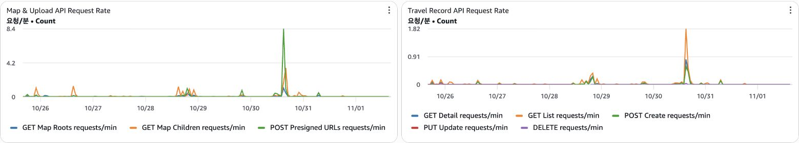
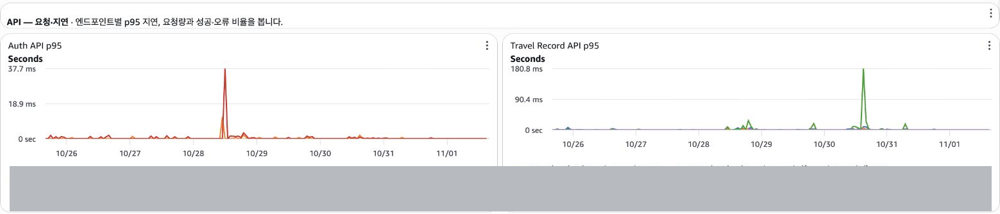
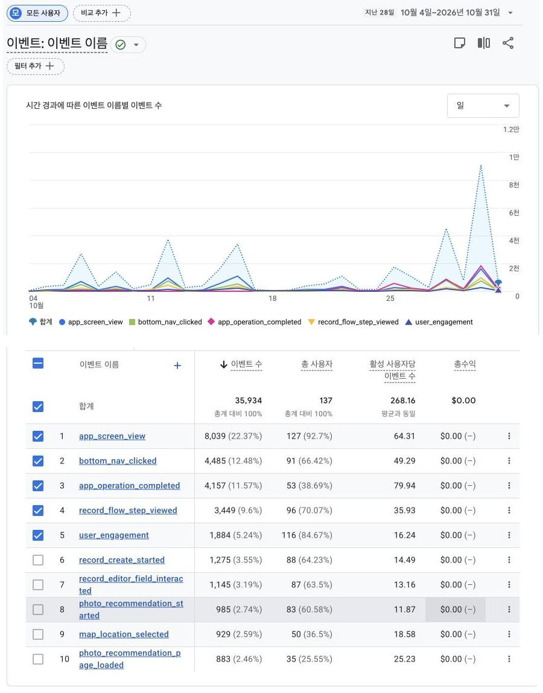

# 서버가 켜져 있는데, 우리 서비스는 괜찮을까? — Mapmory 모니터링 구축기

## 들어가며

Mapmory는 여행 사진을 지도에 모아 기록하는 서비스입니다. 사진첩에서 예전 여행 사진을 일일이 찾거나, 블로그와 노션에 여행 기록을 따로 남겨야 했던 불편함에서 출발했습니다.

서비스를 배포한 뒤에는 다른 고민이 생겼습니다. **서버가 실행되고 있으면 서비스도 잘 동작하고 있는 걸까요?**

서버가 켜져 있어도 장소 검색은 실패할 수 있습니다. 사진을 선택한 사용자가 기록을 끝까지 작성하지 않고 앱을 나갈 수도 있습니다. 서버 실행 여부만으로는 이런 상황을 알 수 없었습니다.

그래서 저는 두 가지를 확인하고 싶었습니다. 요청이 정상적으로 처리되고 있는지, 그리고 사용자가 서비스를 어떻게 이용하는지입니다. 이 글에서는 Mapmory에서 무엇을 관찰하기로 했고, 그 정보로 어떤 문제를 확인했는지 정리합니다. 이제 막 서비스를 운영하며 무엇부터 봐야 할지 고민하는 개발자를 위한 글입니다.

## 1. 서버가 살아 있다는 것과 서비스가 정상이라는 것

처음에는 /health 엔드포인트에 직접 접속해 서버 상태를 확인했습니다. 실행 여부를 확인하기는 쉬웠지만, 제가 접속하지 않는 동안 생긴 문제는 바로 알기 어려웠습니다. 개별 기능이 제대로 동작하는지도 이 화면만으로는 알 수 없었습니다.

실제로 장소 검색 오류는 사용자 테스트(UT)에서 발견했습니다. 서버는 실행 중이었지만 장소를 검색하면 실패했습니다. 로그에는 외부 서비스 설정 누락과 관련된 오류 코드와 503 응답이 남아 있었습니다. 서버가 켜져 있는지와 사용자가 원하는 기능을 쓸 수 있는지는 다른 문제였습니다.

```
logger_name
com.mapmory.backend.common.handler.BusinessExceptionHandler
message
Business exception: code=PLACE_PROVIDER_UNAVAILABLE, status=503, method=GET, uri=/
requestId
52eae3c4-f638-43ab-98e0-e858349d115a
```

사진 업로드도 마찬가지입니다. Mapmory에서는 서버가 업로드용 주소인 Presigned URL을 발급하고, 앱이 그 주소로 S3에 사진을 직접 전송합니다. 주소 발급이 성공했어도 실제 사진 전송은 실패할 수 있습니다. 따라서 서버의 성공 응답만으로 업로드 전체가 정상이라고 판단할 수는 없습니다.

관찰할 대상을 정할 때는 사용자가 서비스를 이용하는 흐름을 먼저 생각했습니다.

| 관점 | 확인하고 싶은 것 | 살펴볼 정보 |
| --- | --- | --- |
| 요청 처리 | 요청이 실패하거나 느려지지 않는가? | 요청량, 오류, 응답 시간 |
| 서버 자원 | 느려지거나 실패했다면 어디를 살펴봐야 하는가? | CPU, 메모리, DB 연결과 로그 |
| 사용자 행동 | 사용자가 기록을 만드는 과정에서 어디까지 진행하는가? | 화면과 주요 행동 이벤트 |

이 세 관점을 함께 봐야 서버의 상태와 사용자의 경험을 연결할 수 있었습니다. 다만 대시보드에 지표를 많이 붙이는 것부터 시작하지는 않았습니다. 지금 우리가 답하고 싶은 질문에 필요한 정보부터 모으기로 했습니다.

## 2. 우리에게 맞는 관찰 도구 고르기

서버 모니터링은 Prometheus와 Grafana를 조합하는 방법부터 살펴봤습니다. 하지만 기존 인스턴스에 Grafana까지 실행하면 메모리에 부담이 될 것 같았습니다. 그렇다고 인스턴스를 하나 더 띄우기에는 정해진 AWS 예산이 부담됐습니다.

그래서 별도 인스턴스를 운영하는 비용과 관리 부담을 고려해 CloudWatch를 선택했습니다. 애플리케이션이 제공하는 지표와 로그를 CloudWatch에 모으고, 요청량과 응답 시간, 서버 자원을 대시보드에 배치했습니다. 문제가 생기면 팀이 알 수 있도록 경보도 연결했습니다.

사용자 행동에는 Firebase Analytics와 PostHog를 사용했습니다. 두 도구를 같은 용도로 연결한 것은 아닙니다. 앱 안에서의 행동과 이탈은 Firebase Analytics의 이벤트로 확인하고, PostHog는 랜딩페이지에 연결했습니다.

| 도구 | 관찰 대상 | 사용 목적 |
| --- | --- | --- |
| CloudWatch | 서버 요청, 자원, 로그 | 실패와 지연을 발견하고 원인을 좁히기 |
| Firebase Analytics | 앱의 화면과 행동 이벤트 | 기록 작성 과정과 이탈 지점 살펴보기 |
| PostHog | 랜딩페이지 | 앱에 들어오기 전의 방문과 행동 살펴보기 |

## 3. 요청이 들어오고, 제대로 처리되고 있을까?

### 요청량: 평소와 무엇이 달라졌는가

요청량은 서버가 얼마나 바쁜지 보는 지표이면서, 다른 지표를 해석하는 기준이기도 합니다. 오류가 늘었을 때도 전체 요청이 함께 늘어난 것인지, 비슷한 요청량에서 실패가 많아진 것인지 구분해야 합니다.

사진 업로드 준비와 지도 조회, 여행 기록 API의 요청량을 나누어 볼 수 있게 했습니다. 전체 요청량만 보면 어느 기능의 사용이 늘었는지 알기 어려웠기 때문입니다.



그림 1. 최근 일주일의 지도&업로드 준비 API와 여행 기록 API 요청량. 요청이 몰리는 시점과 평소의 차이를 확인할 수 있습니다.

10월 30일 무렵 요청이 증가한 구간을 확인했습니다. 이럴 때는 같은 시간의 응답 시간과 오류를 살펴보고, 배포나 테스트가 있었는지도 함께 확인합니다.

또 트래픽이 적은 초기 서비스에서는 짧은 시간만 보면 그래프가 거의 움직이지 않을 수 있습니다. 그래서 지금 상태를 볼 때는 짧은 구간을, 사용 패턴을 살필 때는 하루나 일주일을 보는 식으로 시간 범위를 바꿉니다.

### 응답 시간과 오류: 사용자가 불편을 겪고 있는가

요청이 들어온다는 사실만으로 처리가 잘되고 있는 것은 아닙니다. 그래서 요청량과 함께 응답 시간과 실패를 살펴봅니다. 인증, 여행 기록, 지도와 업로드 준비처럼 기능을 나누어 응답 시간을 볼 수 있게 했습니다.

응답 시간은 p95도 확인합니다. 해당 구간 요청의 약 95%가 이 시간 이내에 처리되었다는 뜻입니다. 평균만 보면 일부 느린 요청이 가려질 수 있어, 느려진 요청이 있는지 살펴보는 데 도움이 됩니다.



그림 2. 최근 일주일의 인증 API와 여행 기록 API p95. 변동 시점의 요청량, 오류와 로그를 함께 확인합니다.

인증 API와 여행 기록 API의 응답 시간이 올라간 시점은 서로 달랐습니다. 그래서 지연이 보이면 먼저 어느 기능에서 변화가 생겼는지 확인하고, 같은 시간의 요청량과 오류를 살펴봅니다.

오류도 건수만 보지 않습니다. 어떤 요청이 실패했고, 전체 요청에서 어느 정도 비중인지 함께 살펴봅니다. 요청이 적으면 오류 한 건의 비율이 크게 보일 수 있습니다. 반대로 비율이 작아도 실제로 기능을 쓰지 못한 사용자가 있을 수 있습니다.

### 자원과 로그: 어디에서 문제가 생겼을까

지연이나 실패를 발견한 다음에는 원인을 좁힐 정보가 필요합니다. CPU와 메모리, 데이터베이스 연결 상태를 같은 시간대에 놓고 봅니다. API가 느린데 CPU에는 여유가 있다면 데이터베이스나 외부 응답을 기다리고 있을 가능성도 살펴봅니다. CPU가 낮다는 이유만으로 정상이라고 결론 내리지는 않습니다.

로그에서는 어떤 요청이 어떤 이유로 실패했는지 확인합니다. 장소 검색 오류 때도 로그의 오류 코드와 메시지가 외부 서비스 설정을 확인할 단서가 되었습니다. 이 문제는 UT에서 발견했으므로, 모니터링이 먼저 찾아냈던 사례라고 말할 수는 없습니다. 대신 서버의 실행 여부만 확인해서는 놓치는 문제가 무엇인지 보여준 경험이었습니다.

개발 환경에서는 로그인 만료 메시지가 한 달 넘게 반복되기도 했습니다. 관련 단서가 DEBUG 수준에 남다 보니 당시 확인하던 로그만으로는 원인을 좁히기 어려웠습니다. 그래서 원인 추적에 필요한 로그 수준을 조정했습니다. 로그가 있다는 것뿐 아니라, 문제가 생겼을 때 필요한 정보를 실제로 확인할 수 있는지도 중요했습니다.

관찰할 때의 순서는 다음처럼 정리했습니다.

| 발견한 변화 | 다음에 함께 볼 것 |
| --- | --- |
| 특정 API의 응답이 느려짐 | 같은 시간의 요청량, 관련 로그와 DB 상태 |
| 오류가 늘어남 | 실패한 기능과 오류 코드, 최근 배포나 설정 변경 |
| DB 연결을 기다리는 요청이 늘어남 | 연결 사용량과 DB 응답 지연 |
| 메모리가 계속 증가함 | 일시적인 증가인지, 시간이 지나도 회복하지 않는지 |

## 4. 초기 서비스에는 초기 서비스에 맞는 경보가 필요했다

대시보드를 만들어도 계속 보고 있을 수는 없습니다. 문제가 생기면 팀이 알아차릴 수 있도록 알림을 연결했습니다. 그런데 처음 정한 경보 기준이 우리 서비스 상황과 맞지 않았습니다.

처음에는 일정 시간 동안 문제가 반복되거나 지속되어야 알림이 오도록 했습니다. 하지만 초기 서비스는 요청이 많지 않았습니다. 사용자가 한 번 오류를 겪어도 같은 문제가 5분 동안 반복되지는 않아, 지속 시간 조건으로는 이를 빠르게 알아차리기 어려웠습니다.

그래서 API 오류와 ERROR 로그는 짧게 발생한 문제도 확인할 수 있게 조건을 민감하게 조정했습니다. 초기에는 오류 한 건도 살펴볼 필요가 있다고 판단했습니다.

| 대상 | 처음의 접근 | 조정한 기준 |
| --- | --- | --- |
| API 오류와 ERROR 로그 | 일정 시간 지속되거나 반복되는 문제를 감지 | 1분 구간에서 발생한 오류도 감지하도록 민감하게 조정 |
| CPU 등 자원 사용량 | 사용량이 높은 상태가 이어지는지 확인 | 순간적인 변동보다 지속 여부를 보는 기준 유지 |

다른 서비스의 경보 기준을 그대로 가져오기보다 우리 서비스의 요청량과 놓치고 싶지 않은 문제를 기준으로 조정해야 했습니다.

또 현재 알림은 오류가 날 때마다 한 통씩 보내는 방식이 아닙니다. 설정한 조건을 만족해 경보 상태로 바뀔 때 팀에 전달되고, 정상으로 돌아왔을 때도 알립니다. 요청이 늘어나면 같은 기준이 너무 많은 알림을 만들 수 있으므로, 서비스가 커지는 만큼 경보도 다시 살펴봐야 합니다.

## 5. 서버는 정상인데 사용자는 어디에서 멈출까?

서버가 정상 응답을 보내더라도 사용자가 여행 기록을 끝까지 만들지 못할 수 있습니다. 그래서 앱 안에서 기록 작성 과정의 주요 행동을 이벤트로 남겼습니다. 앱을 얼마나 실행했는지뿐 아니라 기록을 시작하고, 사진을 고르고, 입력 과정으로 넘어가는 흐름을 보고 싶었습니다.

초기 버전에서는 사진을 선택한 뒤 제목과 날짜를 필수로 입력해야 했습니다. 사용자 입장에서는 사진을 골랐다고 기록이 끝나는 것이 아니었습니다. 이런 과정을 보면서 어디에서 사용자가 멈추는지 확인할 필요를 느꼈고, Firebase Analytics 이벤트로 이탈을 살펴봤습니다.



그림 3. Firebase Analytics에서 확인한 기록 시작, 작성 단계와 사진 추천 이벤트

저는 기록 작성 시작, 작성 단계 조회, 입력 항목 상호작용 같은 이벤트를 남겼습니다. 이 이벤트를 통해 사용자가 기록을 시작한 뒤 어느 단계까지 진행하는지 살펴봤습니다.

같은 사용자가 이벤트를 여러 번 발생시킬 수 있어 단순히 이벤트 수를 나눠 이탈률을 계산하지는 않았습니다. 같은 기간과 사용자 흐름을 기준으로 확인하고, 멈춘 이유는 UT와 사용자 피드백으로 살펴봤습니다.

## 6. 수집한 숫자를 믿기 전에 확인할 것

관찰 도구를 붙인 뒤에는 데이터가 무엇을 포함하는지도 확인해야 했습니다. 개발자가 테스트하며 만든 기록과 요청이 실제 사용자 데이터에 섞이면, 서비스가 어떻게 사용되는지 해석하기 어려워집니다. 그래서 개발과 운영 환경을 나누고 대시보드와 로그도 구분했습니다.

## 마치며

처음에는 서버가 켜져 있는지부터 확인했습니다. 지금은 어떤 요청이 들어오고, 얼마나 걸리고, 어디서 실패하며, 사용자가 어떤 과정에서 멈추는지 살펴봅니다. 대시보드와 로그, 사용자 이벤트가 각각 다른 질문에 답한다는 점을 배웠습니다.

Mapmory에서 모니터링을 구성하며 가장 중요했던 것은 도구를 붙이는 방법보다 관찰할 질문을 정하는 일이었습니다. 초기 서비스의 짧은 오류도 놓치지 않도록 경보를 바꾸고, 필요한 단서를 확인할 수 있도록 로그 수준을 조정한 것도 그 질문에서 출발했습니다.

이제 막 서비스를 운영한다면 지금 모르는 것을 한 가지 골라보면 좋겠습니다. 사용자의 요청이 실패하는지, 기록을 끝까지 만드는지처럼 구체적인 질문이면 됩니다. 그 질문에 필요한 정보를 모으고, 확인한 내용을 다음 행동으로 연결하는 것부터 시작할 수 있습니다.

## 참고 자료

서버 모니터링 분석 가이드 — https://kciter.so/posts/server-monitoring-analysis-guide/
