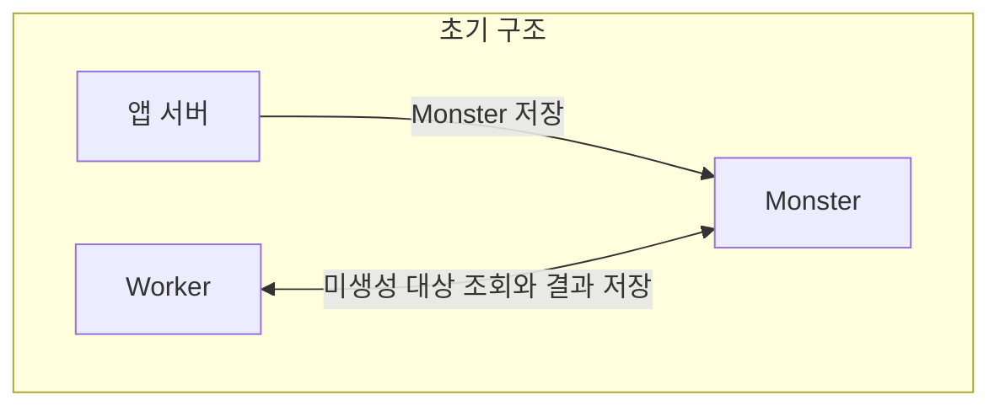
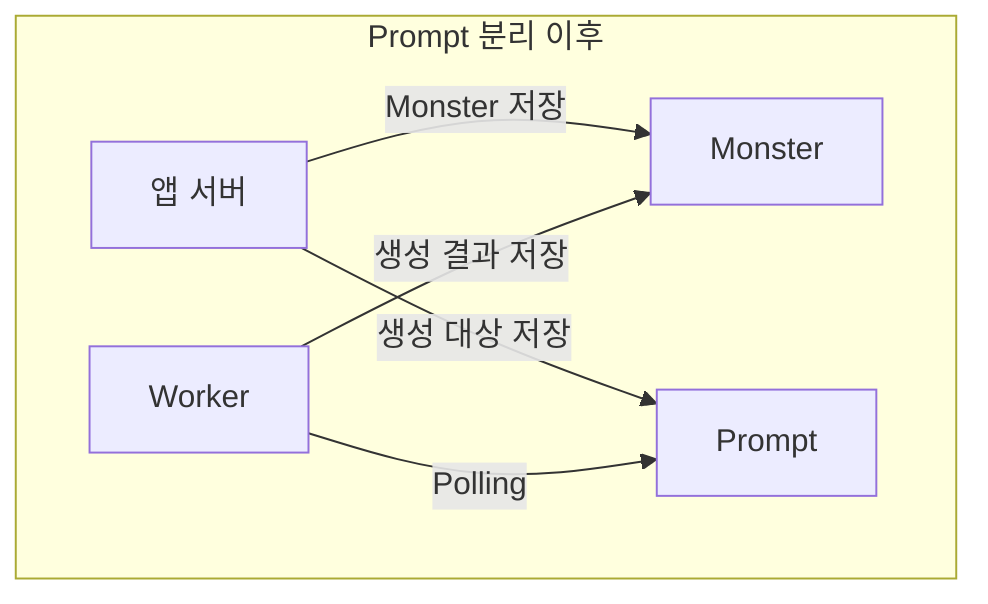
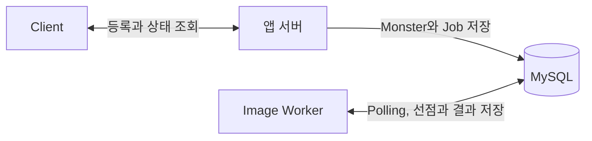
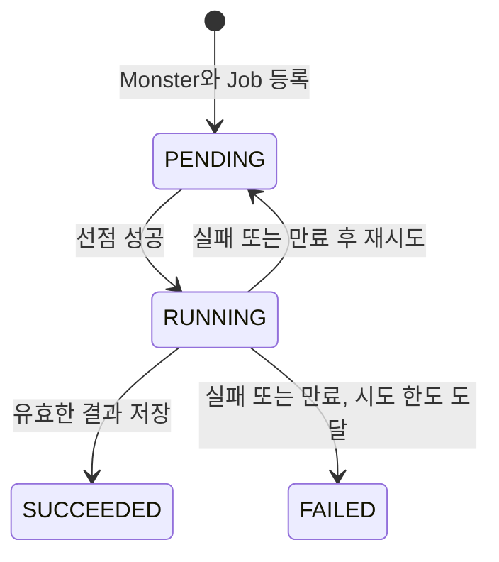
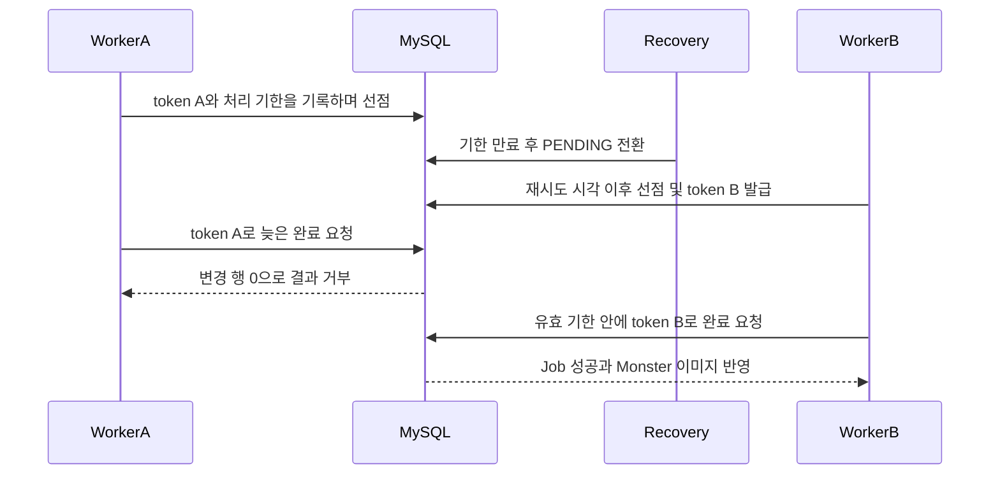
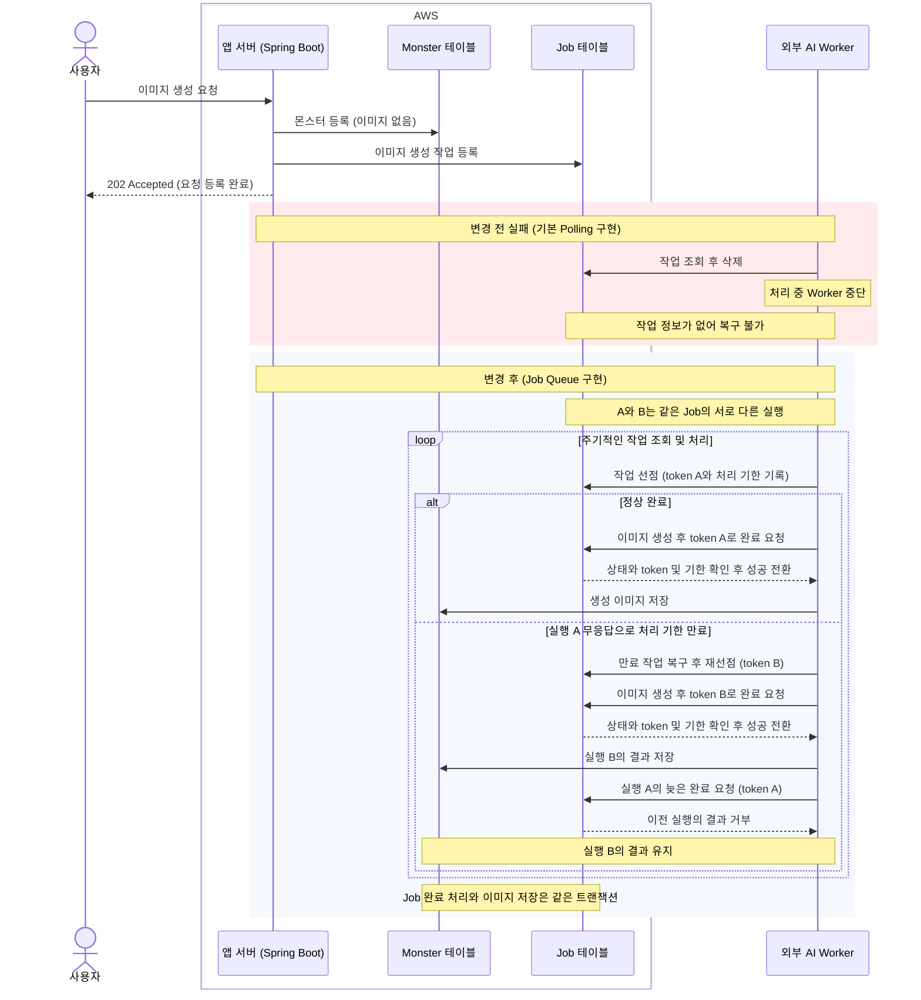

# DB Job Queue로 이미지 생성 작업을 보존하고 복구하기

발표 날 시연 도중 제 서비스가 멈췄습니다.

시연 화면에는 `429 Too Many Requests` 오류가 나타났고 사용자들에게도 같은 응답이 돌아갔습니다. 어설프게 남겨둔 로그만으로는 무슨 일이 일어났는지 파악하기도 어려웠습니다.

당시에는 외부 작업의 완료와 애플리케이션 서버(이하 앱 서버)의 요청 응답을 충분히 분리하지 못했습니다. 일부 요청은 외부 워커의 작업이 끝날 때까지 동기적으로 기다리고 있었습니다. 외부 워커가 결함으로 중단된 뒤 응답을 기다리던 요청들이 타임아웃까지 서버 자원을 점유한 문제라고 결론을 내렸습니다.

만약 지금 다시 만든다면 외부 워커가 멈춰도 앱 서버는 작업을 등록하고 응답할 수 있어야 한다고 생각했습니다. 접수한 작업은 남아 있어야 하고 다시 처리할 수 있어야 했습니다. 이 글에서는 그 기준으로 DB Job Queue를 설계하고 검증한 과정을 정리했습니다.

## 목차

1. 서비스가 멈춘 뒤 돌아본 구조
2. DB Job Queue를 선택한 이유
3. DB Job Queue에 추가한 신뢰성 규칙
4. 실패 복구와 300건 처리 검증
5. 운영에 적용하기 전에 확인할 제약
6. 마치며

## 1. 서비스가 멈춘 뒤 돌아본 구조

### 1-1. 당시 구조와 대응

커켓몬은 사용자가 입력한 프롬프트로 나만의 몬스터 이미지를 만들고 배틀하는 서비스였습니다. 2025년 행사에서는 35명의 사용자로부터 약 300건의 이미지 생성 요청이 들어왔습니다. 별도의 이미지 생성 서버(이하 Worker)는 이미지가 없는 `Monster`를 주기적으로 조회하고 생성 결과를 같은 DB에 기록했습니다. 이런 주기적 조회 방식을 Polling이라고 합니다.

장애 이후에는 생성 대상을 별도의 `Prompt` 테이블로 분리했습니다. 프론트의 디바운스와 계정당 하루 10개 생성 제한도 함께 적용했고 최종 발표에서는 이전과 비슷한 규모의 요청을 처리할 수 있었습니다.





그림은 당시 테이블의 역할과 데이터 흐름을 요약한 개념도입니다. 여러 변경을 함께 적용했고 작업별 처리 결과를 측정하지 않아 각 변경의 효과와 작업 유실 및 중복 여부는 확인하지 못했습니다.

### 1-2. 검증할 실패 상황

이번에는 과거 방식을 참고한 기본 Polling 구현에서 실패를 재현하고 신뢰성 규칙을 추가한 Job Queue를 구현했고 같은 조건으로 검증했습니다. 이미지 생성 작업 한 건은 Job이라고 하겠습니다. 과거에 확인한 스케줄러 중단과 함께 다음 상황도 고려해 봤습니다.

1. **등록 비원자성:** `Monster` 저장 후 Job 등록이 실패하면 생성 작업이 없는 `Monster`가 남을 수 있었습니다.
2. **중복 선점:** 여러 Worker가 같은 Job을 조회하고 실행하면 이미지 생성이 중복될 수 있었습니다.
3. **작업 유실:** 처리 전에 작업 행을 삭제하고 Worker가 멈추면 복구할 행이 남아 있지 않았습니다.
4. **결과 오연결:** Job ID를 `Monster` ID처럼 사용하면 다른 `Monster`에 결과가 저장될 수 있었습니다.
5. **스케줄러 중단:** 한 작업의 예외로 주기적인 조회가 중단되면 이후 Job도 처리되지 않을 수 있었습니다.

스케줄러 중단 외의 사례는 현재 실험 구현에서 검증한 잠재적 실패이며 당시 운영에서 발생했는지는 확인하지 못했습니다.

## 2. DB Job Queue를 선택한 이유

DB Job Queue를 선택한 이유는 작업을 보존하면서 `Monster`와 Job을 같은 트랜잭션으로 등록할 수 있기 때문입니다. 둘 중 하나만 저장되는 상황도 막아야 했습니다.

당시 Worker는 연구실의 로컬 컴퓨터에서 실행했고 앱 서버에서 직접 호출할 수 없었습니다. RabbitMQ와 같은 추가 인프라도 학습에 드는 시간과 운영 부담 때문에 도입하기 어려웠습니다. 이번 실험에서도 이 제약을 그대로 유지했습니다.

작업 보존과 등록 원자성 및 운영 비용을 기준으로 네 가지 방식을 비교했습니다.

| 방식 | 이번 조건에서 고려한 점 | 판단 |
| --- | --- | --- |
| 별도 작업 저장소 없는 `@Async` | 실행 요청을 메모리에만 두면 프로세스 종료 후 복구할 수 없어 별도 저장과 복구 규칙이 필요합니다. | 거부 |
| 앱 서버 → Worker 직접 HTTP 호출 | Worker를 직접 호출할 수 없고 DB 저장과 원격 접수 사이의 실패 처리도 필요합니다. | 거부 |
| DB Job Queue | 기존 MySQL에 작업을 보존하고 `Monster`와 Job을 같은 트랜잭션으로 등록할 수 있습니다. | 채택 |
| 메시지 브로커 | 작업 전달을 맡길 수 있지만 DB 저장과 메시지 발행의 연계 및 추가 인프라 운영이 필요합니다. | 보류 |

방식별 처리량을 측정한 비교는 아닙니다. DB Job Queue를 사용하더라도 Polling 조회 비용과 선점 및 복구 규칙은 직접 관리해야 했습니다.

## 3. DB Job Queue에 추가한 신뢰성 규칙

### 3-1. 요청 등록과 작업 실행 분리

Java와 Spring Boot 및 JPA로 앱 서버와 Worker를 구현하고 각각 별도 JVM으로 실행했습니다. 두 프로세스는 MySQL만 공유합니다. `Monster`에는 도메인 정보와 이미지를 저장하고 Job에는 생성 작업의 상태와 실행 정보를 저장했습니다.

앱 서버는 `POST /jobs`로 받은 프롬프트를 등록한 뒤 `202 Accepted`와 작업 ID(`jobId`) 및 몬스터 ID(`monsterId`)를 반환합니다. 이 응답은 작업 접수가 완료됐다는 의미이며 상태와 결과는 `GET /jobs/{jobId}`로 조회합니다. Worker는 HTTP 서버를 열지 않고 DB에서 Job을 가져와 실행합니다. 실제 AI 모델 대신 일정 시간 뒤 `image:{prompt}`를 반환하는 모의 생성기(Generator)를 사용했습니다.



### 3-2. Monster와 Job의 원자적 등록

기본 Polling 구현에서는 `Monster`를 저장한 뒤 Job 등록에 실패하면 생성할 작업이 없는 `Monster`가 남았습니다. Job Queue 구현에서는 두 등록을 같은 트랜잭션으로 묶어 Job 저장이 실패하면 `Monster`도 함께 롤백되도록 했습니다.

Job에는 결과 대상인 `Monster`의 `monster_id`를 기록하고 결과 저장에도 이 값을 사용했습니다. 서로 다른 테이블의 ID가 암묵적으로 같다는 가정에 의존하지 않도록 한 것입니다.

### 3-3. 상태 기반 작업 보존

기본 Polling 구현에서는 요청 행을 삭제한 뒤 Generator를 호출했습니다. 이 때문에 삭제 이후 생성 중에 예외가 발생하면 다시 처리할 행을 찾을 수 없었습니다.

Job Queue 구현에서는 행을 보존하고 네 가지 상태로 처리 과정을 나타냈습니다. `PENDING`은 대기 중인 작업이고 `RUNNING`은 Worker가 처리 권한을 얻은 작업입니다. 결과 저장에 성공하면 `SUCCEEDED`로 바꾸고 더 시도할 수 없는 실패는 `FAILED`로 종결합니다.



종결된 Job도 남겨 최종 상태와 시도 횟수 및 실패 사유를 조회할 수 있도록 했습니다.

### 3-4. 조건부 UPDATE를 통한 선점

여러 Worker가 같은 대기 작업을 조회할 수 있으므로 후보 조회와 선점을 나눴습니다. 선점은 Job을 처리할 권한을 얻는 과정입니다. `PENDING`에서 `RUNNING`으로 상태를 바꾸는 데 성공한 Worker만 Generator를 호출하도록 했습니다.

아래는 선점에 사용한 JPQL입니다.

```sql
update ImageGenerationJobEntity job
   set job.status = :running,
       job.claimToken = :token,
       job.deadlineAt = :deadline,
       job.attemptCount = job.attemptCount + 1,
       job.startedAt = :now,
       job.finishedAt = null
 where job.id = :jobId
   and job.status = :pending
   and job.nextAttemptAt <= :now
   and job.attemptCount < :maxAttempts
```

대기 상태이면서 재시도 시각이 됐고 시도 한도에 도달하지 않은 Job만 선점합니다. 변경한 행이 1개이면 실행 권한을 얻지만 0개이면 실행하지 않습니다. 이때 새로운 실행 식별자인 `claimToken`과 처리 기한인 `deadlineAt`을 기록하고 시도 횟수도 증가시킵니다.

UPDATE의 레코드 잠금을 이미지 생성 내내 유지하지 않도록 선점 트랜잭션은 먼저 커밋하고 Generator는 트랜잭션 밖에서 호출했습니다.

### 3-5. 만료 작업의 복구와 재시도

Worker가 오류로 인해 완료나 실패를 기록하지 못하면 Job은 `RUNNING`에 남습니다. 별도의 복구 작업이 처리 기한이 지난 Job을 주기적으로 조회하고 재시도 여유가 있으면 `PENDING`으로 돌립니다. 재시도 간격을 더한 다음 실행 가능 시각은 `nextAttemptAt`에 기록했습니다. 시도 한도를 채운 상태에서 실패하거나 기한이 만료되면 `FAILED`로 두어 더 이상 시도하지 않습니다.

복구 대상을 조회한 뒤에도 상태가 바뀔 수 있으므로 UPDATE에서 현재 상태와 token 및 시도 횟수와 기한 만료 조건을 다시 확인했습니다. 조회 당시의 정보로 이미 완료됐거나 재선점된 작업을 바꾸지 않도록 한 것입니다.

### 3-6. claimToken으로 오래된 결과 거부

같은 Job을 다시 선점하면 새로운 `claimToken`을 발급합니다. 이전 Worker의 생성이 뒤늦게 끝나더라도 그 실행의 token으로는 현재 결과를 바꿀 수 없어야 합니다.



완료 UPDATE는 `RUNNING` 상태와 현재 `claimToken` 및 `deadlineAt > now`를 함께 검사합니다. 변경한 행이 0개이면 이미지도 갱신하지 않습니다. Job의 성공 전환과 `Monster`의 이미지 저장은 같은 트랜잭션으로 묶어 이미지 갱신이 실패하면 성공 전환도 롤백되도록 했습니다.

### 3-7. 작업 단위 예외 격리

Worker는 생성이나 완료 처리에서 예외가 발생하면 해당 Job의 실패 전환을 시도합니다. 실패 기록마저 저장하지 못하면 오류를 로그에 남기고 보존된 `RUNNING` 상태와 처리 기한을 통해 만료 복구가 다시 접근하도록 했습니다.

주기적인 작업 조회와 만료 복구의 경계에서도 `RuntimeException`을 기록해 다음 주기에 다시 실행하도록 했습니다. 이미지 생성용 실행 풀은 이 스케줄러와 분리하고 실행 여유를 확보한 뒤 선점하도록 구성했습니다. 긴 생성 작업이 다음 작업의 조회까지 막지 않게 하려는 목적입니다.

## 4. 실패 복구와 300건 처리 검증

기본 Polling 구현의 실패 상황과 Job Queue 구현의 성공 상황을 MySQL 통합 테스트로 검증했습니다.

### 4-1. 작업 실패 후 후속 처리

모의 Generator가 첫 작업에서 예외를 던지게 한 뒤 후속 작업을 등록했습니다. 기본 Polling 구현에서는 후속 작업이 완료되지 않았지만 Job Queue 구현에서는 정상 완료됐습니다. 과거에 겪었던 스케줄러 중단을 출발점으로 한 작업의 실패가 이후 처리까지 막지 않는지 확인한 것입니다.

### 4-2. 무응답 복구와 오래된 결과 거부

완료나 실패를 기록하지 않는 `RUNNING` Job을 만들고 처리 기한을 넘긴 뒤 복구를 실행했습니다. 재선점한 실행의 완료는 성공했고 이전 token으로 보낸 늦은 완료 요청은 거부됐습니다. 이 검증은 DB에 남은 무응답 상태의 복구를 검증한 것입니다.

이 두 사례에 등록 실패 롤백과 동시 선점 및 결과 연결을 더한 다섯 가지 회귀 검증이 통과했습니다. 이미지 저장 실패 시 Job의 성공 전환이 롤백되는 조건도 추가로 확인했습니다.

### 4-3. 300건 정상 부하 검증

별도 측정 프로그램이 HTTP로 등록한 Job과 DB의 최종 결과를 대조했습니다. Worker 프로세스 하나의 동시 처리 상한은 8개로 두고 생성 대신 작업당 5초를 기다리도록 했습니다. 등록 요청은 최대 35개를 동시에 보내 총 300건을 전송했습니다.

300건은 모두 성공했고 접수 시작부터 마지막 작업 완료까지 193.639초가 걸렸습니다. 접수한 작업의 누락이나 결과 오연결은 발견되지 않았고 각 프롬프트에 맞는 이미지가 저장된 것도 확인했습니다.

## 5. 운영에 적용하기 전에 확인할 제약

이처럼 300건 검증을 마쳤다고 운영에서도 안전하게 동작한다고 단정할 수는 없습니다. 실제 운영에 적용하기 전에 확인해야 할 제약들이 남아 있습니다.

### 5-1. 작업 대기와 접수 제한

첫 번째로, 빠른 접수 응답 뒤에도 남는 작업 대기가 있습니다. 300건 측정에서 HTTP 접수 응답 시간의 p95는 160ms였지만 생성 시작 전 대기 시간의 p95는 178.087초였습니다. p95는 측정값을 작은 순서로 정렬했을 때 95% 지점의 값입니다.

한 번에 실행할 수 있는 작업이 8개로 제한돼 나머지는 차례를 기다렸죠. 접수는 빨리 끝나도 일부 작업은 이미지를 만들기 시작하기까지 약 3분을 기다렸다는 뜻입니다.

Worker가 이미지를 생성하는 속도보다 빠르게 요청이 계속 들어오면 작업을 보존하더라도 대기 시간은 길어집니다. 등록 경로에 대기 Job 수에 따른 새로운 등록 제한을 고려해야 합니다.

실제로 같은 Worker 실행 상한과 모의 생성 지연으로 요청 1,500건을 180초 구간에 투입해 봤습니다. 작업 대기의 p95는 734.125초였고 관측한 최대 `PENDING`은 1,212건이었습니다. 운영에서는 실제 생성 시간을 바탕으로 사용자가 기다릴 수 있는 시간을 정하고 그에 맞춰 동시 처리 상한과 접수 제한을 검토해야 합니다.

### 5-2. 작업 복구와 실행 자원 반환

두 번째로, DB에서 작업을 다시 대기 상태로 돌려도 이미 실행 중인 이미지 생성은 계속될 수 있습니다. **claimToken은 이전 실행의 결과 저장을 막지만 이미지 생성 자체를 멈추지는 않습니다.** 따라서 재시도와 이전 실행이 겹치면 같은 Job의 이미지 생성을 여러 번 실행해 자원을 더 사용할 수 있습니다.

예를 들어 최대 8개를 동시에 처리하는 Worker에서 호출 하나가 끝나지 않으면 그 호출이 계속 한 자리를 차지합니다. Job을 `PENDING`으로 바꿔도 그 자리가 비워지는 것은 아닙니다. 실제 생성 API를 연결할 때는 타임아웃이나 취소 이후 Worker가 그 자리에 다른 작업을 실행할 수 있는지도 확인해야 합니다.

### 5-3. 처리 기한과 재시도 설정

세 번째로, 실제 생성 시간에 맞는 처리 기한 설정이 필요합니다. 이번 측정에서는 처리 기한 30초와 재시도 간격 1초를 적용하고 최초 선점을 포함해 최대 3회 시도하도록 했습니다. 기한이 짧으면 정상 작업도 만료돼 생성 비용이 추가될 수 있고 길면 무응답 작업의 복구가 늦어집니다.

운영에서는 실제 생성 시간 분포와 실패 유형에 맞춰 조정해야 합니다. 재시도 설정에서 고려할 점은 [AWS의 타임아웃과 재시도, 백오프와 지터 설명](https://aws.amazon.com/builders-library/timeouts-retries-and-backoff-with-jitter/)도 참고할 수 있습니다.

### 5-4. Polling과 작업 보존 비용

네 번째로, Polling 조회와 작업 보존의 비용을 고려해야 합니다. 작업 조회와 만료 복구의 기본 간격은 각각 100ms입니다. 작업이 없어도 조회가 발생하며 Worker를 추가하면 DB 조회와 같은 후보를 두고 경쟁하는 비용이 늘어납니다. 완료된 Job도 보존하므로 누적 행 수와 조회 시간을 관찰하고 보존 기간을 정해야 합니다.

조회 비용이 업무 DB에 부담을 주면 Polling 간격과 인덱스를 점검하고 작업 전달을 분리할지도 검토해야 합니다. 브로커를 선택하더라도 중복 전달에 대응할 규칙은 필요합니다. [RabbitMQ의 신뢰성 가이드](https://www.rabbitmq.com/docs/reliability)도 장애 뒤 재전달 가능성을 설명합니다.

## 6. 마치며

다음은 사용자 요청부터 응답까지 그리고 기존 Polling 구조와 현재 DB Job Queue 구조를 정리한 시퀀스 다이어그램입니다.



이번 작업을 하면서 외부 시스템의 장애가 서비스 전체로 번지지 않도록 경계를 설계하는 방법과 그 중요성을 배웠습니다. 요청 응답과 작업 실행을 분리하고 실패한 작업을 보존해 복구할 수 있게 만드는 과정을 경험했습니다.

또한 이런 규칙은 운영에서 문제가 드러나기 전에 테스트와 모의실험으로 먼저 검증해야 한다는 점을 느꼈습니다. 앞으로도 외부 시스템과 연계할 때는 무응답과 늦은 결과 같은 실패 조건을 미리 생각해 보고, 기대한 대로 복구하거나 결과를 거부하는지 확인하려고 합니다.
