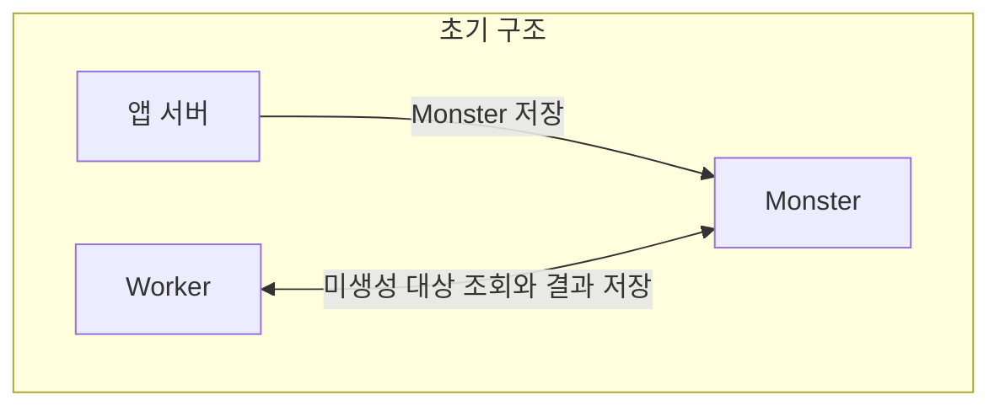
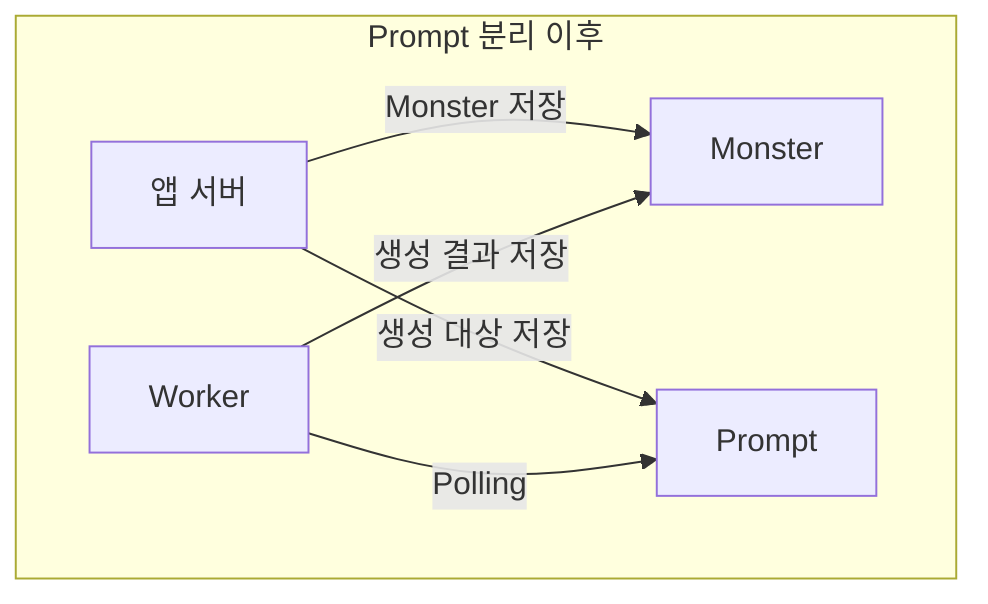
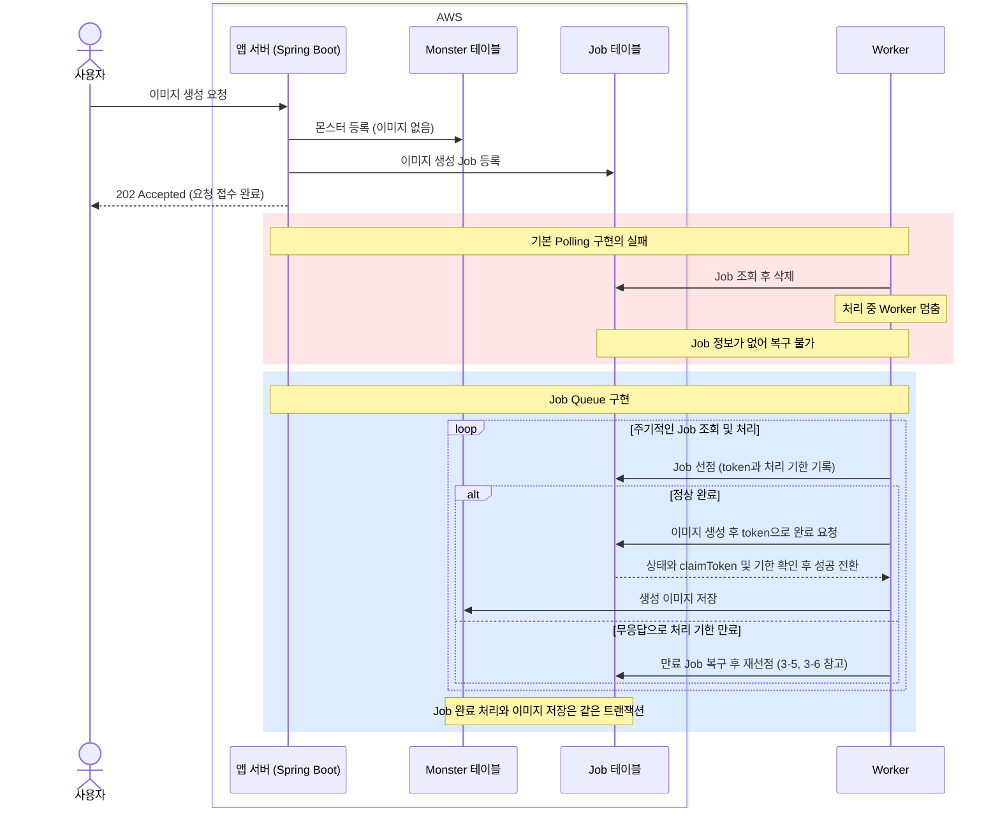
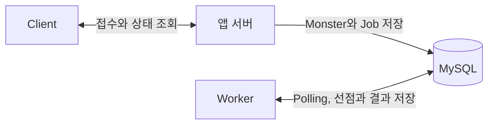
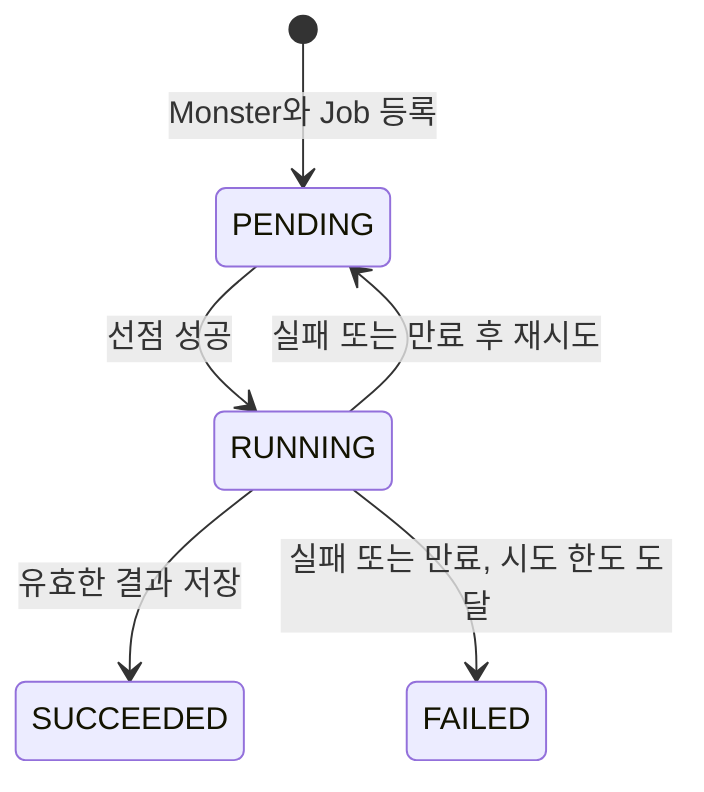
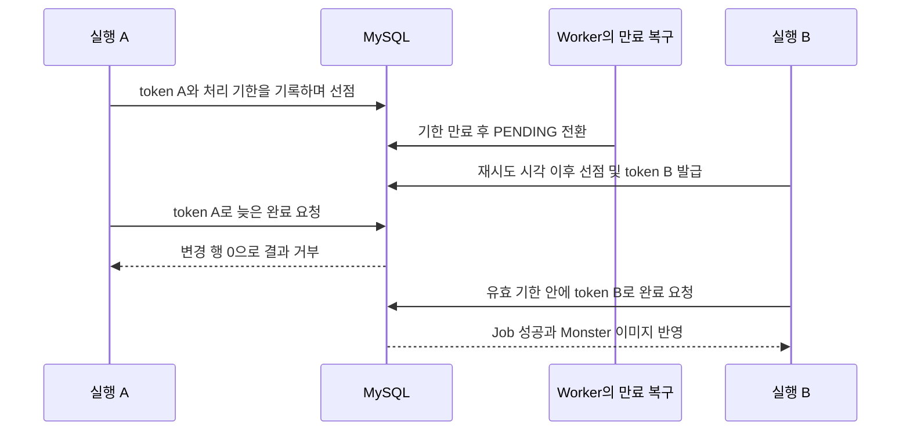

# DB Job Queue로 이미지 생성 작업을 보존하고 복구하기

프로젝트 중간 발표에서 서비스를 시연하던 도중 핵심 기능이 멈췄습니다. 프롬프트를 입력하면 커스터마이징 몬스터, 줄여서 '커켓몬'의 이미지를 생성해 주는 기능이었습니다.

사용자가 몬스터 생성을 요청하면 프런트엔드는 약 10초 뒤 결과를 조회했고, 이미지가 없으면 "커켓몬이 도망쳤다"는 실패 문구를 보여 줬습니다. 참석자들이 직접 서비스를 쓰기 시작하자 이미지 생성이 점점 밀렸고, 실패를 본 사용자들이 다시 요청하면서 대기는 더 늘었습니다. 그러다 외부 이미지 생성 서버(이하 Worker)가 이미지 생성 중 멈췄고 쌓인 요청은 발표가 끝날 때까지 이미지 없이 프롬프트만 남았습니다.

Worker가 멈춘 원인은 확인하지 못했지만, 더 큰 문제는 시스템이 그 상황을 알 수 없었다는 점이었습니다. 애플리케이션 서버(이하 앱 서버)는 이미지가 비어 있는 몬스터를 DB에 저장할 뿐 처리 상태를 남기지 않아 요청이 대기 중인지, 처리 중인지, 멈췄는지 구분할 수 없었습니다. 프런트엔드는 고정된 시간으로 실패를 추측했고, 시스템에는 멈춘 작업을 자동으로 감지해 다시 처리할 수단도 없었습니다.

만약 당시와 같은 환경에서 지금 다시 만든다면 작업의 상태를 DB에 남겨 조회할 수 있게 하고, 멈춘 작업을 찾아 다시 처리할 수 있어야 한다고 생각했습니다. 이 글에서는 실제 서비스를 고치는 대신 실험용 구현을 따로 만들어, 그 기준으로 DB Job Queue를 설계하고 검증한 과정을 정리했습니다.

## 목차

1. 이미지 생성이 멈춘 뒤 돌아본 구조
2. DB Job Queue를 선택한 이유
3. DB Job Queue에 추가한 신뢰성 규칙
4. 실패 복구와 300건 처리 검증
5. 운영에 적용하기 전에 확인할 제약
6. 마치며

## 1. 이미지 생성이 멈춘 뒤 돌아본 구조

### 1-1. 당시 구조와 대응

2025년 중간 발표에서는 35명의 사용자로부터 약 300건의 이미지 생성 요청이 들어왔습니다. 별도 서버인 Worker는 이미지가 없는 `Monster`를 주기적으로 조회하고 생성 결과를 같은 DB에 기록했습니다. 이런 주기적 조회 방식을 Polling이라고 합니다.

장애 이후에는 생성 대상을 별도의 `Prompt` 테이블로 분리했습니다. 프런트엔드의 디바운스와 계정당 하루 10개 생성 제한도 함께 적용했고 최종 발표에서는 이전과 비슷한 규모의 요청을 처리할 수 있었습니다.





그림은 당시 테이블의 역할과 데이터 흐름을 요약한 개념도입니다. 여러 변경을 함께 적용했고 작업별 처리 결과를 측정하지 않아 각 변경의 효과와 작업 유실 및 중복 여부는 확인하지 못했습니다. 이 대응은 요청 수를 줄이고 조회 대상을 좁혔지만, 요청의 상태를 구분하거나 멈춘 작업을 자동으로 복구하는 방법은 여전히 없었습니다.

### 1-2. 검증할 실패 상황

이번에는 별도 테이블을 Polling하는 구조만 가져와 실험용 구현을 새로 만들었습니다. 3장의 신뢰성 규칙을 넣지 않은 이 구현을 기본 Polling 구현이라고 부르겠습니다. 이 구현에서 실패를 재현한 뒤 신뢰성 규칙을 추가한 Job Queue를 구현해 실패 상황별로 비교했습니다. 이미지 생성 작업 한 건은 Job이라고 하겠습니다. 도입부에서 말한 상태 구분 문제와 실패 추측, 복구 수단의 부재는 각각 3-3, 3-1, 3-5에서 다룹니다. 기본 Polling 구현에서 Job이 등록, 선점, 실행, 결과 저장, 반복 조회를 거치는 동안 깨질 수 있는 지점은 다음과 같습니다.

1. **등록 비원자성:** `Monster` 저장 후 Job 등록이 실패하면 Job이 없는 `Monster`가 남을 수 있었습니다.
2. **중복 선점:** 여러 Worker가 같은 Job을 조회하고 실행하면 이미지 생성이 중복될 수 있었습니다.
3. **Job 유실:** 처리 전에 Job 행을 삭제하면 생성이 실패하거나 Worker가 멈췄을 때 복구할 행이 남아 있지 않았습니다.
4. **결과 오연결:** Job ID를 `Monster` ID처럼 사용하면 다른 `Monster`에 결과가 저장될 수 있었습니다.
5. **스케줄러 중단:** 한 Job의 예외로 주기적인 조회가 중단되면 이후 Job도 처리되지 않을 수 있었습니다.

다섯 가지는 기본 Polling 구현에서 재현한 실패입니다. `Prompt` 분리 이후의 당시 코드는 `Monster`와 `Prompt`를 한 트랜잭션에 저장하고 같은 ID를 썼으며, 결과를 저장한 뒤 행을 지웠고 예외가 나도 반복을 이어 갔습니다. 다섯 가지 중 당시 구조에서도 생길 수 있었던 것은 Worker를 늘렸을 때의 중복 선점뿐입니다. 따라서 4-1의 결과는 당시 코드보다 나아졌다는 근거가 아니라, 각 규칙이 빠졌을 때 어떤 실패가 나는지 보여 주는 근거입니다. 당시 코드와 실제로 달라진 핵심은 상태 구분과 처리 기한을 이용한 멈춤 감지, 시도 한도입니다.

## 2. DB Job Queue를 선택한 이유

DB Job Queue는 처리할 Job을 DB 테이블의 행으로 저장하고, Worker가 그 행을 조회해 처리하는 방식입니다. 별도의 메시지 브로커 없이 기존 DB를 큐처럼 사용합니다. 이 글에서는 기본 Polling 구현에 3장의 신뢰성 규칙을 더한 구현을 Job Queue 구현이라고 부릅니다.

DB Job Queue를 선택한 이유는 Job을 보존할 수 있고, `Monster`와 같은 트랜잭션으로 등록해 Job 없는 `Monster`가 남지 않게 할 수 있기 때문입니다.

당시 Worker는 연구실의 로컬 컴퓨터에서 실행했고 앱 서버에서 직접 호출할 수 없었습니다. RabbitMQ와 같은 추가 인프라도 학습에 드는 시간과 운영 부담 때문에 도입하기 어려웠습니다. 이번 실험에서도 이 제약을 그대로 유지했습니다.

Job 보존과 등록 원자성 및 운영 비용을 기준으로 네 가지 방식을 비교했습니다.

| 방식 | 이번 조건에서 고려한 점 | 판단 |
| --- | --- | --- |
| 별도 작업 저장소 없는 `@Async` | 실행 요청을 메모리에만 두면 프로세스 종료 후 복구할 수 없어 별도 저장과 복구 규칙이 필요합니다. | 거부 |
| 앱 서버 → Worker 직접 HTTP 호출 | Worker를 직접 호출할 수 없고 DB 저장과 원격 접수 사이의 실패 처리도 필요합니다. | 거부 |
| DB Job Queue | 기존 MySQL에 Job을 보존하고 `Monster`와 같은 트랜잭션으로 등록할 수 있습니다. | 채택 |
| 메시지 브로커 | 작업 전달을 맡길 수 있지만 DB 저장과 메시지 발행의 연계 및 추가 인프라 운영이 필요합니다. | 보류 |

방식별 처리량을 측정한 비교는 아닙니다. DB Job Queue를 사용하더라도 Polling 조회 비용과 선점 및 복구 규칙은 직접 관리해야 했습니다.

## 3. DB Job Queue에 추가한 신뢰성 규칙

다음은 사용자 요청부터 응답까지의 흐름을 기본 Polling 구현과 Job Queue 구현으로 나누어 정리한 시퀀스 다이어그램입니다. 그림에 나오는 선점과 `claimToken`, 처리 기한은 3-4부터 3-6까지에서 차례로 설명합니다.



### 3-1. 요청 접수와 Job 실행 분리

Java와 Spring Boot 및 JPA로 앱 서버와 Worker를 구현하고 각각 별도 JVM으로 실행했습니다. 두 프로세스는 MySQL만 공유합니다. `Monster`에는 도메인 정보와 이미지를 저장하고 Job에는 이미지 생성의 상태와 실행 정보를 저장했습니다.

앱 서버는 `POST /jobs`로 받은 프롬프트를 등록한 뒤 `202 Accepted`와 Job ID(`jobId`) 및 몬스터 ID(`monsterId`)를 반환합니다. 이 응답은 Job 접수가 완료됐다는 의미이며 상태와 결과는 `GET /jobs/{jobId}`로 조회합니다. Worker는 HTTP 서버를 열지 않고 DB에서 Job을 가져와 실행합니다. 실제 AI 모델 대신 일정 시간 뒤 `image:{prompt}`를 반환하는 모의 생성기(Generator)를 사용했습니다.



### 3-2. Monster와 Job의 원자적 등록

기본 Polling 구현에서는 `Monster`를 저장한 뒤 Job 등록에 실패하면 생성할 Job이 없는 `Monster`가 남았습니다. Job Queue 구현에서는 두 등록을 같은 트랜잭션으로 묶어 Job 저장이 실패하면 `Monster`도 함께 롤백되도록 했습니다.

Job에는 결과 대상인 `Monster`의 `monsterId`를 기록하고 결과 저장에도 이 값을 사용했습니다. 서로 다른 테이블의 ID가 암묵적으로 같다는 가정에 의존하지 않도록 한 것입니다.

### 3-3. 상태 기반 Job 보존

기본 Polling 구현에서는 Job 행을 삭제한 뒤 Generator를 호출했습니다. 이 때문에 삭제 이후 생성 중에 예외가 발생하면 다시 처리할 행을 찾을 수 없었습니다.

Job Queue 구현에서는 행을 보존하고 네 가지 상태로 처리 과정을 나타냈습니다. `PENDING`은 대기 중인 Job이고 `RUNNING`은 Worker가 처리 권한을 얻은 Job입니다. 결과 저장에 성공하면 `SUCCEEDED`로 바꾸고 더 시도할 수 없는 실패는 `FAILED`로 종결합니다.



종결된 Job도 남겨 최종 상태와 시도 횟수 및 실패 사유를 조회할 수 있도록 했습니다. 처리에 쓰는 주요 필드는 다음과 같습니다.

| 필드 | 역할 |
| --- | --- |
| `monsterId` | 결과를 저장할 `Monster` |
| `status` | 현재 처리 상태 |
| `attemptCount` | 선점할 때마다 늘어나는 시도 횟수 |
| `nextAttemptAt` | 선점할 수 있는 가장 이른 시각 |
| `deadlineAt` | 현재 실행의 처리 기한 |
| `claimToken` | 현재 실행의 식별자 |

대기 Job과 만료 Job을 찾는 조회에는 각각 `status`와 시각 필드를 묶은 인덱스를 두었습니다.

### 3-4. 조건부 UPDATE를 통한 선점

여러 Worker가 같은 대기 Job을 조회할 수 있으므로 후보 조회와 선점을 나눴습니다. 선점은 Job을 처리할 권한을 얻는 과정입니다. `PENDING`에서 `RUNNING`으로 상태를 바꾸는 데 성공한 Worker만 Generator를 호출하도록 했습니다.

아래는 선점에 사용한 JPQL입니다.

```sql
update ImageGenerationJobEntity job
   set job.status = :running,
       job.claimToken = :token,
       job.deadlineAt = :deadline,
       job.attemptCount = job.attemptCount + 1,
       job.startedAt = :now,
       job.finishedAt = null
 where job.id = :jobId
   and job.status = :pending
   and job.nextAttemptAt <= :now
   and job.attemptCount < :maxAttempts
```

대기 상태이면서 재시도 시각이 됐고 시도 한도에 도달하지 않은 Job만 선점합니다. 변경한 행이 1개이면 실행 권한을 얻지만 0개이면 실행하지 않습니다.

UPDATE의 레코드 잠금을 이미지 생성 내내 유지하지 않도록 선점 트랜잭션은 먼저 커밋하고 Generator는 트랜잭션 밖에서 호출했습니다.

### 3-5. 만료 Job의 복구와 재시도

Worker가 오류로 인해 완료나 실패를 기록하지 못하면 Job은 `RUNNING`에 남습니다. Worker 프로세스 안에서 도는 별도 주기 작업이 처리 기한이 지난 Job을 주기적으로 조회하고 재시도 여유가 있으면 `PENDING`으로 돌립니다. 재시도 간격을 더한 다음 실행 가능 시각은 `nextAttemptAt`에 기록했습니다. 시도 한도를 채운 상태에서 실패하거나 기한이 만료되면 `FAILED`로 두어 더 이상 시도하지 않습니다.

복구 대상을 조회한 뒤에도 상태가 바뀔 수 있으므로 UPDATE에서 현재 상태와 `claimToken` 및 시도 횟수와 기한 만료 조건을 다시 확인했습니다. 조회 당시의 정보로 이미 완료됐거나 재선점된 Job을 바꾸지 않도록 한 것입니다.

처리 기한도 시간으로 판단한다는 점은 당시 프런트엔드와 같습니다. 다만 추측에서 끝나지 않고 기한이 지난 Job을 다시 처리하며, 늦게 도착한 결과는 3-6의 규칙으로 거부합니다.

### 3-6. claimToken으로 오래된 결과 거부

같은 Job을 다시 선점하면 새로운 `claimToken`을 발급합니다. 이전 실행의 생성이 뒤늦게 끝나더라도 그 실행의 `claimToken`으로는 현재 결과를 바꿀 수 없어야 합니다.



아래는 완료 처리에 사용한 JPQL입니다.

```sql
update ImageGenerationJobEntity job
   set job.status = :succeeded,
       job.finishedAt = :now,
       job.claimToken = null,
       job.deadlineAt = null
 where job.id = :jobId
   and job.status = :running
   and job.claimToken = :token
   and job.deadlineAt > :now
```

완료 UPDATE는 `RUNNING` 상태와 현재 `claimToken` 및 `deadlineAt > now`를 함께 검사합니다. 변경한 행이 0개이면 이미지도 갱신하지 않습니다. Job의 성공 전환과 `Monster`의 이미지 저장은 같은 트랜잭션으로 묶어 이미지 갱신이 실패하면 성공 전환도 롤백되도록 했습니다.

### 3-7. Job 단위 예외 격리

Worker는 생성이나 완료 처리에서 예외가 발생하면 해당 Job의 실패 전환을 시도합니다. 실패 기록마저 저장하지 못하면 오류를 로그에 남기고 보존된 `RUNNING` 상태와 처리 기한을 통해 만료 복구가 다시 접근하도록 했습니다.

기본 Polling 구현은 `scheduleWithFixedDelay`로 조회를 반복해 예외가 전파되면 이후 실행이 취소됐습니다. Job Queue 구현은 `@Scheduled`로 조회와 만료 복구를 실행해 한 주기가 실패해도 다음 주기가 이어지고, 경계에서 `RuntimeException`을 작업 이름과 함께 로그로 남겼습니다. 이미지 생성용 실행 풀은 이 스케줄러와 분리하고 실행 여유를 확보한 뒤 선점하도록 구성했습니다. 긴 이미지 생성이 다음 Job의 조회까지 막지 않게 하려는 목적입니다.

## 4. 실패 복구와 300건 처리 검증

기본 Polling 구현의 실패 상황과 Job Queue 구현의 성공 상황을 MySQL 통합 테스트로 검증했습니다.

### 4-1. 실패 상황별 회귀 검증

1-2의 실패 상황별 결과는 다음과 같습니다.

| 실패 상황 | 기본 Polling 구현 | Job Queue 구현 | 적용 규칙 |
| --- | --- | --- | --- |
| 등록 비원자성 | Job 등록 실패 후 `Monster`가 남음 | `Monster`도 함께 롤백 | 같은 트랜잭션(3-2) |
| 중복 선점 | 같은 Job의 이미지를 2번 생성 | 한 Worker만 선점 | 조건부 UPDATE(3-4) |
| Job 유실 | 생성 중 예외 뒤 복구할 행이 없음 | 기한 만료 뒤 재선점해 완료 | 행 보존과 만료 복구(3-3, 3-5) |
| 결과 오연결 | 대상이 아닌 `Monster`를 갱신 | 요청한 `Monster`에만 저장 | `monsterId` 기록(3-2) |
| 스케줄러 중단 | 첫 Job 예외 뒤 후속 Job 미완료 | 후속 Job 정상 완료 | 스케줄러 교체와 예외 격리(3-7) |

Job 유실은 두 구현의 실패 방식이 다릅니다. 기본 Polling 구현은 행을 삭제한 뒤 Generator 예외를 발생시켰습니다. Job Queue 구현에서 같은 예외는 3-7의 실패 기록으로 처리되므로, 기록조차 남기지 못한 `RUNNING` Job을 만들고 처리 기한을 넘겨 검증했습니다. 재선점한 실행의 완료는 성공했고 이전 `claimToken`으로 보낸 늦은 완료 요청은 거부됐습니다. Worker 프로세스 강제 종료나 Generator가 끝나지 않는 상황은 검증하지 않았고 DB에 남은 `RUNNING` 상태의 복구 규칙만 확인했습니다. 이미지 저장 실패 시 Job의 성공 전환이 롤백되는 조건도 추가로 확인했습니다.

### 4-2. 300건 정상 부하 검증

Job Queue 구현만 대상으로, 별도 측정 프로그램이 HTTP로 등록한 Job과 DB의 최종 결과를 대조했습니다. Worker 프로세스 하나의 동시 처리 상한은 8개로 두고 생성 대신 Job당 5초를 기다리도록 했습니다. 접수 요청은 최대 35개를 동시에 보내 총 300건을 전송했습니다.

300건은 모두 성공했고 접수 시작부터 마지막 Job 완료까지 193.639초가 걸렸습니다. 접수한 Job의 누락이나 결과 오연결은 발견되지 않았고 각 프롬프트에 맞는 이미지가 저장된 것도 확인했습니다.

## 5. 운영에 적용하기 전에 확인할 제약

이처럼 300건 검증을 마쳤다고 운영에서도 안전하게 동작한다고 단정할 수는 없습니다. 실제 운영에 적용하기 전에 확인해야 할 제약들이 남아 있습니다.

### 5-1. Job 대기와 접수 제한

첫 번째로, 빠른 접수 응답 뒤에도 Job 대기는 남습니다. 300건 측정에서 HTTP 접수 응답 시간의 p95는 160ms였지만, 한 번에 8개만 실행할 수 있어 생성 시작 전 대기 시간의 p95는 178.087초였습니다.

Worker의 처리 속도보다 빠르게 요청이 들어오면 Job을 보존하더라도 대기 시간은 계속 길어집니다. 같은 조건에서 요청 1,500건을 180초 구간에 투입하자 입력(초당 약 8.33건)이 처리율(8개 ÷ 5초 = 초당 1.6건)을 크게 넘어 최대 `PENDING`은 1,212건, Job 대기의 p95는 734.125초까지 늘었습니다.

사용자가 기다리다 다시 요청하면 대기는 더 늘어날 수 있습니다. 운영에서는 실제 생성 시간을 바탕으로 사용자가 기다릴 수 있는 시간을 정하고, 그에 맞춰 동시 처리 상한과 대기 Job 수에 따른 접수 제한을 검토해야 합니다.

### 5-2. Job 복구와 실행 자원 반환

두 번째로, DB에서 Job을 다시 대기 상태로 돌려도 이미 실행 중인 이미지 생성은 계속될 수 있습니다. `claimToken`은 이전 실행의 결과 저장을 막지만 이미지 생성 자체를 멈추지는 않습니다. 따라서 재시도와 이전 실행이 겹치면 같은 Job의 이미지 생성을 여러 번 실행해 자원을 불필요하게 사용할 수 있습니다.

예를 들어 최대 8개를 동시에 처리하는 Worker에서 호출 하나가 끝나지 않으면 그 호출이 계속 한 자리를 차지합니다. Job을 `PENDING`으로 바꿔도 그 자리가 비워지는 것은 아닙니다. 8개가 모두 끝나지 않으면 `PENDING`으로 돌린 Job을 실행할 자리가 없습니다. Worker가 하나뿐이면 프로세스가 종료될 때 그 안에서 도는 만료 복구도 함께 멈춰, Job은 남아 있어도 재시작 전까지 다시 처리되지 않습니다. 즉 Worker 전체가 멈추면 이번 규칙만으로는 처리가 이어지지 않으므로, 실제 생성 API를 연결할 때는 호출 타임아웃과 자리 반환, Worker 재시작 수단을 함께 갖춰야 합니다.

### 5-3. 처리 기한과 재시도 설정

세 번째로, 실제 생성 시간에 맞는 처리 기한 설정이 필요합니다. 이번 측정에서는 처리 기한 30초와 재시도 간격 1초를 적용하고 최초 선점을 포함해 최대 3회 시도하도록 했습니다. 기한이 짧으면 정상 Job도 만료돼 생성 비용이 추가될 수 있고 길면 무응답 Job의 복구가 늦어집니다.

운영에서는 실제 생성 시간 분포와 실패 유형에 맞춰 조정해야 합니다. 재시도 설정에서 고려할 점은 [AWS의 타임아웃과 재시도, 백오프와 지터 설명](https://aws.amazon.com/builders-library/timeouts-retries-and-backoff-with-jitter/)에서도 확인할 수 있습니다.

### 5-4. Polling과 Job 보존 비용

네 번째로, Polling 조회와 Job 보존의 비용을 고려해야 합니다. Job 조회와 만료 복구의 기본 간격은 각각 100ms입니다. Job이 없어도 조회가 발생하며 Worker를 추가하면 DB 조회와 같은 후보를 두고 경쟁하는 비용이 늘어납니다. 완료된 Job도 보존하므로 누적 행 수와 조회 시간을 관찰하고 보존 기간을 정해야 합니다.

조회 비용이 업무 DB에 부담을 주면 Polling 간격과 인덱스를 점검하고 작업 전달을 분리할지도 검토해야 합니다. 브로커를 선택하더라도 중복 전달에 대응할 규칙은 필요합니다. [RabbitMQ의 신뢰성 가이드](https://www.rabbitmq.com/docs/reliability)도 장애 뒤 재전달 가능성을 설명합니다.

## 6. 마치며

이번 작업을 하면서 외부 시스템은 언제든 멈출 수 있다는 전제로 경계를 설계하는 방법을 배웠습니다. 요청 응답과 Job 실행을 분리하고 실패한 Job을 보존해, 상태를 조회하고 응답이 없는 실행은 처리 기한으로 찾아내 다시 처리할 수 있게 만들었습니다. 또한 이런 규칙은 운영에서 문제가 드러나기 전에 테스트와 모의실험으로 먼저 검증해야 한다는 점을 느꼈습니다.

DB Job Queue는 도메인 데이터와 Job을 같은 DB에 둘 수 있고 Worker를 직접 호출하기 어려운 환경에서 고려할 만합니다. 다만 Polling 부하, 대기 시간, 재시도율이 커지면 메시지 브로커를 포함한 다른 방식을 다시 검토해야 합니다.

앞으로도 외부 시스템과 연계할 때는 무응답과 늦은 결과 같은 실패 조건을 미리 생각해 보고, 기대한 대로 복구하거나 결과를 거부하는지 확인하려고 합니다.
