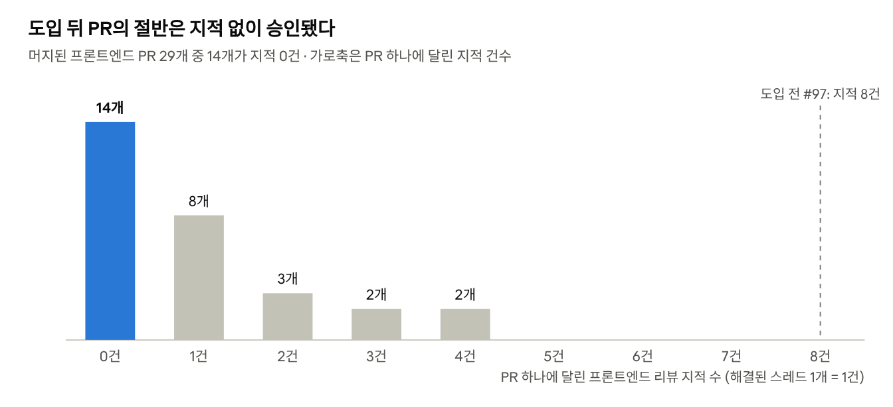

# AI가 쓴 코드, 무엇을 믿고 승인할까: 반복해서 받던 리뷰 코멘트, AI 리뷰로 먼저 고치기

## 왜 리뷰가 병목이 됐나

요즘 코드 작성을 AI에게 전부 맡기고 결과물은 읽지 않는다는 이야기가 자주 들린다. 설사 당장은 그렇지 않더라도, 사람이 코드를 점점 덜 보는 쪽으로 가고 있다는 것은 분명하다. 그래도 코드에 대한 책임은 여전히 개발자에게 남는다. 책임을 지려면 AI가 쓴 코드를 검증해야 하는데, 그 일은 결국 사람의 코드 리뷰가 맡는다. 여기서 리뷰가 병목이 된다. AI가 코드를 만드는 비용은 크게 낮췄지만 그 코드를 사람이 이해해야 한다는 조건까지는 없애지는 못했기 때문이다.

내가 속한 팀은 이 상황을 극단적인 형태로 겪었다. 우아한테크코스 팀 빌딩 기간에 프론트엔드 크루를 구하지 못해, 백엔드 크루 3명이 전자제품 추천 서비스 Devica의 화면까지 만들어야 했다. 그러다 보니 구현은 자연스럽게 각자의 AI 에이전트(Claude Code, Codex)에 맡기게 됐다. 코드는 나왔지만, 그 코드가 맞는지 한 줄씩 읽고 판단하기는 어려웠다. 리뷰를 어떻게 해야 할지 감조차 잡히지 않았다.

그래서 우리가 처음 시도한 것은 규칙이었다. 팀이 최소한의 규칙을 정하고 AI가 그 규칙을 지키게 하면, 리뷰에서 확인할 것도 크게 줄어들 거라고 생각했다. 하지만 실제로 부딪힌 문제는 예상과 달랐다. 이 글은 그 과정을 시간순으로 따라간다. 드러난 문제, 반복되던 리뷰 코멘트를 작성자가 먼저 고치게 한 방법, 그리고 승인할 때 AI와 자동 검사에 맡긴 것과 사람이 판단하는 것을 차례로 다룬다.

## 첫 시도: 미리 정한 규칙

우리는 규칙을 미리 정하기로 했지만, 어떤 규칙을 두고 어떤 형태로 에이전트에게 전달할지는 아무것도 정해진 게 없었다. 그래서 나는 먼저 다른 회사들이 AI 에이전트를 어떻게 쓰는지 찾아봤다. 크게 두 가지 방식이 있었다. 하나는 회사 단위로 에이전트 인프라를 만들어 Slack이나 웹에서 함께 쓰는 방식이고, 다른 하나는 Rules(무엇을 지킬지)와 Skills(어떤 순서로 작업할지)를 마크다운으로 작성해 각자의 에이전트가 읽게 하는 방식이다. 전자는 "3명이 각자 로컬에서 만드는 코드를 통일한다"는 우리 문제와 층위가 달랐고 새 인프라가 필요했다. 코드도 근거도 거의 없는 단계에서 가장 빨리 시작할 수 있는 후자를 골랐다.

형태는 정해졌지만 어떤 규칙을 둘지는 여전히 문제였다. 당시 화면은 하나도 없었고, 이 때문에 AI가 실제로 어디서 벗어나는지 본 적이 없으니, 규칙은 프론트 구조에서 벗어나기 쉬워 보이는 지점을 예상해서 정할 수밖에 없었다. 그때 화면은 Thymeleaf가 서버에서 그리는 구조라 화면 하나를 만들어도 작업이 컨트롤러까지 이어졌다. 그래서 AI가 계층을 넘나들며 임의로 판단하는 것(Model에 엔티티를 넘기거나 템플릿에서 계산하는 것), 공통 레이아웃을 무시하고 화면을 새로 만드는 것, 요청하지 않은 라이브러리를 가져다 쓰는 것, 아직 정해지지 않은 스펙을 추측으로 채우는 것을 막는 데 맞췄다. 근거도 시간도 부족해서 규칙은 최소한만 두었다.

규칙은 무엇을 지킬지(rules)와 어떤 순서로 할지(workflows)로 나눠 마크다운으로 적었다. 나누는 구성은 우아한형제들 사례에서, "AI가 임의로 정한 스펙이 있으면 구현 전에 멈춘다"는 스펙 태깅 게이트는 바이버스 사례에서 가져왔다. 이것을 PR로 올렸지만, 다른 팀원들에게 승인은 받지 못했다. 리뷰에 남은 반응은 두 가지였다.

- 프론트 규칙이 왜 필요한지 판단할 수 없다. 한 팀원은 "아예 모르는 분야라 난해하다"고 적었다.
- 매 요청마다 AI가 규칙 문서를 읽어야 해서 토큰 소모가 많이 될 것 같다.

그 사이 프론트를 Thymeleaf에서 React로 전환하면서, SSR을 전제로 쓴 규칙은 통째로 낡아 버렸다.

PR은 한 달 넘게 열려 있다가 닫혔고, 계획에 있던 "적용하며 걸리는 지점을 기록한다"는 단계는 실행되지 못했다. 돌아보면 실패의 원인은 하나, 규칙이 겪어 본 문제가 아니라 상상한 문제에서 나왔다는 점이다. 그러니 팀원은 규칙이 맞는지 판단할 수 없었고, 전제가 바뀌자 규칙도 함께 힘을 잃었다. 규칙으로 리뷰를 줄일 수 있는지는 확인해 보지도 못한 채, 팀은 각자 개발로 들어갔다.

## 규칙 없이 올린 첫 PR에서 드러난 문제

그렇게 처음 올라온 PR은 React로 이식한 첫 화면이었다. 작성자는 자기 에이전트로 AI 리뷰를 한 번 거친 뒤 PR을 올렸다. 그런데도 리뷰어 둘이 각자의 에이전트로 다시 리뷰하자 문제가 끊임없이 나왔다. 한 리뷰어가 6건을 남겼고, 다른 리뷰어의 다음 리뷰에서 2건이 더 나왔다.

이 8건에는 첫 시도에서 걱정한 문제가 하나도 없었다. 검색 조건 구조가 기획과 어긋난 1건을 빼면, 7건이 모두 **비동기 요청과 상태 관리 결함**이었다. 그중 리뷰어가 반드시 고쳐야 한다고 본 것은 다섯 건이다.

- 검색 조건을 빨리 바꾸면 늦게 도착한 예전 응답이 새 결과를 덮어썼다.
- 불러오는 중과 요청 실패가 모두 "0건"으로 보였다.
- 첫 화면에서 요청이 실패해도 안내가 없고, 버튼을 연타하면 요청이 중복됐다.
- 고정 타이머로 만든 로딩 화면이 실제 조회보다 먼저 사라졌다.
- 검색어 끝의 공백이 입력 도중에 지워져 두 단어를 이어 칠 수 없었다.

이 문제들은 한 번의 리뷰에서 다 나오지 않았다. 작성자의 AI 리뷰를 거쳤는데도 리뷰어의 에이전트가 찾아냈고, 두 리뷰어도 같은 종류의 문제를 서로 다른 곳에서 지적했다. 무엇을 확인할지 팀에 공통 기준이 없었기 때문이다. 리뷰어가 자기 에이전트의 결과를 PR 코멘트로 옮기면, 작성자는 그 코멘트를 다시 자기 에이전트에 읽혀 반영했다. 사람은 두 AI 사이의 전달자 노릇을 하고 있었다.

나는 여기서 문제를 다르게 보게 됐다. AI가 코드를 잘못 쓰는 것보다, 같은 종류의 리뷰 코멘트가 매번 사람 손을 거쳐 오간다는 게 더 큰 문제였다. 그렇다면 바꿔야 할 것은 코드를 쓰는 과정이 아니라 리뷰 과정이었다.

## 두 번째 시도: 겪은 문제에서 뽑은 규칙, push 전 AI 리뷰, 결정적인 검사

그래서 두 번째 시도에서는 규칙이 적용되는 위치를 리뷰로 옮겼다. 첫 시도의 규칙이 AI가 코드를 쓸 때 지켜야 할 것이었다면, 이번 규칙은 리뷰에서 확인할 기준이었다. 바뀐 흐름을 먼저 그림으로 보면 이렇다.


**그 기준은 실제로 받은 리뷰 코멘트에서 뽑았다.** 첫 시도처럼 상상해서 쓰지 않고, 앞의 첫 화면 PR에서 받은 비동기·상태 지적 7건을 각각 규칙으로 만들었다(비동기 요청 5개, 상태 모델 2개). 규칙 본문에는 특정 화면 대신 "왜 문제인지"와 "무엇을 확인할지"만 적어 다른 화면에도 쓰이게 했다. 필수·권장 구분은 출처가 된 리뷰 코멘트의 분류를 그대로 따랐다.

| 규칙                               | 구분 | 출처가 된 리뷰 코멘트                |
|----------------------------------|----|-----------------------------|
| 늦게 도착한 응답이 새 상태를 덮지 않는다          | 필수 | 조건을 빨리 바꾸면 예전 목록이 새 조건을 덮음  |
| 불러오는 중·실패·빈 결과를 구분해 보여준다         | 필수 | 로딩 중과 오류가 모두 "0건"으로 보임      |
| 요청 중엔 조작을 잠그고, 실패는 그 화면에서 알린다    | 필수 | 실패 안내 없음, 연타하면 요청 중복        |
| 로딩 표시는 실제 요청과 함께 끝난다             | 필수 | 고정 타이머 로딩이 조회보다 먼저 끝남       |
| 응답이 왔을 때 사용자가 떠났으면 화면을 옮기지 않는다   | 권장 | 다른 화면으로 가도 결과 화면으로 끌려감      |
| 사용자 입력을 가공한 값으로 되돌려 쓰지 않는다       | 필수 | 검색어 끝 공백이 입력 도중 지워짐         |
| 여러 경로로 들어오는 화면의 돌아갈 위치를 덮어쓰지 않는다 | 권장 | 상세에서 목록으로 재진입하면 돌아갈 곳이 빈 화면 |

규칙을 만들면서 원칙을 하나 세웠다. AI 리뷰는 같은 코드를 봐도 매번 결과가 다를 수 있다. 그래서 결정적인 검사로 판정할 수 있는 것은 최대한 그쪽에 맡기고, AI에게는 판단이 필요한 것만 남겼다. 이번 지적 7건은 모두 판단이 필요해 규칙 문서로 갔다. 대신 hook 호출 규칙, effect 의존성, 목록 `key`처럼 리뷰어가 매번 봐야 했던 기계적인 항목은 린트(Biome)로 옮기고, AI 리뷰어는 린트가 잡는 것을 보지 않게 했다.

**이 규칙들로 하는 AI 리뷰는 작성자가 먼저 실행하게 했다.** 첫 화면 PR에서는 리뷰어가 PR을 받은 뒤에야 각자 AI 리뷰를 실행했고, 그 결과를 사람이 옮겼다. 이번에는 작성자가 push하기 전에 자기 에이전트 세션 안에서 리뷰용 Skill을 실행한다. Skill은 규칙 파일마다 AI 리뷰어를 하나씩 병렬로 띄워 리뷰하고, 지적마다 반영하거나 기각 근거를 적게 한 뒤, 린트를 실행하고 기록을 남긴다. 작성자가 그 자리에서 지적을 바로 반영하니, 사람이 두 AI 사이에서 전달자 노릇을 할 일이 줄어든다. AI 리뷰는 각자 로그인한 에이전트에서만 실행되고, 훅과 CI에는 LLM 호출도 API 키도 없다.

**리뷰를 거쳤는지는 결정적인 검사로 확인했다.** 작성자에게 먼저 실행하게 했다고 해서 리뷰를 반드시 거친다는 보장은 없다. 첫 시도에서는 규칙을 지키는지를 AI에게 맡겼을 뿐, 강제하는 장치가 없었다. 이번에는 앞의 원칙대로, 리뷰를 거쳤는지를 `frontend/` diff의 해시로 검사한다. Skill이 리뷰를 마칠 때 그 시점의 diff 해시를 기록에 남기고, pre-push 훅은 지금 코드의 해시와 비교한다. 리뷰 뒤에 코드를 고쳤거나 필수 지적을 미해결로 두었으면 push가 막히고, CI가 PR마다 같은 검사를 다시 한다. 검사는 지적을 고쳤는지가 아니라 답했는지만 본다. 고칠지 기각할지는 작성자가 정한다. 실제로 push해 확인한 결과는 이렇다.

| 상황                | 결과          |
|-------------------|-------------|
| 리뷰 후 push         | 통과          |
| 리뷰 없이 push        | 차단          |
| 리뷰 뒤 코드 수정        | 차단 (해시 불일치) |
| 필수 지적 미해결         | 차단          |
| 필수 지적 기각 + 권장 미해결 | 통과          |
| 백엔드만 변경           | 통과          |

이 구조를 정하면서 다른 방법도 몇 가지 고려했고, 각각 아래 이유로 제외했다.

| 방법 | 제외한 이유 |
|---|---|
| AI가 PR 코멘트를 직접 달게 하기 (봇·브라우저 자동화) | 브라우저로 PR을 오가며 코멘트를 달게 하면 토큰을 많이 쓰고 느리다. 저장소와 PR 권한을 더 넓게 주어야 하는 점도 걸렸다 |
| CI에서 LLM 리뷰 | 한 사람의 인증 정보로 팀 전체 요청을 처리해야 하고, 결과가 매번 달라 통과·차단을 가르는 검사로 쓸 수 없다 |
| 팀 전용 리뷰 에이전트 구축 (VoltAgent) | 각자의 구독 계정으로 호출할 수 없어 API 비용이 든다 |

**이번에는 팀원들의 승인을 받았다.** 이 구조를 PR로 올리자 리뷰에서 나온 말부터 달랐다. 첫 시도에서는 "아예 모르는 분야라 난해하다"는 반응이 나왔지만, 이번에는 규칙 자체에 이견이 없었다. 팀원들은 대신 검사 방식에 대한 의견을 남겨주었다. CI에서까지 검사해야 하는지, CI 검사가 병합 조건에 들어가 있지 않은데 실제로 막을 수 있는지, 리뷰 기록이 저장소에 계속 쌓여도 괜찮은지를 물었다. 나는 규칙이 팀이 함께 겪은 버그에서 나왔기 때문이라고 본다. 버그를 같이 겪었으니 규칙이 왜 필요한지는 설명할 필요가 없었다.

## 운영하며 고친 것: 리뷰 기록을 파일에서 커밋 트레일러로

두 번째 시도에서는 Skill이 리뷰를 마칠 때 기록을 마크다운 파일로 남겼다. 브랜치마다 `.review/` 폴더에 파일을 하나씩 만들어 diff 해시와 지적 목록, 항목별 상태(해결·기각), 기각 근거를 적고 함께 커밋했다. 검사는 이 파일의 해시를 읽어 리뷰를 거쳤는지 확인했다.

문제는 파일이 계속 남는다는 점이었다. 브랜치가 머지된 뒤에는 검사에 더 쓰이지 않는데도 파일은 develop에 그대로 남았고, 도입 나흘 만에 17개가 쌓였다. 두 번째 시도를 리뷰할 때 팀원이 지적했던 문제가 그대로 현실이 됐다. 이대로면 PR이 늘수록 아무도 다시 읽지 않는 파일을 계속 관리해야 했다. 머지 뒤나 CI에서 파일을 지우는 방법도 있었지만, 그러면 지우는 커밋이 따로 남는다.

그래서 기록을 파일이 아니라 커밋 트레일러 한 줄로 옮겼다. 트레일러는 커밋 메시지 끝에 `키: 값` 형식으로 붙이는 줄이다.

```
Frontend-Review: hash=<diff 해시> base=<기준 브랜치> unresolved=<미해결 필수 항목 수>
```

검사 스크립트는 기준 브랜치 이후 커밋의 트레일러를 읽어, 해시가 push하는 코드와 맞고 `unresolved=0`이면 통과시킨다. 커밋 메시지는 해시 계산에 들어가지 않으므로, 해시를 구한 뒤 트레일러를 붙여도 값이 그대로다. 이미 push한 뒤라도 빈 커밋에 붙여 올릴 수 있다. 기록이 커밋에 붙어 있으니 따로 관리할 파일이 없다.

대가도 있다. 지적 목록과 기각 근거가 더는 저장소에 남지 않고, 검사도 `unresolved` 숫자만 본다. 에이전트가 리뷰를 마칠 때 작성자에게 보고하는 것으로 갈음했다. 가볍게 만드는 대신 추적 가능성을 내어놓은 선택이다.

## 세 번째 시도: 한 달치 리뷰 코멘트로 규칙 보완

자동 리뷰를 거친 PR에서도 팀원의 AI 리뷰가 문제를 찾는 일은 이어졌다. 자동 리뷰가 무엇을 놓치는지 보려고, 도입 뒤 한 달 동안 올라온 프론트엔드 PR 31개의 리뷰 24건을 모두 모았다.

기존 규칙 7개에 걸리는 지적은 0건이었고 리뷰어의 에이전트가 규칙 위반을 놓친 사례도 없었다. 반복된 지적은 모두 규칙 밖에 있었고 PR 작성자가 누구든 같은 패턴이었다.

- 이전 상태가 다음 흐름에 남는다. 설문을 다시 시작해도 예전 설문 캐시를 쓰는 식이다.
- 화면에 보이는 값이 실제 요청이나 문서와 다르다. 검색 중 화면이 수정 전 사양을 보여 주는 식이다.
- URL 쿼리를 검증하거나 정제하지 않는다. 허용 목록이 없거나, 일회성 파라미터가 주소에 남는 식이다.
- 핵심 흐름에 자동 테스트가 없다.

어떤 패턴을 규칙으로 만들지는 **지적이 실제로 반영됐는지**로 가렸다. 앞의 세 패턴은 14건 중 13건이 작은 수정 커밋으로 반영됐고 모두 특정 순서로 조작하면 재현되는 사용자 버그였다. 반대로 "자동 테스트가 없다"는 지적은 5건 모두 반영되지 않았다. 다섯 코멘트가 같은 문장으로 시작했고 세 작성자가 다섯 번 모두 반영하지 않았다. 코드를 보고 내린 판단이라기보다 리뷰 프롬프트의 고정 항목으로 보였다. 그래서 이 항목은 규칙에서 뺐고 테스트를 요구할지는 규칙이 아니라 팀이 따로 결정할 일로 넘겼다.

그리고 상태 모델에 "이전 상태 정리"와 "표시값·요청값 일치"를, 새 URL 상태 규칙에 "허용 목록 검증"과 "일회성 파라미터 제거"를 더해 규칙 4개를 추가했다. 허용 목록 검증은 이미 ADR로 정해 둔 것인데 자동 리뷰가 확인하지 않고 있었다. 확인 항목은 코드 형태가 아니라 "A 하고 B 한 뒤 돌아오면"같은 조작 순서로 적어 리뷰어가 시나리오를 따라가게 했다.

하나는 규칙으로 만들 수 없었다. "구현이 PR 본문·이슈·문서와 다르다"는 지적은 어느 쪽이 틀린 것인지가 매번 다르다. 대신 Skill에 **대조 리뷰어**를 규칙 리뷰어와 따로 두었다. PR 본문과 연결된 이슈, 언급된 ADR을 읽고 구현과 다른 점을 보고하되, 어느 쪽이 맞는지는 판단하지 않고 고칠 쪽은 작성자가 정한다.

첫 화면 PR의 지적에서 첫 규칙을 뽑았듯, 도입 뒤 PR들의 지적에서 규칙을 더했다. "반복된 리뷰 코멘트에서 규칙을 사후에 추가한다"는 원칙은 한 번의 우연으로 끝나지 않고 운영 방식이 됐다.

## 해 보니 무엇이 달라졌나

**리뷰의 기준이 하나가 됐다.** 작성자마다 각자의 기준으로 하던 AI 리뷰를, 이제는 모두가 같은 규칙과 같은 린트로 한다. 규칙에 있는 문제는 push하기 전, 작성자의 세션 안에서 걸러지며 사람의 PR 리뷰는 그대로 한다.

**리뷰를 빠짐없이 거쳤다.** 도입 뒤 한 달 동안 프론트엔드를 바꾼 PR 중 develop에 머지된 29개가 모두 리뷰 기록을 남겼다. 트레일러가 3\~4개 붙은 PR도 있는데, 리뷰 → 수정 → 재리뷰를 그만큼 반복했다는 뜻이다.

**PR에 달리는 지적이 줄었다.** 도입 전 첫 화면 PR에는 지적이 8건 달렸다. 도입 뒤 29개 중 14개는 지적 없이 승인됐고 나머지도 PR당 1\~4건으로, 전체 평균은 약 1건이다. 리뷰어가 AI 리뷰 결과를 코멘트로 옮기는 일도 크게 줄었다. 다만 비교 기준이 PR 한 개라 참고치로 봐야 한다.



지적이 달린 PR도 대부분 1\~2건에 그쳤다. 4건이 달린 PR 2개는 PostHog 연동과 제품 목록 상세 화면처럼 변경이 큰 PR이었다.

**규칙이 다루는 문제는 push 전에 걸러졌다.** 도입 뒤 리뷰 24건 중 기존 규칙에 걸리는 지적은 0건이었고 리뷰어의 에이전트가 규칙 위반을 놓친 사례도 없었다. 남은 지적은 모두 규칙 밖의 영역이었다. 두 번째 시도를 만들 당시에는 LLM 리뷰가 규칙 위반을 놓칠 것을 우려했다. 같은 시기에 작업하던 다른 PR의 코드에서 규칙에 문자 그대로 적힌 위반을 3번 중 2번 놓쳤기 때문이다. 실제 운영에서는 리뷰어 리뷰까지 통과한 규칙 위반이 없었다.

**규칙이 과거 문제를 다시 잡아냈다.** 첫 화면 PR이 처음 리뷰받던 시점의 코드를, 당시 코멘트를 알려 주지 않고 3번 리뷰하게 했다. 규칙화한 지적 7건을 3번 모두 찾았고 잘못된 지적은 0건이었으며 필수·권장 구분도 당시 리뷰어와 일치했다. 원래 두 번째 리뷰에서야 나온 지적을 첫 리뷰 시점에 잡았다. 세 번째 시도에서 더한 규칙도 같은 방식으로 검증했다. 근거가 된 PR의 반영 전 코드에서 규칙 5건을 당시와 같은 줄에서 잡았고 당시 리뷰에 없던 실제 문제 2건도 찾았다. 다만 규칙을 그 코드에서 뽑았으니 과적합된 결과로, 규칙이 문제를 재현할 만큼 구체적이라는 것까지만 보여 준다.

**판단은 여전히 사람이 했다.** 자동화한 것은 반복되는 리뷰이지 판단이 아니다. 어떤 코멘트를 기준으로 만들지는 사람이 반영률을 보고 정했고 테스트 요구처럼 반영되지 않은 코멘트는 의도적으로 뺐다. 대조 리뷰어도 어느 쪽이 맞는지 판단하지 않고 어긋남만 보고하며 고칠 쪽은 사람이 정한다. 사람의 PR 리뷰와 승인도 그대로 남았다. 다만 판단을 미룰 수는 없다. 필수 지적을 미해결로 두거나 리뷰 뒤 코드를 바꾸면 push와 CI가 막는다. 사람이 하는 것은 판단이고 검사가 하는 것은 판단을 건너뛰지 못하게 하는 일이다. 달라진 점은, 사람이 반복되는 코멘트 대신 규칙 밖의 판단에 집중하게 됐다는 것이다.

**흔히 제안되는 처방을 실제로 해 본 셈이다.** AI 시대의 리뷰 병목을 다룬 글들은 대개 비슷한 처방을 내놓는다. 우리가 한 일은 그 처방과 하나씩 짝지어진다.

| 흔히 제안되는 처방              | 우리가 실제로 한 것                         |
|-------------------------|-------------------------------------|
| 기계적인 검사는 자동화한다          | Biome 린트와 pre-commit 훅              |
| 사람보다 AI가 먼저 리뷰한다        | push 전, 작성자의 로컬 세션에서 Skill로 리뷰      |
| 리뷰 여부는 결정론적으로 보장한다      | diff 해시를 pre-push 훅과 CI가 검사         |
| AI 지적의 반영률을 보고 규칙을 조정한다 | 반영률로 규칙 후보를 고르고, 반영되지 않은 테스트 지적은 제외 |
| 사람은 판단이 필요한 곳에 집중한다     | 29개 PR 중 14개가 지적 0건, 남은 지적은 규칙 밖 영역 |

다만 3명이 한 달 동안 29개 PR에서 얻은 현장 기록이다. 일반화된 증명이 아니라, 처방이 실제 팀에서 어떻게 작동했는지 보여 주는 한 사례로 읽어야 한다.

## 언제 쓰면 위험한가

**근거 없이 규칙을 미리 정할 때.** 겪어 보지 않은 문제로 만든 규칙은 팀원이 판단할 수 없고 전제가 바뀌면 통째로 무효가 된다. 우리의 첫 시도가 그랬다. 처음에는 규칙 없이 시작하고, 리뷰에서 같은 지적이 반복된 뒤에 규칙을 추가하는 편이 낫다.

**검사가 실제로 막는지 확인하지 않았을 때.** CI 잡을 추가했다고 머지가 막히지는 않는다. 우리 저장소에서도 `review-record` 잡은 룰셋의 필수 검사로 등록되어 있지 않다. 그래서 `--no-verify`로 훅을 건너뛰면 CI는 실패를 표시할 뿐 머지를 막지 못한다. 등록하지 않은 이유도 있다. develop에서 main으로 가는 배포 PR의 `frontend/` diff는 여러 기능 브랜치가 합쳐진 것이라 어느 리뷰 기록의 해시와도 맞지 않는다. 그래서 배포 PR에서는 검사를 건너뛰게 했고 필수 검사로 걸면 배포가 막힌다. develop 룰셋에만 등록하는 방법은 남아 있다.

**LLM 리뷰 결과를 그대로 믿을 때.** 두 가지를 조심해야 한다. 첫째, 규칙을 만든 코드로 규칙을 검증하면 결과가 좋게 나올 수밖에 없다. 두 번째·세 번째 시도의 재현 검증은 모두 이 방식이라, 규칙이 문제를 재현할 만큼 구체적이라는 것까지만 보여 준다. 둘째, 처음 보는 코드에서는 다르다. 같은 시기에 작업하던 다른 PR의 코드에서 LLM 리뷰는 규칙에 문자 그대로 적힌 위반을 3번 중 2번 놓쳤다. 운영 결과가 이 우려보다 좋았던 것은 LLM 한 번을 믿은 결과가 아니다. 리뷰를 거쳤는지는 결정적인 검사가 보장했고 리뷰어의 AI 리뷰가 한 겹 더 있었다. LLM 리뷰는 리뷰를 돕는 데 쓰고 통과·차단 판정은 결정적인 검사에 맡겨야 한다.

**반영되지 않는 지적이 반복될 때.** "자동 테스트가 없다"는 지적은 다섯 번 모두 같은 문장으로 시작했고 다섯 번 모두 반영되지 않았다. 이런 지적이 계속 올라오면 정작 봐야 할 지적이 묻힌다. 지적의 횟수가 아니라 반영 여부를 봐야 진짜 문제를 가릴 수 있다. 리뷰 프롬프트에 고정 항목이 있다면 그것부터 의심해야 한다.

**규칙 밖의 영역을 놓칠 때.** 우리 규칙은 비동기 요청, 상태 모델, URL 상태만 다룬다. 폴더 구조, 컴포넌트 분리, 네이밍 같은 설계 기준은 아직 없어서, 이 영역은 여전히 에이전트마다 다르게 작성될 수 있다. 규칙 밖의 지적은 주기적으로 모아 보고 반영된 것부터 규칙으로 옮겨야 한다.

**덜어낼 것과 남길 것을 구분하지 않을 때.** 모델이 좋아지면서 하네스를 덜어내는 흐름이 있다. 덜어낼 대상은 AI가 코드를 잘 쓰도록 판단을 대신해 주던 비계다. 매 요청에 붙는 긴 전역 지침, 미리 상상해서 쓴 규칙이 여기에 속한다. 우리의 첫 시도가 바로 그랬다. 반면 반복되는 리뷰를 자동화한 장치는 모델이 좋아져도 남는다. 기준은 팀의 리뷰 코멘트와 팀의 결정(ADR)에서 나왔기에 모델이 스스로 알 수 없다. 리뷰를 거쳤는지 막는 검사는 LLM이 아니라 git으로 동작하기에 모델 발전과 무관하다. 둘을 구분하지 않고 함께 덜어내면, 리뷰 병목은 다시 사람에게 돌아온다.

## 그래서 무엇을 믿고 승인하나

규칙 안의 문제는 작성자의 AI 리뷰가 그 코드를 봤고 필수 지적마다 답했다는 기록을 믿는다. diff 해시와 커밋 트레일러의 `unresolved=0`이 그 기록이다. 규칙 밖의 문제는 리뷰어와 리뷰어의 AI가 본다. 승인은 여전히 사람이 한다.

자동화한 것은 반복되는 리뷰이고, 훅과 CI가 하는 일은 그 리뷰를 건너뛰지 못하게 하는 것이다. 프론트를 모르는 백엔드 3명이 이 장치를 만든 것은 코드를 직접 볼 수 없는 상황을 극단까지 몰아가 본 것이지, 검증을 AI에게 넘기기 위해서가 아니다. 리뷰가 병목인 팀이라면, 각자의 AI 리뷰를 PR 코멘트로 옮기는 일을 어떻게 줄일지부터 찾아보기를 권한다. 반복되는 코멘트는 이미 쌓여 있다.
