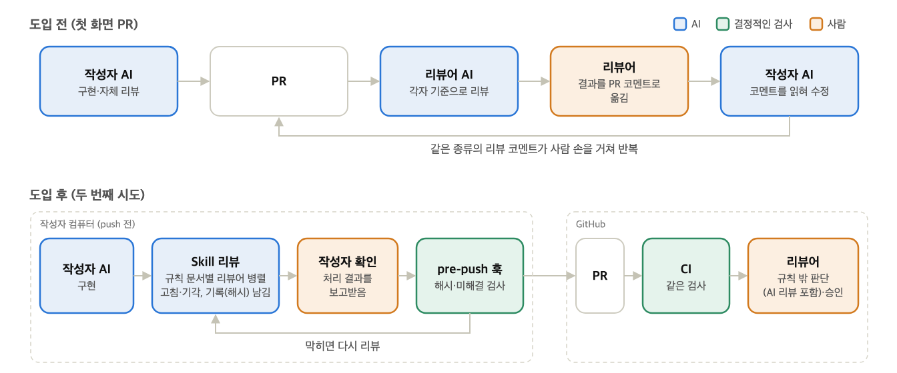
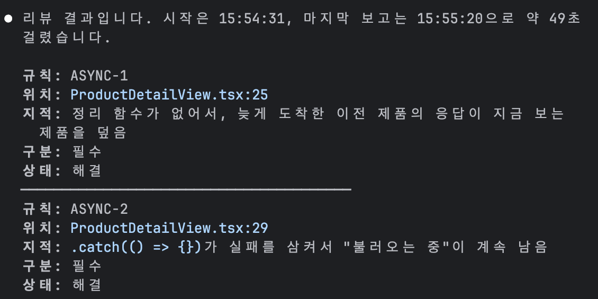
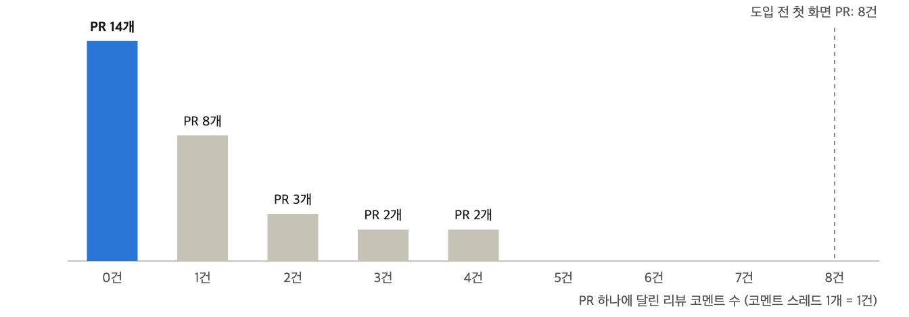

# PR에서 반복되던 리뷰 코멘트, AI 리뷰로 먼저 고치기

## AI가 쓴 코드와 리뷰 병목

AI 코딩 도구는 코드 몇 줄을 자동완성해 주던 수준을 넘어, 작업 전체를 맡아 처리하는 에이전트로 발전하고 있습니다. 할 일을 말로 대충 설명하면 AI가 코드를 읽고 여러 파일을 고친 뒤 테스트까지 실행하고 결과만 보고합니다. 심지어 코드 작성을 AI에게 전부 맡기고 결과물은 읽지 않는다는 이야기도 자주 들립니다.

그래도 코드에 대한 책임은 여전히 개발자에게 남습니다. 책임을 지려면 AI가 쓴 코드를 검증해야 하는데, 그 일은 결국 사람의 코드 리뷰가 맡습니다. 여기서 리뷰가 병목이 됩니다. AI 덕분에 코드가 나오는 속도는 크게 빨라졌지만, 사람이 그 코드를 읽고 맞는지 판단하는 속도는 그대로입니다. 두 속도가 벌어질수록 리뷰를 기다리는 PR은 쌓이고, 리뷰어 한 사람이 봐야 할 코드도 늘어납니다.

제가 속한 팀은 이 상황을 극단적인 형태로 겪었습니다. 우아한테크코스에서는 서로 다른 분야의 크루들이 모여 프로젝트 팀을 꾸리는데, 저희 팀은 백엔드 크루 3명으로만 꾸려져 전자제품 추천 서비스 Devica의 화면까지 직접 만들어야 했습니다. 그러다 보니 구현은 자연스럽게 각자의 AI 에이전트(Claude Code, Codex)에 맡기게 됐습니다. 코드는 나왔지만, 그 코드가 맞는지 한 줄씩 읽고 판단하기는 어려웠습니다. 리뷰를 어떻게 해야 할지 감조차 잡히지 않았습니다.

그래서 저희가 처음 시도한 것은 규칙이었습니다. AI가 생성한 코드를 판단하기 어렵다면, 판단할 일이 덜 생기도록 코드를 쓰는 단계에서부터 막아 두자고 생각했습니다. 팀이 최소한의 규칙을 정하고 AI가 그 규칙을 지키게 하면, 리뷰에서 확인할 것도 크게 줄어들 거라고 봤습니다. 하지만 실제로 맞닥뜨린 문제는 예상과 달랐습니다. 같은 종류의 리뷰 코멘트가 사람 손을 거쳐 되풀이되는 일이었습니다.

이 글은 그 과정을 시간순으로 따라갑니다. 드러난 문제, 반복되던 리뷰 코멘트를 작성자가 먼저 고치게 한 방법, 그리고 승인할 때 AI와 자동 검사에 맡긴 것과 사람이 판단하는 것을 차례로 다룹니다.

## 첫 시도: 예상으로 정한 규칙

규칙을 두기로 했지만, 어떤 규칙을 어떤 형태로 에이전트에게 전달할지는 정해진 게 없었습니다. 그래서 먼저 다른 회사들이 AI 에이전트를 어떻게 쓰는지 찾아봤습니다. 그중 지킬 것(Rules)과 작업 순서(Skills)를 마크다운으로 적어 각자의 에이전트가 읽게 하는 방식을 골랐습니다. 코드도 근거도 거의 없던 때라 가장 빨리 시작할 수 있는 방식이었습니다.

틀도 사례에서 가져왔습니다. 무엇을 지킬지와 어떤 순서로 할지를 나누고, AI가 정해지지 않은 스펙을 추측으로 채우려 하면 구현 전에 멈추게 했습니다. AI가 저희가 의도한 방향을 벗어나지 않게, 코드를 쓰는 단계에서 막아 두는 장치였습니다.

문제는 그 안에 채울 규칙이었습니다. 당시에는 화면이 하나도 없어서 AI가 실제로 어디서 벗어나는지 본 적이 없었습니다. 그래서 벗어나기 쉬워 보이는 지점을 예상해 정했습니다. 그때 화면은 Thymeleaf가 서버에서 그리는 구조라 작업이 컨트롤러까지 이어졌기 때문에, 계층을 넘나드는 판단, 공통 레이아웃 무시, 요청하지 않은 라이브러리 사용을 막는 데 맞췄습니다. 근거가 없으니 규칙은 최소한만 두었습니다.

이 규칙을 PR로 올렸지만 팀원들의 승인은 받지 못했습니다. 한 팀원은 "아예 모르는 분야라 난해하다"고 적었고, 요청마다 규칙 문서를 읽느라 토큰을 많이 쓸 것 같다는 우려도 나왔습니다. 그러는 사이 화면을 Thymeleaf에서 React로 바꾸면서, 서버에서 화면을 그리는 구조를 전제로 쓴 규칙은 통째로 낡아 버렸습니다.

결국 PR은 한 달 넘게 열려 있다가 닫혔습니다. 돌아보면 원인은 규칙이 겪어 본 문제가 아니라 상상한 문제에서 나왔다는 데 있었습니다. 그러니 팀원은 규칙이 맞는지 판단할 수 없었고, 전제가 바뀌자 규칙도 힘을 잃었습니다. 규칙으로 리뷰를 줄일 수 있는지는 확인하지 못한 채, 팀은 각자 개발로 들어갔습니다.

## 첫 화면 PR: 예상과 다른 문제

그렇게 처음 올라온 PR은 React로 이식한 첫 화면이었습니다. 작성자는 자기 에이전트로 AI 리뷰를 한 번 거친 뒤 PR을 올렸습니다. 그런데도 리뷰어 둘이 각자의 에이전트로 다시 리뷰하자 문제가 계속 나왔습니다. 한 리뷰어가 6건을 남겼고, 다른 리뷰어의 다음 리뷰에서 2건이 더 나왔습니다.

이 8건에는 첫 시도에서 걱정한 문제가 하나도 없었습니다. 검색 조건 구조가 기획과 어긋난 1건을 빼면, 7건이 모두 **비동기 요청과 상태 관리 결함**이었습니다. 그중 리뷰어가 반드시 고쳐야 한다고 본 것은 다섯 건입니다.

- 조건을 빨리 바꾸면 늦게 도착한 예전 응답이 새 결과를 덮어썼습니다.
- 불러오는 중과 요청 실패가 모두 "0건"으로 보였습니다.
- 첫 화면에서 요청이 실패해도 안내가 없고, 버튼을 연타하면 요청이 중복됐습니다.
- 고정 타이머로 만든 로딩 화면이 실제 조회보다 먼저 사라졌습니다.
- 검색어 끝의 공백이 입력 도중에 지워져 두 단어를 이어 칠 수 없었습니다.

이 문제들은 한 번의 리뷰에서 다 나오지 않았습니다. 작성자의 AI 리뷰를 거쳤는데도 리뷰어의 에이전트가 찾아냈고, 두 리뷰어도 같은 종류의 문제를 서로 다른 곳에서 지적했습니다. 무엇을 확인할지 팀에 공통 기준이 없었기 때문입니다. 리뷰어가 자기 에이전트의 결과를 PR 코멘트로 옮기면, 작성자는 그 코멘트를 다시 자기 에이전트에 읽혀 반영했습니다. **사람은 두 AI 사이의 전달자 노릇을 하고 있었습니다.**

저는 여기서 문제를 다르게 보게 됐습니다. AI가 코드를 잘못 쓰는 것보다, 같은 종류의 리뷰 코멘트가 매번 사람 손을 거쳐 오간다는 게 더 큰 문제였습니다. 그렇다면 바꿔야 할 것은 코드를 쓰는 과정이 아니라 리뷰 과정이었습니다.

## 두 번째 시도: 작성자가 먼저 하는 AI 리뷰

그래서 두 번째 시도에서는 규칙이 적용되는 위치를 리뷰로 옮겼습니다. 첫 시도의 규칙이 AI가 코드를 쓸 때 지켜야 할 것이었다면, 이번 규칙은 리뷰에서 확인할 기준이었습니다. 바뀐 흐름을 도입 전과 나란히 놓으면 다음과 같습니다.



**그 기준은 실제로 받은 리뷰 코멘트에서 뽑았습니다.** 첫 시도처럼 상상해서 쓰지 않고, 앞의 첫 화면 PR에서 받은 비동기·상태 지적 7건을 각각 규칙으로 만들었습니다. 규칙 본문에는 특정 화면 대신 "왜 문제인지"와 "무엇을 확인할지"만 적어 다른 화면에도 쓰이게 했습니다. 필수·권장 구분은 출처가 된 리뷰 코멘트의 분류를 그대로 따랐습니다.

| 규칙                               | 구분 | 출처가 된 리뷰 코멘트                |
|----------------------------------|----|-----------------------------|
| 늦게 도착한 응답이 새 상태를 덮지 않는다          | 필수 | 조건을 빨리 바꾸면 예전 목록이 새 조건을 덮음  |
| 불러오는 중·실패·빈 결과를 구분해 보여준다         | 필수 | 로딩 중과 오류가 모두 "0건"으로 보임      |
| 요청 중엔 조작을 잠그고, 실패는 그 화면에서 알린다    | 필수 | 실패 안내 없음, 연타하면 요청 중복        |
| 로딩 표시는 실제 요청과 함께 끝난다             | 필수 | 고정 타이머 로딩이 조회보다 먼저 끝남       |
| 사용자 입력을 가공한 값으로 되돌려 쓰지 않는다       | 필수 | 검색어 끝 공백이 입력 도중 지워짐         |
| 응답이 왔을 때 사용자가 떠났으면 화면을 옮기지 않는다   | 권장 | 다른 화면으로 가도 결과 화면으로 끌려감      |
| 여러 경로로 들어오는 화면의 돌아갈 위치를 덮어쓰지 않는다 | 권장 | 상세에서 목록으로 재진입하면 돌아갈 곳이 빈 화면 |

규칙 문서에 실제로 적은 내용은 다음과 같습니다. 비동기 요청 규칙을 모은 문서의 앞부분입니다. 여기서 effect는 화면이 바뀔 때 실행되는 React 코드이고, 정리 함수는 다음 실행 전에 이전 요청의 응답을 무시하도록 처리하는 자리입니다.

```markdown
# 비동기 요청

서버 요청의 응답은 늦게 오거나, 순서가 뒤바뀌거나,
실패할 수 있다. 이 규칙은 그런 경우에도 화면이
사용자에게 틀린 정보를 보여주지 않는지 본다.

effect 의존성 누락처럼 린터(Biome)가 잡는 것은
보지 않는다.

## ASYNC-1 늦게 도착한 응답이 새 상태를 덮지 않는다 · 필수

조건을 빠르게 바꾸면 요청이 여러 개 나가고,
응답은 보낸 순서대로 온다는 보장이 없다.
먼저 보낸 요청의 응답이 늦게 오면,
선택한 조건과 다른 결과가 화면에 남는다.

- 요청을 보내는 effect에 정리 함수가 있는지 본다.
  정리 함수에서 이전 요청을 무효 처리하거나
  취소해야 한다.
- 같은 문제는 목록뿐 아니라 id가 바뀌는 상세
  화면에서도 생긴다.

…
```

규칙을 만들면서 원칙을 하나 세웠습니다. AI 리뷰는 같은 코드를 봐도 매번 결과가 다를 수 있습니다. 그래서 결정적인 검사(같은 코드에는 늘 같은 결과를 내는 린트·훅·CI)로 판정할 수 있는 것은 최대한 그쪽에 맡기고, AI에게는 판단이 필요한 것만 남겼습니다.

이번 지적 7건은 모두 판단이 필요해 규칙 문서로 갔습니다. 대신 React Hooks 호출 규칙, effect 의존성, 목록 `key`처럼 리뷰어가 매번 봐야 했던 기계적인 항목은 커밋할 때 자동으로 실행되는 린트(Biome)로 옮기고, AI 리뷰어는 린트가 잡는 것을 보지 않게 했습니다.

**이 규칙들로 하는 AI 리뷰는 작성자가 먼저 실행하게 했습니다.** 첫 화면 PR에서는 리뷰어가 PR을 받은 뒤에야 각자 AI 리뷰를 실행했고, 그 결과를 사람이 옮겼습니다. 이번에는 작성자가 push하기 전에 자기 에이전트 세션 안에서 리뷰용 Skill을 실행합니다.

Skill은 규칙 파일마다 AI 리뷰어를 하나씩 병렬로 띄워 리뷰하고, 에이전트가 지적마다 코드를 고치거나 기각 근거를 적은 뒤, 린트를 실행하고 기록을 남깁니다. 작성자는 마지막에 그 처리 결과를 보고받습니다. 지적이 작성자의 세션 안에서 바로 처리되니, 사람이 두 AI 사이에서 전달자 노릇을 할 일이 줄어듭니다. AI 리뷰는 각자 로그인한 에이전트에서만 실행되고, 훅과 CI에는 LLM 호출도 API 키도 없습니다.

리뷰가 끝나면 작성자의 세션에는 이런 보고가 남습니다. 예시로 실행한 화면이며, 리뷰 한 번에 1분이 채 걸리지 않았습니다.



AI 리뷰를 작성자의 세션에서만 실행하기로 하면서, 다른 방법도 몇 가지 고려했고 각각 아래 이유로 제외했습니다.

| 방법                                | 제외한 이유                                                                 |
|-----------------------------------|------------------------------------------------------------------------|
| AI가 PR 코멘트를 직접 달게 하기 (봇·브라우저 자동화) | 브라우저로 PR을 오가며 코멘트를 달게 하면 토큰을 많이 쓰고 느리다. 저장소와 PR 권한을 더 넓게 주어야 하는 점도 걸렸다 |
| CI에서 LLM 리뷰                       | 한 사람의 인증 정보로 팀 전체 요청을 처리해야 하고, 결과가 매번 달라 통과·차단을 가르는 검사로 쓸 수 없다         |
| 팀 전용 리뷰 에이전트 구축 (VoltAgent)       | 각자의 구독 계정으로 호출할 수 없어 API 비용이 든다                                        |

**리뷰를 거쳤는지는 결정적인 검사로 확인했습니다.** 작성자에게 먼저 실행하게 했다고 해서 리뷰를 반드시 거친다는 보장은 없습니다. 첫 시도에서는 규칙을 지키는지를 AI에게 맡겼을 뿐, 강제하는 장치가 없었습니다.

이번에는 앞의 원칙대로, 리뷰를 거쳤는지를 기준 브랜치와 비교한 `frontend/` diff의 해시로 검사합니다. Skill이 리뷰를 마칠 때 그 시점의 diff 해시를 기록에 남기고, pre-push 훅은 지금 코드의 해시와 비교합니다. 리뷰 뒤에 코드를 고쳤거나 필수 지적을 미해결로 두었으면 push가 막히고, CI가 PR마다 같은 검사를 다시 합니다. 검사는 필수 지적을 고쳤는지가 아니라 답했는지만 봅니다. 실제로 push해 확인한 결과는 다음과 같습니다.

| 상황                | 결과          |
|-------------------|-------------|
| 리뷰 후 push         | 통과          |
| 리뷰 없이 push        | 차단          |
| 리뷰 뒤 코드 수정        | 차단 (해시 불일치) |
| 필수 지적 미해결         | 차단          |
| 필수 지적 기각 + 권장 미해결 | 통과          |
| 백엔드만 변경           | 통과          |

**이번에는 팀원들의 승인을 받았습니다.** 이 구조를 PR로 올리자 리뷰에서 나온 말부터 달랐습니다. 첫 시도에서는 "아예 모르는 분야라 난해하다"는 반응이 나왔지만, 이번에는 규칙 자체에 이견이 없었습니다. 팀원들은 대신 검사 방식에 대한 의견을 남겨주었습니다. CI에서까지 검사해야 하는지, CI 검사가 병합 조건에 들어가 있지 않은데 실제로 막을 수 있는지, 리뷰 기록이 저장소에 계속 쌓여도 괜찮은지를 물었습니다.

저는 규칙이 팀이 함께 겪은 버그에서 나왔기 때문이라고 봅니다. 버그를 같이 겪었으니 규칙이 왜 필요한지는 설명할 필요가 없었습니다.

## 리뷰 기록을 남기는 방식

두 번째 시도에서는 Skill이 리뷰를 마칠 때 기록을 마크다운 파일로 남겼습니다. 브랜치마다 `.review/` 폴더에 파일을 하나씩 만들어 diff 해시와 지적 목록, 항목별 상태(해결·기각), 기각 근거를 적고 함께 커밋했습니다. 검사는 이 파일의 해시를 읽어 리뷰를 거쳤는지 확인했습니다.

문제는 파일이 계속 남는다는 점이었습니다. 브랜치가 develop에 합쳐진 뒤에는 검사에 더 쓰이지 않는데도 파일은 develop에 그대로 남았고, 도입 나흘 만에 17개가 쌓였습니다. 두 번째 시도를 리뷰할 때 팀원이 지적했던 문제가 그대로 현실이 됐습니다. 이대로면 PR이 늘수록 아무도 다시 읽지 않는 파일을 계속 관리해야 했습니다. 머지 뒤나 CI에서 파일을 지우는 방법도 있었지만, 그러면 지우는 커밋이 따로 남습니다.

그래서 기록을 파일이 아니라 커밋 트레일러 한 줄로 옮겼습니다. 트레일러는 커밋 메시지 끝에 `키: 값` 형식으로 붙이는 줄입니다. 아래는 한 브랜치의 커밋 두 개를 제목과 트레일러만 추린 것입니다.

```
d9906ba fix: 설문 결과를 가리키는 화면 문구를 제품 추천 결과로 통일
Frontend-Review: hash=da35938… base=origin/develop unresolved=0
3e20dbb refactor: 맞춤 목록이 고친 값을 검색 조건으로만 받도록 변경
Frontend-Review: hash=e20f9d7… base=origin/develop unresolved=0
```

`hash`는 리뷰한 시점의 diff 해시, `base`는 기준 브랜치, `unresolved`는 미해결 필수 지적 수입니다. 리뷰할 때마다 한 줄씩 붙어서, 다시 리뷰한 브랜치에는 트레일러가 여러 줄 남습니다.

검사 스크립트는 기준 브랜치 이후 커밋의 트레일러를 읽어, 해시가 push하는 코드와 맞고 `unresolved=0`이면 통과시킵니다. 트레일러는 작성자의 에이전트가 커밋 메시지에 붙입니다. 커밋 메시지는 해시 계산에 들어가지 않으므로, 해시를 구한 뒤 트레일러를 붙여도 값이 그대로입니다. 기록이 커밋에 붙어 있으니 따로 관리할 파일이 없습니다.

대가도 있습니다. 지적 목록과 기각 근거가 더는 저장소에 남지 않고, 검사도 `unresolved` 숫자만 봅니다. 에이전트가 리뷰를 마칠 때 작성자에게 보고하는 것으로 갈음했습니다.

## 세 번째 시도: 한 달치 코멘트로 보완한 규칙

두 번째 시도를 도입한 뒤 한 달 동안 팀은 이 방식으로 개발했습니다. 그런데 작성자의 AI 리뷰를 거쳐 올린 PR에서도, 리뷰어의 AI 리뷰가 문제를 찾아내는 일이 반복됐습니다. 규칙이 무엇을 놓치고 있는지 보려고, 그 한 달 동안 올라온 프론트엔드 PR과 거기 달린 리뷰를 모두 모았습니다.

문제는 기존 규칙 밖에 있었습니다. 기존 규칙 7개에 걸리는 지적은 한 건도 없었고, 반복된 지적은 PR 작성자가 누구든 다섯 가지 패턴으로 묶였습니다. 이 가운데 어떤 패턴을 규칙으로 만들지는 **리뷰 코멘트를 받은 작성자가 실제로 코드를 고쳤는지**로 판단했습니다.

| 반복된 패턴                     | 지적 | 작성자가 고친 횟수 | 결정           |
|----------------------------|----|------------|--------------|
| 이전 상태가 다음 흐름에 남는다          | 5회 | 5회         | 규칙으로 추가      |
| 화면에 보이는 값이 실제 요청이나 문서와 다르다 | 5회 | 5회         | 규칙 + 대조 리뷰어  |
| URL 쿼리를 검증하거나 정제하지 않는다     | 4회 | 3회         | 규칙으로 추가      |
| 핵심 흐름에 자동 테스트가 없다          | 5회 | 0회         | 제외           |
| 부가 요청의 실패가 핵심 흐름을 막는다      | 3회 | 2회         | 보류(나온 PR 2개) |

고친 비율이 높은 세 패턴은 규칙으로 옮겼습니다. 자동 테스트 지적은 팀의 합의가 필요한 사항이라 판단해 따로 논의했고, 팀은 테스트를 요구하지 않기로 했습니다. 부가 요청 실패는 나온 PR이 두 개뿐이라, 다시 나오면 넣기로 했습니다.

새로 옮긴 패턴은 대부분 사용자가 화면을 특정 순서로 오갈 때만 드러나는 버그였습니다. 예를 들어 요청이 실패한 뒤 조건을 다시 고르면 이전 실패 안내가 그대로 남습니다. 이런 결함은 바뀐 코드 한 곳만 봐서는 보이지 않습니다. 그래서 규칙에는 AI 리뷰어가 사용 흐름을 직접 따라가 보도록 적었습니다. 이전 상태 패턴의 규칙은 "흐름을 다시 시작하거나 다른 화면에 갔다가 돌아오는 경로를 나열하고, 각 경로에서 이전 상태가 지워지는지 따라가 본다"고 요구합니다.

화면 표시값 패턴 가운데 구현이 PR 본문이나 이슈, 문서와 다르다는 지적은 규칙으로 만들 수 없었습니다. 문서 쪽이 틀린 경우도 있었기 때문입니다. 대신 Skill에 **대조 리뷰어**를 따로 두어, PR 본문과 연결된 이슈, 팀의 결정 문서(ADR)를 읽고 구현과 다른 점을 보고하게 했습니다. 대조 리뷰어는 어느 쪽이 맞는지 판단하지 않고, 어긋난 점만 보고합니다.

## 도입 후 달라진 점

**리뷰의 기준이 하나가 됐습니다.** 전에는 리뷰어가 PR을 받은 뒤 각자의 기준으로 AI 리뷰를 했습니다. 이제는 모든 작성자가 push하기 전에 같은 규칙과 같은 린트로 리뷰합니다. 그래서 규칙에 있는 문제는 PR이 올라오기 전에 먼저 걸러 낼 수 있게 됐습니다.

**리뷰를 빠짐없이 거쳤습니다.** 두 번째 시도를 도입하고 세 번째 시도로 규칙을 보완하기 전까지 한 달 동안, 프론트엔드를 변경하는 PR 29개가 develop에 들어갔고 모두 리뷰 기록을 남겼습니다. 트레일러가 3\~4개 붙은 PR도 있는데, 리뷰하고 고치고 다시 리뷰하기를 그만큼 되풀이했다는 뜻입니다.

**PR에 달리는 리뷰 코멘트가 줄었습니다.** 도입 전 첫 화면 PR에는 지적이 8건 달렸습니다. 도입 뒤에는 29개 중 14개가 지적 없이 승인됐고, 전체 평균은 PR당 약 1건입니다.



지적이 달린 PR도 대부분 1\~2건에 그쳤습니다. 가장 많이 달린 PR 두 개도 4건이었고, 둘 다 변경 범위가 컸습니다. 이렇게 PR에 달린 지적은 모두 규칙 밖의 문제였습니다. 다만 도입 전 비교 대상이 PR 한 개뿐이라 이 숫자는 참고치로 봐야 합니다. 체감으로는 리뷰어가 AI 리뷰 결과를 코멘트로 옮기는 일도 줄었습니다.

**규칙은 출처가 된 코드의 문제를 다시 찾아냈습니다.** 규칙을 만들 때마다 그 규칙이 출처가 된 문제를 정말 잡는지 확인했습니다. 방법은 같습니다. 규칙의 근거가 된 PR의 수정 전 코드를 AI 리뷰에 주고, 당시 리뷰 코멘트는 알려 주지 않았습니다. 그 결과를 처음 보는 코드에서 한 검증과 나란히 놓으면 다음과 같습니다.

| 검증한 규칙      | 리뷰한 코드                    | 결과                                                  |
|-------------|---------------------------|-----------------------------------------------------|
| 두 번째 시도의 규칙 | 첫 화면 PR의 수정 전 코드(규칙의 근거)  | 3회 리뷰해 3회 모두 빠짐없이 찾았고, 잘못된 지적은 없었다                  |
| 세 번째 시도의 규칙 | 근거가 된 PR들의 수정 전 코드        | 규칙으로 만든 지적을 모두 당시와 같은 줄에서 찾았고, 당시 리뷰에 없던 실제 문제도 찾았다 |
| 두 번째 시도의 규칙 | 같은 시기 다른 PR의 코드(처음 보는 코드) | 3회 중 앞의 2회는 규칙에 적힌 위반을 놓쳤다                          |

두 번째 시도의 규칙은 필수·권장 구분도 당시 리뷰어와 같았고, 원래 다음 리뷰에서야 나온 지적도 첫 리뷰 시점의 코드에서 잡았습니다. 다만 표의 위 두 줄은 규칙의 근거가 된 코드로 확인한 것이라 답을 알고 푼 셈이고, 규칙이 문제를 재현할 만큼 구체적이라는 데까지만 보여 줍니다.

**판단은 여전히 사람이 했습니다.** 어떤 코멘트를 규칙으로 만들지는 작성자가 실제로 코드를 고쳤는지를 보고 사람이 정했고, 한 번도 고쳐지지 않은 테스트 요구는 일부러 뺐습니다. PR 리뷰와 승인도 그대로 사람이 합니다.

검사가 맡은 일은 리뷰를 거치지 않고 넘어가지 못하게 하는 것입니다. 필수 지적을 미해결로 두거나 리뷰 뒤에 코드를 바꾸면 pre-push 훅이 push를 막고, 훅을 건너뛰어도 CI에 실패가 남습니다. 규칙 안의 문제는 PR 전에 걸러지니, 사람은 반복되는 코멘트 대신 규칙 밖의 판단에 집중할 수 있게 됐습니다.

**흔히 권하는 해법을 하나씩 저희 방식으로 적용했습니다.** AI 시대의 리뷰 병목을 다룬 글들은 대개 비슷한 해법을 내놓지만, 원칙을 말하는 데서 그치는 경우가 많습니다. 원칙별로 저희가 적용한 방식은 다음과 같습니다.

| 흔히 권하는 해법                    | 우리 팀이 적용한 방식                                    |
|------------------------------|-------------------------------------------------|
| 기계적인 항목은 자동 검사에 맡긴다          | 커밋할 때 실행되는 Biome 린트                             |
| 사람보다 AI가 먼저 리뷰한다             | push 전, 작성자의 로컬 세션에서 Skill로 리뷰                  |
| 리뷰를 거쳤는지는 결정적인 검사로 확인한다      | diff 해시를 pre-push 훅과 CI가 검사                     |
| AI 지적이 실제로 고쳐졌는지 보고 규칙을 조정한다 | 작성자가 고친 비율이 높은 패턴을 규칙으로 옮기고, 고쳐지지 않은 테스트 지적은 제외 |
| 사람은 판단이 필요한 곳에 집중한다          | PR 리뷰와 승인은 사람이 하고, 리뷰어는 규칙 밖의 문제를 본다            |

다만 이것은 3명이 한 달 동안 29개 PR에서 얻은 기록입니다. 이 해법들이 한 팀에서 어떻게 작동했는지 보여 주는 사례일 뿐, 일반화된 증명은 못 됩니다.

## 도입 전에 짚어 둘 한계

이 방식을 도입하기 전에 짚어 둘 점이 있습니다. 저희가 직접 겪었거나 아직 풀지 못한 것들입니다.

**근거 없이 규칙을 미리 정할 때.** 겪어 보지 않은 문제로 만든 규칙은 팀원이 왜 필요한지 판단할 수 없고, 전제가 바뀌면 통째로 낡아 버립니다. 저희의 첫 시도가 그랬습니다. 처음에는 규칙 없이 시작하고, 같은 리뷰 코멘트가 반복된 뒤에 규칙을 더하는 편이 낫습니다.

**검사가 실제로 막는지 확인하지 않을 때.** CI에 잡을 추가해도 룰셋의 필수 검사로 지정하지 않으면 병합은 막히지 않습니다. 저희 저장소의 `review-record` 잡도 아직 필수 검사가 아닙니다. 그래서 작성자가 `--no-verify`로 pre-push 훅을 건너뛰면, CI는 실패를 표시할 뿐 병합을 막지 못합니다.

**AI 리뷰 결과를 그대로 믿을 때.** 앞에서 본 재현 검증은 규칙의 근거가 된 코드로 한 것입니다. 처음 보는 코드에서는 결과가 달랐습니다. 앞의 표 마지막 줄이 그 결과입니다. 같은 시기에 작업하던 다른 PR의 코드를 세 번 리뷰하게 했더니, AI 리뷰는 앞의 두 번 동안 규칙에 문자 그대로 적힌 위반을 놓쳤습니다.

한 달 동안 PR에서 규칙 위반이 지적되지 않았다는 것도, 같은 코드를 AI 리뷰가 두 번 본 뒤에 나온 결과입니다. 결정적인 검사가 모든 PR이 작성자의 AI 리뷰를 거치게 했고, 리뷰어의 AI 리뷰가 같은 코드를 한 번 더 봤습니다. AI 리뷰는 문제를 찾는 데 쓰고, 통과·차단 판정은 결정적인 검사에 맡겨야 합니다.

**고쳐지지 않는 지적이 반복될 때.** 자동 테스트 지적은 여러 번 나왔지만 작성자가 한 번도 코드를 고치지 않았습니다. 횟수만 보면 규칙 후보지만, 이런 지적이 계속 올라오면 정작 봐야 할 지적이 묻힙니다. 규칙 후보는 지적이 나온 횟수보다 작성자가 실제로 고쳤는지로 골라야 하고, 팀이 받아들이지 않기로 한 기준이라면 리뷰어의 프롬프트에서도 빼야 합니다.

**규칙이 다루지 않는 영역이 남아 있을 때.** 저희 규칙은 리뷰에서 반복된 비동기·상태 결함만 다룹니다. 폴더 구조나 네이밍 같은 설계 기준은 아직 없어서, 이 영역의 코드는 에이전트마다 다르게 작성될 수 있습니다. 규칙 밖의 지적은 주기적으로 모으고, 작성자가 고친 비율이 높은 것부터 규칙으로 옮겨야 합니다.

**덜어낼 것과 남길 것을 구분하지 않을 때.** 모델 성능이 좋아지면서 하네스(AI가 일하도록 둘러 두는 지침·도구·검사)를 줄이자는 이야기가 자주 나옵니다. 저도 매 요청에 붙는 긴 전역 지침이나 미리 상상해서 쓴 규칙은 줄여도 된다고 봅니다. 저희 첫 시도가 그런 규칙이었습니다.

하지만 리뷰 코멘트를 근거로 만든 기준은 팀이 겪은 문제에서 나온 것이라, 모델이 좋아져도 스스로 알 수 없습니다. 리뷰를 거쳤는지 확인하는 검사도 AI 없이 git과 diff 해시로만 동작해서 모델 성능과 관계가 없습니다. 이 둘까지 함께 줄이면, 같은 리뷰 코멘트를 다시 사람이 달게 됩니다.

## AI에게 맡긴 것, 사람이 판단하는 것

이 글은 AI가 쓴 코드의 검증을 사람의 리뷰가 모두 떠안는 데서 출발했습니다. 세 번의 시도를 거쳐, 그 일은 AI 리뷰와 검사, 사람이 나눠 맡게 됐습니다. 규칙 안의 문제는 작성자의 에이전트가 push 전에 AI 리뷰로 먼저 처리하고, 리뷰를 거쳤다는 기록은 커밋 트레일러로 남아 훅과 CI가 확인합니다. 리뷰어는 트레일러가 있으면 규칙 안의 문제는 이미 걸러졌다고 보고, 규칙 밖의 문제에 집중합니다.

다만 이 기록이 보장하는 것은 리뷰를 받았고 필수 지적마다 답했다는 사실까지입니다. 그 답이 맞는지, 코드를 받아들일지는 여전히 사람이 판단합니다.

저희 팀은 백엔드 크루끼리 화면까지 만들면서, 코드를 직접 보지 않는 상황을 극단적인 형태로 겪었습니다. 그런 조건에서도 승인까지 AI에게 넘기지는 않았습니다.

리뷰가 병목인 팀이라면, 지난 PR들에서 같은 리뷰 코멘트가 몇 번 되풀이됐는지부터 세어 보기를 권합니다. 되풀이된 코멘트 가운데 작성자가 실제로 코드를 고친 것만 골라 규칙으로 옮기고, 그 규칙으로 하는 리뷰를 push 전에 거치게 하는 데서 시작할 수 있습니다. 저희 팀도 첫 화면 PR 하나의 리뷰 코멘트로 규칙을 시작했고, 한 달 뒤 되풀이된 코멘트를 세어 보완했습니다.

AI가 코드를 쓰는 속도는 앞으로도 빨라질 것입니다. 사람이 코드를 읽는 속도를 그만큼 올릴 수는 없었지만, 같은 리뷰 코멘트를 사람이 다시 달고 옮기는 일은 덜어 낼 수 있었습니다. 이 글이 같은 고민을 하는 팀에 참고가 되면 좋겠습니다.
