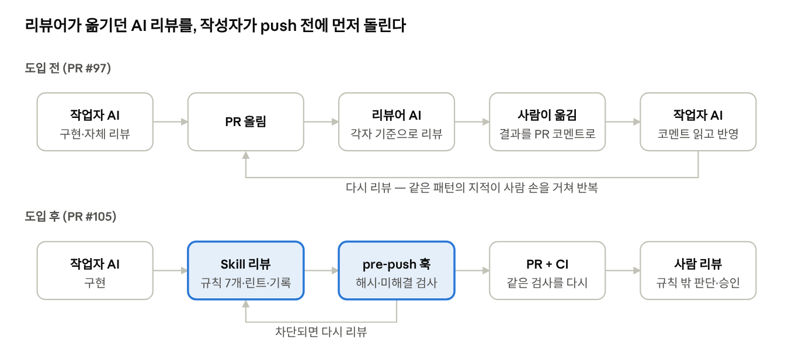

# AI가 쓴 코드, 무엇을 믿고 승인할까: 반복해서 받던 리뷰 코멘트, AI 리뷰로 먼저 고치기

## 코드는 빨라졌는데, 리뷰는 그대로다

요즘 코드 작성을 AI에게 전부 맡기고 결과물은 읽지 않는다는 이야기가 자주 들린다. 아직은 부족하더라도, 사람이 코드를 점점 덜 보는 쪽으로 가고 있다는 것은 분명하다. 그래도 우리 코드에 대한 책임은 우리에게 남는다. 책임을 지려면 AI가 쓴 코드를 검증해야 하고 그 검증은 결국 사람의 코드 리뷰로 돌아온다. 여기서 리뷰가 병목이 된다. AI는 코드를 만드는 비용을 크게 낮췄지만 그 코드를 사람이 이해해야 한다는 조건까지 없애지는 못했기 때문이다.

우리 팀은 이 상황을 극단적인 형태로 겪었다. 우아한테크코스 팀 빌딩에서 프론트엔드 팀원을 구하지 못해 백엔드 개발자 3명이 화면까지 만들어야 했다. 프론트 경험이 거의 없으니 구현은 각자의 AI 에이전트(Claude Code, Codex)에 맡겼다. 코드는 나왔지만 그 코드가 맞는지는 우리가 한 줄씩 읽고 판단하기는 어려웠다. 리뷰를 어떻게 해야 할지 감조차 잡히지 않았다.

처음에는 이 문제를 "AI가 우리 의도대로 코드를 쓰게 하자"는 쪽에서 풀려 했다. 팀이 지켜야 한다고 생각한 규칙을 미리 정해 에이전트에게 주는 것으로, 우리는 이것을 하네스라고 불렀다. 당시 막으려던 이탈은 세 가지였다.


- 공통 레이아웃을 무시하고 화면을 새로 작성한다.
- 요청하지 않은 라이브러리를 끌어온다.
- AI가 임의로 정한 스펙대로 구현한다.

이 예상은 실제와 달랐다. 두 달 뒤 우리가 실제로 만든 것은 생성을 통제하는 규칙이 아니라, 반복해서 받던 리뷰 코멘트를 작성자 쪽에서 먼저 처리하는 AI 리뷰 자동화였다. 이 글은 그 과정을 시간순으로 따라간다. 무엇을 예상했고, 무엇이 실제로 문제였고, 무엇을 자동화했고, 무엇을 사람에게 남겼는지다.

## 첫 시도: 규칙을 미리 정해 문서로 주었다 (8월)

8월 초에 기업 사례를 조사해 보니 크게 두 갈래가 있었다. 하나는 회사 단위로 에이전트 인프라를 만들어 Slack과 웹에서 공유하는 방식이고 다른 하나는 Rules(무엇을 지킬지)와 Skills(어떤 순서로 작업할지)를 마크다운으로 작성해 각자의 에이전트가 읽게 하는 방식이다. 전자는 "3명이 각자 로컬에서 만드는 코드를 통일한다"는 우리 문제와 층위가 달랐고 새 인프라가 필요했다. 코드도 근거도 거의 없는 단계에서 가장 빨리 시작할 수 있는 후자를 골랐다.

8월 13일, 첫 하네스를 PR로 올렸다. Rules/Skills 분리는 우아한형제들 사례에서, "AI가 임의로 정한 스펙이 있으면 구현 전에 멈춘다"는 스펙 태깅 게이트는 바이버스 사례에서 가져왔다. 근거도 시간도 부족해서 규칙은 최소한만 정했다. 이 PR이 곧 팀 합의를 구하는 자리였다.

세 가지가 겹치면서 합의에 이르지 못했다.

- 팀원은 프론트 규칙이 왜 필요한지 판단하지 못했다. 리뷰에 "아예 모르는 분야라 난해하다"는 말이 그대로 남아 있다. 매 요청에 붙는 규칙 문서의 토큰 부담도 지적받았다.
- 그 사이 프론트를 Thymeleaf에서 React로 전환하면서 SSR을 전제로 쓴 규칙이 통째로 맞지 않게 됐다.
- 계획에 있던 "적용하며 걸리는 지점을 기록한다"는 단계는 실행되지 못했다.

PR은 9월 18일에 닫혔다. 돌아보면 실패의 원인은 하나, 규칙이 겪어 본 문제가 아니라 상상한 문제에서 나왔다는 점이다. 그러니 팀원은 규칙이 맞는지 판단할 수 없었고 전제가 바뀌자 규칙도 같이 무효가 됐다.

## 규칙 없이 개발하자, 리뷰가 사람 손을 거쳐 반복됐다 (9월 20일)

첫 하네스가 닫히고 이틀 뒤, React로 이식한 첫 화면 PR이 올라왔다. 작업자는 자기 에이전트로 AI 리뷰를 한 번 거친 뒤 PR을 올렸다. 그런데 리뷰어 둘이 각자의 에이전트로 다시 리뷰를 돌리자 문제가 계속 나왔다. 리뷰 → 수정 → 재리뷰를 거치는 동안 같은 종류의 지적이 되풀이됐고 두 번째 리뷰에서야 나온 지적까지 다 합치니 8건이었다.

실제 문제는 예상과 달랐다. 레이아웃이나 라이브러리 문제는 하나도 없었고 8건은 모두 **비동기 요청과 상태 관리 결함**이었다.

- 검색 조건을 빨리 바꾸면 늦게 도착한 예전 응답이 새 결과를 덮어썼다.
- 불러오는 중과 요청 실패가 모두 "0건"으로 보였다.
- 첫 화면에서 요청이 실패해도 안내가 없고, 버튼을 연타하면 요청이 중복됐다.
- 고정 타이머로 만든 로딩 화면이 실제 조회보다 먼저 사라졌다.
- 검색어 끝의 공백이 입력 도중에 지워져 두 단어를 이어 칠 수 없었다.

에이전트마다 짚은 지점은 달랐지만 종류는 같았다. 팀에 공통 기준이 없다는 신호였다. 비용의 대부분은 사람이 졌다. 리뷰어가 자기 에이전트의 결과를 읽고 PR 코멘트로 옮기면, 작업자가 그 코멘트를 다시 자기 에이전트에 읽혀 반영하는 식이었다. AI와 AI 사이를 사람이 손으로 잇고 있었다.

여기서 방향을 바꿨다. 문제는 AI가 코드를 잘못 쓰는 것보다, 같은 종류의 리뷰가 매번 사람 손을 거쳐 반복된다는 데 있었다. 그렇다면 자동화할 대상은 코드 생성이 아니라 반복되는 리뷰였다.

## 두 번째 시도: 실제 리뷰 코멘트에서 기준을 뽑아 AI 리뷰를 자동화했다 (9월 28일)

일주일 뒤 올린 두 번째 하네스는 첫 시도와 세 가지가 달랐다.

**규칙의 출처를 바꿨다.** 상상해서 쓴 규칙 대신, #97의 리뷰 지적 8건에서 규칙 7개(비동기 요청 5개, 상태 모델 2개)를 뽑았다. 각 지적을 "코드만 보고 기계적으로 판정할 수 있는가"로 나눠 가능한 것은 린트(Biome)로 넘기고 AI 판단이 필요한 것만 규칙 문서에 남겼다. 규칙 본문에는 특정 화면 대신 "왜 문제인지"와 "무엇을 확인할지"만 적어 다른 화면에도 쓰이게 했다.

| 규칙                                       | 구분 | 출처가 된 #97 지적                |
|------------------------------------------|----|-----------------------------|
| ASYNC-1 늦게 도착한 응답이 새 상태를 덮지 않는다          | 필수 | 조건을 빨리 바꾸면 예전 목록이 새 조건을 덮음  |
| ASYNC-2 불러오는 중·실패·빈 결과를 구분해 보여준다         | 필수 | 로딩 중과 오류가 모두 "0건"으로 보임      |
| ASYNC-3 요청 중엔 조작을 잠그고, 실패는 그 화면에서 알린다    | 필수 | 실패 안내 없음, 연타하면 요청 중복        |
| ASYNC-4 로딩 표시는 실제 요청과 함께 끝난다             | 필수 | 고정 타이머 로딩이 조회보다 먼저 끝남       |
| ASYNC-5 응답이 왔을 때 사용자가 떠났으면 화면을 옮기지 않는다   | 권장 | 다른 화면으로 가도 결과 화면으로 끌려감      |
| STATE-1 사용자 입력을 가공한 값으로 되돌려 쓰지 않는다       | 필수 | 검색어 끝 공백이 입력 도중 지워짐         |
| STATE-2 여러 경로로 들어오는 화면의 돌아갈 위치를 덮어쓰지 않는다 | 권장 | 상세에서 목록으로 재진입하면 돌아갈 곳이 빈 화면 |

필수·권장은 당시 리뷰어가 붙인 구분(BLOCKER·MAJOR / "함께 고치면 좋음")을 그대로 따랐다.

**AI 리뷰를 작성자의 로컬 세션에 먼저 두었다.** 작업자가 push하기 전에 자기 에이전트 세션 안에서 `frontend-review` Skill을 실행한다. Skill은 규칙 파일마다 리뷰어를 병렬로 띄워 리뷰하고, 지적을 반영하거나 기각 근거를 적게 하고, 린트를 돌린 뒤 기록을 남긴다. 리뷰어가 AI 결과를 PR 코멘트로 옮기고 작업자의 에이전트가 그것을 다시 읽는 왕복이 줄어든다. LLM은 각자 로그인한 에이전트 세션에서만 돌고, 훅과 CI에는 LLM 호출도 API 키도 없다.

**강제 장치를 바꿨다.** 리뷰를 거쳤는지는 LLM 없이 `frontend/` diff의 해시로 검사한다. Skill이 리뷰를 마칠 때 그 시점의 diff 해시를 기록에 남기고 pre-push 훅은 지금 코드의 해시와 비교한다. 리뷰 뒤에 코드를 고쳤거나, 필수 지적을 미해결로 두었으면 push가 막히고 CI가 PR마다 같은 검사를 다시 한다.

| 상황                | 결과          |
|-------------------|-------------|
| 리뷰 → 커밋 → push    | 통과          |
| 리뷰 없이 push        | 차단          |
| 리뷰 뒤 코드 수정        | 차단 (해시 불일치) |
| 필수 지적 미해결         | 차단          |
| 필수 지적 기각 + 권장 미해결 | 통과          |
| 백엔드만 변경           | 통과          |



도입 전에는 사람이 AI 사이를 잇는 단계가 PR 뒤에 있었다. 도입 후에는 규칙 리뷰와 그 검사가 push 앞으로 옮겨졌고 사람은 규칙 밖의 판단에 집중한다.

**고려한 대안.** 이 구조에 이르기 전에 몇 가지를 검토하고 제외했다.

| 방법                                | 제외한 이유                                                                 |
|-----------------------------------|------------------------------------------------------------------------|
| 규칙 문서만 두고 강제 장치 없음                | 리뷰를 거쳤는지 보장할 수 없다                                                      |
| 각자의 에이전트를 그대로 사용                  | 실제로 해 보니 리뷰어 AI마다 다른 문제를 짚고, 사람이 결과를 옮기는 비용이 컸다 (#97)                  |
| 자체 에이전트 구축 (VoltAgent)            | 각자의 구독 계정으로 호출할 수 없어 API 비용이 든다                                        |
| AI가 PR 코멘트를 직접 달게 하기 (봇·브라우저 자동화) | 브라우저로 PR을 오가며 코멘트를 달게 하면 토큰을 많이 쓰고 느리다. 저장소와 PR 권한을 더 넓게 주어야 하는 점도 걸렸다 |
| CI에서 LLM 리뷰                       | 한 사람의 인증 정보로 팀 전체 요청을 처리해야 하고, 결과가 매번 달라 통과·차단을 가르는 게이트로 쓸 수 없다        |

살린 것은 "LLM 리뷰는 각자의 에이전트에서, 리뷰를 거쳤는지는 결정적인 검사로" 하나다.

**팀의 반응이 달랐다.** 첫 시도의 리뷰가 "난해하다"였다면 이번 리뷰에서는 팀원들이 검사 로직의 허점을 짚고 리뷰 기록이 저장소에 계속 쌓이는 점을 지적했다. 규칙이 팀이 실제로 겪은 버그에서 나왔기 때문으로 보인다. 버그를 같이 겪었으니 규칙이 맞는지 판단할 수 있었다.

## 써 보면서 고쳤다: 리뷰 기록을 커밋 트레일러로 옮겼다 (10월 7일)

첫 버전은 리뷰 기록을 `.review/` 폴더에 브랜치마다 마크다운 파일로 남기고 커밋했다. 지적 목록, 항목별 상태(해결·기각), 기각 근거가 모두 저장소에 남았다. 그런데 이 파일은 브랜치가 머지된 뒤에도 develop에 그대로 남아, 검사에는 더 쓰이지 않는데도 10월 2일 기준 17개까지 쌓였다. #105 리뷰에서 팀원이 짚었던 문제가 그대로 실현됐다.

그래서 기록을 커밋 트레일러 한 줄로 옮겼다.

```
Frontend-Review: hash=<diff 해시> base=<기준 브랜치> unresolved=<미해결 필수 항목 수>
```

검사 스크립트는 기준 브랜치 이후 커밋의 트레일러를 읽어 해시가 push하는 코드와 맞고 `unresolved=0`이면 통과시킨다. 커밋 메시지는 해시 계산에 들어가지 않으므로, 해시를 구한 뒤 트레일러를 붙여도 값이 그대로다. 이미 push한 뒤라도 빈 커밋에 붙여 올릴 수 있다.

대가도 있다. 지적 목록과 기각 근거가 더는 저장소에 남지 않고, 검사도 `unresolved` 숫자만 본다. 에이전트가 리뷰를 마칠 때 작성자에게 보고하는 것으로 갈음했다. 가볍게 만드는 대신 추적 가능성을 내어놓은 선택이다.

이 PR의 리뷰에서도 검사 로직의 결함이 하나 나왔다. 같은 코드에 예전 `unresolved=0` 트레일러가 있으면, 재검토에서 필수 문제가 나와 `unresolved=1`을 남기더라도 예전 기록으로 통과하는 문제다. 가장 최신 트레일러 하나만 보도록 고치면서 게이트 자체도 리뷰를 거쳐 다듬어졌다.

## 세 번째: 리뷰 코멘트를 다시 모아 기준을 보완했다 (10월 30일)

자동 리뷰를 거친 PR에서도 팀원의 AI 리뷰가 문제를 찾는 일은 이어졌다. 자동 리뷰가 무엇을 놓치는지 보려고, 도입 뒤 한 달 동안 올라온 프론트엔드 PR 31개의 리뷰 24건을 모두 모았다.

기존 규칙 7개에 걸리는 지적은 0건이었고 리뷰어의 에이전트가 규칙 위반을 놓친 사례도 없었다. 반복된 지적은 모두 규칙 밖에 있었고 PR 작성자가 누구든 같은 패턴이었다.

- 이전 상태가 다음 흐름에 남는다. 설문을 다시 시작해도 예전 설문 캐시를 쓰는 식이다.
- 화면에 보이는 값이 실제 요청이나 문서와 다르다. 검색 중 화면이 수정 전 사양을 보여 주는 식이다.
- URL 쿼리를 검증하거나 정제하지 않는다. 허용 목록이 없거나, 일회성 파라미터가 주소에 남는 식이다.
- 핵심 흐름에 자동 테스트가 없다.

어떤 패턴을 규칙으로 만들지는 **지적이 실제로 반영됐는지**로 가렸다. 앞의 세 패턴은 14건 중 13건이 작은 수정 커밋으로 반영됐고 모두 특정 순서로 조작하면 재현되는 사용자 버그였다. 반대로 "자동 테스트가 없다"는 지적은 5건 모두 반영되지 않았다. 다섯 코멘트가 같은 문장으로 시작했고 세 작성자가 다섯 번 모두 반영하지 않았다. 코드를 보고 내린 판단이라기보다 리뷰 프롬프트의 고정 항목으로 보였다. 그래서 이 항목은 규칙에서 뺐고 테스트를 요구할지는 규칙이 아니라 팀이 따로 결정할 일로 넘겼다.

그리고 상태 모델에 "이전 상태 정리"와 "표시값·요청값 일치"를, 새 URL 상태 규칙에 "허용 목록 검증"과 "일회성 파라미터 제거"를 더해 규칙 4개를 추가했다. 허용 목록 검증은 이미 ADR로 정해 둔 것인데 자동 리뷰가 확인하지 않고 있었다. 확인 항목은 코드 형태가 아니라 "A 하고 B 한 뒤 돌아오면"같은 조작 순서로 적어 리뷰어가 시나리오를 따라가게 했다.

하나는 규칙으로 만들 수 없었다. "구현이 PR 본문·이슈·문서와 다르다"는 지적은 어느 쪽이 틀린 것인지가 매번 다르다. 대신 Skill에 **대조 리뷰어**를 규칙 리뷰어와 따로 두었다. PR 본문과 연결된 이슈, 언급된 ADR을 읽고 구현과 다른 점을 보고하되, 어느 쪽이 맞는지는 판단하지 않고 고칠 쪽은 작성자가 정한다.

\#97의 지적에서 첫 규칙을 뽑았듯, 도입 뒤 PR들의 지적에서 규칙을 더했다. "반복된 리뷰 코멘트에서 규칙을 사후에 추가한다"는 원칙은 한 번의 우연으로 끝나지 않고 운영 방식이 됐다.

## 해 보니 무엇이 달라졌나

**리뷰의 기준이 하나가 됐다.** 작업자마다 각자의 기준으로 돌리던 AI 리뷰를, 이제는 모두가 같은 규칙과 같은 린트로 돌린다. 규칙에 있는 문제는 push하기 전, 작성자의 세션 안에서 걸러지며 사람의 PR 리뷰는 그대로 한다.

**리뷰가 빠짐없이 돌았다.** 도입 뒤 한 달 동안 프론트엔드를 바꾼 PR 중 develop에 머지된 29개가 모두 리뷰 기록을 남겼다. 트레일러가 3\~4개 붙은 PR도 있는데, 리뷰 → 수정 → 재리뷰를 그만큼 반복했다는 뜻이다.

**PR에 달리는 지적이 줄었다.** 도입 전 #97에는 지적이 8건 달렸다. 도입 뒤 29개 중 14개는 지적 없이 승인됐고 나머지도 PR당 1\~4건으로, 전체 평균은 약 1건이다. 리뷰어가 AI 리뷰 결과를 코멘트로 옮기는 일도 크게 줄었다. 다만 비교 기준이 PR 한 개(#97)라 참고치로 봐야 한다.


지적이 달린 PR도 대부분 1\~2건에 그쳤다. 4건이 달린 PR 2개는 PostHog 연동과 제품 목록 상세 화면처럼 변경이 큰 PR이었다.

**규칙이 다루는 문제는 push 전에 걸러졌다.** 도입 뒤 리뷰 24건 중 기존 규칙에 걸리는 지적은 0건이었고 리뷰어의 에이전트가 규칙 위반을 놓친 사례도 없었다. 남은 지적은 모두 규칙 밖의 영역이었다. #105를 만들 당시에는 LLM 리뷰가 규칙 위반을 놓칠 것을 우려했다. 처음 보는 #110 코드에서 규칙에 문자 그대로 적힌 위반을 3번 중 2번 놓쳤기 때문이다. 실제 운영에서는 리뷰어 리뷰까지 통과한 규칙 위반이 없었다.

**규칙이 과거 문제를 다시 잡아냈다.** #97 첫 리뷰 시점의 코드를, 당시 코멘트를 알려 주지 않고 3번 리뷰하게 했다. 규칙화한 지적 7건을 3번 모두 찾았고 잘못된 지적은 0건이었으며 필수·권장 구분도 당시 리뷰어와 일치했다. 원래 두 번째 리뷰에서야 나온 지적을 첫 리뷰 시점에 잡았다. #305의 새 규칙도 같은 방식으로 검증했다. 근거가 된 PR의 반영 전 코드에서 규칙 5건을 당시와 같은 줄에서 잡았고 당시 리뷰에 없던 실제 문제 2건도 찾았다. 다만 규칙을 그 코드에서 뽑았으니 과적합된 결과로, 규칙이 문제를 재현할 만큼 구체적이라는 것까지만 보여 준다.

**판단은 여전히 사람이 했다.** 자동화한 것은 반복되는 리뷰이지 판단이 아니다. 어떤 코멘트를 기준으로 만들지는 사람이 반영률을 보고 정했고 테스트 요구처럼 반영되지 않은 코멘트는 의도적으로 뺐다. 대조 리뷰어도 어느 쪽이 맞는지 판단하지 않고 어긋남만 보고하며 고칠 쪽은 사람이 정한다. 사람의 PR 리뷰와 승인도 그대로 남았다. 다만 판단을 미룰 수는 없다. 필수 지적을 미해결로 두거나 리뷰 뒤 코드를 바꾸면 push와 CI가 막는다. 사람이 하는 것은 판단이고 기계가 하는 것은 판단을 건너뛰지 못하게 하는 일이다. 달라진 점은, 사람이 반복되는 코멘트 대신 규칙 밖의 판단에 집중하게 됐다는 것이다.

**흔히 제안되는 처방을 실제로 해 본 셈이다.** AI 시대의 리뷰 병목을 다룬 글들은 대개 비슷한 처방을 내놓는다. 우리가 한 일은 그 처방과 하나씩 짝지어진다.

| 흔히 제안되는 처방              | 우리가 실제로 한 것                         |
|-------------------------|-------------------------------------|
| 기계적인 검사는 자동화한다          | Biome 린트와 pre-commit 훅              |
| 사람보다 AI가 먼저 리뷰한다        | push 전, 작성자의 로컬 세션에서 Skill로 리뷰      |
| 리뷰 여부는 결정론적으로 보장한다      | diff 해시를 pre-push 훅과 CI가 검사         |
| AI 지적의 반영률을 보고 규칙을 조정한다 | 반영률로 규칙 후보를 고르고, 반영되지 않은 테스트 지적은 제외 |
| 사람은 판단이 필요한 곳에 집중한다     | 29개 PR 중 14개가 지적 0건, 남은 지적은 규칙 밖 영역 |

다만 3명이 한 달 동안 29개 PR에서 얻은 현장 기록이다. 일반화된 증명이 아니라, 처방이 실제 팀에서 어떻게 작동했는지 보여 주는 한 사례로 읽어야 한다.

## 언제 쓰면 위험한가

**근거 없이 규칙을 미리 정할 때.** 겪어 보지 않은 문제로 만든 규칙은 팀원이 판단할 수 없고 전제가 바뀌면 통째로 무효가 된다. 우리의 첫 시도가 그랬다. 처음에는 규칙 없이 시작하고, 리뷰에서 같은 지적이 반복된 뒤에 규칙을 추가하는 편이 낫다.

**검사가 실제로 막는지 확인하지 않았을 때.** CI 잡을 추가했다고 머지가 막히지는 않는다. 우리 저장소에서도 `review-record` 잡은 룰셋의 필수 검사로 등록되어 있지 않다. 그래서 `--no-verify`로 훅을 건너뛰면 CI는 실패를 표시할 뿐 머지를 막지 못한다. 등록하지 않은 이유도 있다. develop에서 main으로 가는 배포 PR의 `frontend/` diff는 여러 기능 브랜치가 합쳐진 것이라 어느 리뷰 기록의 해시와도 맞지 않는다. 그래서 배포 PR에서는 검사를 건너뛰게 했고 필수 검사로 걸면 배포가 막힌다. develop 룰셋에만 등록하는 방법은 남아 있다.

**LLM 리뷰 결과를 그대로 믿을 때.** 두 가지를 조심해야 한다. 첫째, 규칙을 만든 코드로 규칙을 검증하면 결과가 좋게 나올 수밖에 없다. #105와 #305의 재현 검증은 모두 이 방식이라, 규칙이 문제를 재현할 만큼 구체적이라는 것까지만 보여 준다. 둘째, 처음 보는 코드에서는 다르다. #110 코드에서 LLM 리뷰는 규칙에 문자 그대로 적힌 위반을 3번 중 2번 놓쳤다. 운영 결과가 이 우려보다 좋았던 것은 LLM 한 번을 믿은 결과가 아니다. 리뷰를 거쳤는지는 결정적인 검사가 보장했고 리뷰어의 AI 리뷰가 한 겹 더 있었다. LLM 리뷰는 리뷰를 돕는 데 쓰고 통과·차단 판정은 결정적인 검사에 맡겨야 한다.

**반영되지 않는 지적이 반복될 때.** "자동 테스트가 없다"는 지적은 다섯 번 모두 같은 문장으로 시작했고 다섯 번 모두 반영되지 않았다. 이런 지적이 계속 올라오면 정작 봐야 할 지적이 묻힌다. 지적의 횟수가 아니라 반영 여부를 봐야 진짜 문제를 가릴 수 있다. 리뷰 프롬프트에 고정 항목이 있다면 그것부터 의심해야 한다.

**규칙 밖의 영역을 놓칠 때.** 우리 규칙은 비동기 요청, 상태 모델, URL 상태만 다룬다. 폴더 구조, 컴포넌트 분리, 네이밍 같은 설계 기준은 아직 없어서, 이 영역은 여전히 에이전트마다 다르게 작성될 수 있다. 규칙 밖의 지적은 주기적으로 모아 보고 반영된 것부터 규칙으로 옮겨야 한다.

**덜어낼 것과 남길 것을 구분하지 않을 때.** 모델이 좋아지면서 하네스를 덜어내는 흐름이 있다. 덜어낼 대상은 AI가 코드를 잘 쓰도록 판단을 대신해 주던 비계다. 매 요청에 붙는 긴 전역 지침, 미리 상상해서 쓴 규칙이 여기에 속한다. 우리의 첫 시도가 바로 그랬다. 반면 반복되는 리뷰를 자동화한 장치는 모델이 좋아져도 남는다. 기준은 팀의 리뷰 코멘트와 팀의 결정(ADR)에서 나왔기에 모델이 스스로 알 수 없다. 리뷰를 거쳤는지 막는 검사는 LLM이 아니라 git으로 돌기에 모델 발전과 무관하다. 둘을 구분하지 않고 함께 덜어내면, 리뷰 병목은 다시 사람에게 돌아온다.

## 그래서 무엇을 믿고 승인하나

규칙 안의 문제는 작성자의 AI 리뷰가 그 코드를 봤고 필수 지적마다 답했다는 기록을 믿는다. diff 해시와 커밋 트레일러의 `unresolved=0`이 그 기록이다. 규칙 밖의 문제는 리뷰어와 리뷰어의 AI가 본다. 승인은 여전히 사람이 한다.

자동화한 것은 반복되는 리뷰이고, 기계가 하는 일은 그 리뷰를 건너뛰지 못하게 하는 것이다. 프론트를 모르는 백엔드 3명이 이 장치를 만든 것은 코드를 직접 볼 수 없는 상황을 극단까지 몰아가 본 것이지, 검증을 AI에게 넘기기 위해서가 아니다. 리뷰가 병목인 팀이라면, 각자의 AI 리뷰를 PR 코멘트로 옮기는 일을 어떻게 줄일지부터 찾아보기를 권한다. 반복되는 코멘트는 이미 쌓여 있다.
