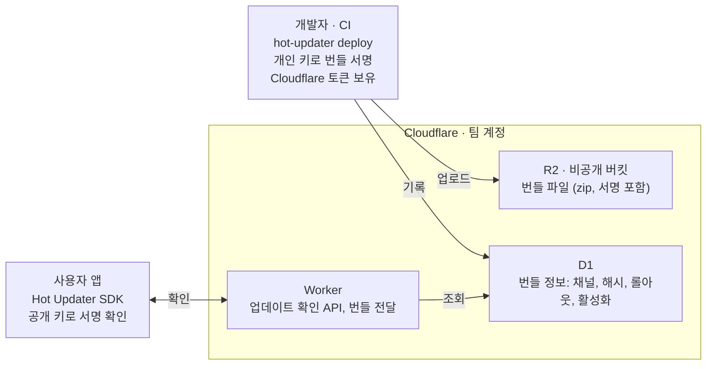
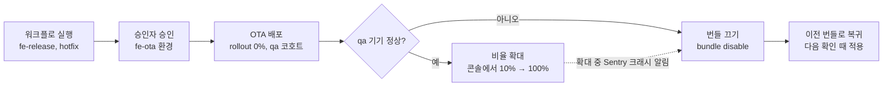

# 여기담 앱에 OTA를 붙이기까지

## 요약

여기담은 bare React Native로 만든 앱이다. 버그를 고칠 때마다 스토어 심사를 기다리는 게 답답해서, 프론트엔드 팀은 JS 수정분을 심사 없이 내려보낼 수 있는 OTA(Over-The-Air) 업데이트를 넣기로 했다. 조건은 하나였다. 돈을 거의 쓰지 않을 것.

이 글은 여기담 팀원, 그리고 bare React Native 앱에 OTA를 검토하는 개발자를 위해 썼다. 도구와 인프라를 고른 근거, 호환성 전략, 보안 설정, 배포 절차 설계를 다루고, 네이티브 코드 연동 방법은 다루지 않는다. 내용은 2026년 11월 2일, Hot Updater 1.1.4 기준이다.

도입하면서 정한 것을 표로 먼저 추려 둔다. 근거는 괄호 안의 장에서 다룬다.

| 정한 것 | 결과 | 이유 |
| --- | --- | --- |
| 도구 (2장) | Hot Updater | bare RN 구성을 바꾸지 않고, 셀프호스팅이라 비용이 거의 없음 |
| 인프라 (3장) | Cloudflare (R2, D1, Workers) | 쓸 수 있는 AWS 계정의 권한으로는 필요한 리소스를 만들 수 없음. R2는 전송 비용이 무료 |
| 호환성 전략 (4장) | fingerprint | 네이티브가 다른 앱에 번들이 가서 생기는 크래시를 배포 단계에서 차단 |
| 보안 (5장) | 번들 서명 + 토큰 분리 | 배포 키가 새도 서명 없는 번들은 앱이 거부 |
| 배포 절차 (6장) | 수동 실행 + 단계적 롤아웃 (설계안) | 심사가 하던 확인을 승인과 qa 검증으로 대신함 |

11월 2일 현재 설정 파일과 Cloudflare 인프라, 서명 키, fingerprint 기준 파일까지는 개발 브랜치에 들어갔다. 앱 네이티브 코드에 연동하는 작업과 배포 워크플로는 아직 남아 있다.

## 1. 왜 OTA가 필요했나

웹이라면 고친 코드를 배포하는 순간 사용자에게 반영된다. 앱은 그렇지 않다. 버그 한 줄을 고쳐도 바이너리를 새로 빌드해 App Store와 Google Play 심사를 받아야 하고, 심사를 통과한 뒤에도 사용자가 스토어에서 업데이트를 눌러야 수정이 닿는다.

여기담은 React Native 0.86 기반 bare 앱으로, Hermes 엔진과 New Architecture를 쓰고 오류는 Sentry로 추적한다. 화면과 로직 대부분이 JavaScript(TypeScript)라 실제로 터지는 버그도 대개 JS 쪽에서 나온다. 고칠 곳이 JS라면 스토어를 거치지 않고 고칠 방법이 있지 않을까 하는 데서 이번 작업이 시작됐다.

### OTA로 바꿀 수 있는 것과 없는 것

React Native 앱은 스토어를 통해 설치되는 네이티브 바이너리와, 그 안에서 실행되는 JS 번들로 나뉜다. OTA가 바꾸는 건 뒤쪽뿐이다. 앱이 켜질 때 서버에 새 번들이 있는지 묻고, 있으면 내려받아 다음 실행부터 그 번들로 돈다.

| 바꾸는 것 | 스토어 배포 | OTA 배포 |
| --- | --- | --- |
| JS 코드, 문구, 스타일, 이미지 | 가능 | 가능 |
| 네이티브 코드, 네이티브 라이브러리 | 가능 | 불가능 |
| 권한, 앱 아이콘, Info.plist 값 | 가능 | 불가능 |
| 사용자에게 닿는 시간 | 수 시간~수 일 | 수 분 (다음 실행 시) |

### 대신 생기는 문제

그렇다고 OTA가 공짜인 건 아니다. 도입 전에 팀에서 걸린 점이 몇 가지 있었다.

가장 먼저 나온 얘기는 품질 게이트였다. 심사는 느리지만 우리 코드를 한 번 더 보는 눈이기도 했는데, OTA는 잘못된 코드까지 몇 분 만에 전체 사용자에게 보낸다.

버전 조합도 문제다. 사용자 기기마다 바이너리 버전과 번들 버전이 따로 놀게 되는데, 네이티브가 다른 바이너리에 새 JS가 내려가면 존재하지 않는 네이티브 함수를 부르다 앱이 죽는다.

스토어 정책도 확인해야 했다. Apple 가이드라인 3.3.1(b)는 앱의 핵심 목적을 바꾸는 코드 다운로드를 금지한다. 그래서 OTA는 버그 수정과 UI 개선에만 쓰고, 새 기능은 지금처럼 스토어로 내기로 했다.

뒤에 이어지는 결정 대부분은 이 문제들을 어떻게 줄일지에 대한 답이다. 여기에 예산 문제가 겹쳤다. 팀에는 유료 서비스를 구독할 돈이 없었다.

### 이 글에서 쓰는 용어

| 용어 | 뜻 |
| --- | --- |
| 바이너리 | 스토어를 통해 설치되는 앱 파일. 네이티브 코드와 기본 JS 번들이 들어 있다 |
| 번들 | JS 코드와 에셋을 묶은 파일. OTA가 바꾸는 대상 |
| Provider | Hot Updater에서 번들 저장소와 데이터베이스를 고르는 플러그인 |
| R2, D1, Workers | Cloudflare의 파일 저장소, 데이터베이스, 서버리스 함수 |
| fingerprint | 네이티브 코드로 계산한 해시. 어떤 앱이 어떤 번들을 받을지 정하는 데 쓴다 (4장) |
| 채널 | 빌드할 때 정해지는 앱 묶음. 예: production, staging (6장) |
| 코호트 | 같은 앱 안에서 기기를 나누는 번호나 이름. 예: `qa` (6장) |
| 롤아웃 | 새 번들을 받을 사용자의 비율 (6장) |

## 2. 도구 고르기

Hot Updater를 골랐다. 셀프호스팅이라 비용이 거의 들지 않고, 지금 빌드 구성을 건드리지 않으면서도 웹 콘솔과 롤아웃 기능을 쓸 수 있었다.

### 후보 추리기

찾아보니 OTA 도구는 생각보다 많았다. 일단 후보를 다 모은 다음, 서비스가 아직 살아 있는지, 구독료나 사용자 수 기반 과금이 있는지, bare RN 빌드를 크게 바꿔야 하는지를 차례로 따져 걸렀다. 앞의 두 조건에 걸리면 제외했고 마지막 조건에 걸리면 뒤로 미뤘다.

| 후보 | 결과 | 이유 |
| --- | --- | --- |
| App Center CodePush | 제외 | 2025년 3월 31일 서비스 종료 |
| Revopush, Stallion, AppZung 등 | 제외 | 구독료가 있어 예산 조건에 맞지 않음 |
| Pushy (react-native-update) | 제외 | 서버가 중국에 있고 문서가 주로 중국어 |
| 직접 구현, react-native-ota-hot-update | 제외 | 롤백, 롤아웃 같은 운영 기능을 직접 만들어야 함 |
| Re.Pack Module Federation | 제외 | 빌드 체계 전체를 바꿔야 함 |
| EAS Update | 비교 기준 | 완성도는 가장 높지만 유료 전환 조건과 Expo Modules 도입 부담 |
| @bravemobile/react-native-code-push | 최종 후보 | 서버 없이 CDN만으로 동작, 비용 최소 |
| Hot Updater | **선택** | 셀프호스팅, 웹 콘솔, 큰 커뮤니티 |

### EAS Update를 쓰지 않은 이유

EAS Update는 가장 널리 쓰이는 도구이고 fingerprint, 채널, 코드 서명까지 다 갖췄다. 걸린 건 무료 플랜 한도였다. 업데이트를 받는 사용자가 월 1,000명을 넘으면 초과 과금도 없이 그냥 막히고, 유료 플랜은 월 19달러부터다. bare RN에서 쓰려면 Expo Modules를 설치해야 해서 빌드 구성도 바뀐다. 같은 기능을 거의 0원에 셀프호스팅할 수 있으니 EAS는 비교 기준으로만 남겼다.

### Hot Updater와 bravemobile 포크

끝까지 남은 두 도구는 구조부터 달랐다. 업데이트 여부를 판단하는 서버가 있느냐 없느냐의 차이다.

| 기준 | Hot Updater | bravemobile 포크 |
| --- | --- | --- |
| 구조 | 업데이트 확인 API(서버리스 함수) + 저장소 | CDN에 올린 릴리즈 기록 JSON + 번들 |
| 운영 화면 | 웹 콘솔 (배포 현황, 롤백, 활성화 전환) | 없음, CLI와 JSON으로 운영 |
| 비용 | 저장소 + 함수 호출 (무료 한도 안에서 $0) | 저장소와 CDN만, 사실상 $0 |
| 커뮤니티 | npm 월 약 15만 다운로드 | npm 월 약 1.8만 다운로드, 한 회사가 관리 |
| 주의할 점 | 장애 지점이 하나 늘어남 | 동시 배포 시 JSON을 서로 덮어쓸 수 있음, 통계 없음 |

비용과 단순함만 보면 bravemobile 포크가 앞섰다. 그래도 팀원 여럿이 배포 상태를 같이 보고, 문제가 생기면 누구든 콘솔에서 번들을 끌 수 있어야 한다고 판단했다. 한 회사가 관리를 그만두면 업데이트가 끊길 수 있다는 점도 마음에 걸렸다. 서버가 있어서 드는 비용은 다음 장의 인프라 선택으로 해결했고, 장애 위험은 받아들이기로 했다. 업데이트 확인이 실패해도 앱은 원래 번들로 그대로 실행되기 때문이다.

### Hot Updater의 구조

Hot Updater는 번들을 만들어 올리는 CLI, 서버, 앱에 들어가는 SDK로 이뤄진다. 서버는 번들 파일을 두는 저장소와 번들 정보를 담는 데이터베이스, 업데이트 확인 API로 구성되는데, 어떤 저장소와 데이터베이스를 쓸지는 플러그인으로 고른다. 문서에서는 이 플러그인을 Provider라고 부른다.

새 번들을 받았다고 바로 믿지는 않는다. 받은 번들은 임시 상태로 실행되다가 첫 화면이 그려진 뒤에야 정상 번들로 인정되고, 그 전에 앱이 죽으면 한 번 더 시도한 뒤 이전 번들로 돌아간다. 다만 첫 화면 이후에 나는 크래시는 자동으로 되돌리지 못해서, 이 빈틈은 6장에서 배포 절차로 메웠다.

## 3. 인프라 정하기

처음엔 AWS로 정했다가 같은 날 Cloudflare로 바꿨다. Hot Updater의 AWS 구성은 IAM 역할, DynamoDB, SSM Parameter Store 같은 리소스를 자동으로 만드는데, 팀이 쓸 수 있는 AWS 계정에는 그 권한이 없었다. 서버를 직접 띄워 우회할 수도 있었지만, 서버 운영을 프론트엔드 팀이 떠안게 돼서 다른 Provider를 찾기로 했다.

### 다른 Provider 비교

Hot Updater가 지원하는 다른 Provider는 Cloudflare, Supabase, Firebase다. 셋 다 init으로 자동 구성되고 계정을 팀이 직접 가진다. 차이는 전송량 과금에서 났다.

OTA는 같은 번들을 모든 사용자에게 반복해서 보낸다. 번들 2MB, 사용자 1만 명, 한 달에 4번 배포로 잡으면 전송량이 80GB쯤 된다. 전송량에 과금하는 서비스라면 사용자가 늘고 배포가 잦아질수록 비용도 같이 커진다.

| 기준 (월 사용자 1만 명) | Cloudflare | Supabase | Firebase |
| --- | --- | --- | --- |
| 구성 | R2 + D1 + Workers | Storage + Postgres + Edge Functions | Storage + Firestore + Functions |
| 전송 비용 | 무료 | 월 약 5GB 초과 시 과금 | 종량제 |
| 예상 월 비용 | $0 | $25부터 | $0~소액, 예측 어려움 |
| 카드 등록 | R2 구독에 필요 | 불필요 | 필요 (Blaze 플랜) |
| 가용성 | 높음 | 활동이 없으면 일시정지 | 높음 |

Cloudflare R2는 저장 10GB, 쓰기 작업 월 100만 건, 읽기 작업 월 1,000만 건까지 무료이고 전송 비용은 아예 받지 않는다. Workers도 하루 10만 요청까지 무료다. 사용자 한 명이 하루 세 번 앱을 연다고 치면 하루 요청이 10만 건을 넘는 건 사용자가 3만 명쯤 됐을 때인데, 그때 붙는 유료 플랜도 월 5달러다. 그래서 Hot Updater + Cloudflare로 정했다. 최종 구성은 그림 1과 같다.

*그림 1. Hot Updater + Cloudflare 최종 구성*

앱이 아는 주소는 Worker 하나뿐이고, 번들을 올리고 기록하는 권한은 CI에만 있다.

### 감수한 것

Cloudflare를 쓰면서 떠안은 것도 있다. 외부 계정이니 결제, 계정 관리, 인수인계를 팀이 직접 해야 한다. 그래서 계정은 팀 공용 이메일로 만들고 팀원 전원이 2단계 인증을 켜기로 했다.

R2는 무료로 쓰더라도 결제 수단을 등록하는 구독 절차를 거쳐야 해서, 사용량 알림을 걸어 예상치 못한 과금에 대비했다. 무료 플랜이라 가용성 보장(SLA)도 없지만, 업데이트 확인이 실패해도 앱은 기존 번들로 돌기 때문에 장애가 나도 새 업데이트가 늦게 도착하는 정도로 끝난다.

## 4. 호환성 전략

Hot Updater 설정의 `updateStrategy`를 무엇으로 할지가 가장 오래 고민한 부분이고, `fingerprint`로 정했다. 이 설정값은 첫 바이너리에 같이 들어가서 출시한 뒤에는 바꾸기 어렵다. 바꿔도 이미 설치된 앱에는 적용되지 않는다.

### updateStrategy가 정하는 것

1장에서 말한 버전 조합 문제를 막는 장치다. 설치된 앱마다 이름표가 붙어 있고, 번들에는 어떤 이름표를 단 앱이 받을지가 적혀 있다. `updateStrategy`는 이 이름표로 앱 버전(`appVersion`)과 네이티브 코드 해시(`fingerprint`) 중 무엇을 쓸지 정한다.

| | appVersion | fingerprint |
| --- | --- | --- |
| 앱의 이름표 | 마케팅 버전 (예: 2.1.0) | 네이티브 코드로 계산한 해시 |
| 번들의 대상 | 배포할 때 사람이 지정 | 배포할 때 현재 코드로 자동 계산 |
| 번들을 받는 앱 | 버전이 같은 앱 | 해시가 같은 앱 (버전은 보지 않음) |
| 추가로 관리하는 파일 | 없음 | `fingerprint.json` |

### 해시에 들어가는 것과 빠지는 것

처음엔 fingerprint가 당연히 더 안전해 보였다. 판단이 복잡해진 건 Hot Updater 코드와 우리 CI 설정을 직접 읽고 나서였다. 해시는 `@expo/fingerprint`를 바탕으로 저장소에 있는 네이티브 파일만 보고 계산하는데, 우리 CI는 앱 버전, 빌드 번호, 환경 변수를 파일에 쓰지 않고 빌드할 때 주입한다.

| 변경 | 해시 | 주입 방식 |
| --- | --- | --- |
| `ios/`, `android/`의 네이티브 파일 | 바뀜 | 저장소 파일 |
| 네이티브 코드가 있는 라이브러리 추가, 업그레이드 | 바뀜 | `package.json`, `Podfile.lock` |
| 앱 버전 (2.1.0 → 2.2.0) | 그대로 | 빌드 인자 `MARKETING_VERSION` |
| 빌드 번호 | 그대로 | 빌드 인자 `CURRENT_PROJECT_VERSION` |
| `.env` (API 주소, 카카오 키 등) | 그대로 | CI가 Secrets로 `.env`를 만들어 주입 |

그러니 fingerprint에서는 네이티브만 같으면 2.1.0과 2.2.0이 같은 앱이다. 스토어에는 2.1.0으로 표시된 앱이 2.2.0의 JS를 받을 수 있다는 얘기다. `.env`를 해시에 넣는 설정(`fingerprint.extraSources`)도 있긴 한데, CI가 매번 `.env`를 새로 만들기 때문에 빌드 때와 배포 때 내용이 조금만 달라도 배포가 막힌다. 그래서 넣지 않았다.

### 상황별로 따져 보기

기준만 늘어놓고 보면 두 전략의 차이가 잘 와닿지 않아서, 실제로 있을 법한 상황을 하나씩 대입해 봤다.

| 상황 | appVersion | fingerprint |
| --- | --- | --- |
| 2.1.0의 JS 버그를 fe-release에서 고쳐 배포 | 2.1.0만 받음 | 네이티브가 같은 다른 버전도 받음 |
| 카카오맵 SDK를 올린 브랜치에서 실수로 2.1.0에 배포 | **크래시** (없는 네이티브 호출) | 배포 차단 (해시 불일치) |
| TestFlight에 같은 버전으로 여러 번 올리고 그사이 네이티브 변경 | 이전 빌드 테스터 크래시 | 구분됨 |
| 네이티브는 그대로, `.env`에 새 키를 추가한 2.2.0의 JS를 배포 | 2.2.0만 받음 | **2.1.0도 받음**, 키 값이 없어 오작동 |
| 네이티브를 바꾸고 `fingerprint.json` 갱신을 잊음 | 상관없음 | 배포 차단, CLI가 갱신 안내 |
| JS 코드 자체의 버그 | 크래시 가능 | 크래시 가능 |

어느 쪽도 완벽하지 않았다. appVersion에서는 사람이 한 번 실수하면 그게 곧바로 크래시가 되고, fingerprint에서는 버전 경계가 흐려져서 새 JS가 이전 버전까지 퍼진다.

### 테스트 빌드 얘기가 나왔을 때

검토하다가 "네이티브가 바뀌면 어차피 새로 빌드하고, 그 빌드에는 최신 JS가 들어가지 않냐"는 질문이 나왔다. 맞는 말이다. 새 바이너리 자체는 안전하고, 위험한 건 그 뒤에 OTA 번들이 네이티브가 다른 이전 바이너리로 내려가는 경우다.

그래서 판단 기준을 배포 경로를 CI 한 곳으로 막을 수 있느냐로 좁혔다. 막을 수 있다면 appVersion의 실수 위험은 거의 사라진다. 하지만 OTA 배포 워크플로는 아직 없고, TestFlight처럼 같은 버전의 빌드가 여러 개 도는 환경도 있다. 팀은 사람의 실수가 크래시로 번지지 않는 쪽을 골랐고, 10월 29일 fingerprint로 확정했다.

### 같이 지키기로 한 규칙

fingerprint가 새로 만든 위험은 운영 규칙으로 막는다.

1. 네이티브를 바꾼 PR에는 `fingerprint create`로 갱신한 `fingerprint.json`을 같이 커밋한다.
2. `.env`에 새 키를 추가한 변경은 OTA로 내보내지 않고, 새 키를 읽는 코드에는 기본값을 둔다.
3. 새 기능은 스토어로 낸다. OTA는 버그 수정과 작은 UI 개선용이다.
4. 배포는 CI에서 `npm ci`로 설치한 다음에 한다. 로컬과 CI의 설치 결과가 다르면 해시가 어긋난다.
5. 앱 버전만으로는 지금 실행 중인 JS를 알 수 없으니, Sentry에 번들 ID를 태그로 남긴다.

## 5. 보안

OTA 배포 키를 가진 사람은 심사 없이 모든 사용자의 앱 코드를 바꿀 수 있다. 그래서 키가 새는 상황까지 가정하고 막을 장치를 여러 겹 뒀다.

### 번들 서명

R2에 쓰기 권한만 있으면 누구든 번들을 올릴 수 있다. 번들 서명을 쓰면 앱이 받은 번들이 정말 우리가 만든 것인지 직접 확인한다. Hot Updater는 RSA-SHA256 서명을 쓰고, 절차는 이렇다.

1. `hot-updater keys generate -k 4096`으로 개인 키와 공개 키를 만든다.
2. `hot-updater keys export-public`으로 공개 키를 iOS `Info.plist`와 Android `AndroidManifest.xml`에 넣는다. 공개 키는 바이너리에 들어가므로 스토어 배포로만 바뀐다.
3. 배포할 때 CLI가 개인 키로 번들에 서명한다.
4. 앱은 번들을 내려받은 뒤 공개 키로 서명을 확인하고, 맞지 않으면 적용하지 않는다.

이렇게 해 두면 Cloudflare 토큰이 새더라도 개인 키 없이는 앱이 받아들일 번들을 만들 수 없다. 반대로 개인 키를 잃어버리면 새 공개 키를 넣은 바이너리를 스토어로 내기 전까지 OTA를 쓸 수 없다. 개인 키는 팀 비밀 저장소에 백업하고 CI에는 GitHub Secrets로 넣기로 했다.

### 토큰 나누기

Cloudflare API 토큰은 쓰임새별로 따로 발급했다. 하나가 새면 그 토큰만 폐기하면 되고, 어디서 샜는지 추적하기도 쉽다. CI용 토큰은 특정 팀원 계정에 묶이지 않도록 Account 토큰으로 발급했다.

| 토큰 | 최소 권한 | 쓰는 곳 |
| --- | --- | --- |
| hot-updater-d1 | D1 편집 | 로컬에서 init과 수동 작업 |
| hot-updater-d1-ci | D1 편집, Account 토큰 | CI 배포 |
| hot-updater-r2 (R2 액세스 키) | R2 읽기, 쓰기 | 번들 업로드, Worker의 번들 조회 (삭제하면 업데이트가 멈춤) |

앱에는 이 토큰들이 하나도 들어가지 않는다. 앱이 아는 건 Worker URL과 클라이언트 API 키뿐이다. 클라이언트 API 키는 `x-api-key` 헤더로 전달되고 업데이트 확인 말고는 할 수 있는 게 없다. R2 버킷은 비공개로 둬서 Worker를 거치지 않고는 번들 파일에 접근할 수 없다.

### 커밋 직전에 발견한 구멍

로컬에는 비밀 파일이 두 개 있다. Cloudflare 토큰 12개 값이 든 `.env.hotupdater`와 서명 개인 키 `keys/private-key.pem`이다. 둘 다 저장소에 올라가면 안 되는 파일이다.

설정 작업을 한 브랜치에서는 두 파일이 `.gitignore`에 들어 있었다. 그런데 개발 브랜치(`fe-dev`)로 옮겨서 확인해 보니 그 규칙이 없었다. 두 파일은 저장소에 없는 로컬 파일이라 브랜치를 바꿔도 그대로 남는데, `.gitignore` 규칙은 브랜치마다 다르다. `git status`에 두 파일이 추적되지 않은 파일로 떠 있었으니 `git add .` 한 번이면 토큰과 개인 키가 GitHub에 올라갈 뻔했다.

개발 브랜치의 `.gitignore`에도 같은 규칙을 넣고 `git check-ignore`로 두 파일이 무시되는지 확인했다. 비밀 파일 규칙은 그 파일을 만든 브랜치 하나가 아니라 모든 브랜치에 먼저 들어가 있어야 한다는 걸 이때 배웠다. 한 겹 더 막고 싶다면 비밀 파일 이름이 커밋에 섞였는지 CI에서 검사하는 방법도 있다.

## 6. 배포 운영

심사가 하던 확인은 이제 배포 절차가 맡는다. 배포는 CI 한 곳에서만 하고, 승인을 거치고, 적은 사용자부터 내보낸다는 게 기본 방침이다. 이 장은 설계 단계이고, 워크플로는 아직 만들지 않았다.

### 배포 트리거

브랜치에 머지되면 바로 OTA가 나가는 자동 배포는 하지 않기로 했다. OTA는 모든 사용자의 앱을 바꾸니, 사람이 의도를 갖고 직접 눌러야 한다고 봤다. 그래서 기존 베타 빌드 워크플로(`frontend-beta.yml`)처럼 GitHub Actions의 수동 실행(`workflow_dispatch`)을 쓴다. 아래 표는 이 워크플로에 넣을 안전장치다.

| 장치 | 내용 | 막는 것 |
| --- | --- | --- |
| 브랜치 제한 | fe-release와 hotfix 브랜치에서만 실행 | 개발 중인 코드가 사용자에게 가는 일 |
| 승인자 | fe-ota 환경에 필수 승인자 지정 | 혼자 누른 실수 배포 |
| 환경별 Secrets | 배포 토큰과 서명 키는 fe-ota 환경에만 등록 | 다른 워크플로가 배포 키를 읽는 일 |
| 동시 실행 제한 | concurrency로 한 번에 하나만 실행 | 두 배포가 서로 꼬이는 일 |
| 설치 방식 | `npm ci` 후 배포 | 로컬과 다른 설치 결과로 fingerprint가 어긋나는 일 |

### 워크플로 입력값

실행할 때 고르는 값은 Hot Updater의 deploy 옵션에 그대로 대응한다.

| 입력 | 기본값 | deploy 옵션 | 뜻 |
| --- | --- | --- | --- |
| platform | all | `-p` | iOS, Android 중 어느 쪽에 배포할지 |
| channel | production | `-c` | 번들을 받을 앱 묶음. staging은 staging으로 빌드한 앱만 받음 |
| message | (필수) | `-m` | 콘솔에 남길 변경 설명 |
| rollout | 0 | `-r` | 번들을 받을 사용자 비율 |
| target cohorts | qa | `--target-cohorts` | 비율과 상관없이 항상 받는 기기 묶음 |
| disabled | 꺼짐 | `-d` | 올리기만 하고 아무에게도 보내지 않음 |

처음 받은 초안에는 rollout과 cohort 입력이 없었다. 그 상태면 기본값이 모든 사용자 100%라서 실행 버튼을 한 번 누르는 순간 전체 배포가 된다. 두 입력을 추가하고 기본값을 "비율 0%, qa 코호트만"으로 잡았다.

### 채널, 코호트, disabled의 차이

설계하면서 가장 헷갈렸던 부분이다. 셋 다 일부에게만 번들을 보내는 기능처럼 보이지만 나누는 기준이 다르다.

채널은 바이너리를 빌드할 때 정해진다. staging 채널 번들은 staging으로 빌드한 테스트용 앱만 받고, 스토어에서 받은 앱은 절대 받지 못한다. 그만큼 안전하지만 테스트용 빌드를 따로 관리해야 한다.

코호트는 같은 운영 앱 안에서 기기를 나눈다. 기기마다 1에서 1000 사이 번호가 붙고, QA 팀원 기기는 앱에서 `qa` 코호트로 지정한다. 실제 운영 환경에서 미리 확인해 볼 수 있다는 게 장점이다.

disabled는 번들을 꺼진 상태로 올린다. 서버에 올라가 있어도 아무도 받지 못하고, 콘솔에서 켜는 순간 그때의 비율대로 나간다. 서버 API 배포에 맞춰 공개 시점을 조절할 때 쓸 만하지만, 실기기 검증은 못 하니 기본 절차에는 넣지 않았다.

### 단계적 롤아웃과 롤백

기본 절차는 그림 2와 같다. qa 코호트에서 먼저 확인하고, 이상이 없으면 콘솔에서 비율을 올린다. 비율을 올릴 때 번들을 다시 올리지는 않는다. 같은 번들의 설정값만 바뀐다.

*그림 2. OTA 배포 절차 (설계안)*

문제가 생기면 콘솔이나 `bundle disable` 명령으로 번들을 끈다. 그러면 기기는 다음 업데이트 확인 때 이전에 켜져 있던 번들이나 바이너리에 들어 있는 번들로 돌아간다. 2장에서 말한 자동 롤백은 첫 화면이 뜨기 전의 크래시만 잡기 때문에, 특정 화면에서만 나는 크래시는 Sentry 알림을 보고 사람이 직접 꺼야 한다. 이 수동 롤백이 좀 늦어져도 단계적 롤아웃 덕분에 피해는 일부 사용자에서 그친다.

## 7. 남은 일과 돌아보며

결정과 설정은 끝났지만, 앱이 실제로 업데이트를 받으려면 네이티브 연동과 배포 워크플로가 더 필요하다.

### 진행 상황

| 항목 | 상태 |
| --- | --- |
| Hot Updater 패키지, `hot-updater.config.ts`, Node 24.22.1 요구 | 완료 (PR #488) |
| Cloudflare R2, D1, Worker 구성 | 완료 |
| 번들 서명 키 생성, 공개 키 등록 | 완료 |
| `updateStrategy: 'fingerprint'`, `fingerprint.json` | 완료, 단 재생성 필요 |
| 비밀 파일 `.gitignore` (모든 브랜치) | 개발 브랜치 반영, 커밋 전 |
| iOS `AppDelegate`, Android `MainApplication`에서 Hot Updater 번들 경로 사용 | 남음 |
| 앱 코드에서 업데이트 확인, Sentry에 번들 ID와 소스맵 연동 | 남음 |
| CI가 만드는 `.env`에 `HOT_UPDATER_URL`, `HOT_UPDATER_CLIENT_KEY` 추가 | 남음 |
| OTA 배포 워크플로와 `fe-ota` 환경 | 남음 |
| 실기기에서 배포, 자동 롤백, 서명 거부 검증 | 남음 |

`fingerprint.json`은 네이티브 연동을 끝낸 뒤 다시 만들어야 한다. `AppDelegate`와 `MainApplication`을 고치면 해시가 바뀌고, 지금 파일은 `Podfile.lock`이 갱신되기 전 상태로 만들어졌기 때문이다.

### 돌아보며

가장 아쉬운 건 제약을 늦게 확인한 점이다. AWS로 결정하고 나서야 계정 권한 제약을 알았다. 비용 비교표를 만들기 전에 우리 계정에서 만들 수 있는지부터 물었다면 인프라 비교를 두 번 하지 않아도 됐다.

호환성 전략을 정할 때는 문서보다 우리 코드가 더 많은 걸 알려 줬다. 문서만 보면 fingerprint는 더 안전한 방식이다. 그런데 우리 CI가 버전과 `.env`를 빌드 시점에 주입한다는 사실을 놓고 보니 버전 경계가 흐려지는 새 위험이 드러났다. 같은 도구를 써도 프로젝트에 따라 결론이 달라질 수 있다.

기본값이 얼마나 중요한지도 실감했다. 워크플로 초안의 기본값은 전체 사용자 100%였고, `.gitignore`는 브랜치를 옮기자 비어 있었다. 누가 뭘 잘못한 것도 아닌데 클릭 한 번이면 사고가 날 수 있는 구조였다. 안전한 쪽을 기본으로 두고, 위험한 쪽은 일부러 골라야만 하게 만들어야 한다.

OTA 덕분에 배포는 몇 분이면 끝나지만, 심사가 해 주던 확인은 이제 팀 몫이다. 서명, 승인자, qa 코호트, 단계적 롤아웃은 전부 그 빈자리를 메우려고 넣은 장치다. 도구를 붙이는 것보다 팀이 이 절차를 실제로 지키게 하는 쪽이 더 어려울 것 같다.

## 참고 자료

- [Hot Updater 공식 문서](https://hot-updater.dev): How it works, Deploy, Cloudflare, Bundle Signing, Fingerprint
- [Expo 가격 정책](https://expo.dev/pricing): EAS Update 무료 한도 (2026-10-27 확인)
- [Cloudflare R2 가격](https://developers.cloudflare.com/r2/pricing/), [Workers 가격](https://developers.cloudflare.com/workers/platform/pricing/)
- [Soomgo-Mobile/react-native-code-push](https://github.com/Soomgo-Mobile/react-native-code-push): bravemobile 포크
- [App Store 심사 가이드라인 3.3.1(b)](https://developer.apple.com/app-store/review/guidelines/)
- 팀 내부 자료: OTA 도입 트레이드오프 (2026-10-28), OTA 호환성 전략 결정 (2026-10-29)
- 저장소: `Frontend/hot-updater.config.ts`, `.github/workflows/frontend-ci.yml`, `.github/workflows/frontend-beta.yml`

가격과 무료 한도는 작성 당시 공개 자료 기준이며 바뀔 수 있다. Supabase와 Firebase 한도는 직접 확인하지 않은 근사치다.
