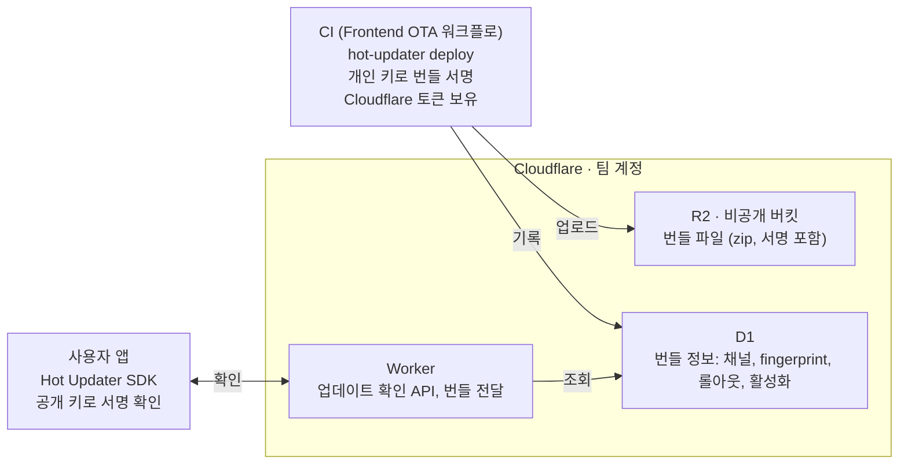
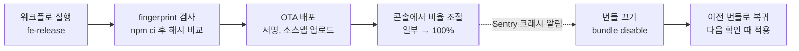

# 여기담 앱에 OTA를 붙이기까지

## 요약

여기담은 bare React Native로 만든 앱이다. 버그를 고칠 때마다 스토어 심사를 기다리는 게 답답해서, 프론트엔드 팀은 JS 수정분을 심사 없이 내려보낼 수 있는 OTA(Over-The-Air) 업데이트를 넣었다. 지킬 조건은 네 가지였다. 지도 화면의 사용성을 해치지 않을 것, 돈을 거의 쓰지 않을 것, 지금의 bare React Native 빌드 구성을 크게 바꾸지 않을 것, 팀원 누구나 배포 상태를 보고 문제가 생기면 바로 되돌릴 수 있을 것.

이 글은 여기담 팀원, 그리고 bare React Native 앱에 OTA를 검토하는 개발자를 위해 썼다. 심사 없이 앱을 고치는 방법 중 OTA를 고른 이유, 도구와 인프라를 고른 근거, 호환성 전략, 보안 설정, 배포 절차를 다루고, 네이티브 코드 연동 방법은 다루지 않는다. React Native 앱의 빌드 구조와 GitHub Actions를 써 본 독자를 가정한다. 내용은 2026년 11월 9일, Hot Updater 1.1.4 기준이다.

도입하면서 정한 것을 표로 먼저 추려 둔다. 근거는 괄호 안의 장에서 다룬다.

| 정한 것 | 결과 | 이유 |
| --- | --- | --- |
| 방식 (2장) | 네이티브 화면 + OTA | 웹뷰와 고칠 수 있는 범위는 같고, 사용성은 네이티브 화면이 낫다 |
| 도구 (3장) | Hot Updater | bare RN 구성을 바꾸지 않고, 셀프호스팅이라 비용이 거의 없음 |
| 인프라 (4장) | Cloudflare (R2, D1, Workers) | 쓸 수 있는 AWS 계정의 권한으로는 필요한 리소스를 만들 수 없음. R2는 전송 비용이 무료 |
| 호환성 전략 (5장) | fingerprint | 네이티브가 다른 앱에 번들이 가서 생기는 크래시를 배포 단계에서 차단 |
| 보안 (6장) | 번들 서명 + 토큰 분리 | 배포 키가 새도 서명 없는 번들은 앱이 거부 |
| 배포 절차 (7장) | 릴리스 브랜치에서 수동 실행 | 심사가 하던 확인을 배포 절차가 대신함 |

11월 9일 현재 앱 연동과 배포 워크플로까지 개발 브랜치에 들어갔다. 단계적 롤아웃을 워크플로 입력으로 다루는 일과 실기기 검증이 남아 있다.

## 1. 왜 OTA가 필요했나

웹이라면 고친 코드를 배포하는 순간 사용자에게 반영된다. 새로고침만 하면 모두 최신 화면을 본다. 앱은 그렇지 않다. 오타 하나를 고쳐도 바이너리를 새로 빌드해 App Store와 Google Play 심사를 받아야 한다. 심사는 보통 하루에서 이틀이 걸리고, 반려되면 고쳐서 처음부터 다시 기다려야 하니 일주일을 넘기기도 한다. 심사를 통과해도 끝이 아니다. 사용자가 스토어에서 업데이트를 눌러야 수정이 닿고, 누르지 않은 사용자는 옛 버전을 계속 쓴다.

여기담은 React Native 0.86 기반 bare 앱으로, Hermes 엔진과 New Architecture를 쓰고 오류는 Sentry로 추적한다. 화면과 로직 대부분이 JavaScript(TypeScript)라 실제로 터지는 버그도 대개 JS 쪽에서 나온다. 고칠 곳이 JS라면 스토어를 거치지 않고 고칠 방법이 있지 않을까 하는 데서 이번 작업이 시작됐다.

### OTA로 바꿀 수 있는 것과 없는 것

React Native 앱은 스토어를 통해 설치되는 네이티브 바이너리와, 그 안에서 실행되는 JS 번들로 나뉜다. OTA가 바꾸는 건 뒤쪽뿐이다. 앱이 켜질 때 서버에 새 번들이 있는지 묻고, 있으면 내려받아 기기에 저장해 뒀다가 다음 실행부터 그 번들로 돈다.

| 바꾸는 것 | 스토어 배포 | OTA 배포 |
| --- | --- | --- |
| JS 코드, 문구, 스타일, 이미지 | 가능 | 가능 |
| 네이티브 코드, 네이티브 라이브러리 | 가능 | 불가능 |
| 권한, 앱 아이콘, Info.plist 값 | 가능 | 불가능 |
| 사용자에게 닿는 시간 | 하루~수 일 | 수 분 (다음 실행 시) |

### 대신 생기는 문제

그렇다고 OTA가 공짜인 건 아니다. 도입 전에 팀에서 걸린 점이 몇 가지 있었다.

가장 먼저 나온 얘기는 품질 게이트였다. 심사는 느리지만 우리 코드를 한 번 더 보는 눈이기도 했는데, OTA는 잘못된 코드까지 몇 분 만에 전체 사용자에게 보낸다.

버전 조합도 문제다. 사용자 기기마다 바이너리 버전과 번들 버전이 따로 놀게 되는데, 네이티브가 다른 바이너리에 새 JS가 내려가면 존재하지 않는 네이티브 함수를 부르다 앱이 죽는다.

스토어 정책도 확인해야 했다. 결론부터 말하면 규정 안에서 쓰는 방법이다. Apple은 Developer Program 라이선스 계약 3.3.1(B)에서 실행 시점에 해석되는 코드(interpreted code)를 내려받는 것은 허용하되, 앱의 핵심 목적을 바꾸는 용도는 금지한다. Google Play도 기기 및 네트워크 악용 정책에서 Play 밖에서 실행 코드를 받는 걸 막지만, JavaScript처럼 가상 머신이나 인터프리터에서 도는 코드는 예외로 둔다. 그래서 OTA는 버그 수정과 UI 개선에만 쓰고, 새 기능은 지금처럼 스토어로 내기로 했다.

뒤에 이어지는 결정 대부분은 이 문제들을 요약에서 말한 네 가지 조건 안에서 어떻게 줄일지에 대한 답이다. 사용성은 방식을 고르는 기준이 됐고(2장), 비용과 빌드 구성은 도구와 인프라를 거르는 기준이 됐다(3장, 4장). 되돌릴 수 있어야 한다는 조건은 웹 콘솔이 있는 도구를 고른 이유이자 배포 절차를 설계한 출발점이다(3장, 7장).

### 이 글에서 쓰는 용어

| 용어 | 뜻 |
| --- | --- |
| 바이너리 | 스토어를 통해 설치되는 앱 파일. 네이티브 코드와 기본 JS 번들이 들어 있다 |
| 네이티브 코드 | iOS의 Swift, Android의 Kotlin처럼 바이너리에 들어가는 코드. 바꾸려면 심사가 필요하다 |
| 번들 | JS 코드와 에셋을 묶은 파일. OTA가 바꾸는 대상 |
| 웹뷰 | 앱 안에서 웹 페이지를 띄우는 브라우저 화면 (2장) |
| Provider | Hot Updater에서 번들 저장소와 데이터베이스를 고르는 플러그인 |
| R2, D1, Workers | Cloudflare의 파일 저장소, 데이터베이스, 서버리스 함수 |
| fingerprint | 네이티브 코드로 계산한 해시. 어떤 앱이 어떤 번들을 받을지 정하는 데 쓴다 (5장) |
| 채널 | 빌드할 때 정해지는 앱 묶음. 예: production, staging (7장) |
| 롤아웃 | 새 번들을 받을 사용자의 비율 (7장) |

## 2. 웹뷰가 아니라 OTA를 고른 이유

OTA를 알아보기 전에, 심사 없이 앱을 고치는 방법부터 넓게 찾아봤다. 크게 네 가지였고, 서버에서 어디까지 바꿀 수 있느냐로 나뉜다.

| 방법 | 서버가 보내는 것 | 예 |
| --- | --- | --- |
| 원격 설정 | 앱에 미리 넣어 둔 기능을 조절하는 값 | 배너 켜고 끄기, 문구 바꾸기 |
| 서버 주도 UI | 어떤 컴포넌트를 어떤 순서로 보여 줄지 담은 데이터 | 홈 화면 구성 바꾸기 |
| 웹뷰 | 웹 페이지 자체. 앱 안의 브라우저가 띄운다 | 이벤트 페이지 |
| OTA | 앱이 실행하는 코드 묶음(번들) 자체 | 새 화면, 버그 수정 |

여기담이 심사 없이 고치고 싶었던 건 배너 같은 값이 아니라 오타, 버그, 새 UI처럼 코드 자체였다. 원격 설정과 서버 주도 UI는 미리 만들어 둔 틀 안에서만 바꿀 수 있어서 이걸 하지 못한다. 그래서 웹뷰와 OTA가 남았고, 둘을 수정 가능 범위와 사용성 두 기준으로 비교했다.

### 범위와 배포는 같다

두 방식은 구조가 같다. 앱은 네이티브 코드와 그 안에서 실행되는 코드로 나뉘고, 서버에서 바꿀 수 있는 건 안쪽뿐이다. 웹뷰는 웹 페이지를, OTA는 번들을 바꾼다. 둘 다 네이티브 코드는 바꾸지 못하니 고칠 수 있는 범위가 같다.

배포 방식도 둘 다 웹과 비슷하다. 웹뷰는 말 그대로 웹 배포라 빌드해서 CDN에 올리면 끝이다. OTA도 빌드한 번들을 저장소에 올리는 건 같고, 어떤 앱이 어떤 번들을 받을지 기록해 두고 앱이 물어보면 API가 답하는 단계가 더 있을 뿐이다. 저장소와 API는 웹에서 쓰던 것과 같은 종류다.

### 사용성은 다르다

차이는 사용성에서 났다. 이유는 두 가지다.

첫째, 화면 코드를 받아 오는 시점이 다르다. 웹뷰는 화면을 열 때마다 서버를 거친다. 브라우저 캐시 덕에 매번 전부 받지는 않지만, 최소한 바뀐 게 있는지는 서버에 묻는다. 그래서 네트워크가 느리면 그만큼 늦게 뜨고, 끊기면 화면이 안 뜰 수 있다. OTA는 번들을 미리 받아 기기에 저장해 두고, 화면을 열 때는 저장된 번들로 바로 실행한다. 서버와 통신하는 건 앱을 켤 때 하는 업데이트 확인뿐이고, 이 확인은 화면이 뜨는 걸 막지 않는다. 화면에 채울 데이터는 둘 다 서버에서 받아 오므로, 차이는 화면 코드에만 있다.

둘째, 화면을 그리는 주체가 다르다. 웹뷰는 브라우저가 HTML과 CSS로 그리고, 네이티브 화면은 iOS와 Android가 직접 그린다. 그래서 뒤로 가기 스와이프, 화면 전환, 스크롤처럼 손에 닿는 동작에서 차이가 난다. 네이티브 화면은 이런 동작을 OS가 처리해 주지만, 웹뷰 안에서 페이지끼리 이동할 때는 OS가 그 이동을 모르기 때문에 같은 느낌을 내려면 JS로 직접 만들어야 한다. 만들 수는 있지만 품이 들고, 큰 회사들은 이런 부분을 챙기는 팀을 따로 둔다.

여기담에서는 이 차이가 지도에서 가장 크게 드러났다. 같은 방식으로 지도를 밀어 보면, 네이티브 지도 SDK를 쓰는 여기담은 손을 떼도 지도가 미끄러지다가 천천히 멈춘다. 웹뷰로 만든 지도 화면을 같은 방식으로 녹화해 비교해 보니, 손을 떼는 순간 바로 멈췄다. 화면 녹화를 프레임 단위로 재 보면, 한 번 밀었을 때 지도가 움직인 시간이 여기담은 약 0.4초, 웹뷰 지도는 약 0.07초였다.

| | 웹뷰 | 네이티브 화면 + OTA |
| --- | --- | --- |
| 고칠 수 있는 범위 | 네이티브 코드만 빼고 전부 | 네이티브 코드만 빼고 전부 |
| 배포 | 웹 배포 (CDN) | 웹 배포와 비슷 (저장소 + 업데이트 확인 API) |
| 화면 코드를 받는 시점 | 화면을 열 때마다 서버를 거침 | 미리 받아 둔 번들로 바로 실행 |
| 화면을 그리는 주체 | 브라우저 | OS |

### 그럼 큰 앱들은 왜 웹뷰를 쓸까

여기까지만 보면 OTA가 더 나아 보인다. 그런데 큰 앱들은 웹뷰를 많이 쓴다. 토스는 앱을 웹뷰 영역과 네이티브 영역으로 나눠 웹뷰 쪽만 갱신하는 방식으로 배포 속도를 높였고(바이라인네트워크, 2024), 당근도 많은 화면을 웹뷰로 만든 경험을 테크 밋업에서 공유했다(「아니, 여기도 웹뷰였어요?」, 2024 당근 테크 밋업). 우리가 정리한 이유는 조직 규모에서 오는 장점이었다. 수십 개 팀이 앱 출시 일정을 기다리지 않고 각자 화면을 배포할 수 있고, iOS, Android, 웹에서 같은 페이지를 그대로 쓸 수 있고, 다른 회사 서비스도 웹 페이지로 쉽게 붙일 수 있다. 사용성을 조금 내주는 대신 조직과 확장성을 얻는 선택이다.

여기담은 반대였다. 작은 팀 하나가 앱 하나를 만들고, 지도가 핵심이다. 큰 앱이 웹뷰로 얻는 장점은 크지 않았고, 앞에서 본 사용성 차이는 포기하기 어려웠다. 그래서 핵심 화면은 지금처럼 네이티브로 그리고 OTA를 붙이기로 했다.

웹뷰를 버린 건 아니다. OTA를 쓰는 앱 안에도 웹뷰를 붙일 수 있다. 나중에 장소 상세처럼 검색에 노출되고 링크로 공유돼야 하는 화면이 생기면, 그 화면만 웹 페이지로 만들어 웹뷰로 띄우는 방식도 검토할 수 있다.

## 3. 도구 고르기

Hot Updater를 골랐다. 셀프호스팅이라 비용이 거의 들지 않고, 지금 빌드 구성을 건드리지 않으면서도 웹 콘솔과 롤아웃 기능을 쓸 수 있었다.

### 후보 추리기

찾아보니 OTA 도구는 생각보다 많았다. 일단 후보를 다 모은 다음, 서비스가 아직 살아 있는지, 구독료나 사용자 수 기반 과금이 있는지, bare RN 빌드를 크게 바꿔야 하는지를 차례로 따져 걸렀다. 앞의 두 조건에 걸리면 제외했고 마지막 조건에 걸리면 뒤로 미뤘다.

| 후보 | 결과 | 이유 |
| --- | --- | --- |
| App Center CodePush | 제외 | 2025년 3월 31일 서비스 종료 |
| Revopush, Stallion, AppZung, Pushy 등 | 제외 | 구독료가 있거나, 서버와 문서가 국내에서 쓰기 어려움 |
| 직접 구현, Re.Pack Module Federation | 제외 | 롤백, 롤아웃을 직접 만들거나 빌드 체계 전체를 바꿔야 함 |
| EAS Update | 비교 기준 | 완성도는 가장 높지만 무료 한도와 Expo Modules 도입 부담 |
| @bravemobile/react-native-code-push | 최종 후보 | 서버 없이 CDN만으로 동작, 비용 최소 |
| Hot Updater | **선택** | 셀프호스팅, 웹 콘솔, 큰 커뮤니티 |

App Center 종료일은 Microsoft의 App Center 은퇴 안내 문서 기준이다. 분석, 진단 기능만 지원이 연장됐고, CodePush는 App Center 없이 따로 운영하는 서버 버전을 쓰라고 안내한다.

EAS Update는 fingerprint, 채널, 코드 서명까지 다 갖췄지만, 업데이트를 받는 사용자가 월 1,000명을 넘으면 무료 플랜에서는 막히고 유료 플랜은 월 19달러부터다. bare RN에서 쓰려면 Expo Modules도 설치해야 한다. 같은 기능을 거의 0원에 셀프호스팅할 수 있어서 비교 기준으로만 남겼다.

### Hot Updater와 bravemobile 포크

끝까지 남은 두 도구는 구조부터 달랐다. 업데이트 여부를 판단하는 서버가 있느냐 없느냐의 차이다.

| 기준 | Hot Updater | bravemobile 포크 |
| --- | --- | --- |
| 구조 | 업데이트 확인 API(서버리스 함수) + 저장소 | CDN에 올린 릴리스 기록 JSON + 번들 |
| 운영 화면 | 웹 콘솔 (배포 현황, 롤백, 활성화 전환) | 없음, CLI와 JSON으로 운영 |
| 비용 | 저장소 + 함수 호출 (무료 한도 안에서 $0) | 저장소와 CDN만, 사실상 $0 |
| 커뮤니티 | npm 월 약 18만 다운로드 | npm 월 약 1.8만 다운로드, 한 회사가 관리 |
| 주의할 점 | 장애 지점이 하나 늘어남 | 동시 배포 시 JSON을 서로 덮어쓸 수 있음, 통계 없음 |

다운로드 수는 npm 공개 다운로드 API로 확인한 2026년 10월 10일~11월 8일 값이다(`hot-updater`, `@bravemobile/react-native-code-push`).

비용과 단순함만 보면 bravemobile 포크가 앞섰다. 그래도 팀원 여럿이 배포 상태를 같이 보고, 문제가 생기면 누구든 콘솔에서 번들을 끌 수 있어야 한다고 판단했다. 한 회사가 관리를 그만두면 업데이트가 끊길 수 있다는 점도 마음에 걸렸다. 서버가 있어서 드는 비용은 다음 장의 인프라 선택으로 해결했고, 장애 위험은 받아들이기로 했다. 업데이트 확인이 실패해도 앱은 원래 번들로 그대로 실행되기 때문이다.

### Hot Updater의 구조

Hot Updater는 번들을 만들어 올리는 CLI, 서버, 앱에 들어가는 SDK로 이뤄진다. 서버는 번들 파일을 두는 저장소와 번들 정보를 담는 데이터베이스, 업데이트 확인 API로 구성되는데, 어떤 저장소와 데이터베이스를 쓸지는 플러그인으로 고른다. 문서에서는 이 플러그인을 Provider라고 부른다.

새 번들을 받았다고 바로 믿지는 않는다. 받은 번들은 임시 상태로 실행되다가 첫 화면이 그려진 뒤에야 정상 번들로 인정되고, 그 전에 앱이 죽으면 한 번 더 시도한 뒤 이전 번들로 돌아간다. 다만 첫 화면 이후에 나는 크래시는 자동으로 되돌리지 못해서, 이 빈틈은 7장의 배포 절차와 Sentry 감시로 메운다.

## 4. 인프라 정하기

처음엔 AWS로 정했다가 같은 날 Cloudflare로 바꿨다. Hot Updater의 AWS 구성은 IAM 역할, DynamoDB, SSM Parameter Store 같은 리소스를 자동으로 만드는데, 팀이 쓸 수 있는 AWS 계정에는 그 권한이 없었다. 서버를 직접 띄워 우회할 수도 있었지만, 서버 운영을 프론트엔드 팀이 떠안게 돼서 다른 Provider를 찾기로 했다.

### 다른 Provider 비교

Hot Updater가 지원하는 다른 Provider는 Cloudflare, Supabase, Firebase다. 셋 다 init으로 자동 구성되고 계정을 팀이 직접 가진다. 차이는 전송량 과금에서 났다.

OTA는 같은 번들을 모든 사용자에게 반복해서 보낸다. 번들 2MB, 사용자 1만 명, 한 달에 4번 배포로 잡으면 전송량이 80GB쯤 된다. 전송량에 과금하는 서비스라면 사용자가 늘고 배포가 잦아질수록 비용도 같이 커진다.

| 기준 (월 사용자 1만 명) | Cloudflare | Supabase | Firebase |
| --- | --- | --- | --- |
| 구성 | R2 + D1 + Workers | Storage + Postgres + Edge Functions | Storage + Firestore + Functions |
| 전송 비용 | 무료 | 무료 플랜은 월 5GB까지, 넘으면 유료 플랜 | Blaze 플랜 종량제 (Storage 다운로드 월 100GB까지 무료) |
| 예상 월 비용 | $0 | Pro 플랜 월 $25부터 | $0~소액, 예측 어려움 |
| 카드 등록 | R2 구독에 필요 | 불필요 | 필요 (Functions와 Storage 과금이 Blaze 플랜에서만 가능) |
| 가용성 | 높음 | 무료 플랜은 1주일 활동이 없으면 일시정지 | 높음 |

Supabase와 Firebase 수치는 각 서비스의 가격 페이지 기준이다(2026년 11월 9일 확인).

Cloudflare R2는 저장 10GB, 쓰기 작업 월 100만 건, 읽기 작업 월 1,000만 건까지 무료이고 전송 비용은 아예 받지 않는다. Workers도 하루 10만 요청까지 무료다. 사용자 한 명이 하루 세 번 앱을 연다고 치면 하루 요청이 10만 건을 넘는 건 사용자가 3만 명쯤 됐을 때인데, 그때 붙는 유료 플랜도 월 5달러다. 그래서 Hot Updater + Cloudflare로 정했다. 최종 구성은 그림 1과 같다.

*그림 1. Hot Updater + Cloudflare 최종 구성*

앱이 아는 주소는 Worker 하나뿐이고, 번들을 올리고 기록하는 권한은 CI에만 있다.

### 감수한 것

Cloudflare를 쓰면서 떠안은 것도 있다. 외부 계정이니 결제, 계정 관리, 인수인계를 팀이 직접 해야 한다. 그래서 계정은 팀 공용 이메일로 만들고 팀원 전원이 2단계 인증을 켜기로 했다.

R2는 무료로 쓰더라도 결제 수단을 등록하는 구독 절차를 거쳐야 해서, 사용량 알림을 걸어 예상치 못한 과금에 대비했다. 무료 플랜이라 가용성 보장(SLA)도 없지만, 업데이트 확인이 실패해도 앱은 기존 번들로 돌기 때문에 장애가 나도 새 업데이트가 늦게 도착하는 정도로 끝난다.

## 5. 호환성 전략

Hot Updater 설정의 `updateStrategy`를 무엇으로 할지가 가장 오래 고민한 부분이고, `fingerprint`로 정했다. 이 설정값은 첫 바이너리에 같이 들어가서 출시한 뒤에는 바꾸기 어렵다. 바꿔도 이미 설치된 앱에는 적용되지 않는다.

### updateStrategy가 정하는 것

1장에서 말한 버전 조합 문제를 막는 장치다. 설치된 앱마다 이름표가 붙어 있고, 번들에는 어떤 이름표를 단 앱이 받을지가 적혀 있다. `updateStrategy`는 이 이름표로 앱 버전(`appVersion`)과 네이티브 코드 해시(`fingerprint`) 중 무엇을 쓸지 정한다.

| | appVersion | fingerprint |
| --- | --- | --- |
| 앱의 이름표 | 마케팅 버전 (예: 2.1.0) | 네이티브 코드로 계산한 해시 |
| 번들의 대상 | 배포할 때 사람이 지정 | 배포할 때 현재 코드로 자동 계산 |
| 번들을 받는 앱 | 버전이 같은 앱 | 해시가 같은 앱 (버전은 보지 않음) |
| 추가로 관리하는 파일 | 없음 | `fingerprint.json` |

### 해시에 들어가는 것과 빠지는 것

처음엔 fingerprint가 당연히 더 안전해 보였다. 판단이 복잡해진 건 Hot Updater 코드와 우리 CI 설정을 직접 읽고 나서였다. 해시는 `@expo/fingerprint`를 바탕으로 저장소에 있는 네이티브 파일만 보고 계산하는데, 우리 CI는 앱 버전, 빌드 번호, 환경 변수를 파일에 쓰지 않고 빌드할 때 주입한다.

| 변경 | 해시 | 주입 방식 |
| --- | --- | --- |
| `ios/`, `android/`의 네이티브 파일 | 바뀜 | 저장소 파일 |
| 네이티브 코드가 있는 라이브러리 추가, 업그레이드 | 바뀜 | `package.json`, `Podfile.lock` |
| 앱 버전 (2.1.0 → 2.2.0) | 그대로 | 빌드 인자 `MARKETING_VERSION` |
| 빌드 번호 | 그대로 | 빌드 인자 `CURRENT_PROJECT_VERSION` |
| `.env` (API 주소, 카카오 키 등) | 그대로 | CI가 Secrets로 `.env`를 만들어 주입 |

그러니 fingerprint에서는 네이티브만 같으면 2.1.0과 2.2.0이 같은 앱이다. 스토어에는 2.1.0으로 표시된 앱이 2.2.0의 JS를 받을 수 있다는 얘기다. `.env`를 해시에 넣는 설정(`fingerprint.extraSources`)도 있긴 한데, CI가 매번 `.env`를 새로 만들기 때문에 빌드 때와 배포 때 내용이 조금만 달라도 배포가 막힌다. 그래서 넣지 않았다.

### 상황별로 따져 보기

기준만 늘어놓고 보면 두 전략의 차이가 잘 와닿지 않아서, 실제로 있을 법한 상황을 하나씩 대입해 봤다.

| 상황 | appVersion | fingerprint |
| --- | --- | --- |
| 2.1.0의 JS 버그를 fe-release에서 고쳐 배포 | 2.1.0만 받음 | 네이티브가 같은 다른 버전도 받음 |
| 카카오맵 SDK를 올린 브랜치에서 실수로 2.1.0에 배포 | **크래시** (없는 네이티브 호출) | 배포 차단 (해시 불일치) |
| TestFlight에 같은 버전으로 여러 번 올리고 그사이 네이티브 변경 | 이전 빌드 테스터 크래시 | 구분됨 |
| 네이티브는 그대로, `.env`에 새 키를 추가한 2.2.0의 JS를 배포 | 2.2.0만 받음 | **2.1.0도 받음**, 키 값이 없어 오작동 |
| 네이티브를 바꾸고 `fingerprint.json` 갱신을 잊음 | 상관없음 | 배포 차단, CLI가 갱신 안내 |
| JS 코드 자체의 버그 | 크래시 가능 | 크래시 가능 |

어느 쪽도 완벽하지 않았다. appVersion에서는 사람이 한 번 실수하면 그게 곧바로 크래시가 되고, fingerprint에서는 버전 경계가 흐려져서 새 JS가 이전 버전까지 퍼진다.

검토하다가 "네이티브가 바뀌면 어차피 새로 빌드하고, 그 빌드에는 최신 JS가 들어가지 않냐"는 질문도 나왔다. 맞는 말이다. 새 바이너리 자체는 안전하고, 위험한 건 그 뒤에 OTA 번들이 네이티브가 다른 이전 바이너리로 내려가는 경우다. TestFlight처럼 같은 버전의 빌드가 여러 개 도는 환경도 있으니, 팀은 사람의 실수가 크래시로 번지지 않는 쪽을 골랐고 10월 29일 fingerprint로 확정했다.

### 같이 지키기로 한 규칙

fingerprint가 새로 만든 위험은 운영 규칙으로 막는다. 1번과 4번은 배포 워크플로가 자동으로 확인한다 (7장).

1. 네이티브를 바꾼 PR에는 `fingerprint create`로 갱신한 `fingerprint.json`을 같이 커밋한다.
2. `.env`에 새 키를 추가한 변경은 OTA로 내보내지 않고, 새 키를 읽는 코드에는 기본값을 둔다.
3. 새 기능은 스토어로 낸다. OTA는 버그 수정과 작은 UI 개선용이다.
4. 배포는 CI에서 `npm ci`로 설치한 다음에 한다. 로컬과 CI의 설치 결과가 다르면 해시가 어긋난다.
5. 앱 버전만으로는 지금 실행 중인 JS를 알 수 없으니, Sentry와 PostHog에 번들 ID(`ota_bundle_id`)를 태그로 남긴다.

## 6. 보안

OTA 배포 키를 가진 사람은 심사 없이 모든 사용자의 앱 코드를 바꿀 수 있다. 그래서 키가 새는 상황까지 가정하고 막을 장치를 여러 겹 뒀다.

### 번들 서명

R2에 쓰기 권한만 있으면 누구든 번들을 올릴 수 있다. 번들 서명을 쓰면 앱이 받은 번들이 정말 우리가 만든 것인지 직접 확인한다. Hot Updater는 RSA-SHA256 서명을 쓰고, 절차는 이렇다.

1. `hot-updater keys generate -k 4096`으로 개인 키와 공개 키를 만든다.
2. `hot-updater keys export-public`으로 공개 키를 iOS `Info.plist`와 Android `AndroidManifest.xml`에 넣는다. 공개 키는 바이너리에 들어가므로 스토어 배포로만 바뀐다.
3. 배포할 때 CLI가 개인 키로 번들에 서명한다.
4. 앱은 번들을 내려받은 뒤 공개 키로 서명을 확인하고, 맞지 않으면 적용하지 않는다.

이렇게 해 두면 Cloudflare 토큰이 새더라도 개인 키 없이는 앱이 받아들일 번들을 만들 수 없다. 반대로 개인 키를 잃어버리면 새 공개 키를 넣은 바이너리를 스토어로 내기 전까지 OTA를 쓸 수 없다. 개인 키는 팀 비밀 저장소에 백업하고, CI에는 `fe-ota` 환경의 Secret으로 넣었다.

### 토큰 나누기

Cloudflare API 토큰은 쓰임새별로 따로 발급했다. 하나가 새면 그 토큰만 폐기하면 되고, 어디서 샜는지 추적하기도 쉽다. CI용 토큰은 특정 팀원 계정에 묶이지 않도록 Account 토큰으로 발급했다.

| 토큰 | 최소 권한 | 쓰는 곳 |
| --- | --- | --- |
| hot-updater-d1 | D1 편집 | 로컬에서 init과 수동 작업 |
| hot-updater-d1-ci | D1 편집, Account 토큰 | CI 배포 |
| hot-updater-r2 (R2 액세스 키) | R2 읽기, 쓰기 | 번들 업로드, Worker의 번들 조회 (삭제하면 업데이트가 멈춤) |

앱에는 이 토큰들이 하나도 들어가지 않는다. 앱이 아는 건 Worker URL과 클라이언트 API 키뿐이다. 클라이언트 API 키는 `x-api-key` 헤더로 전달되고 업데이트 확인 말고는 할 수 있는 게 없다. R2 버킷은 비공개로 둬서 Worker를 거치지 않고는 번들 파일에 접근할 수 없다.

로컬에 남는 비밀 파일(`.env.hotupdater`, 서명 개인 키 `keys/private-key.pem`)은 `.gitignore`로 막는다. 한 번은 설정 작업을 한 브랜치에만 규칙이 있고 개발 브랜치에는 없어서, `git add .` 한 번이면 토큰과 개인 키가 올라갈 뻔했다. 로컬 파일은 브랜치를 바꿔도 그대로 남지만 `.gitignore`는 브랜치마다 다르기 때문이다. 비밀 파일 규칙은 그 파일을 만들기 전에 모든 브랜치에 먼저 들어가 있어야 한다.

## 7. 배포 운영

심사가 하던 확인은 이제 배포 절차가 맡는다. 배포는 CI 한 곳에서만 하고, 사람이 의도를 갖고 직접 실행한다는 게 기본 방침이다.

### 배포 워크플로

브랜치에 머지되면 바로 OTA가 나가는 자동 배포는 하지 않는다. OTA는 모든 사용자의 앱을 바꾸니, 사람이 직접 눌러야 한다고 봤다. 그래서 GitHub Actions의 수동 실행(`workflow_dispatch`)으로 `Frontend OTA` 워크플로를 만들었다. 아래 표는 워크플로에 넣은 안전장치다.

| 장치 | 내용 | 막는 것 |
| --- | --- | --- |
| 브랜치 제한 | `fe-release`의 최신 커밋에서만 실행 | 개발 중인 코드가 사용자에게 가는 일 |
| 환경별 Secrets | 배포 토큰과 서명 키는 `fe-ota` 환경에만 등록 | 다른 워크플로가 배포 키를 읽는 일 |
| 동시 실행 제한 | concurrency로 한 번에 하나만 실행 | 두 배포가 서로 꼬이는 일 |
| 설치 방식 | `npm ci` 후 배포 | 로컬과 다른 설치 결과로 fingerprint가 어긋나는 일 |
| fingerprint 검사 | 배포 전에 해시를 다시 계산해 커밋된 `fingerprint.json`과 비교 | 출시되지 않은 네이티브 변경이 섞인 번들 배포 |
| 소스맵, 번들 ID | 소스맵을 Sentry에 올리고, 번들 ID를 실행 요약에 남김 | 어떤 번들에서 난 오류인지 모르는 일 |

fingerprint 검사가 실패하면 워크플로는 "네이티브 변경이 있다면 Frontend Beta로 스토어에 먼저 출시하라"는 메시지와 함께 멈춘다. 5장의 규칙 1번을 사람의 기억 대신 CI가 지키게 한 것이다.

### 워크플로 입력값

실행할 때 고르는 값은 Hot Updater의 deploy 옵션에 그대로 대응한다.

| 입력 | 기본값 | deploy 옵션 | 뜻 |
| --- | --- | --- | --- |
| platform | all | `-p` | iOS, Android 중 어느 쪽에 배포할지. all이면 둘을 따로 배포 |
| message | (필수) | `-m` | 콘솔에 남길 변경 설명 |
| disabled | 꺼짐 | `-d` | 올리기만 하고 아무에게도 보내지 않음 |

채널은 `production`으로 고정했다. 지금은 모든 앱이 기본 채널로 빌드되기 때문이다. 테스터용 staging 채널은 앱에 채널을 바꾸는 기능을 만든 뒤 입력값으로 추가한다.

### 채널, 코호트, disabled의 차이

셋 다 일부에게만 번들을 보내는 기능처럼 보이지만 나누는 기준이 다르다. 채널은 바이너리를 빌드할 때 정해져서, staging 채널 번들은 staging으로 빌드한 테스트용 앱만 받는다. 코호트는 같은 운영 앱 안에서 기기를 나누는 번호나 이름이라, QA 팀원 기기만 먼저 받게 할 수 있다. disabled는 번들을 꺼진 상태로 올려서 아무도 받지 못하게 하고, 콘솔에서 켜는 순간 그때의 비율대로 나간다.

### 단계적 롤아웃과 롤백

기본 절차는 그림 2와 같다. 비율을 올릴 때 번들을 다시 올리지는 않는다. 같은 번들의 설정값만 바뀐다.

*그림 2. OTA 배포 절차*

문제가 생기면 콘솔이나 `bundle disable` 명령으로 번들을 끈다. 그러면 기기는 다음 업데이트 확인 때 이전에 켜져 있던 번들이나 바이너리에 들어 있는 번들로 돌아간다. 3장에서 말한 자동 롤백은 첫 화면이 뜨기 전의 크래시만 잡기 때문에, 특정 화면에서만 나는 크래시는 Sentry 알림을 보고 사람이 직접 꺼야 한다. Sentry에는 번들 ID가 태그로 붙어 있어서 어떤 번들에서 난 오류인지 바로 구분할 수 있다. 수동 롤백이 좀 늦어져도 단계적 롤아웃을 하면 피해는 일부 사용자에서 그친다.

## 8. 남은 일과 돌아보며

### 남은 일

인프라, 서명, fingerprint, 네이티브 연동, 업데이트 확인, Sentry 연동, 배포 워크플로까지는 끝났다. 남은 일은 세 가지다.

1. 워크플로에 롤아웃 비율과 코호트 입력 추가
2. 테스터용 staging 채널
3. 실기기에서 배포, 자동 롤백, 서명 거부 검증

지금 워크플로는 disabled를 켜지 않고 실행하면 번들이 바로 모든 사용자에게 나간다. 단계적 롤아웃을 기본으로 하려면 disabled로 올린 뒤 콘솔에서 비율을 정해 켜거나, 롤아웃 비율과 코호트를 입력값으로 추가하고 기본값을 작게 잡아야 한다.

### 돌아보며

가장 아쉬운 건 제약을 늦게 확인한 점이다. AWS로 결정하고 나서야 계정 권한 제약을 알았다. 비용 비교표를 만들기 전에 우리 계정에서 만들 수 있는지부터 물었다면 인프라 비교를 두 번 하지 않아도 됐다.

방식을 고를 때는 도구보다 앱이 먼저였다. OTA와 웹뷰는 고칠 수 있는 범위도, 웹처럼 배포한다는 점도 같았다. 결정을 가른 건 여기담이 지도가 핵심인 작은 팀의 앱이라는 사실이었다. 여러 팀이 움직이는 큰 앱이었다면 같은 비교에서 웹뷰를 골랐을 것이다.

호환성 전략을 정할 때는 문서보다 우리 코드가 더 많은 걸 알려 줬다. 문서만 보면 fingerprint는 더 안전한 방식이다. 그런데 우리 CI가 버전과 `.env`를 빌드 시점에 주입한다는 사실을 놓고 보니 버전 경계가 흐려지는 새 위험이 드러났다. 같은 도구를 써도 프로젝트에 따라 결론이 달라질 수 있다.

기본값이 얼마나 중요한지도 실감했다. `.gitignore`는 브랜치를 옮기자 비어 있었고, 배포 워크플로도 아무것도 고르지 않으면 전체 배포가 된다. 누가 뭘 잘못한 게 아니어도 클릭 한 번이면 사고가 날 수 있는 구조다. 안전한 쪽을 기본으로 두고, 위험한 쪽은 일부러 골라야만 하게 만들어야 한다.

OTA 덕분에 배포는 몇 분이면 끝나지만, 심사가 해 주던 확인은 이제 팀 몫이다. 서명, fingerprint 검사, 릴리스 브랜치 제한, 단계적 롤아웃은 전부 그 빈자리를 메우려고 넣은 장치다. 도구를 붙이는 것보다 팀이 이 절차를 실제로 지키게 하는 쪽이 더 어려울 것 같다.

## 참고 자료

- [Hot Updater 공식 문서](https://hot-updater.dev): How it works, Deploy, Cloudflare, Bundle Signing, Fingerprint
- [Expo 가격 정책](https://expo.dev/pricing): EAS Update 무료 한도 (2026-10-27 확인)
- [Cloudflare R2 가격](https://developers.cloudflare.com/r2/pricing/), [Workers 가격](https://developers.cloudflare.com/workers/platform/pricing/)
- [Supabase 가격](https://supabase.com/pricing), [Firebase 가격](https://firebase.google.com/pricing): 무료 한도와 유료 플랜 조건 (2026-11-09 확인)
- [Visual Studio App Center Retirement](https://learn.microsoft.com/en-us/appcenter/retirement), Microsoft Learn: App Center 종료일과 CodePush 대안 (2026-11-09 확인)
- [npm 다운로드 API](https://api.npmjs.org/downloads/point/last-month/hot-updater): 패키지별 최근 한 달 다운로드 수 (2026-11-09 확인)
- [Soomgo-Mobile/react-native-code-push](https://github.com/Soomgo-Mobile/react-native-code-push): bravemobile 포크
- [토스플레이스, 하루에 수십번 포스 업데이트가 가능한 이유](https://byline.network/2024/09/12-329/), 바이라인네트워크: 토스의 웹뷰 영역 분리 배포 (2026-11-09 확인)
- [아니, 여기도 웹뷰였어요? | 2024 당근 테크 밋업](https://www.youtube.com/watch?v=4UD4EB00AME), 당근 팀 YouTube: 당근의 웹뷰 전환 경험 (2026-11-09 확인)
- [Apple Developer Program 라이선스 계약](https://developer.apple.com/support/terms/apple-developer-program-license-agreement/): 3.3.1(B) 해석되는 코드를 내려받는 조건
- [Google Play 기기 및 네트워크 악용 정책](https://support.google.com/googleplay/android-developer/answer/9888379): 인터프리터에서 실행되는 코드 예외
- 팀 내부 자료: OTA 도입 트레이드오프 (2026-10-28), OTA 호환성 전략 결정 (2026-10-29)
- 저장소: `Frontend/hot-updater.config.ts`, `Frontend/src/lib/hot-updater.ts`, `.github/workflows/frontend-ota.yml`, `.github/workflows/frontend-ci.yml`

가격과 무료 한도, 다운로드 수, 스토어 정책의 조항 번호는 작성 당시 공개 자료 기준이며 바뀔 수 있다.
