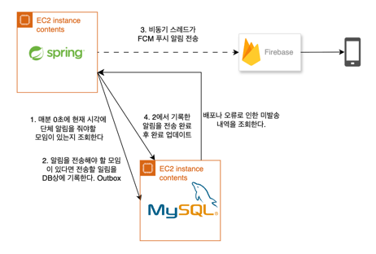

# FCM 알림을 즉시 발송과 복구 발송으로 나누며 생긴 구멍 8개를 메운 과정

**우테코 최종 프로젝트 링아웃의 활동 알림은 매분 스케줄러가 데이터베이스에 기록하고, 같은 스레드에서 곧바로 FCM(Firebase Cloud Messaging)으로 보냈습니다. 이 구조에서는 FCM이 5분 동안 응답하지 않자 10건 중 8건이 흔적 없이 사라졌고, 서버를 정상적으로 내렸을 때도 이미 보낸 알림이 PENDING(발송을 대기 중인 알림)으로 남았습니다.**

**그래서 발송을 두 경로로 나눴습니다. 기록 직후 별도 스레드가 바로 보내는 즉시 경로와, 보내지 못한 기록을 주기적으로 찾아 다시 보내는 복구 경로입니다. 그런데 경로가 둘이 되자 새로운 구멍이 생겼습니다. 두 경로가 같은 알림을 함께 집어 두 번 보낼 수 있었고, 발송 도중 서버가 꺼진 알림은 어느 경로도 다시 집지 않았으며, 장애가 끝난 뒤에는 이미 지난 "활동 시간이에요" 알림이 뒤늦게 도착할 수 있었습니다.**

**이 글은 이런 구멍 8개를 누락 없음, 중복 최소화, 정시 도착이라는 세 기준으로 나눠 하나씩 메운 과정을 기록합니다.**



이미지: 푸시 알림 발송 인프라 구조도

**세 줄 요약**

- 알림 기록과 FCM 발송을 한 스레드에서 처리하던 구조는 FCM이 멈추거나 실행이 1분을 넘으면 알림을 흔적 없이 놓쳤습니다. 그래서 기록 직후 바로 보내는 즉시 경로와, 보내지 못한 기록을 다시 보내는 복구 경로를 함께 두었습니다.
- 경로가 둘이 되자 같은 알림을 두 번 보내거나(중복), 어느 경로도 다시 집지 않거나(누락), 이미 지난 알림을 뒤늦게 보내는(지각) 구멍 8개가 생겼습니다. 이 구멍들을 선점 토큰, 리스, 체크포인트, 만료 시한으로 메웠습니다.
- 외부로 나가는 발송은 정확히 한 번을 보장할 수 없습니다. 같은 시간에 함께 목표를 달성하는 앱이라 누락보다 중복을 골랐고, 남는 중복은 디바이스에서 하나로 합쳐지게 했습니다.


Spring 스케줄러로 푸시 알림을 보내고 있거나, 발송 기록을 DB에 남기고 비동기나 폴링으로 보내면서 중복과 누락 사이에서 고민하는 백엔드 개발자를 위한 글입니다. 앞부분의 수치는 실제 FCM이 아닌 가상의 알림 발송기로 구조의 동작을 재현한 실험 결과입니다. 뒤에서 다루는 구멍 8개는 운영에서 관측한 장애가 아니라 구조를 따져 찾아낸 시나리오이며, 일부는 테스트로 재현했습니다.


## 1. 링아웃 활동 알림
링아웃은 함께 정한 시각에 함께 움직이는 기능을 제공하는 알람 앱입니다. 사용자는 방에 들어가 각자 알람을 설정하고, 방마다 매일 활동을 시작할 요일과 시각이 정해져 있습니다.

활동 알림은 그 시각이 되면 방 멤버 모두에게 가는 푸시 알림입니다. 지금 서버가 보내는 알림은 이것 하나뿐입니다.

이 알림은 정해진 분에 와야 의미가 있습니다. 7시에 오기로 한 알림이 7시 3분에 오면 늦은 것이고, 오지 않으면 기능이 실패한 것입니다. 사용자는 이 알림을 보고 활동 준비를 시작하는데, 알림을 받지 못하면 그만큼 준비가 늦어집니다.


그래서 알림을 다루면서 세 가지 기준을 두었습니다.

1. **누락 없음**: 모든 알림은 결국 나가야 합니다.
2. **중복 최소화**: 같은 알림은 가능한 한 번만 나가야 합니다.
3. **정시 도착**: 정해진 분에 도착해야 하고, 의미가 없어질 만큼 늦은 알림은 보내지 않습니다.

세 가지를 늘 함께 지킬 수는 없었습니다. 누락을 막으려고 다시 보내면 중복이 생기고, 중복을 막으려고 조심하면 누락이 생깁니다. 둘이 부딪히면 1번을 고릅니다. 오지 않는 알림은 기능 실패이고, 두 번 오는 알림은 불편이기 때문입니다.


다시 보내기를 계속하면 이번에는 3번과 부딪힙니다. 장애가 30분 이어진 뒤에 "활동 시간이에요" 알림이 도착하면, 사용자에게는 잘못된 알림입니다. 그래서 다시 보내는 데에도 시한을 두었습니다. 시한 안에서는 누락을 막는 쪽을 고르고, 시한이 지나면 보내지 않습니다.


## 2. 가장 단순한 구조
처음에는 가장 간단하게 만들었습니다. 매분 정각에 스케줄러가 돌고, 그 분에 활동 시각이 걸린 방을 찾아 알림을 저장한 뒤 바로 FCM으로 보냅니다. 분 단위로 정해진 알림을 보내는 데 이보다 단순한 방법은 떠오르지 않았습니다.

흐름은 다섯 단계입니다.

1. 매분 정각에 스케줄러가 실행되고, 현재 시각을 분 단위로 자릅니다.
2. 그 분에 활동 시각이 걸린 방과 멤버들의 디바이스를 조회합니다.
3. 디바이스마다 알림을 PENDING 상태로 저장하고 커밋합니다.
4. 트랜잭션 밖에서 FCM으로 발송합니다.
5. 결과에 따라 SENT 또는 FAILED로 기록합니다.


```java
@Scheduled(cron = "0 * * * * *")
@SchedulerLock(name = "roomActivityNotification", lockAtLeastFor = "30s", lockAtMostFor = "50s")
public void notifyRoomActivity() {
    LocalDateTime now = LocalDateTime.now(clock).truncatedTo(ChronoUnit.MINUTES);
    try {
        List<Long> notificationIds = roomActivityNotificationService.create(now);
        notificationSendService.send(notificationIds);
    } catch (Exception e) {
        log.error("방 활동 알림 처리 실패 - {}", now, e);
    }
}
```

저장부터 발송, 기록까지 모든 단계를 스케줄러 스레드 하나가 처리합니다. 스케줄러 스레드 수도 따로 설정하지 않아 기본값인 한 개였습니다.

이후 블루그린 배포를 도입하면서 두 가지를 덧붙였습니다. 배포 중에는 새 서버가 뜨고 기존 서버가 내려가기까지 두 대가 겹칩니다. 이 구간에서 같은 알림이 두 번 나갈 수 있다고 보고 ShedLock으로 한 대만 스케줄러를 실행하게 했습니다. 그리고 기존 서버가 내려갈 때 발송 중인 알림이 끊기지 않도록 종료 대기를 넣었습니다. Spring은 스케줄러 작업을 최대 30초 기다리고(`await-termination`), Docker 컨테이너는 종료 전에 40초를 기다립니다.

설정을 두 개 덧붙이고 나니 오히려 확신이 줄었습니다. 이 설정들이 정말 무엇을 지켜주는지 알 수 없었습니다. 구조를 바꾸기 전에, 이 구조가 무엇을 당연하게 여기고 있는지부터 적어 봤습니다.

| 이 구조가 기대하는 가정 | 깨지면 생기는 일 |
|---|---|
| 한 번의 실행은 1분 안에 끝난다 | 건너뛴 분의 알림이 나가지 않는다 |
| FCM은 항상 응답한다 | 스레드 하나가 멈춰 뒤의 알림이 모두 멈춘다 |
| 서버는 발송 도중 멈추지 않는다 | 서버가 고장 나면 알림이 PENDING으로 남는다 |
| 서버는 늘 한 대다 | 같은 분의 알림이 두 번 나갈 수 있다 |


이제 하나씩 이 가정을 깨 보겠습니다. 실험은 실제 FCM 대신 지연과 무응답을 넣을 수 있는 가짜 발송기로 진행했고, MySQL 8.4 컨테이너에서 실제로 커밋이 일어나게 했습니다. 일부 실험은 2초를 1분으로 쳐서 시간을 줄였고, 대부분 한 번씩 측정했습니다. 그래서 숫자는 구조가 어떻게 동작하는지를 보여줄 뿐, 실제 FCM의 지연이나 운영 트래픽을 뜻하지는 않습니다.


## 3. 가정이 깨지면
### A. 한 번의 실행이 1분을 넘기면
첫 실행이 약 75초 걸리게 만들고, 1분마다 방 하나씩 활동 시각이 걸리게 둔 채 실제 cron으로 돌렸습니다.

| 경과 시각 | 스케줄러 실행 | 그 분의 방 |
|---|---|---|
| 0초 | 실행 | 75건 발송 |
| 60초 | 실행 없음 | 알림 0건 |
| 120초 | 실행 | 121초에 발송 |
| 180초 | 실행 | 181초에 발송 |

60초의 방은 1분 늦게 받은 게 아니라 끝까지 받지 못했습니다. Spring의 cron은 다음 실행 시각을 직전 실행이 끝난 시점 기준으로 계산하므로 60초 실행은 건너뛰고 보충하지 않습니다.

스케줄러는 현재 분만 보기 때문에 지나간 분을 다시 볼 방법도 없습니다. 실행 자체가 없었으니 알림 행도, 오류 로그도 남지 않았습니다. 누락 없음이 깨졌고, 흔적조차 없었습니다.


### B. FCM이 응답하지 않으면
FCM 호출에는 타임아웃이 없었고, 하나뿐인 스케줄러 스레드가 그 호출을 기다립니다. 가짜 발송기가 5분 동안 응답하지 않게 하고, 매분 방 하나씩 알림 2건, 모두 10건을 기대했습니다(2초를 1분으로 침).

장애 동안 발송은 0건이었고, 알림 행이 생긴 방은 첫 방 하나뿐이었습니다. 회복 후 나간 건 2건, 10건 중 8건이 사라졌습니다. 외부 시스템 하나가 멈추자 우리 쪽 알림 전체가 멈췄고, 장애 시간만큼의 분은 A처럼 돌아오지 않았습니다.

### C. 서버를 정상적으로 내려도
종료 대기(30초)를 믿고, 알림 6건을 보내는 도중 SIGTERM을 보냈습니다.

| 종료 방식 | 실제 발송 | DB 상태 |
|---|---|---|
| SIGTERM, 대기 30초 | 6건 | PENDING 6건 |
| SIGTERM, 대기 1초 | 5건 | PENDING 6건 |
| SIGKILL | 3건 | PENDING 6건 |

종료 대기는 발송까지만 지켜줬습니다. 스케줄러가 발송을 기다리는 사이 `EntityManagerFactory`가 먼저 닫혀, 상태를 SENT로 바꾸는 쿼리가 `EntityManagerFactory is closed`로 실패했습니다. `scheduling shutdown` 설정은 스케줄러 작업이 끝나기만 기다렸습니다. A, B에서는 알림이 사라졌지만, 여기서는 알림은 나갔는데 기록이 틀렸습니다. 다시 보내는 구조를 붙이면 이미 받은 사람에게 또 보내게 됩니다.


### D. 서버가 두 대가 되면
ShedLock은 길어도 50초 뒤에 풀립니다. 실행이 그보다 길면 다른 서버가 같은 분을 다시 보낼 수 있다고 보고, 두 인스턴스에서 첫 실행이 70초 걸리게 돌렸습니다.

같은 분의 중복 발송은 0건이었습니다. 락이 풀려도 다른 서버의 다음 기회는 다음 정각이고, 그때 스케줄러가 보는 건 다음 분이기 때문입니다. 락이 아니라 현재 분만 보는 cron이 같은 분의 재실행을 막고 있었습니다.


## 4. 고치는 방법 두 가지를 직접 만들어 보기
고칠 방향을 고민하면서 이전에 운영했던 서비스를 먼저 떠올렸습니다. 그 서비스에서는 알림을 `@Async`로 보냈습니다. 요청을 처리하는 쪽이 FCM 응답을 기다리지 않게 하려는 선택이었습니다.

그런데 배포를 하면 메모리에 있던 발송 작업이 서버와 함께 사라졌고, 알림은 PENDING으로 남았습니다. 이걸 다시 보내려고 PENDING을 주워 가는 스케줄러를 붙였더니, 이번에는 `@Async` 스레드와 스케줄러가 같은 알림을 동시에 집어 운영 중에 같은 알림이 두 번 나갔습니다. 결국 보내기 직전에 PENDING을 SENDING으로 바꾸는 쪽만 보내도록 선점을 넣고서야 멈췄습니다.


그때는 중복이 멈춘 것을 보고 거기서 끝냈습니다. 이번에는 `@Async`와 복구 스케줄러가 정말 둘 다 필요한지, 둘을 함께 쓰려면 선점 말고 무엇이 더 필요한지 끝까지 따져 보기로 했습니다.


`@Async`로 발송을 따로 떼어내자 스케줄러는 살아났습니다. FCM이 멈춰도 매분 알림을 빠짐없이 저장했습니다. 하지만 보낼 일이 스레드 풀의 메모리 큐에만 있어서, 발송 도중 서버를 내리자 큐에 있던 알림 6건은 재시작 뒤에도 PENDING으로 남았습니다. 큐가 넘쳐 작업이 거부될 때도 같은 이유로 알림이 남거나 사라졌습니다.


재시도 폴링은 서버가 다시 뜨자 8초 만에 남은 알림을 모두 보냈습니다. 보내야 할 일의 원본이 메모리가 아니라 DB의 PENDING 행이기 때문입니다. 다만 폴링 하나에 정시 도착까지 맡기면 폴러가 쉬지 않고 DB를 조회해야 하고, 그렇게 해도 정시보다 약 17초 늦었습니다.

그래서 둘 중 하나를 고르지 않고 역할을 나눴습니다. 알림 저장이 커밋되면 별도 스레드가 바로 보내는 즉시 경로가 정시 도착을 맡고, 1분마다 남은 알림을 찾아 다시 보내는 복구 경로가 누락 없음을 맡습니다.


즉시 경로의 작업이 거부되거나 서버와 함께 사라져도 알림은 DB에 PENDING으로 남고, 복구 경로가 집어 갑니다. 그래서 거부 정책을 따로 고민할 필요도 없어졌습니다. 거부되면 로그만 남기고 복구 경로에 맡기면 됩니다.

그런데 경로가 둘이 되자, 새로운 구조적 구멍들이 보이기 시작했습니다.


## 5. 경로가 둘이 되면 생기는 구멍 8개
### 1. 두 경로가 같은 알림을 함께 집는다
예전 서비스에서 겪었던 일을 실험으로 다시 만들어 봤습니다. 디바이스 5개에 보내는 데 2.5초가 걸리게 하고, 복구 경로가 "생성 후 1초가 지난 PENDING"을 다시 보내게 했습니다. 즉시 경로가 아직 보내는 중인 알림을 복구 경로가 계속 다시 집어서, 5개 디바이스에 30건이 나갔습니다. 디바이스마다 6번씩입니다. 그런데 DB에는 SENT 5건만 남아 아무 문제가 없어 보였습니다.

두 경로가 "PENDING인지 확인하고 보낸다"를 따로 하기 때문입니다. 확인과 보내기 사이에 다른 경로가 끼어들 수 있습니다. 그래서 확인과 상태 변경을 UPDATE 한 번으로 묶었습니다. 발송자는 매번 새 선점 토큰(claim token)을 만들고, 조건에 맞는 행에만 그 토큰을 새깁니다.

```sql
UPDATE notification
SET status = 'SENDING', claim_token = :token, claimed_at = :now
WHERE id IN (:ids) AND status = 'PENDING'
```

같은 행을 두 발송자가 동시에 UPDATE하면 InnoDB가 줄을 세우고, 뒤에 온 쪽은 이미 SENDING인 행을 보고 아무것도 바꾸지 못합니다. MySQL의 UPDATE는 바뀐 행의 id를 돌려주지 않기 때문에, 이어서 `claim_token = :token`으로 조회해 내가 선점한 알림만 보냅니다. 결과를 기록할 때도 `AND claim_token = :token` 조건을 붙여서, 선점을 잃은 발송자가 남의 결과를 덮어쓰지 못하게 했습니다.

복구 경로는 생성 후 1분이 지난 알림만 봅니다. 선점만으로도 중복은 막히지만, 방금 만들어져 즉시 경로가 보내려는 알림을 두고 다툴 이유는 없기 때문입니다.

### 2. 보냈는데 기록하기 전에 멈춘다
재시도 폴링 실험에서 서버를 재시작하자 중복 5건이 생겼습니다. FCM에는 보냈지만 SENT를 기록하기 전에 서버가 내려간 알림들입니다. 3장 C처럼 정상 종료에서도 상태 기록이 실패할 수 있습니다. 다음 발송자는 이 알림이 이미 나갔다는 사실을 알 수 없습니다.

이 구멍은 서버에서 막을 수 없습니다. FCM 호출은 DB 트랜잭션에 묶이지 않습니다. 기록을 먼저 하면 누락이 생기고, 발송을 먼저 하면 중복이 생깁니다. 외부로 나가는 발송은 정확히 한 번(exactly-once)을 보장할 수 없습니다. 알림의 특성을 고려해 누락보다 중복을 골랐습니다.

대신 중복이 사용자에게 두 번 보이지 않게 했습니다. 같은 활동 알림에는 같은 식별자를 붙여서, 디바이스가 새로 쌓지 않고 앞의 알림을 교체하게 했습니다. iOS에서는 APNs(Apple Push Notification service)의 `apns-collapse-id` 헤더를, Android에서는 FCM 알림의 `tag`를 씁니다. FCM에도 `collapse_key`라는 옵션이 있지만, 이건 디바이스가 오프라인일 때 FCM 서버에서 메시지를 합치는 기능이라 이미 표시된 알림은 교체하지 않습니다.

```java
AndroidNotification.builder().setTag(message.collapseKey())  // Android
ApnsConfig.builder().putHeader("apns-collapse-id", message.collapseKey())  // iOS
```


완벽하지는 않습니다. 교체될 때 소리나 진동이 다시 날 수 있고, 사용자가 첫 알림을 이미 지웠다면 두 번째 알림은 새로 표시됩니다.

### 3. SENDING에서 멈춘 알림
선점을 넣자 새 구멍이 생겼습니다. 알림을 SENDING으로 바꾼 직후 서버가 내려가면, 복구 경로는 PENDING만 보기 때문에 이 알림을 영영 집지 않습니다.

그래서 선점에 리스(lease)를 두었습니다. 선점한 지 5분이 지나도 SENDING이면, 발송자가 죽었다고 보고 다른 발송자가 다시 선점할 수 있습니다. 구멍 1의 UPDATE 조건이 이렇게 바뀝니다.

```sql
WHERE id IN (:ids)
AND (status = 'PENDING'
OR (status = 'SENDING' AND claimed_at < :now - 5분))
```

리스는 "살아 있는 발송자는 5분 안에 끝난다"는 가정 위에 서 있습니다. 3장 B처럼 FCM 호출이 끝없이 기다리면, 살아 있는 발송자의 알림을 다른 발송자가 가져가 다시 중복이 생깁니다.

그래서 FCM 호출에 타임아웃을 넣었습니다(연결 5초, 응답 10초). 타임아웃이 있어야 리스의 가정이 성립합니다.


### 4. 알림 하나가 배치 전체를 막는다
사용자가 로그아웃하거나 같은 디바이스에서 다른 계정으로 로그인하면, 기존 디바이스의 FCM 토큰은 비워집니다. 알림을 만들 때는 토큰이 있었는데 보낼 때는 비어 있는 경우가 생깁니다. 즉시 경로에서는 그 사이가 몇 ms라 드물지만, 복구 경로는 1분 넘게 지난 알림을 보내니 훨씬 자주 생깁니다.


토큰이 비어 있으면 FCM SDK의 `Message.build()`가 `IllegalArgumentException`을 던집니다. 이 예외가 발송 메서드 밖으로 터지면서 같은 배치의 정상 알림까지 하나도 나가지 않고, 모두 상태를 기록하지 못한 채 남았습니다. 복구 경로가 이 배치를 다시 집으면 같은 예외로 또 멈춥니다. 알림 하나가 배치 전체를 영원히 막는 것입니다.


두 겹으로 막았습니다. 보내기 전에 토큰이 없는 알림을 걸러 바로 FAILED로 기록하고, 발송기는 메시지를 한 건씩 만들어 실패한 건만 실패로 돌려주게 했습니다. 다시 보내도 성공할 수 없는 알림이 다시 보낼 수 있는 알림을 붙잡지 않게 한 것입니다.


### 5. 다시 보내면 성공할 알림을 포기한다
원래는 FCM이 실패를 돌려주면 모두 FAILED로 끝냈습니다. 하지만 FCM의 실패에는 성격이 다른 두 종류가 있습니다. UNREGISTERED처럼 다시 보내도 소용없는 실패가 있고, UNAVAILABLE, INTERNAL, QUOTA_EXCEEDED처럼 잠시 뒤에 다시 보내면 성공할 실패가 있습니다. 뒤의 것까지 FAILED로 끝내면 FCM이 잠깐 흔들린 것만으로 알림을 잃습니다.


그래서 발송 결과를 SENT, RETRYABLE, PERMANENT 셋으로 나눴습니다. RETRYABLE인 알림은 PENDING으로 되돌려 다음 복구 주기에 다시 보냅니다. 응답을 받지 못한 타임아웃도 RETRYABLE로 둡니다. 실제로는 FCM에 닿았을 수도 있으니 중복이 생길 수 있지만, 구멍 2와 같은 이유로 누락보다 중복을 골랐고 그 중복은 collapse key가 흡수합니다.


### 6. 만들어지지도 않은 알림
복구 경로가 다시 보낼 수 있는 건 DB에 저장된 알림뿐입니다. 3장 A처럼 실행이 밀려 cron이 한 분을 건너뛰거나, 배포 중 서버가 정각을 걸쳐 내려가 있으면, 그 분의 알림은 처음부터 만들어지지 않습니다. 복구 경로에는 보이지도 않는 누락입니다.


스케줄러가 어디까지 처리했는지 기록하는 체크포인트를 두었습니다. 스케줄러는 이제 현재 분만 보지 않고, 마지막으로 처리한 분의 다음 분부터 현재 분까지를 모두 만듭니다.

```java
@Transactional
public List<Long> createSinceLastRun(LocalDateTime now) {
    SchedulerCheckpoint checkpoint = checkpointRepository.findById(CHECKPOINT_NAME)...;
    LocalDateTime from = checkpoint.nextMinuteOr(now);
    // ... 10분보다 오래 밀린 분은 건너뜀
    for (LocalDateTime minute = from; !minute.isAfter(now); minute = minute.plusMinutes(1)) {
        notificationIds.addAll(create(minute));
    }
    checkpoint.advanceTo(now);
    return notificationIds;
}
```

체크포인트 갱신을 알림 생성과 같은 트랜잭션에 넣은 것이 핵심입니다. 둘은 함께 커밋되거나 함께 롤백됩니다. 그래서 알림은 만들었는데 체크포인트를 못 올려서 다음에 또 만드는 일도, 그 반대로 체크포인트만 올라가서 알림이 빠지는 일도 없습니다. 스케줄러 스레드도 2개로 늘려서, 복구 경로가 발송하는 동안 매분 실행이 밀리지 않게 했습니다.


### 7. 같은 분을 두 번 만든다
3장 D에서 서버 두 대가 같은 분의 알림을 두 번 만들지 않은 건, 스케줄러가 현재 분만 봤기 때문이었습니다. 구멍 6을 메우면서 지나간 분을 다시 보게 만들었으니, 그 보호가 사라졌습니다. 두 서버가 같은 체크포인트를 읽고 같은 분을 동시에 만들 수 있습니다.


체크포인트에 `@Version`을 붙여 낙관적 락을 걸었습니다. 두 서버가 같은 버전을 읽고 동시에 알림을 만들면, 먼저 커밋한 쪽이 버전을 올립니다. 뒤에 커밋하려는 쪽은 버전이 맞지 않아 실패하고, 같은 트랜잭션에서 만든 알림까지 모두 롤백됩니다.

알림 테이블에 유니크 제약을 거는 방법도 생각했지만, 알림을 만드는 길이 체크포인트를 거치는 하나뿐이라 버전 락만으로 충분하다고 판단했습니다.


### 8. 장애가 끝난 뒤 쏟아지는 지난 알림
복구 경로와 재시도를 붙이고 나니 반대쪽 문제가 생겼습니다. FCM 장애가 30분 이어졌다면, 장애가 끝난 순간 30분 전의 "활동 시간이에요" 알림이 한꺼번에 나갑니다. FCM의 TTL(Time to live)은 보낼 때마다 새로 계산되니 FCM이 걸러주지도 않습니다. 1장에서 말한 의미가 없어질 만큼 늦은 알림입니다.


그래서 만료 시한을 두었습니다. 복구 경로는 매 주기 처음에, 만들어진 지 10분이 지난 PENDING과 SENDING을 EXPIRED로 바꾸고 나머지만 다시 보냅니다. 10분은 FCM에 보내는 메시지의 TTL과 맞춘 값입니다.


이 시한 하나가 앞의 장치들의 끝을 함께 정합니다. 일시 오류 재시도는 10분까지만 이어지고, 놓친 분 따라잡기도 10분 전까지만 거슬러 올라갑니다. 1장의 말대로, 시한 안에서는 누락을 막는 쪽을 고르고 시한이 지나면 보내지 않습니다.


## 6. 무엇을 대가로 냈고 무엇이 남았나
이 구조에도 대가가 있습니다. 보낸 뒤 기록하기 전에 서버가 멈추면 같은 알림은 여전히 두 번 나갑니다. 발송과 기록이 서로 다른 시스템에서 일어나는 한 이 틈은 메울 수 없어서, 누락 대신 중복을 고르고 그 중복은 디바이스에서 하나로 합치게 했습니다. 정상 종료에서 상태 기록이 실패하는 원인은 아직 고치지 못했고, 두 발송자가 정말 동시에 부딪히는 상황도 아직 실험으로 확인하지 못했습니다.


가장 단순하게 만든 분 단위 알림은 실행이 1분을 넘기면 다음 분을 건너뛰었고, FCM이 5분 동안 응답하지 않자 10건 중 8건을 잃었으며, 정상 종료에서도 이미 보낸 6건을 PENDING으로 남겼습니다. `@Async`는 스케줄러를 살렸지만 서버와 함께 일을 잃었고, 재시도 폴링은 스스로 복구했지만 정시에 늦었습니다. 그래서 둘을 즉시 경로와 복구 경로로 나눴고, 두 경로가 만나는 자리에서 생긴 구멍 8개를 선점 토큰, 리스, 체크포인트, 만료 시한으로 메웠습니다.


예전 서비스에서는 선점 하나를 넣고 중복이 멈춘 걸 보며 끝냈습니다. 돌아보면 그건 8개 중 하나였습니다. 경로를 둘로 나누는 건 코드 몇 줄이었지만, 두 경로가 만나는 자리를 메우는 데는 이 글 전체가 필요했습니다.


## 참고 자료
- 이재혁, "MySQL을 Outbox로 운영중인 서비스의 푸시 알림 운영하기", Tistory 기술블로그 https://icecupregular.tistory.com/49
- 전예환, "사장님 입점신청 자동승인 주기를 10분에서 10초로", 우아한형제들 기술블로그 https://techblog.woowahan.com/27678/