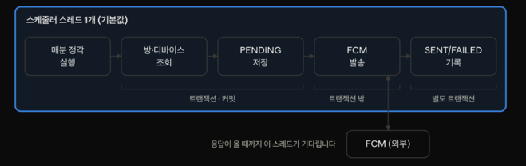
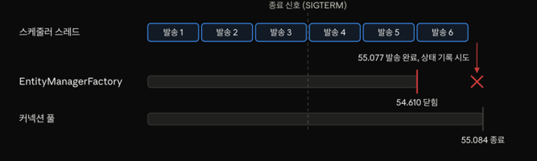
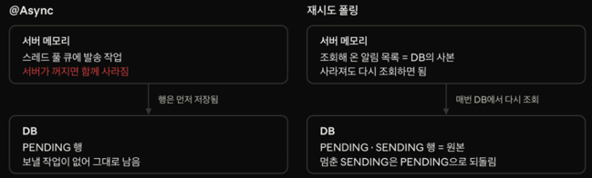

**링아웃의 활동 알림은 FCM(Firebase Cloud Messaging)이 5분 동안 응답하지 않자 10건 중 8건이 흔적 없이 사라졌고, 서버를 정상적으로 내렸을 때도 이미 보낸 알림을 PENDING으로 남겼습니다. 이렇게 조용히 실패하던 알림을 실패가 보이고 스스로 복구되게 고쳐 본 과정을 기록한 글입니다.**


그림 출처: 하루들 AI 생성

세 줄 요약
가장 단순하게 만든 분 단위 알림은 실행이 1분을 넘거나 FCM이 멈추면 다음 분의 알림을 흔적 없이 놓쳤고, 정상 종료에서도 이미 보낸 알림을 PENDING으로 남겼습니다.
@Async와 상태 기반 재시도 폴링을 직접 만들어 같은 실험에 넣었고, 서버가 내려갔다 올라온 뒤 스스로 복구한 구조는 재시도 폴링 방식뿐이었습니다.
대신 복구 과정에서 중복 발송이 생겼습니다. 조용히 사라지던 알림을 눈에 보이고 다시 보내는 구조로 바꾼 대가입니다. 같은 시간에 함께 목표를 달성하는 앱이라 누락보다 중복을 골랐습니다.


Spring 스케줄러로 푸시 알림을 보내고 있거나, @Async와 폴링 중 무엇으로 보낼지 고민하는 백엔드 개발자를 위한 글입니다. 글의 수치는 실제 FCM이 아닌 가상의 알림 발송기로 구조의 동작을 재현한 실험 결과입니다.


1. 링아웃 활동 알림
   링아웃은 함께 정한 시각에 함께 움직이는 기능을 제공하는 알람 앱입니다. 사용자는 방에 들어가 각자 알람을 설정합니다, 방마다 매일 활동을 시작할 요일과 시각은 정해져 있습니다.

활동 알림은 그 시각이 되면 방 멤버 모두에게 가는 푸시 알림입니다. 지금 서버가 보내는 알림은 이것 하나뿐입니다.

이 알림은 정해진 분에 와야 의미가 있습니다. 7시에 오기로 한 알림이 7시 3분에 오면 늦은 것이고, 오지 않으면 기능이 실패한 것입니다. 예를 들어, 설정해둔 알람이 울리기 전 방의 활동 푸시 알림을 보고 준비하면 바로 활동하러 나갈 수 있는데 받지 못하면 준비가 더 늦어질 수 있습니다.

그래서 알림을 다루면서 세 가지 기준을 두었습니다.

모든 알림은 결국 누락 없이 나가야 합니다.
같은 알림은 가능한 한 번만 나가야 합니다.
정해진 분 안에 도착해야 합니다.
세 가지를 늘 함께 지킬 수는 없었습니다. 누락을 막으려고 다시 보내면 중복이 생기고, 중복을 막으려고 조심하면 누락이 생깁니다. 둘이 부딪히면 1번을 고릅니다. 앱에서 오지 않는 알림은 기능 실패이고, 두 번 오는 알림은 불편이라 생각했기 때문입니다.


2. 가장 단순한 구조
   처음에는 가장 간단하게 만들었습니다. 매분 정각에 스케줄러가 돌고, 그 분에 활동 시각이 걸린 방을 찾아 알림을 저장한 뒤 바로 FCM으로 보냅니다. 분 단위로 정해진 알림을 보내는 데 이보다 단순한 방법은 떠오르지 않았습니다.

흐름은 다섯 단계입니다.

매분 정각에 스케줄러가 실행되고, 현재 시각을 분 단위로 자릅니다.
그 분에 활동 시각이 걸린 방과 멤버들의 디바이스를 조회합니다.
디바이스마다 알림을 PENDING 상태로 저장하고 커밋합니다.
트랜잭션 밖에서 FCM으로 발송합니다.
결과에 따라 SENT 또는 FAILED로 기록합니다.



``` java
@Scheduled(cron = "0 * * * * *")
@SchedulerLock(name = "roomActivityNotification", lockAtLeastFor = "30s", lockAtMostFor = "50s")
public void notifyRoomActivity() {
    LocalDateTime now = LocalDateTime.now(clock).truncatedTo(ChronoUnit.MINUTES);
    try {
        List<Long> notificationIds = roomActivityNotificationService.create(now);
        notificationSendService.send(notificationIds);
    } catch (Exception e) {
        log.error("방 활동 알림 처리 실패 - {}", now, e);
    }
}
```

저장부터 발송, 기록까지 모든 단계를 스케줄러 스레드 하나가 처리합니다. 스케줄러 스레드는 따로 설정하지 않아 기본값인 한 개였습니다.

이후 블루그린 배포를 도입하면서 두 가지를 덧붙였습니다. 배포 중에는 새 서버가 뜨고 기존 서버가 내려가기까지 두 대가 겹칩니다. 이 구간에서 같은 알림이 두 번 나갈 수 있다고 보고 ShedLock으로 한 대만 스케줄러를 실행하게 했습니다. 그리고 기존 서버가 내려갈 때 발송 중인 알림이 끊기지 않도록 종료 대기를 넣었습니다. Spring은 스케줄러 작업을 최대 30초 기다리고(await-termination), Docker 컨테이너는 종료 전에 40초를 기다립니다.

설정을 두 개 덧붙이고 나니 오히려 확신이 줄었습니다. 이 설정들이 정말 무엇을 지켜주는지 알 수 없었습니다. 구조를 바꾸기 전에, 이 구조가 무엇을 당연하게 여기고 있는지부터 적어 봤습니다.

| 이 구조가 기대하는 가정 | 깨지면 생기는 일 |
|---|---|
| 한 번의 실행은 1분 안에 끝난다 | 건너뛴 분의 알림이 나가지 않는다 |
| FCM은 항상 응답한다 | 스레드 하나가 멈춰 뒤의 알림이 모두 멈춘다 |
| 서버는 발송 도중 멈추지 않는다 | 서버가 고장나면 PENDING으로 알림은 남는다 |
| 서버는 늘 한대다 | 같은 분의 알림이 두 번 나갈 수 있다 |


이제 하나씩 이 가정을 깨 보겠습니다. 제 실험은 실제 FCM 대신 지연과 무응답을 넣을 수 있는 가짜 발송기로 진행했고, MySQL 8.4 컨테이너에서 실제로 커밋이 일어나게 했습니다. 일부 실험은 2초를 1분으로 쳐서 시간을 줄였고, 대부분 한 번씩 측정했습니다. 그래서 숫자는 구조가 어떻게 동작하는지를 보여줄 뿐, 실제 FCM의 지연이나 운영 트래픽을 뜻하지는 않습니다.


## 3. 가정이 깨지면
### A. 한 번의 실행이 1분을 넘기면
cron은 매분 정각에 돕니다. 그래서 알림도 매분 나간다고 생각하기 쉽습니다. 하지만 이 말은 한 번의 실행이 1분 안에 끝날 때만 맞습니다.
실행을 일부러 길게 만들어 봤습니다. 첫 방에만 의도적으로 알림 75건을 걸고 건당 1초가 걸리게 해서, 첫 실행이 약 75초가 걸리도록 설정했습니다. 그다음 1분마다 방 하나씩 활동 시각이 걸리게 두고 실제 분 단위 cron으로 돌렸습니다.

| 경과 시각 | 스케줄러 실행 | 그 분의 방 |
|---|---|---|
| 0초 | 실행 | 75건 발송 |
| 60초 | 실행 없음 | 알림 0건 |
| 120초 | 실행 | 121초에 발송 |
| 180초 | 실행 | 181초에 발송 |

60초의 방은 1분 늦게 받은 게 아니라, 끝까지 받지 못했습니다.

Spring의 cron은 다음 실행 시각을 직전 실행이 끝난 시점 기준으로 계산합니다. 첫 실행이 76초쯤 끝났으니 그다음 정각은 120초입니다. 60초의 실행은 건너뛰고, 보충하지도 않습니다. 게다가 스케줄러는 실행될 때 현재 분만 보기 때문에, 지나간 분을 다시 볼 방법이 없습니다.

게다가 흔적도 남지 않았습니다. 실행 자체가 일어나지 않았으니 알림 행도, 오류 로그도 전혀 남지 않았습니다.


### B. FCM이 응답하지 않으면
실행이 길어지면 그 분을 건너뜁니다. 그럼 실행이 아예 끝나지 않으면 어떻게 될까요.

지금 구조는 FCM이 늘 응답한다고 가정합니다. FCM 호출에 타임아웃을 설정하지 않았고, SDK(Software Development Kit)의 기본값은 응답이 올 때까지 무제한으로 기다립니다. 그리고 하나뿐인 스케줄러 스레드가 이 호출을 기다립니다.

가짜 알림 발송기가 5분 동안 응답하지 않다가 회복하도록 만들었습니다. 매분 방 하나, 방마다 알림 2건으로 기대 발송은 10건입니다. 이 실험은 시간을 줄이려고 2초를 1분으로 쳤습니다.

장애 동안 발송은 0건이었고, 스케줄러 스레드는 발송기 안에서 응답을 기다리고 있었습니다.
장애 동안 알림 행이 생긴 방은 첫 방 하나(PENDING 2건)뿐이었습니다. 나머지 4개 방은 행조차 생기지 않았습니다.
회복 후 발송된 건 2건이었습니다. 10건 중 8건, 방 4개가 사라졌습니다.


외부 시스템 하나가 멈추자 우리 쪽 알림 전체가 멈췄고, 회복된 뒤에도 그 사이의 분은 돌아오지 않았습니다. 장애 시간만큼 알림 건너뛰기가 된 셈입니다.

### C. 서버를 정상적으로 내려도
2장에서 배포 중 서버가 내려갈 때를 대비해 종료에 대기 설정을 넣었습니다. 스케줄러 작업이 끝날 때까지 최대 30초를 기다리는 설정입니다. 그래서 정상 종료라면 발송 중인 알림도 안전하다고 생각했습니다.

실제 프로세스를 띄우고 발송 도중 종료 신호(SIGTERM)를 보냈습니다. 방 하나에 알림 6건, 건당 0.5초가 걸리게 하고, 3건을 보낸 시점에 신호를 보냈습니다.

결과는 이랬습니다. 6건은 모두 발송됐습니다. 그리고 6건 모두 PENDING 상태로 남았습니다.

종료 대기는 발송까지만 지켜줬습니다.

로그를 보면 순서가 드러났습니다.

| 시각 | 일어난 일 |
|---|---|
| 54.610 | EntityManagerFactory 종료 |
| 55.077 | 발송 완료, 상태 저장 시도 중 "EntityManagerFactory is closed" 오류 |
| 55.084 | 커넥션 풀 종료 |



스케줄러는 약속대로 발송이 끝날 때까지 기다렸습니다. 하지만 그사이 JPA가 DB에 쓰는 데 필요한 EntityManagerFactory가 먼저 닫혔습니다. 발송은 끝났지만 상태를 SENT로 바꾸는 쿼리는 실패했습니다.

로그를 보면 종료 대기를 켠 스케줄러는 다른 자원이 정리된 뒤에 늦게 멈추는 것으로 보입니다. 지금 구조는 발송을 트랜잭션 밖에서 하고 상태 기록을 그 뒤 별도 트랜잭션으로 하기 때문에, 발송이 끝나고 기록하기 전에 EntityManagerFactory가 닫히면 상태를 저장하지 못합니다.


종료 대기를 줄이거나 강제로 종료하면 어떨까요.

| 종료 방식 | 실제 발송 | DB 상태 |
|---|---|---|
| SIGTERM, 대기 30초 | 6건 | PENDING 6건 |
| SIGTERM, 대기 1초 | 5건 | PENDING 6건 |
| SIGKILL | 3건 | PENDING 6건 |


어느 경우든 DB의 기록은 실제와 다릅니다.

이 실패는 A, B와 성격이 다릅니다. A와 B는 알림이 사라졌지만, 여기서는 알림이 나갔는데 기록이 틀렸습니다. DB만 보면 6건은 아직 보내지 않은 알림입니다. 재시도 스케줄러가 돌면 이미 알림을 받은 사람에게 다시 보내게 됩니다.


### D. 서버가 두 대가 되면
마지막 가정은 서버가 늘 한 대라는 것입니다. 블루그린 배포 중에는 두 대가 잠깐 겹치고, 이를 위해 ShedLock을 붙였습니다. 그런데 이 락은 길어도 50초 뒤에 풀립니다. 실행이 50초를 넘기면 락이 풀린 사이 다른 서버가 같은 분의 알림을 다시 보낼 수 있다고 봤습니다.

같은 DB를 보는 인스턴스 두 개를 띄우고, 첫 분의 실행이 70초 걸리게 해서 실제 cron으로 돌렸습니다.

같은 분의 중복 발송은 0건이었습니다. 방마다 알림 묶음은 하나씩만 만들어졌습니다. 서로 다른 분의 발송이 약 1초 겹쳤을 뿐입니다.

생각해 보면 당연했습니다. 락이 50초에 풀려도, 다른 서버가 실행할 다음 기회는 다음 정각입니다. 그때 스케줄러가 보는 건 다음 분입니다. 락의 만료 시간이 아니라, 정각에만 돌고 분 단위로 자르는 cron이 같은 분의 재실행을 막고 있었습니다.


## 4. 고치는 방법 두 가지를 직접 만들어 보기
### 예전에 겪었던 일
고칠 방향을 고민하면서 이전에 운영했던 서비스를 먼저 떠올렸습니다. 그 서비스에서는 알림을 @Async로 보냈습니다. 요청을 처리하는 쪽이 FCM 응답을 기다리지 않게 하려는 선택이었습니다.

그런데 배포를 하면 메모리에 있던 발송 작업이 서버와 함께 사라졌고, 알림은 PENDING으로 남았습니다. 이걸 다시 보내려고 PENDING을 주워 가는 스케줄러를 붙였더니, 이번에는 @Async 스레드와 스케줄러가 같은 알림을 동시에 집어 운영 중에 같은 알림이 두 번 나갔습니다. 결국 보내기 직전에 PENDING을 SENDING으로 바꾸는 쪽만 보내도록 선점을 넣고서야 멈췄습니다.

@Async와 복구 스케줄러 둘 다 필요한지, 같은 조건에서 확인해보기로 했습니다.

### 같은 실험, 세 구조
현재 구조 외에 두 가지를 만들었습니다. 두 구조 모두 실험 브랜치에서만 만들었고, 운영에 적용한 적은 없습니다.

- @Async: 스케줄러는 알림 저장까지만 하고, 발송은 별도 스레드 풀로 넘깁니다.
- 재시도 폴링: 스케줄러는 알림 저장까지만 하고, 별도 폴러가 짧은 주기로 PENDING을 찾아 보냅니다. 보내기 전에 조건부 UPDATE로 PENDING을 SENDING으로 바꾼 쪽만 보내고, 실패하면 다음 시도 시각을 뒤로 미룹니다. 오래 멈춘 SENDING은 PENDING으로 되돌립니다.

다음 표는 3장의 실험을 세 구조에 그대로 넣은 결과입니다.


| 상황 | 현재 구조 | @Async | 재시도 폴링 |
|---|---|---|---|
| cron 실행이 1분을 넘김 | 60초 실행 없음, 그 방 0건 | 매분 실행, 전 방 발송 | 매분 실행, 전 방 발송(정시 대비 약 17초 지연) |
| FCM 5분 무응답 후 회복 | 10건 중 2건, 방 4개 누락 | 스케줄러 정상, 회복 후 10건 | 10건 (재시도 한도 3회면 6건 + FAILED 4건) |
| 발송 중 SIGTERM | 6건 발송, PENDING 6건 | 6건 발송, PENDING 6건 | 0.09초 만에 종료, 3건 발송, SENDING 6 |
| 같은 프로세스 종료 후 재시작 | PENDING 그대로 | PENDING 그대로 | 8초 뒤 SENT 12, 중복 5건 |
| 서버 두 대, 실행 70초 | 같은 분 중복 0 | 중복 0 | 중복 0 |

재시도 폴링이 종료 신호에 바로 내려간 건 이번 구현이 종료 신호를 받으면 발송을 기다리지 않기 때문입니다. 대신 남은 SENDING은 재시작 후 정리 로직이 다시 보냅니다.

종료 후 스스로 복구된 구조는 재시도 폴링 하나였습니다.

### @Async: 스케줄러는 살렸지만 PENDING은 되살리지 못함
@Async로 발송을 떼어내자 3장의 A, B는 해결됐습니다. 발송이 오래 걸리거나 FCM이 멈춰도 스케줄러는 매분 돌며 알림 행을 빠짐없이 저장했습니다.

@Async로 넘긴 발송 작업은 스레드 풀의 메모리 큐에만 있습니다. 실험에서 첫 방을 보내는 도중 서버를 내리자, 큐에서 기다리던 두 번째 방의 알림 6건은 한 번도 나가지 못했고 재시작 뒤에도 PENDING으로 남았습니다. 알림 행은 DB에 있었지만, 그 행을 보내야 한다는 사실은 서버와 함께 사라졌습니다.

스레드 풀이 생기면서 새로 정해야 할 것도 생겼습니다. 스레드와 큐가 모두 차면 Java 스레드 풀은 거부 정책에 따라 새 작업을 처리합니다. 기본값인 AbortPolicy는 예외를 던지고 작업을 받지 않고, CallerRunsPolicy는 작업을 넘긴 스레드가 직접 실행합니다.

스레드 1개, 큐 1칸으로 일부러 좁혀서 2초마다 방 하나씩, 방마다 알림 3건을 넣었습니다. 기대 발송은 24건입니다.

| 거부 정책 | 발송 | 누락 | 왜 조용한가 |
|---|---|---|---|
| AbortPolicy | 18 | 6건 PENDING 잔류 | 예외는 났지만 다시 볼 주체가 없다 |
| CallerRunsPolicy | 21 | 방 1개 알림이 아예 생성 안 됨 | 상태 표에는 PENDING 0건이라 보이지 않는다 |


CallerRunsPolicy는 넘친 작업을 스케줄러 스레드가 직접 처리합니다. 그동안 스케줄러가 밀려서 한 분을 놓쳤습니다. 누락이 없는 정책처럼 보이지만, 3장 A와 같은 방식으로 조용히 알림을 잃었습니다.

결국 남은 PENDING을 누군가 다시 봐야 합니다. 예전처럼 PENDING을 주워 다시 보내는 스케줄러를 붙여 봤습니다. 디바이스 5개, 발송에 2.5초가 걸리는 상황에서 "생성 후 1초가 지난 PENDING"을 다시 보내게 하자, 5개 디바이스에 30건이 나갔습니다. 디바이스마다 6번씩입니다. DB에는 SENT 5건으로 아무 문제가 없어 보였습니다. 중복은 발송 기록을 직접 봐야만 볼 수 있었습니다.


### 재시도 폴링: 복구는 됐지만 중복이 남음
재시도 폴링은 서버가 내려간 뒤 다시 뜨자 8초 만에 남은 알림을 전부 보냈습니다.

폴러도 조회한 알림 목록을 메모리에 들고 있습니다. 하지만 그 목록은 DB에서 언제든 다시 만들 수 있는 사본입니다. 보내야 할 일의 원본은 DB의 PENDING 행이고, 서버가 꺼져도 그대로 남습니다. 보내던 중이던 SENDING 행도 오래 멈춰 있으면 정리 로직이 PENDING으로 되돌립니다. 그래서 어느 알림도 아무도 다시 보지 않는 상태로 남지 않습니다.

대신 중복 5건이 생겼습니다. 서버가 내려가기 직전 FCM에는 보냈지만 SENT를 기록하지 못한 알림들이 SENDING으로 남았고, 정리 로직이 이를 PENDING으로 되돌려 다시 보냈기 때문입니다. 보낸 뒤 기록하기 전에 멈추면, 다음 시도는 이미 보냈다는 사실을 알 수 없습니다.


### 왜 폴링인가
@Async에 안전망을 붙이면 결국 선점, 다음 시도 시각, 멈춘 작업 정리가 필요해집니다. 그건 폴링이 갖추는 장치 그대로입니다. 그 장치를 다 갖추면 @Async 경로가 따로 하는 일은 몇 초 빨리 보내는 것뿐입니다.

앞에서 본 것처럼 차이는 보내야 할 일이 메모리에 있느냐, DB에 있느냐입니다. 우아한형제들 기술블로그의 「사장님 입점신청 자동승인 주기를 10분에서 10초로」에서 말한 것처럼, 현재 상태를 반복해서 보는 방식은 신호를 놓쳐도 스스로 회복합니다.




그래서 폴링 하나로 합치기로 했습니다. 다만 앞에서 본 중복은 남았고, 이 대가는 6장에서 다룹니다.


## 5. 실패를 보이게
   3장에서 본 실패들의 공통점은 흔적이 없거나, 흔적이 틀렸다는 것이었습니다. 건너뛴 분에는 알림 행도 로그도 없었고, 정상 종료 뒤의 PENDING은 실제로는 이미 나간 알림이었습니다. 복구가 되더라도, 어디서 무엇이 실패하고 있는지 보이지 않으면 문제가 생겨도 알 수 없습니다.

그래서 재시도 폴링에 세 가지 숫자를 세는 집계를 붙였습니다.

| 지표 | 무엇을 뜻하나 |
|---|---|
| 오래된 PENDING | 만들어진 지 한참 지났는데 아직 아무도 보내지 않은 알림. 폴러가 멈췄거나 밀리고 있다는 신호 |
| 오래된 SENDING | 누군가 집어 갔는데 끝나지 않은 알림. 보내던 서버가 죽었다는 신호 |
| 한도 초과 FAILED | 재시도를 다 쓰고 포기한 알림. 사람이 봐야 하는 실패 |


FCM이 5분간 응답하지 않는 실험에서, 재시도 한도를 3회로 두자 장애가 끝나기 전에 집계에 한도 초과 FAILED 4건이 나타났습니다. 현재 구조에서는 같은 상황에 방 4개의 알림이 행조차 없이 사라졌습니다. 같은 장애가 "아무 흔적 없음"에서 "포기한 알림 4건"이라는 숫자로 바뀐 것입니다.

| 상황 | 개선 전 남는 흔적 | 개선 후 남는 흔적 |
|---|---|---|
| 1분 초과로 건너뛴 분 | 없음 | 행이 생성되고 늦게라도 발송 |
| FCM 무응답 | 행 없는 방 | 재시도 중인 PENDING, 한도 초과 FAILED 집계 |
| 발송 중 종료 | 보냈는데 PENDING | SENDING으로 남고 정리 로직이 회수 |

여전히 보이지 않는 실패가 하나 남았습니다. 중복입니다. 상태 테이블은 마지막 결과만 기록하기 때문에, 같은 알림이 몇 번 나갔는지는 발송 기록을 따로 남기지 않는 한 알 수 없습니다.

## 6. 무엇을 대가로 냈고 무엇이 남았나
   재시도 폴링으로 바꾸면서 가장 먼저 받아들인 건 중복입니다. 4장에서 생긴 중복 5건은 FCM에는 보냈지만 우리 DB에 SENT를 적기 전에 서버가 멈춘 알림들이었습니다. 발송은 FCM에서, 기록은 DB에서 따로 일어나기 때문에 상태를 아무리 꼼꼼하게 관리해도 이 사이는 메울 수 없었습니다. 그래서 1장에서 정한 대로 누락을 막는 쪽을 골랐습니다. 같은 알림이 화면에 두 번 쌓이지 않게 하는 방법은 따로 있겠지만, 이번 글에서는 다루지 않았습니다.

재시도 한도도 생각보다 신경 쓸 값이었습니다. FCM이 5분 동안 멈춘 실험에서 한도를 3회로 두었더니, 장애가 끝나기 전에 4건이 FAILED가 되어 회복된 뒤에도 다시 나가지 않았습니다. 100회로 늘리자 10건이 모두 나갔습니다. 한도를 짧게 잡으면 장애 중에 포기하고, 길게 잡으면 의미 없는 시도가 계속됩니다. 이번에는 실험에 맞춰 정했을 뿐이라, 실제로 쓰려면 FCM 장애가 보통 얼마나 이어지는지부터 알아야 합니다.

폴러가 하나뿐이라는 점도 남았습니다. 실행이 1분을 넘긴 실험에서 다음 분의 방은 앞선 75건이 끝나길 기다리느라 정각보다 17초쯤 늦게 알림을 받았습니다. 분 단위 알림이라 이 정도는 괜찮다고 봤지만, 한 분에 몰리는 알림이 많아지면 폴러를 늘리거나 한 번에 보내는 양을 조절해야 할 것 같습니다.

마지막으로, 정상 종료에서도 보낸 알림이 PENDING으로 남는 문제는 원인까지만 확인했습니다. 상태를 기록하기 전에 DB 쪽 자원이 먼저 닫힌다는 것은 알았지만 순서를 바꿔 보지는 않았습니다. 지금은 재시작한 뒤 재시도 폴링이 다시 보내는 것으로 이 문제를 덮고 있습니다.


가장 단순하게 만든 분 단위 알림은 세 가지 상황에서 알림을 잃었습니다. 실행이 1분을 넘기면 다음 분을 건너뛰었고, FCM이 5분 동안 응답하지 않자 10건 중 8건이 사라졌으며, 정상 종료에서도 이미 보낸 6건을 PENDING으로 남겼습니다. 서버 두 대에서의 중복 발송은 재현되지 않았습니다.

@Async와 재시도 폴링을 같은 실험에 넣었을 때, 서버가 내려갔다 올라온 뒤 스스로 복구한 구조는 재시도 폴링뿐이었습니다. 대신 중복 5건이 생겼고, 1장의 기준에 따라 누락보다 중복을 감수하기로 했습니다.

코드만 읽었을 때는 종료 대기 설정이 상태 기록까지 지켜 준다고 생각했고, 락 만료가 중복을 만들 수 있다고 생각했습니다. 실험 결과는 둘 다 반대였습니다.


## 참고 자료
전예환, "사장님 입점신청 자동승인 주기를 10분에서 10초로", 우아한형제들 기술블로그, 2026. 9. 23., https://techblog.woowahan.com/27678/