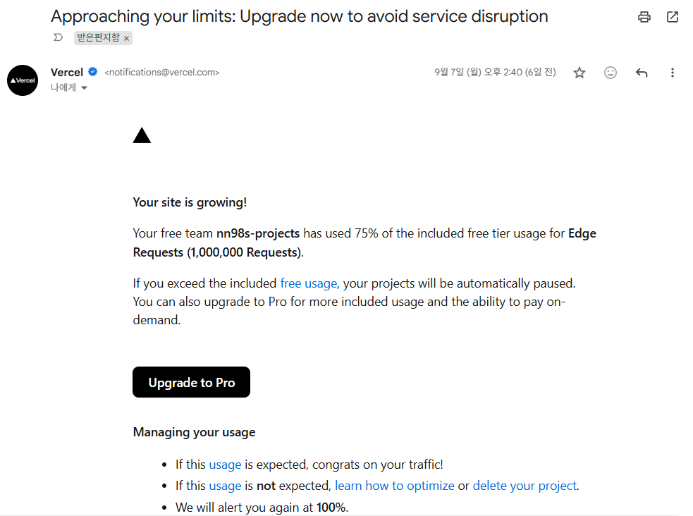
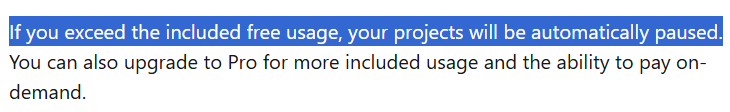
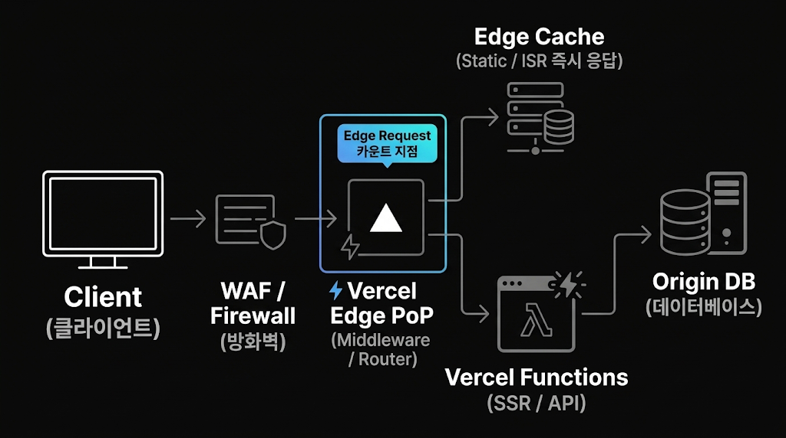
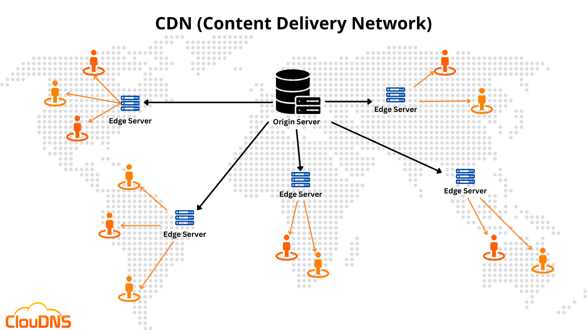
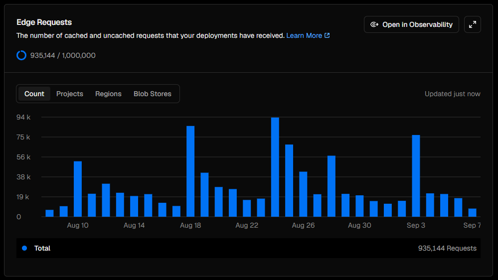
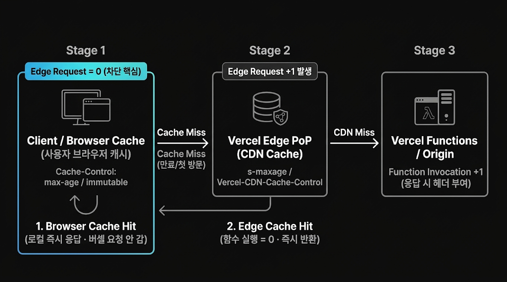
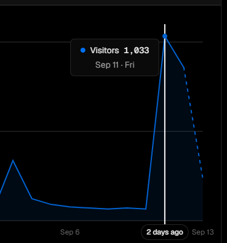
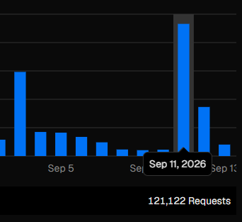

# 엣지 리퀘스트가 뭔데? (Vercel)

## 엣지 리퀘스트

Vercel(정적 파일과 서버리스 함수를 올려 주는 호스팅 서비스)로 서비스를 배포한다면 언젠가 마주치게 될 메일이다.
2026-09-07 14:40, 무료 한도의 75%를 썼다는 경고가 왔다. 한도를 넘으면 프로젝트가 자동으로 멈춘다.
필자는 전혀 준비되지 않은 채 마주친 덕에 당혹스러웠다.

> ### 엣지 리퀘스트가 뭔데?
> 리퀘스트는 아는데 Edge가 뭐지;
>
> 
> (이미지 출처 표기 필요)

킹갓 제미나이에게 물으니 `Vercel Edge PoP`(사용자 가까이 놓인 Vercel 접속 지점)에 들어온 클라이언트 요청이 엣지 리퀘스트라고 한다.

그냥 리퀘스트라 부르지 왜 Edge를 붙여서 사람 헷갈리게 하지?

이유는 버셀의 서버 구조에 있다.

#### CDN

중앙 서버 하나가 모든 데이터를 관리하면 데이터 충돌도 없고 비용 관리도 쉽다.
대가로 서버에서 멀어질수록 물리적 지연이 커지고, 중앙 서버가 죽는 순간 전체가 멈춘다.

그래서 나온 대안이 콘텐츠 전송 네트워크(CDN, Content Delivery Network)다.

- 중앙 서버(Origin)를 둔다.
- 중앙과 연결된 `Edge Server`를 여러 지역에 나눠 둔다.
- 사용자는 가까운 `Edge Server`에 요청을 보내 빠르게 응답받는다.

사용자와 서버 사이의 물리적 지연을 줄여 빠른 응답을 주는 구조다.
서비스 페이지 읽기 요청이 대부분인 [Vercel은 CDN](https://vercel.com/docs/cdn)을 쓸 이유가 충분하다.

CDN의 `Edge Server`로 들어온 요청을 `Edge Request`라 부른다.
여기서 놓치기 쉬운 점이 있다. **Edge 캐시에 적중해 함수가 돌지 않은 요청도 1건으로 센다.** Usage 화면 설명도 "cached and uncached requests"다.
무료 제공량은 최근 30일 누적 100만 건이다.

메일에 첨부된 Usage 페이지를 들어가니 예상과 다른 화면이 나왔다.

> ### ???
> 메일은 75%였는데 열어 보니 93만? DAU 50도 안 되는 우리 서비스에?

#### 원인 파악

리퀘스트 그래프는 방문자 그래프와 비례했다.
악의적 공격으로 폭증했다고 볼 수 없었고, 그럴 규모의 프로젝트도 아니었다.

결국 가능성은 사용자 하나가 발생시키는 리퀘스트가 어마어마하게 많다는 것.
단순 계산으로 (당일 리퀘스트) / (당일 사용자) = 700..

## 🤦

평균만 따져도 700이고 무반응 이탈을 고려하면 한 명이 1천 개 가까운 리퀘스트를 보내고 있는 상황.
서비스 코드가 얼마나 개판인지 직접 체감이 됐다.

에이전트에게 상황을 설명하고 원인을 찾게 하니 답이 바로 나왔다. 원인은 다섯 가지였다.

1. **정적 자산을 매번 재검증했다.** 캐시 헤더가 없으면 Vercel은 `public/` 파일에 `Cache-Control: public, max-age=0, must-revalidate`를 붙인다. 페이지를 열 때마다 로고와 아이콘 전부에 "바뀌었나요?" 요청이 나간다. `304 Not Modified`로 끝나도 1건이다. 브랜드 카드마다 로고 1장과 배달앱 아이콘 4장이 붙고, 카드가 수십 개 깔리니 곱해진다.
2. **45px 자리에 2084px 원본 이미지를 내려보냈다.** 전송량 문제지만 같이 고쳤다.
3. **`robots.txt`(크롤러에게 접근 규칙을 알리는 파일)가 없었다.** 크롤러 속도를 정할 수 없었고, 나중에 만든 파일도 프리렌더 결과물이 덮어써 나가지 않았다.
4. **사이트맵(sitemap)이 매일 89장 전부를 "변경됨"으로 알렸다.** 크롤러가 매일 전 페이지를 다시 긁으러 왔다.
5. **API와 PostHog(사용자 행동 분석 도구) 요청이 Vercel을 거쳐 갔다.** `vercel.json`의 경로 재작성(rewrite)이 API 서버와 PostHog로 가는 요청을 대신 전달했다. 방문 1회에 API 호출만 6건쯤 Edge 요청으로 잡혔다.

아무리 CS를 놓고 살았어도 이 상황에 뭐가 필요한지는 자명했다. 캐싱.
CDN 구조부터 캐시와 닮았고, 이미 받은 값을 브라우저가 재활용하면 요청은 Vercel까지 오지도 않는다.

위 그림이 이 글의 요점이다.

- **1단계, 브라우저 캐시:** `max-age`와 `immutable` 안이면 요청이 아예 나가지 않는다. Edge Request 0건.
- **2단계, Edge 캐시:** `s-maxage`로 Edge에 저장하면 함수 실행은 줄지만 Edge Request는 1건 생긴다.
- **3단계, 함수와 원 서버:** 함수 실행까지 더해진다.

한도를 요청 수로 세는 서비스에서 줄일 수 있는 곳은 1단계뿐이다.

## 조치

프랜차이즈 브랜드 로고는 반기에 한 번 바뀔까 말까다.
2026-09-09에 로고를 브라우저 캐시로 박아 버리고 기한을 한 달로 걸자 인당 요청이 100여 건으로 줄었다.

그새 리퀘스트 한도는 95%에 육박했다. 당장의 서비스 중지를 막으려고 적용할 수 있는 조치를 모두 했다.

| 날짜 | 대상 | 조치 |
|---|---|---|
| 09-09 | 로고, 배달앱 아이콘 | `public, max-age=2592000, immutable` (30일) |
| 09-09 | 빌드 결과물 `/assets/` | `public, max-age=31536000, immutable` (1년) |
| 09-09 | 이미지 | 화면 크기에 맞게 축소 |
| 09-09 | 크롤러 | `robots.txt` 추가, 사이트맵은 실제 바뀐 페이지만 갱신 |
| 09-09 | PostHog | 리버스 프록시 해제 |
| 09-12 | API | 경로 재작성을 지우고 API 서버를 절대주소로 직접 호출 |
| 09-12 | HTML (`/`, `/brand/*`) | `public, max-age=600, must-revalidate` (10분) |

몇 가지는 설명이 필요하다.

- `/assets/`의 자바스크립트와 CSS는 빌드 도구(Vite)가 파일 이름에 내용 해시를 넣는다. 내용이 바뀌면 이름이 바뀌니 1년 `immutable`(만료 전에는 재검증도 하지 않음)이 안전하다.
- HTML은 주소가 고정이고 배포마다 내용이 바뀐다. 그래서 10분으로 짧게 두었다. `stale-while-revalidate`(만료된 사본을 먼저 보여 주고 뒤에서 갱신)는 쓰지 않았다. 배포 직후 옛 HTML이 사라진 번들을 가리켜 화면이 비는 위험이 있다. 화면의 할인 값은 API에서 오므로, 묵은 HTML을 받아도 보이는 값은 최신이다.
- PostHog 프록시는 광고 차단을 피해 이벤트를 모으려고 넣었던 것이다. 해제한 대가로 광고 차단을 쓰는 방문자의 이벤트는 잃는다. 이후 지표는 이 손실을 감안하고 읽는다.

#### 고쳤는데 반영이 안 됐다

09-09의 수정은 한동안 배포되지 않았다.
`vercel.json`에 설명용으로 넣은 `"//"` 주석 키가 설정 검증에 걸려 배포 자체를 막고 있었다. 코드는 고쳤는데 사용자에게 나가는 헤더는 그대로였다.
그 뒤로는 배포 후 `curl -I`로 실제 응답 헤더를 확인한다.

온몸을 비틀어 가며 조치를 취하고 캐시도 어느 정도 데워지고 나니 사용자 1인당 요청 수는 25개가 되었고, 리퀘스트 한도는 94%에 도달했다.

#### 정해 둔 걸 코드가 어기고 있었다

API 프록시는 원래 없어야 했다.
2026-07-28 결정 문서(ADR-001)가 "API는 절대주소로 부르고 프록시를 두지 않는다"로 확정해 두었다. 어느 시점에 코드만 프록시로 돌아갔고, 두 달 가까이 문서와 코드가 다른 말을 했다.
걷어내지 못한 사유는 "서버가 운영 주소만 허용해서(CORS) 프리뷰 배포가 깨진다"였다. 확인해 보니 프리뷰 주소는 이미 허용돼 있었다. 확인 비용은 curl 세 번이었다.

> ## 조질 뻔
> 
>
> 09-09 조치를 마치고 이틀 뒤, 2026-09-11(금) 18시에 네이버 카페에 서비스가 홍보되며 하루 방문자 1,033명을 찍었다.
> 신기록에 기뻐해야 정상인데 난 폭증을 확인하자마자 엣지 리퀘스트 그래프만 쳐다보고 있었다.
> 봇부터 의심했지만 원장(이벤트 기록)으로 확인하니 사람이었다. IP 해시당 최대 3명, 화면 크기는 전부 실제 모바일, 18시 급등 뒤 자연스럽게 줄었다.
>
> ## 세이프
> 
>
> 조치 전엔 300명-94,000개 요청이 1000명-121,122개 요청으로 급감했다.
> 미리 조치하지 않았으면 시원하게 서비스가 터질 뻔했다.
> HTML 헤더와 API 프록시 제거는 이 급등을 겪은 다음 날 새벽에 넣었다.
>
> 그 다음 날도 800명 가량이 방문했지만 전날 방문자의 재방문이라 요청 자체는 1/3 수준이었다.
> 브라우저 캐시의 효과가 명확히 입증된 순간.

폭증 덕분에 한도는 97.5%를 찍는 기염을 토했다.
한도는 최근 30일 누적이라, 이후 방문이 정상으로 돌아오고 오래된 날이 빠지면서 사용량은 안정적으로 내려갔다.

#### 캐시가 404까지 기억했다

한 달 `immutable`에는 함정이 있었다.
로고가 없는 브랜드도 `/logos/<이름>.png`를 요청했고, 그 404 응답까지 30일 동안 캐시됐다. 09-11에 빽다방 로고를 새로 올렸지만 전에 방문한 브라우저는 30일 동안 로고 대신 첫 글자만 봤다. 브라우저가 서버에 묻지 않으니 고칠 방법도 없다.

그래서 빌드할 때 로고 목록(매니페스트)을 만든다.

- 목록에 없는 브랜드는 ``를 그리지 않는다. 요청도 404도 없다.
- 있는 브랜드는 `/logos/BBQ.png?v=e18b3347`처럼 파일 내용 해시를 붙인다. 파일을 바꾸면 주소가 바뀌어 캐시를 비켜 간다.

배달앱 아이콘 네 장은 아예 자바스크립트 번들에 문자열(base64 데이터 URL)로 넣어 요청 자체를 없앴다. 합쳐서 13KB라 번들에 넣는 손해가 요청 4건보다 작다.
자세한 기준은 [캐시 헤더와 자산 전달 방식](https://github.com/nn98/mono/blob/main/docs/CACHING-AND-ASSETS.md)에 정리했다.

### 무엇을 배웠고 다음에는 무엇을 할 것인가?

**학습**

기술 부채를 말로는 많이 언급했지만, 이번 부채는 복잡한 코드가 아니라 확인하지 않은 기본값과 설정이었다.

- 과금 단위를 먼저 봤어야 했다. Vercel 무료 한도에서 먼저 닿는 건 요청 수다.
- 플랫폼 기본값(`max-age=0`)이 내 서비스에 맞는지 확인하지 않았다.
- 고친 것과 배포된 것은 다르다. 주석 키 하나가 수정 전체를 막았다.
- 결정 문서가 있어도 코드가 지키는지 확인하지 않으면 문서는 틀린 안심만 준다.

**시도**

- 방문 1회당 요청 수를 지표로 둔다. 총 요청은 방문자에 따라 출렁이지만 1인당 요청은 코드 상태를 보여 준다.
- 배포 후 주요 경로의 응답 헤더를 `curl -I`로 확인한다.
- 사용량 경고를 75%보다 이른 지점에 건다.

부채가 청구서로 날아오기 전에 미리 다 막기는 어렵다.
그래도 첫 고지서가 오는 순간 빠르게 대응할 여력과 역량은 키워 두겠다.
