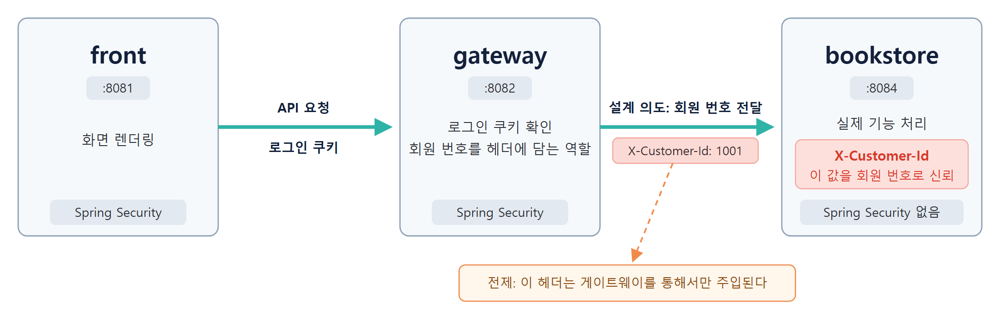
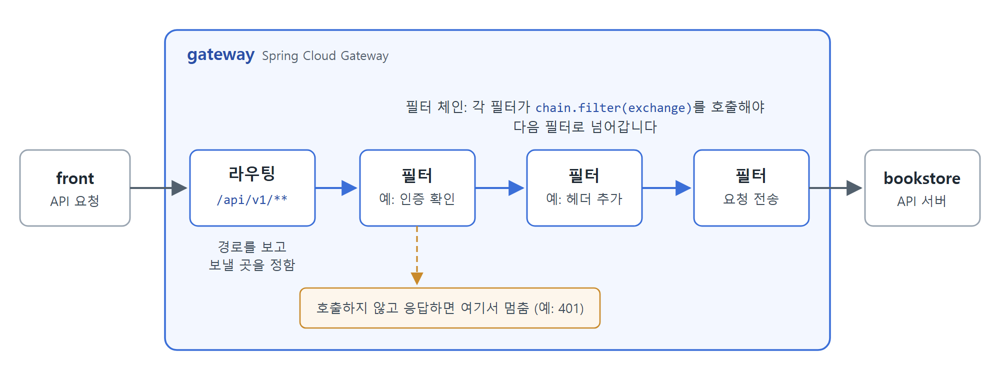
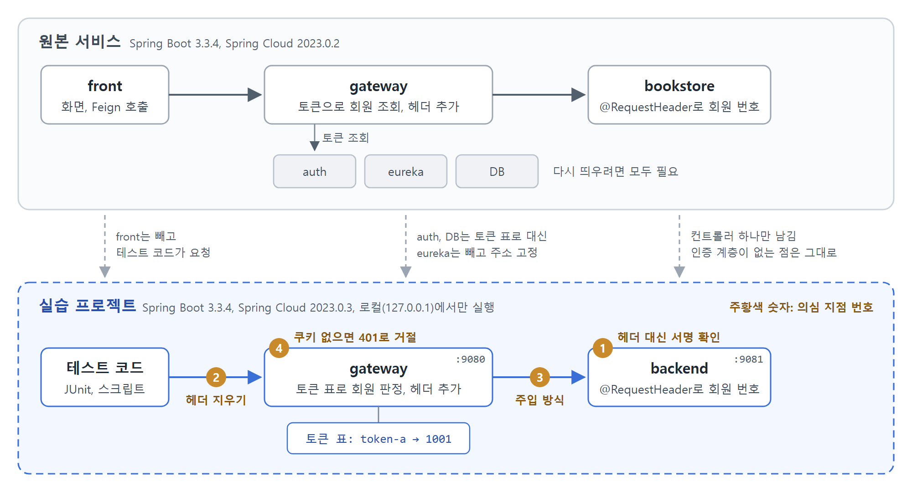
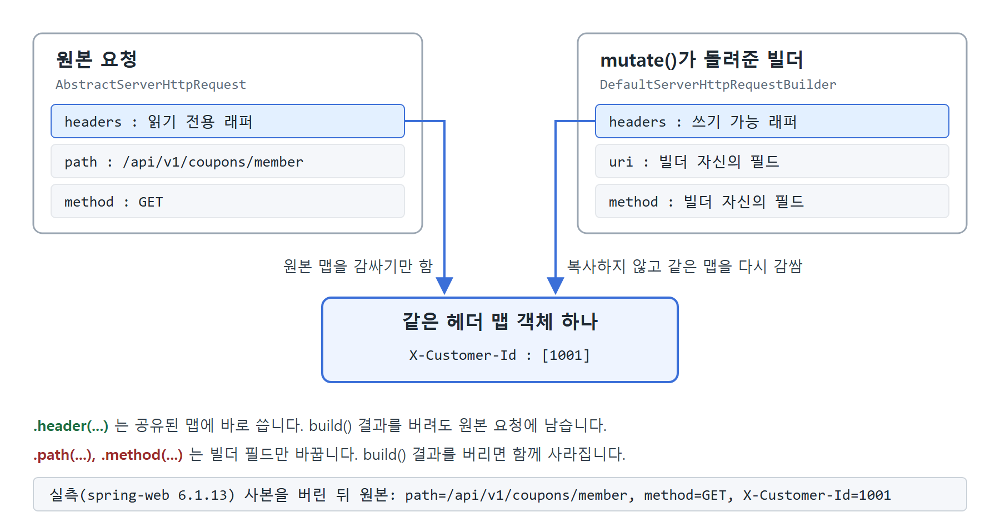
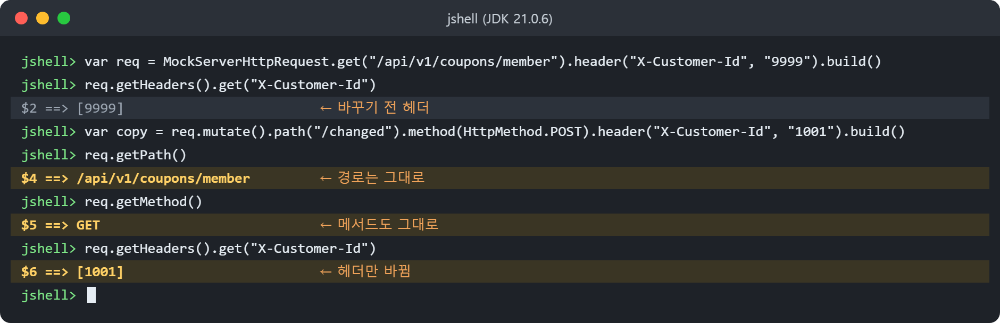
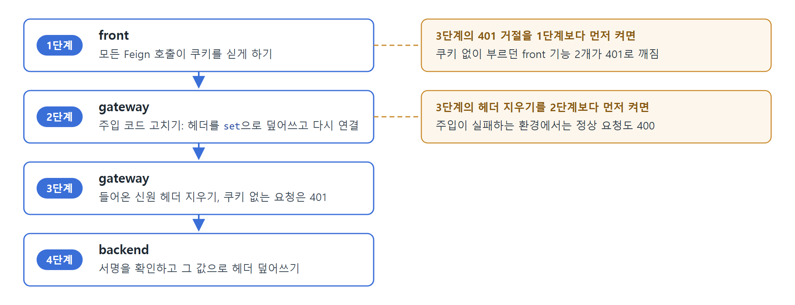
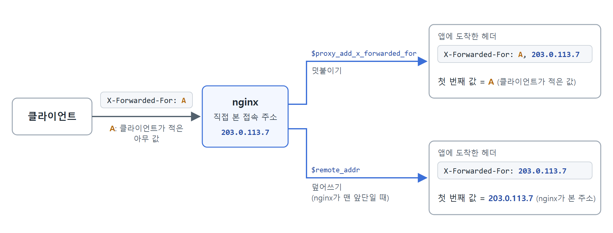

# 게이트웨이가 붙여 준 헤더, 백엔드는 믿어도 될까

[노션 링크](https://purrfect-chip-a6d.notion.site/Technical-Writing-3-40b5f1d0083f81c9a275c5dfe2098e88?source=copy_link)

## 개요

팀 프로젝트로 온라인 서점 서비스를 MSA(Microservice Architecture)로 구현한 적이 있었습니다. 이때 회원 기능을 만들면서 로그인과 인증/인가 기능을 도입했습니다. 실제 서비스는 모듈 6개로 이뤄져 있지만 이 글에서는 다음 세 지점만 중점적으로 다루려고 합니다.


*이 글에서 다루는 front, gateway, bookstore의 구성*

- **front**: 화면 그리기 및 인증 요청
- **gateway**: front에서 온 API 요청 라우팅. front에서 온 API는 모두 이곳을 거칩니다.
- **bookstore**: 실제 서비스 로직을 처리하는 API 서버. 요청 헤더의 `X-Customer-Id`를 보고 어느 회원의 요청인지 판단합니다.

구현할 당시에는 자연스러운 인증 흐름이라고 생각했습니다. 인증은 사용자가 처음 들어오는 front에서 한 번만 하면 충분하다는 생각이었는데, 이 구조에는 전제가 하나 있었습니다.

> `X-Customer-Id`는 게이트웨이를 통해서만 주입된다.

정말 그럴까요?

사실 이 질문은 프로젝트가 끝나고 2년이 지나서야 떠올랐습니다. 당시에는 기능 구현에 급급해서 돌아가는 것만 확인하고 그대로 두었습니다. 문득 생각이 나 AI에게 이 서비스의 인증 과정을 리뷰해 달라고 했더니, 생각보다 많은 지적이 돌아왔습니다. 이 글은 그중 하나를 직접 실험하며 확인한 기록입니다.

Spring MVC로 API를 만들어 봤고(`@RequestHeader` 등), 쿠키로 로그인 상태를 유지하는 방식을 알고 있다면 읽기 수월합니다. Spring Cloud Gateway의 필터와 `exchange`는 바로 아래에서 필요한 만큼 소개합니다.

## Spring Cloud Gateway란

**Spring Cloud Gateway**는 들어온 요청을 조건에 따라 그다음 서비스로 넘겨주는 API 게이트웨이입니다. 여기서 주로 쓰는 개념은 두 가지입니다.


*요청이 게이트웨이를 지나가는 순서*

- **라우팅**: 어떤 경로의 요청을 어디로 보낼지 정하는 규칙입니다. 저희 프로젝트에서는 `/api/v1/**` 요청이 bookstore 모듈로 갑니다.
- **필터**: 요청이 넘어가기 전후에 작동하는 영역으로, 인증 확인이나 헤더 추가 같은 공통 처리를 주로 맡습니다. 필터는 사슬처럼 이어져 있어서 각 필터가 `chain.filter(exchange)`를 호출해야 요청이 다음 단계로 넘어갑니다.

위 그림은 요청 하나가 게이트웨이를 지나가는 모습입니다. 라우팅으로 보낼 곳을 정한 뒤, 필터를 차례로 거쳐 bookstore에 도착합니다. 어느 필터든 다음으로 넘기지 않고 응답해 버리면 요청은 거기서 멈춥니다.

### 특징

뒤에서 다룰 문제점의 원인은 이 도구의 세 가지 특징에 있습니다.

**받은 헤더를 그대로 넘깁니다.** 게이트웨이는 어디까지나 프록시라서, 따로 지우라고 설정하지 않은 헤더는 클라이언트가 보낸 모습 그대로 다음 서비스에 넘깁니다. 그 헤더를 클라이언트가 보냈는지 게이트웨이가 붙였는지는 가리지 않습니다.

**필터는 알아서 검사해 주지 않습니다.** 필터 안에서 아무것도 확인하지 않고 `chain.filter(exchange)`를 호출하면, 요청은 그대로 다음 단계로 넘어갑니다. 한번 넘어간 요청은 뒤에서 누군가 막지 않는 이상 끝까지 갑니다.

**요청 객체는 직접 고칠 수 없습니다.** 원래 요청과 응답은 `exchange`에 담겨 있습니다. 요청 헤더를 바꾸려면 `mutate()`로 변경할 내용을 설정하고, `build()`로 고친 요청을 만들어야 합니다.

예를 들어 아래 코드는 헤더를 고친 요청을 만들어 놓고 정작 다음 단계에는 원래 `exchange`를 넘깁니다. 문서를 수정해 놓고 원본을 보내는 것과 같습니다. 변경을 반영하려면 고친 요청을 담은 `exchange`를 만들어 넘겨야 합니다.

```java
exchange.getRequest().mutate()
        .header("X-Customer-Id", "1001")
        .build();

return chain.filter(exchange);
```

## 어떤 점이 문제인가?

앞에서 본 세 가지 특징은 각각 문제로 이어집니다. 게이트웨이가 만든 `X-Customer-Id`와 클라이언트가 직접 써 보낸 `X-Customer-Id`는 이름이 같습니다. bookstore 입장에서는 둘을 구별할 방법이 없습니다.

### 헤더가 곧 로그인 정보

bookstore의 코드를 보면 이 점이 더 명확해집니다.

```java
@GetMapping("/coupons/mypage")
public ResponseEntity<List<MemberCouponResponseDto>> couponsByMemberId(
        @RequestHeader("X-Customer-Id") String customerId) {
    List<MemberCouponResponseDto> responseDtos =
            memberCouponService.getAllMemberCoupons(Long.parseLong(customerId));
    return ResponseEntity.ok(responseDtos);
}
```

컨트롤러만 놓고 보면 이상한 곳이 없습니다. 헤더로 받은 값을 회원 번호로 쓸 뿐입니다. 이런 코드가 컨트롤러 11개에 걸쳐 25군데 있었습니다.

그런데 bookstore에는 그 값이 진짜인지 확인하는 단계가 없었습니다. Spring Security 같은 인증 계층을 두고 토큰을 직접 검증했다면, 회원 번호도 헤더 대신 검증된 토큰에서 꺼냈을 것입니다. 하지만 bookstore의 의존성에는 비밀번호 암호화(`BCryptPasswordEncoder`)에 쓰는 `spring-security-crypto`만 있었고 요청을 검증하는 필터는 하나도 없었습니다.

bookstore에서는 `X-Customer-Id` 헤더가 곧 로그인 정보였습니다. 헤더에 1001이 적혀 있으면 그 요청은 1001번 회원의 것이 됩니다. 그 값을 게이트웨이가 붙였는지 다른 누군가가 적었는지는 따지지 않습니다.

### 쿠키가 없으면 그냥 통과

게다가 게이트웨이 필터는 액세스 토큰이 없으면 별도의 확인 절차 없이 요청을 통과시켰습니다.

```java
if (!exchange.getRequest()
        .getCookies()
        .containsKey("accessToken")) {
    return chain.filter(exchange);   // 쿠키가 없으면 그대로 통과
}
```

bookstore가 헤더를 그대로 믿는다는 점과 게이트웨이가 쿠키 없는 요청을 통과시킨다는 점이 맞물리면서 이런 시나리오가 가능해졌습니다. 로그인하지 않은 사람이 요청에 `X-Customer-Id: 9999` 한 줄만 추가하면 bookstore는 그 요청을 9999번 회원의 것으로 처리합니다.

### 버려진 사본

필터는 `mutate()`로 만든 사본을 넘기지 않고 버렸습니다. 원칙대로라면 헤더가 붙지 않아야 하는데 실제로는 붙게 됩니다. 요청 사본과 원본이 헤더를 공유하기 때문입니다. 이 때문에 로그인한 요청은 멀쩡하게 동작했고 코드가 틀렸다는 사실을 아무도 알아채지 못했습니다.

### 헤더를 만드는 곳이 하나 더

사실 헤더를 만드는 곳은 게이트웨이만이 아니었습니다. front도 회원 번호를 직접 헤더에 실어 보냈습니다.

```java
@FeignClient(name = "PointClient", url = "${gateway.base-url}")
public interface PointDetailClient {
    @GetMapping("/v1/points/histories/details")
    ResponseEntity<GetMyPageDetailPointHistory> getDetailPointHistories(
            @RequestHeader("X-Customer-Id") String customerId);
}
```

게이트웨이가 헤더를 붙여 주기를 기다리지 않고 front가 알고 있는 회원 번호를 그대로 실어 보낸 것입니다. 헤더를 만드는 곳이 두 군데였던 셈인데, 이 이야기는 뒤에서 다시 하겠습니다.

## 정말 그럴지 확인해봅시다

### 처음 세운 가설

AI가 짚어 준 의심 지점은 다섯 가지였습니다. 앞에서 이야기한 내용을 목록으로 정리하면 이렇습니다.

1. bookstore에 인증 계층이 없습니다. 도착한 헤더를 그대로 회원 번호로 씁니다.
2. 게이트웨이는 클라이언트가 보낸 `X-Customer-Id`를 지우지 않습니다.
3. 게이트웨이가 `mutate()`로 만든 사본을 버립니다. 헤더 주입이 실패하는 것처럼 보입니다.
4. 게이트웨이가 쿠키 없는 요청을 검증 없이 통과시킵니다.
5. front도 `X-Customer-Id`를 직접 만들어 보냅니다.

앞에서 "실제로는 붙게 됩니다"라고 적었지만 처음부터 그렇게 알았던 것은 아닙니다. 직접 돌려 보기 전까지는 사본을 버렸으니 헤더도 붙지 않을 것이라고 생각하고 있었습니다.

### 실험 환경

원본 서비스를 다시 띄우려면 eureka, auth, DB까지 모두 살려야 했습니다. 그런데 제가 확인하고 싶은 것은 "토큰으로 사용자를 어떻게 찾는가"보다 "찾은 신원이 bookstore까지 제대로 전달되는가"였습니다. 그래서 신원이 지나가는 길만 남긴 작은 실습 프로젝트를 따로 만들어 실험했습니다.


*원본 서비스와 실습 프로젝트의 구성*

- **gateway**: 원본 필터와 같은 모양으로 헤더를 붙입니다. 토큰 조회는 미리 정해 둔 표로 대신해서 `token-a` 쿠키를 가진 사용자를 1001번 회원으로 판정합니다.
- **backend**: 원본 bookstore처럼 Spring Security 없이 `@RequestHeader`로 회원 번호를 받습니다.

결과를 원본에 그대로 적용하려면 버전이 같아야 합니다. 특히 뒤에서 볼 현상은 spring-web 내부 구현에서 나오기 때문에, 원본과 같은 Spring Boot 3.3.4(Spring Framework 6.1.13)로 맞췄습니다.

의심 지점 1번부터 4번은 재시작 없이 켜고 끌 수 있게 만들었습니다. 어느 지점이 결과를 좌우하는지 보려면 하나씩 바꿔 봐야 하기 때문입니다. 실험은 모두 로컬에서만 진행했습니다.

위 그림의 번호는 켜고 끌 수 있게 만든 지점이고, 앞에서 세운 의심 지점의 번호와 같습니다. 처음에는 네 곳 모두 원본과 같은 상태입니다.

| 번호 | 켜고 끌 수 있는 설정 | 처음 상태 |
| --- | --- | --- |
| 1 | backend가 헤더 대신 서명을 확인 | 확인 안 함 |
| 2 | 게이트웨이 입구에서 클라이언트가 보낸 `X-Customer-Id` 지우기 | 안 지움 |
| 3 | 게이트웨이가 헤더를 붙이는 방식: 사본 버리기, 다시 연결해 덮어쓰기, 추가, 안 붙이기 | 사본 버리기 |
| 4 | 쿠키 없는 요청을 401로 거절 | 그냥 통과 |

### 첫 번째 결과: 로그인한 요청은 문제없음

먼저 원본과 같은 상태에서 확인했습니다. 1001번 회원이 헤더에 다른 번호(9999)를 적어 보냈을 때, backend가 누구로 처리하는지 봤습니다.

| 요청 | backend가 처리한 회원 |
| --- | --- |
| 쿠키 없이 게이트웨이를 거친 요청 | **9999** |
| 1001번 회원의 쿠키를 싣고 게이트웨이를 거친 요청 | 1001 |
| 게이트웨이를 거치지 않고 backend로 바로 보낸 요청 | **9999** |

첫째 줄과 셋째 줄은 예상대로였습니다. 로그인하지 않아도 헤더에 번호만 적으면 그 회원이 됩니다.

이상한 것은 둘째 줄이었습니다. 필터는 `mutate()`로 만든 사본을 버리고 원본 `exchange`를 넘기고 있으니, 가설대로라면 게이트웨이가 판정한 1001은 사라지고 제가 보낸 9999가 그대로 도착해야 합니다. 그런데 backend는 1001로 처리했습니다. 처음에는 실험이 잘못된 게 아닌가 싶었습니다.

### 사본을 버렸는데 왜 반영될까?

실험이 잘못된 건 아닌지부터 확인했습니다. 원본 서비스의 필터처럼 사본을 만들었다가 버리는 필터를 실습 게이트웨이에 끼워 넣고 그 전후로 원본 요청의 헤더를 찍어 봤습니다.

```java
// 이 시점의 원본 요청 헤더: "original"
exchange.getRequest().mutate()
        .header("X-Probe", "mutated-copy")
        .build();                          // 반환값은 버린다

// 이 시점의 원본 요청 헤더: "mutated-copy"
return chain.filter(exchange);
```

사본에서만 바뀌었어야 할 헤더가 원본에서도 바뀌어 있었고 backend도 `mutated-copy`를 받았습니다. 실험 실수가 아니었습니다. 이유를 찾으려고 spring-web 6.1.13 소스를 따라가 봤습니다.

`mutate()`가 돌려주는 빌더는 원본 요청의 헤더를 쓰기 가능한 형태로 바꿔서 들고 있습니다. 그 변환을 맡은 메서드([`HttpHeaders.writableHttpHeaders()`](https://github.com/spring-projects/spring-framework/blob/v6.1.13/spring-web/src/main/java/org/springframework/http/HttpHeaders.java#L1870))가 이렇게 생겼습니다.

```java
// spring-web 6.1.13, HttpHeaders
public static HttpHeaders writableHttpHeaders(HttpHeaders headers) {
    Assert.notNull(headers, "HttpHeaders must not be null");
    if (headers == EMPTY) {
        return new HttpHeaders();
    }
    return (headers instanceof ReadOnlyHttpHeaders ? new HttpHeaders(headers.headers) 
            : headers);
}
```

읽기 전용 래퍼 안에 든 맵(`headers.headers`)을 꺼내 새 `HttpHeaders`로 감쌀 뿐, 맵을 복사하지는 않습니다. 그리고 이 생성자는 받은 맵을 그대로 필드에 넣습니다. 그래서 원본 요청과 빌더는 같은 헤더 맵을 가리키고 빌더의 `.header()`는 그 맵에 바로 값을 씁니다.


*원본 요청과 빌더가 같은 헤더 맵을 공유하는 구조*

그러니 부작용은 `.header()`를 호출하는 순간 생깁니다. 원본의 헤더가 그때 이미 바뀌기 때문에 `build()`의 결과를 쓰든 버리든 상관이 없습니다.

흥미롭게도 이 현상은 헤더에만 해당합니다. 같은 빌더로 경로나 메서드를 바꾸면 이 값은 빌더 안에만 있다가 결과를 버리는 순간 함께 사라집니다. jshell로 확인해 보니 정말로 경로와 메서드는 그대로였고 헤더만 바뀌어 있었습니다.


*경로, 메서드, 헤더를 모두 바꾼 사본(copy)을 만든 뒤 쓰지 않고, 원본 요청(req)을 다시 확인한 결과 (spring-web 6.1.13)*

"반환값을 버렸으니 아무것도 적용되지 않았다"는 추론이 절반만 맞았던 셈입니다. 원본 서비스의 필터는 마침 헤더만 바꿨습니다. 그래서 코드는 틀렸는데도 결과는 맞았습니다.

### 그럼 안전했던 걸까요?

아닙니다. 로그인한 요청에서는 다른 회원 번호를 보내도 토큰에 해당하는 회원으로 처리됐습니다. 이는 프레임워크 내부 구현 덕분이었습니다. 코드가 옳아서 막힌 게 아니었습니다. 그리고 첫 번째 결과의 첫째 줄(쿠키 없이 게이트웨이를 거친 요청)과 셋째 줄(backend로 바로 보낸 요청)은 여전히 열려 있었습니다.

처음 가설에서 틀린 건 취약하다는 판단이 아니라, 어느 길이 뚫렸는지 짚은 부분이었습니다. 실제로 열려 있던 경로는 별것 아니라고 넘겼던 4번(쿠키 없는 요청을 검증 없이 통과시키는 분기)이었습니다. 핵심이라고 생각한 3번(사본을 버려서 생기는 주입 실패)은 이 버전에서 일어나지 않았습니다.

로그인한 요청도 영원히 안전하지는 않습니다. 버전이 올라가면서 사본과 원본을 따로 두도록 구현이 바뀌거나, 주입 코드가 아예 빠져 있다면 어떻게 될까요? 실습 프로젝트에서 주입을 끈 채로 다시 요청해 봤습니다.

1. 1001번 회원의 쿠키와 함께 다른 번호(9999)를 적어 보내면 **9999**로 처리됩니다. 이제는 로그인한 사용자도 다른 회원이 될 수 있습니다.
2. 같은 상태에서 front처럼 자기 번호(1001)를 직접 실어 보내면 1001로 정상 처리됩니다.
3. 헤더 없이 쿠키만 보내면 회원 번호가 없어서 400 오류가 납니다.

5번(front도 헤더를 직접 만들어 보냄)이 왜 문제인지는 바로 위 목록의 둘째 항목에서 드러납니다. front는 언제나 자기 회원 번호를 정확히 실어 보내니, 게이트웨이의 주입이 실패해도 결과는 늘 맞습니다. 헤더를 만드는 곳이 두 군데면, 한쪽이 고장 나도 다른 쪽이 그 고장을 가려 버립니다. 원본 구조에서 bookstore를 부르는 쪽은 대부분 front였기 때문에, 주입이 실패하는 버전이었다면 정말로 아무도 몰랐을 것입니다.

### 무엇이 겹쳐야 뚫릴까?

마지막으로 1번부터 4번까지를 각각 켜고 끄는 조합 16가지를 모두 돌려 봤습니다. 정리한 내용만 옮기면 이렇습니다.

- **게이트웨이를 거치는 요청**은 1번(backend가 헤더를 그대로 믿음)과 2번(게이트웨이가 헤더를 지우지 않음)이 함께 있어야만 뚫립니다. 여기에 3번(주입 실패)이 겹치면 로그인한 요청이, 4번(쿠키 없이 통과)이 겹치면 로그인하지 않은 요청이 뚫립니다.
- **backend로 바로 가는 요청**은 1번 하나만 있어도 뚫립니다. backend의 포트에 직접 닿을 수만 있다면, 게이트웨이를 아무리 고쳐도 이 문제는 계속 남습니다.

1번과 2번은 모든 길에 공통으로 걸려 있고 3번과 4번은 필터의 특정 분기에만 있습니다. 이 구조를 알고 나니 무엇부터 고쳐야 할지가 보였습니다.

## 하나씩 막아 보기

세 가지 방법을 하나씩 적용하고 같은 요청을 다시 보내 봤습니다. 게이트웨이에서 신원 헤더를 지우는 방법, 게이트웨이에서 쿠키 없는 요청을 거절하는 방법, 그리고 backend가 헤더의 출처를 직접 확인하는 방법입니다.

| 적용한 방법 | 로그인 + 다른 번호 | 비로그인 + 다른 번호 | backend 직접 호출 |
| --- | --- | --- | --- |
| 적용 전 | 1001 | **9999** | **9999** |
| 게이트웨이에서 헤더 지우기 | 1001 | 400 | **9999** |
| 쿠키 없으면 401로 거절 | 1001 | 401 | **9999** |
| 위 두 가지 함께 | 1001 | 401 | **9999** |
| backend가 출처 확인 | 1001 | 401 | 401 |

게이트웨이만 고친 둘째부터 넷째 줄까지는 직접 호출 칸이 그대로입니다. 앞에서 본 것처럼 직접 호출은 1번 하나로 뚫리기 때문입니다. 1번 자체를 없앤 마지막 줄에서야 모든 칸이 닫혔습니다. 로그인한 사용자의 정상 요청은 모든 경우에 문제없이 처리됐습니다.

### 게이트웨이: 지우고, 덮어쓰고, 다시 연결하기

게이트웨이에서는 두 가지를 바꿨습니다. 우선 들어오는 신원 헤더를 라우팅보다 먼저 지웁니다. 이때 고친 요청을 반드시 `exchange`에 다시 연결합니다. 원본 코드에서 빠져 있던 바로 그 부분입니다.

```java
ServerHttpRequest sanitized = exchange.getRequest().mutate()
        .headers(headers -> IdentityHeaders.RESERVED.forEach(headers::remove))
        .build();
return chain.filter(exchange.mutate().request(sanitized).build());   // 다시 연결한다
```

신원을 주입할 때도 `add` 대신 `set`으로 덮어쓰고 역시 다시 연결합니다. 앞서 본 헤더 공유 동작은 내부 구현일 뿐이라 버전이 바뀌면 언제든 사라질 수 있습니다. 거기에 기대지 않으려면 의도를 코드에 그대로 드러내야 합니다.

```java
return chain.filter(exchange.mutate()
        .request(r -> r.headers(h -> {
            h.set(IdentityHeaders.CUSTOMER_ID, user.id());       // add 가 아니라 set
            h.set(IdentityHeaders.CUSTOMER_ROLE, user.role());
        }))
        .build());
```

### backend: 헤더 대신 서명을 믿기

backend는 서명으로 출처를 확인하게 했습니다. 게이트웨이는 회원을 확인한 뒤 회원 번호와 유효 기간을 적고, 거기에 서명을 붙여 별도 헤더(`X-Internal-Assertion`)에 실어 보냅니다. 이렇게 서명을 붙인 신원 정보를 **어서션**(assertion)이라고 부릅니다. 게이트웨이가 "이 요청은 1001번 회원의 것"이라고 보증하는 쪽지라고 보면 됩니다. 서명은 게이트웨이와 backend만 나눠 가진 비밀 키로 만들기 때문에, 다른 누군가가 같은 내용을 적어 보내도 서명까지 맞출 수는 없습니다. 유효 기간은 짧게 잡아서 한번 만든 어서션을 오래 쓰지 못하게 했습니다.

backend는 요청을 받으면 이 서명부터 검증합니다. 서명이 맞으면 거기 담긴 회원 번호로 `X-Customer-Id`를 덮어씁니다. 그러면 요청에 어떤 번호가 실려 오든 컨트롤러까지는 닿지 못합니다. 덕분에 헤더를 받던 25군데는 한 줄도 고치지 않아도 됐습니다.

```java
Optional<AssertionCodec.Claims> claims =
        codec.verify(request.getHeader(IdentityHeaders.INTERNAL_ASSERTION));

if (claims.isEmpty()) {
    response.setStatus(HttpStatus.UNAUTHORIZED.value());
    return;
}
chain.doFilter(new VerifiedIdentityRequest(request, claims.get()), response);
// VerifiedIdentityRequest 는 X-Customer-Id 를 물으면 서명에 담긴 회원 번호를 돌려준다
```

실습에서는 비밀 키 하나로 서명하는 HMAC(Hash-based Message Authentication Code)으로 간단하게 구현했습니다. 실제로 적용한다면 JWT 같은 표준 서명 토큰을 쓰고, 누가 발급했는지(`iss`), 누구에게 보낸 것인지(`aud`), 언제 만료되는지(`exp`)까지 검증해야 합니다.

### 테스트로 남겨 두기

이번 일을 겪으며 가장 크게 느낀 점은 이것입니다. 이런 결함은 기능 테스트로는 잡히지 않습니다. 정상적으로 쓰는 동안에는 "자기 것이 아닌 회원 번호"가 들어올 일이 없기 때문입니다. 그래서 일부러 다른 번호를 실어 보내는 테스트를 만들어 두었습니다. 같은 요청이 설정 하나에 따라 9999에서 1001로 뒤집히는 것을 확인합니다.

```java
@Test
@DisplayName("[RED] 검증이 없으면 자격증명 없이 임의 신원으로 응답한다")
void withoutVerificationAnyIdentityIsAccepted() throws Exception {
    properties.setRequireAssertion(false);

    mvc.perform(get("/api/v1/coupons/member").header(IdentityHeaders.CUSTOMER_ID, "9999"))
       .andExpect(status().isOk())
       .andExpect(jsonPath("$.servedFor").value("9999"));
}

@Test
@DisplayName("[GREEN] 위조된 신원 헤더가 함께 와도 검증된 주체가 쓰인다")
void verifiedSubjectWinsOverForgedHeader() throws Exception {
    properties.setRequireAssertion(true);
    String assertion = codec.issue("1001", "MEMBER", Duration.ofSeconds(30));

    mvc.perform(get("/api/v1/coupons/member")
                    .header(IdentityHeaders.INTERNAL_ASSERTION, assertion)
                    .header(IdentityHeaders.CUSTOMER_ID, "9999"))
       .andExpect(status().isOk())
       .andExpect(jsonPath("$.servedFor").value("1001"));
}
```

헤더 공유나 중복 헤더 바인딩처럼 앞에서 확인한 핵심 현상도 테스트로 남겼고, 이렇게 만든 테스트 22개가 모두 통과했습니다.

```txt
Tests run: 1, Failures: 0, Errors: 0, Skipped: 0 -- in lab.gateway.DiscardedMutationStillAppliesTest
Tests run: 1, Failures: 0, Errors: 0, Skipped: 0 -- in lab.gateway.HeaderMutationMechanismTest
Tests run: 9, Failures: 0, Errors: 0, Skipped: 0 -- in lab.gateway.HeaderPropagationMatrixTest
Tests run: 4, Failures: 0, Errors: 0, Skipped: 0 -- in lab.backend.BackendIdentityTrustTest
Tests run: 7, Failures: 0, Errors: 0, Skipped: 0 -- in lab.backend.HeaderBindingSemanticsTest
```

## 고치면서 알게 된 것

### 고치는 순서

막상 고치려고 보니 함정이 있었습니다.

실습에서 주입이 실패하는 상태로 두고 **게이트웨이에서 헤더부터 지웠더니**, 정상 요청까지 400이 됐습니다. front가 실어 보내던 헤더는 지워졌는데 게이트웨이가 채워 주지 못했기 때문입니다.

front 코드를 다시 보니, 이번에는 **쿠키 없는 요청부터 막으면** 일부 기능이 401로 깨지는 구조였습니다. 원본 front에는 회원 번호를 직접 싣는 Feign 클라이언트가 세 개 있었는데, 그중 쿠키까지 함께 넘기는 것은 `LikeClient` 하나뿐이었습니다. 나머지 두 개(`PointDetailClient`, `MemberPointSimpleHistoryClient`)는 바로 그 "쿠키 없으면 통과" 분기 덕분에 동작했습니다. 정상 기능이 취약한 분기에 기대고 있었던 것입니다.

그래서 이 프로젝트에서는 front의 모든 호출이 쿠키를 싣게 하고 주입 코드를 고친 다음, 게이트웨이 쪽 두 가지를 켜고 마지막으로 backend 검증을 붙이는 순서로 정리했습니다. 호출 구조가 다른 프로젝트라면 순서도 달라질 수 있습니다.


*이 프로젝트에서 정리한 수정 순서와, 순서를 바꾸면 깨지는 기능*

### 덮어쓰지 않는 AddRequestHeader

게이트웨이에서 헤더를 붙인다고 하면 `AddRequestHeader` 필터를 먼저 떠올리기 쉽습니다. 그런데 이름 그대로, 이 필터는 기존 값을 바꾸지 않고 뒤에 덧붙입니다. 클라이언트가 보낸 값이 남아 있으면 backend에는 두 값이 함께 도착하고 받는 방식에 따라 결과가 달라집니다. 실습에서 같은 방식으로 헤더를 덧붙여 확인해 봤습니다.

| backend가 값을 받는 방식 | 9999와 1001이 함께 도착했을 때 |
| --- | --- |
| `request.getHeader()` | `9999` (첫 번째 값) |
| `@RequestHeader String` | `9999,1001` (쉼표로 이어 붙임) |
| `@RequestHeader long` | `9999` (첫 번째 값, 오류 없음) |
| `@RequestHeader List<String>` | `[9999, 1001]` |

눈여겨볼 곳은 `long`입니다. 이 상황에서는 400 오류가 날 것으로 예상했는데, 실제로는 첫 번째 값을 조용히 받아들였습니다. 클라이언트가 보낸 값이 앞에 서기 때문에, 회원 번호를 숫자로 받는 코드는 아무 오류 없이 클라이언트가 고른 번호를 씁니다. 그래서 실습에서는 신원 헤더를 먼저 지우고 `set`으로 넣었습니다.

### 버전에 따라 달라지는 결과

이 헤더 공유는 spring-web 6.1.13의 내부 구현일 뿐 공식으로 보장하는 동작이 아닙니다. 다른 버전에서는 사본이 원본과 분리될 수도 있고 그러면 로그인한 요청까지 뚫립니다. 이 글의 결과도 spring-web 6.1.13에서 확인한 것입니다. 그래서 실습 코드에서는 이 동작에 기대지 않도록, `mutate()`로 고친 요청을 `exchange`에 다시 연결했습니다.

### 모놀리식과 X-Forwarded-For

MSA만의 이야기도 아닙니다. 앱 앞에 nginx나 로드밸런서가 있다면 "앞단과 앱"은 "게이트웨이와 백엔드"와 같은 구조입니다. 대표적인 예가 `X-Forwarded-For`입니다. nginx에서 흔히 쓰는 [`$proxy_add_x_forwarded_for`](https://nginx.org/en/docs/http/ngx_http_proxy_module.html#var_proxy_add_x_forwarded_for)는 클라이언트가 보낸 값을 지우지 않고 그 뒤에 접속 주소를 덧붙입니다. 앱이 목록의 첫 번째 값을 클라이언트 IP로 읽는다면, IP 허용 목록이나 요청 제한의 기준을 요청자가 정합니다. nginx가 맨 앞단이라면 `$remote_addr`로 덮어써서, nginx가 직접 본 접속 주소만 남길 수도 있습니다. 두 방식을 나란히 놓으면 아래와 같습니다.


*nginx가 X-Forwarded-For를 만드는 두 방식: 덧붙이기와 덮어쓰기*

제가 이번에 정리한 원칙은 "앞단이 만든 값만 남기고 나머지는 지운다"였지만, 앞단을 어떻게 구성했는지에 따라 적용하는 방법은 달라질 것입니다.

## 마치며

돌아보면 게이트웨이는 하라는 대로 했을 뿐입니다. **지우라고 한 것만 지우고, 막으라고 한 것만 막습니다.** 프록시라면 당연한 동작입니다. 문제는 그렇게 동작하는 프록시에게 신원을 헤더로 주고받게 했다는 데 있습니다.

이번에 직접 실험해 보면서 두 가지를 배웠습니다.

- **신뢰는 헤더 이름 대신 확인할 수 있는 증거에 두어야 합니다.** `X-Customer-Id`라는 이름은 누구나 쓸 수 있습니다. 백엔드가 그 값을 믿으려면, 그 값이 정말 게이트웨이에서 왔는지 스스로 확인할 방법이 있어야 합니다.
- **코드는 틀렸는데 결과가 맞는 상태가 가장 위험합니다.** 원본 서비스의 필터는 프레임워크 덕분에 우연히 동작했고 설령 실패했더라도 front가 가려 줬을 것입니다. 처음 세운 가설도 직접 돌려 보기 전까지는 그럴듯해 보였습니다. 돌려 보는 것 말고는 확인할 방법이 없었습니다.

혹시 비슷한 구조를 쓰고 있다면 한번 확인해 보시길 권합니다. 지금 쓰는 백엔드는 그 헤더가 어디서 왔는지 알고 있나요?
