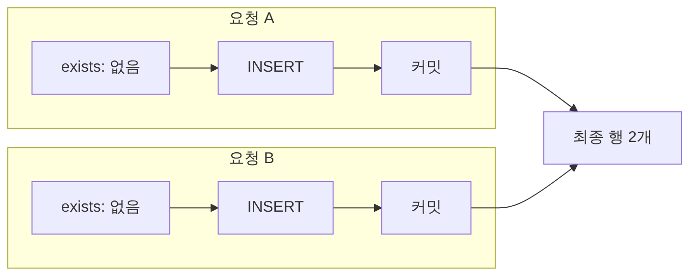
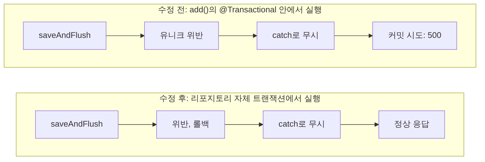
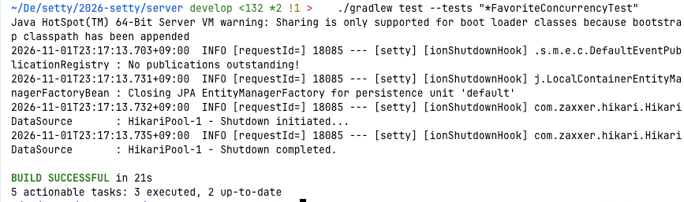
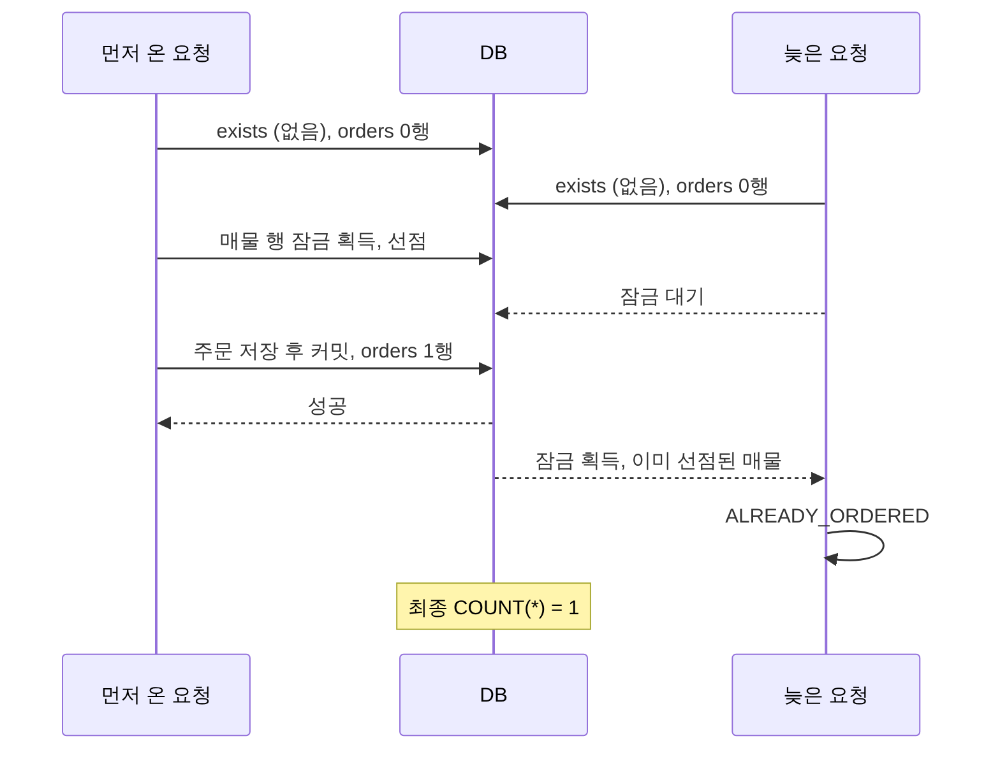

# @Transactional을 걸어도 중복이 생기는 이유: 찜 10건과 주문 2건 동시 요청으로 검증한 해결 과정

2026-11-01 작성: 예진

## 들어가며

`@Transactional`을 붙이면 중복 저장도 막아 줄 것 같지만, 동시 요청 앞에서는 그렇지 않습니다. 이 글은 팀 프로젝트 세티의 서버에서 찜과 주문을 구현하며 "없던 행이 두 개 생기는" 문제를 만났습니다. 이를 유니크 제약과 행 잠금으로 해결한 과정을 정리합니다.

이 글은 `@Transactional`은 써 봤지만 DB가 정확히 무엇을 보장하는지는 대충만 알고 있는 백엔드 개발자를 대상으로 합니다. Spring Data JPA로 저장 코드를 작성해 본 경험이 있다고 가정합니다. 이 글을 읽고 나면 다음을 설명할 수 있기를 기대합니다.

- `@Transactional`이 보장하는 것과 보장하지 않는 것
- `exists`로 검사하고 저장하는 방식이 동시 요청에서 뚫리는 이유
- 행 잠금과 유니크 제약을 각각 언제 쓰는지
- 예외를 `catch`했는데도 `UnexpectedRollbackException`이 발생하는 이유

## 1. 문제 상황

### 찜과 주문, 같은 문제와 다른 요구

세티(SETTY)는 우아한테크코스에서 진행하는 팀 프로젝트입니다. 중고 가구를 둘러보고, 예상 배송비를 확인하고, 가구 값과 배송비를 한 번에 결제할 수 있는 중고 가구 거래 플랫폼입니다. 구매자는 마음에 드는 매물을 찜하거나 주문할 수 있습니다. 찜 버튼은 서버 응답이 느리면 사용자가 연달아 눌러 같은 요청이 여러 번 들어올 수 있고, 인기 매물은 여러 구매자가 거의 동시에 주문할 수 있습니다. 두 경우 모두 "없던 행이 두 개 생기는" 문제가 됩니다. 그런데 원하는 결과는 서로 달랐습니다.

- **찜**: 같은 회원이 같은 매물을 두 번 찜해도 찜 기록은 하나만 남아야 합니다. 사용자에게는 에러 없이 성공으로 보여야 합니다.
- **주문**: 한 매물에 주문은 하나만 생겨야 합니다. 늦은 구매자는 "이미 주문된 매물"이라는 안내를 받아야 합니다.

### 첫 번째 방법이 뚫리는 이유

처음 떠올린 방법은 익숙했습니다. `@Transactional`을 걸고, `exists`로 이미 있는지 확인하고, 없으면 저장합니다. 요청이 하나씩 들어올 때는 정확히 동작합니다.

그런데 동시 요청에서는 다릅니다. 요청 A와 B가 거의 같은 시각에 들어왔다고 해 보겠습니다. A가 `exists`를 실행하는 시점에 B는 아직 커밋하지 않았습니다. 두 트랜잭션은 서로의 커밋 전 행을 볼 수 없으므로 둘 다 "없음"을 보고 검사를 통과합니다. 그 뒤 둘 다 저장하고, 행이 두 개가 됩니다.



그림에서 강조한 두 칸이 문제의 지점입니다. 검사하는 시점에는 두 요청 모두 아직 아무것도 저장하지 않았습니다.

**왜 커밋 전 행이 보이지 않나요?** 격리 수준은 트랜잭션끼리 서로의 변경을 얼마나 볼 수 있는지 정하는 설정입니다. READ COMMITTED 이상에서는 다른 트랜잭션이 아직 커밋하지 않은 변경을 읽을 수 없습니다. 가장 낮은 단계인 READ UNCOMMITTED만 예외입니다. MySQL InnoDB의 기본 격리 수준인 REPEATABLE READ도 READ COMMITTED보다 높은 단계라 마찬가지입니다. 그래서 "검사 → 저장" 사이에 다른 트랜잭션이 끼어들면 검사 결과는 이미 낡은 정보가 됩니다.

`@Transactional`은 한 트랜잭션 안의 작업이 함께 성공하거나 함께 실패하는 것을 보장합니다. 다른 트랜잭션이 사이에 끼어들지 못하게 막아 주지는 않습니다.

## 2. 비교한 방법

먼저 판단 기준 네 가지를 정했습니다.

1. 동시 요청에서 실제로 1건만 남는가
2. 서로 충돌하지 않는 요청까지 막지는 않는가
3. 중복을 "성공"으로 처리할지 "에러"로 알릴지 고를 수 있는가
4. 실패가 서비스 안에서 잡히는가 (500 방지)

비교한 방법은 네 가지입니다.

- `exists` 검사 후 저장
- 유니크 제약 + `saveAndFlush` + 예외 처리
- 부모 행(매물) 비관적 락
- 낙관적 락(`@Version`)

**비관적 락과 낙관적 락**: 비관적 락은 충돌이 날 것이라 보고 먼저 행을 잠가 다른 요청을 기다리게 합니다. 낙관적 락은 충돌이 드물다고 보고, 저장하는 시점에 버전 값을 비교해 충돌을 감지합니다. 이 글에서 '락'은 이런 방식의 이름을, '잠금'은 행에 락을 거는 동작을 가리킵니다.

**유니크 제약**: 같은 키를 가진 행이 둘 이상 저장되지 않도록 DB가 보장하는 제약입니다. 위반하면 DB가 INSERT를 거부하고 예외가 발생합니다.

| 방법 | 1. 1건만 남는가 | 2. 충돌 없는 요청은 안 막는가 | 3. 성공/에러를 고를 수 있는가 | 4. 서비스 안에서 잡히는가 |
| --- | --- | --- | --- | --- |
| `exists` 검사 후 저장 | 아니오 (둘 다 "없음"으로 통과) | — | — | — |
| 유니크 제약 + `saveAndFlush` + 예외 처리 | 예 (DB가 판정) | 예 (잠금 없음) | 예 (예외를 무시하면 성공, 바꿔 던지면 에러) | 조건부 (트랜잭션 범위를 잘못 잡으면 500, 3장) |
| 부모 행(매물) 비관적 락 | 예 (같은 매물의 요청을 한 줄로 세움) | 아니오 (같은 매물의 요청은 서로 기다림) | 예 (늦은 요청을 에러로 알리기에 적합) | 예 (잠금을 얻은 뒤 상태를 보고 예외를 던짐) |
| 낙관적 락 (`@Version`) | 아니오 (새 행을 만들 때는 버전을 비교할 기존 행이 없음) | — | — | — |

"—"는 1번 기준에서 이미 제외되어 나머지 기준을 따져 보지 않았다는 뜻입니다.

### 이렇게 골랐습니다

`exists` 검사는 동시 요청에서 1건을 보장하지 못해 제외했습니다. 낙관적 락은 새 행을 만들 때는 버전을 비교할 기존 행이 없어 맞지 않았습니다. 남은 두 방법은 기능의 요구에 맞춰 나눠 썼습니다.

- **찜**은 중복을 "성공"으로 처리하면 됩니다. 여러 회원이 같은 매물을 동시에 찜해도 되므로 서로 기다릴 이유가 없습니다. 그래서 잠금 없이 유니크 제약만 씁니다.
- **주문**은 한 매물에 하나만 허용하고, 늦은 요청은 "에러"로 알려야 합니다. 그래서 매물 행을 잠가 선착순을 정합니다. 유니크 제약은 잠금을 거치지 않는 경로가 생기더라도 행이 두 개가 되지 않게 하는 최후 방어입니다.

## 3. 적용

찜은 유니크 제약에 판정을 맡기고 `@Transactional`을 빼서 해결했습니다. 주문은 `exists` 검사, 매물 행 잠금, 유니크 제약을 겹쳐 쌓았습니다. 두 기능 모두 다중 스레드 동시성 테스트를 작성해 실행했습니다.

### 3-1. 찜: 중복 판정을 DB에 맡깁니다

찜의 중복은 `(member_id, listing_id)`가 같은 행입니다. "같은 회원이 같은 매물을 두 번"이 막으려는 중복의 정의이고, 이 두 값은 요청에서 이미 확정되어 있습니다. 그래서 먼저 조회하지 않고 DB에 판정을 맡길 수 있습니다. 제약은 엔티티가 아니라 `schema.sql`에 있습니다.

```sql
CONSTRAINT uk_favorites_member_listing UNIQUE (member_id, listing_id)
```

저장 코드는 `saveAndFlush`로 INSERT를 호출한 줄에서 DB로 내보내고, 유니크 위반 예외(`DataIntegrityViolationException`)를 잡아 무시합니다. JDBC(자바의 DB 접속 API)의 `executeUpdate()`처럼 그 줄에서 예외가 발생하므로 `catch` 안에서 잡힙니다.

```java
// 수정 후 (일부 줄임)
public void add(final Long memberId, final Long listingId) {
    // 매물 존재, 본인 매물 검사 생략
    saveIgnoringDuplicate(new Favorite(memberId, listingId));
}

private void saveIgnoringDuplicate(final Favorite favorite) {
    try {
        favoriteRepository.saveAndFlush(favorite);
    } catch (final DataIntegrityViolationException alreadyFavorited) {
        // 이미 찜한 상태이므로 성공으로 봅니다
    }
}
```

#### 첫 시도: 예외를 잡았는데 500이 났습니다

같은 서비스의 `remove()`와 조회 메서드에는 모두 `@Transactional`이 붙어 있습니다. 처음에는 `add()`도 `@Transactional`로 감쌌습니다.

```java
@Transactional   // 수정 전: 문제의 애노테이션
public void add(final Long memberId, final Long listingId) {
    saveIgnoringDuplicate(new Favorite(memberId, listingId));
}
```

예외를 잡았으니 중복 요청도 정상 응답이 나갈 거라고 생각했습니다. 하지만 500이 돌아왔고 로그에는 `UnexpectedRollbackException`이 찍혔습니다.

```text
FavoriteConcurrencyTest > 같은_회원이_같은_매물을_동시에_찜하면_한_건만_저장된다() FAILED
    java.lang.AssertionError: Expecting empty but was: [
    org.springframework.transaction.UnexpectedRollbackException:
      Transaction silently rolled back because it has been marked as rollback-only
        at AbstractPlatformTransactionManager.processCommit(AbstractPlatformTransactionManager.java:803)
        at AbstractPlatformTransactionManager.commit(AbstractPlatformTransactionManager.java:757)
        at TransactionAspectSupport.commitTransactionAfterReturning(TransactionAspectSupport.java:687)
        ...,
    (같은 예외 8건 생략)]
        at FavoriteConcurrencyTest.java:85
```

`FavoriteConcurrencyTest`를 10개 스레드로 돌리면 9건이 이 예외로 실패합니다. 스택은 모두 서비스 코드가 아니라 `commit` 단계(`processCommit`)를 가리킵니다. `catch`로 예외를 잡은 뒤, 메서드가 정상 종료되고 커밋을 시도하는 순간에 터진다는 뜻입니다.

#### 원인: catch가 실행되기 전에 이미 rollback-only였습니다

예외는 분명 서비스에서 잡았는데 왜 커밋 단계에서 에러가 발생했을까요? 요청이 처리되는 순서를 따라가 보겠습니다.

1. `add()`가 시작되며 트랜잭션이 열립니다.
2. `saveAndFlush()`는 리포지토리 메서드이고 이것도 `@Transactional`이라 같은 트랜잭션에 참여합니다.
3. INSERT가 유니크 제약에 걸려 예외가 발생합니다.
4. 예외가 리포지토리 메서드를 빠져나오는 순간 트랜잭션에 **rollback-only 표시**가 남습니다.
5. 서비스의 `catch`가 예외를 잡아 무시합니다. 코드 흐름으로는 정상입니다.
6. `add()`가 정상 종료되고 스프링이 커밋을 시도합니다.
7. 4번의 표시 때문에 커밋할 수 없어 `UnexpectedRollbackException`이 발생하고, 500이 됩니다.

에러는 7번에서 보이지만 원인은 3\~4번입니다. `catch`는 5번에서 실행되므로 이미 남은 표시를 지울 수 없습니다. 리포지토리는 서비스가 연 트랜잭션에 참여만 하므로 스스로 롤백하지 못합니다. 그래서 "이 트랜잭션은 롤백만 가능하다"는 표시만 남겨 결정을 바깥에 넘깁니다. JPA도 영속성 예외가 발생하면 현재 트랜잭션을 롤백 대상으로 표시하도록 규정합니다. 한쪽에서 실패한 트랜잭션을 다른 쪽이 커밋해 버리는 일을 막기 위한 안전장치입니다.

#### 해결: 예외를 받을 바깥 트랜잭션을 없앴습니다

`add()`에서 `@Transactional`을 뺐습니다. 그러면 흐름이 달라집니다.

1. `add()`가 시작됩니다. 열려 있는 트랜잭션은 없습니다.
2. `saveAndFlush()`가 자기 트랜잭션을 열고 INSERT를 실행합니다.
3. 유니크 위반이 나면 그 트랜잭션은 롤백되고 끝납니다.
4. 예외가 서비스로 올라와 `catch`에서 처리됩니다.
5. 표시를 받을 바깥 트랜잭션이 없으므로 커밋 문제도 없습니다. 정상 응답이 나갑니다.



점선이 트랜잭션의 범위입니다. 수정 후에는 `catch`가 점선 밖에서 실행됩니다.

예외가 잡히는 시점에 트랜잭션이 아직 열려 있는지, 이미 끝났는지가 결과를 가릅니다. 대가도 있습니다. `add()`가 더 이상 하나의 트랜잭션이 아니어서 매물 조회와 저장이 각자 따로 실행됩니다. 찜은 저장이 한 번뿐이라 하나로 묶을 필요가 없었습니다.

예외를 `catch`로 삼키는 코드를 `@Transactional` 안에 두면 안 됩니다. 예외가 발생한 순간 트랜잭션은 이미 rollback-only이기 때문입니다.

### 3-2. 주문: 세 겹으로 막습니다

주문은 한 매물에 하나만 생겨야 하고, 늦은 요청은 에러로 알려야 합니다. 그래서 다음 세 단계를 순서대로 쌓았습니다.

```java
@Transactional
public Order pending(final OrderCreateRequest request, final Member buyer) {
    // 1겹: 이미 활성 주문이 있으면 빠르게 거절
    if (orderRepository.existsByListingIdAndOrderStatusNotIn(
            request.listingId(), List.of(OrderStatus.EXPIRED, OrderStatus.CANCELLED))) {
        throw new BusinessException(ErrorCode.ALREADY_ORDERED);
    }

    // 2겹: 매물 행을 잠그고 선점 (이미 선점됐으면 ALREADY_ORDERED)
    listingService.registerPurchaseRequest(request.listingId(), buyer.getId());

    // 3겹: 유니크 제약이 최후 방어
    try {
        return orderRepository.saveAndFlush(Order.pending(/* 인자 생략 */));
    } catch (final DataIntegrityViolationException e) {
        throw new BusinessException(ErrorCode.ALREADY_ORDERED);
    }
}
```

- **1겹 `exists`**: 이미 활성 주문이 있는 흔한 경우를 적은 비용으로 거절합니다. 동시 요청에서는 뚫리므로 보장이 아닙니다.
- **2겹 매물 행 잠금**: `registerPurchaseRequest`가 매물 행을 `SELECT ... FOR UPDATE`(JPA `PESSIMISTIC_WRITE`)로 잠그고, 이미 선점된 매물이면 `ALREADY_ORDERED`를 던집니다. 잠금은 트랜잭션이 끝날 때까지 유지되므로 같은 매물에 대한 두 번째 요청은 첫 번째가 커밋할 때까지 기다립니다. 이 순서가 선착순입니다.
- **3겹 유니크 제약**: 잠금을 거치지 않는 경로가 생겨도 활성 주문이 두 개가 되지 않게 합니다. 이 제약은 `listing_id`가 아니라 활성 주문만 가리키는 `active_listing_id`에 겁니다 (5장).

찜과 달리 주문에서는 `@Transactional`을 유지했습니다. 예외를 삼키지 않고 `BusinessException`으로 바꿔 던지므로 롤백이 원하는 동작이기 때문입니다. 같은 `@Transactional`이 찜에서는 문제였고 주문에서는 필요했습니다. 찜은 예외를 잡고 계속 진행하므로 롤백 표시가 문제가 되고, 주문은 예외를 바꿔 던져 끝내므로 롤백이 곧 의도한 동작입니다.

행 잠금은 같은 행을 건드리는 요청의 순서를 정하고, 유니크 제약은 잠금을 거치지 않은 경로까지 마지막에 막습니다. 두 방어는 역할이 다르므로 함께 쓸 수 있습니다.

## 4. 결과와 근거

찜은 10개 스레드가 같은 찜을 동시에 요청해도 실패 0건에 favorites 행 1개가 남았고, 주문은 2개 스레드가 같은 매물을 동시에 주문하면 1건 성공, 1건 `ALREADY_ORDERED`, orders 행 1개가 남았습니다.

### 확인 방법

두 기능 모두 서비스 메서드(`favoriteService.add()`, `orderService.pending()`)를 직접 호출하는 동시성 테스트입니다. 실제 MySQL 8.4 컨테이너(Testcontainers, 실제 DB를 컨테이너로 띄우는 테스트 라이브러리)에서 `CountDownLatch`로 모든 스레드를 동시에 출발시키고, 던져진 예외와 DB 행 수를 확인했습니다. 서비스를 직접 호출하므로 HTTP 응답 코드는 보지 않습니다.



`add()`에서 `@Transactional`을 뺀 뒤 `FavoriteConcurrencyTest`를 실행한 결과입니다. 10개 스레드가 동시에 요청해도 실패 없이 통과합니다.

|  | 찜 | 주문 |
| --- | --- | --- |
| 스레드 수 | 10 | 2 |
| 요청 | 같은 회원이 같은 매물을 찜 | 서로 다른 구매자가 같은 매물을 주문 |
| 결과 | 실패 0건 | 1건 성공, 1건 `ALREADY_ORDERED` |
| 최종 행 수 | `favorites` 1행 | `orders` 1행 |

### 찜: `@Transactional`이 있을 때와 없을 때

같은 코드에서 애노테이션 하나만 다릅니다. 중복 요청이 들어왔을 때 결과는 아래처럼 갈립니다.

|  | `add()`에 `@Transactional` | `add()`에 없음 |
| --- | --- | --- |
| 중복 요청의 결과 | `UnexpectedRollbackException`, 500 | 정상 응답 |
| 예외가 잡히는 시점 | 트랜잭션이 아직 열려 있음 | 트랜잭션이 이미 롤백되고 끝남 |
| `catch`로 무시한 뒤 | 커밋에서 터짐 | 그대로 정상 종료 |

### 주문: 두 요청이 부딪히면

두 요청이 거의 동시에 들어오면 1겹의 `exists`는 둘 다 통과할 수 있습니다. 결과는 2겹에서 갈립니다.

1. 두 요청 모두 `exists`에서 활성 주문이 없음을 확인합니다. orders는 0행입니다.
2. 먼저 매물 행의 잠금을 얻은 요청이 선점 표시를 하고, 다른 요청은 같은 잠금을 기다립니다.
3. 먼저 온 요청이 주문을 저장하고 커밋하면서 잠금이 풀립니다. orders는 1행이 됩니다.
4. 기다리던 요청이 잠금을 얻고 매물을 읽습니다. 이미 선점된 매물이라 `ALREADY_ORDERED`를 던집니다.
5. 최종적으로 `COUNT(*)`는 1입니다.



먼저 잠금을 얻은 요청만 저장에 도달하고, 늦은 요청은 커밋 뒤에야 잠금을 얻어 이미 선점된 매물을 봅니다.

### 이 결과가 말해 주는 것

테스트가 통과했다고 동시성 문제가 없다는 증명이 되지는 않습니다. 스레드를 열 개 띄워도 타이밍이 맞지 않으면 문제가 드러나지 않을 수 있습니다. 저희가 믿는 근거는 테스트가 아니라 구조입니다. 행이 하나라는 보장은 DB의 유니크 제약에서 나오고, 테스트는 그 보장이 서비스 코드의 예외 처리까지 이어져 사용자에게 의도한 응답으로 나가는지를 확인합니다.

## 5. 주의할 점

두 방법 모두 DB 하나를 전제로 하고, 유니크 제약은 취소 기록을 남기는 순간 까다로워집니다. 아래는 세티에서 부딪혔거나 부딪힐 수 있는 한계입니다.

### 유니크 제약을 쓸 때

**취소된 기록을 남겨야 하면 그대로는 쓰기 어렵습니다.** 주문에 `listing_id` 유니크를 걸면, 취소된 주문이 남아 있는 한 그 매물은 다시 주문할 수 없습니다. 세티는 처음에 결제에 실패한 주문을 아예 삭제해서 이 문제를 피했습니다. 이후 종료된 주문을 보존하면서 같은 매물의 새 주문을 허용하려고 제약을 바꿨습니다. 지금은 주문 상태에 따라 값이 달라지는 생성 컬럼에 유니크를 겁니다.

```sql
active_listing_id BIGINT GENERATED ALWAYS AS (
    CASE WHEN order_status IN ('EXPIRED', 'CANCELLED') THEN NULL ELSE listing_id END
) STORED,
UNIQUE KEY uk_orders_active_listing_id (active_listing_id)
```

MySQL의 유니크 인덱스는 NULL이 여러 개 있어도 허용합니다. 만료되거나 취소된 주문은 `active_listing_id`가 NULL이 되어 제약에서 빠지고, 활성 주문의 `listing_id`만 유일하게 제한됩니다. 이 방식은 MySQL의 NULL 처리에 기대고 있어서 DB를 바꾸면 다시 확인해야 합니다.

**예외를 삼키는 범위가 넓습니다.** 찜 코드는 `DataIntegrityViolationException`을 통째로 무시합니다. 이 예외는 유니크 위반뿐 아니라 외래 키, NOT NULL 위반도 포함할 수 있어서, 다른 원인의 실패까지 "이미 찜함"으로 넘어갈 위험이 있습니다. 제약 이름(`uk_favorites_member_listing`)으로 원인을 확인해서 좁히는 방법을 생각해 볼 수 있습니다. 이 글에서는 시도하지 않았습니다.

### 매물 행을 잠글 때

**한 매물에 하나만 허용할 때 씁니다.** 주문이 그렇습니다. 찜은 여러 사람이 동시에 해도 되므로, 잠그면 괜히 서로 기다리게 됩니다.

**잠금은 트랜잭션이 끝날 때까지 풀리지 않습니다.** 그 사이에 오래 걸리는 작업을 하면 같은 매물에 들어온 다른 요청이 계속 기다립니다. 잠금을 잡은 트랜잭션은 짧게 유지해야 합니다.

### 둘 다

**DB가 하나일 때의 방법입니다.** 행 잠금도 유니크 제약도 하나의 DB 안에서만 보장됩니다. DB가 여러 개로 나뉘면 통하지 않습니다.

## 마치며

정리하면, 트랜잭션은 그 안의 작업을 함께 성공하거나 함께 실패하게 하고, 행 잠금은 같은 행을 건드리는 요청의 순서를 정하며, 유니크 제약은 같은 키의 행이 두 개가 되지 않게 합니다.

처음 질문으로 돌아가면, `@Transactional`만으로는 중복 생성을 막지 못합니다. 막는 것은 순서를 정하는 락이거나 마지막에 판정하는 유니크 제약이고, 그 결과를 사용자에게 어떤 응답으로 돌려줄지는 트랜잭션 범위와 예외 처리로 정합니다.

찜과 주문은 같은 "중복 생성" 문제처럼 보였지만, 중복을 성공으로 처리할지 에러로 알릴지에 따라 서로 다른 도구를 골랐습니다. 비슷한 문제를 만난 분이 각 도구가 무엇을 보장하는지 구분하는 데 이 글이 도움이 되기를 바랍니다.

## 참고 자료

- 세티 서버 저장소, https://github.com/woowacourse-teams/2026-setty (`FavoriteService`, `OrderService`, `FavoriteConcurrencyTest`, `OrderConcurrencyTest`, `schema.sql`)
- MySQL 8.4 Reference Manual, "Locking Reads", https://dev.mysql.com/doc/refman/8.4/en/innodb-locking-reads.html
- MySQL 8.4 Reference Manual, "Transaction Isolation Levels", https://dev.mysql.com/doc/refman/8.4/en/innodb-transaction-isolation-levels.html
- MySQL 8.4 Reference Manual, "CREATE TABLE and Generated Columns", https://dev.mysql.com/doc/refman/8.4/en/create-table-generated-columns.html
- MySQL 8.4 Reference Manual, "CREATE INDEX Statement" (유니크 인덱스와 NULL), https://dev.mysql.com/doc/refman/8.4/en/create-index.html
