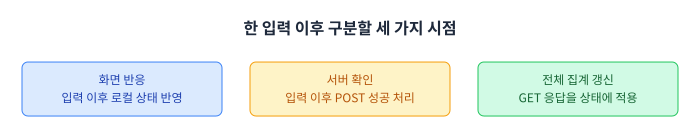
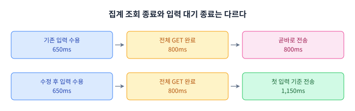
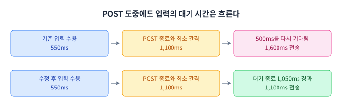
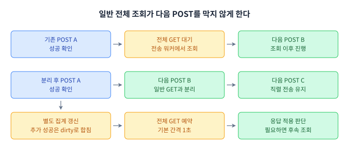
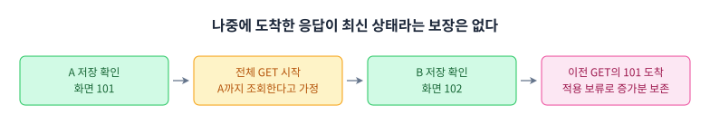

# 버튼은 바로 반응하는데, 서버 반영은 왜 늦을까?

연속 입력을 묶어 보내면서 불필요한 대기와 조회를 줄인 과정

Pheeeew에는 감정 버튼을 연달아 누르는 ‘프레스’라는 기능이 있습니다. 답답하거나 짜증 나는 감정을 버튼으로 표현하면 내가 누른 횟수가 올라갑니다. 다른 사용자들의 입력을 포함한 전체 집계도 같은 화면에서 볼 수 있습니다.

버튼을 누르고 서버 응답이 올 때까지 숫자가 바뀌지 않으면 연타에 대한 반응도 늦어집니다. 그래서 앱은 입력을 받자마자 화면의 숫자에 먼저 더합니다. 서버에는 잠시 모아 두었던 입력을 한꺼번에 보내고, 성공 응답을 받으면 로컬 상태를 서버 값과 맞춥니다. 흔히 말하는 낙관적 UI입니다.

이 구조에서는 화면이 바로 반응해도 서버 확인은 늦을 수 있습니다. 아직 입력을 모으고 있을 수도 있고, 앞선 요청이 끝나기를 기다리고 있을 수도 있습니다. POST가 성공한 뒤에도 전체 집계는 이전 값일 수 있습니다. 그 값은 따로 조회하기 때문입니다.

프레스의 전송 경로를 손보면서 다룬 것도 이 시간 차이였습니다. 첫 입력부터 500ms 동안 모으기로 했는데, 기존 코드에는 그 대기를 건너뛰는 경로와 이미 기다린 뒤 다시 대기를 시작하는 경로가 함께 있었습니다. 대기를 바로잡은 뒤에는 요청 수가 늘었습니다. 이어서 전체 집계 조회를 줄이고, 조회와 전송이 겹칠 때 숫자를 잘못 보정하지 않도록 처리했습니다.

## 화면 반응과 서버 확인을 나눠 보기

먼저 이 글에서 말하는 ‘늦다’가 어느 시점을 가리키는지 구분하겠습니다. 버튼을 누른 뒤에는 아래 세 가지 일을 각각 살펴볼 수 있습니다.



*그림 1. 한 입력 이후의 화면 반응, 서버 확인, 전체 집계 갱신입니다. 세 상자가 차례로 실행된다는 뜻은 아닙니다.*

| 구분 | 이 글에서의 의미 |
| --- | --- |
| 화면 반응 | 입력을 로컬 상태와 화면에 반영하는 과정 |
| 입력 확인 지연 | 입력 계측 로그부터 POST 성공 결과 처리 로그까지의 시간 |
| 전체 집계 갱신 | 전체 집계 GET 결과를 받아 화면 상태에 적용하는 과정 |

실험에서 잰 지연은 가운데에 있는 입력 확인 지연입니다. 화면이 그려지는 데 걸린 시간은 재지 않았습니다. 이 글에 나오는 p95도 같은 지연을 작은 순서로 정렬했을 때 약 95% 지점의 값입니다. 버튼이 눈에 얼마나 빨리 반응했는지와 섞지 않고 읽어 주시면 됩니다.

## 500ms를 기다리기로 했는데 왜 바로 보냈을까

프레스는 첫 입력을 받은 뒤 기본 500ms 동안 입력을 모읍니다. 모은 입력 묶음을 배치라고 부르겠습니다. 추가 입력이 올 때마다 500ms를 다시 세지는 않습니다. 비어 있던 버퍼에 첫 입력이 들어온 시각을 기준으로 삼습니다. 같은 감정 30개 또는 전체 100개에 도달하면 일찍 보낼 수도 있습니다.

그런데 기존 코드에는 이 대기를 지키지 않는 구간이 있었습니다. 전체 집계 GET이 진행되는 동안 들어온 입력입니다.

대기와 전송을 담당하는 비동기 작업을 전송 워커라고 부릅니다. 기존 워커는 POST 성공 후 전체 집계 GET까지 기다렸습니다. 그동안 새 입력이 들어오면 이미 워커가 실행 중이라 별도 전송 예약을 만들지 않았습니다. GET이 끝난 뒤에는 남은 입력을 지연 없이 재개했습니다. 입력이 얼마 동안 기다렸는지와 관계없이 조회 완료가 다음 전송의 계기가 됐습니다.

예를 들어 보겠습니다. POST가 600ms에 끝나고 GET이 800ms에 끝납니다. 그사이인 650ms에 새 입력이 들어왔다면 첫 입력 기준 대기 종료는 1,150ms입니다. 하지만 기존 경로에서는 GET이 끝난 800ms에 바로 전송됐습니다. 반대로 GET이 1,600ms에 끝났다면 입력은 이미 충분히 기다린 상태입니다. 그때 500ms를 새로 기다리게 할 이유도 없습니다.



*그림 2. 같은 입력도 조회가 끝난 시각에 따라 묶음 대기를 건너뛸 수 있었습니다. 시각은 동작을 설명하기 위한 예시이며 상자 길이는 시간 비율과 무관합니다.*

그래서 첫 입력이 들어올 때 대기 종료 시각을 저장했습니다. 작업을 다시 시작할 때는 그 시각까지 얼마나 남았는지만 계산합니다. GET이 빨리 끝났다면 남은 시간 동안 입력을 더 모으고, 늦게 끝났다면 추가 대기 없이 이어갑니다. 재시도할 고정 묶음에는 기존 재시도 정책을 적용했습니다.

이 단계의 가상 시간 비교에서는 입력 100개의 논리 전송 수가 32회에서 17회로 줄었습니다. 다만 확인 지연 p50은 280ms에서 340ms로 늘었습니다. 너무 일찍 나가던 작은 묶음을 더 기다려 모았기 때문입니다. 가짜 Sender를 사용한 결과라서 이 수치를 실제 HTTP 요청 감소율로 해석하지는 않았습니다.

## 앞선 POST를 기다린 시간도 대기에 포함하기

GET 경계를 고쳤어도 다음 입력이 들어올 수 있는 구간은 하나 더 있습니다. 앞선 POST가 진행 중일 때입니다. 서버 응답을 기다리는 동안에도 새 입력은 버퍼에 쌓입니다. POST가 끝난 뒤 묶음 대기를 처음부터 시작하면 이 입력은 이미 기다린 시간에 500ms를 더 기다리게 됩니다.

첫 POST가 500ms에 시작해서 1,000ms에 끝난다고 하겠습니다. 다음 입력은 550ms에 들어왔습니다. 이 입력의 대기는 1,050ms에 끝납니다. POST 종료 뒤 최소 요청 간격 100ms를 지켜도 1,100ms이므로 더 모을 필요가 없습니다. 여기서 500ms를 다시 부과하면 전송은 1,600ms까지 밀립니다.



*그림 3. 앞선 POST와 요청 간격을 기다리는 동안에도 다음 입력의 대기 시간은 흐릅니다. 실기기 측정값이 아닌 설명용 예시입니다.*

앞서 저장한 종료 시각을 이 경로에서도 사용했습니다. `accept`는 입력을 추가하기 전에 버퍼가 비어 있었는지를 `wasEmpty`로 기록합니다. 입력을 받아들였을 때 아래 문장을 실행하므로 첫 입력만 종료 시각을 정합니다.

```kotlin
if (wasEmpty) batchFlushNotBefore = safeDeadline(nowMillis(), flushDelayMillis)
```

남은 시간은 현재 시각을 빼서 구합니다. 이미 종료 시각을 지났다면 0입니다. `nowMillis`는 단조 시계를 사용하므로 사용자가 시스템 시각을 바꿔도 이 대기 계산과 구분됩니다.

```kotlin
private fun remainingBatchWait(now: Long = nowMillis()): Long =
    ((batchFlushNotBefore ?: now) - now).coerceAtLeast(0L)
```

POST 뒤에 다음 묶음이 남아 있다면 최소 요청 간격을 먼저 지킨 후 남은 대기를 계산합니다. 아래 코드는 앞의 함수와 다른 위치에서 발췌했습니다.

```kotlin
if (outstanding > 0) {
    delay(retryPolicy.minRequestIntervalMillis)
    awaitFlush(remainingBatchWait())
}
```

이렇게 하면 POST가 길어졌다는 이유로 새 500ms 대기가 붙지 않습니다. 다만 전송은 계속 직렬로 처리하고 연결 상태와 재시도 제한도 따릅니다. 입력 후 500ms 이내 전송을 보장하는 변경은 아닙니다. 회귀 테스트에서는 POST 지연을 100ms, 500ms, 1,000ms, 3,000ms로 바꾸며 다음 전송 시작 시각과 서버 반영 수, 최대 동시 전송 1개를 확인했습니다.

## 기다림을 줄이니 요청 수가 늘었다

이미 기다린 시간을 인정하면 다음 입력을 더 일찍 보낼 수 있습니다. 대신 그동안 모이던 입력이 더 작은 묶음으로 나갈 수 있습니다. 실제 기기에서는 이 변화가 어떤 결과를 만드는지 확인했습니다.

2026년 10월 18일 Galaxy S10 5G에서 POST 대기 보완 전후를 각각 세 차례 재측정했습니다. 실제 화면을 띄우고 개발 서버로 요청을 보냈습니다. 손가락 터치 대신 화면 입력을 처리하는 ViewModel에 자동 입력을 주었습니다. 같은 감정 100회와 교차 감정 100회를 각각 세 차례 실행한 연속 입력 600회 조건의 결과입니다.

| POST 대기 보완 재측정 | 보완 전 | 보완 후 |
| --- | ---: | ---: |
| POST | 89회 | 104회 |
| POST와 GET 합계 | 125회 | 191회 |
| 회차별 확인 지연 p95 범위 | 743–845ms | 570–636ms |

*표 1. POST 대기 보완만 비교했습니다. 요청 합계에는 마지막 검증용 조회도 들어 있습니다. p95 범위는 회차별 p95의 최솟값과 최댓값입니다.*

이 조건에서 확인 지연은 낮아졌지만 요청 수는 늘었습니다. POST도 늘었고 GET까지 합친 요청은 더 많이 늘었습니다. 대기를 고쳤다는 결과만 보고 끝낼 수 없었습니다.

묶음 대기를 길게 잡으면 다시 더 많은 입력을 모을 수는 있습니다. 하지만 앞선 작업이 끝난 뒤 불필요하게 기다리던 문제를 해결한 상황에서 그 시간을 되돌리는 선택이 됩니다. 여기서는 전송 이후의 조회를 함께 살폈습니다. 매번 전체 집계를 읽어야 하는지 확인하기 위해서입니다.

POST 성공 응답에는 이미 나의 당일 집계가 들어 있었습니다. 앱은 이 값으로 개인 집계를 갱신하고 성공한 묶음만 로컬의 미확인 입력에서 뺍니다. 그사이 새로 들어온 입력은 남깁니다. 내 입력의 성공을 확인하려고 개인 집계 GET을 매번 보낼 필요는 없었습니다.

전체 집계는 다릅니다. 다른 사용자의 입력도 들어 있고, 내 POST가 성공해도 마지막 전체 조회에는 아직 포함되지 않았을 수 있습니다. 그래서 로컬 증가분을 따로 유지하면서 다시 조회합니다. 여러 번의 전송 성공을 모아 전체 집계를 조회하면 입력의 확인을 늦추지 않고도 요청을 줄일 여지가 있었습니다.

이후 집계 합치기는 별도 전후 실험으로 비교했습니다. 위의 191회와 뒤에 나올 182회는 종료 대기 절차 등이 달라 직접 이어 붙일 수 없습니다. 두 실험은 각각의 전후 결과로 읽어야 합니다.

## 내 입력을 보내는 일과 전체 집계를 읽는 일 분리하기

정상 전송이 성공한 뒤의 전체 GET을 별도 작업으로 옮겼습니다. 다음 POST가 이 GET의 완료를 기다리지 않게 한 것입니다. 최초 기준값을 읽거나 서버 처리 여부가 불명확한 요청을 복구하는 조회는 그대로 별도 경로에 남겼습니다.



*그림 4. 정상 전송 뒤 일반 전체 조회를 분리한 모습입니다. 다음 POST는 해당 GET 응답을 기다리지 않습니다.*

분리만 해서는 요청 수가 줄지 않습니다. 성공할 때마다 GET을 하나씩 예약하면 같은 수의 조회가 나갈 수 있습니다. 그래서 조회가 필요하다는 표시인 dirty 상태를 두고 예약 작업은 하나만 유지했습니다. 성공 전송 뒤 미확인 입력이 0이고 집계가 dirty이면 아래 함수를 호출합니다.

```kotlin
private fun scheduleAggregateRefresh() {
    if (aggregateRefreshJob?.isActive == true) return
    aggregateRefreshJob =
        sessionScope.launch {
            while (allStatsDirtyAfterWrite && connected != false &&
                pendingWrite?.uncertain != true) {
                delay(aggregateRefreshMillis)
                if (pendingWrite?.phase != WritePhase.InFlight) {
                    refreshAllAfterWrite(detached = true)
                }
            }
        }
}
```

`aggregateRefreshJob`이 실행 중이면 바로 반환합니다. 예약을 새로 만들거나 기존 예약을 뒤로 미루지 않습니다. 그동안 전송이 더 성공하면 dirty 상태에 합쳐 둡니다. 마지막 성공마다 시간을 다시 세는 디바운스와는 다르게 동작합니다.

예약 간격은 기본 1초입니다. 한 간격 뒤 POST가 진행 중이 아니면 집계를 읽고, 조회 중 새 성공이 생기거나 응답을 적용하지 못했다면 후속 간격에서 다시 읽습니다. POST가 진행 중이면 조회를 건너뛸 수도 있습니다. 따라서 실제 갱신 시점은 네트워크 지연과 작업 상태에도 달려 있습니다. 모든 전체 집계가 1초 안에 최신이 된다는 의미는 아닙니다.

이제 일반 전체 조회가 느려도 다음 POST는 진행할 수 있습니다. 대신 조회와 전송이 겹치는 경우를 처리해야 합니다. 먼저 시작한 GET이 새 POST보다 늦게 끝났을 때 그 응답을 그대로 적용해도 되는지가 다음 문제였습니다.

## 늦게 온 응답을 적용하면 숫자가 내려갈 수도 있다

프레스의 전체 숫자는 서버에서 마지막으로 읽은 전체 집계에 로컬 증가분을 더한 값입니다. 로컬 증가분에는 아직 보내지 않은 입력뿐 아니라 POST는 성공했지만 전체 조회로 확인하지 않은 입력도 들어 있습니다. 서버 저장을 확인했다고 전체 화면의 증가분까지 바로 없애면 안 됩니다.

이 보정이 왜 필요한지 숫자로 보겠습니다. 다른 사용자의 입력은 없다고 가정하겠습니다. 처음 읽은 서버 전체 집계는 100입니다. 입력 A를 받으면 로컬 증가분이 1이 되어 화면은 101을 보여 줍니다. A의 POST가 성공해도 전체 집계 기준값은 아직 100입니다. 로컬 증가분을 유지하므로 화면은 계속 101입니다.

이때 전체 GET을 시작합니다. 이 조회는 A까지만 포함한 101을 돌려준다고 가정하겠습니다. 응답을 기다리는 사이 입력 B를 받고 B의 POST까지 성공하면 화면은 102가 됩니다. 이전 기준값 100에 로컬 증가분 2를 더한 상태입니다.

이제 앞서 시작한 GET의 101이 도착합니다. 여기서 현재 성공한 두 입력을 모두 확인한 것으로 처리해 로컬 증가분 2를 빼면 어떻게 될까요. 화면에는 서버 값 101만 남습니다. B까지 서버에 보냈는데도 화면에서 그 입력이 사라지는 셈입니다. 이 조회가 B를 포함했다는 근거가 없는데 B의 증가분까지 지운 탓입니다.



*그림 5. A까지만 포함한 조회 응답이 B의 POST 성공 뒤에 도착하는 예시입니다. 100·101·102는 설명용 숫자이며 실기기 측정값은 아닙니다.*

그래서 응답 값과 함께 조회가 시작된 시점도 확인했습니다. 조회 뒤 새 POST가 성공했거나 개인·전체 쌍 조회가 시작됐다면 앞선 응답으로 지금의 로컬 증가분을 보정하지 않습니다. 적용을 보류하고 다시 조회합니다.

이를 판단하는 표식이 `readGeneration`입니다. 클라이언트 안에서 새 POST가 성공하거나 개인·전체 쌍 조회를 시작할 때 바뀝니다. 서버가 발급한 버전 번호는 아니므로 다른 사용자까지 포함한 모든 변경을 알아내지는 못합니다. 여기서는 조회를 시작한 뒤 로컬 상태가 앞서 갔는지 확인하는 데 사용했습니다.

## 조회를 시작할 때 보정할 범위를 정해 두기

전체 조회를 시작할 때 두 값을 저장합니다. `readGeneration`은 응답을 적용해도 되는지 판단할 번호이고, `acceptedSinceAllSnapshot`은 마지막 전체 집계 이후 성공 확인된 로컬 입력 수입니다. 뒤의 값은 이번 조회에서 보정할 범위를 정하는 데 씁니다.

```kotlin
val acceptedCoveredAtReadStart = acceptedSinceAllSnapshot
val generation = readGeneration
```

응답이 왔을 때는 그사이 세대가 바뀌었는지, POST가 진행 중인지, 처리 불명 상태인지 확인합니다. 아래 조건에 걸리면 이번 응답을 적용하지 않습니다. 두 코드는 같은 함수의 서로 다른 부분입니다.

```kotlin
if (detached &&
    (
        generation != readGeneration || pendingWrite?.phase == WritePhase.InFlight ||
            pendingWrite?.uncertain == true
    )
) {
    // A write or paired read superseded this snapshot. Never subtract its old coverage.
    allStatsDirtyAfterWrite = true
    publish(mutableState.value.copy(isLoadingAll = false))
    return
}
```

`detached`는 전송 워커와 분리한 일반 전체 조회를 가리킵니다. 응답을 버릴 때 dirty를 다시 설정해 다음 조회가 필요하다는 상태를 남깁니다. 숫자는 당장 갱신하지 못하지만, 늦게 온 응답 때문에 새 입력의 증가분을 없애는 일은 피합니다.

응답을 적용할 수 있어도 차감 범위는 조회 시작 때 저장한 값으로 제한합니다. GET을 기다리는 동안 새 입력만 들어오고 아직 POST가 성공하지 않았다면 세대는 그대로일 수 있습니다. 이때 현재의 증가분을 전부 빼면 새 입력까지 없어집니다. 응답 적용 조건을 검사하는 일과 차감할 범위를 고정하는 일을 따로 둔 이유입니다.

테스트에서는 오래된 응답을 돌려주거나 POST를 멈춰 두어 이런 순서를 재현했습니다.

| 검증한 순서 | 지켜야 할 상태 |
| --- | --- |
| GET 시작 뒤 새 POST 성공 | 앞선 응답이 성공 확인된 로컬 증가분을 없애지 않음 |
| GET이 새 POST 진행 중 반환 | 진행 중 입력을 포함한 낙관적 증가분 보존 |
| GET 도중 새 입력 추가 | 조회 시작 이후 입력까지 함께 차감하지 않음 |
| 느린 일반 GET 도중 새 입력 | GET 완료를 기다리지 않고 전송 대기 종료 시각 유지 |

집계 합치기 당시에는 관련 프레스·탭 테스트 65개가 실패와 오류 없이 통과했습니다. 이는 정해 둔 실행 순서에 대한 회귀 검증입니다. 모든 비동기 순서를 시험한 결과나 현재 코드 전체의 검증 결과로 넓혀 해석하지는 않습니다.

## 마지막 예약 조회까지 세어야 비교할 수 있다

로직 테스트로는 느린 GET이나 POST를 원하는 순서로 멈춰 둘 수 있습니다. 실제 요청 수를 비교할 때는 기기와 서버로 나간 요청을 다시 세었습니다. 집계 합치기 실험은 2026년 10월 18일 Galaxy S10 5G, Android 12, Wi-Fi 환경의 측정용 Debug 앱과 개발 서버로 진행했습니다. 양쪽 모두 POST 대기 보완이 적용되어 있고, 일반 집계 조회를 분리하고 합쳤는지가 차이입니다.

실제 PressScreen을 띄운 뒤 ViewModel에 자동 입력을 주었습니다. 단발 1회, 짧은 연타 5회, 같은 감정 100회, 교차 감정 100회를 각각 세 번 실행했습니다. 단발을 제외한 세 패턴의 입력 간격은 모두 100ms였습니다. 전후를 합하면 24개 조건입니다. 실행 순서는 전 1회차, 후 1·2회차, 전 2·3회차, 후 3회차로 교차했습니다.

측정을 언제 끝낼지도 정해야 했습니다. POST가 끝난 즉시 멈추면 예약된 GET이 아직 나가지 않았을 수 있습니다. 그러면 개선 후 요청을 덜 세게 됩니다. 전후 모두 상태가 1.3초 연속 안정될 때까지 기다려 마지막 예약 조회를 포함했습니다. 이후 개인·전체 GET을 별도로 보내 서버 증가량도 확인했습니다.

| 측정 항목 | 기록한 방법 |
| --- | --- |
| 입력 확인 지연 | 입력 로그와 Accepted 결과 처리 로그를 연결 |
| HTTP 요청 수 | 실행 구간의 POST·개인 GET·전체 GET 시작 로그 집계 |
| 서버 반영 수 | 종료 후 조회한 개인 집계 증가량과 입력 수 비교 |
| 남은 입력 | 종료 시 pending이 0인지 확인 |

확인 지연은 입력마다 계산했습니다. 분석기는 감정별 입력 시각을 기억했다가 각 전송 묶음과 연결하고, Accepted 결과를 처리한 시각에서 빼 줍니다. 예를 들어 한 묶음에 6개가 들어가도 여섯 입력의 대기 시간은 서로 다릅니다. 성공 응답 하나를 지연 표본 하나로 세지 않은 이유입니다. p95는 정렬한 표본의 `ceil(표본 수 × 0.95)`번째 값으로 구했습니다.

원본 로그와 SHA-256 목록, 분석 스크립트도 함께 보존했습니다. 원본이 없거나 해시가 다르면 분석기가 중단하고, 문제가 없다면 요약 CSV를 다시 만듭니다. 결과표의 수치를 원본까지 되짚어 볼 수 있습니다.

이 비교는 당시 재현 하네스에 대상 전송 로직을 적용한 결과입니다. 실제 HTTP를 사용했지만 물리 터치나 렌더링 프레임을 재지는 않았습니다. 현재 제품 앱 전체의 성능을 새로 측정한 결과와도 구분해야 합니다.

## 줄어든 요청 대부분은 전체 집계 GET이었다

연속 입력 결과부터 보겠습니다. 같은 감정 100회와 교차 감정 100회를 각각 세 번 실행한, 버전별 600회 입력입니다. 단발과 5회 연타는 이 표에서 제외했습니다.

| 연속 입력 600회씩 | 집계 합치기 전 | 집계 합치기 후 |
| --- | ---: | ---: |
| POST | 104회 | 102회 |
| 전체 집계 GET | 72회 | 57회 |
| 개인 집계 GET | 6회 | 6회 |
| 전체 HTTP 요청 | 182회 | 165회 |
| 회차별 확인 지연 p95 범위 | 577–600ms | 572–577ms |
| 최대 대기 입력 | 8개 | 8개 |

*표 2. 양쪽에 POST 대기 보완을 공통 적용했습니다. p95 범위는 연속 입력 여섯 조건에서 나온 회차별 p95의 최솟값과 최댓값입니다.*

POST는 2회 줄었고 전체 집계 GET은 15회 줄었습니다. 전체 집계 GET의 감소율은 20.8%, HTTP 전체의 감소율은 9.3%입니다. 요청 감소의 대부분이 줄이려 했던 조회에서 나왔습니다.

HTTP 합계에는 각 조건의 마지막 검증용 개인 GET과 전체 GET도 포함되어 있습니다. 연속 입력 여섯 조건에서 양쪽에 똑같이 들어간 검증 요청 12개를 빼면 170회에서 153회로 줄어 10% 감소입니다. 본문에서는 검증용 조회까지 포함한 182회와 165회, 즉 9.3%를 사용했습니다.

확인 지연은 연속 입력 조건에서 악화를 관찰하지 않았습니다. 그렇다고 모든 입력의 지연이 줄지는 않았습니다. 단발은 전 557–624ms, 후 609–703ms로 개선 후 한 회차에서 703ms가 나왔습니다. 짧은 연타의 p95는 전 572–587ms, 후 571–577ms였습니다. 단발과 짧은 연타의 POST 및 전체 HTTP 요청 수는 전후 같았습니다.

24개 조건 전체에서는 입력 1,236회, 확인 표본 1,236개, 서버 증가량 1,236회가 일치했습니다. 감정별 증가량과 각 조건의 pending 0도 확인했습니다. 측정한 전경 실행에서는 누락이 없었습니다. 다만 앱 종료, 백그라운드, 오프라인이나 장애 상황의 유실·중복 방지까지 검증한 것은 아닙니다.

서버 CPU, 다중 사용자 처리량, 전송 바이트, 배터리 사용량도 따로 재지 않았습니다. 여기서 확인한 결과는 이 기기와 입력 조건에서 HTTP 요청이 줄었고, 연속 입력의 확인 지연과 반영 수를 함께 점검했다는 데까지입니다. 개발 서버의 응답 시간은 고정하지 않았으며 반복 세 차례도 제한된 표본입니다.

## 같은 500ms라도 어디서 세느냐가 달랐다

처음 문제로 돌아가 보면, 프레스에는 입력을 모으기 위한 500ms가 필요했습니다. 다만 조회가 끝났다고 그 대기를 건너뛰거나 앞선 POST가 끝났다고 다시 시작할 필요는 없었습니다. 입력이 들어온 시각을 기준으로 남은 대기를 계산하자 두 경계를 같은 방식으로 다룰 수 있었습니다.

이 변경을 요청 수와 함께 보니 다음 문제가 드러났습니다. 입력을 더 일찍 보내면서 확인 지연은 낮아졌지만 요청이 늘었습니다. 이후 정상 전송과 전체 집계 조회를 분리하고 조회 예약을 합쳤습니다. 이때도 단순히 GET을 따로 실행하는 것으로 끝나지 않았습니다. 늦게 온 조회가 새 입력의 증가분을 없애지 않도록 응답을 적용할 조건과 보정 범위를 함께 정했습니다.

그 결과 측정한 연속 입력 조건에서 전체 HTTP 요청이 182회에서 165회로 줄었습니다. 대신 전체 집계는 예약 간격과 네트워크 지연에 따라 늦게 갱신될 수 있습니다. 적용하지 못한 응답이 있으면 다음 조회도 기다립니다. 다른 사용자들의 입력까지 즉시 보여 줘야 한다면 이 조회 정책을 다시 검토해야 합니다.

화면은 이미 반응하고 있었지만, 뒤에서 기다리는 일은 하나가 아니었습니다. 어느 입력이 언제 들어왔는지, 무엇을 기다리고 있는지, 그 응답으로 어디까지 확인할 수 있는지를 나눠 보니 손댈 곳이 드러났습니다. 이번 개선에서 줄인 대기와 유지한 대기, 요청 수와 맞바꾼 집계 최신성도 그 구분으로 설명할 수 있습니다.

## 코드와 실험 근거

코드는 개선 PR #812의 커밋 `5e9870eaf74c039b8cac343e956dcc16dc68f56b`에서 발췌했습니다. 긴 조건은 줄바꿈만 조정했습니다. 이후 리팩터링된 현재 구조와 구분하려고 당시 커밋으로 고정했습니다. 실험 조건과 수치는 아래 기록에서 확인할 수 있습니다.

그림은 [bybit-exchange/svg-diagram](https://github.com/bybit-exchange/svg-diagram)의 SVG 스킬로 제작했습니다. 설명용 시각·숫자 예시와 실기기 결과표는 구분했습니다.

- [PressRepositoryImpl의 대기 종료 시각과 집계 예약 및 응답 보정](https://github.com/woowacourse-teams/2026-pheeeew/blob/5e9870eaf74c039b8cac343e956dcc16dc68f56b/AN/Pheeeew/shared/src/commonMain/kotlin/com/pheeeew/data/repository/PressRepositoryImpl.kt)
- [PressScreen의 서버 집계와 로컬 증가분 합산](https://github.com/woowacourse-teams/2026-pheeeew/blob/5e9870eaf74c039b8cac343e956dcc16dc68f56b/AN/Pheeeew/shared/src/commonMain/kotlin/com/pheeeew/feature/screens/press/PressScreen.kt)
- [집계 조회 도중 입력의 묶음 대기 유지 실험](https://github.com/woowacourse-teams/2026-pheeeew/blob/5e9870eaf74c039b8cac343e956dcc16dc68f56b/AN/Pheeeew/measurements/personal-press/799-batch-wait.md)
- [POST 도중 입력의 대기 보완과 후속 집계 합치기 기록](https://github.com/woowacourse-teams/2026-pheeeew/blob/5e9870eaf74c039b8cac343e956dcc16dc68f56b/AN/Pheeeew/measurements/personal-press/799-post-wait.md)
- [PressBatchWaitTest의 대기 경계와 오래된 집계 응답 검증](https://github.com/woowacourse-teams/2026-pheeeew/blob/5e9870eaf74c039b8cac343e956dcc16dc68f56b/AN/Pheeeew/shared/src/commonTest/kotlin/com/pheeeew/data/repository/PressBatchWaitTest.kt) 및 [PressViewModelTest의 증가분 보존 검증](https://github.com/woowacourse-teams/2026-pheeeew/blob/5e9870eaf74c039b8cac343e956dcc16dc68f56b/AN/Pheeeew/shared/src/commonTest/kotlin/com/pheeeew/feature/screens/press/PressViewModelTest.kt)
- [POST 대기 보완의 Galaxy S10 5G 재측정](https://github.com/woowacourse-teams/2026-pheeeew/blob/5e9870eaf74c039b8cac343e956dcc16dc68f56b/AN/Pheeeew/measurements/personal-press/799-post-wait-device-repeat/README.md)
- [집계 합치기의 실기기 비교 조건과 결과](https://github.com/woowacourse-teams/2026-pheeeew/blob/5e9870eaf74c039b8cac343e956dcc16dc68f56b/AN/Pheeeew/measurements/personal-press/799-aggregate-device/README.md) 및 [원본 로그에서 산출한 비교 CSV](https://github.com/woowacourse-teams/2026-pheeeew/blob/5e9870eaf74c039b8cac343e956dcc16dc68f56b/AN/Pheeeew/measurements/personal-press/799-aggregate-device/comparison.csv)
