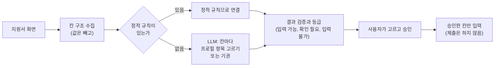
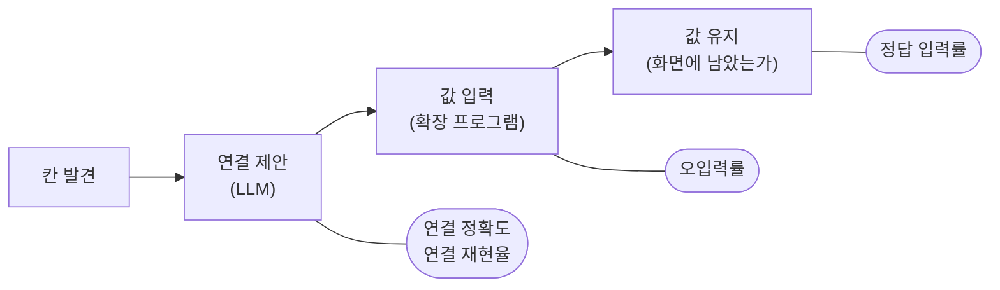

# 우리 서비스에 맞는 LLM, 무엇을 기준으로 선택할까?

> 지원서 자동 입력 기능에서 '더 많이 채우는 모델'과 '덜 틀리는 모델' 사이의 선택 기준을 세운 기록

팀에서 같은 합성 지원서를 같은 설정으로 다섯 번 분석한 적이 있습니다. 지원서에는 저장된 정보로 채울 수 있는 칸이 67개 있었고, 첫 번째 실행에서 모델은 그중 55개를 맞게 연결했습니다. 그런데 같은 실행에서 모델이 연결하겠다고 답한 칸은 99개였고, 그중 44개가 틀렸습니다. 나머지 네 번은 연결하겠다고 답한 칸이 67개에서 106개 사이로 실행마다 달랐고, 맞은 연결은 42개에서 50개였습니다.

저는 채용 지원서 자동 입력 서비스 Career Form에서 LLM 기능을 맡았습니다. 첫 구현에서는 모델을 데모용 잠정값으로 정해 두었습니다. 후보 모델 네 개의 비용과 잘못된 연결, 연결 범위, 응답 속도는 나중에 비교하기로 문서에 적었습니다. 위의 숫자는 그 비교가 생각보다 단순하지 않다는 것을 보여 줍니다. 많이 맞힌 실행에도 틀린 연결이 많이 섞여 있었고, 같은 모델도 실행할 때마다 결과가 흔들렸습니다. 후보를 비교하려면 어떤 답을 좋은 답으로 볼지부터 정해야 했습니다.

이 글은 팀이 그 기준을 세운 과정을 정리합니다. 저는 첫 분석 API와 모델의 응답 계약을 만들었고, 평가 도구와 판정 기준은 팀원이 남긴 기록을 바탕으로 정리했습니다. 대상은 LLM API를 호출해 본 적은 있지만 서비스에 쓸 모델을 골라야 하는 백엔드 개발자입니다. 자기 서비스의 기준을 세울 때 참고할 수 있도록 숫자와 한계를 함께 적었습니다.

라이브러리 선택과 프롬프트 작성법은 다루지 않습니다. 본문의 수치와 사례는 2026년 8월부터 10월까지 팀이 남긴 개발 기록과 평가 결과에서 가져왔습니다. 모두 합성 프로필로 실제 지원서나 합성 지원서를 채운 평가 환경의 값이고, 운영 환경에서는 LLM 경로를 아직 켜지 않았습니다. 후보 모델 네 개를 같은 조건에서 비교하는 실험도 아직 하지 않았기 때문에, 이 글에는 "이 모델이 가장 좋다"는 결론이 없습니다.

## 1. LLM에게 맡긴 일은 칸마다 항목을 고르거나 비워 두는 것이었습니다

Career Form은 Chrome 확장 프로그램입니다. 이름, 연락처, 학력, 경력 같은 정보를 브라우저에 한 번 저장해 두면, 채용 지원서에서 사용자가 확인한 항목만 채워 줍니다. 회사마다 지원서의 칸 이름과 배치가 달라서, 화면의 칸이 저장된 정보 중 무엇에 해당하는지 판단해야 합니다. 이 판단의 일부를 LLM이 맡습니다.

모든 지원서에 LLM을 쓰지는 않습니다. 자주 쓰이는 채용 플랫폼과 일부 회사의 지원서는 팀이 만든 정적 규칙으로 처리하고, 규칙이 없는 지원서에서만 LLM을 호출합니다. 규칙을 조회하다 실패하거나 화면 구조가 규칙과 맞지 않을 때도 LLM으로 넘기지 않고 입력을 막습니다. LLM은 외부 공급자의 API로 부릅니다. 처음 공급자는 OpenAI(모델 gpt-5.6-luna)였고, 10월에 JEV라는 분류 API로 바뀌었습니다(6장).



*그림 1. 칸 연결에서 LLM은 칸과 프로필 항목을 잇는 판단을 맡습니다. 값을 넣고 지원서를 제출하는 일에는 관여하지 않습니다.*

LLM이 받는 정보는 원칙적으로 값이 빠진 칸의 구조입니다. 섹션 제목, 칸의 라벨, 입력 종류, 선택지 문구 같은 정보만 보냅니다. 사용자가 저장한 실제 값과 페이지의 원문 HTML, 계정 정보는 보내지 않습니다(라벨을 보내는 방식의 예외는 7장에서 다룹니다). LLM은 칸마다 미리 정해 둔 프로필 항목 목록에서 하나를 고르거나, 근거가 부족하면 고르지 않습니다. 아래는 설명을 위해 줄인 합성 예시이며 실제 요청 형식과는 다릅니다.

```jsonc
// 확장 프로그램이 모은 칸 구조 (실제 값 없음)
[
  { "id": "c07", "section": "인적사항", "label": "휴대폰 번호", "type": "tel" },
  { "id": "c31", "section": "추천인 정보", "label": "추천인 연락처", "type": "tel" }
]

// 모델의 답 (확신하는 연결만 포함)
{ "matches": [ { "id": "c07", "profileKey": "MOBILE_PHONE" } ] }
```

예시에서 모델은 추천인 연락처 칸을 연결하지 않았습니다. 이 칸에 지원자 본인의 전화번호를 넣으면 틀린 값이 되기 때문입니다. 실제 평가에서는 추천인 연락처를 본인 전화번호와 연결해 값까지 들어간 경우가 있었습니다(표 1). 그 뒤 팀은 다른 사람의 정보를 묻는 칸에는 확신도와 관계없이 입력을 막는 규칙을 더했습니다.

이 기능에서 LLM은 정해진 목록에서 답을 고르는 분류기 역할을 합니다. 그래서 모델의 답에서는 맞는 항목을 고르는지, 근거가 부족하면 고르지 않는지, 서버가 읽을 수 있는 형식으로 답하는지를 먼저 봐야 합니다. 지금은 섹션 분류나 검색 칸 조작 같은 판단도 LLM이 맡지만, 이 글에서는 칸 연결만 다룹니다.

## 2. 틀린 답은 두 종류였고, 사용자에게 주는 피해가 달랐습니다

칸 연결의 오류는 칸을 엉뚱한 항목과 잇는 잘못된 연결과, 채울 수 있는 칸을 비워 두는 놓친 연결로 나뉩니다. 표 1은 평가에서 실제로 나온 사례입니다. 회사 이름은 빼고 칸의 성격만 남겼습니다.

*표 1. 평가에서 나온 두 종류의 오류*

| 종류 | 평가에서 나온 사례 | 결과 | 출처 |
| --- | --- | --- | --- |
| 잘못된 연결 | 아이디와 도메인으로 나뉜 이메일 칸 중 아이디 칸에 전체 주소를 넣음 | 형식이 틀린 값이 들어감 | 실사이트, OpenAI |
| 잘못된 연결 | 경력의 담당업무를 '희망연봉 산정 이유' 칸에 넣음 | 엉뚱한 답변이 채워짐 | 실사이트, OpenAI |
| 잘못된 연결 | 추천인의 이름, 연락처, 이메일 칸을 지원자 본인 정보와 연결 | 다른 사람 칸에 본인 정보가 들어감 | 합성 지원서, OpenAI |
| 놓친 연결 | 채울 수 있는 칸이 7개인 지원서에서 하나도 연결하지 않음 | 사용자가 7칸을 직접 채움 | 실사이트, OpenAI |
| 놓친 연결 | 채울 수 있는 칸 67개 중 8개를 연결하지 않음 | 사용자가 직접 채움 | 합성 지원서, OpenAI |

두 오류가 사용자에게 주는 부담은 다릅니다. 놓친 칸은 비어 있어서 사용자가 지원서를 훑어보다 직접 채웁니다. 잘못 채운 칸은 이미 값이 있어 확인 대상에서 빠지기 쉽고, 그대로 제출되면 지원자가 바로잡을 기회가 사라집니다. 이 차이는 모델의 응답을 다루는 방식을 정할 때도 기준이 됐습니다.

당시 서버는 모델에게 모든 칸을 '연결함' 목록과 '연결 안 함' 목록 중 하나에 반드시 넣도록 요구했습니다. 모델이 형식에 맞는 JSON을 돌려주더라도 확신하지 못한 칸 하나를 어느 목록에도 넣지 않으면, 서버는 응답 전체를 계약 위반으로 버렸습니다. 맞게 연결한 다른 칸까지 함께 버려져, API 응답은 '분석을 끝내지 못함' 경고와 빈 결과가 됐습니다. 한 칸이 빠진 작은 형식 위반 때문에 지원서 전체가 빈 결과로 바뀌는 구조였습니다.

저는 이 계약을 바꿨습니다. 모델은 확신하는 연결만 돌려주고, 돌려주지 않은 칸은 서버가 '연결하지 못함'으로 채워 자동 입력을 막습니다. 프로필 항목 이름은 응답 형식(JSON Schema)의 열거형으로 제한해 목록 밖의 이름을 만들지 못하게 했습니다. 같은 칸이 두 번 나오거나 요청에 없던 칸이 나오는 등 응답 자체를 믿을 수 없을 때는 지금도 결과 전체를 거부합니다. 그만큼 모델이 놓친 칸은 입력할 수 없게 됩니다. 결정 기록에는 이 선택이 "**잘못된 자동 입력보다 누락을 우선하는 제품 원칙에 맞는다**"고 적었습니다.

지금 OpenAI 경로에서 서버가 모델에게 주는 지시문 중 두 문장을 그대로 옮기면 다음과 같습니다.

```text
Return only confident canonical mappings in the required matches array.
Omit candidates when the display metadata is insufficient; the Backend will treat omissions as no match.
```

두 번째 문장이 "근거가 부족하면 빼라"는 지시입니다. 지시문에 적었다고 모델이 늘 비워 두지는 않으며, 표 1의 추천인 칸이 그런 예입니다. 그래서 모델을 평가할 때는 잘못된 연결과 놓친 연결을 따로 세고, 모델의 원래 답과 서비스가 보완한 결과를 구분해서 봐야 합니다. 서버가 빈칸을 '연결하지 못함'으로 채워 응답을 완성하더라도, 그 칸을 모델이 맞게 판단했다고 볼 수는 없기 때문입니다.

## 3. 가격과 속도만으로는 알 수 없는 조건이 개발 중에 드러났습니다

모델을 고르는 방법은 표 2처럼 세 가지를 생각할 수 있습니다.

*표 2. 모델을 고르는 세 가지 방법*

| 방법 | 답해 주는 질문 | 답하지 못하는 질문 |
| --- | --- | --- |
| 잘 알려진 모델부터 쓰기 | 자료가 많고 바로 시작할 수 있는가 | 실제 지원서에서 어떤 칸을 얼마나 틀리는가 |
| 가격과 응답 속도로 추리기 | 호출 한 번의 비용과 시간을 감당할 만한가 | 더 자주 틀려서 생기는 재시도와 수동 수정의 비용 |
| 실제 지원서로 시험하기 | 두 오류가 각각 얼마나 나오는가, 실행마다 결과가 흔들리는가 | 시험에 넣지 않은 지원서 구조에서의 결과 |

앞의 두 방법은 후보를 거르는 데 도움이 되지만, 그것만으로는 실제로 처리할 지원서에서 얼마나 틀리는지 알 수 없습니다. 개발하는 동안에는 모델의 정확도와 별개로 서비스 쪽에서 맞춰야 하는 조건도 드러났습니다.

응답의 형식과 길이가 그중 하나입니다. 서버가 응답을 바로 검증하려면 모델이 정해진 형식으로만 답하도록 강제할 수 있어야 합니다. 저는 더 긴 구조화 응답을 받을 수 있도록 출력 토큰 한도의 기본값을 2048에서 8192로 올렸습니다. 이때 응답이 길어지면 지연 시간과 비용이 함께 늘 수 있다는 점도 기록해 두었습니다.

서비스가 기다릴 수 있는 시간도 조건입니다. 제가 처음 정한 호출 제한 시간 10초는 모델이 결과를 만들어도 서버가 받지 못하는 문제를 일으켰고, 팀원이 60초로 늘렸습니다. 이후 8초로 줄인 제한이 칸 분석에도 걸리자, 팀은 칸 분석은 30초, 검색 조작 판단은 8초로 나눴습니다. 확장 프로그램은 분석 응답을 최대 60초까지 기다리므로, 모델의 응답 속도도 이 시간 안에서 비교해야 합니다. 한 요청에 담을 수 있는 양도 공급자마다 달랐는데, 이 문제는 6장에서 다룹니다.

## 4. 정답과 분모를 실행 전에 고정하고, 두 오류를 따로 셌습니다

실제 지원서로 시험하려면 정답이 먼저 있어야 합니다. 팀은 평가를 실행하기 전에 지원서의 모든 칸을 분류하고 그 수를 고정했습니다. 저장된 값으로 채울 수 있는 칸, 프로필에 값이 없어 비워야 하는 칸, 건드리면 안 되는 칸 등으로 나누는 식입니다. 모델이 찾은 칸만으로 분모를 만들면 모델이 놓친 칸이 계산에서 사라지기 때문입니다. 다만 미리 고정한 정답도 틀릴 수 있어서, 5장의 합성 지원서에서는 측정 뒤에 정답 2칸을 바로잡았습니다.

지표는 표 3의 세 가지를 중심으로 봤습니다. 같은 '정확도'라도 분모를 무엇으로 잡느냐에 따라 드러나는 오류가 다릅니다.

*표 3. 두 오류를 나눠 세는 지표와 첫 실사이트 기준선*

| 지표 | 계산 | 드러나는 오류 | 첫 기준선 |
| --- | --- | --- | ---: |
| 연결 정확도 | 맞은 연결 ÷ 모델이 제안한 연결 | 잘못된 연결 | 11/13 (84.6%) |
| 연결 재현율 | 맞은 연결 ÷ 채울 수 있는 칸 | 놓친 연결 | 11/31 (35.5%) |
| 오입력률 | 틀린 값이 들어간 칸 ÷ 실제로 값을 넣은 칸 | 틀린 값이 들어간 결과(연결 오류와 입력 오류 모두) | 4/12 (33.3%) |

첫 기준선은 2026년 9월 28일에 합성 프로필로 실제 회사 지원서 네 곳을 채워 잰 값입니다. 모델은 OpenAI의 gpt-5.6-luna였고 여덟 번 호출했습니다. 모델이 연결하겠다고 답한 칸은 13개 중 11개가 맞았지만, 채울 수 있는 칸 31개 중에서는 3분의 1 남짓만 찾았습니다. 오입력 4건에는 연결 자체가 틀린 경우 2건과, 연결은 맞았는데 입력 단계에서 선택지를 반대로 고른 경우 2건이 섞여 있었습니다. 지원서 네 곳의 결과라서 이 숫자로 모델의 실력을 일반화할 수는 없습니다.

오입력 4건이 두 단계에서 나왔듯이, 평가는 칸 하나가 거치는 단계를 나눠 기록합니다(그림 2). 그래야 틀린 결과가 나왔을 때 연결 단계의 문제인지 입력 단계의 문제인지 가릴 수 있습니다.



*그림 2. 평가는 칸이 거치는 단계마다 결과를 따로 기록합니다. 정답 입력률은 정답 값이 끝까지 남은 칸을 채울 수 있는 칸 수로 나눈 값입니다.*

평가 데이터는 두 방향으로 넓혔습니다. 실제 회사 지원서를 여러 곳 쓰는 실사이트 평가와, 사람이 정답을 확정할 수 있는 합성 지원서입니다. 실사이트에서는 확장 프로그램이 같은 입력을 보내도 LLM 응답이 실행마다 달라져 결과가 흔들렸습니다. 합성 지원서는 정답의 분모를 고정하고 공급자를 같은 조건에서 비교하려고 만들었습니다. 정답이 '비워 두기'인 칸이 절반 넘게 들어 있고, 추천인 정보와 국가번호 선택, 임시 저장과 제출 버튼 같은 함정도 있습니다.

## 5. 같은 지원서를 다섯 번 돌리자 결과가 흔들렸고, 틀린 연결은 두 갈래였습니다

합성 지원서는 처음 화면에 보이는 칸 131개와 행 추가 버튼을 누르면 생기는 칸 28개를 합쳐 159칸입니다. 저장된 값으로 채울 수 있는 칸이 67개, 프로필에 값이 없어 비워야 하는 칸이 90개, 건드리면 안 되는 칸이 2개입니다. 팀은 2026년 10월 17일에 이 지원서를 다섯 번 분석했습니다. 모델은 OpenAI gpt-5.6-luna, 응답 제한 시간은 30초, 출력 한도는 8192 토큰이었습니다. 같은 측정에서 JEV도 다섯 번 실행했지만, 분석 요청이 모두 실패해 표에서 뺐습니다(6장).

*표 4. 같은 합성 지원서를 다섯 번 분석한 결과(OpenAI gpt-5.6-luna)*

| 회차 | 연결을 제안한 칸 | 맞은 연결 | 연결 정확도 | 값을 넣은 칸 | 틀린 값 | 분석 시간(초) |
| ---: | ---: | ---: | ---: | ---: | ---: | ---: |
| 1 | 99 | 55 | 55.6% | 16 | 4 | 19.2 |
| 2 | 96 | 42 | 43.8% | 16 | 4 | 19.1 |
| 3 | 106 | 45 | 42.5% | 15 | 3 | 22.1 |
| 4 | 87 | 50 | 57.5% | 15 | 3 | 18.0 |
| 5 | 67 | 45 | 67.2% | 13 | 1 | 14.9 |

측정할 때 코드 버전과 프로필, 정답은 다섯 번 모두 같았습니다. 1회차만 나중에 정답 2칸을 바로잡아 다시 채점했고, 나머지 네 번은 그 전에 남긴 요약값입니다. 그래서 2회차부터 5회차까지의 맞은 연결은 최대 2개까지 달라질 수 있습니다.

입력과 설정이 같았는데도 연결을 제안한 칸은 67개에서 106개까지 오갔고, 연결 정확도는 42.5%에서 67.2% 사이를 움직였습니다. 팀의 공식 지표는 1회차로 계산해서 연결 재현율 82.1%(67개 중 55개)가 기준선으로 남았습니다. 그런데 표 4를 보면 1회차의 맞은 연결 55개는 다섯 번 중 가장 많은 값이고, 나머지 네 번은 이보다 5개에서 13개 적었습니다.

이 글을 쓰며 1회차 관측 파일을 정답과 맞춰 잘못된 연결 44개를 다시 나눠 봤습니다. 37개는 프로필에 값이 없는 칸이었고, 그중 36개는 셋째와 넷째 학력 행처럼 프로필에 기록이 없는 반복 행의 칸이었습니다. 모델은 프로필에 어떤 기록이 있는지 받지 않으므로, 화면만 보고는 이 칸들을 비워야 하는지 알 수 없습니다. 어느 행을 채울지는 확장 프로그램이 값을 붙일 때 정하고, 실제로 이 37칸에는 값이 들어가지 않았습니다.

나머지 7개는 화면 정보로 피할 수 있었던 판단 오류였습니다. 추천인의 이름, 연락처, 이메일 칸 3개는 지원자 본인 정보와 이어졌습니다. 채울 수 있는 칸 4개는 다른 항목과 이어졌는데, 비상 연락처 칸에 본인 전화번호를 이은 경우가 여기에 들어갑니다. 실제로 틀린 값이 들어간 4칸은 모두 이 7개에서 나왔습니다.

모델끼리 비교하는 지표라면 이 두 갈래를 나눠 세야 합니다. 연결 정확도 55.6%에는 모델이 알 수 없었던 37칸이 섞여 있습니다. 이 값을 그대로 비교하면 뒤쪽 행을 우연히 비워 둔 모델이 더 정확해 보일 수 있습니다. 반대로 추천인 칸처럼 모델이 기권해야 하는 칸을 따로 모으면 기권을 제대로 하는지가 드러납니다. 두 종류의 칸이 평가 데이터에 모두 들어 있어야, 틀린 연결을 줄일 때 모델을 바꿀지 확장 프로그램의 규칙을 고칠지 판단할 근거가 생깁니다.

이 표는 합성 지원서 한 장의 결과이고, 실제 지원서의 성공률을 뜻하지 않습니다. 다섯 번은 평균을 내기에는 적은 횟수이고, 분석 시간도 네트워크와 공급자 상태에 따라 흔들립니다.

## 6. 결과가 엇갈릴 때의 판정 기준을 공급자를 바꾸기 전에 정했습니다

비교가 필요한 순간은 모델 후보 네 개보다 공급자 쪽에서 먼저 왔습니다. 팀은 10월에 칸 분석 공급자를 OpenAI에서 JEV(typesafe.ai)로 바꾸는 방안을 검토했습니다. JEV는 질문마다 정해 둔 선택지 중 하나를 고르고, 그 답의 확신도와 선택지별 확률을 함께 돌려주는 API입니다. 저희 코드는 모든 질문의 선택지에 '기권'을 넣어 보내므로, 근거가 부족하면 모른다고 답할 수 있습니다. OpenAI 경로에서는 확신도를 받지 않습니다.

팀의 결정 기록에는 10월 13일 비교 실험의 요약이 남아 있습니다. JEV는 같은 입력을 반복했을 때 69개 중 68개에서 같은 결과를 냈고, OpenAI는 JEV보다 약 2.5배 많은 칸을 연결했습니다. 많이 채우는 공급자와, 덜 채우지만 결과가 안정적이고 기권할 줄 아는 공급자 중에서 골라야 했습니다. 다만 이 실험의 입력과 반복 횟수 같은 원자료는 저장소에 남아 있지 않아, 요약 이상으로 해석하기는 어렵습니다.

팀은 JEV로 바꾸기로 했습니다. 대신 이 선택이 맞았는지 판정할 기준을 공급자 전환이 병합되기 약 16시간 전에 먼저 적어 두었습니다(표 5). 기준선 중 재현율과 오입력률은 5장의 OpenAI 1회차 결과입니다. 응답 시간은 다섯 번의 p95로, 표본이 다섯 개라 가장 느린 3회차 값과 같습니다.

*표 5. 공급자 전환 판정 기준(2026년 10월 20일 작성)*

| 기준 | 합격 조건 | 다루는 위험 |
| --- | --- | --- |
| 연결 재현율 | 77.1% 이상 (기준선 82.1%에서 5%p까지 하락 허용) | 놓친 연결 |
| 오입력률 | 25.0% 이하 (기준선보다 나빠지면 안 됨) | 잘못 채운 칸 |
| 큰 지원서 | 100칸 이상 화면에서 분석 실패 0건 | 분석이 실패해 모든 칸이 빔 |
| 응답 시간 | 섹션 분류와 연결을 합친 p95가 12초 이하이고 기준선(22.1초) 이하 | 사용자가 기다리는 시간 |

두 오류를 다르게 다룬 이유는 기록에 따로 적혀 있지 않습니다. 그래도 이 기준은 2장의 원칙과 같은 방향을 향합니다. 놓친 연결에는 5%p의 여유를 주었지만, 잘못 채운 칸은 기준선보다 나빠지면 탈락입니다. 저는 이 비대칭을 빈칸은 사용자가 채울 수 있지만 잘못 채운 칸은 그대로 제출될 수 있다는 원칙이 숫자로 들어간 것으로 읽습니다. 팀은 네 기준 중 하나라도 미달이면 이전 공급자의 코드를 지우지 않고 비교 대상으로 남기기로 했습니다.

이 기준에도 약점이 있습니다. 기준선 82.1%는 다섯 번 중 맞은 연결이 가장 많았던 1회차의 값입니다. 2, 3, 5회차의 맞은 연결(42개, 45개, 45개)은 정답 보정을 감안해도 77.1%에 못 미칩니다. 기준선이 된 결과 자체의 흔들림이 5%p 여유보다 크다는 뜻입니다. 한 번 잰 값을 기준선으로 삼기 전에 반복 측정으로 그 폭부터 확인해야 합니다.

채움 양이 줄어드는 대가는 다른 장치로 메우기로 했습니다. 먼저 선택지를 줄였습니다. JEV 경로는 칸마다 프로필 항목 약 130개를 모두 선택지로 물었습니다. 팀의 비교 실험에서는 토큰 초과와 학력 칸의 낮은 확신도, 국가번호 칸을 국적과 잇는 식의 범주를 넘는 오답이 함께 나타났습니다. 팀은 그 원인을 넓은 선택지로 봤습니다. 그래서 섹션 범주(학력, 경력 등)를 먼저 분류하고 그 범주의 항목만 묻는 범용 지원서 전용 API를 만들었는데, 효과는 아직 측정 전입니다.

다음으로 확신도를 세 단계로 나눴습니다. 정적 규칙 지원서와 함께 쓰는 기존 분석 API(공유 경로)의 코드는 지금도 다음처럼 확신도 하나로 답을 쓸지 정합니다.

```java
double probability = answer.probabilities().get(answer.choice());
boolean uniqueWinner = answer.probabilities().entrySet().stream()
    .filter(option -> !option.getKey().equals(answer.choice()))
    .allMatch(option -> option.getValue() < probability);
selected.put(entry.getKey(), uniqueWinner && answer.confidence() >= minConfidence
    ? answer.choice() : ABSTAIN);
```

가장 높은 확률의 답이 하나뿐이고 확신도가 기준(기본 0.8) 이상일 때만 그 답을 쓰고, 나머지는 기권으로 바꿉니다. 잘못된 연결을 줄이려는 규칙이지만, 확신도가 낮은 정답도 함께 버립니다. 팀의 실험에서는 1순위 후보가 맞는데도 확신도가 0.4에서 0.7 사이에 머문 학력 칸이 모두 버려졌습니다. 그래서 범용 지원서 전용 경로에서는 0.8 이상을 자동 입력 후보, 0.5 이상을 '확인 필요', 그 아래를 '입력 불가'로 나눴습니다. 확신이 낮은 답을 버리지 않고 사용자에게 넘겨, 놓친 연결을 줄이면서 잘못된 값이 자동으로 들어가지 않게 하려는 장치입니다. 경계값은 결정 기록에 "측정 후 조정할 수 있는 제안값"으로 적혀 있습니다. 이후 0.35부터 자동 입력 후보로 올리는 규칙이 더해지는 등 경계는 지금도 바뀌고 있습니다.

표 5에는 비용이 빠져 있습니다. 팀의 평가 결과는 비용을 기록하지 못했고, 토큰 사용량도 첫 기준선에서 한 번만 남았습니다. 제가 다음 비교에서 쓰려는 순서는 이렇습니다. 오입력률이 상한을 넘는 후보는 먼저 탈락시키고, 남은 후보 중 놓친 연결이 적은 후보를 고릅니다. 놓친 연결이 비슷하면 제한 시간 안의 응답 시간을 보고, 마지막으로 호출 한 번이 아닌 쓸 만한 결과 하나를 얻는 데 드는 비용을 비교합니다.

이 판정은 아직 끝나지 않았습니다. 기본 공급자는 10월 20일에 JEV로 바뀌었지만, 같은 조건으로 다시 재서 네 기준을 판정하는 작업은 11월 2일 현재 진행 중입니다. 지금까지 두 공급자를 같은 조건에서 잰 기록은 5장의 측정 하나뿐입니다. 이때 JEV는 다섯 번 모두 분석 요청이 실패해 한 칸도 연결하지 못했습니다. 당시 공유 경로의 코드는 처음 화면의 칸 128개(파일 첨부 칸 3개를 뺀 수)를 한 번의 요청에 모두 담아 보냈습니다. 팀은 큰 화면에서 생기는 이런 실패를 따로 고칠 문제로 기록했습니다.

JEV가 칸을 얼마나 잘 연결하는지는 이 결과로 알 수 없습니다. 모델을 비교할 때는 실제로 배포할 호출 경로로 재야 하고, 한쪽이 호출 단계에서 실패한 비교를 품질 비교로 읽으면 안 됩니다.

## 7. 이 숫자를 다른 서비스에 옮기기 전에 확인할 것이 있습니다

이 글의 숫자는 모두 평가 환경에서 나왔습니다. 운영에서는 LLM 경로를 한 번도 켜지 않았고, 실사이트 평가는 합성 프로필로 지원서 몇 곳을 채워 잰 값입니다. 10월 하순의 한 실사이트 측정에서는 같은 빌드로 같은 지원서를 채워도 맞게 채운 칸이 27칸과 29칸으로 갈렸습니다. 다른 서비스라면 입력의 모양과 정답의 기준이 다르니, 이 숫자를 옮기기보다 같은 방식으로 다시 재야 합니다.

모델의 답과 서비스의 최종 결과도 나눠 봐야 합니다. 첫 실사이트 기준선의 한 지원서에서는 연결 4개가 모두 맞았는데, 입력 단계에서 보훈과 장애 선택지가 프로필과 반대로 선택됐습니다. 제품의 결과 화면에도 이 두 입력은 나타나지 않아, 평가에서 화면에 남은 실제 값을 직접 확인하고서야 발견했습니다. 합성 지원서에서도 맞은 연결 55개 중 정답 값이 끝까지 남은 칸은 12개였습니다. 나머지 중 18칸은 확인이 필요한 칸이라 승인되지 않았고, 25칸은 입력 단계에서 실패했습니다. 최종 결과만 재면 이 차이가 모두 모델 탓처럼 보입니다. 그림 2처럼 단계를 나눠 기록해야 모델과 입력 코드, 승인 정책 중 어디를 고칠지 가를 수 있습니다.

모델에 보내는 정보의 범위도 선택 기준입니다. 팀은 처음에 칸의 라벨을 정해 둔 어휘로 정제해 보냈습니다. 그런데 정제 과정에서 한국어 라벨의 뜻이 지워져, 한 지원서의 학력 칸 20개가 모두 기권으로 끝났습니다. 그래서 팀은 범용 지원서의 칸 연결에 원문 라벨을 보내도록 바꿨습니다. 이메일과 URL, 전화번호, 두 자리 이상의 숫자는 가리고 120자까지만 보냅니다. 같은 지원서를 한 번 다시 재 보니 학력 행 6칸이 채워졌습니다. 다만 같은 마스킹을 쓰는 다른 기능의 기록에는, 가린 라벨에도 행 요약이나 검색어 같은 입력값이 섞일 수 있다고 적혀 있습니다.

채운 칸을 늘리는 대신 공급자에게 가는 정보가 늘었으니, 공급자가 데이터를 어떻게 보관하고 학습에 쓰는지도 선택 기준에 들어가야 합니다. JEV의 이 정책은 아직 확인되지 않았습니다. 팀은 정책 확인을 전환 조건으로 두지 않고, 결정 기록에 미검증 위험으로 남겼습니다. 저는 운영에서 LLM 경로를 켜기 전에는 이 정책을 확인해야 한다고 봅니다.

모델 버전이나 지시문, 칸을 모으는 방식이 바뀌면 같은 평가를 다시 돌려야 합니다. 팀은 평가 결과에 측정한 코드 버전을 함께 남기고, 버전을 확인할 수 없는 실행은 개선이나 회귀의 근거로 쓰지 않습니다.

자기 서비스에서 모델을 고르기 전에 다음 질문에 답해 보면 빠진 기준을 찾을 수 있습니다.

1. 모델에게 맡길 판단과, 값 생성이나 입력, 제출처럼 맡기지 않을 일을 정했습니까?
2. 잘못된 답과 빠진 답 중 어느 쪽의 피해가 더 큰지 정하고, 그 차이를 허용 기준의 숫자로 적었습니까?
3. 평가 데이터에 정답이 '모름'이나 '비워 두기'인 칸이 충분히 있고, 그 정답과 분모를 실행 전에 고정했습니까?
4. 모델이 받은 정보로 피할 수 있는 오류와 그럴 수 없는 오류를 나눠 셉니까?
5. 같은 입력으로 여러 번 돌려 기준선의 흔들림을 확인했습니까?
6. 실제로 배포할 호출 경로와 제한 시간으로 쟀습니까?
7. 모델에 보내는 데이터의 범위와 공급자의 보관 정책을 확인했습니까?
8. 비용을 호출 한 번이 아닌 쓸 만한 결과 하나를 기준으로 계산했습니까?

## 마치며

지원서 자동 입력에서 잘못 채운 칸은 빈칸보다 사용자에게 부담이 큽니다. 그래서 팀은 두 오류를 따로 세고, 공급자를 바꿀 때 놓친 연결에는 5%p의 여유를, 잘못 채운 칸에는 기준선 이하라는 조건을 두었습니다. 기록을 다시 세어 보니 평가 방법에도 고칠 점이 보였습니다. 기준선은 여러 번 재서 폭을 확인해야 하고, 모델끼리 비교할 때는 모델이 받은 정보로 피할 수 있는 오류만 따로 세야 합니다.

저희 팀은 아직 모델을 확정하지 못했습니다. 팀의 다음 단계는 공급자 전환 판정을 끝내는 일이고, 제가 첫 구현 때 적어 둔 후보 네 개의 비교도 아직 남아 있습니다. 자기 서비스에 맞는 모델을 고르고 있다면, 7장의 질문 중 답하지 못한 것부터 채워 보기를 권합니다.
