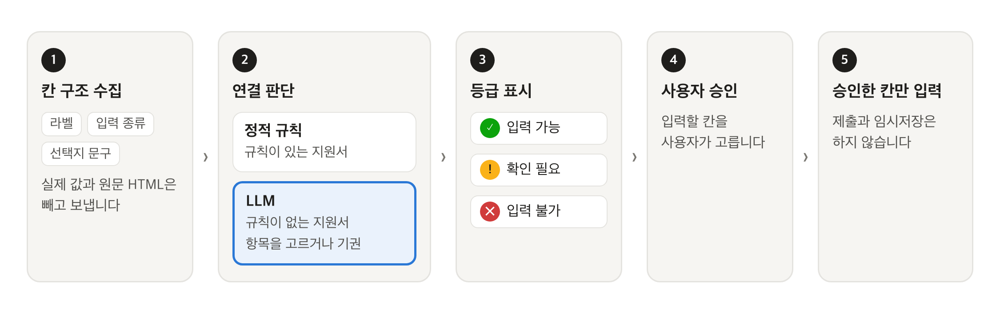
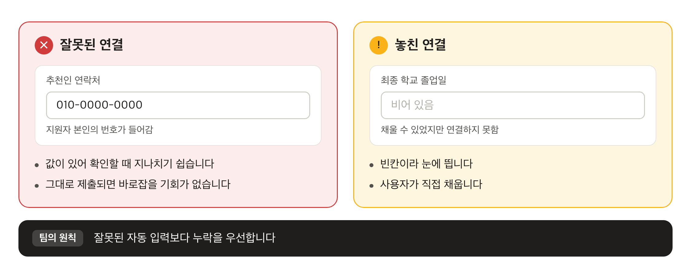
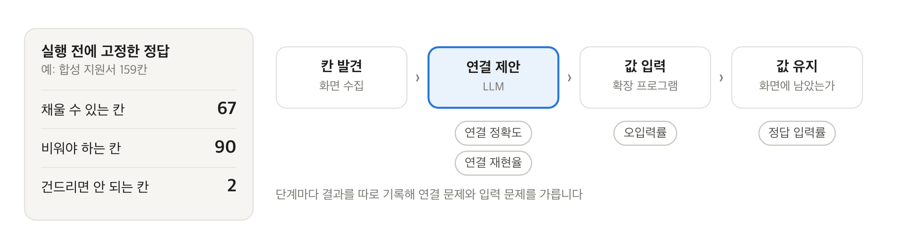
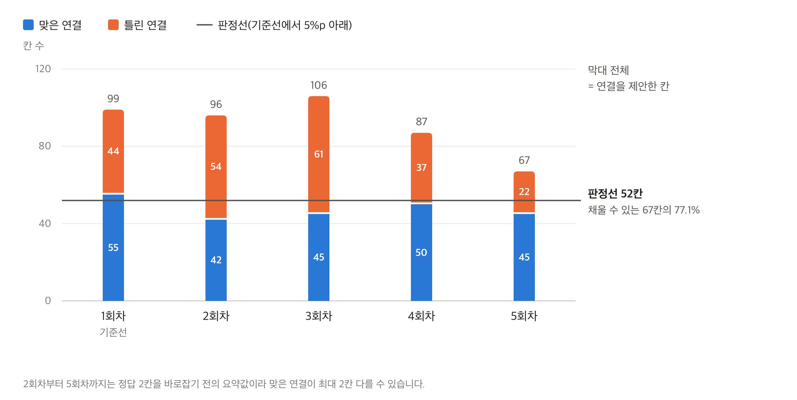
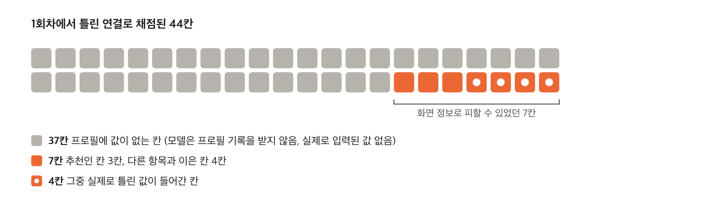
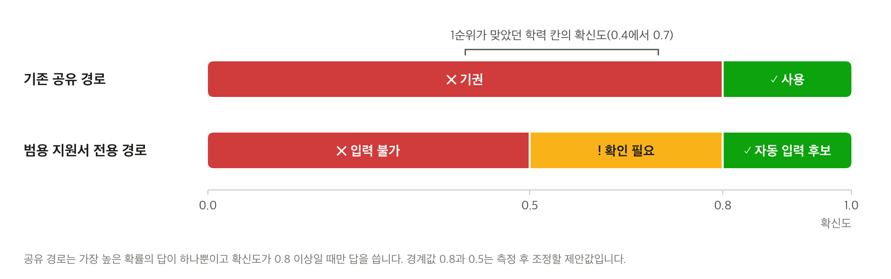

# 우리 서비스에 맞는 LLM, 무엇을 기준으로 선택할까?

> 지원서 자동 입력 기능에서 '더 많이 채우는 모델'과 '덜 틀리는 모델' 사이의 선택 기준을 세운 기록

팀에서 같은 합성 지원서를 같은 설정으로 다섯 번 분석한 적이 있습니다. 첫 번째 실행에서 모델은 채울 수 있는 칸 67개 중 55개를 맞게 연결했지만, 연결하겠다고 답한 99개 중 44개는 틀렸습니다. 나머지 네 번은 결과가 또 달랐습니다.

저는 채용 지원서 자동 입력 서비스 Career Form에서 LLM 기능을 맡았습니다. 첫 구현에서는 모델을 데모용 잠정값으로 정해 두고 후보 모델 네 개를 나중에 비교하기로 했습니다. 그런데 위의 숫자처럼 많이 맞힌 결과에도 틀린 연결이 섞여 있어서, 비교하기 전에 무엇을 좋은 답으로 볼지부터 정해야 했습니다. 이 글은 팀이 그 기준을 세운 과정을 정리합니다. 첫 분석 API와 모델의 응답 계약은 제가 만들었고, 평가 도구와 판정 기준은 팀원이 남긴 기록을 바탕으로 정리했습니다.

| 구분 | 내용 |
| --- | --- |
| 대상 독자 | LLM API를 호출해 본 적은 있지만 서비스에 쓸 모델을 골라야 하는 백엔드 개발자 |
| 다루는 것 | 좋은 답의 정의, 두 오류를 나눠 세는 평가, 결과가 엇갈릴 때의 판정 기준 |
| 다루지 않는 것 | 라이브러리 선택, 프롬프트 작성법, "가장 좋은 모델"이라는 결론 |
| 근거 | 2026년 8월부터 10월까지 팀의 개발 기록과 평가 결과. 모두 평가 환경의 값이고, 운영에서는 LLM 경로를 아직 켜지 않음 |

## 1. LLM에게 맡긴 일

Career Form은 브라우저에 저장해 둔 이름, 연락처, 학력, 경력을 채용 지원서에 채워 주는 Chrome 확장 프로그램입니다. 회사마다 칸 이름과 배치가 달라서, 화면의 칸이 저장된 정보 중 무엇인지 판단해야 합니다. 자주 쓰이는 채용 플랫폼은 팀이 만든 정적 규칙으로 처리하고, 규칙이 없는 지원서에서만 LLM이 이 판단을 맡습니다.

*그림 1. 자동 입력 흐름과 LLM의 자리*

LLM은 원칙적으로 값이 빠진 칸 구조만 받고(예외는 7장), 미리 정해 둔 프로필 항목 중 하나를 고르거나 기권합니다. 그래서 모델을 고를 때는 맞는 항목을 고르는지, 근거가 부족하면 고르지 않는지, 서버가 읽을 수 있는 형식으로 답하는지를 먼저 봅니다. 공급자는 처음에 OpenAI(gpt-5.6-luna)였고, 10월에 JEV라는 분류 API로 바뀌었습니다(6장).

## 2. 두 종류의 오류

*그림 2. 잘못된 연결과 놓친 연결*

빈칸은 눈에 띄어 사용자가 직접 채우지만, 잘못 채운 칸은 지나치기 쉽고 그대로 제출될 수 있습니다. 평가에서 실제로 나온 사례는 표 1과 같습니다.

*표 1. 평가에서 나온 오류 사례*

| 종류 | 사례 | 출처 |
| --- | --- | --- |
| 잘못된 연결 | 아이디와 도메인으로 나뉜 이메일 칸 중 아이디 칸에 전체 주소를 넣음 | 실사이트, OpenAI |
| 잘못된 연결 | 경력의 담당업무를 '희망연봉 산정 이유' 칸에 넣음 | 실사이트, OpenAI |
| 잘못된 연결 | 추천인의 이름, 연락처, 이메일 칸에 지원자 본인 정보를 넣음 | 합성 지원서, OpenAI |
| 놓친 연결 | 채울 수 있는 칸이 7개인 지원서에서 하나도 연결하지 않음 | 실사이트, OpenAI |

이 차이는 모델 응답을 다루는 계약에도 반영됐습니다. 처음 계약에서는 칸 하나만 빠져도 응답 전체가 빈 결과가 됐고, 저는 이를 표 2처럼 바꿨습니다. 같은 칸이 두 번 나오는 등 응답 자체를 믿을 수 없을 때는 지금도 결과 전체를 거부합니다.

*표 2. 모델 응답 계약의 변경*

| 구분 | 바꾸기 전 | 바꾼 뒤 |
| --- | --- | --- |
| 모델에게 요구한 것 | 모든 칸을 '연결함'이나 '연결 안 함' 목록에 넣기 | 확신하는 연결만 돌려주기 |
| 칸 하나가 빠지면 | 응답 전체를 버려 빈 결과가 됨 | 빠진 칸만 '연결하지 못함'으로 입력을 막음 |
| 목록에 없는 항목 이름 | 서버가 받은 뒤 결과 전체를 거부 | 응답 형식(JSON Schema)의 열거형으로 생성 단계에서 제한 |

결정 기록에는 이 선택이 "**잘못된 자동 입력보다 누락을 우선하는 제품 원칙에 맞는다**"고 적었습니다. 다만 지시문에 "근거가 부족하면 빼라"고 적어도 모델이 늘 비워 두지는 않습니다. 표 1의 추천인 칸이 그런 예입니다. 그래서 평가에서는 두 오류를 따로 세고, 모델의 원래 답과 서버가 보완한 결과를 나눠 봐야 합니다.

## 3. 비교표로는 보이지 않는 조건

모델을 고르는 방법은 표 3처럼 세 가지를 생각할 수 있습니다. 앞의 두 방법은 후보를 거르는 데 도움이 되지만, 실제로 처리할 지원서에서 얼마나 틀리는지는 알려 주지 않습니다.

*표 3. 모델을 고르는 세 가지 방법*

| 방법 | 알 수 있는 것 | 알 수 없는 것 |
| --- | --- | --- |
| 잘 알려진 모델부터 쓰기 | 자료가 많고 바로 시작할 수 있는가 | 실제 지원서에서 어떤 칸을 얼마나 틀리는가 |
| 가격과 응답 속도로 추리기 | 호출 한 번의 비용과 시간 | 더 자주 틀려서 생기는 재시도와 수동 수정의 비용 |
| 실제 지원서로 시험하기 | 두 오류의 빈도, 실행마다의 흔들림 | 시험에 넣지 않은 지원서 구조에서의 결과 |

개발하는 동안에는 모델의 정확도와 별개로 서비스 쪽에서 맞춰야 하는 조건도 드러났습니다(표 4). 출력 한도와 처음의 10초 제한은 제가 정한 값이고, 이후의 시간 조정은 팀원이 했습니다.

*표 4. 개발 중에 드러난 조건*

| 조건 | 개발 중에 생긴 일 | 후보를 볼 때 확인할 것 |
| --- | --- | --- |
| 응답 형식 | 칸 하나가 빠지면 전체를 버리던 계약(2장) | 정해진 형식을 강제할 수 있는가 |
| 응답 길이 | 출력 한도를 2048에서 8192 토큰으로 올림. 지연과 비용이 늘 수 있음 | 긴 구조화 응답을 끝까지 내는가 |
| 기다릴 시간 | 10초 제한에서는 결과를 받지 못해 60초로 늘렸다가, 칸 분석 30초와 검색 판단 8초로 나눔. 확장 프로그램은 최대 60초 대기 | 제한 시간 안에 답하는가 |
| 한 번에 묻는 양 | 큰 화면을 한 요청에 담자 분석 요청이 실패함(6장) | 실제 지원서 크기로 호출해 봤는가 |

## 4. 정답과 분모부터 정한 평가

*그림 3. 실행 전에 고정한 정답과 단계별 지표*

팀은 평가를 실행하기 전에 지원서의 모든 칸을 분류해 분모를 고정했습니다. 모델이 찾은 칸만으로 분모를 만들면 놓친 칸이 계산에서 사라지기 때문입니다. 결과는 칸이 거치는 단계마다 따로 기록했습니다.

*표 5. 지표와 첫 실사이트 기준선(2026년 9월 28일, 회사 지원서 4곳, OpenAI gpt-5.6-luna)*

| 지표 | 계산 | 보는 오류 | 첫 기준선 |
| --- | --- | --- | ---: |
| 연결 정확도 | 맞은 연결 ÷ 제안한 연결 | 잘못된 연결 | 11/13 (84.6%) |
| 연결 재현율 | 맞은 연결 ÷ 채울 수 있는 칸 | 놓친 연결 | 11/31 (35.5%) |
| 오입력률 | 틀린 값이 들어간 칸 ÷ 값을 넣은 칸 | 연결 오류와 입력 오류 | 4/12 (33.3%) |

제안한 연결은 대부분 맞았지만, 채울 수 있는 칸은 3분의 1 남짓만 찾았습니다. 오입력 4건 중 2건은 연결은 맞았는데 입력 단계에서 선택지를 반대로 고른 경우였습니다. 단계를 나눠 기록하지 않았다면 이 2건도 모델의 실수로 셌을 것입니다.

평가 데이터는 실제 회사 지원서와, 사람이 정답을 확정할 수 있는 합성 지원서를 함께 썼습니다. 실제 지원서에서는 같은 입력을 보내도 LLM 응답이 실행마다 달라 반복 비교가 어려웠습니다. 합성 지원서에는 '비워 두기'가 정답인 칸이 절반 넘게 들어 있고, 추천인 정보와 국가번호 선택, 제출 버튼 같은 함정도 있습니다.

## 5. 다섯 번 돌린 결과

*그림 4. 같은 합성 지원서를 다섯 번 분석한 결과(2026년 10월 17일, OpenAI gpt-5.6-luna)*

합성 지원서는 159칸이고 그중 67칸을 채울 수 있습니다. 입력과 설정이 같아도 모델이 연결을 제안한 칸은 67개에서 106개까지 달라졌습니다. 맞은 연결은 1회차의 55개가 가장 많았는데, 팀의 공식 지표가 1회차로 계산돼서 연결 재현율 82.1%가 기준선이 됐습니다. 같은 측정에서 JEV는 분석 요청이 모두 실패해 그림에서 뺐습니다(6장).

*그림 5. 1회차의 틀린 연결 44칸*

이 글을 쓰며 1회차 관측 파일을 정답과 맞춰 44칸을 다시 나눠 봤습니다. 37칸은 셋째와 넷째 학력 행처럼 프로필에 기록이 없는 칸이었습니다. 모델은 프로필에 어떤 기록이 있는지 받지 않으므로 화면만으로는 비워야 하는지 알 수 없고, 실제로 이 칸들에는 값이 들어가지 않았습니다. 화면 정보로 피할 수 있었던 오류는 7칸이었고, 실제로 틀린 값이 들어간 4칸은 모두 여기서 나왔습니다.

그래서 모델끼리 비교하는 지표라면 두 갈래를 나눠 세야 합니다. 37칸이 섞인 연결 정확도로 비교하면 뒤쪽 행을 우연히 비워 둔 모델이 더 정확해 보일 수 있습니다. 평가 데이터에도 확장 프로그램이 걸러야 할 칸과 모델이 기권해야 할 칸이 함께 있어야, 틀린 연결을 줄일 때 어디를 고칠지 정할 수 있습니다. 이 결과는 합성 지원서 한 장을 다섯 번 잰 값이라 실제 지원서의 성공률을 뜻하지는 않습니다.

## 6. 공급자 전환의 판정 기준

10월에 팀은 칸 분석 공급자를 OpenAI에서 JEV(typesafe.ai)로 바꾸는 방안을 검토했습니다. 결정 기록에 남은 두 공급자의 차이는 표 6과 같습니다. 10월 13일 실험의 원자료는 저장소에 없어서 요약만 옮깁니다.

*표 6. 두 공급자의 차이*

| 구분 | OpenAI (gpt-5.6-luna) | JEV |
| --- | --- | --- |
| 답하는 방식 | 정해진 JSON 형식의 연결 목록 | 질문마다 선택지 하나와 확신도 |
| 모를 때 | 연결을 돌려주지 않음 | '기권' 선택지를 고름 |
| 10월 13일 실험 요약 | JEV보다 약 2.5배 많은 칸을 연결 | 같은 입력을 반복하면 69개 중 68개가 같은 결과 |

팀은 덜 채우더라도 결과가 안정적이고 기권할 줄 아는 JEV를 택했습니다. 대신 전환을 병합하기 약 16시간 전에, 이 선택이 맞았는지 판정할 기준을 먼저 적어 두었습니다(표 7).

*표 7. 공급자 전환 판정 기준(2026년 10월 20일 작성)*

| 기준 | 합격 조건 | 다루는 위험 |
| --- | --- | --- |
| 연결 재현율 | 77.1% 이상 (기준선 82.1%에서 5%p까지 하락 허용) | 놓친 연결 |
| 오입력률 | 25.0% 이하 (기준선보다 나빠지면 안 됨) | 잘못 채운 칸 |
| 큰 지원서 | 100칸 이상 화면에서 분석 실패 0건 | 분석이 실패해 모든 칸이 빔 |
| 응답 시간 | 분류와 연결을 합친 p95가 12초 이하이고 기준선(22.1초) 이하 | 사용자가 기다리는 시간 |

두 오류를 다르게 다룬 이유는 기록에 따로 적혀 있지 않습니다. 그래도 놓친 연결에는 5%p의 여유를 주고, 잘못 채운 칸은 기준선보다 나빠지면 탈락시킵니다. 저는 이 기준을 2장의 원칙이 숫자로 들어간 것으로 읽습니다. 응답 시간의 기준선은 다섯 번의 p95로, 가장 느린 3회차 값과 같습니다.

이 기준에도 약점이 있습니다. 재현율 기준선 82.1%는 다섯 번 중 가장 좋았던 1회차의 값입니다. 그림 4에서 보듯 나머지 네 번 중 세 번은 정답 보정을 감안해도 판정선에 못 미칩니다. 기준선 자체의 흔들림이 5%p 여유보다 크다는 뜻이므로, 한 번 잰 값을 기준선으로 삼기 전에 반복 측정으로 그 폭부터 확인해야 합니다.

*그림 6. 확신도에 따른 처리*

채움 양이 줄어드는 대가는 두 가지로 메우기로 했습니다. 하나는 칸마다 프로필 항목 약 130개를 모두 묻던 방식을, 섹션 범주(학력, 경력 등)에 맞는 항목만 묻도록 좁힌 것입니다. 효과는 아직 측정 전입니다. 다른 하나는 그림 6처럼 확신도를 세 단계로 나눠, 확신이 낮은 정답을 버리지 않고 사용자에게 넘긴 것입니다. 기존 방식에서는 1순위가 맞았던 학력 칸도 확신도가 0.4에서 0.7 사이라 모두 기권 처리됐기 때문입니다.

표 7에는 비용이 없습니다. 팀의 평가는 비용을 기록하지 못했고, 토큰 사용량도 첫 기준선에서 한 번만 남았습니다. 다음 비교에서 저는 이 순서로 보려고 합니다.

1. 오입력률이 상한을 넘는 후보는 먼저 탈락
2. 남은 후보 중 놓친 연결이 적은 후보
3. 비슷하면 제한 시간 안의 응답 시간
4. 마지막으로 쓸 만한 결과 하나를 얻는 데 드는 비용

이 판정은 11월 2일 현재 진행 중입니다. 지금까지 두 공급자를 같은 조건에서 잰 기록은 5장의 측정 하나뿐입니다. 당시 코드가 화면의 칸 128개를 한 요청에 담아 보내, JEV의 분석 요청은 다섯 번 모두 실패했습니다. 이 결과로는 JEV의 연결 품질을 알 수 없습니다. 모델을 비교할 때는 실제로 배포할 호출 경로로 재야 합니다.

## 7. 다른 서비스에 옮기기 전에

이 글의 숫자는 모두 평가 환경의 값입니다. 같은 빌드로 같은 지원서를 채워도 맞게 채운 칸이 27칸과 29칸으로 갈린 적이 있으니, 숫자보다 재는 방식을 가져가는 편이 낫습니다.

모델의 답과 서비스의 최종 결과도 나눠 봐야 합니다. 합성 지원서에서 맞은 연결 55칸 중 정답 값이 끝까지 남은 칸은 12칸이었습니다. 18칸은 확인이 필요한 칸이라 승인되지 않았고, 25칸은 입력 단계에서 실패했습니다. 최종 결과만 보면 이 차이가 모두 모델 탓처럼 보입니다.

모델에 보내는 정보의 범위도 선택 기준입니다. 정제한 라벨을 보내자 한국어 라벨의 뜻이 지워져 한 지원서의 학력 칸 20개가 모두 기권했습니다. 그래서 팀은 이메일, URL, 전화번호, 두 자리 이상의 숫자를 가린 원문 라벨을 120자까지 보내도록 바꿨습니다. 같은 지원서를 한 번 다시 재자 학력 행 6칸이 채워졌습니다. 다만 같은 마스킹을 쓰는 다른 기능의 기록에는 가린 라벨에도 행 요약이나 검색어 같은 입력값이 섞일 수 있다고 적혀 있습니다. JEV의 데이터 보관 정책은 아직 확인되지 않았고, 팀은 이를 전환 조건으로 두지 않는 대신 미검증 위험으로 기록했습니다. 저는 운영에서 LLM 경로를 켜기 전에 이 정책을 확인해야 한다고 봅니다.

*표 8. 모델을 고르기 전에 확인할 것*

| 확인할 것 | 이 글에서 |
| --- | --- |
| 모델에게 맡길 판단과 맡기지 않을 일 | 1장 |
| 두 오류의 피해 차이와 허용 기준 | 2장, 6장 |
| 실행 전에 고정한 정답과 분모 | 4장 |
| '비워 두기'가 정답인 칸 | 4장, 5장 |
| 모델이 피할 수 있었던 오류만 따로 센 지표 | 5장 |
| 반복 측정으로 확인한 기준선의 폭 | 5장, 6장 |
| 실제 배포 경로와 제한 시간에서의 측정 | 3장, 6장 |
| 보내는 데이터의 범위와 공급자의 보관 정책 | 7장 |
| 쓸 만한 결과 하나를 얻는 비용 | 6장 |

## 마치며

지원서 자동 입력에서 잘못 채운 칸은 빈칸보다 사용자에게 부담이 큽니다. 그래서 팀은 두 오류를 따로 세고, 공급자를 바꿀 때 놓친 연결에는 5%p의 여유를, 잘못 채운 칸에는 기준선 이하라는 조건을 두었습니다. 기록을 다시 세어 보니 평가 방법에도 고칠 점이 보였습니다. 기준선은 여러 번 재서 폭을 확인해야 하고, 모델끼리 비교할 때는 모델이 피할 수 있었던 오류만 따로 세야 합니다.

저희 팀은 아직 모델을 확정하지 못했습니다. 팀의 다음 단계는 공급자 전환 판정을 끝내는 일이고, 제가 첫 구현 때 적어 둔 후보 네 개의 비교도 아직 남아 있습니다. 자기 서비스에 맞는 모델을 고르고 있다면, 표 8에서 아직 비어 있는 칸부터 채워 보기를 권합니다.
