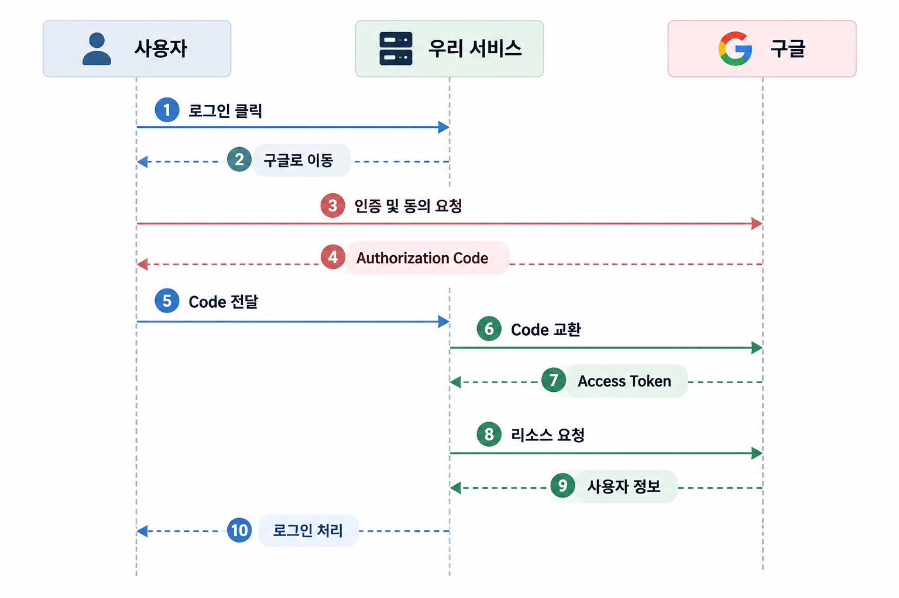

# 소셜 로그인은 왜 이렇게 복잡하게 동작할까?

**대상 독자**

> - HTTP 요청과 응답, 서버 인증의 기본 개념은 알고 있지만 OAuth 2.0과 소셜 로그인의 동작 원리는 처음 접하는 백엔드 개발자
> 
> - 이 글에서는 OAuth 2.0의 전체 명세를 다루기보다, 구글 로그인의 주요 단계를 따라가며 각 단계가 필요한 이유를 설명한다.

서비스에 구글 로그인을 구현하기 위해 OAuth 2.0을 처음 공부했을 때, 가장 먼저 든 생각은 **_왜 이렇게 복잡하지?_** 였다.

내가 생각했던 소셜 로그인은 단순했다.

1. 사용자가 구글 로그인 버튼을 클릭한다.
2. 구글에서 아이디와 비밀번호로 인증한다.
3. 인증에 성공하면 우리 서비스에 로그인한다.

그런데 실제 OAuth 2.0의 동작 과정은 예상보다 복잡했다.

사용자를 구글 인증 페이지로 이동시키고, 인증이 끝나면 Authorization Code를 전달받는다. 이 코드를 다시 구글에 보내 Access Token을 발급받고, 발급받은 토큰으로 사용자 정보에 접근한다.

처음에는 이 과정이 불필요하게 복잡하다고 느껴졌다.

구글에서 인증에 성공했다면 그 결과를 우리 서비스에 바로 전달하면 되는 것 아닐까? 굳이 코드를 발급하고, 다시 토큰으로 교환하는 이유는 뭘까?

이 글에서는 이러한 의문에서 출발해 OAuth 2.0이 현재와 같은 구조를 갖게 된 이유를 살펴보려고 한다.

## 1. 문제: 로그인 하나에 왜 이렇게 많은 단계가 필요할까?

소셜 로그인의 목적은 간단하다. 사용자가 기존에 가지고 있는 구글 계정을 이용해 우리 서비스에 로그인하도록 만드는 것이다.

하지만 여기에는 중요한 문제가 있다.

> **“우리 서비스는 사용자가 구글에서 인증에 성공했다는 사실을 어떻게 신뢰할 수 있을까?”**
>

사용자가 직접 “저 구글에서 로그인했어요”라고 말하는 것만으로는 충분하지 않다. 누구나 그렇게 주장할 수 있기 때문이다.

그렇다면 구글이 직접 인증 결과를 전달해 주면 되지 않을까?

이렇게 생각하면 소셜 로그인은 훨씬 간단하게 구현할 수 있을 것 같다. 그러나 인증 결과를 어떤 방식으로 전달하고, 누가 그 결과를 사용할 수 있으며, 어떤 정보까지 접근하도록 허용할 것인지에 대한 문제가 남는다.

OAuth 2.0의 여러 단계는 이러한 문제를 해결하기 위한 설계다.

그렇다면 OAuth 없이 소셜 로그인을 구현한다면 어떤 방식이 가능할까?

## 2. 비교한 방법: 더 간단하게 구현할 수는 없을까?

### 방법 1. 우리 서비스가 구글 아이디와 비밀번호를 직접 받는다.

먼저 OAuth 없이 소셜 로그인을 구현한다고 가정해 보자. 가장 단순하게 떠올릴 수 있는 방식은 사용자가 우리 서비스에 구글 아이디와 비밀번호를 입력하는 것이다.

우리 서비스는 전달받은 계정 정보로 구글에 인증을 요청하고, 성공하면 사용자를 로그인 처리한다.

구현 방식만 생각하면 직관적이다. 하지만 **심각한 문제**가 존재한다.

사용자는 본인의 구글 계정 비밀번호를 우리 서비스에 알려줘야 한다.

우리 서비스가 비밀번호를 저장하지 않더라도, 비밀번호가 우리 서버를 거쳐 간다는 사실 자체가 위험하다. 서버가 공격받거나 요청 정보가 유출된다면 사용자의 구글 계정까지 위험해질 수 있다.

또한 구글 계정의 비밀번호는 우리 서비스만을 위한 비밀번호가 아니다. Gmail, Google Drive 등 다양한 서비스에 접근하는 데 사용된다.

단순히 사용자 프로필을 확인하기 위해 계정 전체의 자격 증명을 요구하는 것은 지나치게 큰 권한을 요구하는 셈이다.

따라서 다음과 같은 조건이 필요하다.

> **“사용자가 구글 비밀번호를 우리 서비스에 알려주지 않아도 되어야 한다.”**
>

### 방법 2. 구글이 인증 결과를 우리 서비스에 바로 전달한다.

이번에는 사용자가 구글에서 직접 로그인하도록 만들어 보자.

사용자가 구글 로그인 버튼을 클릭하면 구글 인증 페이지로 이동한다. 구글에서 인증을 마치면 우리 서비스에 사용자 정보를 전달한다.

이렇게 하면 우리 서비스는 비밀번호를 직접 다루지 않아도 된다.

그런데 새로운 문제가 생긴다.

구글이 사용자 정보를 전달할 때, 우리 서비스는 해당 정보가 정말 구글에서 발급한 것인지 확인해야 한다.

또한 그 정보가 우리 서비스를 대상으로 발급된 것인지, 아직 유효한지, 다른 요청에서 탈취한 정보를 재사용한 것은 아닌지도 확인해야 한다.

예를 들어 구글에서 인증에 성공했다는 사실만 담긴 값을 전달한다고 가정하자. 공격자가 그 값을 가로채 재사용할 수 있다면 다른 사용자로 로그인할 가능성이 생긴다.

인증 결과의 출처와 유효성을 검증한다면 이러한 문제를 해결할 수 있다.

하지만 인증 결과를 안전하게 전달하는 것만으로는 해결되지 않는 문제가 있다.

우리 서비스가 사용자 정보에 접근하려면 어떤 정보에 접근할 수 있는지, 사용자가 어디까지 허용했는지를 정해야 한다.

즉, **사용자가 누구인지 확인하는 것과 사용자의 정보에 접근할 권한을 얻는 것은 서로 다른 문제다.**

그렇다면 사용자의 비밀번호를 직접 받지 않으면서, 필요한 정보에만 접근할 권한을 얻으려면 어떻게 해야 할까?

### 방법 3. 사용자 인증과 접근 권한을 분리한다

구글이 사용자를 직접 인증하고, 사용자가 허용한 범위의 정보에만 우리 서비스가 접근할 수 있도록 만들면 어떨까?

예를 들어 우리 서비스가 필요한 정보가 사용자의 이름과 이메일뿐이라면, 구글 계정 전체에 대한 권한을 받을 필요가 없다.

사용자는 구글에서 직접 인증하고, 우리 서비스에는 필요한 범위의 접근 권한만 허용한다.

이것이 OAuth 2.0의 핵심 개념인 **권한 위임(Authorization Delegation)** 이다.

OAuth는 사용자의 비밀번호를 제3자 애플리케이션에 제공하지 않고도, 특정 리소스에 접근할 권한을 위임할 수 있도록 설계된 프레임워크다.

하지만 여기서 또 다른 의문이 생긴다.

권한을 위임하는 것이 목적이라면, 왜 Authorization Code를 발급한 다음 Access Token으로 교환하는 과정을 거쳐야 할까?

## 3. 해 본 일: OAuth의 각 단계에는 어떤 이유가 있을까?

이 의문을 해결하기 위해 OAuth 2.0의 Authorization Code 흐름을 단계별로 따라가 보았다.

전체 흐름은 다음과 같다.

*이 다이어그램은 이해를 돕기 위한 단순화된 흐름이다. 실제로 Authorization Code는 등록된 Redirect URI로 전달되며, OIDC를 사용하는 경우 ID Token 발급 및 검증 과정이 추가된다.*

### 3.1. 왜 사용자를 구글 인증 페이지로 이동시킬까?

사용자가 구글 로그인 버튼을 클릭하면 우리 서비스는 사용자를 구글의 인증 페이지로 이동시킨다.

이는 사용자의 구글 계정 정보를 우리 서비스가 직접 취급하지 않도록 하기 위해서다.

사용자는 구글이 제공하는 환경에서 인증하고, 우리 서비스는 사용자의 비밀번호를 알 필요가 없다.

또한 이 과정에서 사용자는 우리 서비스가 요청한 접근 권한을 확인하고 동의할 수 있다.

### 3.2. 왜 Access Token 대신 Authorization Code를 먼저 발급할까?

구글이 사용자 인증과 동의를 마쳤다면 Access Token을 바로 전달하면 되지 않을까?

Authorization Code 흐름에서는 토큰을 브라우저를 통한 리다이렉트 응답으로 직접 전달하는 대신, 일회성의 짧은 유효기간을 가진 코드를 먼저 전달한다.

우리 서비스는 이 코드를 구글의 Token Endpoint에 전달해 Access Token으로 교환한다.

이렇게 하면 실제 리소스 접근에 사용하는 Access Token을 브라우저의 리다이렉트 URL에 직접 노출하지 않을 수 있다.

그러나 Authorization Code 역시 탈취될 수 있다. 따라서 코드 자체만으로는 충분하지 않다.

Authorization Code 탈취에 대응하기 위한 보안 장치로 PKCE(Proof Key for Code Exchange)가 있다.

PKCE에서는 인증 요청을 시작할 때 무작위로 생성한 `code_verifier`와, 이를 기반으로 계산한 `code_challenge`를 이용한다.

구글은 토큰 교환 시 전달받은 `code_verifier`가 최초 요청과 연결된 값인지 검증한다.

따라서 공격자가 Authorization Code만 탈취하더라도 올바른 `code_verifier`가 없다면 토큰으로 교환하기 어렵다.

즉, Authorization Code와 PKCE는 토큰을 안전하게 발급받기 위한 장치다.

### 3.3. 왜 Access Token이 필요할까?

Authorization Code를 Access Token으로 교환했다면, 이제 이 토큰을 이용해 구글의 사용자 정보 API에 접근할 수 있다.

그런데 왜 굳이 토큰을 사용할까?

핵심은 사용자의 비밀번호 대신 **제한된 접근 권한을 표현하는 수단**을 제공한다는 점이다.

Access Token을 사용하면 우리 서비스는 사용자의 비밀번호를 알지 못하더라도 허용된 리소스에 접근할 수 있다.

또한 토큰의 권한 범위(scope), 유효기간 등을 통해 접근을 제한할 수 있다.

예를 들어 사용자 프로필을 읽는 권한을 받았다고 해서 Gmail의 메일을 읽거나 삭제할 수 있는 것은 아니다.

이처럼 Access Token은 사용자 계정 전체에 대한 권한을 넘기지 않고 필요한 작업만 수행하도록 만드는 역할을 한다.

### 3.4. 그렇다면 Access Token으로 로그인해도 될까?

여기서 중요한 사실을 발견했다.

**Access Token은 사용자 인증을 증명하기 위해 만들어진 토큰이 아니다.**

Access Token은 리소스 서버에 접근할 권한을 나타낸다.

따라서 우리 서비스가 Access Token을 전달받았다는 사실만으로 사용자의 신원을 안전하게 확인했다고 단정할 수 없다.

OAuth 2.0은 기본적으로 리소스 접근 권한을 위임하기 위한 프레임워크이지, 로그인 자체를 정의하는 인증 프로토콜이 아니기 때문이다.

그렇다면 사용자의 신원은 어떻게 확인할 수 있을까?

이를 위해 사용하는 표준이 **OpenID Connect(OIDC)** 다.

OIDC는 OAuth 2.0을 기반으로 사용자 인증에 필요한 규칙을 추가한 프로토콜이다. 대표적으로 사용자의 인증 정보를 담은 ID Token을 제공한다.

ID Token은 사용자 인증에 관한 정보를 담고 있으며, 우리 서비스는 서명, 발급자(`iss`), 대상(`aud`), 만료 시간(`exp`) 등을 검증해 해당 토큰을 신뢰할 수 있는지 판단한다.

인증 흐름에서 사용하는 경우 `nonce`를 검증해 인증 요청과 응답의 연결도 확인한다.

즉, OAuth 2.0과 OIDC는 서로 다른 문제를 해결한다.

- OAuth 2.0: 애플리케이션에 리소스 접근 권한을 위임한다.
- OIDC: 사용자가 누구인지 확인할 수 있도록 인증 정보를 제공한다.

### 3.5. 실제 구현에서는 어떻게 적용했을까?

OAuth 2.0과 OIDC의 역할을 이해하기 위해 실제로 구현한 구글 소셜 로그인 방식을 비교했다.

웹에서는 Spring Security의 OAuth2 Login을 사용했다. 사용자가 구글 로그인을 요청하면 Spring Security가 Authorization Code 흐름을 처리하고, OIDC를 통해 사용자 인증 정보를 전달받는다.

반면 모바일에서는 클라이언트가 구글에서 발급받은 ID Token을 서버로 전달한다. 서버는 구글의 공개키를 이용해 JWT 서명을 검증하고, `iss`, `aud`, `exp` 등의 클레임을 확인한다.

두 구현 방식에서 공통적으로 확인한 점은 구글의 인증 결과와 우리 서비스의 로그인 처리가 분리되어 있다는 것이다.

우리 서비스는 외부 인증 제공자의 정보를 검증한 뒤 내부 회원과 연결하고, 자체 JWT를 발급해 로그인 상태를 관리한다.

이를 통해 소셜 로그인은 단순히 구글의 인증 결과를 전달받는 것으로 끝나지 않으며, 외부 인증 결과를 신뢰할 수 있는지 확인하고 서비스 자체의 인증 체계와 연결해야 한다는 점을 이해했다.

## 4. 달라진 점과 근거: OAuth와 로그인의 관계를 이해하다

처음에는 OAuth 2.0을 다른 서비스의 계정으로 로그인하는 기술이라고 생각했다.

하지만 OAuth의 각 단계와 실제 구현 방식을 살펴보면서 생각이 달라졌다. OAuth 2.0의 목적은 로그인 자체가 아니라, 사용자의 자격 증명을 제3자에게 전달하지 않고 리소스 접근 권한을 위임하는 것이었다.

반면 OIDC는 OAuth 2.0을 기반으로 사용자 인증에 필요한 정보를 제공한다.

실제로 웹과 모바일에서 서로 다른 방식으로 구글 로그인을 구현했지만, 두 방식 모두 외부 인증 정보를 검증한 뒤 우리 서비스의 JWT를 발급하는 과정을 거쳤다.

이를 통해 외부 서비스에서 사용자를 인증하는 과정과 우리 서비스에서 로그인 상태를 생성하는 과정은 별개라는 점을 확인할 수 있었다.

## 5. 주의할 점: 원리를 잘못 이해하면 어떤 문제가 생길까?

OAuth 2.0과 OIDC는 안전한 인증 및 권한 위임을 구현하기 위한 표준이지만, 사용한다고 해서 모든 보안 문제가 자동으로 해결되는 것은 아니다.

### 5.1. Access Token을 ID Token처럼 사용하는 경우

Access Token은 리소스 접근 권한을 나타내는 토큰이다.

이를 단순히 디코딩해 사용자 정보를 읽거나, 토큰이 존재한다는 이유만으로 로그인 처리하면 잘못된 인증 판단으로 이어질 수 있다.

사용자 인증에는 OIDC의 ID Token 등 해당 목적에 맞는 검증 체계를 사용해야 한다.

### 5.2. ID Token을 검증하지 않는 경우

ID Token은 JWT 형태이지만, JWT라는 이유만으로 신뢰해서는 안 된다.

서명 검증 없이 토큰에 담긴 사용자 식별자나 이메일을 그대로 신뢰하면 공격자가 조작한 정보를 이용할 가능성이 생긴다.

따라서 최소한 다음 항목을 확인해야 한다.

- 서명: 신뢰하는 인증 제공자가 발급한 토큰인가?
- `iss`: 예상한 인증 제공자가 발급했는가?
- `aud`: 우리 애플리케이션을 대상으로 발급되었는가?
- `exp`: 만료되지 않은 토큰인가?
- `nonce`: 사용한 인증 흐름에서 요청과 응답이 올바르게 연결되는가?

### 5.3. Authorization Code를 안전하게 처리하지 않는 경우

Authorization Code는 일회성이고 유효기간이 짧지만, 탈취에 대한 방어가 필요하다.

PKCE를 사용하지 않거나 Redirect URI를 부적절하게 관리하면 인증 코드 탈취 및 잘못된 대상에 대한 응답 전달 등의 위험이 커질 수 있다.

또한 `state`를 통해 인증 요청과 콜백의 연관성을 확인하여 로그인 CSRF 등의 공격을 방어해야 한다.

### 5.4. 외부 사용자 식별자를 잘못 사용하는 경우

소셜 로그인을 구현할 때는 사용자 이메일만으로 회원을 식별하는 방식을 주의해야 한다.

이메일은 변경될 수 있고, 인증 제공자마다 이메일 검증 및 제공 정책도 다를 수 있다.

일반적으로는 인증 제공자의 식별자와 해당 제공자가 발급한 안정적인 사용자 식별자(`sub`)를 조합해 외부 계정을 식별하는 것이 적절하다.

## 마무리

처음에는 소셜 로그인의 여러 단계가 불필요하게 복잡하다고 생각했다.

하지만 각 단계를 하나씩 살펴보니 모두 해결하려는 문제가 있었다.

사용자는 인증 제공자에서 직접 로그인하므로 비밀번호를 제3자에게 노출하지 않는다. Access Token은 허용된 범위의 리소스 접근에 사용하고, Authorization Code와 PKCE는 토큰 발급 과정을 보호한다.

그리고 사용자 인증이 필요한 경우에는 OIDC를 통해 신뢰할 수 있는 인증 정보를 전달받는다.

결국 OAuth의 복잡한 흐름은 단순히 로그인을 어렵게 만들기 위한 것이 아니었다.

**사용자의 자격 증명을 보호하면서 필요한 권한만 안전하게 위임하기 위한 설계였다.**

처음에는 외워야 할 단계로 보였던 OAuth의 흐름이, 이제는 각각의 문제를 해결하기 위한 선택으로 보이기 시작했다.