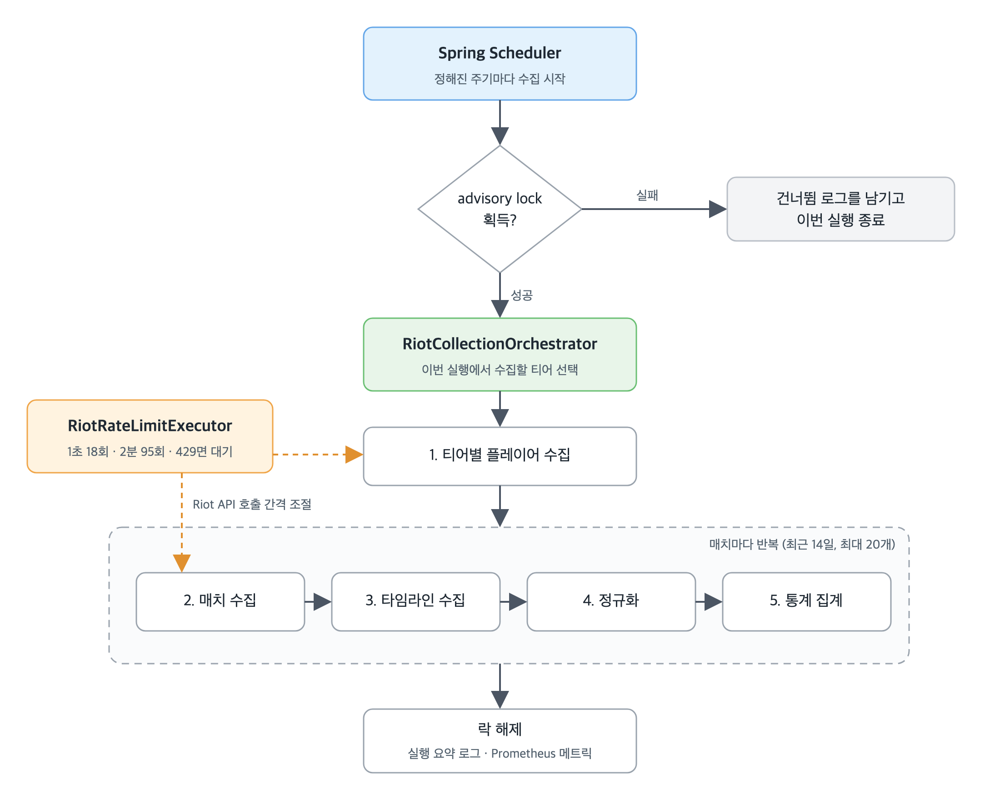
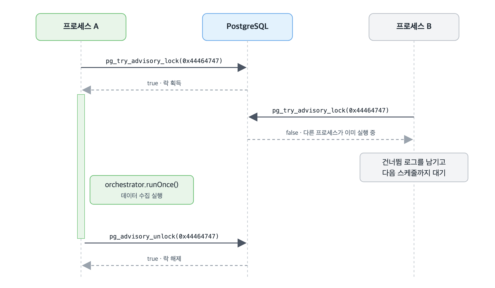
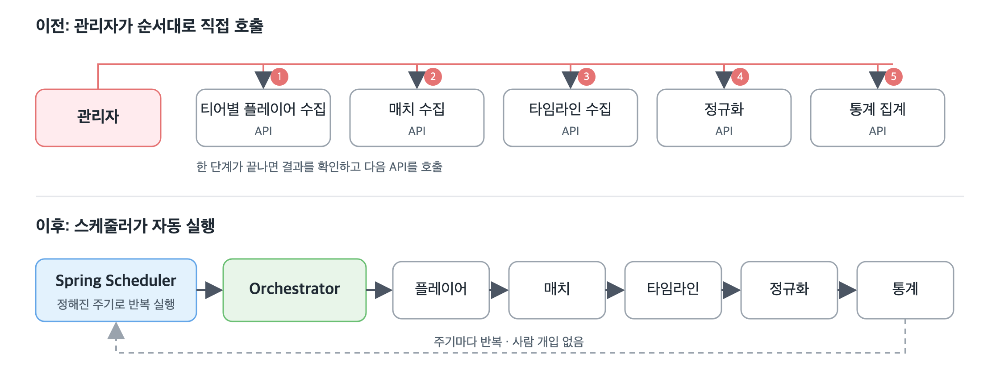
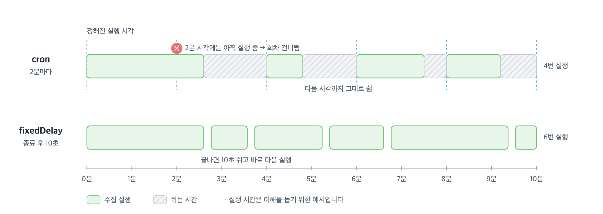

# API 5개를 순서대로 호출하던 데이터 수집, Spring Scheduler로 자동화하기

## 들어가며

저희 서비스는 리그 오브 레전드의 양 팀 조합과 실시간 데이터를 바탕으로 아이템을 추천합니다. OP.GG나 GGQ 같은 서비스는 아이템을 세 개 정도만 추천하거나, 챔피언별로 많이 간 아이템 통계를 그대로 보여 줍니다. 저희는 여기서 불편함을 느꼈습니다. 상대에 맞춰 아이템을 다르게 가도록 추천하면 랭크 게임 승률이 오르고, 낮은 티어 사용자도 티어를 올릴 수 있지 않을까 하는 가설에서 출발했습니다. 그래서 전적 통계에서 많이 쓰인 아이템을 그대로 보여 주는 대신, 저희가 만든 모델의 결과로 추천하기로 했습니다.

추천이 정확하려면 최신 매치 데이터가 꾸준히 쌓여야 합니다. 그래서 Riot API로 받은 데이터를 저희 DB에 저장하고, 그 데이터로 AI 모델을 만들어 서빙하기로 했습니다. 그런데 이 데이터를 쌓는 일은 사람이 시작해야 했습니다. 관리자가 티어별 플레이어 수집 API를 호출하고, 끝나면 매치 수집과 타임라인 수집 API를, 그다음 정규화와 통계 집계 API를 차례로 호출했습니다. 관리자가 바쁘거나 순서를 헷갈리면 추천 데이터는 그만큼 오래된 상태로 남았습니다.

이 글에서는 서버가 데이터를 스스로 수집하도록, 이 호출 작업을 Spring Scheduler에 넘긴 과정을 다룹니다. 비교한 선택지 다섯 가지와 그중 가장 단순한 도구를 고른 이유, Rate Limit을 지키기 위해 서버가 여러 대일 때 추가로 챙긴 것, 운영하며 cron을 fixedDelay로 바꾼 과정, 아직 해결하지 못한 한계를 순서대로 정리했습니다.

이 글은 Java와 Spring을 다뤄 봤고 빈과 의존성 주입은 알지만, `@Scheduled`는 처음 써 보는 개발자를 위해 작성했습니다. 반복 작업 자동화 도구를 고르고 있다면 2장의 비교표부터 읽어도 좋습니다.

---

## 1. 데이터 수집을 매번 사람이 시작해야 했다

### 수집은 다섯 단계를 순서대로 거쳐야 했습니다

수집은 특정 티어에 속한 플레이어를 찾는 데서 시작합니다. 찾은 플레이어마다 최근 매치를 가져오고, 매치마다 상세 타임라인을 다시 가져옵니다. 이렇게 모은 원본을 분석하기 좋은 형태로 정규화한 뒤, 통계를 집계해야 추천에 쓸 수 있습니다. 각 단계는 앞 단계의 결과를 입력으로 받기 때문에 순서를 바꿀 수 없습니다.

| 순서 | 단계 | 하는 일 | 사용한 Riot API | 앞 단계에 의존하는 이유 |
| --- | --- | --- | --- | --- |
| 1 | 티어별 플레이어 수집 | 특정 티어에 속한 플레이어 목록 저장 | LEAGUE-V4 | 수집 대상이 정해져야 매치를 찾을 수 있음 |
| 2 | 매치 수집 | 플레이어별 최근 매치 원본 저장 | MATCH-V5 | 플레이어 식별자(PUUID)가 필요 |
| 3 | 타임라인 수집 | 매치별 상세 타임라인 원본 저장 | MATCH-V5 | 매치 ID가 필요 |
| 4 | 정규화 | 원본 데이터를 분석용 테이블로 변환 | — (내부 처리) | 원본이 저장돼 있어야 함 |
| 5 | 통계 집계 | 추천에 쓰는 통계 갱신 | — (내부 처리) | 정규화된 데이터가 필요 |

### 무엇이 불편했나

수집을 시작하려면 관리자가 위 다섯 단계의 API를 순서대로 직접 호출해야 했습니다. 한 단계가 끝나면 결과를 확인하고 다음 단계를 호출하는 식이어서, 사람이 매번 순서와 실행 결과를 지켜봐야 했습니다.

그렇다고 한꺼번에 빠르게 호출해서 끝낼 수도 없었습니다. Riot API에는 일정 시간 동안 보낼 수 있는 요청 수를 제한하는 Rate Limit이 있어서, 짧은 시간에 요청을 몰아 보내면 제한에 걸립니다. 저희가 쓰는 개인용 키(Personal API Key)는 1초에 20회, 2분에 100회까지만 요청할 수 있습니다. 한도가 더 넉넉한 운영용(Production) 키는 Riot의 승인 심사를 거쳐야 하는데, 글을 쓰는 지금도 심사 중입니다. 결국 수집은 조금씩 나눠서 꾸준히 실행해야 했고, 이 일을 사람이 계속 맡기는 어려웠습니다.

정리하면 해결해야 할 문제는 이것이었습니다.

> **정해진 순서의 수집 흐름을, 사람이 지켜보지 않아도 Rate Limit 안에서 일정한 주기로 실행되게 만들기**

---

## 2. 반복 작업 하나에 필요한 복잡도는 어느 정도인가

### 판단 기준부터 정했습니다

수집 파이프라인을 자동화하려고 했을 때 가장 먼저 떠오른 도구는 Spring Batch와 Spring Scheduler였습니다. 둘 다 Spring에서 반복 작업을 다룰 때 흔히 쓰는 도구입니다. 하지만 많이 쓰인다고 해서 저희 상황에 맞는 것은 아닙니다. 도구가 강력할수록 배워야 할 것과 운영해야 할 것도 함께 늘어나기 때문입니다. 그래서 "무엇이 가장 좋은가"보다 "**지금 구현과 프로젝트 규모에서 무엇이 충분한가**"를 먼저 따졌고, 아래 네 가지 기준으로 선택지를 비교했습니다.

1. **기존 코드 재사용**: 이미 만들어 둔 수집 서비스를 그대로 호출할 수 있는가
2. **추가 구성**: 새 인프라, 테이블, 인증 설정이 필요한가
3. **학습 비용**: 팀이 처음 써도 바로 이해할 수 있는가
4. **실패 처리**: 실패 기록과 재시작을 어디까지 지원하는가

### 다섯 가지 선택지 비교

| 선택지 | 역할 | 기존 코드 재사용 | 추가 구성 | 학습 비용 | 실패 처리 | 판단 |
| --- | --- | --- | --- | --- | --- | --- |
| 수동 실행 유지 | 사람이 직접 호출 | 지금 그대로 | 없음 | 없음 | 사람이 판단 | 문제 그대로 |
| 외부 Cron (서버/클라우드) | 실행 시점 결정 (애플리케이션 밖) | API를 열어 거쳐서 호출 | 호출 엔드포인트, 인증, 네트워크 | 낮음 | 없음 | 구성이 늘어남 |
| **Spring Scheduler** | **실행 시점 결정 (애플리케이션 안)** | **서비스 빈 직접 호출** | **어노테이션 몇 줄** | **낮음** | **직접 구현** | **선택** |
| Quartz | 실행 시점 결정 + 실행 상태 관리 | Job 클래스로 감싸 호출 | Job 저장 테이블, 클러스터 설정 | 중간 | Job 상태 저장, misfire 처리 | 지금은 과함 |
| Spring Batch | 실행 흐름·이력 관리 (주기 실행은 스케줄러가 따로 필요) | Step으로 감싸 호출 | 메타데이터 테이블, Job/Step 설계 | 높음 | 실행 이력, 재시작 | 지금은 과함 |

### 왜 Spring Scheduler였나

당시 팀의 기조는 프로토타입을 빠르게 만들어 사용자에게 배포하고, 그 반응을 바탕으로 가설과 검증을 짧게 반복하는 것이었습니다. 이 사이클을 돌리려면 백엔드는 모델 개발에 쓸 데이터를 최대한 빨리 쌓아야 했고, 수집 자동화 하나에 오랜 시간을 들일 여유가 없었습니다. 그래서 새 기술을 들이기보다, 지금 구조에 그대로 붙일 수 있는 자동화 방법을 찾는 데 집중했습니다. 이 기준으로 각 선택지를 보면 다음과 같습니다.

- **Spring Batch**는 '언제 실행할지'를 정하는 도구가 아니라, Job의 실행 흐름과 이력을 관리하는 프레임워크입니다. 그래서 주기적으로 돌리려면 결국 `@Scheduled` 같은 스케줄러가 따로 필요합니다. 실행 이력 저장과 실패 후 재시작은 강점이지만, 메타데이터 테이블을 만들고 수집 흐름을 Job과 Step 단위로 다시 설계해야 해서 당시 요구에 비해 도입 범위가 컸습니다.
- **Quartz**는 Job 상태 저장, misfire 처리(서버가 꺼져 있는 등의 이유로 정해진 시각에 실행하지 못한 회차를 나중에 어떻게 처리할지 정하는 기능)처럼 스케줄링 기능이 풍부합니다. 그만큼 Job, Trigger, JobStore(Job과 Trigger 정보를 메모리나 DB에 저장하는 저장소) 같은 개념을 새로 익혀야 하고, 여러 서버에서 쓰려면 전용 테이블과 클러스터 설정도 필요합니다. 학습 비용과 구현 비용 모두 지금 필요한 수준보다 컸습니다.
- **외부 Cron**은 개념이 단순해서 학습 비용은 낮습니다. 하지만 Cron이 호출할 API를 외부에 열고, 아무나 호출하지 못하도록 인증을 붙여야 합니다. 수집 로직은 이미 애플리케이션 안에 있는데, 이를 깨우려고 바깥에 구성을 하나 더 두는 셈이라 구현 비용이 늘었습니다.
- **Spring Scheduler**는 Spring에 이미 포함돼 있어 의존성을 추가할 필요가 없고, 기존 서비스 빈을 그대로 호출할 수 있습니다. 어노테이션 몇 줄이면 동작하므로 학습 비용과 구현 비용이 가장 낮았습니다.

그래서 저희는 지금 구조를 그대로 살리면서 가장 빨리 자동화를 붙일 수 있는 **Spring Scheduler를 선택했습니다.**

---

## 3. 실행 시점과 수집 흐름을 분리해 자동화했다

### 전체 구조

1장에서 정리한 목표를 이루려면 두 가지 질문에 답해야 했습니다. 수집을 **언제** 시작할지, 그리고 시작한 뒤 **무엇을 어떤 순서로** 실행할지입니다. 저희는 두 질문을 각각 스케줄러와 오케스트레이터에 맡겼고, Riot API의 Rate Limit은 별도의 처리기(`RiotRateLimitExecutor`)가 지키게 했습니다. 이 처리기는 Riot API를 호출할 때마다 간격을 조절하는데, 자기 프로세스 안에서 보낸 요청만 셉니다. 먼저 전체 그림으로 흐름을 보고, 이어지는 절에서 하나씩 살펴보겠습니다. 그림 가운데 락을 확인하는 단계는 수집 프로세스가 둘이 될 때 한 곳에서만 수집하게 하는 장치입니다.



*그림 1. 데이터 수집 자동화 구조*

이 구조에서는 역할을 둘로 나눴습니다.

| 구성 요소 | 책임 | 모르는 것 |
| --- | --- | --- |
| **스케줄러** | 언제 실행할지 | 수집이 어떤 단계로 이뤄지는지 |
| **오케스트레이터** | 어떤 순서로 무엇을 실행할지 | 누가 언제 자신을 호출하는지 |

이렇게 나누면 실행 주기를 바꿀 때 수집 로직을 건드리지 않아도 되고, 반대로 관리자가 수동으로 수집을 돌려야 할 때도 같은 오케스트레이터를 호출하면 됩니다.

### 3-1. 스케줄러: 언제 시작할지 정하기

Spring Scheduler는 두 가지만 하면 동작합니다. 스케줄링을 켜고, 주기적으로 실행할 메서드에 어노테이션을 붙입니다.

```java
@Configuration(proxyBeanMethods = false)
@EnableScheduling
@ConditionalOnProperty(prefix = "collection.scheduler", name = "enabled", havingValue = "true")
public class RiotSchedulingConfiguration {
}
```

```java
@Component
@ConditionalOnProperty(prefix = "collection.scheduler", name = "enabled", havingValue = "true")
public class RiotCollectionScheduler {

    // 처음 작성한 코드: 정해진 시각마다 실행한다.
    // 기본값은 5분이고, 운영에서는 환경변수로 2분(10 */2 * * * *)을 넣었다.
    @Scheduled(
            cron = "${collection.scheduler.cron:0 */5 * * * *}",
            zone = "${collection.scheduler.zone:Asia/Seoul}"
    )
    public void collect() {
        // 락을 얻은 뒤 orchestrator.runOnce()를 호출한다
    }
}
```

스케줄링을 켜는 설정과 실제로 실행할 작업을 서로 다른 클래스로 나눴습니다.

`RiotSchedulingConfiguration`은 애플리케이션에 스케줄링 기능을 켜는 설정입니다. `@EnableScheduling`을 붙이면 Spring이 `@Scheduled`가 붙은 메서드를 찾아 주기적으로 실행할 준비를 합니다. 함께 붙은 `@ConditionalOnProperty`는 설정값에 따라 이 설정을 켜고 끄는 어노테이션입니다.

`RiotCollectionScheduler`는 '데이터 수집'이라는 작업 하나를 맡습니다. `@Scheduled`에 실행 주기를 지정하면, 다른 곳에서 호출하지 않아도 Spring이 그 주기마다 이 메서드를 실행합니다.

둘을 나눈 이유는 두 가지입니다. 첫째, 스케줄링 기능을 켜는 일과 어떤 작업을 언제 실행할지 정하는 일은 관심사가 다릅니다. 나중에 다른 주기 작업이 생겨도 새 작업 클래스만 추가하면 되고, 설정 클래스는 건드리지 않아도 됩니다. 둘째, 수집을 꺼 둔 환경에서는 스케줄링 기능 자체를 띄우지 않기 위해서입니다. 두 클래스가 같은 조건으로 등록되므로, 수집을 끄면 스케줄링 기능도 함께 꺼집니다.

스케줄러의 주기를 지정하는 방법은 세 가지이고, 처음 쓸 때 가장 헷갈리는 부분입니다.

| 옵션 | 다음 실행 시점 | 이전 실행이 길어지면 |
| --- | --- | --- |
| `fixedRate` | 이전 실행 **시작** 후 N 뒤 | 끝나는 즉시 다음 실행이 이어짐 |
| `fixedDelay` | 이전 실행 **종료** 후 N 뒤 | 항상 N만큼 쉬고 시작 |
| `cron` | 지정한 시각 | 이전 실행이 안 끝났으면 그 회차를 건너뜀 |

저희는 `cron`을 골랐습니다. 처음에는 수집 주기를 짧게 잡았는데, Riot API 호출이 몰리면서 Rate Limit에 걸렸고 서버가 갑자기 멈췄습니다. 당시 스케줄러는 실행할 때마다 DB에 쌓인 플레이어 전체의 매치를 다시 조회하고 있어서, 플레이어가 쌓일수록 호출이 늘어 429 응답이 잦아졌습니다. 처리기는 429를 받으면 응답 헤더의 Retry-After만큼 스레드를 재워 기다렸는데, 한 번에 한 요청만 처리하는 구조라 대기가 이어지는 동안 Riot API를 쓰는 작업이 모두 함께 멈춰 섰습니다. Rate Limit을 넘기면 수집만 실패하는 것이 아니라 서버 전체가 위험해진다는 것을 이때 알았습니다.

그래서 이번 리그 조회에서 찾은 플레이어만 수집하도록 고치고, 주기도 Rate Limit이 계산되는 단위에 맞췄습니다. 처리기는 한도보다 조금 낮은 2분에 95회를 기준으로 호출하는데, 매치 하나를 수집하려면 매치와 타임라인을 한 번씩, 모두 두 번 호출해야 합니다. 그래서 실행 한 번에 플레이어 한 명의 매치 ID를 조회하고(1회) 매치를 최대 47개(94회) 받도록 맞추면 2분에 딱 95회가 됩니다. 이렇게 2분마다(`10 */2 * * * *`) 실행하면 하루 720번, 최대 약 3만 4천 개(720 × 47 = 33,840)의 매치가 쌓일 것으로 예상했습니다.

> **Rate Limit에 한 번 걸린 뒤, Rate Limit이 계산되는 2분 단위에 맞춰 2분마다 실행하는 cron으로 정했습니다.**

### 3-2. 오케스트레이터: 수집 순서를 코드로 고정하기

예전에는 사람이 기억하던 순서를 이제 오케스트레이터가 코드로 들고 있습니다.

```java
public void runOnce() {
    String sampleTier = properties.getTiers().get(nextTierIndex);  // 이번 실행에서 수집할 티어
    CollectionRunSummary summary = new CollectionRunSummary(sampleTier);
    try {
        List<String> collectedPuuids = collectPlayers(sampleTier); // 1. 티어별 플레이어 수집
        collectMatches(collectedPuuids, sampleTier, summary);      // 2~5. 매치마다 원본부터 통계까지
    } finally {
        moveToNextTier();                                          // 다음 실행은 다음 티어
        report(summary);                                           // 실행 요약 로그와 메트릭
    }
}
```

```java
// 한 매치를 원본 수집부터 통계 집계까지 처리한다 (일부 생략)
private void processMatch(String matchId, String sampleTier, CollectionRunSummary summary) {
    boolean collected;
    try {
        collected = matchSyncService.syncMatch(matchId);            // 매치·타임라인 원본 수집
    } catch (RuntimeException exception) {
        summary.record(MatchCollectionOutcome.COLLECTION_FAILED);   // 이 매치만 건너뛰고 다음 매치로
        return;
    }
    if (!collected) {                                                // 이미 원본이 있는 매치
        summary.record(MatchCollectionOutcome.DUPLICATE);
        return;
    }
    NormalizedMatch normalized = matchNormalizationService.normalizeAsTierSample(matchId, sampleTier);
    matchNormalizationService.save(normalized);                      // 정규화
    aggregateStats(normalized, List.of(sampleTier), new ArrayList<>()); // 통계 집계
    summary.record(MatchCollectionOutcome.COLLECTED);
}
```

한 번 실행할 때 처리하는 양은 작게 잡았습니다. 코드의 기본값은 티어 하나에서 플레이어 1명, 최근 14일 안의 매치 최대 20개이고, 운영에서는 환경변수로 이 값을 조정합니다. 티어는 실행마다 돌아가며 바뀝니다. 또 사람이 호출하던 때처럼 단계별로 전체를 한 번씩 돌리지 않고, 매치 하나마다 원본 수집부터 통계 집계까지 끝까지 처리합니다. 이렇게 하면 수집된 매치가 바로 통계에 반영되고, 한 매치가 실패해도 그 매치만 건너뛰고 다음 매치를 계속 처리할 수 있습니다.

### 3-3. 수집 프로세스가 둘이 될 때: 한 곳에서만 실행하게 하기

저희는 데이터 수집과 추천을 한 서버에서 함께 하다가, 추천 서버와 수집 서버로 나눠 두었습니다. 서버를 나눴는데도 락이 필요했던 이유는, 수집 프로세스가 둘이 되는 경우가 남아 있었기 때문입니다. 코드는 여전히 하나의 애플리케이션에 함께 있어서 스케줄러 코드도 두 서버에 함께 배포됩니다. 나중에 도입한 블루-그린 배포(새 버전을 먼저 띄워 트래픽을 옮긴 뒤 이전 버전을 내리는 무중단 배포 방식)에서도 새 버전과 이전 버전이 잠깐 함께 떠 있습니다.

2분 주기는 서버 한 대가 API 키를 혼자 쓴다는 전제로 계산한 값입니다. 그런데 `@Scheduled`는 **애플리케이션 인스턴스(실행 중인 서버 프로세스)마다** 동작하므로, 설정 하나만 잘못돼도 두 프로세스가 같은 API 키로 동시에 수집을 시작합니다. 그러면 키 하나로 보내는 요청이 계산의 두 배로 늘어나 다시 Rate Limit에 걸립니다. 같은 매치를 두 번 수집하는 낭비도 생깁니다.

Rate Limit 처리기로도 이 문제는 막을 수 없습니다. 처리기는 자기 프로세스 안에서 보낸 요청만 세기 때문에, 프로세스가 둘이면 각자 한도를 지켜도 합치면 한도를 넘깁니다. 그래서 여러 프로세스 중 한 곳에서만 수집하게 만들기로 했습니다.



*그림 2. advisory lock으로 한 프로세스만 수집하는 과정*

ShedLock 같은 라이브러리를 쓰거나 Redis로 분산 락을 구현해서 이 문제를 막을 수도 있습니다. 저희는 이미 PostgreSQL을 쓰고 있어서 **새 의존성 없이 쓸 수 있는 PostgreSQL advisory lock**을 선택했습니다.

advisory lock은 테이블이나 행이 아니라 **애플리케이션이 정한 숫자 키**에 거는 락입니다. PostgreSQL은 이 락이 무엇을 보호하는지 모르고, 락은 애플리케이션이 약속한 대로만 쓰입니다. 그래서 '권고(advisory)' 락이라고 부릅니다. `pg_try_advisory_lock(키)`는 락을 얻으면 `true`, 다른 세션이 이미 잡고 있으면 기다리지 않고 바로 `false`를 돌려줍니다. 저희는 모든 프로세스가 같은 키 `0x44464747`("DFGG"의 ASCII 값)를 쓰도록 했습니다.

```java
public void collect() {
    // 락의 소유권이 연결에 묶이므로, 획득부터 해제까지 같은 Connection을 유지한다.
    try (Connection connection = dataSource.getConnection()) {
        // SELECT pg_try_advisory_lock(?)
        if (!executeLockQuery(connection, TRY_LOCK_SQL)) {
            log.info("Riot 데이터 수집 스케줄 실행 건너뜀: 다른 인스턴스가 실행 중입니다.");
            return;
        }
        try {
            orchestrator.runOnce();
        } finally {
            unlock(connection);  // SELECT pg_advisory_unlock(?)
        }
    } catch (SQLException exception) {
        throw new IllegalStateException("Failed to coordinate Riot collection scheduler", exception);
    }
}
```

여기서 하나 조심한 점이 있습니다. advisory lock은 락을 잡은 DB 연결(세션)만 풀 수 있습니다. 커넥션 풀에서 락을 잡을 때와 풀 때 서로 다른 연결을 빌려 오면 해제가 실패하고, 락은 풀에 반납된 연결에 그대로 남습니다. 그러면 이후 모든 실행이 "다른 인스턴스가 실행 중"이라며 건너뛰어서, 에러 없이 수집만 멈춥니다.

그래서 연결을 하나 꺼내 try-with-resources로 감싸고, 락을 잡는 순간부터 푸는 순간까지 그 연결 하나만 썼습니다. 해제 쿼리마저 실패하면 락이 남아 있을 수 있어서, 그때는 연결을 아예 끊습니다. PostgreSQL은 세션이 끝나면 그 세션이 잡고 있던 advisory lock도 함께 풀어 줍니다.

> **외부 API 한도를 프로세스 안에서 지키고 있다면, 그 작업은 한 곳에서만 실행되게 해야 합니다. 이미 쓰는 데이터베이스가 있다면 advisory lock으로 새 인프라 없이 만들 수 있습니다.**

### 3-4. 주기와 활성화 여부 분리하기

스케줄러 설정은 코드에 직접 적지 않고, `.env` 같은 환경변수로 관리하게 했습니다. 운영용 API 키가 승인돼 한도가 늘어나는 것처럼 상황이 바뀌어도, 코드는 그대로 두고 설정값만 바꿔 주기와 수집량을 맞출 수 있게 하기 위해서입니다.

```yaml
collection:
  scheduler:
    enabled: "${COLLECTION_SCHEDULER_ENABLED:false}"
    # 기본값은 5분이고, 운영에서는 환경변수로 2분(10 */2 * * * *)을 넣었다.
    cron: "${COLLECTION_SCHEDULER_CRON:0 */5 * * * *}"
    tiers: "${COLLECTION_SCHEDULER_TIERS:PLATINUM}"
    divisions: "${COLLECTION_SCHEDULER_DIVISIONS:I}"
    player-limit: "${COLLECTION_SCHEDULER_PLAYER_LIMIT:1}"
    match-count: "${COLLECTION_SCHEDULER_MATCH_COUNT:20}"
    match-lookback: "${COLLECTION_SCHEDULER_MATCH_LOOKBACK:14d}"
```

- **수집 주기(cron 식)는 환경변수로** 바꿀 수 있습니다. 한 번에 수집할 티어, 플레이어 수, 매치 수, 조회 기간도 같은 방식으로 뺐습니다.
- **활성화 여부도 설정으로 분리**했습니다. `@ConditionalOnProperty`는 설정 파일이나 환경변수의 값에 따라 빈을 등록할지 말지 정하는 Spring Boot 어노테이션입니다. 스케줄링 설정과 스케줄러 양쪽에 이 어노테이션을 붙여, `collection.scheduler.enabled`가 `true`일 때만 둘 다 등록되게 했습니다. 기본값이 `false`라서, 켜야 하는 환경에서만 환경변수로 켭니다. 로컬이나 테스트 환경에서 외부 API를 계속 호출하는 일을 막을 수 있습니다.
- **Riot API 호출 간격은 스케줄러가 아니라 `RiotRateLimitExecutor`가 지킵니다.** 개인용 키 한도(1초 20회, 2분 100회)보다 조금 낮은 1초 18회, 2분 95회로 미리 간격을 두고, 그래도 429(Too Many Requests) 응답이 오면 응답 헤더의 Retry-After만큼 기다렸다가 다시 요청합니다. 1장에서 말한 "Rate Limit 안에서"는 이 처리기가 맡습니다.

---

## 4. 수동 호출을 주기 실행으로 바꾸고 실행 상태를 기록했다

### 무엇이 달라졌나



*그림 3. 수동 호출과 자동 실행 비교*

| 항목 | 이전 | 이후 |
| --- | --- | --- |
| 수집 시작 | 관리자가 API 5개를 순서대로 호출 | 스케줄러가 정해진 주기마다 자동 시작 |
| 실행 순서 | 사람이 기억 | 오케스트레이터 코드에 고정 |
| 수집 간격 | 사람의 일정에 따라 불규칙 | 일정한 주기 (환경변수로 조정) |
| 수집 프로세스가 둘일 때 | 해당 없음 | advisory lock으로 한 곳에서만 실행 |
| 실행 확인 | 호출한 사람만 앎 | 시작·완료·실패·소요 시간 로그, 실행 요약, Prometheus 메트릭 |

### 실행 상태를 로그로 남겼습니다

자동화하면 사람이 지켜보지 않습니다. 그래서 "돌았는지, 성공했는지, 얼마나 걸렸는지"를 로그로 확인할 수 있게 했습니다.

```txt
[로그 형식은 실제 코드 기준, 숫자는 예시]
INFO  Riot 데이터 수집 스케줄 실행 시작
INFO  Riot 데이터 수집 대상 티어: tier=PLATINUM
INFO  Riot 데이터 수집 실행 요약: tier=PLATINUM, collected=17, duplicate=3, collectionFailed=0, normalizationFailed=0, runeFailed=0, purchaseFailed=0
INFO  Riot 데이터 수집 스케줄 실행 완료: elapsedMs=48213
ERROR Riot 데이터 수집 스케줄 실행 실패: elapsedMs=3102
INFO  Riot 데이터 수집 스케줄 실행 건너뜀: 다른 인스턴스가 실행 중입니다.
```

실행이 끝날 때마다 매치를 몇 개 수집했고 몇 개가 중복이거나 실패했는지 요약 로그를 남기고, 같은 숫자를 Prometheus 메트릭으로도 내보냅니다.

특히 **"건너뜀" 로그**가 중요했습니다. 이 로그가 없으면 락을 얻지 못한 프로세스에서 수집이 돌지 않는 것이 정상인지 장애인지 구분할 수 없습니다.

### 기록해 보니 수집량이 예상의 3분의 1이었습니다

이렇게 남긴 기록 덕분에 문제를 하나 찾았습니다. 수집량 메트릭을 붙이고 하루 수집량을 재 보니 약 9,000개로, cron을 고를 때 예상한 약 3만 4천 개의 3분의 1에도 미치지 못했습니다.

원인은 cron의 실행 방식에 있었습니다. 수집은 처리할 매치 수와 Rate Limit 대기에 따라 걸리는 시간이 들쭉날쭉한데, cron은 정해진 시각에만 실행되고, Spring은 이전 실행이 끝난 뒤에야 다음 실행 시각을 계산합니다. 그래서 한 번의 수집이 2분을 넘기면 실행 중에 지나간 시각은 건너뛰었고, 일찍 끝나면 다음 시각까지 그대로 쉬었습니다. 결국 Rate Limit 한도를 한참 남긴 채 수집하고 있었습니다.



*그림 4. cron과 fixedDelay의 실행 비교*

그래서 이전 실행이 끝난 시각부터 대기 시간을 세는 `fixedDelay`로 바꾸고, 대기 시간은 10초로 줄였습니다.

```java
// 이전 실행이 끝난 시각부터 지연을 센다. 실행이 길어져도 다음 실행과 겹치거나 건너뛰지 않는다.
@Scheduled(fixedDelayString = "${collection.scheduler.fixed-delay:10s}")
public void collect() { ... }
```

설정도 `cron` 대신 `fixed-delay`를 받도록 바꿨습니다.

```yaml
collection:
  scheduler:
    enabled: "${COLLECTION_SCHEDULER_ENABLED:false}"
    # 이전 실행이 끝난 뒤 이만큼 쉬고 다음 실행을 시작한다. Riot 호출 간격은 RiotRateLimitExecutor가 지킨다.
    fixed-delay: "${COLLECTION_SCHEDULER_FIXED_DELAY:10s}"
```

이제 실행이 길어져도 회차를 건너뛰지 않고, 끝나면 짧게 쉰 뒤 바로 다음 수집을 시작합니다. 이때는 `RiotRateLimitExecutor`가 한도보다 조금 낮게 미리 간격을 두고 있었기 때문에, 처음처럼 주기를 길게 잡아 호출량을 조절할 필요도 없었습니다.

바꾼 뒤 수집량을 다시 재 보니, 시간당 처리한 매치는 약 1.6배로 늘었습니다. 하지만 새로 수집한 매치는 하루 약 1만~1.2만 개로, 바꾸기 전보다 20% 정도 늘어나는 데 그쳤습니다. 늘어난 실행이 대부분 이미 저장한 매치를 다시 만났기 때문입니다. 호출 예산을 남기던 문제는 해결했지만, 다음 병목은 '어떤 플레이어의 매치를 고르느냐'였습니다.

> **실행 시간이 들쭉날쭉한 작업이라면, 정해진 시각에 실행하는 cron보다 이전 실행이 끝난 시점을 기준으로 하는 fixedDelay가 맞습니다.**

---

## 5. 주기 실행만으로 실패 복구까지 보장되지는 않는다

스케줄러 덕분에 이제 사람이 수집을 시작하지 않아도 됩니다. 하지만 수집이 중간에 실패했을 때 알아서 복구하지는 못합니다. 이처럼 현재 구조로는 아직 해결되지 않는 부분이 있습니다. 그중 일부는 Spring Scheduler를 고를 때부터 알고 있었고, 지금 규모에서는 감수할 만하다고 판단했습니다.

### 현재 구조로 해결되지 않는 것

- **영속적인 실행 이력이 없습니다.** 실행 결과는 로그와 메트릭으로만 남고, 실행 한 번 한 번의 이력은 DB에 남지 않습니다. "어제 오후 3시 수집이 성공했나"를 확인하려면 로그를 뒤져야 합니다.
- **실패한 작업을 자동으로 다시 하지 않습니다.** 정규화나 통계 집계에 실패한 매치는 관리자 재집계 API로 직접 복구해야 합니다.
- **진행 위치는 메모리에만 있습니다.** 다음에 수집할 티어, 리그 페이지, 플레이어 위치를 메모리(HashMap)에 들고 있어서, 애플리케이션이 재시작되면 첫 티어부터 다시 시작합니다. 블루-그린 배포로 새 버전이 뜰 때마다 이 위치도 처음으로 돌아갑니다.
- **advisory lock은 "동시에 두 번"을 막을 뿐, "정확히 한 번"을 보장하지 않습니다.** 실패 후 재실행 시 같은 매치를 다시 처리할 수 있으므로, 각 단계가 여러 번 실행돼도 결과가 같도록(멱등하게) 만들어야 합니다. 지금은 원본이 이미 저장된 매치를 중복으로 보고 건너뛰는 방식으로, 같은 매치가 두 번 집계되는 것을 막고 있습니다.

### 이럴 때는 다른 도구를 검토하세요

| 이런 요구가 생기면 | 검토할 도구 |
| --- | --- |
| 실행 이력을 DB에 남기고 조회해야 한다 | Spring Batch (JobRepository) |
| 실패한 Step부터 재시작해야 한다 | Spring Batch |
| 서버가 많아 작업을 여러 대에 나눠 실행해야 한다 | Quartz 클러스터, 워크플로 엔진 |
| 지금처럼 "한 대에서 주기 실행"이면 충분하다 | Spring Scheduler + 락 유지 |

---

## 마치며

자동화를 붙이면서 Rate Limit에 걸려 서버가 멈추기도 했고, 수집량이 예상에 한참 못 미치기도 했습니다. 그 과정에서 배운 점을 적어 보면 이렇습니다.

1. **도구는 문제의 크기에 맞춰 골랐습니다.** 저희에게 필요한 것은 "정해진 주기에 이미 있는 코드를 실행하기"였고, 그 이상을 주는 도구는 그만큼 비용도 컸습니다.
2. **"언제"와 "무엇을"을 나눠 두니 바꾸기 쉬웠습니다.** 스케줄러는 시점만, 오케스트레이터는 흐름만 맡겼습니다. 덕분에 cron을 fixedDelay로 바꿀 때도 스케줄러 쪽만 고치면 됐습니다.
3. **외부 API 한도는 서버 하나가 아니라 API 키 하나를 기준으로 봐야 했습니다.** Rate Limit에 걸려 서버가 멈춘 뒤로 주기를 한도에 맞추고, 같은 키로 수집하는 프로세스가 하나뿐이도록 advisory lock을 걸었습니다.
4. **자동화를 붙인 뒤에도 관측과 복구는 따로 챙겨야 했습니다.** 사람이 손을 떼면 문제를 알아차릴 사람도 사라집니다. 수집량이 예상의 3분의 1이라는 것도 기록을 남긴 뒤에야 알았습니다. 실행 이력과 재시작은 아직 다음 과제로 남아 있습니다.

다음 단계는 운영용 키입니다. 지금은 개인용 키의 낮은 한도에 맞춰 수집하고 있지만, 심사 중인 운영용 키가 승인되면 한 번에 수집하는 플레이어와 매치 수를 늘릴 계획입니다.

---

## 참고 자료

- Task Execution and Scheduling, Spring Framework Reference, [https://docs.spring.io/spring-framework/reference/integration/scheduling.html](https://docs.spring.io/spring-framework/reference/integration/scheduling.html)
- Riot Developer Portal — APIs, Riot Games, [https://developer.riotgames.com/apis](https://developer.riotgames.com/apis)
- Rate Limiting, Riot Developer Portal, [https://developer.riotgames.com/docs/portal](https://developer.riotgames.com/docs/portal)
- Spring Batch Reference Documentation, Spring, [https://docs.spring.io/spring-batch/reference/](https://docs.spring.io/spring-batch/reference/)
- Quartz Documentation, Quartz Scheduler, [https://www.quartz-scheduler.org/documentation/](https://www.quartz-scheduler.org/documentation/)
- Advisory Locks, PostgreSQL Documentation, [https://www.postgresql.org/docs/current/explicit-locking.html#ADVISORY-LOCKS](https://www.postgresql.org/docs/current/explicit-locking.html#ADVISORY-LOCKS)
