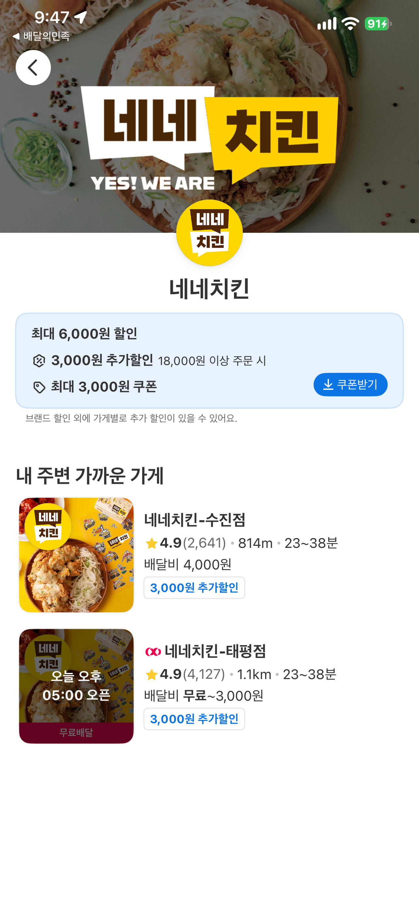
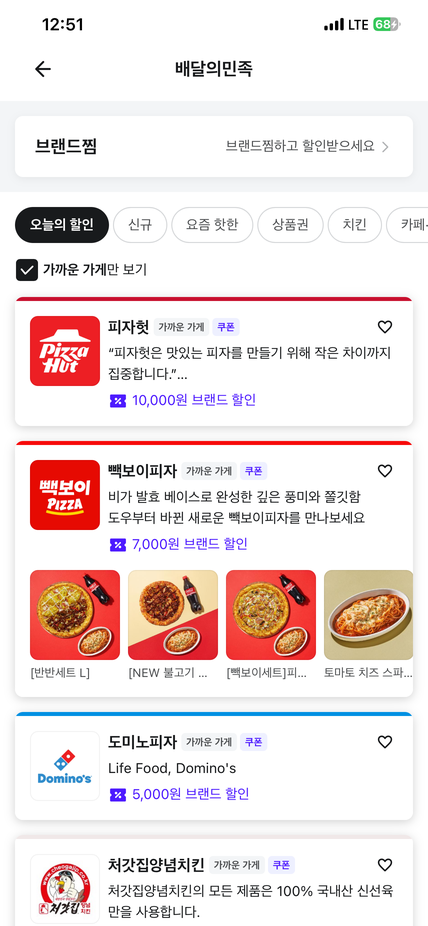

# 모바일 앱에서 필요한 데이터는 어디서 찾을까?

화면 캡처, 접근성 트리, WebView, 네트워크 응답을 상황에 따라 선택하는 방법

## 앱 화면은 보이는데, 필요한 정보는 어디에 있을까?

여러 배달 앱에 흩어진 할인 정보를 모아 비교하는 프로젝트를 진행했습니다. 브랜드별 할인액과 최소주문금액을 확인해야 했고, 웹에서 선택한 브랜드를 해당 배달 앱에서 바로 열 수 있는 링크도 필요했습니다. 다만 앱의 내부 코드나 서버 문서를 볼 수는 없어, 기기에서 실행되는 앱을 직접 살펴봐야 했습니다.

처음에는 앱 화면을 캡처해 할인 문구를 추출했습니다. 한 쿠폰 상세 화면에서 ‘4,000원 할인’, ‘16,000원 이상 주문 시 사용 가능’이라는 문구를 읽었는데, 정작 찾고 있던 것은 같은 브랜드의 7,000원 행사였습니다. 숫자는 제대로 읽었지만 다른 혜택의 조건을 가져올 뻔했습니다.

브랜드 화면을 직접 여는 링크를 찾을 때는 또 다른 문제에 부딪혔습니다. 앱 화면에서 브랜드 이름과 할인 문구는 확인할 수 있었지만, 해당 화면을 외부에서 열 수 있는 주소는 찾을 수 없었습니다. 앱이 실행되는 것과 원하는 브랜드 화면으로 이동하는 것은 다른 문제였습니다.

두 경우 모두 앱에서 데이터를 찾는 일이었지만 필요한 정보의 성격은 달랐습니다. 하나는 화면에 표시된 문구와 조건이었고, 다른 하나는 화면에 드러나지 않는 이동 정보였습니다. 어디부터 살펴볼지는 **무엇을 찾으려는지**에 따라 달라졌습니다.

## 1. 필요한 정보부터 구분하기

‘앱 데이터를 수집한다’는 말만으로는 어떤 도구를 써야 할지 결정하기 어렵습니다. 화면에 보이는 할인액을 읽으려는 것인지, 버튼의 역할을 알아보려는 것인지, 특정 화면을 여는 주소가 필요한 것인지부터 구분해 볼 수 있습니다.

| 필요한 정보 | 먼저 살펴볼 곳 | 결과를 얻은 뒤 확인할 점 |
|---|---|---|
| 할인 문구와 주문 조건 | 화면 캡처, 이미지 속 글자 추출 | 읽은 문구가 찾던 혜택의 것인가? |
| UI 요소의 텍스트와 역할 | 접근성 트리 | 화면에 있는 값이 빠지거나 나뉘지 않았는가? |
| 앱 내부의 웹 콘텐츠 | WebView와 검사 가능 여부 | 실제 주소나 문서 구조에 접근할 수 있는가? |
| 특정 화면으로 이동할 정보 | 공개·공유 링크, 필요한 경우 네트워크 응답 | 외부에서 실행해 목표 화면에 도착하는가? |

이것이 모든 앱에 적용되는 고정된 순서는 아닙니다. 화면에 필요한 문구가 이미 보인다면 네트워크를 분석할 필요가 없을 수 있습니다. 반대로 화면에 표시되지 않는 식별자가 필요하다면 캡처를 반복해도 찾기 어려울 수 있습니다.

또 하나는 **어디에서 값을 얻었는지**와 **그 값이 실제로 원하는 것인지**를 구분하는 일입니다. 할인액을 정확히 읽었더라도 다른 쿠폰의 금액일 수 있습니다. 링크를 실행했더라도 앱의 홈만 열렸다면 원하는 이동을 확인한 것은 아닙니다. 이런 차이가 어떤 방법을 쓸지뿐 아니라 무엇을 검증할지도 결정합니다.

## 2. 화면에 보이는 정보 읽기: 캡처와 OCR

화면에 글자가 보인다면 OCR(광학 문자 인식)을 사용해 볼 수 있습니다. 이미지 속 글자를 추출하는 기술로, 당시에는 화면을 캡처해 할인액과 주문 조건을 읽었습니다.

### 숫자는 맞는데, 혜택이 다를 때

앞서 언급한 4,000원 쿠폰 사례에서는 글자를 읽는 과정과 읽은 결과를 혜택에 연결하는 과정을 구분해야 했습니다.

| 확인한 대상 | 화면에서 읽은 정보 | 판단 |
|---|---|---|
| 열어 본 쿠폰 상세 | 4,000원 할인, 16,000원 이상 주문 | 해당 쿠폰의 조건으로 확인 가능 |
| 웹에서 찾던 행사 | 7,000원 행사 | 같은 혜택이라는 근거가 없음 |
| 필요한 값 | 7,000원 행사의 최소주문금액 | 위 쿠폰의 조건을 그대로 사용할 수 없음 |

OCR이 ‘16,000원’을 정확하게 읽었더라도 그것을 7,000원 행사의 최소주문금액으로 저장하면 결과는 틀립니다. 이때 OCR을 다시 실행하는 것보다 먼저 확인할 것은 **어떤 혜택의 상세 화면을 열었는가**입니다. 같은 브랜드라도 첫 주문 쿠폰, 브랜드 할인, 별도 행사처럼 조건이 다른 혜택이 있기 때문입니다.

금액 옆의 표현도 빠뜨릴 수 없습니다. ‘최대 7,000원 할인’과 ‘7,000원 할인’은 같은 의미가 아닙니다. 숫자만 저장하면 ‘최대’라는 제한이 사라집니다. 금액을 추출할 때 원래 문구를 함께 남겨두면 나중에 값이 맞지 않을 때 화면과 대조할 수 있습니다.

### 한 화면에 숫자가 여러 개라면



*그림 1. 요기요 브랜드 화면(2026-11-02). 할인액·추가할인·주문 조건·쿠폰 금액이 한 화면에 표시됩니다. 8월의 불일치 사례를 재현한 사진은 아닙니다.*

이 화면에서 확인할 점은 최대 할인액과 쿠폰 금액이 같은 혜택인지, 18,000원이 할인액이 아닌 주문 조건인지, 가게별 배달비와 할인액을 혼동하지 않았는지입니다.

위 화면에는 ‘최대 6,000원 할인’, ‘3,000원 추가할인’, ‘18,000원 이상 주문 시’, ‘최대 3,000원 쿠폰’이 함께 보입니다. 가게별 배달비도 표시되어 있습니다. 이 숫자들을 모두 읽어도 각각이 할인액인지, 주문 조건인지, 쿠폰 금액인지 구분하지 않으면 비교에 사용할 수 없습니다. 화면만 보고 할인액을 모두 더해도 된다고 판단할 수도 없습니다.

같은 정보를 다시 찾아야 한다면 원본 화면을 남겨 두고, 금액과 주변 문구를 함께 읽으며 찾던 혜택과 일치하는지 확인하겠습니다. 글자가 잘못 읽혔다면 캡처와 OCR 출력을 확인합니다. 글자는 맞는데 최종 값이 이상하다면 먼저 혜택을 잘못 연결한 것은 아닌지 살펴볼 수 있습니다.

화면의 문구만 필요하다면 여기서 충분할 수도 있습니다. 요소의 이름이나 역할을 알고 싶거나 OCR 결과를 다른 방식으로 대조하고 싶다면 접근성 정보를 확인해 볼 수 있습니다.

## 3. 화면을 이미지가 아닌 요소로 읽기

접근성 트리는 앱이 보조 기술과 자동화 도구에 제공하는 UI 요소의 정보입니다. OCR이 화면을 이미지로 읽는다면 접근성 트리에서는 텍스트, 버튼 이름, 요소의 역할 등을 확인할 수 있습니다. Android에서는 ADB(안드로이드 디버그 브리지)와 UI Automator를 사용했습니다. ADB는 컴퓨터에서 Android 기기와 통신하는 도구이고, UI Automator는 화면 요소의 정보를 확인할 때 활용할 수 있습니다.[1]

화면에 같은 문구가 표시되더라도 접근성 트리에서는 하나의 요소로 나오거나 여러 요소로 나뉠 수 있습니다. 추출한 문자열을 분석 코드에 넣으려면 출력 형식도 살펴봐야 합니다.

### iOS 접근성 출력을 기존 파서에 연결한 방법

당시 분석 코드는 Android에서 얻은 XML(확장 마크업 언어) 형식의 `node` 요소에서 `text` 속성을 읽도록 작성되어 있었습니다. XML은 태그로 데이터를 구조화하는 형식입니다. 반면 iPhone에서 얻은 접근성 정보에는 텍스트와 역할이 캡션 형태로 담겨 있었습니다. 데이터를 얻었더라도 기존 분석 코드에 바로 넣을 수는 없었습니다.

이 문제는 캡션에 포함된 역할 표시를 정리하고, 기존 코드가 읽을 수 있는 XML 형태로 변환해 해결했습니다. 다음은 당시 입력 형식의 차이를 보여주기 위해 단순화한 예시입니다.

```text
iOS 접근성 캡션: "3,000, 고정 텍스트"
변환한 입력:      <node text="3,000" />
```

변환한 데이터를 기존 파서에 넣어 한 브랜드 상세의 할인액 3,000원과 최소주문금액 16,000원을 얻었습니다. 파서를 새로 만드는 대신 입력 형식을 맞춰 재사용한 것입니다. 다만 확인한 범위는 해당 브랜드 상세 화면이었고, 다른 화면이나 반복 수집까지 검증한 것은 아닙니다.

### 트리에 없으면 화면에도 없을까?

별도로 확인한 화면에서 접근성 결과와 OCR 결과를 비교해 봤습니다.

```text
접근성: 최대 6,000원 할인
OCR:    최대 6,000원 할인

접근성: 3,000원 추가할인
OCR:    3,000원 추가할인 18,000원 이상 주문 시
```

같은 화면인데도 접근성 결과는 추가할인과 주문 조건을 나누어 보여주고, OCR은 한 줄로 읽었습니다. 접근성 출력의 일부 숫자에는 줄바꿈과 예상하지 못한 문자가 섞이기도 했습니다. 두 방법으로 같은 문구를 얻더라도 이후 처리 방법이 같다고 볼 수는 없습니다.

실험 중에는 이미지로만 표시되는 값이 있거나 접근성 트리 갱신이 늦는 경우도 있었습니다. 트리에 새 텍스트가 없다는 이유만으로 화면의 끝에 도착했다고 판단하면 스크롤 아래에 남은 정보를 놓칠 수 있습니다. **화면에 없는 값**과 **접근성 트리에서 읽지 못한 값**은 다릅니다. 실제 화면에 내용이 남아 있다면 캡처나 다른 방법으로 확인해야 합니다.

## 4. 앱 화면이 WebView라면?

앱 안에서 보이는 화면이 모두 운영체제의 기본 UI 요소로 만들어지는 것은 아닙니다. WebView는 앱 안에 웹 콘텐츠를 표시하는 구성요소입니다. Android에서 브랜드관을 살펴보던 중, 현재 화면 정보에서 WebView를 사용하는 Activity를 확인했습니다. Activity는 Android 앱에서 화면과 사용자 상호작용을 구성하는 단위입니다.

처음에는 현재 Activity를 알면 어떤 브랜드 화면이 열려 있는지도 구분할 수 있을 것이라 생각했습니다. 하지만 브랜드 목록과 상세 등 여러 웹 화면에 같은 Activity가 사용되었습니다. Activity 이름만으로는 어떤 브랜드 화면인지 알 수 없어 실제 화면의 제목과 브랜드명을 함께 확인해야 했습니다.



*그림 2. 배달의민족 브랜드관 보존 화면(2026-08-18). 화면에 브랜드명과 할인 문구는 보이지만 외부에서 화면을 여는 주소는 이 사진만으로 알 수 없습니다.*

이 화면에서는 카드에 보이는 값과 현재 화면의 이름, 외부에서 열 수 있는 주소가 서로 다른 정보라는 점을 구분할 수 있습니다.

WebView를 발견했다고 해서 URL(웹 주소)이나 DOM(문서 객체 모델)을 곧바로 읽을 수 있는 것은 아닙니다. DOM은 웹 페이지를 이루는 요소들의 구조를 말합니다. 실제로 주소와 문서 구조를 검사할 수 있는지는 앱의 설정과 검사 환경에 따라 달라집니다.[2] 당시에는 WebView용 Activity와 화면 텍스트를 확인했지만 원본 URL이나 DOM은 얻지 못했습니다.

다른 배달 앱의 브랜드 상세 화면에서는 접근성 트리에서 WebView 단서나 브랜드 식별자를 찾지 못했습니다. 공유 버튼도 보이지 않았고, 화면 경로를 추측해 실행해도 원하는 화면으로 이동하지 않았습니다. 한 앱에서 사용했던 방법을 다른 앱에도 그대로 적용할 수는 없었습니다.

따라서 웹 콘텐츠로 보이는 화면이라면 먼저 실제로 검사할 수 있는지 확인해 볼 수 있습니다. 필요한 것이 화면의 문구뿐이라면 캡처나 접근성 정보로 충분할 수 있습니다. 주소나 이동 대상처럼 화면에서 얻지 못한 정보가 필요하다면 공개된 링크부터 찾아보고, 경우에 따라 관련 네트워크 응답을 살펴볼 수 있습니다.

## 5. 화면에 보이지 않는 이동 정보 찾기

웹에서 선택한 브랜드를 앱에서 바로 열려면 어떤 정보가 필요할까요? 앱의 특정 화면으로 이동하는 링크를 딥링크라고 합니다. 앱 실행 자체가 목표는 아니었습니다. 사용자가 선택한 **바로 그 브랜드의 화면**으로 이동해야 했습니다.

먼저 공유 기능과 공개된 링크, 화면에서 확인할 수 있는 식별자를 살펴봤지만 필요한 경로를 찾지 못했습니다. 그래서 iOS 실기기에서 앱의 관련 통신을 프록시로 확인했습니다.

### 어떤 행동에서 나온 응답인지 구분하기

프록시는 앱과 서버 사이의 통신을 중계하는 프로그램입니다. 당시에는 iOS 실기기에서 mitmproxy를 이용해 관련 요청과 응답을 살펴봤습니다. 다만 HTTPS(암호화된 웹 통신)의 내용을 확인하려면 인증서 신뢰 등의 조건이 맞아야 합니다. 앱의 보안 설정에 따라 통신 내용을 읽지 못할 수도 있습니다.[3]

프록시로 통신을 확인해 보니 여러 요청과 응답이 나타났습니다. 어느 응답에 브랜드 카드의 정보가 담겨 있는지 알아보려고, 목표 화면을 열기 전과 후의 통신 내역을 비교했습니다. 요청이 보인다는 이유만으로 관련 응답이라고 판단하지 않고, 앱에서 어떤 행동을 했을 때 나타난 것인지 함께 확인했습니다.

혜택 탭의 브랜드 카드와 관련된 응답에서 이동 대상의 종류와 식별자를 확인했습니다. 화면에 보이는 브랜드 이름이나 할인 문구와 달리, 화면 이동에 사용하는 정보였습니다. 다음은 응답을 JSON(키와 값으로 데이터를 표현하는 형식)으로 단순화한 예시입니다. 실제 필드명과 값은 바꿨습니다.

```json
{
  "label": "브랜드 A",
  "destination": {
    "type": "brand",
    "id": "sample-01"
  }
}
```

이 응답으로 알 수 있었던 것은 브랜드 카드에 이동 대상 정보가 연결되어 있다는 사실입니다. 식별자를 찾았다고 해서 외부에서 실행할 링크가 완성된 것은 아니었습니다. 실제 기록에서는 내부 이동 문자열도 확인했고, 그 문자열을 외부에서 실행할 수 있는지 별도로 살펴봐야 했습니다.

### 내부 주소를 외부에서 실행해 봤을 때

앱 내부에서 사용하던 이동 주소를 외부에서 실행해 봤지만 목표 화면이 열리지 않았습니다. 다른 링크와 비교해 보니 내부에서 사용하는 스킴과 외부에서 처리하는 스킴이 달랐습니다. 스킴(scheme)은 `https:`처럼 주소 앞에서 처리 방식을 나타내는 부분입니다.

```text
응답에서 확인한 내부 이동 문자열
internal-example://brand?id=sample-01
    → 외부 실행 실패

외부에서 처리되는 스킴으로 조합한 주소
external-example://brand?id=sample-01
    → 실기기에서 목표 브랜드 화면 확인
```

위 주소는 구조를 설명하기 위해 바꾼 예시이며 실제 앱에서 실행할 수 있는 링크가 아닙니다.

외부 스킴을 사용한다고 모든 경로가 동작하는 것은 아닙니다. 앱이 처리하는 것으로 확인한 다른 링크와 비교했고, 새로 조합한 주소를 실기기에서 실행해 브랜드명과 화면 텍스트를 대조했습니다. 앱이 켜지는 데서 끝나는지, 홈으로 이동하는지, 목표 브랜드가 열리는지를 구분했습니다. 다른 브랜드에서도 일부 확인했지만 검증 시점과 표본이 달라 모든 링크가 동작한다고 일반화할 수는 없습니다.

네트워크 응답은 링크를 구성할 단서를 주었고, 실제 화면은 그 링크가 원하는 곳으로 이동하는지 확인하는 데 사용했습니다. 응답에서 값을 얻었다는 것과 외부 링크가 정상적으로 동작한다는 것은 별개의 결과였습니다.

### 프록시에 연결됐는데 응답을 읽지 못한다면

다른 Android 가상 기기 실험에서는 프록시 인증서를 설치하고 연결을 확인했지만, 목표 앱의 HTTPS 응답을 읽지 못했습니다. 통신에는 TLS(전송 계층 보안) 인증 과정에서 발생한 `certificate unknown` 오류가 남았습니다. 처음에는 인증서 피닝 때문이라고 생각했습니다. 피닝은 앱이 기대하는 인증서나 공개키 등을 추가로 검사하는 방식입니다.

하지만 남아 있는 로그만으로는 어느 검증 단계에서 연결이 거부됐는지 확정할 수 없었습니다. 이때 확인한 사실은 **프록시에는 연결됐지만 해당 앱의 응답을 읽지 못했다**는 것까지입니다. 인증서 검증을 변경하는 실험은 진행하지 않았습니다. iOS에서 응답을 읽었던 실험과는 대상 앱과 환경이 달랐으므로, 운영체제의 차이라고 결론 내릴 수도 없었습니다.

수집 환경 역시 조건에 따라 선택했습니다. 당시 사용하려던 서버에서는 Android 가상 기기를 실행하기 어려웠고, USB로 연결한 실기기에는 앱 설치와 로그인이 끝나 있었습니다. 그래서 화면 캡처 수집은 실기기에서 시작했습니다. 대신 기기를 연결해 둬야 하고 알림이 화면을 가릴 수 있으며 좌표 기반 코드는 배치에 영향을 받았습니다. 설정을 바꾸며 같은 실험을 반복해야 한다면 가상 기기가 더 편리할 수 있습니다.

## 6. 다시 찾는다면 어떤 순서로 확인할까?

지금 같은 요구를 다시 받는다면 도구 이름보다 먼저 **필요한 값과 성공 조건**을 적어 보겠습니다. 예를 들어 ‘할인 정보 수집’보다는 ‘이 브랜드 행사의 할인액과 사용 조건 확인’이 다음 행동을 고르기 쉽습니다. 딥링크라면 ‘앱 실행’이 아니라 ‘선택한 브랜드 상세 화면에 도착’을 성공 조건으로 삼을 수 있습니다.

| 이런 상황이라면 | 먼저 해 볼 일 | 확인할 점 |
|---|---|---|
| 할인 문구와 조건이 화면에 보임 | 캡처와 OCR | 정확히 읽었는가? 같은 혜택인가? |
| 요소의 텍스트나 역할이 필요함 | 접근성 트리 확인 | 빠진 값이나 형식 차이가 있는가? |
| 화면이 웹 콘텐츠로 보임 | WebView 검사 가능 여부 확인 | 주소나 DOM에 실제 접근할 수 있는가? |
| 특정 화면으로 직접 이동해야 함 | 공개·공유 링크 확인, 필요시 관련 응답 조사 | 외부에서 목표 화면이 열리는가? |
| 프록시 응답을 읽지 못함 | 연결·인증서 신뢰·환경 점검 | 관찰한 오류와 추정 원인을 구분했는가? |

다른 방법을 시도하기 전에는 지금까지 어떤 정보를 확인했고, 무엇을 아직 찾지 못했는지부터 살펴보겠습니다. 필요한 값이 화면에서 확인되고 그 출처까지 대조했다면 거기서 끝낼 수 있습니다. 반면 링크가 필요한 상황에서 화면 캡처만 반복하거나, 다른 혜택을 보고 있는데 OCR만 다시 실행하는 것은 문제를 해결하지 못합니다.

실험을 다시 한다면 앱과 기기 환경, 어떤 행동을 했는지, 원본에서 어떤 값을 봤는지, 어디까지 검증했는지도 기록하겠습니다. 추출 오류인지 데이터 연결 오류인지 구분하려면 원본 화면이 필요합니다. 링크는 앱 실행과 목표 화면 도착을 따로 기록해야 합니다. 실패의 경우에도 관찰한 현상과 원인에 대한 추측을 나눠 두는 편이 이후 실험에 도움이 됩니다.

네트워크 관찰은 본인 소유이거나 허가받은 기기와 계정에서만 진행해야 합니다. 프록시 응답에는 인증 정보나 개인정보가 포함될 수 있어 공유할 때 주의해야 합니다. 실험 후에는 프록시와 인증서 신뢰 설정을 정리하고 일반 연결이 정상인지 확인해야 합니다. 기술적으로 확인할 수 있는 정보와 공개하거나 반복 수집해도 되는 정보는 별개이므로 관련 이용 조건도 살펴봐야 합니다.

화면 캡처, 접근성 트리, WebView, 네트워크 응답은 각각 확인할 수 있는 정보가 다릅니다. 화면에 할인 문구가 있다면 우선 그 문구부터 읽어볼 수 있습니다. 화면에는 없는 이동 정보가 필요하다면 공개된 링크나 관련 네트워크 응답을 찾아볼 수 있습니다. 어떤 방법을 선택하든 마지막에는 얻은 값이 실제로 찾던 정보인지 확인해야 합니다.

## 참고 자료

[1] Android Developers, *UI Automator* — UI 요소의 텍스트와 콘텐츠 설명을 확인하는 공식 문서.

[2] WebKit, *Enabling Web Inspector* — 앱의 웹 콘텐츠를 검사할 수 있는 조건을 다루는 자료.

[3] mitmproxy, *About Certificates* — HTTPS 통신 관찰과 프록시 CA 신뢰 설정에 관한 문서.

본문의 실험은 2026년 7~8월의 작업 기록을 바탕으로 작성했습니다. 화면 캡처 시점은 각 그림에 표시했습니다. 데이터 형식과 링크 예시는 이해를 돕기 위해 단순화하거나 필드와 식별자를 변경했습니다. 실제 앱의 주소나 실행 코드를 제공하는 것은 아닙니다.
