# [주차의 민족] CI/CD EC2로 배포하기 (1)


> 프론트엔드 정적 파일을 배포하는 CI/CD 구축하기

### 들어가며

안녕하세요, 피트입니다. 오늘은 프론트에서 처음 구축해본 CI/CD를 글로 작성해보려고 합니다.

지금까지 프로젝트는 여러 번 해봤지만, 제대로 제 손으로 배포해본 경험은 Vercel과 GitHub Pages가 전부였습니다. ~~그냥 딸깍 하면 되는 거 아닌가?~~ 어차피 개발하면서 인프라나 배포는 백엔드가 하는 거 아닌가? 라는 안일한 생각도 가지고 있었습니다..

이번에 주차의 민족 팀 프로젝트를 시작하면서 프론트엔드 요구사항에 CI/CD가 존재했고, 우테코 측에서 Vercel과 같은 배포 도구 말고 AWS 크레딧을 제공하니까 AWS를 사용하라고 해서 이번에 본격적으로 공부하고 배포하는 과정을 겪게 되었습니다.


옆 집 벤지네서 vercel로 배포해도 되냐는 말에 구구의 반응..

사실 진짜 아무것도 몰랐습니다. aws가 뭔지만 알았지 뭘 해주는지, 뭘 할 수 있는지는 전혀 모르는 상태로 시작하니까 막막했습니다. 그렇지만 개발자가 코드만 쓰는 시대는 지난 것 같고, 배포 과정이 어떻게 흘러가는지 파악하고 그 구조까지 설계하는 것도 개발자의 역량이라는 생각이 들었습니다.

CI/CD가 뭔지는 개념적으로 짧게 다루고, 이후 주차의 민족에서 어떻게 테스트 및 배포를 자동화했는지를 작성해보려고 합니다.

### CI/CD란?

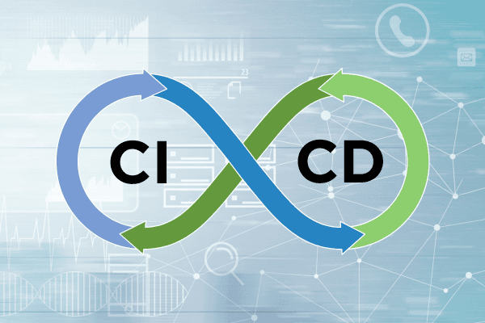

CI/CD는 소프트웨어의 **개발, 테스트, 배포 과정을 자동화**해서 빠르고 안정적으로 소프트웨어를 제공하는 프로세스를 의미합니다. CI/CD는 표현처럼 **CI**(Continuous Integration, 지속적 통합)와 **CD**(Continuous Deployment, 지속적 배포 or Continuous Delivery, 지속적 제공)로 나뉩니다.

#### CI

CI(지속적 통합)는 개발자가 **코드를 레포지토리에 자주 통합**하는 프로세스를 의미합니다. 새로운 코드가 작성되면 빌드 및 테스트가 진행되면서 코드의 변경이 기존 코드에 미치는 영향을 빠르게 확인할 수 있습니다.

CI가 없다면 개발자마다 모두 같은 방식으로 기능을 개발하는 것이 아니기 때문에 충돌이 발생할 수 있습니다. 만약 제가 코드를 변경하면서 같은 팀원인 **찰리**가 구현한 기능에 오류가 발생했다면, 수동으로 충돌을 해결하고 맞춰나가야 하는 리소스가 존재합니다. CI는 이러한 문제를 **자동으로 검증해 문제를 초기에 발견**할 수 있게 합니다.

#### CD

CD(지속적 배포)는 CI 이후에 **코드가 프로덕션(또는 개발) 환경에 자동으로 배포**될 수 있도록 하는 프로세스입니다.

CD가 없다면 개발자가 수동으로 배포해야 하는 번거로움이 생깁니다. 그래서 CI된 파일을 **자동으로 배포하고 프로덕션에 반영**해서 위 번거로움을 해결할 수 있습니다.

#### CI/CD 파이프라인

개발자가 기능을 개발하는 것부터 서비스에 배포되기까지의 CI/CD 과정이 순차적으로 진행됩니다. 이 프로세스를 CI/CD 파이프라인이라고 합니다. CI/CD를 구축하는 방법에는 차이점이 있지만, 일반적으로는 정해진 흐름으로 파이프라인을 설계합니다.

> 1. 빌드: 소스 코드 컴파일, 패키지 설치, 번들링
> 2. 테스트: 단위/E2E 테스트
> 3. 배포: 테스트가 통과된 코드를 프로덕션 환경에 배포

#### CI/CD 도구: GitHub Actions

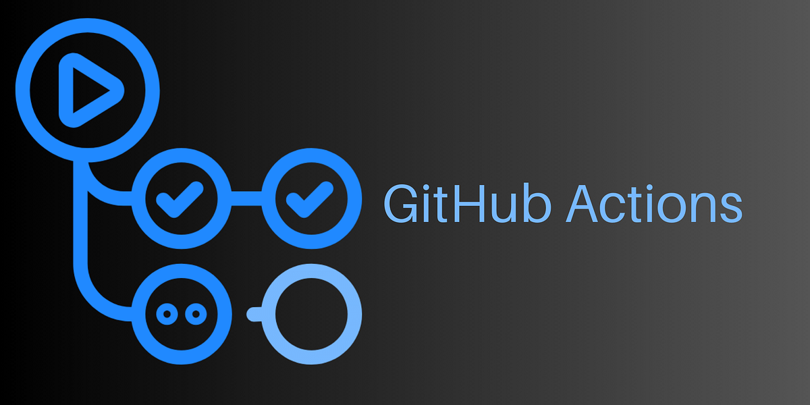

CI/CD를 구축하는 도구는 여러 가지(GitHub Actions, Jenkins, CircleCI, ...)가 있지만, 이후 설명할 **self-hosted Runner와의 연결 편의성**과 기존 협업 흐름 안에서 필요한 **워크플로우를 수월하게 구축**할 수 있다는 점을 고려해서 GitHub Actions를 선택했습니다.

### 주차의 민족 (프론트엔드) 인프라

앞서 말씀드린 것처럼 저는 CI/CD 구축이 아예 처음이었기 때문에 처음에 구축 방법을 찾고 정리하는 데 애를 먹었습니다. 그 때 어떤 방법을 선택했고, 어떤 과정으로 구축했는지 작성해보겠습니다.

#### 왜 EC2였나?

처음 인프라를 구축하는 입장에서 제가 할 수 있는 방법은 두 가지가 있었습니다.

> 1. S3 + CloudFront
> 2. EC2 + Nginx

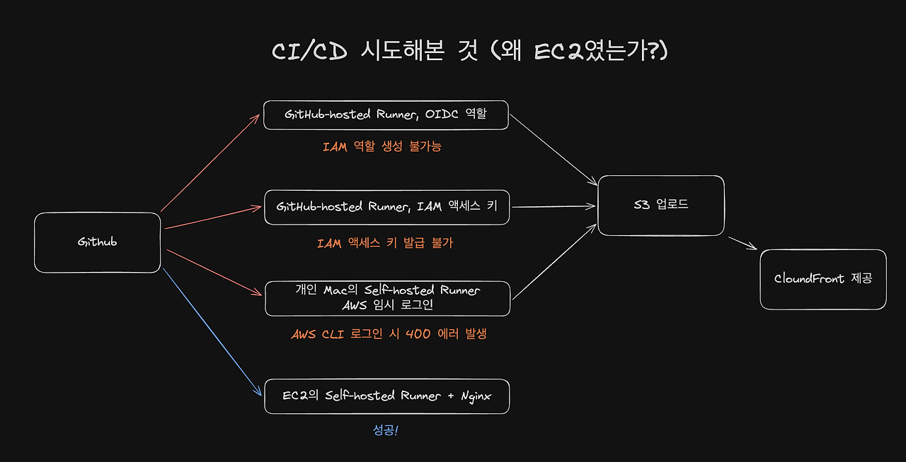

모르니까 맨땅에 헤딩하기..

첫 번째로 '프론트는 어떻게 정적 파일을 배포할까?'를 고민하면서 가장 자료가 많은 것은 S3와 CloudFront를 이용하는 것이었습니다.

이후 S3 + CloudFront에 대해 찾아보면서, CloudFront의 (파일별) **캐싱 정책이 응답 속도 개선**에 도움이 될 것 같아 해당 구조로 인프라를 구축하기로 결정했습니다.

그러나 우테코에서는 권한이 제한된 것이 많았습니다.. 위 도식화에 정리해봤는데요, 제가 시도해본 과정으로는 3가지 방법이 있었습니다.

#### **1. GitHub-hosted Runner + OIDC 역할**

1번 방법은 GitHub가 제공하는 Runner에서 AWS의 임시 자격 증명을 받아 S3에 업로드하는 구조입니다.

> **OIDC(OpenID Connect)란?**
> -> 어떤 요청이 들어오면 해당 요청이 허용된 GitHub 작업에서 왔는지 확인할 수 있게 하는 인증 방식
>
> 1. GitHub Runner에서 빌드
> 2. GitHub가 OIDC 토큰을 발급
> 3. 해당 토큰을 AWS에 제출한 후 AWS가 임시 자격 증명을 발급
> 4. Runner가 해당 임시 자격 증명을 사용해 S3에 업로드

그렇지만 해당 신뢰/권한 정책을 허용하기 위한 **IAM 역할 생성 권한이 없어 불가능**했습니다.

#### **2. GitHub-hosted Runner + IAM 액세스 키**

2번 방법은 AWS 액세스 키를 GitHub Secrets에 등록하고, Runner가 이 키를 사용해 S3에 업로드하는 구조입니다.

> **IAM 액세스 키란?**
> -> AWS API 요청을 인증할 때 사용하는 액세스 키 ID와 비밀 액세스 키 한 쌍입니다. 해당 IAM 사용자에게 부여된 권한 범위에서 AWS 작업을 수행할 수 있습니다.
>
> 1. GitHub Runner에서 빌드
> 2. GitHub Secrets에 미리 등록한 액세스 키를 Runner에 전달
> 3. Runner가 해당 키로 S3 업로드 요청에 서명
> 4. AWS가 인증 정보와 업로드 권한을 확인한 뒤 파일 저장

이 방식은 AWS 키를 GitHub Secrets에 보관하고 관리해야 합니다.

당시 계정에서는 **새 액세스 키 생성도 제한**되어 있었습니다. GitHub Secrets에 등록할 인증 정보를 확보하지 못해 이 방법도 **불가능**했습니다.

#### **3. 개인 Mac의 Self-hosted Runner + AWS 임시 로그인**

3번 방법은 개인 Mac을 GitHub Actions의 실행 환경으로 등록하고, Mac에서 AWS에 로그인해 발급받은 임시 자격 증명으로 S3에 업로드하는 구조입니다.

> **AWS 임시 로그인이란?**
> -> AWS CLI의 aws login을 실행하고 브라우저에서 인증하면, 일정 시간 사용할 수 있는 임시 자격 증명을 발급받는 방식입니다.
>
> 1. 개인 Mac에서 aws login 실행
> 2. 브라우저에서 계정을 선택하고 인증해 임시 자격 증명 발급
> 3. Mac의 Self-hosted Runner가 GitHub Actions 작업을 받아 빌드
> 4. Mac에 저장된 임시 자격 증명을 사용해 S3에 업로드

다만 위 방법도 AWS CLI에서 리전을 입력한 뒤 브라우저에서 계정을 선택하는 단계에서 **400 오류가 발생**했습니다. 회사 IP에서도 같은 오류가 반복됐습니다.. 따라서 이 방법도 **불가능**했습니다.

1~3번 방법이 모두 실패해서 결국 S3 + CloudFront 방식을 사용할 수 없다고 판단해서 다른 방식을 검토했습니다. -> EC2 + Nginx!

#### **4. EC2의 Self-hosted Runner + Nginx**

4번 방법은 빌드 결과물을 EC2 내부에 배치하고, Nginx가 사용자에게 제공하는 구조입니다. **GitHub-hosted Runner가 검사와 빌드를 맡고**, **EC2의 Self-hosted Runner가 배포를 맡도록** 나눴습니다.

두 Runner는 서로 다른 실행 환경에서 동작하므로, 빌드 결과물을 전달하기 위해 GitHub Actions의 **Artifact**를 사용했습니다. GitHub-hosted Runner가 client/dist를 Artifact로 업로드하면, EC2의 Self-hosted Runner가 이를 다운로드해 배포하도록 구성했습니다.

> **Artifact란?**
> -> GitHub Actions에서 만든 빌드 결과물 등을 보관하고 다른 job에 전달할 수 있게 하는 기능입니다. 이 구성에서는 **두 Runner 사이에서 프론트 빌드 파일을 전달**하는 데 사용했습니다.
>
> 1. GitHub-hosted Runner에서 검사와 빌드
> 2. 빌드 결과물을 GitHub Artifact에 업로드
> 3. EC2의 Self-hosted Runner가 Artifact 다운로드
> 4. EC2의 배포 디렉터리에 파일을 배치하고 current 링크 변경
> 5. Nginx가 해당 경로의 정적 파일을 사용자에게 제공

이 배포 작업은 EC2 내부의 Self-hosted Runner가 파일을 갱신하므로 **S3 업로드용 AWS 인증이 필요하지 않았습니다.**

이 방식으로 개발 서버의 자동 배포를 구축했습니다. 이후에는 프론트 변경 사항이 검사와 빌드를 거쳐 EC2에 배포되도록 구성했습니다.

### 구축 과정

이 글에서는 EC2 인스턴스 생성 과정이나 Runner 설치 등의 자세한 이야기보다는 전체적인 흐름 관점에서 작성했습니다 ㅎㅎ,,

#### 1. EC2 인스턴스 준비

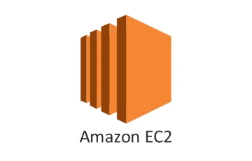

먼저 **Self-hosted Runner**와 **Nginx**를 담을 **가상의 컴퓨터(EC2 인스턴스)**가 필요합니다. EC2 인스턴스 생성 시 제가 신경써야 하는 부분은 **OS와 인스턴스 유형**이었습니다.

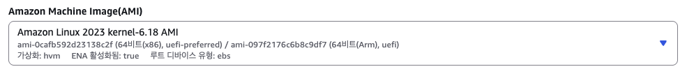

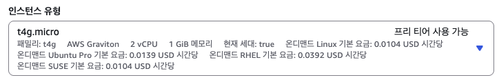

OS는 (사실 잘 몰라서 가장 대표적인) Linux를 선택했고, 인스턴스 유형은 우테코 월별 비용 제한인 50$를 고려해서 우선 **ARM 기반 t4g.micro**를 선택했습니다. 이후에 비용이 오버되면 사양을 늘릴 생각으로..

네트워크 설정의 VPC, 보안 그룹은 우테코에서 제공하는 것들로 설정했습니다.

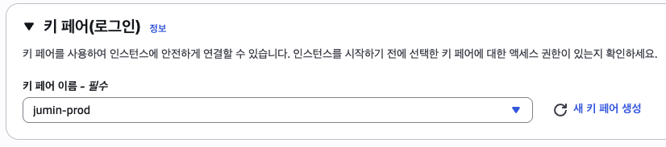

키 페어 생성

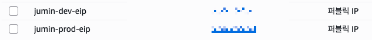

탄력적 IP 주소 할당

키 페어도 생성하고, 퍼블릭/탄력적 IP는 도메인(feat. 가비아)과 연결하면 일단 컴퓨터 한 대 마련은 끝납니다.

#### 2. Nginx 설치

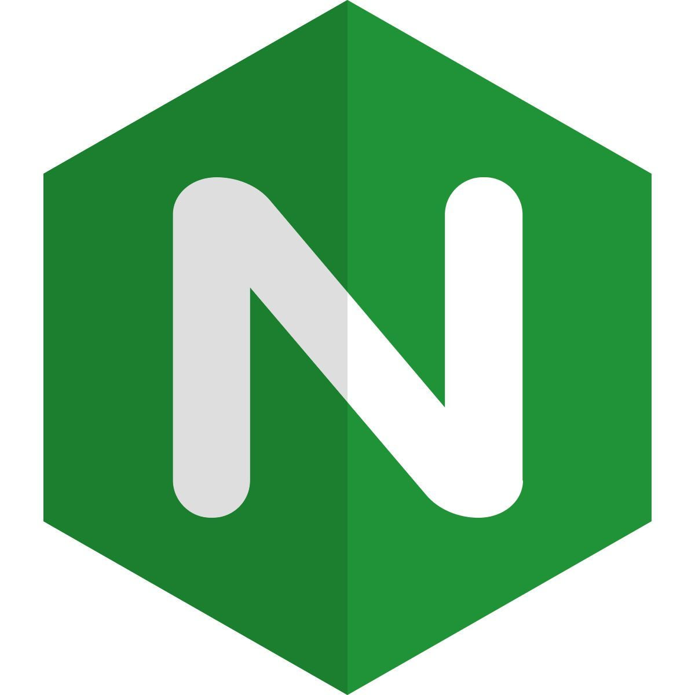

처음에 Nginx를 설치할 당시에는 백엔드가 인프라 쪽에 손을 대지 않은 상태라 ~~미천한~~ 제가 Nginx까지 구축했었는데요.. 처음에 어떻게 설치했고 나중에 백엔드 작업 후 어떻게 바뀌었는지 간단하게 정리해보겠습니다.

처음에는 EC2에 Nginx를 직접 설치했습니다. 프론트 배포 경로는 /var/www/jumin-prod(배포 환경 기준)에 두고, **배포 버전별 파일을 보관할 디렉토리**와 **제공할 버전을 가리키는 current 링크**를 두었습니다.

```
/var/www/jumin-prod/
├── releases/
│   ├── 이전-배포-버전/
│   └── 새-배포-버전/
│       ├── index.html
│       └── assets/
│           └── main.해시.js
└── current → releases/새-배포-버전
```

새 버전의 파일이 배포되면 **current 링크를 통해 새 버전의 파일을 가리키는 방식**이죠.

이렇게 디렉토리 구조를 세팅한 뒤 Nginx 설정 파일을 만져야 합니다. 프론트 정적 파일을 처리할 설정은 아래와 같습니다.

```
server {
    listen 443 ssl; # HTTPS 요청을 받음

    root /var/www/jumin-prod/current; # 기준 경로를 current 링크 위치로 설정
    index index.html; # 디렉토리 요청에서 사용할 기본 파일

    location / {
    	# 요청한 경로의 파일이나 디렉토리를 찾고, 없으면 /index.html을 준다는 의미
        # '/' 경로 뿐만 아니라 '/search'와 같이 URL을 구성해서 진입하는 경우를 처리
        try_files $uri $uri/ /index.html;
    }
    location /assets/ {
    	# /assets/ 파일이 없으면 404 반환
        try_files $uri =404;
    }
}
```

이후 백엔드 인프라 작업 이후에 **설정과 Docker Compose 파일을 저장소에서 관리**하고, 프록시 배포 워크플로가 이를 EC2에 반영하도록 바뀌었습니다.

```
저장소
infra/nginx/jumin.prod.conf
        ↓ 프록시 배포
EC2 호스트
/opt/jumin-prod/proxy/current/jumin.prod.conf
        ↓ 파일 연결
Nginx 컨테이너
/etc/nginx/conf.d/default.conf
```

그래도 여전히 프론트 빌드 파일은 동일한 위치에 있었기 때문에 /var/www/jumin-prod 디렉토리를 Nginx 컨테이너에 연결했습니다.

#### 3. GitHub Actions와 두 Runner 연결

Nginx까지 준비되었으니 이제 코드 반영 시 배포 디렉토리까지 가는 과정을 Runner로 구축해야 합니다.

CI는 GitHub-hosted Runner에서, 빌드된 파일을 EC2의 Self-hosted Runner가 받아 배포하도록 구성합니다.

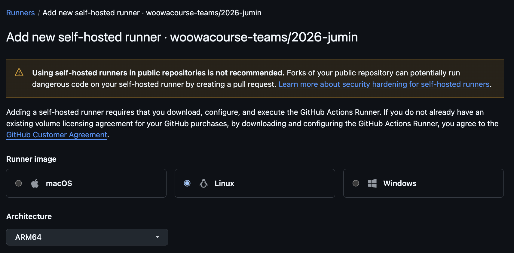

Repo > Settings > Actions > Runners > New self-hosted Runner

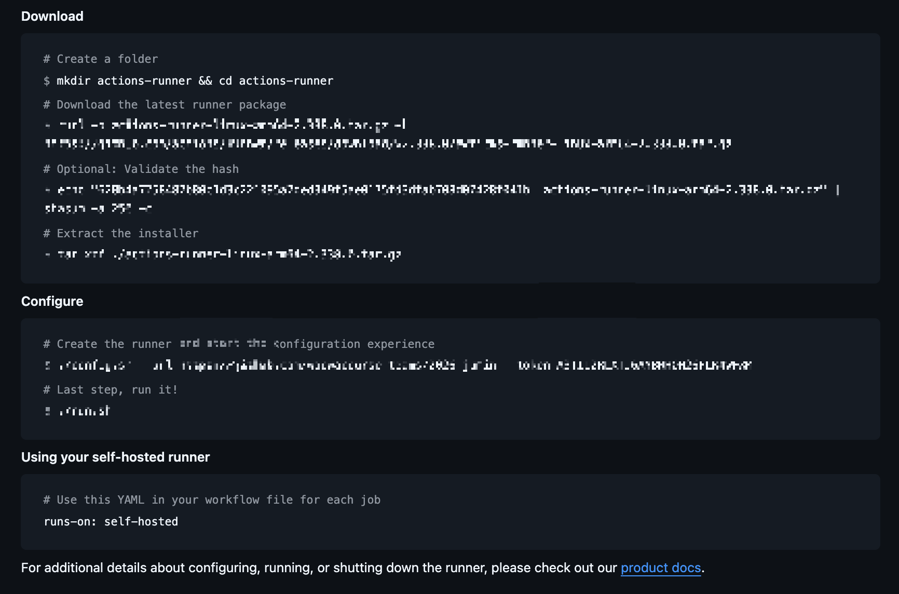

설치, 등록 명령어

OS 환경만 EC2와 맞추면 자세한 설치 명령어들은 모두 제공해주기 때문에 편하게 설치만 하면 됩니다!

설치 이후에는 workflow 파일을 구성했는데요, 개발 환경과 배포 환경이 차이가 있긴 하지만 전체적인 흐름으로 보여드리겠습니다.

```
# 배포 환경 기준 workflow

on:
  push:
    branches:
      - main
    paths:
      - "client/**"
      - ".github/workflows/front-prod-dev.yml"

  workflow_dispatch:
```

workflow 트리거는 main 브랜치에 프론트 코드나 해당 workflow 변경이 반영되면 실행하도록 설정했습니다.

```
jobs:
  build-frontend:
    runs-on: ubuntu-latest

    steps:
      # ... 체크아웃과 실행 환경 준비 단계
      # ... 체크, 빌드, artifact 업로드

  deploy:
    needs: build-frontend
    runs-on: [self-hosted, Linux, ARM64, jumin-prod]

    steps:
      - name: Download frontend artifact
        uses: actions/download-artifact@v8
        with:
          name: frontend-production
          path: ${{ runner.temp }}/jumin-prod-deploy/frontend

      # ... 다운로드한 파일을 배포
```

deploy 단계에서 위에서 설치한 Self-hosted Runner에서 실행되도록 설정합니다. CI와 CD가 서로 다른 컴퓨터에서 실행되므로 빌드 파일을 전달할 방법이 필요했는데요, 이 부분은 **Artifact를 업로드하고 다운로드하는 방식**을 사용했습니다.

```
release_id="${GITHUB_RUN_ID}-${GITHUB_RUN_ATTEMPT}"
frontend_release="/var/www/jumin-prod/releases/${release_id}"

install -d -m 2755 "${frontend_release}"

rsync -a --delete \
  "${RUNNER_TEMP}/jumin-prod-deploy/frontend/" \
  "${frontend_release}/"

test -s "${frontend_release}/index.html"

ln -sfn "${frontend_release}" /var/www/jumin-prod/current
```

이후 다운로드한 파일을 Self-hosted Runner가 배포 버전별 디렉토리를 만들어 복사하고, current 링크를 갱신하는 흐름으로 파일을 배포합니다. (저는 코드를 봐도 처음에 이해를 못해서.. 이런 흐름이다 하고 넘어가시는 걸 추천드립니다)

이제 이러면 CI/CD 구축은 끝!!!! 이제 배포가 잘 되는지 확인할 차례입니다.

#### 4. 실제 자동 배포 결과 확인

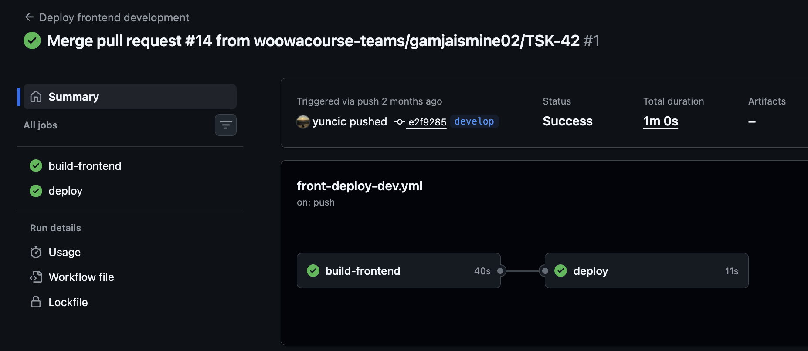

개발 환경에서의 첫 자동 배포 기록

야호! 성공적으로 자동 배포가 잘 되는 것을 볼 수 있습니다. 저희 프로젝트는 **개발/배포 환경을 분리**했으므로 같은 과정을 2번 반복해서 환경을 구축했습니다.

### 최종 흐름 정리

지금까지 구성한 CI/CD 흐름을 정리하면 다음과 같습니다.

#### CI/CD 흐름

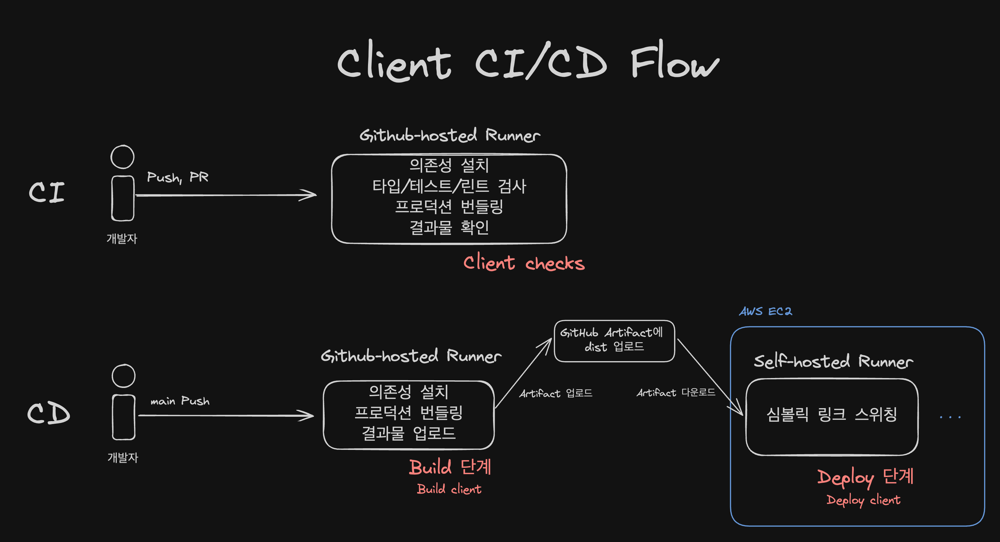

CI/CD 도식화

**CI는 코드 변경을 검증하고, CD는 빌드 결과물을 운영 서버에 반영합니다.** 공통 CI를 만들어서 개발/배포 환경에서 사용하고, CD는 환경별로 각각 구성했습니다.

CI

1. develop/main 브랜치로 **PR을 올리거나 Push되면 공통 CI가 실행**됩니다.
2. GitHub-hosted Runner가 [의존성 설치 / 프론트 검사 / 번들링 / 결과물 확인] 과정을 수행합니다.

CD

1. develop/main 브랜치에 merge되면 각 개발환경 CD가 실행됩니다.
2. GitHub-hosted Runner가 [의존성 설치 / 번들링 / 결과물 업로드] 과정을 수행합니다.
3. 업로드에 성공하면 EC2의 Self-hosted Runner가 deploy job을 실행합니다.

> deploy job: **새 Artifact 다운로드, 배포 버전 복사, current 링크 갱신, 응답 확인**

#### 트래픽 서빙 흐름

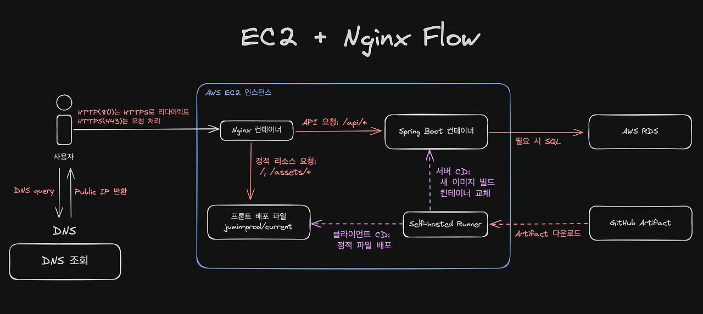

트래픽 서빙 도식화

**배포가 끝난 뒤에는 Nginx가 사용자 요청을 처리**합니다. 요청 경로에 따라 프론트 파일을 제공하거나 Spring Boot에 전달합니다.

화면과 정적 파일을 요청할 때

1. 브라우저가 캐시 또는 DNS 조회를 통해 jucha.info의 접속 주소를 확인합니다.
2. 브라우저가 HTTPS로 Nginx에 연결하고 화면을 요청합니다. HTTP로 접속한 일반 요청은 HTTPS 주소로 리다이렉트합니다.
3. Nginx가 /var/www/jumin-prod/current를 기준으로 파일을 찾습니다. /search처럼 실제 파일이 없는 화면 경로에는 **index.html을 응답**합니다.
4. 브라우저는 HTML에 연결된 JavaScript와 필요한 정적 파일을 추가로 요청합니다. Nginx는 각각의 파일 요청에 응답합니다.
5. 브라우저에서 JS가 실행되고, **React Router가 현재 주소에 해당하는 화면을 렌더링**합니다.

> /assets/\* 에는 별도 규칙이 있어서 **요청한 파일이 없으면 404를 반환**합니다.

API를 요청할 때

1. 화면에서 데이터가 필요하면 브라우저가 /api/...로 요청합니다.
2. Nginx가 /api/ 경로를 확인하고, 같은 Docker 네트워크의 **backend:8080으로 HTTP 요청을 전달**합니다.
3. Spring Boot가 요청을 처리합니다. DB 조회나 수정이 필요하면 **RDS의 PostgreSQL에 접근**합니다.
4. Spring Boot가 처리 결과를 JSON 등의 HTTP 응답으로 반환합니다.
5. Nginx가 응답을 브라우저에 HTTPS로 전달하고, 프론트는 받은 데이터를 화면에 반영합니다.

#### 쉽게 정리해보면

1. 프론트 코드가 push/merge되면?
   -> 깃허브의 러너가 CI를 진행하고, EC2의 Self-hosted Runner가 CD를 진행합니다.
   -> CD 진행 시 프론트 정적 파일을 교체해서 **Nginx를 재시작하지 않고 링크를 전환합니다.**

2. 백엔드 코드가 push/merge되면?
   -> 마찬가지로 CI/CD를 진행하고 Spring Boot 컨테이너를 통째로 교체합니다.

3. 요청이 들어오면?
   -> 들어오는 모든 요청을 **EC2 내부의 Nginx**가 받아 해당 요청이 **정적 리소스 요청인지, API 요청인지 구분해서 응답**합니다.

4. API 요청에 데이터가 필요하다면?
   -> 별도의 창고(AWS RDS)에 접근해서 데이터를 읽고 씁니다.

### 마무리

우여곡절 프론트 배포 환경 구축은 끝났네요.. 처음 구축해보는 인프라기도 하고, 흐름이 시각적으로 보이지 않아서 이해하는 데 오랜 시간이 걸린 것 같습니다. 특히 **Runner의 역할**이 대체 뭔지 파악하기 힘들었던 점이 가장 기억에 남는 것 같네요.

'Vercel이 진짜 편한 방법이었구나..' 생각도 들고, 코드를 빌드하고 사용자에게 도달하기까지의 어떤 과정들이 필요한지도 공부하면서 많이 배운 것 같습니다.

아직 모든 걸 이해하고 있지는 않은 것 같습니다. 추가로 궁금한 점들이 막 생각나네요.

> Actions 성공을 배포 성공이라고 보장할 수 있을까?
> Self-hosted Runner는 public 저장소에서 사용하는 것을 권장하지 않는데, 이러한 보안 문제는 어떻게 해결할 수 있을까?
> 이미 접속 중인 사용자가 이전의 JS 파일을 요청하면 어떻게 될까?

계속 하다 보니 이해됐던 것처럼, **코드 반영이 사용자에게 도달하는 그 핵심 과정**은 계속 하다 보면 늘 것이라고 생각합니다.

감사합니다.
