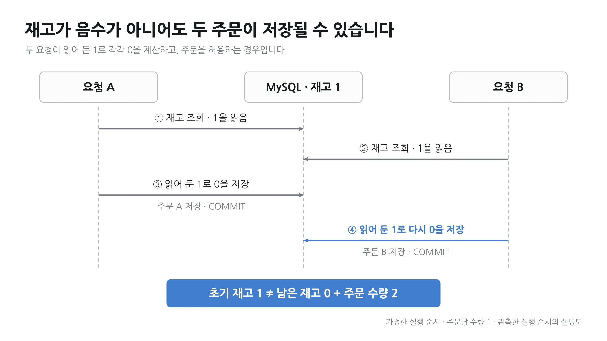
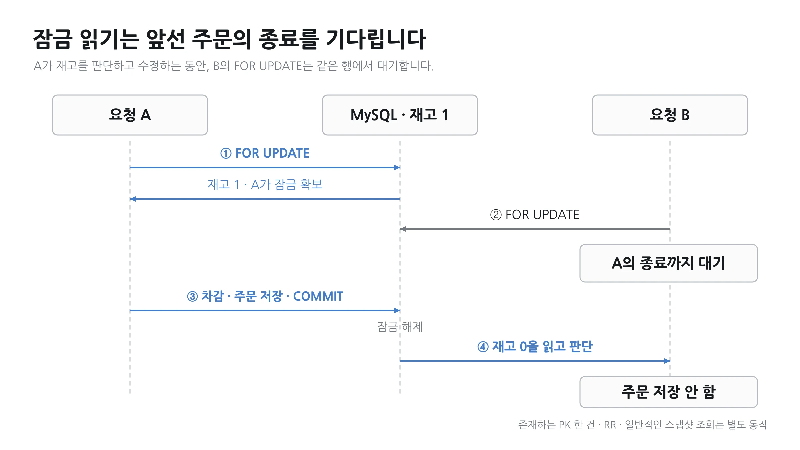
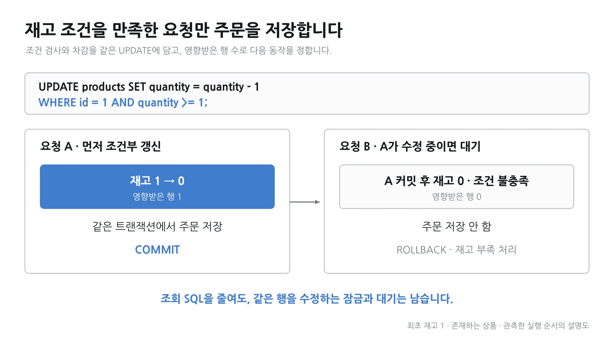
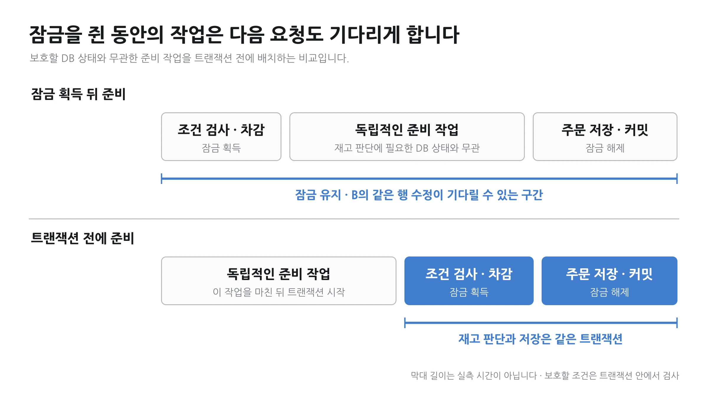
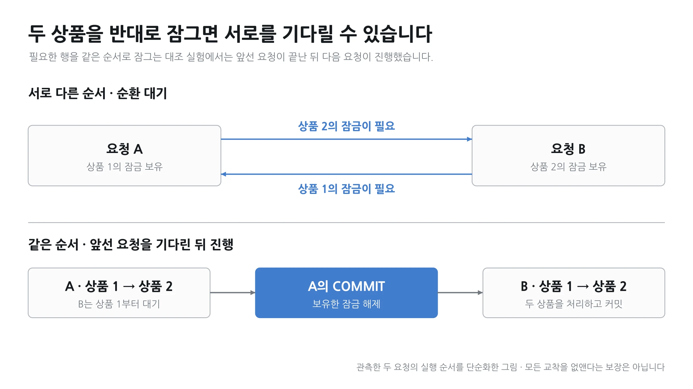

## 레벨 1

### 왜 우리는 그토록 두렵고 괴로운가

<br>

나는 좋은 환경에서 좋은 사람들과 지내는 것을 바라왔다.

그것이 내게 행복을 안겨줄 수 있을 것이라고 막연하게 생각해왔기 때문이다.

우테코는 내게 그런 곳으로 비쳤고, 실제로 겪어본 우테코는 정말 그런 곳이었다.

좋은 사람들과 뜻깊은 이야기를 나눌 수 있는 곳.
<br><br>
하지만, 그토록 바라던 우테코에서도 나의 마음이 결코 편하지만은 않았다.

우테코의 '좋은 환경'은 내게 막연한 불안감과 내 가능성에 대한 의심을 만들어냈고,

우테코의 '좋은 사람'은 내가 생각했던 나의 강점을 평범함으로 바꾸어버렸다.

내게 주어진 환경과 별개로 불안과 우울, 그리고 조바심은 어떤 이유로든 나를 갉아먹고 있다는 것을 알게 되었다.

나는 이에 대해 크루들과 많은 이야기들을 나누며 나의 심정을 고백했는데, 이후에 알게 된 것은 나뿐만 아니라 대부분의 주변 크루들도 나와 같은 고민들을 가지고 있다는 사실이었다.

그 경험은 꽤나 놀라웠는데, 이유가 다른 저마다의 고민들이 내게 너무나 의외였기 때문이다.

높은 실력으로 나를 주눅들게 만들었던 크루는 자신이 쌓아온 것을 남들이 너무나 쉽게 따라오는 것 같다는 생각에 조바심을 느끼고 있었고,

모두에게 따뜻한 모습을 보여주던 크루는 다른 크루들이 자신을 미워할까 걱정하며 불안에 떨고 있었다.

내가 바라보는 다른 사람들의 장점으로부터 그들의 고민이 시작된다는 것이 너무 기이하게 느껴져 이에 대해 깊은 고민들을 했다.

왜 우리는 남이 자신에게 내리는 평가를 그토록 두려워하고, 나의 성장을 의심하며, 그 상황 자체에 조바심을 느끼는 것일까?

왜 나는 남에 대해서 그토록 관대하고 낙관적인 와중에 나 스스로에게만 가혹할까?
<br><br>
이런 질문에 대한 답은 사람마다 모두 다를 것이지만, 나의 경우에는 그것을 인간의 본능에서 찾고자 했다.

인간이 그저 본능에 충실하는 동물이라는 것을 인정하는 것으로부터 나의 모순을 용서하고 해결책을 찾을 수 있다고 생각했다.

사람들은 객관, 직관, 명백한 사실과 같은 것들을 좋아하고, 그러한 사고를 통해 얻어지는 생각만을 믿고 따르려 한다.

하지만, 그런 객관적인 생각보다 더 깊숙한 무의식의 영역에서 인간의 이기심과 감정적인 면모가 먼저 작용하는 것 같다.

사람들은 자신의 생각이 옳다고 믿음에도 그것을 표현하는 것을 두려워하고 남의 의견이 잘못됨을 알더라도 그것을 비판하는 것을 무서워하는 것 같다.

그렇기에 인간은 타인에게 엄격한 잣대를 들이밀며 평가하는 것은 비교적 쉽다고 여기는 반면, 스스로에게 객관적인 평가를 내리는 것은 정말 어려워하는 것이 아닐까 싶다.
<br><br>
나는 주변 크루들을 진심으로 응원하고 존경한다.

모든 크루들이 자신만의 강점과 매력을 가지고 있고, 그 가능성을 믿고 진심으로 크루들을 응원한다.

다른 크루들도 나의 그런 점들을 알아보고 나를 응원해준다.

모두가 나를 믿어주고 응원해주는 상황에서 나를 사랑하지 못하는 사람은 나뿐이었다.
<br><br>
그렇다면 그 걱정과 불안으로부터 오는 자괴감은 객관일까?

결코 그렇지 않다고 생각한다.

그것은 그저 나의 본능의 부산물이라고 믿는다.

그렇다면 나는 그것에 매몰될 필요가 전혀 없다.

물론, 위와 같은 생각으로 내 근심이 사라질 리 없다.

하지만, 나의 감정이 명백한 사실을 기반으로 생겨나는 것이 아니라 그저 본능이 피워내는 막연한 연막이라는 것을 아는 것이 우울이 나를 잠식하는 것을 막는 큰 힘이 되어줌을 느낀다.
<br><br>
내가 남을 수용할 수 있는 만큼 나를 아껴줄 수 있는 사람이 되자.

<br><br>

## 레벨 2

### 나는 좋은 피드백을 주는 사람?

```
피드백
-> `어떤 행동이나 결과에 대해 의견, 평가, 반응을 전달하여 개선하거나 조치를 취할 수 있도록 돕는 상호작용 과정`
```

피드백이라는 것은 참 어렵다.


피드백의 정의에서 `개선하거나 조치를 취할 수 있도록` 이라는 말이 너무나 추상적이고, 개인마다다르게 적용되는 부분이 있다고 생각하기 때문이다.

예를 들면 이런 것이다.

나는 누군가의 습관, 행위, 생각 등에 대해 그것이 형편 없다고 솔직하게 지적할 수 있다.

이에 대해 상대방은 그것을 공격이 아니라 온전히 관찰로서 받아들일 때 자신의 모습을 돌아보고 성장할 수 있다.

하지만, 위처럼 이상적인 판단을 할 수 있는 사람은 얼마나 될까?

본인의 잘못보다 누군가가 자신을 평가하고 적대적으로 대했다는 부정적인 감정이 우선시 된다면?

피드백으로서 의미가 없을 뿐더러 관계까지 악화될 가능성이 높다.

실제로, 검프가 추천한 인간 관계론에서는 다음과 같이 말한다.

```
Criticism is futile because it puts a person on the defensive and usually makes him strive to justify himself.

비판은 대개 소용이 없다. 사람을 방어적으로 만들고, 자기 잘못을 인정하기보다 자신을 정당화하게 만들기 때문이다.
```

즉, 피드백을 받았을 때 이성적인 판단보다 감정적인 면모가 먼저 발휘되어 피드백의 의미가 쉽게 왜곡된다는 것이다. 

나는 사람들과의 관계가 악화되는 것을 고려하면서까지 나의 솔직한 마음을 전할 필요는 없다고 생각하기에, 보통의 상황에서 나의 진실된 생각보다, 상대방이 지금 가장 듣고 싶어하는 달콤한 말이 뭘까 고민하여 말해준다.

하지만, 우테코에서 여러 소프트 스킬 수업들을 듣고 책을 읽으며 결코 그것이 서로를 진정으로 성장하게 하는 방식은 아니라고 생각하게 되었다.

실제로 검프의 추천으로 읽은 인간관계론 독후감에는 이렇게 적었다.

```
개인의 옷에 튄 국물 자국은 백만 명의 사상자를 낸 기근보다 신경 쓰이는 것이며,

인간은 본래 자신의 실수에 대해 지적받았을 때, 수용하기보다 자신의 실수를 지적받았다는 사실에 분개하고,

자아비판을 열심히 하는 사람에게 매우 관대하다는 그런 말들이 흥미롭고 좋았다.

다만, 내가 우테코에서 느꼈던 것이 책에서 말하는 것과 반대인 부분이 존재한다는 것이 다른 방향으로 발상을 시도해 볼 수 있는 부분이었다.
​
단지 좋은 인간관계를 넘어 서로의 성장을 바라는 관계라면, 서로 대등함을 인정하고 부족한 점을 솔직하게 지적하며 그것에 대해 객관적으로 판단하여 서로의 부족한 점들을 보완하고, 개인의 성장을 이끌어내는 것이 옳다고 느꼈기 때문이다.
```

꿀 발린 말은 관계를 가깝게 만들고, 상대방의 일시적인 상황을 해소해준다는 점에서 충분히 이롭지만, 내가 느끼는 상대방의 근본적인 문제를 해결할 수는 없다는 점에서 장기적으로 긍정적일 수는 없다는 생각이었다.

내가 진정으로 상대방과 함께 성장하기를 바란다면 비수가 될 수 있는 말들을 전해야 한다는 것이다.

그 과정 속에서 어떤 상황에, 그리고 어떤 사람에게 어떤 방식으로 피드백을 주어야 할지 저울질하는 것이 가장 어렵게 느껴졌다.

우테코에서는 여러 도전을 했다.

그저 상대방이 지금 가장 듣고 싶은 달콤한 말이 뭘까 고민하여 좋은 말을 건네기도 했고, 상대방이 나를 미워할 수 있다는 것까지 감안하며 내 속마음을 솔직히 전한 적도 있었다.

결과적으로 대부분 내게 좋은 피드백을 주어서 고맙다고 했다.

물론, 그렇지 않았던 사람들은 내게 부정적인 말을 굳이 꺼내지 않았을 것이기에 평가하기는 어렵지만...

내가 느끼기에 아직까지 나의 저울질은 나름 성공적이었던 것 같다.

앞으로도 내 주변 사람에게 더 많은 성장을 가져다줄 수 있는 사람이 되도록 노력할 것이다.

## 레벨 3

첫 스프린트에 해야 할 일을 정리하자 이슈는 146개 안팎까지 늘어났다. 숫자를 처음 보았을 때 좋지 않은 방향으로 가고 있다는 생각이 들었다.

그런데 나는 반대하지 못했다. 무엇이 틀렸는지 설명할 수 없었기 때문이다.

팀원은 프로젝트 초반부터 아주 큰 틀을 그렸다. 필요한 기능을 나누고, 데이터를 저장할 테이블을 만들고, 우리가 해야 할 일을 이슈로 정리했다. 

나는 아직 프로젝트가 어떤 모습이어야 하는지 제대로 떠올리지 못하고 있었기에 그의 계획을 따라갔다. 그럼에도 마음 한편에는 계속 위화감이 남았다.

정말 지금부터 48개의 테이블이 필요할까. 아직 사용자가 원하는 것이 무엇인지도 확실하지 않은데, 우리가 너무 멀리 있는 문제까지 미리 풀고 있는 것은 아닐까. 하지만 그것은 어디까지나 직감이었다.

테이블이 왜 이렇게 많아서는 안 되는지, 어떤 문제가 생길지, 대신 어떻게 설계해야 하는지 말할 수 없었다. 근거 없이 반대하면 열심히 준비한 사람의 일을 기분만으로 막는 것처럼 보일 것 같았다.

결국 나는 동의했다.

이후 코치와 이야기를 나누며 설계와 기술은 사용자의 문제에서부터 설명할 수 있어야 한다는 말을 들었다.

그 기준으로 돌아보자 우리는 많은 것을 설명하지 못하고 있었다.

왜 지금 이 테이블이 필요한지, 왜 첫 스프린트에 이 일까지 해야 하는지, 이것이 어떤 사용자의 문제를 해결하는지 명확하게 답하지 못했다.

테이블이 많다는 사실 자체가 문제는 아니었다.

우리가 설명할 수 없는 결정을 너무 많이 내렸다는 것이 문제였다.

팀은 당장 검증해야 할 기능에 집중하도록 범위를 줄였다. 처음 그 구조를 보며 느꼈던 위화감이 무엇인지 그제야 조금 설명할 수 있게 되었다.

그래도 마음은 편하지 않았다. 나는 처음부터 이상하다고 느꼈다.

그렇다고 마음속에 있던 말을 그대로 꺼냈다면 문제가 해결되었을까.

아마 그렇지 않았을 것이다.

쉽사리 말을 꺼냈다면 팀원의 마음은 내가 닫혔을지도 모른다.

나는 오랫동안 솔직함을 생각한 것을 숨기지 않고 말하는 일이라고 여겼다.

하지만 생각을 그대로 쏟아내는 것과 솔직하게 말하는 것은 달랐다.

내가 확인한 사실과 혼자 만든 추측을 구분해야 했다. 상대의 마음을 평가하는 대신 내가 느끼는 불안과 아직 모르는 것을 말해야 했다.

지금 같은 상황을 다시 만난다면 이렇게 이야기하고 싶다.

> 솔직히 지금 당장 이게 틀린 이유를 말할 수는 없지만, 직감적으로 좋지 않은 부분이 있는 것 같다. 지금은 우리가 이 구조를 설명할 수 있는 부분이 거의 없다. 서로 조금 더 조사해 보고 다시 논의한 뒤 결정하자.

이 말은 상대가 틀렸다고 단정하지 않는다.

그렇다고 내 위화감을 없는 일로 만들지도 않는다.

내가 모른다는 사실까지 팀이 함께 다룰 수 있는 문제로 꺼내놓는다.

솔직함이 모든 관계를 반드시 회복시킨다고 생각하지는 않는다.

마음을 털어놓아도 이해받지 못할 수 있고, 솔직하다는 이유로 누군가를 함부로 판단해서도 안 된다.

그래도 상대의 반응을 혼자 추측한 뒤 침묵하고 싶지는 않다.

내가 아는 것과 모르는 것을 구분하고, 불안하다면 무엇이 불안한지 내 몫의 언어로 말하고 싶다.

당장 근거를 대지 못한다는 이유로 느낌을 버리는 것도, 느낌만으로 상대를 단정하는 것도 피하고 싶다.

<br><br>

## 레벨 4

### 재고 1개에 주문 2건이 들어온 이유: MySQL InnoDB 동시성 실험

재고가 하나 남은 상품에 두 주문이 들어옵니다. 주문을 받는 코드는 단순합니다. 재고를 조회하고, 하나 이상 남아 있으면 수량을 줄인 뒤 주문을 저장합니다. 재고 변경과 주문 저장은 하나의 트랜잭션으로 묶습니다.

주문 저장에 실패하면 재고도 되돌릴 수 있고, 수량이 음수가 되지 않도록 제약 조건도 걸었습니다. 이 정도면 충분해 보입니다. 그런데 첫 번째 요청이 재고를 줄이기 전에 두 번째 요청도 같은 재고를 읽는다면, 두 요청은 어떤 값을 저장하게 될까요.

실제로 두 연결이 모두 재고 1을 읽도록 순서를 맞추고, 각자 계산한 0과 주문을 저장해 봤습니다. 결과는 **재고 0, 주문 2건**이었습니다. 수량은 음수가 아니었고 두 트랜잭션도 정상적으로 커밋됐습니다. 하지만 재고 하나로 두 주문을 받은 셈입니다.



이 문제를 확인하려면 남은 수량만 봐서는 부족합니다. 재입고와 취소가 없는 이번 예시에서는 다음 관계가 유지되어야 합니다.

```text
초기 재고 = 남은 재고 + 커밋된 주문 수량의 합
```

트랜잭션도 묶었고 제약 조건도 걸었는데, 이 관계는 왜 깨졌을까요. 그리고 어디까지 손을 대야 지킬 수 있을까요. 이 글은 실제 서비스 장애 회고가 아니라, 이 질문에 답하기 위해 두 요청의 순서를 직접 만들어 본 실험입니다.

#### 1. 함께 저장하는 것만으로는 부족

실험은 MySQL 8.4.13의 InnoDB에서 진행했습니다. 먼저 한 상품의 재고를 다루고, 마지막 절에서 두 상품 주문으로 범위를 넓힙니다. 오래된 값으로 주문을 허용하는 상황에서 시작해, 읽는 값과 잠금을 구분하고, 대기 시간과 교착 상태까지 차례로 살펴봅니다.

첫 실험에서는 서로 다른 DB 연결 A와 B가 트랜잭션을 시작한 뒤 재고 1을 읽었습니다. 두 연결이 모두 읽기를 마친 다음 A를 먼저 커밋하고 B를 진행했습니다. 여러 요청을 무작정 보내는 대신, 어떤 순서가 문제를 만드는지 드러내기 위한 구성입니다.

핵심은 차감 SQL에 있습니다. 처음 구현은 읽은 값을 애플리케이션 쪽에 보관한 뒤, 그 값에서 1을 뺀 결과를 DB에 보냈습니다. 실험에서는 연결별 사용자 변수로 같은 동작을 만들었습니다.

```sql
-- A와 B가 각각 실행해 모두 1을 읽습니다.
BEGIN;
SELECT quantity INTO @stock FROM products WHERE id = 1;

-- A가 아래 내용을 먼저 끝내고, 그다음 B가 진행합니다.
UPDATE products SET quantity = @stock - 1 WHERE id = 1;
-- 각 요청은 서로 다른 주문 ID로 주문을 저장합니다.
COMMIT;
```

B의 UPDATE가 실행될 때 실제 재고는 이미 0입니다. 하지만 `@stock`에는 처음 읽은 1이 남아 있습니다. B는 DB의 현재 수량에서 1을 빼는 대신, 이전 값으로 계산한 0을 다시 저장합니다. 이때 변경된 행 수는 0이었지만, 실패 구현은 이를 검사하지 않고 주문을 저장했습니다.

| 격리 수준 | A/B가 읽은 값 | 최종 재고 | 주문 수량 합 |
| --- | --- | --- | --- |
| REPEATABLE READ | 1 / 1 | 0 | 2 |
| READ COMMITTED | 1 / 1 | 0 | 2 |

쓰기 자체에도 잠금이 사용됩니다. 그렇다고 B가 앞서 내린 주문 허용 판단까지 자동으로 다시 수행되는 것은 아닙니다. 이번에는 두 UPDATE를 겹쳐 실행할 필요도 없었습니다. 두 요청의 읽기가 첫 수정보다 먼저 끝나는 순서만으로 문제가 생겼습니다.

그렇다고 트랜잭션이 필요 없어진 것은 아닙니다. 별도 실험에서 재고 차감 직후 ROLLBACK을 실행하자, A에게 0으로 보이던 재고가 다른 연결에서는 다시 1로 확인됐습니다. 트랜잭션은 함께 저장하거나 함께 취소할 변경의 범위를 정합니다. 여기에 **경쟁하는 요청이 어떤 값을 근거로 판단할지**도 정해야 했습니다. [COMMIT과 ROLLBACK](https://dev.mysql.com/doc/refman/8.4/en/innodb-autocommit-commit-rollback.html)

READ COMMITTED로 바꾼 실험도 결과는 같았습니다. B가 이미 보관한 값을 다시 사용하기 때문입니다. 그러면 수정 전에 재고를 다시 조회하면 충분할까요. 먼저 InnoDB에서 다시 읽는다는 것이 무엇을 의미하는지 확인할 필요가 있습니다.

#### 2. 다시 읽는다고 항상 새로운 재고가 보이지 않는다

A가 재고 1을 읽은 뒤, B가 재고를 0으로 바꾸고 커밋하도록 했습니다. 그다음 A가 일반 SELECT를 한 번 더 실행했습니다. 기본 격리 수준인 REPEATABLE READ에서는 여전히 1이 보였습니다. 같은 연결에서 `FOR UPDATE`를 붙이자 이번에는 0이 나왔습니다.

| A의 격리 수준 | 최초 일반 조회 | B 커밋 후 일반 조회 | B 커밋 후 잠금 조회 |
| --- | --- | --- | --- |
| REPEATABLE READ | 1 | 1 | 0 |
| READ COMMITTED | 1 | 0 | 0 |

이 차이를 이해하려면 ‘현재 저장된 값’과 ‘이번 읽기에 보이는 값’을 구분해야 합니다. InnoDB는 변경 이전의 행을 재구성할 수 있도록 undo 정보를 보관합니다. 읽기 시점의 가시성 규칙에 맞는 버전을 제공하는 방식이 MVCC, 즉 다중 버전 동시성 제어입니다. 트랜잭션마다 DB 전체를 복사해 두는 것은 아닙니다. [InnoDB Multi-Versioning](https://dev.mysql.com/doc/refman/8.4/en/innodb-multi-versioning.html)

REPEATABLE READ의 일반적인 일관 읽기는 첫 번째 일관 읽기가 정한 스냅샷을 이어서 사용합니다. A가 읽기를 시작한 뒤 B가 커밋했으므로, 두 번째 일반 조회에도 이전 재고 1이 보입니다. READ COMMITTED에서는 문장마다 새로운 스냅샷을 사용해 두 번째 조회에서 0이 보였습니다. 이 실험에서 A 자신은 데이터를 수정하지 않았습니다. [Consistent Nonlocking Reads](https://dev.mysql.com/doc/refman/8.4/en/innodb-consistent-read.html)

같은 트랜잭션에서 일관된 값을 읽을 수 있다는 것은 유용합니다. 여러 번 조회하는 동안 다른 요청의 수정이 계속 섞이면, 하나의 기준으로 데이터를 해석하기 어려울 수 있기 때문입니다. 다만 **내가 읽은 재고가 보인다는 사실이 그 재고를 내 주문에 예약했다는 뜻은 아닙니다.** 다른 요청도 그 상품을 수정할 수 있습니다.

잠금 읽기는 용도가 다릅니다. 이번 실험에서는 B가 이미 커밋한 뒤였으므로 `FOR UPDATE`가 재고 0을 읽었습니다. 주문을 위해 수정할 행을 읽고 보호하는 동작을, 이전 스냅샷을 반복해서 읽는 동작과 같은 것으로 보면 이 결과를 설명하기 어렵습니다.

READ COMMITTED에서 새 값이 보였다는 이유만으로 조회와 수정 사이의 틈이 사라지는 것도 아닙니다. 조회가 끝난 다음 다른 요청이 재고를 가져갈 수 있습니다. 필요한 것은 조회 횟수를 늘리는 데서 한 걸음 더 나아가, **재고를 확인하고 주문을 허용하는 구간에 다른 수정이 끼어드는 것을 다루는 방법**입니다.

#### 3. 재고를 판단하는 동안 다음 수정을 대기

앞선 문제는 두 요청이 같은 재고 1을 읽고, 각자 주문을 받아도 된다고 판단했다는 데 있습니다. 따라서 먼저 재고를 확인한 요청이 주문을 저장할 때까지, 같은 상품을 수정하려는 다른 요청이 그 사이에 끼어들지 못하게 해야 합니다.

`FOR UPDATE`는 수정할 행을 읽으면서 잠금을 획득합니다. A가 잠금을 유지하면 B의 잠금 읽기는 기다리므로, B는 A의 처리가 끝난 뒤 재고를 확인하게 됩니다. 실험에서도 A가 재고 1을 읽고 트랜잭션을 유지하자, 같은 상품을 읽으려는 B의 `FOR UPDATE`가 바로 반환되지 않았습니다.



응답이 늦다는 사실만으로 잠금 대기라고 판단하지는 않았습니다. 관찰용 연결 C에서 `performance_schema.data_locks`와 `data_lock_waits`를 조회했습니다. 상품의 PRIMARY 인덱스 키 1에 대해 A는 `X,REC_NOT_GAP` 잠금을 획득했고, B는 같은 모드의 잠금을 기다리고 있었습니다.

| 요청 | 대상 | 상태 |
| --- | --- | --- |
| A | 상품 1의 PRIMARY 레코드 | GRANTED |
| B | 상품 1의 PRIMARY 레코드 | WAITING |

A가 재고를 차감하고 주문을 저장한 뒤 커밋하자 B의 조회가 끝났습니다. B가 읽은 값은 0이어서 주문을 저장하지 않았습니다. 최종 재고는 0이었고 주문은 1건이었습니다. **읽기 시점부터 판단에 필요한 행을 보호한 것**이 첫 구현과의 차이입니다.

A가 조회 결과를 받았다고 잠금이 풀리지는 않습니다. 재고를 읽은 뒤 주문을 저장하기까지 보호하려면, 그 사이에도 잠금이 유지되어야 하기 때문입니다. 이번 명시적 트랜잭션에서 획득한 잠금은 COMMIT이나 ROLLBACK까지 유지됩니다. [Locking Reads](https://dev.mysql.com/doc/refman/8.4/en/innodb-locking-reads.html)

반면 C의 일반 SELECT는 A가 끝나기를 기다리지 않고 재고 1을 반환했습니다. C는 수정할 행의 잠금을 얻으려는 것이 아니라, MVCC를 통해 자신에게 보이는 커밋된 버전을 읽기 때문입니다. 앞 절의 스냅샷 읽기가 여기서도 동작한 셈입니다.

여기서 확인한 것은 이미 존재하는 기본 키 한 건입니다. 유일 키를 정확히 찾을 때의 레코드 잠금과 달리, 범위를 탐색하는 쿼리에는 빈 구간의 삽입을 제한하는 갭 잠금이나 레코드와 앞 구간을 함께 보호하는 넥스트키 잠금이 관여할 수 있습니다. 잠금 범위를 판단할 때는 결과 행 수뿐 아니라 인덱스와 실제 접근 경로도 살펴봐야 합니다. [SQL별 잠금 범위](https://dev.mysql.com/doc/refman/8.4/en/innodb-locks-set.html)

#### 4. 확인과 차감을 한 문장에

이번 주문의 판단은 단순합니다. 재고가 하나 이상이면 하나 줄이면 됩니다. 그렇다면 애플리케이션이 값을 읽고 비교하는 대신, 그 조건을 수정 SQL에 넣을 수 있습니다.

```sql
UPDATE products
SET quantity = quantity - 1
WHERE id = 1 AND quantity >= 1;
```



A의 UPDATE는 1행을 변경했습니다. 아직 커밋하지 않은 상태에서 B도 실행하자, 이번에는 B의 UPDATE가 기다렸습니다. A가 주문까지 저장하고 커밋한 뒤 B가 반환한 값은 0행이었습니다. 재고가 0이 되어 `quantity >= 1` 조건을 만족하지 않기 때문입니다.

이렇게 조건을 수정 SQL에 넣는 방식을 이 글에서는 조건부 UPDATE라고 부르겠습니다. **영향받은 행 수가 1일 때만 주문을 저장**하면, 오래된 조회값으로 주문을 허용하지 않아도 됩니다. 이 실험에서 상품은 이미 존재합니다. 그 전제가 없다면 0행에는 재고 부족뿐 아니라 상품이 없다는 의미도 포함됩니다.

조회 SQL이 줄었지만 잠금은 남았습니다. 두 요청의 UPDATE도 같은 행을 수정하므로 충돌할 수 있습니다. 조건부 UPDATE를 ‘잠금을 쓰지 않는 방법’이라고 설명하면 실제 관측과 맞지 않습니다. 바뀐 것은 주문을 허용하는 근거를 조회값에서 갱신 성공 여부로 옮겼다는 점입니다.

재고 차감과 주문 저장은 여전히 같은 트랜잭션이어야 합니다. UPDATE가 성공한 뒤 주문 저장이 실패했는데 재고만 남으면 다른 불일치가 생깁니다. 차감 뒤 ROLLBACK을 실행했을 때 재고는 1로, 주문 수는 0으로 돌아오는 것까지 확인한 이유입니다.

두 요청의 순서를 통제한 실험에 이어, 재고 100개에 주문 1,000건을 동시 작업자 16개로 보냈습니다. 두 방식 모두 3회씩 **성공 100건, 재고 부족 900건, DB 오류 0건**을 기록했습니다. 매번 최종 재고는 0이었고 주문과 재고의 관계도 맞았습니다. 이제는 두 방식이 이 조건에서 안전하게 동작한다는 근거를 갖고, 처리 비용을 비교할 수 있습니다.

#### 5. 같은 상품에 요청이 몰리면 두 방식 모두 대기

조건부 UPDATE는 재고 조회 한 번을 줄입니다. 그렇다면 동시에 주문을 보내는 작업자를 늘렸을 때도 처리량이 그만큼 늘어날까요? 같은 상품을 수정하는 요청은 여전히 앞선 트랜잭션을 기다릴 수 있으므로, SQL 수를 줄인 효과와 한 행에 요청이 몰리는 문제를 함께 살펴봐야 합니다.

그래서 한 상품에 요청을 집중한 경우와 100개 상품에 고르게 나눈 경우를 비교했습니다. 같은 행을 두고 경쟁하는 상황과 서로 다른 행을 수정할 수 있는 상황을 나누기 위해서입니다. 동시 작업자는 1개와 16개로 바꾸되, 두 구현의 주문 저장 방식과 트랜잭션 경계는 같게 유지했습니다.

비교할 지표는 초당 성공한 주문 수와 요청 지연 p95입니다. **p95는 측정한 요청의 95%가 그 시간 이내에 끝났다는 뜻**입니다. 처리량이 늘어도 일부 요청이 오래 기다릴 수 있으므로 두 값을 함께 봅니다. 아래 표에는 각각 3회 측정값의 중앙값을 적었습니다. p95 역시 실행별 p95의 중앙값이며, 모든 실행의 요청을 합쳐 계산한 값은 아닙니다.

**초당 성공한 주문 수: 높을수록 같은 시간에 더 많은 주문을 처리합니다.**

| 상품 수 | 동시 작업자 | FOR UPDATE (건/s) | 조건부 UPDATE (건/s) |
| --- | --- | --- | --- |
| 1 | 1 | 363.8 | 442.6 |
| 1 | 16 | 449.9 | 543.3 |
| 100 | 1 | 362.6 | 424.5 |
| 100 | 16 | 1,727.4 | 2,158.8 |

**요청 지연 p95: 낮을수록 요청이 더 짧은 시간 안에 끝납니다.**

| 상품 수 | 동시 작업자 | FOR UPDATE (ms) | 조건부 UPDATE (ms) |
| --- | --- | --- | --- |
| 1 | 1 | 4.36 | 3.63 |
| 1 | 16 | 43.73 | 36.73 |
| 100 | 1 | 4.29 | 3.83 |
| 100 | 16 | 12.01 | 9.52 |

재고 부족으로 빨리 끝나는 요청이 처리량에 섞이지 않도록 상품마다 재고를 충분히 두었습니다. 각 조건은 500건 워밍업 후 초기화해 2,000건을 측정했고, 두 구현의 실행 순서를 번갈아 3회 반복했습니다. 지연은 BEGIN 직전부터 COMMIT까지로, 연결 생성과 커넥션 풀, HTTP 대기는 제외했습니다. 측정 24회의 요청 48,000건이 모두 커밋됐으며 DB 오류와 재고 불일치는 없었습니다.

이 환경에서는 조건부 UPDATE의 처리량이 더 높고 요청 지연도 낮았습니다. 그러나 두 방식 모두 한 상품에 16개 작업자를 보냈을 때는 대기가 길어졌습니다. 조건부 UPDATE도 작업자 1개에서 약 443건/s, 16개에서 약 543건/s였고, p95는 3.63ms에서 36.73ms로 늘었습니다.

같은 16개 작업자가 100개 상품을 나눠 처리하면 조건부 UPDATE는 약 2,159건/s, FOR UPDATE 방식은 약 1,727건/s였습니다. 여러 상품으로 나누어도 클라이언트와 서버 비용은 남지만, 같은 행의 수정을 기다리는 집중 경합을 줄일 수 있다는 관측과 맞습니다.

조건부 UPDATE는 성공 경로에서 재고 조회 한 번을 줄입니다. 이번 구현에서는 BEGIN과 COMMIT을 포함해 FOR UPDATE 방식은 왕복 5회, 조건부 UPDATE는 4회입니다. 이 차이가 비용에 영향을 줄 수 있지만, 측정만으로 SQL 왕복과 서버 실행, 잠금 대기의 기여도를 각각 분리했다고 말할 수는 없습니다.

또한 이 수치는 M1 Pro 위의 Docker, CPU 2개와 메모리 2GiB 제한, Python 클라이언트라는 조건에서 얻었습니다. 각 작업자는 응답을 받은 뒤 다음 요청을 보내는 방식입니다. 실제 서비스의 도착률, 네트워크 지연, 다른 쿼리까지 포함한 최대 처리량으로 옮겨 쓸 수 없습니다. 여기서 얻을 수 있는 판단은, **조회 한 번을 줄여도 한 상품에 집중되는 수정 경합은 별도로 살펴봐야 한다**는 것입니다.

#### 6. 잠금 종류보다 오래 쥐고 있는 일이 원인

한 상품에 요청이 몰리는 상황을 피하기 어렵다면, 다음으로 줄일 수 있는 것은 각 요청이 잠금을 보유하는 시간입니다. 조건부 UPDATE가 빨리 끝나더라도 잠금은 COMMIT까지 유지됩니다. 따라서 차감 뒤에 DB와 무관한 준비 작업을 오래 수행하면, 다음 요청도 그 준비가 끝나기를 기다려야 합니다.

그 준비를 BEGIN 앞으로 옮기면 여러 요청이 준비 작업을 겹쳐 수행할 수 있습니다. 재고를 확인하고 주문을 저장하는 구간만 잠금으로 보호하는 것입니다.



이 차이를 확인하기 위해 DB 상태와 무관한 준비 작업을 20ms의 대기로 대신했습니다. 같은 작업을 UPDATE 이후에 두는 경우와 BEGIN 이전에 두는 경우를 비교한 것입니다. 나머지 조건은 한 상품에 작업자 16개로 요청 200건을 보내고 조건부 UPDATE를 사용하는 것으로 맞췄습니다. 두 경우 모두 3회 실행했습니다. 20ms는 실제 외부 API의 응답 시간이 아니라, 잠금을 오래 보유하는 영향을 드러내기 위해 정한 실험 입력입니다.

| 준비 작업 위치 | 성공 처리량 (건/s) | 요청 지연 p95 (ms) |
| --- | --- | --- |
| UPDATE 이후 | 28.6 | 584.28 |
| BEGIN 이전 | 455.0 | 42.07 |

준비를 밖으로 옮겼다는 이유로 그 시간이 측정에서 빠지면 비교가 공정하지 않습니다. 그래서 이번에는 두 경우 모두 **준비 시작부터 COMMIT까지**를 측정했습니다. 앞 절의 BEGIN부터 COMMIT까지와 측정 경계가 다른 이유입니다. 표는 3회 처리량과 실행별 p95의 중앙값이며, 모든 실행에서 200건이 성공하고 재고와 주문 수량의 관계도 유지됐습니다.

트랜잭션 안에서는 준비 작업도 상품 잠금을 보유한 시간에 포함됩니다. 다음 요청은 그 작업이 DB를 쓰지 않더라도 기다려야 합니다. 트랜잭션 밖에서는 준비를 겹쳐 진행할 수 있고, 준비를 마친 요청들이 짧은 재고 처리 구간에서 경쟁합니다.

그렇다고 모든 검사를 밖으로 옮기면 되는 것은 아닙니다. 준비 작업이 읽은 DB 상태에 의존한다면, 기다리는 사이 그 상태가 바뀔 수 있습니다. 여기서는 그런 의존성이 없는 작업만 이동했고 **재고 조건 검사와 주문 저장은 같은 트랜잭션에 남겼습니다.** 외부 결제까지 다룬 실험도 아니므로 결제의 중복 실행이나 보상 문제를 이 결과로 해결했다고 볼 수는 없습니다.

#### 7. 상품이 두 개가 되면 잠금 순서도 중요

지금까지는 하나의 상품을 두 요청이 기다리는 형태였습니다. 주문에 상품이 두 개 들어가면 상황이 달라집니다. A가 상품 1을 잠그고 상품 2를 기다리는 동안, B가 상품 2를 잠그고 상품 1을 기다릴 수 있습니다. 어느 쪽도 필요한 다음 잠금을 얻지 못하는 순환 대기입니다.



두 연결로 이 순서를 만들자 MySQL은 한 트랜잭션에 **오류 1213**을 반환하고 다른 쪽을 진행시켰습니다. 어느 요청이 희생자가 될지 정해 놓고 테스트하지 않았습니다. `SHOW ENGINE INNODB STATUS`에도 해당 교착이 기록됐습니다.

반대로 두 요청이 모두 상품 1을 잠근 다음 상품 2를 잠그도록 바꾸면, B는 첫 상품부터 기다립니다. A는 두 상품을 확보해 끝낼 수 있고 그 뒤 B가 진행합니다. 이 대조에서는 두 트랜잭션이 모두 커밋됐습니다. 특정 순환을 없앤 결과이며, 모든 테이블과 인덱스에서 교착이 사라진다는 보장은 아닙니다. [교착을 줄이는 접근 순서](https://dev.mysql.com/doc/refman/8.4/en/innodb-deadlocks-handling.html)

접근 순서를 맞추더라도 교착 오류를 받은 요청이 무엇을 다시 수행해야 하는지는 정해야 합니다. 두 번째 상품을 처리하다 실패했을 때, 첫 번째 상품의 차감과 주문 저장이 남아 있는지에 따라 재시도 범위가 달라지기 때문입니다.

InnoDB는 교착의 희생자로 선택한 트랜잭션을 **전체 롤백**합니다. 따라서 실패한 SQL 하나만 다시 실행하면, 함께 취소된 첫 번째 상품의 처리가 빠집니다. 재고 확인부터 주문 저장까지 새 트랜잭션에서 다시 수행해야 합니다. [오류별 롤백 범위](https://dev.mysql.com/doc/refman/8.4/en/innodb-error-handling.html)

실험에서는 각 상품의 재고를 2로 두고, A/B가 자신의 첫 상품을 차감하고 주문 행까지 저장한 뒤 교착하도록 만들었습니다. 희생 요청이 먼저 저장한 주문 행도 사라졌고, 살아남은 요청이 커밋한 뒤에는 두 상품의 재고가 각각 1이었습니다. 실패한 요청의 전체 처리를 새 트랜잭션에서 다시 실행하자, 두 상품 모두 재고는 0, 주문 수량의 합은 2가 되어 처음 정한 관계를 지켰습니다.

이번 재시도는 외부 부수 효과 없이 한 번 수행했습니다. 실제 코드에서는 다시 충돌할 가능성도 고려해 재시도 횟수를 제한해야 합니다. 시도 사이의 대기도 새 트랜잭션을 시작하기 전에 두면, 재고를 처리하는 구간에 불필요한 대기를 넣지 않을 수 있습니다.

#### 8. 이 재고 처리에서는 조건부 UPDATE를 먼저 선택

처음에는 재고가 음수가 되지 않고, 재고 변경과 주문 저장이 함께 커밋되면 충분하다고 생각하기 쉽습니다. 하지만 두 요청이 같은 1을 읽는 순서를 만들자, 최종 수량이 0이어도 주문은 두 건일 수 있었습니다. 확인해야 할 것은 숫자 하나보다 **그 숫자를 근거로 주문을 허용하는 과정**이었습니다.

이번처럼 한 행의 수량을 조건에 맞춰 차감하는 작업에는 조건부 UPDATE가 잘 맞습니다. 조건을 SQL에 표현할 수 있고, 영향받은 행 수로 주문 저장 여부를 분명하게 나눌 수 있기 때문입니다. 실험에서도 재고와 주문 수량의 관계를 같게 유지하면서 조회 한 번을 줄였습니다.

반면 읽은 여러 값을 바탕으로 후속 결정을 내려야 한다면 `FOR UPDATE`로 필요한 데이터를 보호하는 방식을 검토할 수 있습니다. 어느 쪽을 택하든 잠금 범위와 보유 시간은 남는 문제입니다. 여러 행을 다룰 때는 접근 순서와 전체 트랜잭션 재시도까지 함께 설계해야 합니다.

| 작업의 조건 | 먼저 검토할 방법 | 함께 확인할 것 |
| --- | --- | --- |
| 한 행의 재고를 조건에 맞춰 차감 | 조건부 UPDATE | 갱신 행 수, 주문과 같은 트랜잭션 |
| 읽은 값을 보호하며 후속 판단 | FOR UPDATE | 잠금 범위, 보유 시간 |
| 여러 상품을 한 주문으로 처리 | 일관된 접근 순서와 실패 처리 | 전체 롤백, 제한된 재시도 |

이 글의 결론을 ‘조건부 UPDATE가 언제나 빠르다’로 가져가지는 않으려 합니다. 더 오래 남길 것은 동시성 문제를 만났을 때 먼저 던질 세 가지 질문입니다.

1. **어떤 값을 보고 판단하는가.** 조회한 시점의 값인지, 수정하는 시점의 값인지 구분합니다.
2. **그 판단을 어디까지 보호하는가.** 읽기부터 저장까지 다른 수정이 끼어들 수 없는 구간을 정합니다.
3. **실패하면 무엇을 다시 수행하는가.** 롤백되는 범위를 확인하고 재시도 단위를 맞춥니다.

이 세 가지에 먼저 답하면, 잠금 문법과 트랜잭션 경계도 해당 업무에 맞춰 선택할 수 있습니다.
