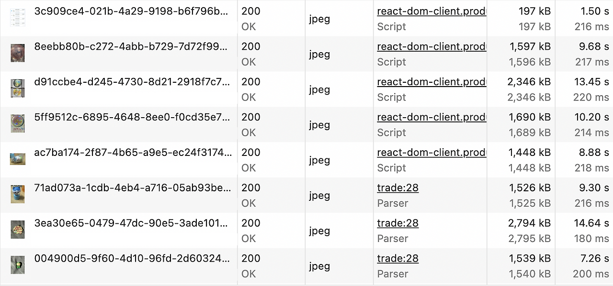
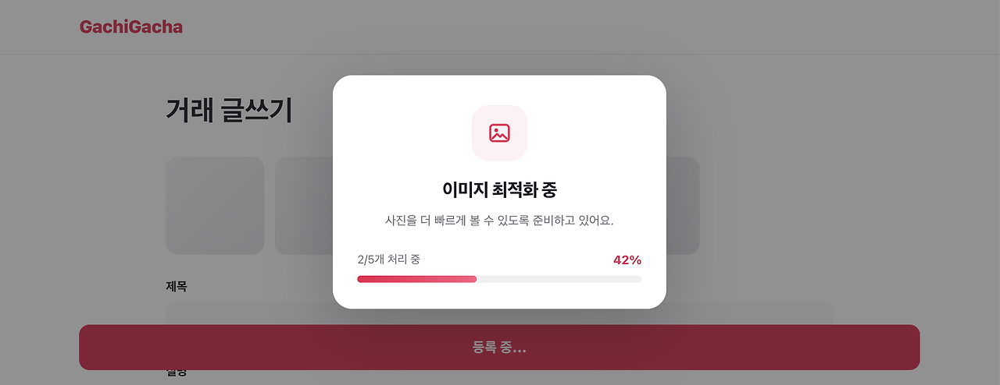
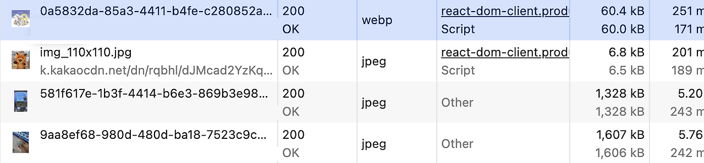
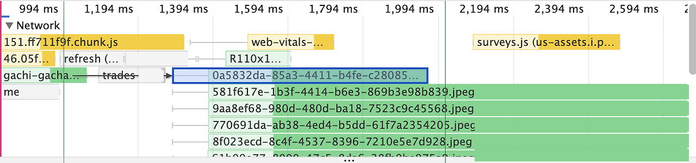
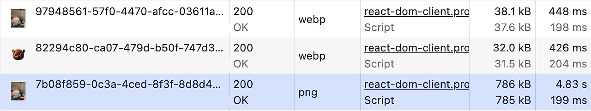
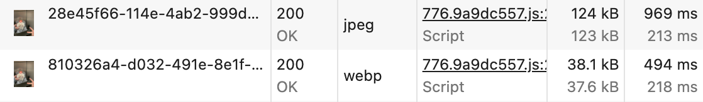

# 최대 15초 걸리던 이미지 로딩을 0.25초로 — 프론트엔드 압축과 사파리 WebP 문제를 풀기까지

가치가챠 교환 게시글의 사진 한 장이 뜨기까지 평균 약 9초, 길게는 15초 가까이 걸렸습니다. 사진을 서버에 올리기 전에 브라우저에서 WebP로 압축하자 0.25초로 줄었습니다.

그런데 사파리에서만 게시글이 등록되지 않는 문제가 생겼습니다. 사파리가 Canvas로 WebP 파일을 만들지 못했기 때문입니다.

이 글에서는 압축을 프론트엔드에서 맡은 이유, 사파리에서 WebP가 만들어지지 않던 원인, 그리고 WebAssembly 인코더로 사파리에서도 WebP를 만들기까지의 과정을 다룹니다.

## 사진 한 장에 최대 15초가 걸렸다

기존에는 사용자가 고른 사진을 아무 처리 없이 서버로 보냈습니다. 아이폰 기본 형식인 HEIC만 막았을 뿐, 나머지는 원본 그대로 S3에 저장하고 화면에도 그대로 보여줬습니다.

스마트폰으로 찍은 사진은 한 장이 1~3MB입니다. 교환 목록에는 이런 사진이 여러 장 뜨기 때문에, 게시글 20개짜리 목록을 열면 사진만 약 39MB를 내려받아야 했습니다.

Chrome DevTools의 Fast 4G 설정으로 화면에 뜬 사진 8장을 측정했습니다. 한 장이 평균 약 1,642KB였고 내려받는 데 평균 약 9초가 걸렸습니다. 가장 큰 사진은 2,794KB에 약 15초였습니다.



## 압축은 서버가 아닌 브라우저에서

압축 위치를 정할 때는 비용이 가장 큰 문제였습니다. 팀이 쓸 수 있는 AWS 예산은 50달러인데, 이미 53달러를 넘게 쓰고 있었습니다.

팀 회의에서 나온 방법은 네 가지였습니다.

| 방법 | 걸림돌 |
| --- | --- |
| 서버 비동기 압축 | 압축하는 동안 서버 자원을 나눠 써서 다른 기능까지 느려짐 |
| 원본 저장 후 교체 | 교체 전 원본 주소를 받은 화면에서 이미지가 깨지거나, 원본과 압축본이 섞여 보임 |
| AWS Lambda 압축 | 설정할 것이 많아 일정 안에 하기 어려움 |
| 프론트엔드 압축 | 사용자 기기 성능에 따라 속도가 달라짐 |

서버 쪽 세 방법은 비용이 늘거나, 새 오류가 생기거나, 만들기가 너무 복잡했습니다. 프론트엔드에서 압축하면 서버 비용이 늘지 않고, 처음부터 압축본만 S3에 올라가며, 백엔드 코드도 그대로 둘 수 있었습니다.

압축에는 Canvas API로 사진을 다시 그려 저장하는 browser-image-compression 라이브러리를 썼습니다. WebP로 저장하고, 긴 변을 상세 화면 최대 크기인 800px 이하로, 장당 1MB 이하로 맞췄습니다. 화면이 멈추지 않도록 Web Worker에서 한 번에 2장씩 압축했습니다. 압축하는 동안에는 몇 장째 처리 중인지와 진행률을 보여 줍니다.



압축한 사진은 약 60KB에 0.25초 만에 내려받았습니다. 같은 화면의 원본 사진(1,328KB, 약 5초)과 비교하면 크기는 약 22분의 1, 시간은 약 21분의 1입니다.





## 사파리에서만 게시글이 올라가지 않았다

압축 기능을 넣고 사용성 테스트를 하던 중, 일부 사용자가 게시글을 등록하지 못했습니다. 압축은 진행되는데 마지막에 오류가 뜨면서 글이 올라가지 않았습니다.

같은 사진으로 여러 기기에서 다시 해 보니 크롬은 정상이고, 사파리에서만 오류가 났습니다. 마침 이벤트로 사용자가 몰리던 때라, 아이폰 사용자는 글을 아예 올릴 수 없는 상황이었습니다.

### Canvas는 WebP 저장을 지원하지 않는다

브라우저에서 사진을 압축할 때는 Canvas에 사진을 다시 그린 뒤 `toBlob()`으로 원하는 형식을 지정해 저장합니다. 저희는 형식으로 `image/webp`를 넘겼습니다.

사파리는 Safari 14부터 WebP를 화면에 띄울 수 있지만 Canvas로 WebP를 저장하는 기능은 지금도 없습니다. 2021년 WebKit 버그 트래커에 이 문제가 올라왔지만 WONTFIX로 닫혔습니다. 사파리가 기반으로 쓰는 하위 프레임워크가 WebP 저장을 지원하지 않기 때문이라는 설명이었습니다.

더 헷갈리게도 에러는 나지 않습니다. HTML 표준은 지원하지 않는 형식을 요청받으면 PNG로 저장하도록 정해 두었습니다. 그래서 사파리에서는 WebP를 달라고 해도 조용히 PNG가 돌아옵니다.

```ts
canvas.toBlob((blob) => {
  console.log(blob.type);
  // 크롬: image/webp
  // 사파리: image/png
}, 'image/webp', 0.8);
```

결과 파일의 `type`을 확인하지 않으면, 원인을 찾기까지 한참 돌아가게 됩니다.

## 급한 대로 PNG, 그다음 JPEG

이벤트 중이라 아이폰 사용자가 글부터 올릴 수 있어야 했습니다. 결과 파일의 `type`이 WebP가 아니면 PNG로 다시 압축하도록 바꿨고 사파리에서도 등록이 다시 됐습니다.

하지만 PNG는 화질을 버리지 않는 무손실 형식이라 품질 값(0.8)이 무시됩니다. 해상도를 줄이는 것 말고는 용량을 줄일 방법이 없어서 압축 효과가 크게 떨어졌습니다.



PNG 대신 JPEG로 바꿨습니다. 사파리도 Safari 11부터 Canvas로 JPEG를 만들 수 있고 품질 값도 그대로 적용됩니다. 같은 사진을 Fast 4G에서 비교한 결과는 다음과 같습니다.

| 형식 (브라우저) | 크기 | 다운로드 시간 |
| --- | --- | --- |
| WebP (크롬) | 약 38KB | 0.45초 |
| JPEG (사파리) | 124KB | 0.97초 |
| PNG (사파리) | 786KB | 약 5초 |



JPEG는 PNG보다 약 6분의 1로 가벼웠지만 WebP보다는 여전히 약 3배 무거웠습니다.

JPEG로 바꾸기 전에 원본 화질을 지켜야 할 이유가 있는지도 따져 봤습니다. 사진이 가장 크게 보이는 상세 화면도 긴 변 800px이고 확대하거나 내려받는 기능은 없습니다. 이 크기에서는 화질 차이보다 빨리 뜨는 것이 더 중요하다고 판단했습니다.

## Canvas는 픽셀만 꺼내고, WebP는 WebAssembly가 만든다

사파리는 Canvas로 WebP를 저장하는 단계에서만 막힙니다. 사진을 Canvas에 그리고 픽셀 데이터를 꺼내는 것까지는 문제없이 합니다. 그래서 저장 단계만 다른 도구에 맡겼습니다.

WebAssembly는 C나 Rust로 만든 프로그램을 브라우저에서 돌리게 해 주는 기술입니다. 구글의 WebP 라이브러리(libwebp)를 WebAssembly로 옮긴 인코더를 쓰면, 브라우저 지원과 상관없이 WebP를 만들 수 있습니다. 인코더는 구글 Squoosh에서 나온 jSquash의 `@jsquash/webp`를 썼습니다.

1. Canvas에 사진을 그려 긴 변을 800px로 줄입니다.
2. Canvas에서 픽셀 데이터(`ImageData`)를 꺼냅니다.
3. 픽셀 데이터를 WebAssembly 인코더에 넘겨 WebP로 만듭니다.

크롬은 Canvas로도 WebP를 만들 수 있지만 브라우저마다 경로를 나누지 않았습니다. Canvas는 크기 조절만, WebAssembly는 인코딩만 맡도록 책임을 나누자 분기 코드가 사라졌습니다. WebAssembly가 실패할 때만 JPEG로 넘어갑니다.

```ts
async function compressImage(file: File, options: Options): Promise<File> {
  try {
    const { encodeTradeImageWithWasm } =
      await import('./encodeTradeImageWithWasm');
    const webpBlob = await encodeTradeImageWithWasm(file, options.signal);
    return createCompressedFile(file, webpBlob);
  } catch {
    // WASM 로드·디코딩·인코딩 오류는 JPEG 폴백에서 처리한다.
  }

  const jpegBlob = await imageCompression(file, {
    ...options,
    fileType: 'image/jpeg',
  });

  return createCompressedFile(file, jpegBlob);
}
```

인코더는 `import()`로 등록 버튼을 누를 때만 불러오므로, 글을 읽기만 하는 사용자는 받지 않습니다. `@jsquash/webp`는 `.wasm` 파일을 `new URL('webp_enc.wasm', import.meta.url)`로 불러오는데, Webpack 5가 이 형태를 알아서 빌드 결과에 포함해 줘서 설정은 바꾸지 않았습니다.

인코딩은 품질 80부터 조금씩 낮추다가 1MB 이하가 되면 멈춥니다.

```ts
const WEBP_QUALITIES = [80, 65, 50, 35] as const;

export async function encodeTradeImageWithWasm(file: File, signal?: AbortSignal) {
  const [encoder, imageData] = await Promise.all([
    import('@jsquash/webp/encode'),
    readImageData(file, signal), // Canvas는 픽셀 추출에만 사용
  ]);

  for (const quality of WEBP_QUALITIES) {
    const buffer = await encoder.default(imageData, { quality });
    const blob = new Blob([buffer], { type: 'image/webp' });

    if (blob.size <= 1024 * 1024) {
      return blob;
    }
  }

  throw new Error('WebP 압축 결과가 최대 크기를 초과했습니다.');
}
```

긴 변 800px로 줄인 사진은 대부분 품질 80에서 바로 1MB 아래로 내려가서 보통 한 번만 인코딩하고 끝납니다.

사진 5장을 한 글에 첨부해 압축 시간을 쟀습니다. 5장을 모두 WebP로 압축하는 데 약 2초, 업로드를 마치고 게시글 화면으로 넘어가기까지 약 3초가 걸렸습니다.

## 대신 감수한 것

WebAssembly 인코더에도 비용이 있습니다. 처음 쓸 때 약 275KB(기기가 SIMD를 지원하면 약 337KB)짜리 `.wasm` 파일을 받아야 하고 오래된 휴대폰에서는 브라우저 내장 기능보다 느릴 수 있습니다. Canvas로 WebP를 만들 수 있는 크롬 사용자도 같은 인코더를 씁니다.

압축의 책임을 백엔드가 아닌 사용자 기기에 둔 것은 의도한 선택이었습니다. 지금 쓸 수 있는 비용으로는 서버가 많은 압축 요청을 감당하기 어렵다고 판단했기 때문입니다. 압축이 느려져서 기다리는 사람은 사진을 올리는 한 명, 그것도 한 번뿐입니다. 사진이 가벼워지면 그 게시글을 여는 모든 사용자가 더 빨리 봅니다. 이 정도는 감수할 만하다고 보았습니다.

## 마무리

AWS 예산을 넘긴 상황에서 압축을 브라우저로 옮겨, 사진 한 장의 다운로드를 평균 약 9초에서 0.25초로 줄였습니다. 사파리가 Canvas로 WebP를 만들지 못하는 문제는 PNG와 JPEG를 거쳐, WebAssembly 인코더로 저장 단계만 바꿔 해결했습니다.

브라우저에서 사진을 WebP로 압축하고 있다면, 사파리에서 결과 파일의 `type`이 정말 `image/webp`인지 한 번 확인해 보세요. 에러 없이 PNG가 돌아오고 있을 수 있습니다.

## 참고 자료

- [Canvas (HTMLCanvasElement.toDataURL) can't export it's data to image/webp — WebKit Bugzilla](https://bugs.webkit.org/show_bug.cgi?id=226950)
- [Ask canvas for a WebP in Safari and you silently get a PNG — DEV Community](https://dev.to/harshit_katheria/ask-canvas-for-a-webp-in-safari-and-you-silently-get-a-png-5hn6)
- [OffscreenCanvas convertToBlob WebP 지원 현황 — caniuse](https://caniuse.com/mdn-api_offscreencanvas_converttoblob_option_type_parameter_webp)
- [HTMLCanvasElement.toBlob image/jpeg 지원 현황 — caniuse](https://caniuse.com/mdn-api_htmlcanvaselement_toblob_type_parameter_jpeg)
- [jSquash — GitHub](https://github.com/jamsinclair/jSquash)

## 원문 연재

- [이미지 로딩 14초, 압축을 서버가 아닌 프론트엔드에서 맡은 이유](https://gachi-gacha.tistory.com/13)
- [사파리에서 Canvas API로 WebP 압축이 안 되던 이유](https://gachi-gacha.tistory.com/14)
- [사파리에서 WebP가 안 된다면, PNG보다 JPEG](https://gachi-gacha.tistory.com/15)
- [사파리에서도 WebP로 압축하기](https://gachi-gacha.tistory.com/16)
