# Yarn Berry는 어떻게 PnP를 구현했을까?

## Yarn Berry와 PnP를 공부하게 된 계기

우아한테크코스에서 레벨 3 팀 프로젝트를 준비하면서 Yarn Berry의 PnP(Plug'n'Play) 방식을 직접 경험해 보고 싶어, TypeScript와 Yarn Berry로 개발 환경을 구축하고자 했다.

하지만 최근에 출시된 TypeScript 7버전과 함께 사용하려고 하자 아래와 같은 오류가 발생했다.

```plain text
$ yarn tsc
src/index.tsx(1,28): error TS2307: Cannot find module 'react-dom/client' or its corresponding type declarations.
src/index.tsx(3,19): error TS7026: JSX element implicitly has type 'any' because no interface 'JSX.IntrinsicElements' exists.
src/index.tsx(3,36): error TS7026: JSX element implicitly has type 'any' because no interface 'JSX.IntrinsicElements' exists.
src/index.tsx(5,53): error TS2875: This JSX tag requires the module path 'react/jsx-runtime' to exist, but none could be found. Make sure you have types for the appropriate package installed.
```

같은 프로젝트를 pnpm으로 설치했을 때는 TypeScript 7이 정상적으로 동작했기 때문에, 나는 코드나 `tsconfig.json`의 설정이 잘못된 것이 아니라 PnP 방식에서만 생기는 문제라고 판단했다. pnpm처럼 node_modules 폴더를 만드는 패키지 매니저에서는 동작하는데 PnP에서만 사용할 수 없다면 PnP가 전혀 다른 방식으로 패키지를 찾고 있다고 볼 수 있다. 결국 우리팀은 Yarn Berry 대신 pnpm으로 바꿔서 진행하게됐지만, PnP에서만 TypeScript 7이 동작하지 않은 원인을 모른 채 그냥 넘어가고 싶지 않아서 나는 "Yarn Berry는 어떻게 PnP를 구현했을까?"라는 질문에 답을 하기 위한 공부를 진행하게됐다.

## 패키지 매니저가 어떤 역할을 하는걸까?

패키지 매니저란 무엇일까?

패키지 매니저는 소프트웨어 패키지를 설치, 업데이트, 삭제하는 과정을 자동으로 처리하면서 패키지 사이의 의존 관계와 버전을 기록해 두어, 어느 환경에서 설치해도 같은 패키지 구성이 만들어지도록 관리하는 도구를 말한다.

운영체제의 apt나 Homebrew, Python의 pip처럼 언어와 환경마다 패키지 매니저가 있으며, JavaScript & node 진영에는 npm, Yarn, pnpm, bun 등이 있다.

아마 프론트엔드 개발을 하게 되면 패키지매니저의 명령어와 node환경이 자주 사용하는 부분에 한정해서는 하루에도 수십번 명령어를 입력해왔을 것이기에 정말 익숙할 것이다.

### `npm install`을 입력하면 무슨 일이 일어날까?

그런데 막상 `npm install`을 실행했을 때 npm이 어떤 순서로 무슨 일을 하는지 설명해 보라고 하면, "패키지를 설치한다" 말고는 선뜻 대답하기 어렵다.

`package.json`에는 `"react": "^19.0.0"`처럼 패키지 이름과 버전 범위만 적혀 있기 때문에, npm은 레지스트리에 패키지 정보를 요청하고, 전달받은 정보들 중 범위에 맞는 버전 가운데 하나를 선택하여 설치한다.

> **레지스트리란?**
>
> 레지스트리는 개발자가 `npm publish`로 올린 패키지를 이름과 버전별로 모아 두고, 패키지 매니저가 요청하면 패키지 정보와 파일을 내려주는 서버(`https://registry.npmjs.org`)를 말한다. 
>
> `https://registry.npmjs.org/[패키지명]`으로 요청하면 패키지의 모든 버전 목록과 버전별 의존성 정보를 담은 JSON 메타데이터를 받아올 수 있다. 
> npm은 메타데이터의 버전 목록에서 package.json에 기록된 범위에 맞는 버전을 고른다.
> 고른 버전의 메타데이터에는 `https://registry.npmjs.org/react/-/react-19.0.0.tgz` 같은 tgz 주소와 파일의 해시도 함께 적혀 있어서, npm은 해당 주소로 tgz 파일을 내려받는다.

> Yarn의 기본 주소인 `https://registry.yarnpkg.com`도 npm 레지스트리와 같은 데이터를 전달하는 프록시 주소이다.

설치하고자 하는 패키지 또한 자신의 의존성을 가질 수 있다. 그리고 이 의존성까지 설치해야 비로소 패키지가 올바르게 동작할 수 있다.

그래서 패키지들의 `package.json`에 작성된 하위 의존성의 버전도 같은 방식으로 확정해나가면서 새로운 의존성이 더 나오지 않을 때까지 확정 과정을 재귀적으로 반복한다.

모든 버전을 확정한 뒤에야 npm은 패키지마다 tgz 파일을 내려받아 `node_modules` 폴더에 압축을 풀어 놓으며, 마지막으로 확정한 결과를 lock 파일인 `package-lock.json`에 기록한다.

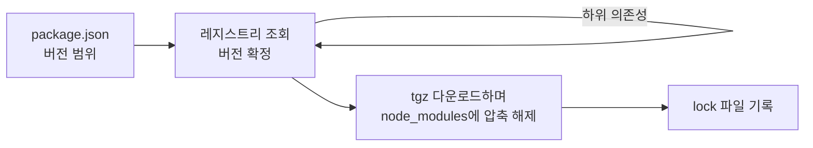

만약 이미 lock 파일이 있다면 npm은 레지스트리에서 버전을 고르는 과정을 생략하고 lock 파일에 적힌 버전을 사용한다.

> **tgz 파일과 zip 파일**
>
> `.tgz` 확장자는 `.tar.gz`를 줄여 쓴 이름이며, 여러 파일을 tar로 한 파일에 차례대로 이어 붙인 뒤 결과 전체를 gzip으로 한 번에 압축해서 만든다. `npm pack`으로 만든 패키지 파일을 풀면 모든 파일이 `package/` 폴더 아래에 들어 있고, 레지스트리는 패키지의 버전마다 이렇게 만든 tgz 파일 하나를 제공한다.
>
> tar는 각 파일의 헤더와 내용을 앞에서부터 순서대로 이어 붙일 뿐 전체 목록을 담은 색인이 없고 gzip이 아카이브 전체를 한 덩어리로 압축하기 때문에, tgz 안의 파일 하나를 읽으려면 파일 맨 앞부터 해당 위치까지 모두 압축을 풀어야 한다. 반대로 흔히 사용하는 zip 압축 형식은 파일마다 따로 압축하고 파일 끝의 중앙 디렉터리에 모든 항목의 이름, 위치, 크기를 기록해 두기 때문에, 중앙 디렉터리만 읽으면 원하는 파일의 위치로 바로 이동해서 해당 파일만 풀 수 있다.
>
> npm이 tgz를 쓰는 이유는 패키지를 설치할 때 파일 하나를 골라 읽을 일이 없고 전부 `node_modules`에 풀어 놓기만 하면 되기 때문이며, tgz는 앞에서부터 순서대로 읽는 형식이라 내려받는 도중에 압축을 풀기 시작할 수 있고, 비슷한 텍스트 파일이 많은 JavaScript 패키지는 여러 파일을 한꺼번에 압축하는 gzip에서 더 작아지며, tar가 유닉스의 실행 권한까지 기록하므로 `bin` 파일을 그대로 옮길 수 있다. 
>
> Yarn Berry의 PnP는 압축을 풀지 않은 채 실행 중에 필요한 파일만 골라 읽어야 하기 때문에 받은 tgz를 zip으로 다시 묶어서 저장하는 방식을 택했다.

### `package.json`에 작성된 패키지들의 의미

npm이 버전을 확정할 때 출발점으로 삼는 `package.json`에는 의존성을 쓰임새에 따라 나누어 적는다.

- `dependencies`에는 앱을 실행할 때 필요한 패키지를 적는다.
- `devDependencies`에는 TypeScript나 Vite처럼 개발하고 빌드할 때만 필요한 패키지를 적는다.
- `peerDependencies`에는 라이브러리가 직접 설치하지 않고, 라이브러리를 사용하는 프로젝트에 설치되어 있기를 기대하는 패키지를 적는다. React 컴포넌트 라이브러리가 `react`를 `peerDependencies`에 적어 두면, 라이브러리는 자기만의 React를 따로 들고 오지 않고 프로젝트에 설치된 React를 함께 사용하게 된다.

```json
{
  "name": "my-app",
  "dependencies": {
    // 앱을 실행할 때 필요한 패키지
    "react": "^19.0.0",
    "react-dom": "^19.0.0"
  },
  "devDependencies": {
    // 개발하고 빌드할 때만 필요한 패키지
    "typescript": "~5.9.2",
    "vite": "7.1.5"
  }
}
```

위처럼 버전은 정확한 번호 대신 범위로 적는 경우가 많으며, `npm install react`로 패키지를 추가해도 npm은 버전 앞에 `^`를 붙인 범위로 `package.json`에 기록한다.

> `^` 는 기준 숫자 이상부터 0이 아닌 가장 앞자리가 변경되지 않는 범위의 패키지를 선택한다.
> 예를 들어 `^0.2.3`은 0.2.3이상 0.3.0 미만까지만 허용한다.

> `~` 는 기준 숫자 이상부터 앞의 두 자리인 메이저 버전과 마이너 버전이 변경되지 않는 범위의 패키지를 선택한다.
> 예를 들어 `~1.2.3`은 1.2.3 이상 1.3.0 미만까지만 허용하므로, 2.0.0 미만까지 허용하는 `^1.2.3`과 달리 마지막 자리인 패치 버전만 올라갈 수 있다.

| 표기 | 허용하는 범위 | 설치되는 버전 |
|---|---|---|
| `^19.0.0` | 19.0.0 이상 20.0.0 미만 | 19.x.x 안의 최신 버전 |
| `~19.0.0` | 19.0.0 이상 19.1.0 미만 | 19.0.x 안의 최신 버전 |
| `19.0.0` | 19.0.0 | 19.0.0 |

그런데 `package.json`에는 범위만 적혀 있으므로, 같은 `package.json`으로 설치하더라도 설치한 날짜에 따라 다른 버전이 들어올 수 있다. `"react": "^19.0.0"`이라고 적어 둔 프로젝트를 React 19.1.0이 나오기 전에 설치한 팀원은 19.0.x를, 나온 뒤에 설치한 팀원은 19.1.x를 받을 수 있다는 것이다.

package.json에 적을 패키지의 버전을 `19.0.0`  처럼 작성하여 고정하더라도 설치하는 패키지의 하위 의존성 `package.json`에 적힌 범위까지는 고정할 수 없기 때문에 이를 package.json 파일만으로는 완벽한 환경 통제를 할 수 없다.

어제 내 컴퓨터에서 잘 돌던 코드가 오늘 갑자기 깨질 수도 있다는 건데, 그렇다면 시간이 지나도 모두가 같은 버전을 설치하게 하려면 어떻게 해야 할까?

### lock 파일에는 무엇이 기록될까?

lock 파일에는 패키지마다 확정한 정확한 버전과 tgz를 내려받을 주소인 `resolved`, 내려받은 파일이 바뀌지 않았는지 검사하는 해시인 `integrity`가 기록된다.

```json
// package-lock.json (일부)
{
  "name": "my-app",
  "lockfileVersion": 3,
  "packages": {
    "node_modules/react": {
      // 범위가 아니라 확정한 버전 한 개
      "version": "19.0.0",
      // tgz를 내려받을 주소
      "resolved": "https://registry.npmjs.org/react/-/react-19.0.0.tgz",
      // 내려받은 파일의 해시 (실제로는 긴 문자열이 적힌다)
      "integrity": "sha512-..."
    }
  }
}
```

npm은 `resolved`의 주소에서 받은 파일의 해시가 `integrity`와 다르면 설치를 멈추기 때문에, 레지스트리나 중간 네트워크에서 모종의 이유로 파일이 변경돼 잘못 설치되는 경우를 막는다.

lock 파일을 저장소에 커밋해 두면 팀원과 CI도 lock 파일에 적힌 버전을 설치하게 된다. lock 파일이 있으면 `npm install` 을 했을 때 `package.json`의 범위를 만족하는 한 lock 파일의 버전을 먼저 사용하지만, `package.json`을 수정했다면 범위를 다시 해석해서 lock 파일을 갱신하기도 한다.

(`npm install` 에서의 영향력 : `package.json` \> `lock`)

`npm ci` 명령어도 `npm install` 과 결과물만 봤을 땐 비슷한 동작을 한다. 동작에서의 차이라면 `node_modules`를 지운 뒤 `package.json`의 범위를 다시 해석하지 않고 lock 파일에 적힌 버전으로만 설치한다. 만약  package.json과 package-lock.json 파일의 내용이 서로 맞지 않으면 lock 파일을 고치지 않고 오류를 내며 멈추기 때문에 CI에서는 주로 `npm install` 이 아닌 `npm ci`를 사용한다.

( `npm ci` 에서의 영향력 : `package.json` \< `lock`)

지금은 `npm install`만 실행해도 `package-lock.json`이 생기지만, npm이 처음부터 lock 파일을 자동으로 만들어 주지는 않았다고 한다. 예전 npm에서 버전을 고정하려면 `npm shrinkwrap`을 직접 실행해서 `npm-shrinkwrap.json`을 만들어야 했고 실행하지 않으면 lock 파일이 생기지 않았다. 이러한 문제점들을 인식하고Facebook은 설치할 때마다 lock 파일을 자동으로 만드는 Yarn을 공개했다.

## Yarn classic의 등장

이런 npm과는 다르게 Yarn 1은 설치할 때마다 `yarn.lock`을 자동으로 만들어서, 같은 `package.json`으로 언제 설치하더라도 lock 파일에 적힌 버전을 받도록 했다. 2016년 당시의 npm은 lock 파일을 기본으로 만들지 않았기 때문에 설치할 때마다 결과가 달라질 수 있었고, 설치 속도도 느렸으며, 한 번 받아 본 패키지도 설치할 때마다 네트워크에 다시 요청해야 했다.

Facebook이 공개한 Yarn 1은 lock 파일 말고도 npm의 불편을 덜어 주는 기능을 함께 갖추고 나왔다. 여러 패키지의 요청을 병렬로 처리해서 동시에 내려받았고, 한 번 받은 패키지를 전역 오프라인 캐시에 저장해 두었다가 다음 설치부터는 네트워크 없이 캐시에서 꺼내 썼으며, 패키지의 코드를 실행하기 전에 체크섬으로 내려받은 파일이 바뀌지 않았는지 검증했다.

하지만 Yarn 1도 npm과 같이 의존성을 `node_modules` 최상위로 끌어올려 평평하게 풀어 놓는 호이스팅 방식으로 폴더를 만들었기 때문에, 선언하지 않은 패키지를 불러올 수 있는 유령 의존성 문제와 설치할 때마다 수만 개의 파일을 복사해야 하는 비용은 해결하지 못했다.

### `node_modules` 방식에는 어떤 문제가 있을까?

Yarn 1까지도 해결하지 못한 문제들은 모두 패키지를 `node_modules` 폴더에 풀어 놓는 방식에서 생긴다.

- 설치 시간의 대부분을 패키지마다 tgz의 압축을 풀어서 수만 개의 파일을 디스크에 복사하는 I/O 작업에 쓴다.
- 호이스팅으로 최상위에 올라온 패키지는 `package.json`에 선언하지 않았더라도 `require`나 `import`로 불러올 수 있으며, 선언하지 않은 패키지에 기대어 동작하던 코드는 다른 패키지를 업데이트하다가 해당 패키지가 최상위에서 빠지면 갑자기 깨진다. 이렇게 선언하지 않은 패키지에 의존하게 되는 문제를 **유령 의존성**이라고 부른다.
- 호이스팅으로 `node_modules`의 크기를 줄이더라도 서로 다른 버전을 요구하는 패키지가 섞인 의존 관계에서는 같은 패키지가 여러 위치에 중복 설치되며, Node는 두 위치의 패키지를 서로 다른 모듈로 불러오기 때문에 React처럼 인스턴스가 하나여야 하는 패키지에서는 오류가 생기기도 한다.

패키지를 `node_modules` 폴더에 풀어 놓는 방식인 호이스팅을 하는 이유와 유령 의존성이 생기는 이유는, 뒤에서 Node.js가 상위 폴더로 거슬러 올라가며 `node_modules`를 탐색하는 방식을 보고 나면 함께 이해할 수 있다.

### Yarn Berry는 무엇을 바꿨을까?

Yarn Berry는  `node_modules`의 모양을 고치지 않고, `node_modules` 폴더를 아예 만들지 않는 방법을 택했다.

Yarn 공식 문서의 [Plug'n'Play](https://yarnpkg.com/features/pnp) 페이지에 따르면 Yarn PnP는 `node_modules` 폴더 대신 `.pnp.cjs`라는 Node.js 로더 파일 하나를 만들고, 해당 파일에 프로젝트의 의존성 트리 전체 정보를 담아서 도구들에게 패키지가 디스크의 어디에 있는지와 `require`, `import` 호출을 어떻게 해석해야 하는지를 알려 준다.

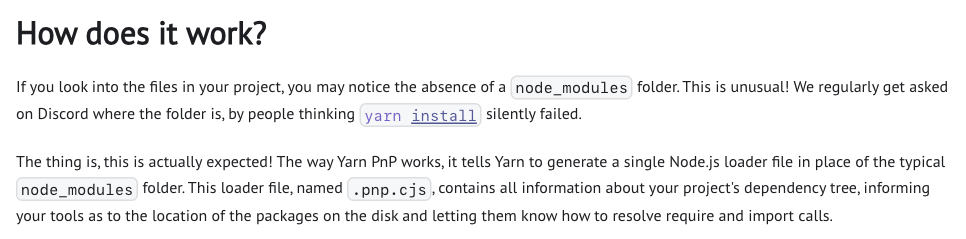

*출처: Yarn 공식 문서 [Plug'n'Play](https://yarnpkg.com/features/pnp)*

공식 문서는 pnpm처럼 `node_modules`를 더 똑똑하게 배치하는 알고리즘으로도 일부 문제는 해결할 수 있지만 모든 문제를 해결할 수 있는 방식은 PnP뿐이라고 설명하면서 PnP의 장점을 소개하는데, 각 장점을 앞에서 정리한 `node_modules` 방식의 문제와 짝지어 본다.

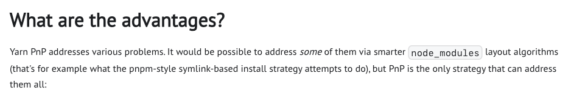

*출처: Yarn 공식 문서 [Plug'n'Play](https://yarnpkg.com/features/pnp)*

**Minimal install footprint** 항목은 설치에 드는 비용을 다룬다. npm은 파일을 디스크의 다른 위치로 복사하는 데, pnpm은 심볼릭 링크와 하드 링크를 만드는 데 설치 시간의 상당 부분을 I/O 작업에 쓰지만, PnP 설치는 대부분 `.pnp.cjs` 로더 파일을 생성하는 것으로 끝난다.

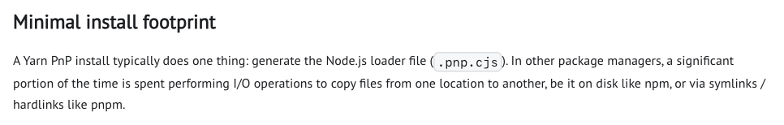

*출처: Yarn 공식 문서 [Plug'n'Play](https://yarnpkg.com/features/pnp)*

**Shared installs across disks** 항목은 앞의 장점과 이어진다. pnpm은 전역 저장소에 있는 패키지의 파일마다 하드 링크를 만들어서 최종 위치에 연결해야 하지만, PnP 로더는 캐시에 있는 패키지의 경로를 직접 가리키기 때문에 디스크에 있는 모든 프로젝트가 같은 패키지 파일을 함께 사용한다.

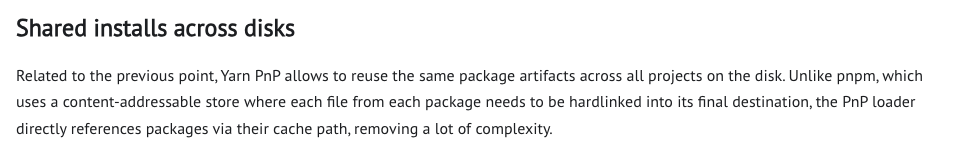

*출처: Yarn 공식 문서 [Plug'n'Play](https://yarnpkg.com/features/pnp)*

**Perfect and correct hoisting** 항목은 중복 설치 문제와 짝을 이룬다. 일반적인 `node_modules` 설치는 유령 의존성의 위험을 감수하면서까지 호이스팅으로 폴더의 크기를 줄이려고 하지만, 일부 의존 관계에서는 안전하게 끌어올릴 수 없어서 같은 패키지가 중복 설치되고 여러 번 인스턴스화된다. PnP는 폴더를 배치하지 않고 `.pnp.cjs`에 기록한 의존 관계로 패키지를 찾기 때문에 이런 문제가 생기지 않는다.

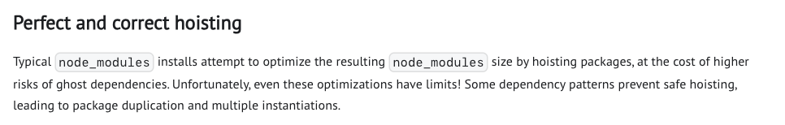

*출처: Yarn 공식 문서 [Plug'n'Play](https://yarnpkg.com/features/pnp)*

**Ghost dependencies protection** 항목은 유령 의존성을 다루는데, Yarn은 모든 패키지와 각 패키지의 의존성 목록을 알고 있으므로 패키지가 선언하지 않은 의존성에 접근하면 막는다. 공식 문서도 다른 패키지 매니저에서 문제없이 동작하던 코드가 PnP에서는 오류를 낼 수 있어서 PnP를 도입하기 어렵다는 점을 인정하지만, 조금 번거롭더라도 오늘 동작하는 앱이 관련 없는 의존성을 추가하거나 업데이트하다가 나중에 갑자기 깨지는 일은 없다고 설명한다.

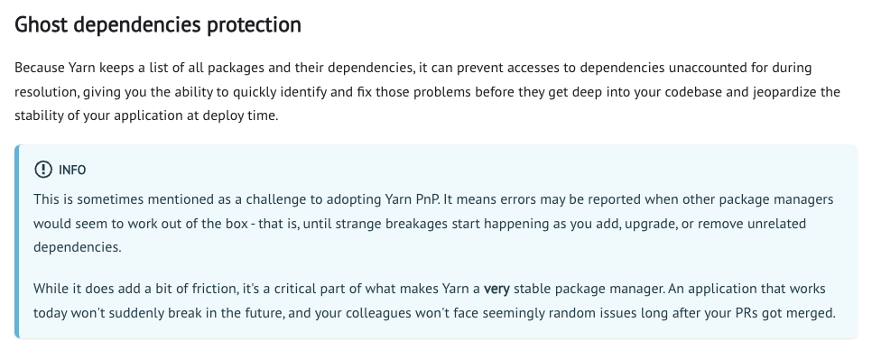

*출처: Yarn 공식 문서 [Plug'n'Play](https://yarnpkg.com/features/pnp)*

**Semantic erroring** 항목은 오류 메시지를 다룬다. Node는 잘못된 `require`나 `import`를 만나면 `Cannot find module`처럼 원인을 알기 어려운 오류만 던지지만, PnP는 어떤 패키지가 무엇을 선언하지 않고 접근했는지까지 알려 준다.

```plain text
// Node.js가 던지는 오류
Uncaught Error: Cannot find module 'not-found'

// Yarn PnP가 던지는 오류
Error: Your application tried to access not-found, but it isn't declared in your dependencies; this makes the require call ambiguous and unsound.

Required package: not-found
Required by: /path/to/my-project/
```

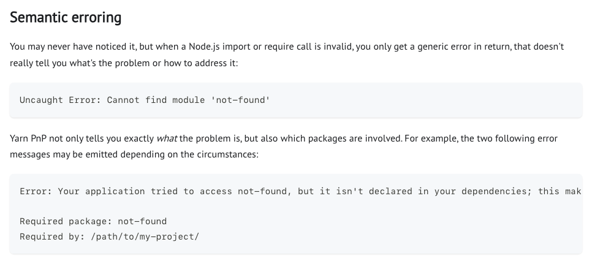

*출처: Yarn 공식 문서 [Plug'n'Play](https://yarnpkg.com/features/pnp)*

공식 문서의 [Caching](https://yarnpkg.com/features/caching) 페이지는 PnP와 함께 쓸 수 있는 Zero-Installs도 소개한다. `.yarnrc.yml`에서 `enableGlobalCache`를 `false`로 설정하면 Yarn은 패키지의 zip 캐시를 프로젝트 안의 `.yarn/cache` 폴더에 저장하는데, 이 캐시와 `.pnp.cjs`를 함께 저장소에 커밋해 두면 clone하거나 브랜치를 바꾼 직후에도 `yarn install` 없이 프로젝트를 실행할 수 있다.

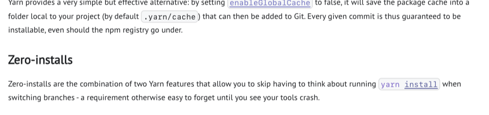

*출처: Yarn 공식 문서 [Cache strategies](https://yarnpkg.com/features/caching)*

`.pnp.cjs`는 어느 컴퓨터에서 만들어도 내용이 같고 캐시에는 로더가 가리키는 파일이 모두 들어 있기 때문에, `git checkout`이 `yarn install`의 역할까지 하게 된다. `node_modules` 폴더를 커밋해도 비슷한 효과를 낼 수는 있지만, Git이 수천 개의 파일을 하나씩 비교해야 하고 호이스팅 때문에 파일 위치도 자주 바뀐다. 반면 PnP 캐시는 패키지마다 zip 파일이 하나씩만 있어서 Git이 추적하기 훨씬 쉽다. 단, 네이티브 의존성이 있는 패키지는 zip 안에서 바로 실행할 수 없기 때문에 이런 패키지를 추가하거나 지울 때는 `yarn install`을 꼭 실행해야 한다.

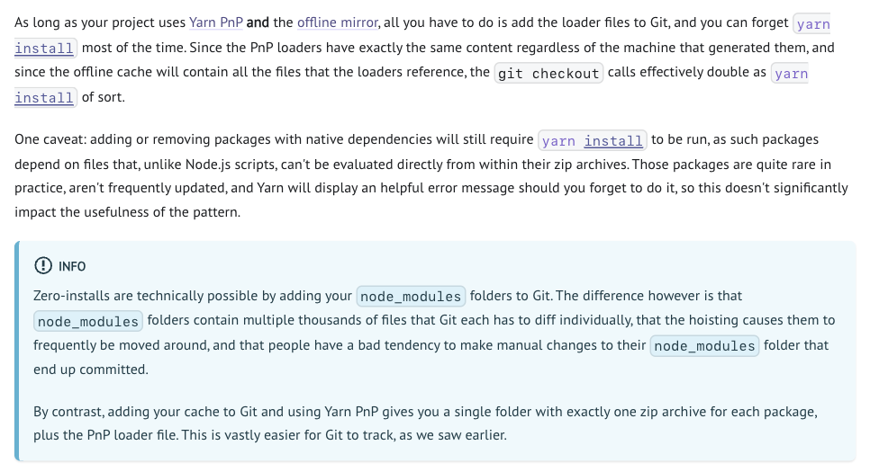

*출처: Yarn 공식 문서 [Cache strategies](https://yarnpkg.com/features/caching)*

처음에는 TypeScript 7이 PnP에서만 모듈을 찾지 못한 원인을 알고 싶어서 시작한 공부였는데, 여기까지 정리하고 나니 Yarn Berry가 PnP를 만든 이유는 이해했지만 PnP가 실제로 패키지를 어떻게 찾아 주는지는 아직 설명할 수 없었다.

## Node는 React를 어떻게 찾아올까?

앞에서 본 것처럼 PnP 프로젝트에는 zero install을 구현하여 `node_modules` 폴더가 없다. 그럼 PnP 환경에서는 어떻게  `require('react')`를 호출하면 React를 가져오는 걸까?

이를 위해서는 우선  `require`를 호출했을 때 모듈의 위치가 어떤 순서로 결정되는지 알아야 한다.

Node의 `require` 코드를 직접 따라가면서 이를 호출했을 때 실행되는 함수들을 차례로 따라가 보자.

## require()의 동작

`require` 함수의 구현은 Node 저장소의 [`lib/internal/modules/cjs/loader.js`](https://github.com/nodejs/node/blob/338f67f57129b4fd15311fab612ceaa18963acb7/lib/internal/modules/cjs/loader.js)에서 확인할 수 있으며, `require('react')`를 호출했을 때 실행되는 부분만 간추리면 아래와 같다.

```javascript
// lib/internal/modules/cjs/loader.js (v24.x, 일부 생략)
Module.prototype.require = function(id) {
  // ...
  return wrapModuleLoad(id, this, /* isMain */ false); // 내부에서 Module._load()를 호출한다
};

Module._load = function(request, parent, isMain, internalOptions = kEmptyObject) {
  // 1. 요청 문자열에 해당하는 파일의 절대 경로를 계산한다
  //    (등록된 훅이 없으면 resolveForCJSWithHooks() 안에서 Module._resolveFilename()이 호출된다)
  const { filename } = resolveForCJSWithHooks(request, parent, isMain, internalOptions);

  // 2. 같은 경로의 모듈이 캐시에 있고 실행을 마쳤다면 저장된 exports를 반환한다
  const cachedModule = Module._cache[filename];
  if (cachedModule !== undefined) {
    updateChildren(parent, cachedModule, true);
    if (cachedModule.loaded) {
      return cachedModule.exports;
    }
  }

  // 캐시에 없으면 새 모듈 객체를 만들고, 실행하기 전에 먼저 캐시에 넣는다
  const module = new Module(filename, parent);
  Module._cache[filename] = module;

  // 3. 파일을 읽어서 실행한다
  module.load(filename);

  // 4. 실행 결과인 module.exports를 반환한다
  return module.exports;
};
```

`require`가 동작하는 방식을 간단히 설명하면, `require('react')`를 호출했을 때 `wrapModuleLoad()`를 거쳐 `Module._load()`가 호출되며, `Module._load()` 안에서 아래 네 단계로 실행된다.

1. 경로 계산: `Module._resolveFilename()`이 호출되어 `'react'`에 해당하는 파일의 절대 경로가 반환된다.
2. 캐시 확인: 반환된 절대 경로를 키로 `Module._cache`를 조회해서, 실행을 마친 모듈이 있으면 저장된 `module.exports`가 반환된다.
3. 파일 읽기와 실행: 캐시에 없는 모듈이면 새 `Module` 객체가 만들어져 `Module._cache`에 저장된 뒤 `module.load()`가 호출되어 파일이 읽히고 실행된다.
4. 결과 반환: 실행이 끝나면 `module.exports`가 `require()`의 결과로 반환된다.

`'react'`처럼 요청한 문자열은 1단계에서 `/home/me/app/node_modules/react/index.js` 같은 절대 경로로 바뀌며 2단계부터는 계산된 절대 경로가 모듈을 구분하는 키로 사용된다.

각 단계를 하나씩 살펴보자.

### 1단계. Module._resolveFilename으로 경로 계산

`Module._resolveFilename(request, parent)`는 `require()`에 넘긴 요청 문자열로 불러올 모듈의 위치를 계산할 때 호출되는 함수로, `request`에는 `'react'`처럼 `require()`에 넘긴 문자열이, `parent`에는 `require()`를 호출한 모듈 객체가 전달된다.

`Module._resolveFilename()`을 호출하면 요청에 따라 다른 값을 리턴한다. `fs`나 `path` 같은 내장 모듈을 요청했다면 `'fs'`처럼 요청한 이름을, 나머지 요청이라면 `/home/me/app/node_modules/react/index.js`처럼 불러올 파일의 절대 경로를 문자열로 리턴한다.

내장 모듈이 아닌 요청이라면 내부에서 `Module._resolveLookupPaths()`를 호출해서 파일을 찾아볼 후보 폴더 목록을 만들어두고, 이를 `Module._findPath()`에 인자로 넘겨 모듈이 있을 후보 폴더 목록들 중 실제 위치한 절대 경로를 찾는다.

`require()`의 인자로 넣을 수 있는 요청 문자열을 분류해보면 크게 4가지 정도이다.

1. 내장 모듈: `fs`, `path`, `node:fs`처럼 Node에 포함된 모듈의 이름
2. 상대 경로: `./utils`, `../config.json`처럼 `./`이나 `../`로 시작하는 경로
3. 절대 경로: `/home/me/app/config.json`처럼 `/`로 시작하는 경로
4. 패키지 이름: `react`, `react/jsx-runtime`, `@babel/core`처럼 `.`이나 `/`로 시작하지 않고 패키지 이름으로 시작하는 요청

`/home/me/app/src/index.js` 파일에서 형태별로 `require()`를 호출하면 후보 폴더 목록과 반환값은 아래와 같다.

1. 내장 모듈: `require('fs')`를 호출하면 후보 폴더 목록이 만들어지기 전에 `'fs'`가 바로 반환된다.
2. 상대 경로: `require('./utils')`를 호출하면 `require()`를 호출한 파일의 폴더가 담긴 `['/home/me/app/src']`가 후보 폴더 목록으로 만들어지며 해당 폴더에서 `utils.js`를 찾으면 `/home/me/app/src/utils.js`가 반환된다.
3. 절대 경로: `require('/home/me/app/config.json')`을 호출하면 `Module._findPath()` 안에서 후보 폴더 목록이 무시되어 요청한 경로에서만 파일을 찾으며 파일이 있으면 `/home/me/app/config.json`이 반환된다.
4. 패키지 이름: `require('react')`를 호출하면 `['/home/me/app/src/node_modules', '/home/me/app/node_modules', '/home/me/node_modules', ...]`처럼 호출한 파일의 폴더부터 루트까지 한 단계씩 올라가며 `node_modules`를 붙인 경로들이 후보 폴더 목록으로 만들어진다. 후보 폴더를 앞에서부터 확인해서 React를 처음 찾은 `/home/me/app/node_modules`의 진입 파일인 `/home/me/app/node_modules/react/index.js`가 반환된다.

어느 형태든 파일을 찾지 못하면 `Cannot find module 'react'` 같은 메시지와 함께 `code`가 `MODULE_NOT_FOUND`인 오류가 발생한다.

실제 코드는 Node 저장소의 [`Module._resolveFilename`](https://github.com/nodejs/node/blob/338f67f57129b4fd15311fab612ceaa18963acb7/lib/internal/modules/cjs/loader.js#L1480-L1569)에서 볼 수 있으며 위에서 살펴본 흐름에 해당하는 부분만 간추리면 아래와 같다.

```javascript
// lib/internal/modules/cjs/loader.js (v24.x, 일부 생략)
Module._resolveFilename = function(request, parent, isMain, options) {
  if (BuiltinModule.normalizeRequirableId(request)) {
    return request; // fs, path 같은 내장 모듈은 이름을 바로 반환한다
  }
  // ...
  // 찾아볼 후보 폴더 목록을 만든다
  paths = Module._resolveLookupPaths(request, parent);
  // ...
  // 후보 폴더에서 실제 파일을 찾는다
  const filename = Module._findPath(request, paths, isMain, conditions);
  if (filename) { return filename; }
  // 끝까지 찾지 못하면 MODULE_NOT_FOUND 오류를 던진다
};
```

### Module._findPath로 진입 파일 결정

1단계에서 본 `Module._resolveFilename()` 코드에서는 `Module._resolveLookupPaths()`로 후보 폴더 목록이 만들어진 뒤, 후보 폴더 가운데 모듈이 실제로 있는 위치를 찾을 때 `Module._findPath()`가 호출된다. `Module._findPath(request, paths)`에는 `'react'` 같은 요청 문자열과 후보 폴더 목록이 인자로 전달되며, 호출하면 후보 폴더에서 처음 찾은 파일의 절대 경로가 반환되고 어느 폴더에서도 찾지 못하면 `false`가 반환된다.

`require('./utils')`처럼 파일을 요청하면 요청한 파일만 찾으면 되지만, `require('react')`처럼 패키지 이름을 요청하면 후보 폴더에서 찾은 `react`가 폴더이기 때문에 폴더 안의 여러 파일 가운데 어떤 파일을 불러올지 정해야 한다. 패키지를 `require()`로 불러왔을 때 처음 실행되는 파일을 진입 파일이라고 하며, `require('react')`를 호출하면 React의 진입 파일인 `react/index.js`가 실행된다.

`Module._findPath()` 안에서는 후보 폴더를 앞에서부터 하나씩 확인하는 반복문이 실행되며 각 폴더에서는 아래 순서로 진입 파일을 찾는다.

1. 패키지의 `package.json`에 `exports` 필드가 있으면, `exports`에 적힌 경로 가운데 조건에 맞는 파일
2. 요청 경로에 해당하는 파일, 없으면 `.js`, `.json`, `.node` 확장자를 붙인 파일
3. 요청 경로가 폴더라면 `package.json`의 `main` 필드에 적힌 파일
4. `main` 필드가 없으면 폴더 안의 `index.js`, `index.json`, `index.node`

```javascript
// lib/internal/modules/cjs/loader.js (v24.x, 일부 생략)
Module._findPath = function(request, paths, isMain, conditions) {
  const cacheKey = request + '\x00' + ArrayPrototypeJoin(paths, '\x00');
  const entry = Module._pathCache[cacheKey];
  if (entry) {
    return entry; // 같은 요청과 후보 폴더로 찾은 적이 있으면 저장해 둔 경로를 반환한다
  }

  for (let i = 0; i < paths.length; i++) {
    const curPath = paths[i];

    // 1. package.json의 exports 필드를 먼저 확인한다
    const exportsResolved = resolveExports(curPath, request, conditions);
    if (exportsResolved) {
      return exportsResolved;
    }

    const basePath = path.resolve(curPath, request);
    const rc = _stat(basePath); // 0이면 파일, 1이면 폴더
    let filename;

    // 2. 요청 경로가 파일이면 해당 파일, 아니면 확장자를 붙여서 찾는다
    if (rc === 0) {
      filename = toRealPath(basePath);
    }
    if (!filename) {
      filename = tryExtensions(basePath, exts, isMain);
    }

    // 3, 4. 폴더라면 package.json의 main, 없으면 index를 찾는다
    if (!filename && rc === 1) {
      filename = tryPackage(basePath, exts, isMain, request);
    }

    if (filename) {
      Module._pathCache[cacheKey] = filename; // 찾은 경로를 캐시에 저장한다
      return filename;
    }
  }

  return false;
};
```

진입 파일을 처음 찾은 폴더에서 반복문이 끝나기 때문에 뒤쪽 후보 폴더는 확인하지 않는다. 파일, 확장자, `main`, `index` 규칙으로 찾은 경로는 `Module._pathCache[cacheKey] = filename` 코드가 실행되어 캐시에 저장된다.

### 2단계. Module._load에서 캐시 확인

1단계에서 절대 경로가 반환되면 `Module._load`에서는 해당 경로를 키로 `Module._cache`를 조회하며 이미 실행을 마친 모듈이 캐시에 있다면 파일을 다시 읽지 않고 저장해 둔 `exports`가 반환된다. 캐시에 없는 모듈이라면 앞에서 본 `Module._load` 코드처럼 새 `Module` 객체가 만들어진 뒤, 파일을 실행하기 전에 먼저 `Module._cache`에 저장된다.

따라서 같은 절대 경로로 결정되는 `require('react')`를 여러 파일에서 호출해도 React의 `index.js`는 처음 한 번만 실행되며 두 번째 호출부터는 첫 호출에서 만들어진 `module.exports` 객체가 반환된다.

### 3단계. module.load로 파일 읽기와 실행

캐시에 없는 모듈이면 `module.load(filename)`이 호출되어 확장자에 맞는 `Module._extensions` 처리 함수가 실행된다.

`.js` 파일이라면 `fs.readFileSync(filename, 'utf8')`로 읽은 문자열이 `module._compile()`에 전달된다.

```javascript
// Module.prototype._compile (v24.x, 일부 생략)
// 파일 내용을 다섯 개의 매개변수를 받는 래퍼 함수로 컴파일한다
const result = wrapSafe(filename, content, this, format);
compiledWrapper = result.function;
// ...
const dirname = path.dirname(filename);
const require = makeRequireFunction(this); // 모듈마다 새 require 함수를 만든다
const exports = this.exports;
const thisValue = exports;
const module = this;
// ...
// 모듈 객체와 require 함수를 인자로 래퍼 함수를 실행한다
result = FunctionPrototypeCall(compiledWrapper, thisValue, exports, require, module, filename, dirname);
```

`wrapSafe()`를 호출하면 파일 내용이 `exports`, `require`, `module`, `__filename`, `__dirname`을 매개변수로 받는 래퍼 함수로 컴파일되며 이어서 모듈 객체와 해당 모듈 전용 `require` 함수를 인자로 래퍼 함수가 호출된다. 래퍼 함수 실행이 끝난 뒤 `Module._load`에서 반환되는 `module.exports`가 `require('react')`의 결과가 되어 `React` 변수에 담긴다.

지금까지 살펴본 require 함수가 하는 네 단계를 하나의 함수로 단순화해서 작성해 보면 아래와 같다.

```javascript
function require(id) {
  const filename = Module._resolveFilename(id, 호출한모듈);            // 1. 경로 계산 (PnP 환경에서 교체된다)
  if (Module._cache[filename]) return Module._cache[filename].exports; // 2. 캐시 확인

  const module = new Module(filename);
  Module._cache[filename] = module;
  const code = fs.readFileSync(filename, 'utf8');                     // 3. 파일 읽기 (PnP 환경에서 교체된다)
  const fn = compileFunction(code, ['exports', 'require', 'module', '__filename', '__dirname']);
  fn.call(module.exports, module.exports, makeRequire(module), module, filename, path.dirname(filename));
  return module.exports;                                              // 4. 반환
}
```

PnP 환경에서는 위 코드에서 주석으로 표시한 1단계의 `Module._resolveFilename`과 3단계의 `fs.readFileSync`가 교체되지만 캐시 확인과 래퍼 함수의 컴파일, 실행에는 Node의 원래 코드가 사용된다.

## 그래서 PnP는 존재하지 않는 위치에서 어떻게 모듈을 가져올까?

PnP 프로젝트에는 `node_modules` 폴더가 없어서 원래의 `Module._resolveFilename`을 호출하면 후보 폴더를 모두 확인해도 React를 찾지 못해 `MODULE_NOT_FOUND` 오류가 발생한다. PnP는 압축된 캐시파일에 모듈이 존재하므로 PnP 환경에서 모듈을 불러오려면 모듈을 가져올 때 두 가지가 달라져야만 한다.

- 경로 계산: `node_modules` 폴더를 탐색하는 대신 `.pnp.cjs`에 기록된 의존 관계 표에서 패키지의 위치를 가져오도록 한다.
- 파일 읽기: 압축된 zip 파일로 저장된 모듈을 사용하기 위해 zip 안의 파일을 읽을 수 있어야 한다.

이는 기존 Node.js 환경에서의 동작과 다르기 때문에, Yarn Berry는 `require`와 `fs` 내장 모듈의 동작을 바꾸는 선택을 했다.

그렇다면 어떻게 동작을 바꾼 걸까?

> 지금부터 나오는 Yarn 코드는 4.18.1 버전을 기준으로 하며 설명을 위하여 일부를 생략한 코드가 있다. 예제의 실행 결과는 Node 22와 Yarn 4.18.1에서 확인했다.

## .pnp.cjs는 어디서 만들어질까?

`yarn`으로 실행하면 `.pnp.cjs`가 먼저 실행되면서 경로를 계산하는 `Module._resolveFilename`과 파일을 읽는 `fs`가 새 함수로 덮어쓰인다.

그런데 `.pnp.cjs`는 어디서 만들어지는 걸까? 만들어진 `.pnp.cjs` 안에는 무엇이 들어 있으며 Node의 함수는 어떤 방법으로 덮어쓰이는 걸까?

`yarn install`을 실행했을 때 `.pnp.cjs`가 만들어지는 순서를 따라가며 만들어진 `.pnp.cjs`를 직접 열어 본 다음, 덮어쓴 `Module._resolveFilename`이 호출되었을 때 패키지 경로가 계산되며 선언하지 않은 의존성이 막히는 흐름까지 차례로 살펴보자.

## yarn install 을 하면 발생하는 일들

`.pnp.cjs`는 `yarn install`의 마지막 단계에서 만들어지기 때문에, 우선 `yarn install`이 어떤 순서로 동작하는지부터 확인할 필요가 있다.

설명을 위한 `my-app` 프로젝트를 임시로 만들고 `yarn install`을 실행하며 흐름을 살펴보자.

`my-app` 프로젝트는 `react`, `react-dom`, `express` 의존성이 있다.

```json
{
  "name": "my-app",
  "private": true,
  "packageManager": "yarn@4.18.1",
  "dependencies": {
    "express": "^4.22.3",
    "react": "^19.3.1",
    "react-dom": "^19.3.1"
  }
}
```

`yarn install`을 실행하면 터미널에 단계별 로그가 찍힌다.

로그에 나오는 `Resolution step`, `Fetch step`, `Link step`  단계로 진행된다.

```plain text
➤ YN0000: · Yarn 4.18.1
➤ YN0000: ┌ Resolution step
➤ YN0085: │ + express@npm:4.22.3, react-dom@npm:19.3.1, react@npm:19.3.1, accepts@npm:1.3.8, array-flatten@npm:1.1.1, async-function@npm:1.0.0, and 68 more.
➤ YN0000: └ Completed in 0s 537ms
➤ YN0000: ┌ Fetch step
➤ YN0013: │ 74 packages were added to the project (+ 10.35 MiB).
➤ YN0000: └ Completed
➤ YN0000: ┌ Link step
➤ YN0000: └ Completed
➤ YN0000: · Done in 0s 700ms
```

앝게만 Yarn 코드와 함께 shallow dive를 해보자

`yarn install`을 실행하면 Yarn 코드에서는 [`Project.install()`](https://github.com/yarnpkg/berry/blob/75ebe063092f86e47e4afeaf1ae4bdf24402874b/packages/yarnpkg-core/sources/Project.ts#L1750-L1925)이 호출된다.

`install()`에서 [`startTimerPromise()`](https://github.com/yarnpkg/berry/blob/75ebe063092f86e47e4afeaf1ae4bdf24402874b/packages/yarnpkg-core/sources/StreamReport.ts#L311-L389)에 단계 이름과 콜백을 넘기면, 콜백의 결과를  `┌ 단계 이름` 과  `└ Completed` 로 묶어서 출력해준다.

위의 로그의 순서처럼 install함수 내에서는 [`resolveEverything()`](https://github.com/yarnpkg/berry/blob/75ebe063092f86e47e4afeaf1ae4bdf24402874b/packages/yarnpkg-core/sources/Project.ts#L771), [`fetchEverything()`](https://github.com/yarnpkg/berry/blob/75ebe063092f86e47e4afeaf1ae4bdf24402874b/packages/yarnpkg-core/sources/Project.ts#L1093), [`linkEverything()`](https://github.com/yarnpkg/berry/blob/75ebe063092f86e47e4afeaf1ae4bdf24402874b/packages/yarnpkg-core/sources/Project.ts#L1208) 을 `startTimerPromise()` 을 사용해서 로그와 함께 호출한다.

```typescript
// packages/yarnpkg-core/sources/Project.ts (4.18.1, 일부 생략)
async install(opts: InstallOptions) {
  // ...
  await opts.report.startTimerPromise(`Resolution step`, async () => {
    // package.json의 버전 범위를 정확한 버전으로 확정한다
    await this.resolveEverything(opts);
  });
  // ...
  await opts.report.startTimerPromise(`Fetch step`, async () => {
    // 확정한 패키지를 내려받아 캐시에 저장한다
    await this.fetchEverything(opts);
  });

  // yarn.lock을 파일로 쓴다
  if (typeof opts.persistProject === `undefined` || opts.persistProject)
    await this.persist();

  await opts.report.startTimerPromise(`Link step`, async () => {
    // ...
    // 캐시에 있는 패키지를 프로젝트와 연결한다
    await this.linkEverything(opts);
  });
  // ...
}
```

앞에서 본 npm의 설치 과정과 비교하면 버전을 확정하고 패키지를 내려받는 앞의 두 단계는 거의 같으며 내려받은 패키지를 Node가 찾을 수 있게 연결하는 마지막 Link step에서 `node_modules` 폴더 대신 `.pnp.cjs`가 만들어진다는 점이 다르다.

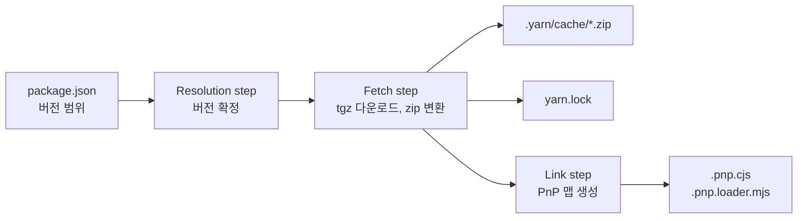

이제 세 단계에서 각각 어떤 일이 일어나는지 차례로 살펴보자.

### Resolution step: 버전 확정하기

Yarn Berry에서는 `package.json`에 적힌 `react@npm:^19.3.1`처럼 이름과 범위로 이루어진 값을 descriptor라고 부르며 범위를 확정해서 얻은 `react@npm:19.3.1`처럼 이름과 정확한 버전으로 이루어진 값을 locator라고 부른다. Resolution step에서는 프로젝트의 모든 descriptor가 locator로 확정한다. 확정한 결과는 Fetch step이 끝난 뒤 `yarn.lock`에 기록된다.

```yaml
# yarn.lock (일부 생략)
# 키에는 package.json에 적힌 descriptor가 들어간다
"react@npm:^19.3.1":
  version: 19.3.1
  # descriptor를 확정한 결과인 locator
  resolution: "react@npm:19.3.1"
  # Fetch step에서 계산한 zip 파일의 해시
  checksum: 10c0/f0ed036d12...
  languageName: node
  linkType: hard
```

### Fetch step: tgz를 zip으로 변환

Fetch step에서는 확정한 locator마다 레지스트리에서 tgz 파일을 내려받은 뒤 zip 파일로 다시 묶어서 캐시 폴더에 저장한다. `yarn.lock`의 checksum과 같은 zip 파일이 캐시에 이미 있으면 내려받지 않고 캐시에 있는 파일을 쓴다.

### Link step: .pnp.cjs를 만든다

Link step에서는 `.yarnrc.yml`의 `nodeLinker` 설정에 맞는 linker가 쓰이며 기본값인 `pnp`에서는 `PnpLinker`의 `packageRegistry`에 패키지마다 위치와 의존성 목록이 모인 뒤 마지막에 `finalizeInstallWithPnp()`가 호출되어 모은 내용이 `.pnp.cjs`로 저장된다.

```typescript
// packages/plugin-pnp/sources/PnpLinker.ts (4.18.1, 일부 생략)
async finalizeInstallWithPnp(pnpSettings: PnpSettings) {
  const pnpPath = getPnpPath(this.opts.project);
  // ...
  if (this.opts.project.configuration.get(`pnpEnableInlining`)) {
    // 기본값: 조회 테이블과 로더 코드를 .pnp.cjs 파일 하나에 함께 쓴다
    const loaderFile = generateInlinedScript(pnpSettings);
    await xfs.changeFilePromise(pnpPath.cjs, loaderFile, {automaticNewlines: true, mode: 0o755});
    await xfs.removePromise(pnpPath.data);
  } else {
    // 조회 테이블은 .pnp.data.json에, 로더 코드는 .pnp.cjs에 나누어 쓴다
    const {dataFile, loaderFile} = generateSplitScript(pnpSettings);
    // ...
  }

  if (this.isEsmEnabled()) {
    // ESM 로더가 필요한 프로젝트에서만 .pnp.loader.mjs를 쓴다
    this.opts.report.reportWarning(MessageName.EXPERIMENTAL, `ESM support for PnP uses the experimental loader API and is therefore experimental`);
    await xfs.changeFilePromise(pnpPath.esmLoader, getESMLoaderTemplate(), {/* ... */});
  }
}
```

`.pnp.loader.mjs`는 설치할 때마다 생기지 않고 `isEsmEnabled()`가 `true`를 반환할 때만 만들어지는데 `.yarnrc.yml`에 `pnpEnableEsmLoader`를 직접 적었으면 적힌 값이 쓰이며 적지 않았으면 ESM 로더가 필요한 패키지가 있거나 workspace의 `package.json`에 `"type": "module"`이 있을 때 `true`가 반환된다.

```typescript
// packages/plugin-pnp/sources/PnpLinker.ts (4.18.1)
private isEsmEnabled() {
  // .yarnrc.yml에 pnpEnableEsmLoader를 직접 적었다면 적힌 값을 따른다
  if (this.opts.project.configuration.sources.has(`pnpEnableEsmLoader`))
    return this.opts.project.configuration.get(`pnpEnableEsmLoader`);

  // 설치 중에 ESM 로더가 필요하다고 판단한 패키지가 있으면 켠다
  if (this.isESMLoaderRequired)
    return true;

  // workspace 가운데 "type": "module"인 곳이 있으면 켠다
  for (const workspace of this.opts.project.workspaces) {
    if (workspace.manifest.type === `module`) {
      return true;
    }
  }

  return false;
}
```

예제 프로젝트는 CommonJS라서 `.pnp.loader.mjs`가 생기지 않았지만 `package.json`에 `"type": "module"`을 추가한 뒤 다시 설치하면 Link step에 아래 경고가 찍히면서 `.pnp.loader.mjs`가 만들어진다. 반대로 CommonJS로 되돌린 뒤 다시 설치하면 `.pnp.loader.mjs`는 지워진다.

```plain text
➤ YN0000: ┌ Link step
➤ YN0092: │ ESM support for PnP uses the experimental loader API and is therefore experimental
➤ YN0000: └ Completed
```

## .pnp.cjs 열어 보기

설치가 끝난 프로젝트 루트에는 `node_modules` 폴더 없이 `.pnp.cjs`, `.yarn/cache`, `.yarn/install-state.gz`, `yarn.lock`이 생기며 예제 프로젝트에서 만들어진 `.pnp.cjs`를 열어 보면 8,649줄의 코드가 들어 있다. 파일의 맨 위에는 shebang과 `"use strict"`가 있으며 바로 아래에 설치할 때 계산한 조회 테이블을 JSON 문자열로 담은 `RAW_RUNTIME_STATE` 상수와 해당 문자열을 파싱하는 `$$SETUP_STATE()` 함수가 놓인다. 나머지 7,700여 줄은 Node의 함수를 덮어쓰는 로더 코드로 채워져 있다.

```javascript
#!/usr/bin/env node
/* eslint-disable */
// @ts-nocheck
"use strict";

// 설치할 때 계산한 조회 테이블을 JSON 문자열로 담아 둔다 (값은 일부 생략)
const RAW_RUNTIME_STATE =
'{\
  "__info": [...],\
  "dependencyTreeRoots": [{"name": "my-app", "reference": "workspace:."}],\
  "enableTopLevelFallback": true,\
  "ignorePatternData": "...",\
  "pnpZipBackend": "libzip",\
  "fallbackExclusionList": [["my-app", ["workspace:."]]],\
  "fallbackPool": [],\
  "packageRegistryData": [...]\
}';

function $$SETUP_STATE(hydrateRuntimeState, basePath) {
  // 실행할 때 문자열을 파싱해서 Map으로 바꾼다
  return hydrateRuntimeState(JSON.parse(RAW_RUNTIME_STATE), {basePath: basePath || __dirname});
}
// ... 아래로 로더 코드가 7,700여 줄 이어진다
```

`RAW_RUNTIME_STATE`의 키 가운데 `fallbackExclusionList`와 `fallbackPool`은 외부 패키지가 선언하지 않은 패키지를 요청했을 때 오류를 던지기 전에 프로젝트 루트가 선언한 의존성에서 같은 이름을 한 번 더 찾아 루트가 선언한 버전으로 연결해 주는 fallback에서 쓰이며 패키지마다 위치와 의존성은 `packageRegistryData`에 기록된다.

### packageRegistryData

`packageRegistryData`에는 패키지 이름을 키로, 버전별 정보를 값으로 갖는 Map이 배열로 풀려서 저장되어 있으며 예제 프로젝트의 `.pnp.cjs`에서 루트와 `react` 항목을 찾으면 아래와 같은 모양을 볼 수 있다.

```javascript
// .pnp.cjs의 packageRegistryData (일부 생략)
[
  [null, [
    [null, {
      // 프로젝트 루트는 이름과 reference가 모두 null이다
      "packageLocation": "./",
      "packageDependencies": [
        // 루트에서 require로 불러올 수 있는 패키지와 reference
        ["express", "npm:4.22.3"],
        ["my-app", "workspace:."],
        ["react", "npm:19.3.1"],
        ["react-dom", "virtual:ddccc941eb...#npm:19.3.1"]
      ],
      "linkType": "SOFT"
    }]
  ]],
  // ...
  ["react", [
    ["npm:19.3.1", {
      // 패키지 폴더 대신 zip 파일 안의 경로를 가리킨다
      "packageLocation": "./.yarn/cache/react-npm-19.3.1-40d7671112-f0ed036d12.zip/node_modules/react/",
      "packageDependencies": [
        // 자기 자신도 목록에 들어간다
        ["react", "npm:19.3.1"]
      ],
      "linkType": "HARD"
    }]
  ]]
]
```

`packageLocation`에는 패키지의 파일이 있는 위치가, `packageDependencies`에는 해당 패키지에서 `require`로 불러올 수 있는 패키지 이름과 reference가 들어 있으며 `packageDependencies`에는 선언한 의존성 외에 자기 자신도 함께 들어간다. `linkType`은 `yarn.lock`의 값과 같아서 `react`처럼 캐시의 zip 파일 안에 파일이 있는 패키지는 `HARD`이며 루트처럼 프로젝트 폴더를 가리키는 workspace는 `SOFT`가 된다.

`packageLocation`이 프로젝트 안의 `./.yarn/cache`를 가리키는 이유는 예제 프로젝트의 `.yarnrc.yml`에 `enableGlobalCache: false`를 적었기 때문이며 Yarn 4의 기본값인 `true`에서는 zip 파일이 사용자 폴더의 `~/.yarn/berry/cache`에 저장된다. `react` 항목의 `packageLocation`을 보면 `react-npm-19.3.1-40d7671112-f0ed036d12.zip` 뒤에 `/node_modules/react/`가 이어져서 zip 파일이 폴더처럼 경로 중간에 끼어 있는데, 해당 경로의 파일을 읽는 방법은 뒤에서 다룬다.

루트의 `packageDependencies`에서 `react-dom`은 `virtual:ddccc941eb...#npm:19.3.1`로 연결되어 있는데, `react-dom`의 `package.json`에는 `react`가 peerDependencies로 적혀 있어서 Yarn은 같은 `react-dom`이라도 부모에 따라 `require('react')`가 다른 React로 연결될 수 있도록 peer를 제공하는 부모마다 `react-dom`을 `virtual:<해시>#npm:19.3.1` 같은 reference를 가진 virtual 패키지로 등록한다. virtual 패키지의 `packageLocation`은 `./.yarn/__virtual__/`로 시작하지만 실제로 예제 프로젝트의 디스크에는 `.yarn/__virtual__` 폴더가 없으며, virtual 경로를 실제 zip 경로로 되돌리는 방법은 뒤에서 다룬다.

### hydrateRuntimeState()로 만들어지는 Map

`.pnp.cjs`가 실행되면 `$$SETUP_STATE()`가 호출되며 안에서 호출되는 `hydrateRuntimeState()`에서 JSON의 배열이 Map으로 바뀌면서 패키지 위치를 키로 locator를 찾는 `packageLocatorsByLocations`도 함께 만들어진다.

```typescript
// packages/yarnpkg-pnp/sources/loader/hydrateRuntimeState.ts (4.18.1, 일부 생략)
// 패키지 위치에서 locator를 찾는 방향의 Map
const packageLocatorsByLocations = new Map();

const packageRegistry = new Map(data.packageRegistryData.map(([packageName, packageStoreData]) => {
  return [packageName, new Map(packageStoreData.map(([packageReference, packageInformationData]) => {
    // ...
    // 처음 나온 위치라면 위치와 locator를 함께 저장한다
    const entry = packageLocatorsByLocations.get(packageInformationData.packageLocation);
    if (!entry) {
      packageLocatorsByLocations.set(packageInformationData.packageLocation, {locator: packageLocator, discardFromLookup});
    }
    // ...
    return [packageReference, {
      // 배열로 저장한 의존성 목록을 Map으로 바꾼다
      packageDependencies: new Map(packageInformationData.packageDependencies),
      packagePeers: new Set(packageInformationData.packagePeers),
      linkType: packageInformationData.linkType,
      discardFromLookup,
      // ...
    }];
  }))];
}));
```

`packageRegistry`로는 이름과 reference로 패키지 정보를 찾을 수 있으며 `packageLocatorsByLocations`로는 반대로 파일의 위치에서 패키지를 찾을 수 있다. 두 번째 Map은 뒤에서 볼 `findPackageLocator()`에서 `require`를 호출한 파일이 어느 패키지에 속하는지 찾을 때 쓰인다.

## .pnp.cjs를 먼저 실행하는 방법

`.pnp.cjs`는 디스크에 놓인 파일일 뿐이라서 사용자 코드의 `require`가 실행되기 전에 `.pnp.cjs`가 먼저 실행되어야 덮어쓴 함수가 쓰인다. `yarn node`나 `yarn run`으로 스크립트를 실행하면 자식 프로세스를 띄우기 전에 `setupScriptEnvironment` 훅이 호출되어 `NODE_OPTIONS` 환경 변수 맨 앞에 `--require` 옵션이 붙는다.

```typescript
// packages/plugin-pnp/sources/index.ts (4.18.1, 일부 생략)
async function setupScriptEnvironment(project: Project, env: NodeJS.ProcessEnv, makePathWrapper) {
  // 이미 설정된 NODE_OPTIONS에서 예전 PnP 옵션을 지운다
  const nodeOptions = (env.NODE_OPTIONS ?? ``)
    .replace(pnpRegularExpression, ` `)
    .replace(esmLoaderExpression, ` `)
    // ...
    .trim();

  // nodeLinker가 pnp가 아니면 PnP 옵션을 붙이지 않는다
  if (nodeLinker !== `pnp`) {
    applyNodeOptions();
    return;
  }

  const pnpPath = getPnpPath(project);
  let pnpRequire = `--require ${quotePathIfNeeded(npath.fromPortablePath(pnpPath.cjs))}`;

  // .pnp.loader.mjs가 있으면 ESM 로더도 함께 등록한다
  if (xfs.existsSync(pnpPath.esmLoader))
    pnpRequire = `${pnpRequire} --experimental-loader ${pathToFileURL(npath.fromPortablePath(pnpPath.esmLoader)).href}`;

  if (xfs.existsSync(pnpPath.cjs)) {
    // 사용자가 적은 옵션보다 앞에 PnP 옵션을 넣는다
    extraNodeOptions.unshift(pnpRequire);
    applyNodeOptions();
  }
}
```

예제 프로젝트에서 `NODE_OPTIONS`를 출력해 보면 `.pnp.cjs`의 절대 경로가 붙어 있는 것을 확인할 수 있으며 `yarn run`으로 실행한 스크립트에서도 같은 값이 나온다. `.pnp.loader.mjs`가 있는 ESM 프로젝트에서는 `--experimental-loader file:///Users/me/my-app/.pnp.loader.mjs`도 함께 붙는다.

```bash
$ yarn node -p "process.env.NODE_OPTIONS"
--require /Users/me/my-app/.pnp.cjs
```

Node의 `--require` 옵션으로 지정한 모듈은 진입 파일보다 먼저 실행되는데, 이렇게 미리 불러온 모듈은 `module.parent.id`가 `internal/preload`이기 때문에 `.pnp.cjs`에서는 해당 값을 확인한 뒤에만 `setup()`이 호출된다.

```typescript
// packages/yarnpkg-pnp/sources/loader/_entryPoint.ts (4.18.1, 일부 생략)
// .pnp.cjs를 불러오면 가장 먼저 조회 테이블을 Map으로 바꾼다
const defaultRuntimeState = $$SETUP_STATE(hydrateRuntimeState);
// ...
const defaultApi = Object.assign(makeApi(defaultRuntimeState, {/* ... */}), {
  // ...
  setup: (api?: PnpApi) => {
    // Node의 모듈 시스템과 fs를 덮어쓴다
    applyPatch(api || defaultApi, {
      fakeFs: defaultFsLayer,
      manager,
    });
    // ...
  },
});

export default defaultApi;

// --require로 미리 불러온 경우에만 Node의 함수를 덮어쓴다
if (module.parent && module.parent.id === `internal/preload`) {
  defaultApi.setup();
  // ...
}
```

`.pnp.cjs`를 불러오면 맨 먼저 `$$SETUP_STATE()`로 조회 테이블이 Map으로 바뀌며 `setup()`이 호출되었을 때 `applyPatch()`가 실행되어 Node의 함수가 덮어쓰인다. 그래서 `require('./.pnp.cjs')`로 불러오기만 하면 Node의 함수는 덮어쓰이지 않으며 PnP API 객체만 반환된다.

`yarn`을 거치지 않더라도 `node -r ./.pnp.cjs index.js`처럼 직접 옵션을 주면 같은 결과를 얻을 수 있으며 코드에서 `require('./.pnp.cjs').setup()`을 호출해도 같은 `setup()`이 실행된다. 다만 `require('./.pnp.cjs').setup()`을 호출하는 방식은 `NODE_OPTIONS`에 옵션이 붙지 않기 때문에, 해당 프로세스가 띄운 자식 프로세스에서는 PnP가 동작하지 않는다.

## applyPatch()가 덮어쓰는 함수

`setup()`에서 호출되는 `applyPatch()`에서는 Node의 모듈 시스템과 `fs`의 함수들이 아래처럼 덮어쓰인다.

| 덮어쓰는 대상 | 덮어쓴 뒤의 동작 | 자세히 보는 절 |
|---|---|---|
| `process.versions.pnp` | `"3"`이 설정되어 다른 도구에서 PnP 환경인지 확인할 수 있다 | - |
| `Module._load` | `require('pnpapi')`를 호출하면 PnP API 객체가 반환되며, 나머지 요청은 Node의 원래 함수로 넘어간다 | 덮어쓴 `Module._resolveFilename` |
| `Module._resolveFilename` | 요청 문자열이 `.pnp.cjs`의 조회 테이블로 계산한 절대 경로로 바뀐다 | 덮어쓴 `Module._resolveFilename` |
| `Module._findPath` | `_findPath`를 직접 호출하는 도구의 요청도 조회 테이블로 처리된다 | - |
| `process.dlopen` | `.node` 파일을 불러오기 전에 virtual 경로가 실제 경로로 바뀐다 | fs 패치가 닿지 않는 곳 |
| `fs` | zip 안의 파일과 virtual 경로를 읽을 수 있게 메서드가 교체된다 | 네 겹으로 쌓은 파일 시스템 |

표에 넣지 않은 `Module._extensions['.js']`는 `require(esm)`을 지원하지 않는 Node 버전에서만 교체되며 `process.emit`은 `--experimental-loader`를 쓸 때 출력되는 실험 기능 경고를 숨기기 위해서만 교체된다. 앞에서 PnP를 하려면 경로 계산과 파일 읽기가 달라져야 한다고 이야기했는데 표에서 `Module._resolveFilename`은 경로 계산을, `fs`는 파일 읽기를 바꾸기 위해 덮어쓰이며 `require()`의 2단계인 캐시 확인과 3단계의 컴파일과 실행은 Node의 코드로 실행된다.

## 덮어쓴 Module._resolveFilename

`applyPatch()`가 실행되면 앞에서 본 `require()`의 1단계인 `Module._resolveFilename`이 `originalModuleResolveFilename` 변수에 담긴 뒤, `Module._resolveFilename`에는 새 함수가 대입된다.

```typescript
// packages/yarnpkg-pnp/sources/loader/applyPatch.ts (4.18.1, 일부 생략)
const originalModuleResolveFilename = Module._resolveFilename;

Module._resolveFilename = function(request, parent, isMain, options) {
  // fs, path 같은 내장 모듈은 이름을 그대로 돌려준다
  if (isBuiltin(request))
    return request;
  // ...
  // paths, conditions 외의 옵션은 지원하지 않으므로 바로 오류를 던진다
  if (options) {
    const optionNames = new Set(Object.keys(options));
    optionNames.delete(`paths`);
    optionNames.delete(`plugnplay`);
    optionNames.delete(`conditions`);

    if (optionNames.size > 0) {
      throw makeError(
        ErrorCode.UNSUPPORTED,
        `Some options passed to require() aren't supported by PnP yet (${Array.from(optionNames).join(`, `)})`,
      );
    }
  }

  // require를 호출한 모듈이 어느 .pnp.cjs에 속하는지 찾는다
  const issuerSpecs = options && options.paths
    ? getIssuerSpecsFromPaths(options.paths)
    : getIssuerSpecsFromModule(parent);
  // ...
  for (const {apiPath, path, module} of issuerSpecs) {
    let resolution;

    const issuerApi = apiPath !== null
      ? opts.manager.getApiEntry(apiPath, true).instance
      : null;

    try {
      if (issuerApi !== null) {
        // 조회 테이블로 경로를 계산한다
        resolution = issuerApi.resolveRequest(request, path !== null ? `${path}/` : null, {
          conditions: options?.conditions,
        });
      } else {
        // PnP 프로젝트 밖의 파일이면 Node의 원래 함수를 호출한다
        resolution = originalModuleResolveFilename.call(Module, request, module || makeFakeParent(path), isMain, {
          conditions: options?.conditions,
        });
      }
    } catch (error) {
      firstError = firstError || error;
      continue;
    }

    if (resolution !== null)
      return resolution;
  }

  // 어느 쪽에서도 찾지 못하면 처음 받은 오류에 require stack을 붙여서 던진다
  // ...
  throw firstError;
};
```

새 함수에서는 먼저 `require`를 호출한 파일이 어느 `.pnp.cjs`에 속하는지 찾는데, 이미 불러온 `.pnp.cjs`의 조회 테이블에 해당 파일이 없으면 파일이 있는 폴더부터 상위 폴더로 올라가며 `.pnp.cjs` 파일을 찾는다. 속한 `.pnp.cjs`가 있으면 해당 `.pnp.cjs`의 `resolveRequest()`가 호출되며 어느 `.pnp.cjs`에도 속하지 않는 파일이면 담아 두었던 Node의 원래 함수가 호출된다.

`Module._load`도 덮어쓰였지만 `pnpapi`가 아닌 요청은 원래 `_load`로 넘어가기 때문에, 앞에서 본 `require()`의 2단계인 캐시 확인과 3단계의 파일 읽기와 컴파일, 4단계의 `module.exports` 반환은 Node의 코드로 실행된다. `Module._cache`의 키는 1단계에서 계산한 절대 경로라서 1단계에서 zip 안의 경로가 반환되어도 캐시는 문제없이 동작한다.

`require.resolve('x', {paths: [...]})`처럼 옵션을 넘기는 경우에는 `paths`와 `conditions`만 지원되며 다른 옵션이 들어오면 원인을 알기 어려운 버그가 생기지 않도록 `UNSUPPORTED` 오류가 바로 던져진다.

## resolveRequest()의 세 단계

`resolveRequest()`는 `makeApi.ts`에 정의되어 있으며 호출되면 요청한 패키지 이름을 패키지 폴더 경로로 바꾸는 `resolveToUnqualified()`가 먼저 실행된 뒤 `exports` 필드를 처리하는 `resolveUnqualifiedExport()`와 실제 파일을 정하는 `resolveUnqualified()`가 차례로 실행된다. 함수 이름에 붙은 unqualified는 확장자나 `main` 필드를 아직 적용하지 않아서 실제 파일까지 정해지지 않은 경로를 가리킨다.

```typescript
// packages/yarnpkg-pnp/sources/loader/makeApi.ts (4.18.1, 일부 생략)
function resolveRequest(request: PortablePath, issuer: PortablePath | null, opts: ResolveRequestOptions = {}): PortablePath | null {
  // ...
  const {considerBuiltins, extensions, conditions} = opts;

  // 1, 2. 요청한 패키지의 폴더 경로를 계산한다
  const unqualifiedPath = resolveToUnqualified(request, issuer, {considerBuiltins});
  // ...
  // 3. exports 필드가 있으면 하위 경로를 실제 파일로 바꾼다
  const remappedPath = (!considerBuiltins || !isBuiltin(request)) && !isIssuerIgnored()
    ? resolveUnqualifiedExport(request, unqualifiedPath, conditions, issuer)
    : unqualifiedPath;

  // 3. 파일, main 필드, 확장자, index 파일 규칙으로 실제 파일을 정한다
  return resolveUnqualified(remappedPath, {extensions});
}
```

### 1. require를 호출한 파일이 어느 패키지에 속하는지 찾는다

`resolveToUnqualified()`에서는 먼저 `findPackageLocator()`로 `require`를 호출한 파일이 어느 패키지 안에 있는지 찾으며 앞에서 본 `packageLocatorsByLocations`에서 경로를 키로 조회한 뒤 없으면 경로의 마지막 폴더를 하나씩 잘라 가며 다시 조회한다.

```typescript
// packages/yarnpkg-pnp/sources/loader/makeApi.ts (4.18.1, 일부 생략)
function findPackageLocator(location: PortablePath, {resolveIgnored = false, includeDiscardFromLookup = false} = {}): PhysicalPackageLocator | null {
  // ...
  let relativeLocation = ppath.relative(runtimeState.basePath, location);
  // ...
  do {
    const entry = packageLocatorsByLocations.get(relativeLocation);

    if (typeof entry === `undefined` || (entry.discardFromLookup && !includeDiscardFromLookup)) {
      // 찾지 못하면 마지막 폴더를 잘라 낸 경로로 다시 조회한다
      relativeLocation = relativeLocation.substring(0, relativeLocation.lastIndexOf(`/`, relativeLocation.length - 2) + 1) as PortablePath;
      continue;
    }

    return entry.locator;
  } while (relativeLocation !== ``);

  return null;
}
```

앞에서 본 Node의 후보 폴더 목록도 경로를 위로 거슬러 올라가며 만들어졌지만 Node에서는 후보 폴더마다 `_stat()`으로 디스크에 존재 여부를 물어봐야 했던 것과 달리 `findPackageLocator()`에서는 메모리에 있는 Map만 조회한다.

### 2. 선언한 의존성 목록에서 버전을 찾는다

찾은 locator로 `packageRegistry`에서 패키지 정보를 꺼낸 뒤 `packageDependencies`에서 요청한 패키지 이름을 조회하면 `npm:19.3.1` 같은 reference가 나오며 이름과 reference로 다시 `packageRegistry`를 조회하면 해당 버전의 `packageLocation`을 얻을 수 있다. 목록에 이름이 없으면 오류가 던져지는데, 오류가 나는 조건은 아래에서 자세히 본다.

### 3. 패키지 위치에서 실제 파일을 정한다

`resolveToUnqualified()`에서 반환되는 경로는 `.../react/`처럼 패키지 폴더까지만 가리키기 때문에, 먼저 `resolveUnqualifiedExport()`에서 앞에서 본 `exports` 규칙으로 하위 경로가 실제 파일로 바뀐다. 이어서 `resolveUnqualified()`에서는 경로가 파일이면 해당 파일이, 폴더면 `main` 필드, 확장자를 붙인 파일, `index` 파일 순서로 찾은 파일이 실제 파일 경로로 정해진다. `react`는 `exports`의 `"."` 항목이 `./index.js`를 가리키기 때문에 `require('react')`는 zip 안의 `node_modules/react/index.js`로 연결된다.

### 세 단계를 줄여 쓴 코드

```javascript
function resolveRequest(request, issuer) {
  // 1. require를 호출한 파일이 어느 패키지에 속하는지 찾는다
  const issuerLocator = findPackageLocator(issuer);

  // 2. 해당 패키지가 선언한 의존성 목록에서 reference를 찾아 패키지 위치를 얻는다
  const [, name, subPath] = request.match(/^((?:@[^/]+\/)?[^/]+)\/?(.*)$/);
  const reference = getPackageInformation(issuerLocator).packageDependencies.get(name);
  const {packageLocation} = getPackageInformation({name, reference});

  // 3. exports 필드, 파일, main 필드, 확장자, index 파일 규칙으로 실제 파일을 정한다
  const unqualifiedPath = path.join(packageLocation, subPath);
  return resolveUnqualified(resolveUnqualifiedExport(request, unqualifiedPath));
}
```

`yarn node`로 실행한 코드에서는 `require('pnpapi')`로 PnP API를 불러와서 각 단계의 결과를 직접 확인해 볼 수 있다.

```javascript
// check-pnp.js (yarn node check-pnp.js로 실행한다)
const pnp = require('pnpapi');

// PnP 환경에서만 값이 있다
console.log(process.versions.pnp);
// 3

// 1. 현재 파일이 속한 패키지
console.log(pnp.findPackageLocator(__filename));
// { name: 'my-app', reference: 'workspace:.' }

// 2. 루트가 선언한 의존성 목록
console.log(pnp.getPackageInformation(pnp.findPackageLocator(__filename)).packageDependencies);
// Map(4) {
//   'express' => 'npm:4.22.3',
//   'my-app' => 'workspace:.',
//   'react' => 'npm:19.3.1',
//   'react-dom' => 'virtual:ddccc941eb...#npm:19.3.1'
// }

// 2까지 계산한 패키지 폴더
console.log(pnp.resolveToUnqualified('react', __filename));
// /Users/me/my-app/.yarn/cache/react-npm-19.3.1-40d7671112-f0ed036d12.zip/node_modules/react/

// 3까지 계산한 실제 파일
console.log(require.resolve('react'));
// /Users/me/my-app/.yarn/cache/react-npm-19.3.1-40d7671112-f0ed036d12.zip/node_modules/react/index.js
```

`yarn` 없이 `node check-pnp.js`로 실행하면 `.pnp.cjs`가 먼저 실행되지 않아서 `Module._load`가 덮어쓰이지 않기 때문에 첫 줄에서 `Error: Cannot find module 'pnpapi'` 오류가 나며 `node -r ./.pnp.cjs check-pnp.js`로 실행하면 `yarn node`와 같은 결과가 나온다.

## 선언하지 않은 의존성을 막는 방법

### 유령 의존성을 PnP에서 실행하면

npm이나 Yarn Classic의 `node_modules` 방식에서는 앱이 `express`만 설치해도 express가 의존하는 `debug`가 루트 `node_modules`로 끌어올려지기 때문에 앱 코드의 `require('debug')`가 오류 없이 동작했는데, 같은 코드를 예제 프로젝트에서 실행해 보자.

```javascript
// phantom.js
// package.json에는 debug를 선언하지 않았다
const debug = require('debug');
console.log(typeof debug);
```

`debug` 2.6.9의 zip 파일이 `.yarn/cache`에 들어 있는데도 `yarn node phantom.js`로 실행하면 아래 오류가 바로 발생한다.

```plain text
/Users/me/my-app/.pnp.cjs:6765
    throw firstError;
    ^

Error: Your application tried to access debug, but it isn't declared in your dependencies; this makes the require call ambiguous and unsound.

Required package: debug
Required by: /Users/me/my-app/

Require stack:
- /Users/me/my-app/phantom.js
    at require$$0.Module._resolveFilename (/Users/me/my-app/.pnp.cjs:6764:13)
    at defaultResolveImpl (node:internal/modules/cjs/loader:1025:19)
    at resolveForCJSWithHooks (node:internal/modules/cjs/loader:1030:22)
    ...
```

스택의 첫 줄을 보면 오류가 Node의 `loader.js`가 아니라 `.pnp.cjs`의 6764번째 줄에서 났는데, 6764번째 줄에는 앞에서 본 덮어쓴 `Module._resolveFilename`이 들어 있다.

### packageDependencies에서 찾은 값에 따라 달라지는 처리

`resolveToUnqualified()`에서는 `require`를 호출한 패키지의 `packageDependencies`에서 요청한 이름을 조회하며 조회 결과가 문자열이면 해당 reference의 위치로 연결된다. 결과가 `null`이면 peerDependencies로 선언했지만 제공한 상위 패키지가 없다는 뜻이라 `MISSING_PEER_DEPENDENCY` 오류가 만들어지며 `undefined`면 아예 선언하지 않은 패키지라서 `UNDECLARED_DEPENDENCY` 오류가 만들어진다.

```typescript
// packages/yarnpkg-pnp/sources/loader/makeApi.ts (4.18.1, 일부 생략)
let dependencyReference = issuerInformation.packageDependencies.get(dependencyName);

// ... (fallback 처리 생략)

let error: Error | null = null;

if (dependencyReference === null) {
  // peerDependencies로 선언했지만 상위 패키지가 제공하지 않았다
  error = makeError(ErrorCode.MISSING_PEER_DEPENDENCY, /* ... */);
} else if (dependencyReference === undefined) {
  if (isDependencyTreeRoot(issuerLocator)) {
    // require를 호출한 쪽이 workspace(내 앱)인 경우
    error = makeError(
      ErrorCode.UNDECLARED_DEPENDENCY,
      `Your application tried to access ${dependencyName}, but it isn't declared in your dependencies; this makes the require call ambiguous and unsound.\n\nRequired package: ${dependencyName}${/* ... */}\nRequired by: ${issuerForDisplay}\n`,
      /* ... */
    );
  } else {
    // require를 호출한 쪽이 외부 패키지인 경우
    error = makeError(
      ErrorCode.UNDECLARED_DEPENDENCY,
      `${issuerLocator.name} tried to access ${dependencyName}, but it isn't declared in its dependencies; this makes the require call ambiguous and unsound.\n\nRequired package: ${dependencyName}${/* ... */}\nRequired by: ${issuerLocator.name}@${issuerLocator.reference} (via ${issuerForDisplay})\n`,
      /* ... */
    );
  }
}
```

| `packageDependencies.get(name)`의 결과 | 의미 | 결과 |
|---|---|---|
| `"npm:2.6.9"` 같은 문자열 | 선언했으며 버전도 확정했다 | 해당 reference의 `packageLocation`으로 연결된다 |
| `null` | peerDependencies로 선언했지만 제공한 상위 패키지가 없다 | `MISSING_PEER_DEPENDENCY` |
| `undefined` | 선언하지 않았다 | `UNDECLARED_DEPENDENCY` (fallback에서 찾으면 해당 버전으로 연결된다) |

앞에서 공식 문서가 소개한 Semantic erroring 메시지는 위 코드에서 만들어지며 `require`를 호출한 쪽이 내 앱인지 외부 패키지인지에 따라 메시지가 달라진다. react 패키지 안의 파일에서 `debug`를 요청한 것처럼 `createRequire()`로 실행해 보면, 메시지의 주어가 `Your application`에서 `react`로 바뀌며 `Required by`에 패키지의 이름과 버전이 함께 붙는다.

```javascript
// third-party.js
const {createRequire} = require('module');

// react 패키지 안의 파일에서 require를 호출한 것처럼 만든다
const requireFromReact = createRequire(require.resolve('react'));
requireFromReact('debug');
```

```plain text
Error: react tried to access debug, but it isn't declared in its dependencies; this makes the require call ambiguous and unsound.

Required package: debug
Required by: react@npm:19.3.1 (via /Users/me/my-app/.yarn/cache/react-npm-19.3.1-40d7671112-f0ed036d12.zip/node_modules/react/)
```

Node의 `Cannot find module` 오류는 파일을 찾지 못했다는 사실만 알려 주지만 PnP의 오류 메시지에는 어느 패키지가 어떤 패키지를 선언하지 않은 채 요청했는지가 적혀 있어서 어느 `package.json`을 고쳐야 하는지 바로 알 수 있다.

## Node의 fs는 zip 안의 경로를 읽지 못한다

앞에서 `require.resolve('react')`는 `.../react-npm-19.3.1-40d7671112-f0ed036d12.zip/node_modules/react/index.js` 경로를 돌려주었는데, `require()`의 3단계에서 본 것처럼 Node는 모듈 파일을 `fs.readFileSync(filename, 'utf8')`로 읽고, Node의 기본 `fs`는 zip 파일을 폴더처럼 지나가는 경로를 만나면 오류를 낸다.

```bash
# .pnp.cjs 없이 node로 직접 읽으면 zip 파일을 폴더로 볼 수 없어서 실패한다
$ node -e "require('fs').readFileSync('.yarn/cache/react-npm-19.3.1-40d7671112-f0ed036d12.zip/node_modules/react/index.js')"
Error: ENOTDIR: not a directory, open '.yarn/cache/react-npm-19.3.1-40d7671112-f0ed036d12.zip/node_modules/react/index.js'

# yarn node로 실행하면 같은 코드가 zip 안의 파일 내용을 읽어 온다
$ yarn node -e "console.log(require('fs').readFileSync('.yarn/cache/react-npm-19.3.1-40d7671112-f0ed036d12.zip/node_modules/react/index.js', 'utf8'))"
'use strict';

if (process.env.NODE_ENV === 'production') {
  module.exports = require('./cjs/react.production.js');
} else {
  module.exports = require('./cjs/react.development.js');
}
```

`yarn node`로 실행한 쪽에서만 파일을 읽을 수 있는 이유는 앞에서 본 `applyPatch()`가 마지막 줄에서 `patchFs()`를 호출해 Node의 `fs` 모듈 객체에 있는 메서드를 PnP가 만든 파일 시스템의 메서드로 교체하기 때문이며, `fs`는 어느 파일에서 `require('fs')`를 호출하더라도 같은 객체를 돌려주므로 패치한 뒤에는 Node 내부의 모듈 로더와 사용자 코드가 모두 교체된 메서드를 쓰게 된다.

```typescript
// packages/yarnpkg-pnp/sources/loader/applyPatch.ts (4.18.1)
patchFs(fs, new PosixFS(opts.fakeFs));
```

## 네 겹으로 쌓은 파일 시스템

`patchFs()`에 넘기는 파일 시스템은 `_entryPoint.ts`에서 만드는데, 요청을 받은 층이 처리할 수 있으면 직접 처리하고 처리할 수 없으면 아래층의 `baseFs`에 넘기는 방식으로 여러 파일 시스템을 쌓아 둔다.

```typescript
// packages/yarnpkg-pnp/sources/loader/_entryPoint.ts (4.18.1, 일부 생략)
// 패치하기 전의 fs를 복사해 둔다
// (복사하지 않으면 NodeFS가 패치한 fs를 다시 불러서 무한 루프에 빠진다)
const localFs: typeof fs = {...fs};
const nodeFs = new NodeFS(localFs);

// 1. __virtual__ 폴더 안의 경로는 virtual 규칙에 따라 실제 경로로 바꾼다
// 2. zip 파일 안으로 들어가는 경로는 zip 구현체가 처리한다
// 3. 나머지 경로는 Node의 fs에 그대로 넘긴다
const defaultFsLayer: FakeFS<PortablePath> = new VirtualFS({
  baseFs: new ZipOpenFS({
    customZipImplementation,
    baseFs: nodeFs,
    // 동시에 열어 둘 zip 파일의 최대 개수
    maxOpenFiles: 80,
    // zip 안에는 파일을 쓰지 못하게 막는다
    readOnlyArchives: true,
  }),
});
```

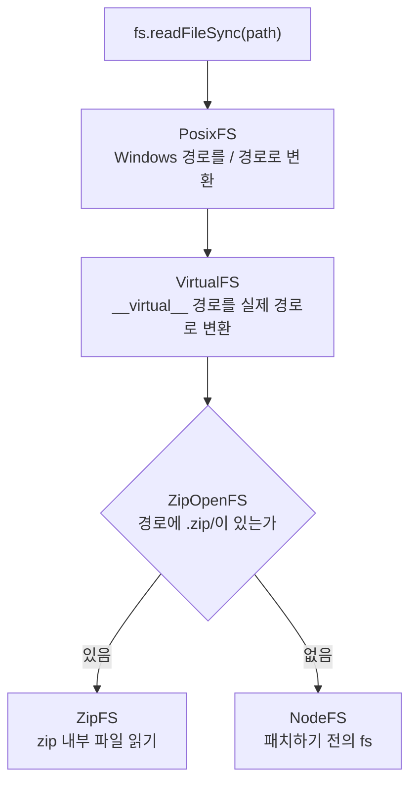

맨 위의 `PosixFS`는 Windows의 `C:\` 경로를 Yarn 내부에서 쓰는 `/` 경로로 바꾸고, `VirtualFS`는 앞에서 본 virtual 패키지의 `__virtual__` 경로를 실제 zip 경로로 바꾸며, `ZipOpenFS`는 경로 안에 zip 파일이 있으면 해당 zip의 `ZipFS`에 요청을 넘기고 없으면 맨 아래의 `NodeFS`로 원래 `fs`를 호출한다.

## ZipOpenFS는 경로에서 zip 파일을 찾는다

`ZipOpenFS`는 경로의 앞부분을 다른 파일 시스템에 연결하는 `MountFS`를 상속하며, 경로 가운데 어디까지가 zip 파일인지 정하는 함수로 `getArchivePart()`를 쓴다.

```typescript
// packages/yarnpkg-libzip/sources/ZipOpenFS.ts (4.18.1)
export function getArchivePart(path: string, extension: string) {
  let idx = path.indexOf(extension);
  if (idx <= 0)
    return null;

  let nextCharIdx = idx;
  while (idx >= 0) {
    nextCharIdx = idx + extension.length;
    // .zip 바로 뒤에 /가 오면 zip 파일 경로를 찾은 것이다
    if (path[nextCharIdx] === ppath.sep)
      break;

    // 이름이 ".zip"인 파일은 zip으로 보지 않는다
    if (path[idx - 1] === ppath.sep)
      return null;

    idx = path.indexOf(extension, nextCharIdx);
  }

  // 경로가 .zip으로 끝나거나 .zip/ 뒤에 하위 경로가 있어야 한다
  if (path.length > nextCharIdx && path[nextCharIdx] !== ppath.sep)
    return null;

  return path.slice(0, nextCharIdx);
}
```

`.yarn/cache/react-npm-19.3.1-40d7671112-f0ed036d12.zip/node_modules/react/index.js`가 들어오면 `getArchivePart()`는 `.zip/` 앞까지인 `.yarn/cache/react-npm-19.3.1-40d7671112-f0ed036d12.zip`을 돌려주고, `ZipOpenFS`는 해당 zip 파일의 `ZipFS`를 열어서 나머지 경로인 `/node_modules/react/index.js`로 파일을 읽는다. 패키지를 불러올 때마다 zip 파일을 새로 열면 느려지기 때문에 `ZipOpenFS`는 한 번 연 `ZipFS`를 `maxOpenFiles`로 정한 80개까지 열어 둔 채 다시 쓴다.

## ZipFS는 zip의 중앙 디렉터리를 읽는다

앞의 tgz와 zip 비교에서 본 것처럼 zip 파일은 끝부분의 중앙 디렉터리에 모든 항목의 이름, 위치, 크기를 기록해 두는데, `ZipFS`는 생성자에서 중앙 디렉터리의 항목 목록을 읽어서 경로마다 항목 번호를 기억하는 `entries`와 폴더마다 하위 항목을 기억하는 `listings`를 만든다.

```typescript
// packages/yarnpkg-libzip/sources/ZipFS.ts (4.18.1, 일부 생략)
this.listings.set(PortablePath.root, new Set<Filename>());

// zip 구현체에서 중앙 디렉터리의 항목 목록을 받아 온다
const listings = this.zipImpl.getListings();
for (let t = 0; t < listings.length; t++) {
  const raw = listings[t] as PortablePath;
  // ...
  const p = ppath.resolve(PortablePath.root, raw);
  // 경로와 항목 번호를 entries에, 부모 폴더와 이름을 listings에 기록한다
  this.registerEntry(p, t);

  // 빈 폴더도 빠지지 않도록 폴더 항목은 listings에 따로 등록한다
  if (raw.endsWith(`/`)) {
    this.registerListing(p);
  }
}
```

`entries`와 `listings`를 만들어 둔 뒤에는 `existsSync()`와 `readdirSync()` 같은 메서드가 압축을 풀지 않고 Map만 조회해서 답할 수 있고, `readFileSync()`가 호출될 때만 `entries`에서 찾은 항목 번호로 해당 파일 하나의 압축을 풀어서 내용을 돌려준다. `statSync()`도 실제 파일이 없으므로 zip 항목의 크기와 권한으로 가짜 stats 객체를 만들어 돌려주며, 수정 시각에는 `SAFE_TIME` 상수(1984-06-22)를 써서 어느 컴퓨터에서 만들어도 같은 값이 나오게 한다.

## libzip을 WebAssembly로 쓰는 이유

`ZipFS`가 기본으로 쓰는 zip 구현체는 C로 작성된 libzip을 Emscripten으로 컴파일한 WebAssembly이며, `@yarnpkg/libzip` 패키지의 `libzipSync.js`에 들어 있다. WebAssembly는 어느 운영체제와 CPU에서도 같은 파일로 실행되고 native addon처럼 설치할 때 빌드할 필요가 없기 때문에, `.pnp.cjs`를 커밋한 저장소를 다른 운영체제에서 clone해도 zip을 읽는 코드가 똑같이 동작한다. 4.18.1에는 `.yarnrc.yml`의 `pnpZipBackend: js`로 고를 수 있는 순수 JavaScript 구현체인 `JsZipImpl`도 실험 기능으로 들어 있다.

## fs 패치가 닿지 않는 곳

`patchFs()`는 `.pnp.cjs`를 불러온 Node 프로세스 안에서 JavaScript 코드가 `fs`를 호출할 때만 동작하기 때문에, 아래의 경우에는 zip 안의 파일을 읽을 수 없다.

- `.node` 확장자의 native addon은 `process.dlopen()`을 거쳐 운영체제의 `dlopen`으로 직접 열리는데, `applyPatch()`가 덮어쓴 `process.dlopen`은 virtual 경로만 실제 경로로 바꿀 뿐 zip 안의 파일을 꺼내 주지 않는다.
- `child_process`로 실행하는 실행 파일이나 C 컴파일러는 Node의 `fs`를 거치지 않고 운영체제에 직접 파일을 요청한다.
- `readOnlyArchives: true` 때문에 설치 스크립트나 실행 중인 코드가 자기 패키지 폴더에 파일을 쓰려고 하면 실패한다.
- Go나 Rust로 만든 도구처럼 Node 위에서 실행되지 않는 프로그램은 `.pnp.cjs`를 불러올 방법이 없다.

앞의 세 경우는 Yarn이 해당 패키지의 압축을 미리 풀어 두는 unplug로 해결하지만 마지막 경우는 도구가 PnP를 직접 구현해야 하며, 처음에 겪은 TypeScript 7 문제도 마지막 경우에 해당한다.

## 마치며

처음에 던진 "Yarn Berry는 어떻게 PnP를 구현했을까?"라는 질문에는, 설치할 때 `node_modules` 폴더 대신 패키지마다 위치와 선언한 의존성을 `.pnp.cjs`에 기록해 두고 실행할 때 `.pnp.cjs`를 사용자 코드보다 먼저 불러와 경로를 계산하는 `Module._resolveFilename`과 파일을 읽는 `fs`를 덮어쓰는 방식으로 구현했다고 답할 수 있다. Node의 모듈 시스템 전체를 새로 만들지 않고 경로 계산과 파일 읽기만 바꾸었기 때문에 캐시 확인과 컴파일, 실행은 Node의 원래 코드로 실행되지만 반대로 Node 프로세스 안에서 `.pnp.cjs`를 불러오지 못하는 도구에는 PnP가 적용되지 않는다. Go로 다시 작성된 TypeScript 7은 Node 위에서 실행되지 않아 `--require`로 `.pnp.cjs`를 먼저 불러올 수 없기 때문에, 덮어쓴 함수가 적용되지 않은 채 디스크에서 `node_modules` 폴더를 찾다가 `Cannot find module 'react-dom/client'` 오류를 냈고 `react/jsx-runtime`의 타입 선언도 찾지 못해 JSX 타입 오류까지 함께 냈다. 같은 프로젝트를 pnpm으로 설치했을 때는 pnpm이 디스크에 `node_modules` 폴더를 실제로 만들어 두었기 때문에 TypeScript 7이 정상적으로 동작했다.
