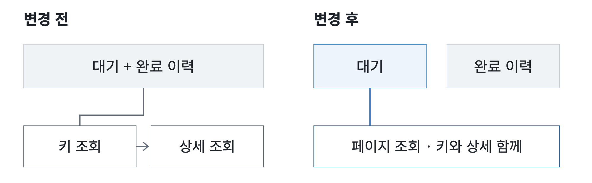
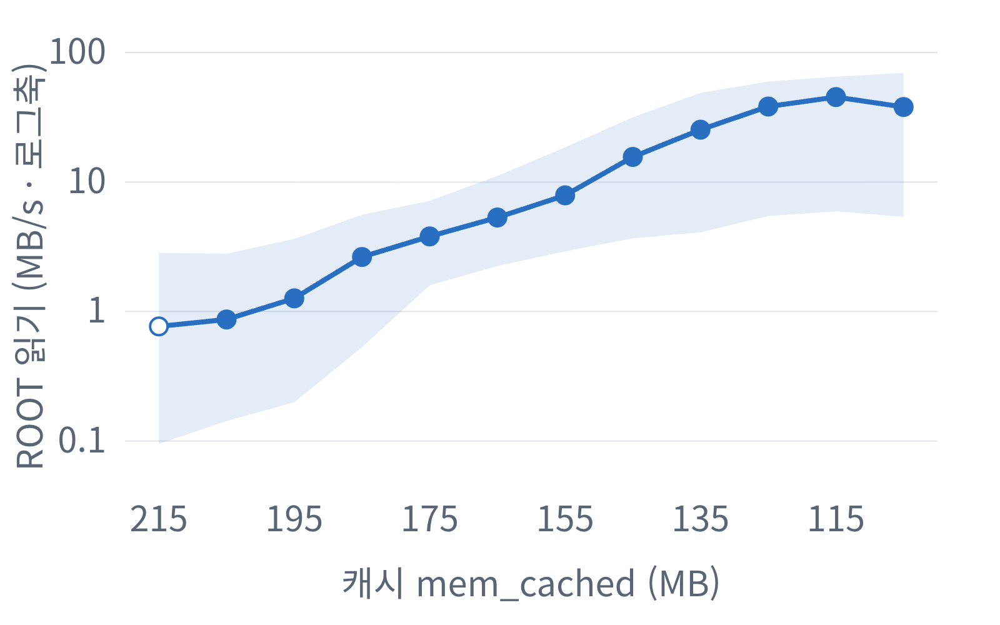
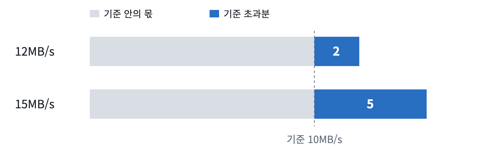
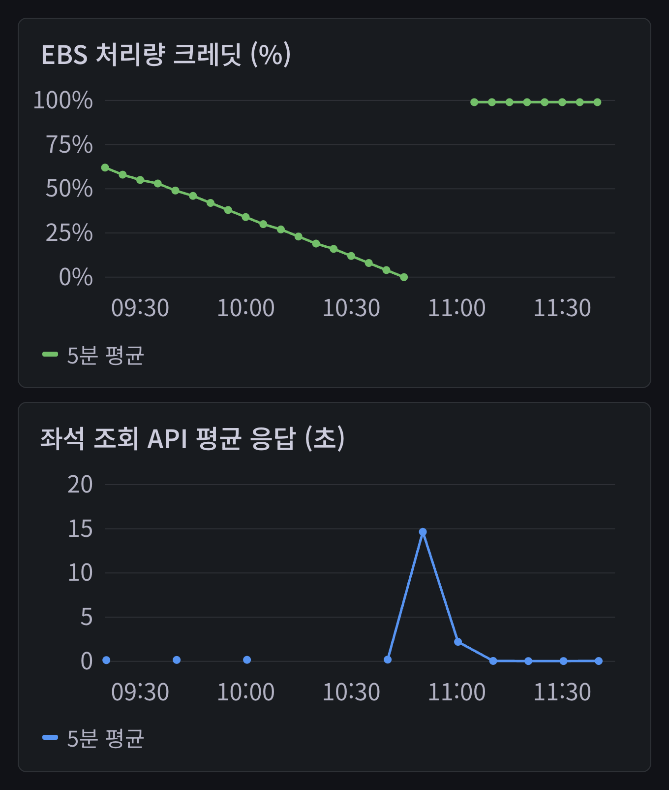
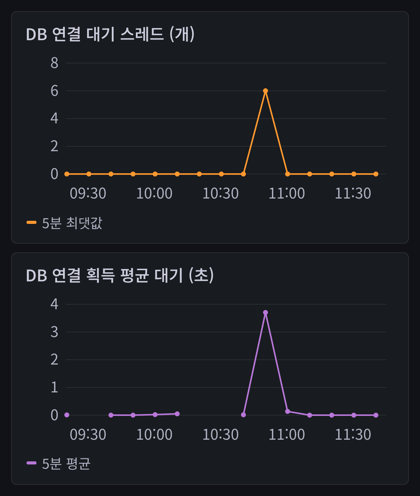

# 10MB가 부족하다

연어버스는 버스의 잔여 좌석을 예보하는 서비스입니다. 메모리가 1GB인 RDS `db.t4g.micro`로 PostgreSQL을 운영하던 중, 쿼리가 지연되고 DB가 재기동하는 일이 반복됐습니다.

사양을 올리기 전에 현재 인스턴스에서 줄일 수 있는 작업부터 찾고 싶었습니다. 당시 검토하던 예보 평가 대기 조회가 그 대상이었는데, 변경이 배포된 뒤에도 읽기 부하가 남아 있어 캐시와 크레딧, 서비스 응답까지 이어서 살펴봤습니다.

## 예보 평가 대기 조회

연어버스에는 아직 평가를 마치지 못한 예보를 DB에 보관하고, 처리할 대상을 주기적으로 찾는 작업이 있습니다. 새로 들어온 작업뿐 아니라 이전 회차에 처리하지 못한 대기도 다음 회차에 다시 조회하는데, 당시에는 이런 대기와 완료 이력이 함께 관리되고 있었습니다.

대기 조회는 호출 횟수가 적었지만, 저장된 SQL 통계에서 실행 시간과 PostgreSQL 버퍼 읽기의 비중이 컸습니다.

다만 PostgreSQL 버퍼에 없는 페이지도 OS 캐시에 남아 있을 수 있으므로, 버퍼 읽기를 인스턴스의 실제 디스크 읽기와 같은 값으로 볼 수는 없습니다. SQL 통계로 개선할 대상을 고른 뒤에는 인스턴스의 실제 읽기 부하도 따로 확인해야 했습니다. 이 글에서 I/O는 스토리지에 데이터를 읽거나 쓰는 작업을 뜻합니다.

<!-- pagebreak -->
## 대기·완료 분리와 조회 통합

검토한 변경에서는 대기와 완료 이력을 별도 테이블로 나누고, 키 조회와 상세 조회를 한 번의 페이지 조회로 묶었습니다. 선택한 키는 같은 SQL 안에서 재사용하며, 같은 페이지의 평가 대상들이 공통으로 쓰는 원본 관측 정보도 공유하는 구조였습니다.

*그림 1. 대기 저장·조회 구조의 변경 전후. 코드 구조를 요약한 도식입니다.*

이 변경은 조회할 대상을 좁히고 같은 페이지를 처리하면서 반복하던 조회를 줄이려는 것이었고, 예보와 결과를 저장하는 작업은 여전히 남습니다. 저장 분리와 조회 재구성이 각각 얼마나 효과를 냈는지 따로 측정한 실험은 아니었습니다.

### SQL 개선 전후의 DATA·ROOT 읽기

배포 뒤에는 쿼리가 사용하는 데이터 쪽과 인스턴스 전체를 나눠 보기 위해 두 볼륨의 읽기를 비교했습니다. **DATA 볼륨**에는 테이블과 인덱스 등 DB 파일이 있고, **ROOT 볼륨**에는 OS와 RDS 관리 프로그램이 있습니다.

배포 전후 각 30분의 기록에서 DATA 읽기는 약 94% 낮아졌지만, ROOT 읽기는 비슷하게 남았고 이후에도 크레딧 고갈과 재기동이 기록됐습니다. 비교한 시간대의 부하와 캐시 상태도 달라졌으므로, 변화 전체를 SQL 개선만의 효과로 계산할 수는 없습니다.

남은 ROOT 읽기를 설명하려고, DB 데이터뿐 아니라 OS와 관리 프로그램이 쓰는 메모리도 살펴봤습니다.

<!-- pagebreak -->
## 전체 메모리와 남은 캐시

OS가 스토리지에서 읽은 파일 내용을 메모리에 남겨 두고 재사용하는 공간을 **페이지 캐시**라고 합니다. 같은 내용이 필요할 때 캐시에 남아 있다면 스토리지를 다시 읽는 일을 줄일 수 있지만, 메모리가 부족해 캐시에서 밀려났다면 다시 필요해졌을 때 스토리지에서 읽어 와야 합니다.

DB 프로세스와 OS, RDS 관리 프로그램이 같은 메모리를 나눠 쓰기 때문에, 다른 용도의 사용량이 늘면 캐시로 남는 공간도 달라질 수 있습니다.[^memory]

메모리 용량은 편의상 GiB·MiB 대신 GB·MB로 표기했습니다. 이 인스턴스에서 OS가 보는 전체 메모리는 약 921MB였고, 그중 RDS 관리 프로세스의 RSS는 평균 약 415MB였습니다. RSS는 프로세스가 실제 RAM에 올려 둔 페이지의 양이지만, 공유 페이지가 중복 집계될 수 있어 모든 프로세스의 RSS를 더한 값을 전체 사용량으로 볼 수는 없습니다.[^processes]

PostgreSQL 자체의 데이터 버퍼인 `shared_buffers`는 약 88MB였고, OS 캐시를 나타내는 `mem_cached`는 평균 약 145MB였습니다. 이 글에서 비교하는 캐시 크기는 `mem_cached` 값이지만, PostgreSQL 공유 메모리가 일부 포함됐을 수 있어 순수한 파일 캐시 크기로 볼 수는 없습니다.

10MB의 비중을 전체 메모리와 남은 캐시에 각각 비교했습니다.

| 비교 기준 | 10MB가 차지하는 비중 |
| --- | ---: |
| OS가 보는 전체 메모리 약 921MB | 약 1.1% |
| 캐시 130~200MB | 약 5~8% |

캐시 지표가 130~200MB 수준일 때는 전체 메모리의 약 1%인 변화도 남은 캐시에서 차지하는 비중이 컸습니다.

캐시에 남은 내용과 그 내용을 얼마나 자주 사용하는지에 따라 읽기량도 달라지므로, 이 비중만으로 읽기량의 변화까지 계산할 수는 없습니다.

<!-- pagebreak -->
## 캐시 크기와 ROOT 읽기

운영 기록을 캐시 크기별로 묶어 ROOT 읽기를 비교했습니다.

*그림 2. 캐시 크기별로 묶은 ROOT 읽기 기록. 가로축은 오른쪽으로 갈수록 캐시가 적은 구간입니다.*

캐시가 적었던 구간에서는 ROOT 읽기가 몇 배씩 높았고, 관리 프로세스가 메모리를 돌려줘 캐시가 늘었을 때는 읽기가 줄어드는 모습도 나타났습니다. 다만 시간대와 부하도 함께 달라졌으므로, 관측된 차이를 모두 메모리만의 효과로 계산할 수는 없었습니다.

저부하 구간 두 곳의 기록에서는 PostgreSQL 프로세스의 읽기량이 DATA 장치의 읽기량과 거의 맞았습니다. 그 차이는 ROOT 읽기에 비하면 작아, ROOT 읽기의 대부분은 PostgreSQL 밖 호스트 작업에서 발생한 것으로 보였습니다. 캐시에서 밀려난 파일·코드 페이지를 다시 읽는 것으로 추정했지만, 어느 프로그램이 어떤 파일을 읽었는지까지는 확인하지 못했습니다.

운영 구간별로 전체 I/O와 크레딧 감소 속도를 비교하니, 부하의 차이보다 잔고가 줄어드는 속도의 차이가 더 컸습니다. 읽기량과 함께 인스턴스가 계속 감당할 수 있는 처리량도 봐야 했습니다.

<!-- pagebreak -->
## 기준 처리량과 크레딧 소모

인스턴스가 계속 감당할 수 있는 I/O 처리량에는 기준이 있으며, RDS가 참조하는 기반 EC2 사양에서 `t4g.micro`의 EBS 기준 처리량은 약 10.88MB/s입니다. 이를 넘는 부하는 남아 있는 처리량 크레딧을 사용해 일정 시간 감당할 수 있습니다. 여기서 말하는 크레딧은 CPU나 IOPS 크레딧과 다릅니다.[^class][^baseline]

크레딧으로 감당해야 하는 부하는 **기준 처리량을 넘은 몫**입니다. 계산을 쉽게 따라갈 수 있도록 아래 예제에서만 기준을 10MB/s로 두고, 전체 I/O가 늘어날 때 초과분이 어떻게 달라지는지 비교했습니다. 실제 인스턴스의 측정값은 아닙니다.

*그림 3. 기준 처리량을 10MB/s로 가정한 계산 예제입니다.*

전체 I/O가 12MB/s일 때 기준을 넘는 몫은 2MB/s이지만, 전체 I/O가 15MB/s가 되면 초과분은 5MB/s가 됩니다. 전체 부하의 증가율만 보면 25%지만, 크레딧으로 감당해야 하는 몫은 두 배 넘게 커집니다.

전체 부하가 기준에 가까울수록 기준을 뺀 나머지가 작아서, 부하가 조금만 늘어도 초과분의 증가율은 커집니다.

이 그림은 부하가 기준을 넘는 동안의 관계를 단순화한 설명입니다. 실제로는 부하가 계속 바뀌고 기준 아래에서는 크레딧이 보충될 수 있어, 이 뺄셈만으로 실제 잔고 변화나 소진 시각을 정확히 예측할 수는 없습니다. 운영 기록에서는 공개 기준으로 계산한 초과분과 실제 크레딧 감소 속도를 나눠 비교했습니다.

<!-- pagebreak -->
### 크레딧 소진 시간

아래 표는 운영 기록을 캐시 크기별로 묶어 비교한 값이며, 전체 I/O에는 ROOT와 DATA의 읽기·쓰기가 모두 들어갑니다. 소진 시간은 크레딧이 가득 찬 상태에서 **각 구간의 감소 속도가 계속된다고 가정한 환산값**입니다.

| 캐시 구간 중심 | 전체 I/O 평균(MB/s) | 기준 초과분(MB/s) | 크레딧 감소(%p/시간) | 100%→0% 환산 |
| --- | ---: | ---: | ---: | ---: |
| 167.5MB | 12.7 | 1.9 | 2.1 | 약 48시간 |
| 157.5MB | 15.9 | 5.0 | 5.2 | 약 19시간 |
| 147.5MB | 24.9 | 14.0 | 13.8 | 약 7시간 |

첫 두 행에서 전체 I/O 평균은 약 25% 늘었지만, 기준을 넘은 몫은 1.9MB/s에서 5.0MB/s로 늘었고 실제 크레딧 감소 속도는 약 2.5배였습니다. 같은 감소 속도가 이어진다면 잔고를 다 쓰는 시간도 약 48시간에서 19시간으로 달라집니다.

`%p/시간`은 크레딧 잔고의 비율이 한 시간에 얼마나 내려가는지 나타내며, 시간당 5.2%p씩 줄어드는 상태라면 100을 5.2로 나눈 약 19시간이 나옵니다. 현재 남은 잔고가 다르거나 그 뒤의 부하가 바뀌면 시간도 달라집니다. 표의 시간은 실제 사건의 지속 시간을 잰 값이 아닙니다.

각 행은 시간대와 부하가 다른 운영 구간을 비교한 값이므로, 캐시를 10MB씩 줄인 실험으로 읽어서는 안 됩니다. 기준 처리량 부근에서는 전체 I/O의 차이가 작아 보여도 크레딧 감소 속도는 크게 달라질 수 있었습니다.

10월 12일에는 캐시가 163MB에서 123MB로 줄어드는 동안 ROOT 읽기가 4.3MB/s에서 46.8MB/s까지 올랐습니다. 오후에 99%였던 크레딧은 높은 읽기 부하가 이어지는 동안 줄어들어, 몇 시간 뒤에는 0으로 기록됐습니다.

이번 기록에서 CloudWatch의 `ReadThroughput`은 DATA 읽기와 맞았지만, 처리량 크레딧 잔고인 `EBSByteBalance%`는 ROOT를 포함합니다.[^storage] DATA 읽기 그래프가 낮다는 이유로 크레딧 소모도 적을 것이라고 판단할 수 없었으므로, 캐시와 읽기 부하를 보면서 잔고가 계속 줄고 있지는 않은지도 확인해야 했습니다.

<!-- pagebreak -->
## 서비스 응답 지연

크레딧이 남아 있으면 기준을 넘는 부하도 일정 시간 처리할 수 있습니다. 대기 시간이 평소 수준인 동안에도 잔고가 줄어들 수 있었으므로, 현재 응답과 남은 처리 여유는 나눠 봐야 했습니다.

10월 16일 오전, 크레딧이 0으로 기록된 무렵 좌석 조회 API의 5분 평균 응답 시간은 고갈 전 135~192ms에서 14.7초로 늘었습니다. 요청량은 분당 수 건이어서 일반적인 성능 차이로 볼 수는 없지만, 적은 요청에도 응답이 오래 걸린 구간이었습니다.

*그림 4. 10월 16일 운영 기록 재구성. API는 10분 간격으로 저장한 5분 평균값이며, 끊긴 구간은 미수집입니다.*

위 그림은 API 전체의 응답 시간이므로, SQL 한 문장이 같은 배수로 느려졌다는 뜻은 아닙니다. API 서버가 DB 연결을 얻기 전에 기다린 시간도 따로 살펴봤습니다.

<!-- pagebreak -->
### DB 연결 대기

API 서버는 미리 만들어 둔 DB 연결을 커넥션 풀에서 빌려 씁니다. 같은 구간에는 연결을 기다리는 스레드가 최대 6개였고, 5분 평균 연결 획득 대기는 약 3.7초였습니다. 연결을 얻지 못해 30초 제한에서 타임아웃된 경우도 기록됐습니다.

*그림 5. 같은 구간의 운영 기록 재구성. 대기 스레드는 5분 최댓값, 획득 대기는 5분 평균입니다(10분 간격 저장).*

대기 스레드 6개를 HTTP 요청 6건으로 셀 수는 없습니다. 고갈 전 DB 연결 수나 PostgreSQL 메모리가 계속 늘어나는 모습은 관측되지 않았고, API 서버의 메모리 기록도 남아 있지 않았습니다. 요청 적체가 RDS 메모리를 더 부족하게 만들었다고 설명할 근거는 없었습니다.

크레딧 고갈과 첫 시간 초과의 정확한 선후관계, AWS 내부의 재기동 조건도 확인하지 못했습니다. 크레딧이 바닥나도 같은 장애로 이어지지 않은 사례가 있었으므로, 잔고 하나만으로 재기동의 원인을 확정하지는 않았습니다.

이후 10월 19일 `db.t4g.small`로 변경했고, 24.6시간 동안의 관측에서는 캐시와 크레딧에 여유가 생긴 것을 확인했습니다. 여러 조건이 함께 바뀌었고 관측도 약 하루였으므로, 이 결과만으로 장기 안정성이나 메모리만의 효과를 판단할 수는 없습니다.

<!-- pagebreak -->
## 최적화 이후의 운영 판단

사양을 올리기 전에 줄일 수 있는 작업을 찾으면서 처음에는 대기 조회의 SQL 통계에 집중했습니다. 하지만 배포 뒤 DATA 읽기가 낮아진 동안에도 ROOT 읽기와 크레딧 소모가 남아 있어, 변경의 효과를 판단하려면 DB 밖에서 쓰는 메모리와 실제 서비스 응답까지 함께 봐야 했습니다.

PostgreSQL의 `shared_buffers`나 `work_mem`을 조정할 때도 DB와 OS, 관리 프로그램이 같은 메모리를 나눠 쓴다는 점을 고려해야 합니다.[^memory] OS에 남은 메모리는 캐시로 활용되기도 하므로, `FreeableMemory` 수치만으로 부족 여부를 판단하기보다는 `SwapUsage`와 디스크 읽기, 서비스 응답 추세를 함께 살펴보는 편이 좋습니다.[^observe]

제목의 10MB는 모든 RDS에 적용되는 장애 기준은 아니지만, 남은 캐시와 I/O 여유가 적었던 이 인스턴스에서는 작지 않은 차이였습니다. 처리량 크레딧을 쓴다면 응답이 정상이어도 잔고가 계속 줄어드는지 살펴야 하고, 감소 속도와 실제 응답을 함께 기록해 두면 같은 부하를 계속 감당할 수 있는지 확인하면서 더 줄일 작업과 사양을 바꿀 시점을 정할 수 있습니다.[^best]

[^memory]: [RDS for PostgreSQL 메모리 구조](https://docs.aws.amazon.com/AmazonRDS/latest/UserGuide/PostgreSQL.Tuning.concepts.memory.html)
[^processes]: [Enhanced Monitoring의 RDS 관리 프로세스 설명](https://docs.aws.amazon.com/AmazonRDS/latest/UserGuide/USER_Monitoring.OS.Viewing.html)
[^class]: [RDS 클래스 사양](https://docs.aws.amazon.com/AmazonRDS/latest/UserGuide/Concepts.DBInstanceClass.Summary.html)
[^baseline]: [EBS 최적화 인스턴스 기준 성능](https://docs.aws.amazon.com/AWSEC2/latest/UserGuide/ebs-optimized.html)
[^storage]: [AWS의 RDS 스토리지 지표 설명](https://docs.aws.amazon.com/AmazonRDS/latest/UserGuide/CHAP_Storage.html)
[^observe]: [AWS의 PostgreSQL 메모리 관측 안내](https://aws.amazon.com/blogs/database/understand-memory-management-in-amazon-rds-for-postgresql-to-avoid-out-of-memory/)
[^best]: [AWS의 RDS 운영 권장사항](https://docs.aws.amazon.com/AmazonRDS/latest/UserGuide/CHAP_BestPractices.html)
