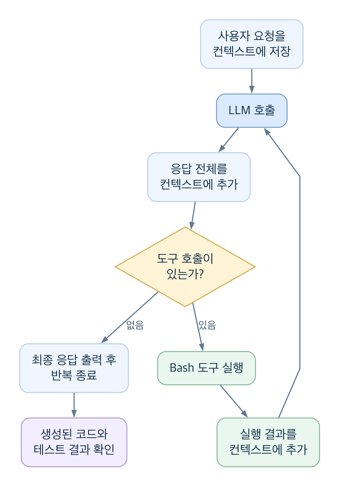

# 프레임워크 없이 코딩 에이전트 만들기

## 들어가며

클로드 코드(Claude Code), 코덱스(Codex)와 같은 코딩 에이전트는 대규모 언어 모델(LLM, Large Language Model)을 활용해 코드를 작성하고 수정하며 테스트를 실행하는 시스템입니다.

이 글에서는 에이전트 프레임워크 없이 코딩 에이전트를 직접 만들어 봅니다. LLM에 메시지를 보내는 코드에서 시작해, 대화 내용을 관리하고 도구를 실행하는 기능을 차례로 추가합니다. 마지막에는 완성한 에이전트에 문자열 덧셈 계산기 구현과 테스트를 맡겨 동작을 확인합니다.

에이전트를 만드는 방법에는 프레임워크를 활용하는 방법과 필요한 기능을 직접 구현하는 방법이 있습니다. 예를 들어 [OpenAI Agents SDK](https://developers.openai.com/api/docs/guides/agents/sdk)는 에이전트 개발에 사용할 수 있는 도구입니다. 프레임워크는 반복 실행과 상태 관리 같은 공통 기능을 묶어 구현 부담을 줄이는 데 도움이 됩니다. 다만 프레임워크 사용이 필수는 아닙니다. 이 글에서는 LLM 호출과 도구 실행이 어떻게 연결되는지 이해하기 위해 반복문과 도구 실행 함수를 직접 작성합니다. API 통신에는 OpenAI Python SDK를 사용하되, 에이전트의 흐름을 관리하는 프레임워크는 사용하지 않습니다.

# AI 에이전트란?

인공지능(AI) 에이전트는 사용자의 목표를 달성하기 위해 다음 행동을 결정하고, 도구를 실행하며, 실행 결과를 바탕으로 작업을 이어 가는 시스템입니다. 코딩 에이전트는 이 과정을 코드 작성·수정과 테스트에 적용합니다.

이 글에서 만들 에이전트는 세 요소로 구성됩니다.

> AI 에이전트 = LLM + 컨텍스트 + 도구

**LLM**은 사용자 요청과 현재 상황을 바탕으로 다음 행동을 결정합니다. 확인할 파일, 수정할 코드, 실행할 테스트 등을 판단합니다.

**컨텍스트(context)**는 LLM이 판단할 때 참고하는 정보입니다. 사용자 요청, 이전 대화, 파일 내용, 도구 실행 결과 등이 포함됩니다.

**도구(tool)**는 파일 읽기·쓰기, 명령어 실행처럼 실제 작업을 수행하는 기능입니다. 프로그램은 LLM이 요청한 도구를 실행하고 결과를 돌려줍니다.

## 에이전트가 해결할 문제: 문자열 덧셈 계산기

에이전트에 문자열을 받아 정수의 합을 반환하는 `add` 함수와 테스트를 작성하도록 요청합니다. 요구사항은 우아한테크코스 프리코스의 문자열 덧셈 계산기 문제를 바탕으로 구성했습니다.

- 빈 문자열을 입력하면 `0`을 반환합니다.
- 쉼표(`,`)와 콜론(`:`)으로 구분한 숫자의 합을 반환합니다. 예를 들어 `"1,2"`는 `3`, `"1,2:3"`은 `6`을 반환합니다.
- 문자열 앞부분의 `//`와 줄바꿈 문자(`\n`) 사이에 커스텀 구분자를 지정할 수 있습니다. 예를 들어 `"//;\n1;2;3"`은 세미콜론(`;`)을 구분자로 사용하며 `6`을 반환합니다.
- 커스텀 구분자는 기본 구분자인 쉼표, 콜론과 함께 사용할 수 있습니다.
- 숫자가 아닌 값이나 음수가 포함되면 `ValueError`를 발생시킵니다.

예제의 `\n`은 실제 줄바꿈 문자를 나타냅니다.

## 개발 환경 구성

Python과 OpenAI Python SDK(Software Development Kit)를 사용합니다.

| 항목 | 버전 |
| --- | --- |
| Python | 3.13 이상 |
| OpenAI Python SDK(`openai`) | 3.41.0 이상 |

명령 실행에는 Bash를, LLM은 `gpt-6-luna`를 사용합니다.

아래 명령은 macOS·Linux 또는 WSL의 Bash 환경을 기준으로 합니다. Python 3.13 이상이 설치되어 있는지 확인한 뒤, 실습 폴더와 가상 환경을 만들고 SDK를 설치합니다.

```bash
python3 --version
mkdir coding-agent
cd coding-agent
python3 -m venv .venv
source .venv/bin/activate
python -m pip install "openai>=3.41.0"
```

SDK 설치와 기본 호출 방법은 [OpenAI 공식 Python SDK 안내](https://developers.openai.com/api/docs/libraries)에서도 확인할 수 있습니다.

[OpenAI Platform](https://platform.openai.com/)에서 API 키를 발급받은 뒤, 터미널에서 환경 변수를 설정합니다.

```bash
export OPENAI_API_KEY="발급받은_API_키"
```

## LLM 응답 받기

OpenAI API에 메시지를 보내고 응답을 출력합니다.

```py
from openai import OpenAI

client = OpenAI()

response = client.responses.create(
    model="gpt-6-luna",
    input="안녕하세요. 제 이름은 행성이입니다."
)

print(response.output_text)
```

다음은 응답 예시입니다. 실제 응답은 호출마다 달라질 수 있습니다.

```txt
안녕하세요, 행성이님! 만나서 반가워요. 무엇을 도와드릴까요?
```

## 컨텍스트로 대화 이어 가기

이름을 알려 준 뒤, 두 번째 API 호출에서 이름을 물어봅니다.

```py
from openai import OpenAI

client = OpenAI()

response1 = client.responses.create(
    model="gpt-6-luna",
    input="안녕하세요. 제 이름은 행성이입니다."
)

response2 = client.responses.create(
    model="gpt-6-luna",
    input="제 이름이 뭔가요?"
)

print(f"Response1:{response1.output_text}")
print(f"Response2:{response2.output_text}")
```

두 번째 호출에서는 다음과 같은 응답을 받을 수 있습니다.

```txt
Response1: 안녕하세요, 행성이님! 만나서 반가워요. 무엇을 도와드릴까요?
Response2: 아직 이름을 알려주지 않으셔서 알 수 없어요.
```

각 API 호출은 기본적으로 독립적입니다. 같은 `client`를 사용해도 이전 대화가 자동으로 전달되지는 않습니다.

LLM이 이전 대화를 참고하도록 메시지를 `context`에 저장하고, 다음 호출에 함께 전달합니다.

```py
from openai import OpenAI

client = OpenAI()

context = []

# 첫 번째 사용자 메시지를 저장합니다.
context.append({
    "role": "user",
    "content": "안녕하세요. 제 이름은 행성이입니다."
})

response1 = client.responses.create(
    model="gpt-6-luna",
    input=context
)

# LLM의 응답과 두 번째 사용자 메시지를 저장합니다.
context.append({
    "role": "assistant",
    "content": response1.output_text
})
context.append({
    "role": "user",
    "content": "제 이름이 뭔가요?"
})

response2 = client.responses.create(
    model="gpt-6-luna",
    input=context
)

print(f"Response1:{response1.output_text}")
print(f"Response2:{response2.output_text}")
```

`context`는 메시지를 순서대로 저장하는 리스트입니다. 각 메시지는 다음 정보를 담습니다.

- `role`: 메시지를 보낸 주체입니다. `user`는 사용자, `assistant`는 LLM을 나타냅니다.
- `content`: 메시지 내용입니다.

두 번째 호출에 이전 대화를 함께 전달하면 LLM이 이름을 답할 수 있습니다.

```txt
Response1: 안녕하세요, 행성이님! 만나서 반가워요. 무엇을 도와드릴까요?
Response2: 행성이님입니다.
```

코딩 작업에서도 같은 방식으로 정보를 전달합니다. 파일 내용과 테스트 결과를 컨텍스트에 추가하면 LLM이 다음 행동을 결정할 때 참고할 수 있습니다.

## Bash 도구 연결하기

에이전트가 파일을 읽고 수정하거나 테스트를 실행하도록 Bash 도구를 추가합니다.

LLM은 사용할 도구와 인자를 요청하고, 프로그램은 요청받은 도구를 실행합니다. OpenAI API에서는 도구 실행 요청을 함수 호출(function calling)로 표현합니다.

### Bash 실행 함수 작성하기

Bash 명령을 실행하고 결과를 반환하는 Python 함수를 작성합니다.

```py
import subprocess
from pathlib import Path

WORKDIR = Path.cwd().resolve()


def bash(command: str) -> dict:
    result = subprocess.run(
        ["bash", "-c", command],
        cwd=WORKDIR,
        capture_output=True,
        text=True,
        errors="replace",
        timeout=30,
    )
    return {
        "exit_code": result.returncode,
        "stdout": result.stdout,
        "stderr": result.stderr,
    }
```

`bash` 함수는 `WORKDIR`을 작업 폴더로 지정해 명령을 실행합니다. 실행 결과로 종료 코드(`exit_code`), 표준 출력(`stdout`), 표준 오류(`stderr`)를 반환합니다.

`cwd`는 작업 폴더만 지정하며 파일 접근 범위를 제한하지 않습니다. 실험할 때는 격리된 환경을 사용하세요.

### 도구 정의 작성하기

LLM에 도구의 기능과 인자 형식을 알려 주는 도구 정의(tool definition)를 작성합니다.

```py
tools = [
    {
        "type": "function",
        "name": "bash",
        "description": (
            "작업 폴더에서 Bash 명령을 실행합니다. "
            "파일 조회, 검색, 생성, 수정, 테스트 실행 등에 사용합니다. "
            "각 호출은 새 셸에서 실행하므로 cd나 환경 변수 설정은 다음 호출에 유지되지 않습니다."
        ),
        "parameters": {
            "type": "object",
            "properties": {
                "command": {
                    "type": "string",
                    "description": "실행할 Bash 명령",
                },
            },
            "required": ["command"],
            "additionalProperties": False,
        },
        "strict": True,
    },
]
```

도구 정의의 주요 항목은 다음과 같습니다.

- `name`: 도구 이름입니다.
- `description`: 도구의 기능과 사용 방법입니다.
- `parameters`: 도구에 전달할 인자를 JSON 스키마(JSON Schema)로 정의합니다.

여기서는 문자열 인자 `command` 하나를 필수로 받습니다. `strict=True`로 인자가 스키마를 따르도록 하고, `additionalProperties=False`로 정의하지 않은 인자를 허용하지 않습니다.

이 설정의 제약과 동작은 [OpenAI 공식 함수 호출 가이드](https://developers.openai.com/api/docs/guides/function-calling#strict-mode)를 참고하세요. 이 글처럼 객체의 모든 속성을 `required`에 포함하고 `additionalProperties`를 `False`로 설정해야 strict 모드를 사용할 수 있습니다. 인자가 스키마에 맞더라도 명령 자체가 올바르거나 안전하다는 뜻은 아니므로, 실행 결과를 별도로 확인해야 합니다.

## 에이전트 루프 구성하기

LLM 호출, 컨텍스트 관리, 도구 실행을 반복문으로 연결합니다.

1. 사용자 요청을 포함한 컨텍스트를 LLM에 전달합니다.
2. LLM의 응답 전체를 컨텍스트에 추가합니다.
3. 응답에 도구 호출이 있으면 도구를 실행하고 결과를 컨텍스트에 추가합니다.
4. 갱신한 컨텍스트로 LLM을 다시 호출합니다.
5. 응답에 도구 호출이 없으면 반복을 종료합니다.

다음 그림에서 도구 실행 결과는 컨텍스트에 다시 합류합니다. 테스트에 실패해도 같은 경로로 오류가 전달되므로, LLM은 이를 참고해 수정과 재실행을 요청할 수 있습니다.



[흐름도 원본(Mermaid)](assets/level4-smile-technical-writing/agent-loop.mmd)

그림은 일반적인 반복 흐름을 나타냅니다. 아래 코드는 응답이 완료되지 않거나 최대 API 호출 횟수를 넘으면 예외를 발생시킵니다.

하나의 파일에 `OpenAI` 클라이언트 초기화 코드, `bash` 함수, `tools` 정의를 작성한 뒤 다음 코드를 추가합니다.

파일 이름은 `agent.py`로 지정하고, 실습 폴더에 저장합니다. 앞의 대화 예제들은 원리를 설명하는 별도 예제이므로 이 파일에 넣지 않습니다. 최종 파일에는 다음 순서로 코드를 모읍니다.

1. `from openai import OpenAI`와 `client = OpenAI()`
2. ‘Bash 실행 함수 작성하기’의 코드 전체: `subprocess`·`Path` import, `WORKDIR`, `bash` 함수
3. ‘도구 정의 작성하기’의 `tools` 정의 전체
4. 아래의 `import json`부터 마지막 `else`까지의 에이전트 루프

```py
import json

context = [{
    "role": "user",
    "content": (
        "문자열을 받아 정수의 합을 반환하는 add 함수를 구현해줘. "
        "빈 문자열은 0을 반환하고, 쉼표와 콜론을 구분자로 사용해. "
        "입력 앞의 //와 실제 줄바꿈 사이에 선언한 커스텀 구분자도 "
        "기본 구분자에 추가해서 사용할 수 있어야 해. "
        "숫자가 아닌 값이나 음수가 있으면 ValueError를 발생시켜. "
        "구현은 calculator.py에, unittest 테스트는 test_calculator.py에 작성해. "
        "python -m unittest -v로 테스트를 실행해줘."
    ),
}]

handlers = {"bash": bash}

for step in range(1, 31):
    response = client.responses.create(
        model="gpt-6-luna",
        instructions=(
            "당신은 코딩 에이전트입니다. "
            "bash로 파일을 확인하고 생성·수정하세요. "
            "도구 실행이 실패하면 오류를 확인하고 수정하세요. "
            "마지막에 변경 내용과 실제 테스트 결과를 설명하세요."
        ),
        input=context,
        tools=tools,
        parallel_tool_calls=False,
    )

    if response.status != "completed":
        raise RuntimeError(f"응답이 완료되지 않았습니다:{response.status}")

    context.extend(response.output)

    calls = [
        item
        for item in response.output
        if item.type == "function_call"
    ]

    if not calls:
        print(response.output_text)
        break

    for call in calls:
        print(f"[도구 호출]{call.name}:{call.arguments}", flush=True)
        try:
            args = json.loads(call.arguments)
            result = handlers[call.name](**args)
        except Exception as exc:
            result = {
                "error": type(exc).__name__,
                "message": str(exc),
            }

        print(json.dumps(result, ensure_ascii=False, indent=2), flush=True)

        context.append({
            "type": "function_call_output",
            "call_id": call.call_id,
            "output": json.dumps(result, ensure_ascii=False),
        })
else:
    raise RuntimeError("최대 API 호출 횟수(30회)를 초과했습니다.")
```

`instructions`에는 에이전트의 작업 지침을, `tools`에는 사용할 도구 정의를 전달합니다. `parallel_tool_calls=False`는 응답 하나에 포함할 도구 호출을 최대 하나로 제한합니다.

`context.extend(response.output)`은 텍스트와 도구 호출을 포함한 응답 전체를 컨텍스트에 저장합니다.

응답에 `function_call`이 있으면 프로그램은 `handlers`에서 해당 함수를 찾아 실행합니다. 실행 결과는 `function_call_output`으로 컨텍스트에 추가합니다. 이때 `call_id`로 도구 호출과 실행 결과를 연결합니다.

`call_id`는 모델이 요청한 호출과 프로그램이 반환하는 결과를 짝짓는 식별자입니다. 도구 호출의 `call.call_id`를 결과의 `call_id`에 그대로 넣어야 합니다. 응답 항목 자체의 `id`와 혼동하지 않도록 주의하세요. 전체 요청·응답 흐름은 [OpenAI 공식 함수 호출 가이드의 실행 결과 반환 예제](https://developers.openai.com/api/docs/guides/function-calling#handling-function-calls)를 참고할 수 있습니다.

테스트가 실패하면 LLM은 컨텍스트에 담긴 오류를 참고해 코드 수정과 테스트 재실행을 요청할 수 있습니다. 반복이 끝없이 이어지지 않도록 API 호출 횟수는 최대 30회로 제한합니다.

**반복 종료는 구현 성공을 뜻하지 않습니다.** 이 코드는 테스트 통과 여부를 검사해 반복을 끝내지 않습니다. LLM의 응답에 도구 호출이 없으면 종료하므로, 테스트를 실행하지 않았거나 실패한 상태에서도 끝날 수 있습니다. 종료 후에도 생성된 코드와 테스트 결과를 확인해야 합니다.

## 에이전트 실행하기

가상 환경을 활성화하고 API 키를 설정한 같은 터미널에서, `agent.py`가 있는 실습 폴더를 작업 폴더로 사용해 실행합니다.

```bash
python agent.py
```

에이전트는 `WORKDIR` 아래에 계산기와 테스트 파일을 작성합니다. 요청대로 파일이 생성되면 폴더 구조는 다음과 같습니다.

```txt
coding-agent/
├── .venv/
├── agent.py              # 직접 작성한 에이전트
├── calculator.py         # 에이전트가 작성한 계산기
└── test_calculator.py    # 에이전트가 작성한 테스트
```

### 실행 과정 살펴보기

에이전트는 한 번의 응답으로 모든 작업을 끝내는 대신, 도구 실행 결과를 받아 다음 행동을 결정합니다. 다음 표는 계산기를 구현할 때 가능한 실행 흐름을 설명하기 위한 예시입니다. 실제 명령과 호출 순서는 달라질 수 있습니다.

| 단계 | LLM이 요청하는 작업 | 프로그램의 동작과 다음 판단에 쓰이는 정보 |
| --- | --- | --- |
| 1. 작업 폴더 확인 | Bash로 현재 파일 조회 | 파일 목록을 컨텍스트에 추가 |
| 2. 구현과 테스트 작성 | Bash로 `calculator.py`와 `test_calculator.py` 생성 | 파일 작성 명령의 종료 코드와 출력을 컨텍스트에 추가 |
| 3. 테스트 실행 | Bash로 python -m unittest -v 실행 | 테스트 결과와 오류 메시지를 컨텍스트에 추가 |
| 4. 수정 또는 마무리 | 실패 원인에 따라 코드 수정·재실행을 요청하거나 최종 응답 작성 | 도구 호출이 있으면 계속 실행하고, 없으면 반복 종료 |

앞서 넣은 `print` 문으로 도구 이름·인자와 실행 결과를 터미널에서 볼 수 있습니다. 다음은 출력 형식을 설명하기 위해 구성한 예시이며, 실제 실행 로그를 새로 수집한 것은 아닙니다. 파일 작성 명령과 테스트별 출력은 생략했습니다.

```txt
[도구 호출]bash:{"command":"ls"}
{
  "exit_code": 0,
  "stdout": "agent.py\n",
  "stderr": ""
}

... calculator.py와 test_calculator.py를 작성하는 도구 호출 및 결과 생략 ...

[도구 호출]bash:{"command":"python -m unittest -v"}
{
  "exit_code": 0,
  "stdout": "",
  "stderr": "... 테스트별 출력 생략 ...\nOK\n"
}

calculator.py와 test_calculator.py를 작성하고 테스트를 실행했습니다.
```

첫 번째 Bash 호출의 결과를 받은 LLM은 파일 작성 명령을 요청할 수 있습니다. 작성 결과를 받은 뒤 테스트를 요청하고, 테스트가 실패하면 그 오류를 참고해 다시 수정합니다. 마지막 줄과 같은 최종 응답을 받으면 코드가 `if not calls` 분기에서 응답을 출력하고 반복을 끝냅니다.

종료 후에는 같은 폴더에서 테스트를 직접 다시 실행합니다.

```bash
python -m unittest -v
```

종료 코드가 `0`이고 테스트 출력이 `OK`인지 확인합니다. 테스트가 실제로 발견되어 실행되었는지도 확인해야 합니다. `Ran 0 tests`라면 테스트를 검증한 것으로 볼 수 없습니다. 테스트가 통과하더라도 빠진 요구사항이 있을 수 있으므로, 생성된 구현과 테스트 항목을 앞의 요구사항 목록과 대조합니다.

## 계산기 구현 결과 확인하기

완성한 에이전트에 계산기 구현과 테스트를 맡겼습니다. 에이전트가 작성한 `add` 함수의 실행 결과는 다음과 같습니다.

| 입력 | 결과 | 확인한 동작 |
| --- | --- | --- |
| `""` | `0` | 빈 문자열 처리 |
| `"1,2"` | `3` | 쉼표로 구분 |
| `"1,2:3"` | `6` | 쉼표와 콜론 혼용 |
| `"//;\n1;2;3"` | `6` | 커스텀 구분자 사용 |
| `"//;\n1;2,3:4"` | `10` | 커스텀 구분자와 기본 구분자 혼용 |
| `"1,-2,3"` | `ValueError` | 음수 입력 거부 |
| `"1,a,3"` | `ValueError` | 숫자가 아닌 입력 거부 |

위 동작을 확인하는 테스트를 포함해 총 10개의 테스트가 모두 통과했습니다.

## 에이전트의 핵심 구조

구현한 코딩 에이전트에서 각 요소는 다음 역할을 맡습니다.

- **LLM:** 컨텍스트를 바탕으로 다음 행동과 사용할 도구를 결정합니다.
- **컨텍스트:** 사용자 요청, 이전 응답, 도구 실행 결과를 다음 LLM 호출에 전달합니다.
- **도구:** 파일 작성·수정과 테스트 실행을 수행합니다.

세 요소는 에이전트 루프에서 다음 순서로 동작합니다.

> LLM의 판단 → 도구 실행 → 실행 결과를 컨텍스트에 추가 → LLM의 다음 판단

테스트 실패 결과도 다음 코드 수정을 위한 정보가 됩니다. 코딩 에이전트의 핵심은 **판단에 따라 도구를 실행하고, 실행 결과를 다음 판단에 반영하는 반복 구조**입니다.
