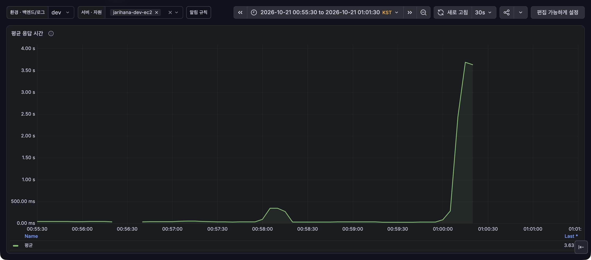
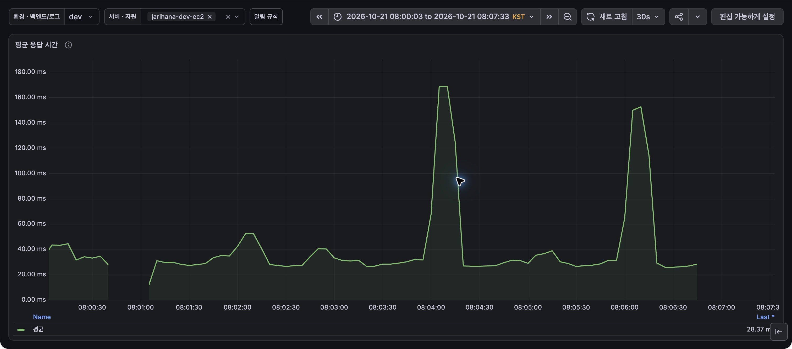

# 들어가며

자리하나?는 우아한테크코스의 동아리, 스터디, 일회성 모임을 한곳에서 찾고 참여할 수 있도록 만든 서비스입니다. 기존에는 모임 정보가 슬랙의 여러 채널과 메시지에 흩어져 있었으며, 관심 있는 모임에 관한 글이 없어 활동 내용이나 참여 방법 등의 정보를 얻지 못하는 불편도 있었습니다.

또한 크루들과 즐겁게 보낸 일회성 모임도 시간이 지나면 슬랙의 대화 속에 묻히곤 했습니다. 그래서 흩어진 모임 정보를 한곳에 모아 찾기 쉽게 하고, 함께한 활동은 다음 기수의 크루들이 새로운 스터디와 모임을 시작할 때 참고할 수 있는 기록으로 남기고자 했습니다.

이 글은 Spring과 자바 영속성 API(Java Persistence API, JPA)로 데이터 생성, 조회, 수정, 삭제를 구현해 본 개발자를 대상으로 하며, 모임 생성 요청이 기다리는 알림 저장 과정에서 지연의 원인을 찾고 개선한 경험을 다룹니다. 모임과 알림을 같은 트랜잭션으로 처리하는 조건을 유지하면서 반복 조회와 개별 저장을 줄인 과정과 함께, 저장 방식을 선택한 이유와 검증 결과를 설명합니다.

자리하나?: https://www.jarihana.com

## 1. 부하 테스트를 하려는데, 트래픽이 너무 적다

자리하나?의 핵심 지표 중 하나가 모임 수인 만큼, 모임 생성 요청에 대한 서버의 처리 한계를 확인하기 위해 부하 테스트를 진행했습니다.

### 한 달에 모임 11건, 이걸로 성능을 잴 수 있을까?

PostHog로 확인한 실제 이용 지표를 바탕으로 테스트 기준을 세우려 했지만, 2026년 9월 15일부터 10월 13일약 1개월 간 생성된 모임은 11건뿐이었습니다. 이 중 첫 모집까지 연결된 모임은 9개였습니다.

모임 생성, 첫 모집 개설, 상세 조회의 세 요청을 한 흐름으로 계산한 평균 요청률은 약 0.00001317 RPS(Requests Per Second, 초당 요청 수)로, 이 빈도를 그대로 적용하면 15분 동안 예상되는 요청도 1건에 미치지 못했습니다. 따라서 실제 빈도를 재현하는 것만으로는 응답 시간을 평가할 표본을 확보하기 어려웠습니다.

### 999명에게 알림을 남겼더니, 모임 생성에 15.6초

자리하나?에서는 모임이 생성될 때마다 푸시 알림을 구독한 회원에게 알림을 남기므로, 실제 요청 빈도와 별개로 회원이 늘었을 때 한 번의 생성 요청이 처리할 작업량도 확인하기로 했습니다. 당시 우아한테크코스 전체 기수의 크루 1,000명이 모두 서비스를 이용하는 낙관적인 상황을 가정했습니다. 이 가운데 모임장을 제외한 모든 회원이 브라우저 하나에서 푸시 알림을 켰다고 보고, 알림 수신자를 999명으로 설정했습니다.

그런데 이 조건에서 모임을 한 번 생성하자 응답까지 15.6초가 걸렸고, 요청이 몰리지 않은 상황에서도 응답이 늦어 한 요청 안에서 어떤 작업을 기다리는지 살펴보기 시작했습니다. 다만 이 수치는 수신자 999명 조건의 단건 관찰값으로, 이후 수신자 200명 조건의 시험과 직접 비교하는 개선 전 기준값으로 사용하지는 않습니다.

## 2. 모임 생성 요청 한 건, 저장할 데이터는 몇 건일까?

이번 부하 테스트에서는 모임을 생성한 뒤 첫 모집을 열고 신청 가능한 상태인지 확인하는 과정을 하나의 **모임 생성 시나리오**로 정했으며 해당 시나리오는 다음 세 API를 순서대로 한 번씩 호출했습니다.

1. **모임 생성**: `POST /api/groups`로 모임을 생성하고 `groupId`를 확인합니다.
2. **첫 모집 개설**: 같은 회원이 `POST /api/groups/{groupId}/recruitments`로 첫 모집을 엽니다.
3. **상세 조회**: `GET /api/groups/{groupId}`로 활성 상태와 신청 가능 여부, 잔여 정원을 확인합니다.

이 글에서 **모임 생성 요청 한 건**은 첫 번째 API 호출을 가리키며 **모임 생성 응답 시간**도 이 요청에 걸린 시간만을 뜻합니다. 세 API를 모두 호출해 다른 회원이 신청할 수 있는 상태까지 확인한 경우는 **개설 흐름 완료**로 구분했습니다.

### 요청 한 건 안에서 무슨 일을 하고 있었을까?

모임 생성 요청 한 건 안에서는 모임 정보뿐 아니라 회원별 알림과 브라우저 구독별 전송 대기도 함께 저장하므로, 요청 수가 같더라도 알림을 받을 대상이 늘면 저장해야 할 데이터가 많아집니다. 이때 알림과 전송 대기는 다음과 같이 역할과 저장 단위가 나뉩니다.

- **알림**은 회원이 서비스 알림함에서 확인하고 읽거나 삭제하는 기록으로, 회원별로 저장합니다.
- **전송 대기**는 어느 브라우저에 푸시 알림을 보내야 하는지 남긴 작업 기록으로, 브라우저 구독별로 저장합니다. 코드의 `delivery`는 이 글에서 전송 대기로 부르겠습니다.

예를 들어 한 회원이 크롬과 사파리에서 각각 푸시 알림을 켰다면, 서비스 알림함에 남길 알림은 하나지만 두 브라우저로 푸시를 보내야 하므로 전송 대기는 두 개가 필요합니다. 이렇게 전송 대기를 데이터베이스에 남겨 두면 서버가 재시작되거나 푸시 전송이 실패해도 처리하지 못한 작업을 다시 시도할 수 있습니다.

### 푸시는 나중에 보내는데, 응답은 왜 늦어질까?

모임 정보와 알림, 전송 대기의 저장을 하나의 트랜잭션으로 묶었습니다. 모임만 생성되고 알림은 누락되는 상황을 막기 위해, 하나라도 저장에 실패하면 전체를 롤백하고 모두 성공한 경우에만 함께 커밋하도록 했습니다.

알림 저장 로직은 이벤트 리스너로 분리했지만 `@TransactionalEventListener`의 `BEFORE_COMMIT` 단계에서 실행되도록 해 모임 생성과 같은 트랜잭션에 참여하게 했습니다. 따라서 모임 생성 요청은 알림과 전송 대기의 저장을 모두 마치고 트랜잭션이 커밋돼야 성공 응답을 반환할 수 있습니다.

실제 푸시는 커밋 후 워커가 별도로 전송하지만 알림과 전송 대기의 저장은 응답 전에 끝나야 하므로 수신자가 늘어 저장할 데이터가 많아질수록 모임 생성 응답도 늦어졌던 것 이였습니다.

### 요청은 그대로인데, 수신자만 늘리면?

수신자가 늘어날 때 어느 지점에서 모임 생성 응답이 기준을 넘는지 확인하고자, 요청량은 고정한 채 알림 수신자를 0명부터 단계적으로 늘렸습니다. 요청량은 세 API를 합해 0.1 HTTP RPS로 맞췄으며, 시나리오 한 번에 세 요청이 발생하므로 전체 시나리오를 약 30초에 한 번씩 실행하는 조건이었습니다.

여기서 수신자 수는 동시 요청 수가 아니라 **모임 생성 요청 한 건이 알림을 남길 대상 수**를 뜻하며, 회원당 브라우저 구독을 하나로 통일했기 때문에 수신자가 200명이면 생성 요청 한 건에서 알림 200건과 전송 대기 200건을 저장하게 됩니다.

수신자 수에 따른 저장 비용을 비교할 수 있도록 dev 애플리케이션과 전용 테스트 데이터베이스에서 시험을 진행하고, 외부 푸시와 전송 워커는 껐습니다. 모임 생성 조건도 동일하게 맞춰 이미지 처리나 재모집, 반복 일정 등의 추가 작업을 제외했으며, 테스트 준비를 위한 요청은 실제 성능을 측정하는 요청과 구분해 집계했습니다.

각 수신자 조건에서는 모임 생성 요청 한 건의 응답이 2초 이내인지 먼저 확인하고, 이를 통과했을 때만 요청을 반복하는 본 부하로 넘어가도록 했으며, 본 부하의 통과 기준은 모임 생성과 첫 모집 개설 API 각각의 응답 시간 95번째 백분위 값(p95)이 1초 이내인 것으로 정했습니다.

이렇게 수신자를 늘려 가던 중 200명 조건에서 단건 응답이 2초를 넘었고, 같은 조건으로 다시 확인해도 기준을 충족하지 못해 본 부하를 보류하고 수신자 증가도 멈췄습니다. 이후에는 200명을 이번 시험의 최대 수신자로 두고 해당 조건에서 지연의 원인을 분석한 뒤, 개선 효과도 같은 수신자 조건에서 확인했습니다. 시험별 조건과 결과는 부하테스트 실험일지에 남겼습니다.

## 3. 수신자 200명에서, 본 부하를 시작하지 못했다

요청률을 동일하게 유지한 채 알림 수신자를 늘려 가자 모임 생성 응답 시간도 길어졌으며, 수신자 175명에서는 본 부하의 기준인 p95 1초에 가까워졌습니다. 아래는 개선 전 본 부하 결과의 일부로, 각 수신자 조건에서 수집한 모임 생성 API 응답 10건을 기준으로 정리했습니다.

| 알림 수신자 | 생성 p95 | 생성 p99   | 해석                             |
| ----------- | -------- | ---------- | -------------------------------- |
| 0명         | 82.31ms  | 84.94ms    | 알림 저장 대상이 없는 기준 조건  |
| 100명       | 541.17ms | 547.98ms   | p95 1초 기준 이내                |
| 150명       | 825.64ms | 836.59ms   | p95 1초 기준 이내                |
| 175명       | 974.18ms | 1,049.93ms | p95는 기준 이내지만 1초에 가까움 |

표의 p99는 응답 시간의 99번째 백분위 값이지만, 조건별 표본이 10개뿐이므로 장기적인 응답 분포를 판단하는 수치로 보기는 어려워 참고값으로만 사용했습니다.

수신자 175명까지는 본 부하의 p95 기준을 충족했지만, 200명으로 늘린 뒤에는 본 부하에 앞서 진행한 단건 검사부터 기준을 넘었습니다. 모임 생성 요청 한 건의 응답이 3,230.362ms(약 3.23초)로 사전 기준인 2초를 넘었고, 같은 조건으로 다시 확인한 요청도 2,156.943ms(약 2.16초)가 걸렸습니다.

첫 요청에는 서버 재시작 후 초기화 영향이 섞였을 수 있으나 재검사에서도 2초를 넘었기 때문에, 수신자를 더 늘리기 전에 현재 조건부터 살펴볼 필요가 있었습니다. 두 요청 모두 모임 생성에 성공하고 알림과 전송 대기도 요청마다 각각 200건씩 정상적으로 저장됐지만, 응답 시간은 사전 기준을 충족하지 못했으므로 200명 조건의 본 부하는 보류했습니다.

다만 개별 SQL과 요청 처리 중의 자원 변화를 모두 수집한 것은 아니어서, 지연 증가분 전체를 직전에 추가한 수신자 25명만의 영향으로 단정할 수는 없었습니다. 따라서 수신자나 요청률을 더 높이기보다 200명 조건을 유지한 채, 모임 생성 요청 안에서 어떤 저장 작업이 반복되고 어느 구간에 시간이 집중되는지 살펴보기로 했습니다.

## 4. 400행 저장에 SQL 600번, 꼭 이래야 할까?

알림 저장 경로는 **400행을 저장하려고 SQL을 600번 실행하는 구조**였습니다. 수신자 200명이 브라우저를 하나씩 구독하고 모두 새 알림을 받는 조건에서, 알림 저장과 재조회, 전송 대기 저장이 회원마다 반복되고 있었습니다.

코드를 따라가 보니 회원별로 알림을 저장한 뒤, 전송 대기에 연결할 알림의 ID와 객체를 얻기 위해 방금 저장한 알림을 다시 조회하고 있었습니다. 이후 해당 회원의 활성 브라우저 구독을 순회하며 전송 대기를 저장했으므로, 회원 한 명에 구독이 하나씩인 조건에서는 다음 세 작업이 각각 200번 발생합니다.

- 회원별 알림을 저장하는 INSERT: 200회
- 방금 저장한 알림을 다시 가져오는 SELECT: 200회
- 브라우저 구독별 전송 대기를 저장하는 INSERT: 200회

실제로 새로 저장하는 데이터는 알림 200행과 전송 대기 200행이지만, 알림 재조회가 200회 추가돼 SQL 실행은 총 600회가 됩니다. 이는 코드 구조를 기준으로 계산한 알림 저장 경로의 횟수이며, 수신 대상 조회와 모임 정보 저장은 포함하지 않았습니다.

개별 SQL이 짧게 끝나더라도 데이터베이스에 요청을 보내고 결과를 받는 과정이 반복되면 그 비용은 누적됩니다. 객체 관계 매핑(Object-Relational Mapping, ORM) 계층에서 변경 사항을 확인하고 데이터베이스에 반영하는 flush 과정에도 비용이 생길 수 있으므로, 가장 오래 걸린 SQL 하나만 찾기보다 반복되는 저장 작업 전체를 살펴볼 필요가 있었습니다.

실제 어느 구간에 시간이 집중되는지 확인하려고 알림 저장 전체와 flush, 마지막 commit에 걸리는 시간을 나눠 측정했으며, 이때 모임 생성에 걸린 약 1,598ms 중 약 1,568ms가 알림 저장에 사용됐습니다. 마지막 commit은 약 3.5ms에 그쳐, 이 측정에서는 최종 커밋보다 그 전에 반복하는 알림 처리에 시간이 집중돼 있었습니다.

이 수치는 앞선 3.230초나 2.157초 요청과는 다른 요청에서 측정했으므로 해당 지연을 그대로 분해한 결과로 볼 수는 없지만, 코드의 반복 구조와 구간별 측정 결과를 함께 보고 알림 재조회와 개별 저장을 줄이는 방향을 잡았습니다.

### 방금 저장했는데, 왜 다시 조회하지?

전송 대기를 만들려면 어떤 알림을 보낼 것인지 연결할 알림의 ID와 객체가 필요했습니다. 그런데 기존 `insertIfAbsent()`는 알림을 저장한 뒤 삽입된 행 수만 돌려줬기 때문에, 필요한 ID와 객체를 얻으려면 방금 저장한 알림을 다시 조회해야 했습니다.

JPA의 `save()`처럼 저장한 객체를 반환받으면 재조회를 없앨 수 있겠지만, 기존 메서드는 같은 사건의 알림이 이미 존재할 때 중복 저장을 건너뛰고 있었습니다. 단순히 `save()`로 교체하면 이 동작이 달라질 수 있어, 중복 무시는 유지하면서 저장 결과에서 필요한 데이터를 받을 방법을 찾았습니다.

이를 위해 PostgreSQL의 `RETURNING`을 사용해 INSERT 결과에서 생성된 알림의 ID와 필요한 데이터를 바로 받도록 바꿨습니다. 이미 존재하는 알림은 `ON CONFLICT DO NOTHING`으로 건너뛰고, `RETURNING`으로 반환된 새 알림에 대해서만 전송 대기를 만들면 되므로 별도 SELECT 없이 다음 저장 작업으로 이어갈 수 있었습니다.

이렇게 새로 삽입한 알림에 대해서만 전송 대기를 만들도록 해, 같은 사건이 다시 처리되더라도 삭제한 알림을 되살리거나 나중에 추가된 브라우저 구독에 과거 알림을 보내지 않게 하는 기존 동작도 유지했습니다.

이 변경으로 수신자 200명 조건에서 재조회 200회는 없앨 수 있지만 알림 INSERT 200회와 전송 대기 INSERT 200회는 여전히 남았습니다.

## 5. 알림 저장을 뒤로 미룰까, 묶어서 처리할까?

재조회를 없애도 알림과 전송 대기를 개별적으로 저장하는 비용은 여전히 모임 생성 응답에 영향을 주고 있었습니다. 이 비용을 줄이기 위해 저장 작업을 응답 이후로 옮기는 방법과, 같은 트랜잭션 안에서 여러 건을 묶어 저장하는 방법을 검토했습니다.

### 알림 저장을 비동기로 옮기면, 실패한 알림은 누가 챙길까?

먼저 알림 저장을 비동기로 처리해 응답 이후로 옮기면, 모임 생성 요청이 저장 작업을 기다리는 시간을 줄일 수 있을 것이라 생각했습니다. 다만 모임을 먼저 커밋하고 알림과 전송 대기를 나중에 저장하게 되므로, 모임은 생성됐지만 뒤이은 알림 저장은 실패하는 상황이 생길 수 있었습니다.

이 방식을 적용하려면 실패한 저장을 어떻게 복구할지뿐 아니라 작업이 어디까지 진행됐는지, 같은 작업이 중복 실행되지는 않는지도 함께 관리해야 했습니다. 회원별 알림함과 브라우저별 전송 대기 기록은 실제 푸시를 보내는 방식이 바뀌어도 필요했으므로, 이번에는 기존 트랜잭션의 정합성을 유지하면서 그 안에서 반복되는 데이터베이스 요청을 줄이는 방향으로 범위를 정했습니다.

### `saveAll()`이면 INSERT도 한 번일까?

같은 트랜잭션 안에서 반복 저장을 줄일 방법을 살펴보면서, JPA에서 여러 객체를 목록으로 전달할 수 있는 `saveAll()`을 검토했습니다. 하지만 목록을 한 번에 메서드로 넘기는 것과 실제 INSERT를 묶어 데이터베이스에 보내는 것은 별개여서, 당시 저장 조건에서도 SQL을 묶어 실행할 수 있는지 확인해야 했습니다.

당시 전송 대기는 INSERT할 때 데이터베이스가 ID를 생성하는 `IDENTITY` 전략을 사용하고 있어, Hibernate의 일반적인 INSERT 배치를 그대로 적용할 수 없었습니다. 이 방식을 쓰려면 ID 생성 전략과 배치 설정뿐 아니라 중복을 건너뛰는 처리까지 함께 검토해야 했으므로, 단순히 `saveAll()`로 메서드를 교체하는 것만으로 해결하기는 어려웠습니다.

`JdbcTemplate`으로 배치나 벌크 INSERT를 직접 구현하는 방법도 있었지만, 모임 생성 경로에서는 JPA를 유지하기로 한 팀의 기준이 있어 JPA 안에서 반복 조회와 flush 부담을 줄일 방법을 먼저 검토했습니다. 그 결과 JPA 저장소에서 데이터베이스 SQL을 직접 실행하는 native query로 여러 행을 삽입하는 방식을 선택했으며, 기존 모델과 트랜잭션, 중복 무시와 재조회 제거도 유지할 수 있도록 했습니다.

SQL은 처음 검토했던 커스텀 저장소 대신 기존 저장소의 `@Query`에서 실행하도록 정리해 기존 코드 구조에 맞췄습니다. 검토한 대안과 선택 이유는 아키텍처 결정 기록(Architecture Decision Record, ADR)인 ADR 0024에 남겼습니다.

## 6. INSERT 400번, 8번으로 끝낼 수 있었다

### INSERT 결과, 넣은 순서대로 돌아올까?

회원 ID 목록을 JSON으로 전달하고 PostgreSQL의 JSON 함수로 행을 펼쳐, JPA native query의 `INSERT ... SELECT` 한 번으로 여러 알림을 저장합니다. 아래는 실제 알림 저장 쿼리에서 알림 내용과 시각 등의 필드를 생략한 설명용 예시입니다.

```sql
INSERT INTO notifications (member_id, event_key, ...)
SELECT CAST(recipient.value AS bigint), :eventKey, ...
FROM jsonb_array_elements_text(CAST(:memberIds AS jsonb))
     AS recipient(value)
ON CONFLICT (event_key, member_id) DO NOTHING
RETURNING id, member_id, event_key, ...;
```

`ON CONFLICT`로 이벤트 키와 회원 ID가 같은 알림은 건너뛰고, `RETURNING`으로 ID가 포함된 새 알림을 받아 전송 대기를 만듭니다.

중복으로 건너뛴 알림은 결과에서 빠질 수 있어, 반환 결과를 입력 목록과 순서대로 연결하면 안 됩니다. A, B, C의 알림 중 B가 이미 있다면 새로 받는 알림은 A와 C뿐이며, 두 번째 결과를 두 번째 입력인 B와 연결하면 다른 회원의 구독에 전송 대기를 만들 수 있습니다.

그래서 처음 조회한 활성 구독을 회원별로 보관해 두고, 반환된 알림의 회원 ID로 구독을 찾아 연결했습니다. 구독 ID와 구독 버전인 구독 세대도 처음 조회한 값을 유지해, 알림 저장 도중 구독을 다시 조회하면서 대상이 바뀌지 않도록 합니다.

전송 대기는 알림 ID, 구독 ID, 구독 세대를 JSON 목록으로 전달한 뒤 `jsonb_to_recordset`으로 행을 펼쳐 저장하며, 이 세 값으로 중복도 판단합니다. 알림은 회원 단위, 전송 대기는 브라우저 구독 단위라는 차이를 저장 키에도 반영했습니다.

### 50건씩 나눠 저장하면, SQL은 몇 번일까?

알림과 전송 대기를 각각 최대 50건씩 나눠 저장했습니다. 수신자 200명 모두 새 알림을 받고 브라우저 구독이 하나씩 있다면, 알림과 전송 대기를 각각 네 번에 나눠 저장하므로 총 8회의 INSERT를 실행합니다.

| 저장 구조        | 알림 INSERT | 전송 대기 INSERT | 알림 재조회 | 해당 경로의 SQL 합계 |
| ---------------- | ----------- | ---------------- | ----------- | -------------------- |
| 기존 개별 처리   | 200회       | 200회            | 200회       | 600회                |
| 재조회 제거      | 200회       | 200회            | 0회         | 400회                |
| 50건씩 벌크 저장 | 4회         | 4회              | 0회         | 8회                  |

표는 이 조건에서 코드 구조에 따른 SQL 횟수를 비교한 것으로, 별도 배포의 성능 측정값은 아닙니다. 다른 조회와 모임 정보 저장에 쓰이는 SQL은 합계에서 제외했습니다.

마지막에 남은 데이터가 50건보다 적어도 저장하되, 입력이 비어 있으면 SQL을 실행하지 않도록 했습니다. 한 번에 저장할 데이터는 우선 50건으로 정했으며, 운영 중 응답 지연이 발생하면 처리 상황을 살펴보고 조정할 계획입니다.

### 속도만큼 중요한 질문, 알림은 제대로 남았을까?

native query에서는 엔티티를 `save()`할 때의 저장 콜백이나 연관 엔티티를 함께 저장하는 cascade 처리에 맡길 수 없으므로, 기존 도메인 검증과 필드 값을 직접 챙겨야 했습니다. 알림과 전송 대기의 생성 로직으로 값을 검증하고, payload 버전과 생성 시각, 만료 시각, 구독 세대, 최초 전송 상태를 쿼리에 반영했습니다.

50건씩 나눠 저장해도 전체 저장 과정은 하나의 트랜잭션으로 처리하므로, 50건마다 따로 커밋하지 않습니다. 나중에 실행한 INSERT에서 오류가 나면 앞서 저장한 모임과 알림, 전송 대기까지 모두 롤백돼야 합니다.

변경 후에는 통합 테스트에서 실제로 실행된 SQL을 수집해, INSERT가 총 8회 실행되는 것을 확인했습니다. 알림 200건과 전송 대기 200건이 저장되고 알림 재조회가 없는지도 함께 검사했으며, 회원당 브라우저가 여러 개인 경우와 중복 사건, 구독 세대 변경, 마지막 INSERT 실패 시 전체 롤백까지 테스트했습니다.

SQL 횟수 테스트, 알림 저장과 전체 롤백 검증 테스트

## 7. 수신자 200명 재시험, 이번에는 p95 258ms

개선 후에도 수신자 200명과 활성 브라우저 구독 200개를 유지한 채 시험을 다시 진행했습니다. 먼저 사전 검사로 모임 생성 요청을 한 번 보냈을 때 응답 시간은 1,029.726ms였고, 알림과 전송 대기도 각각 200건씩 저장됐습니다. 2초 이내라는 사전 기준을 통과해, 이번에는 요청을 반복해서 보내는 본 부하까지 진행할 수 있었습니다.

본 부하에서는 세 API의 요청률을 합해 0.1 HTTP RPS로 설정했습니다. 모임 생성 시나리오 10회가 모두 완료됐으며, API별 응답 시간은 다음과 같았습니다.

| API            | 표본 수 | p95       | p99       | 최대      |
| -------------- | ------- | --------- | --------- | --------- |
| 모임 생성      | 10      | 257.881ms | 277.666ms | 282.612ms |
| 첫 모집 개설   | 10      | 45.892ms  | 53.012ms  | 54.792ms  |
| 모임 상세 조회 | 10      | 46.321ms  | 48.656ms  | 49.240ms  |

모임 생성 API의 p95는 257.881ms로, 첫 모집 개설 API와 함께 1초 이내 기준을 만족했습니다. 세 API에 보낸 HTTP 요청 30건은 모두 성공했고, 시작하지 못하거나 도중에 중단된 시나리오도 없었습니다. 모임 10개는 모두 활성 상태로 첫 모집이 연결돼 있었으며, 알림과 전송 대기도 모임마다 각각 200건씩, 전체로는 각각 2,000건이 저장된 것을 확인했습니다.

다만 부하를 300초 동안 유지하도록 설정했지만 실제 유지 시간은 약 285초였고, 전체 시험에는 약 315초가 걸렸습니다. 따라서 5분간 부하를 유지했다고 보기는 어렵습니다. API별 요청도 10건이므로 표의 p99만으로 드물게 발생하는 지연까지 판단하기에는 한계가 있습니다.

이번 시험의 목적은 수신자가 많을 때 모임 생성 요청에서 발생하던 저장 병목이 개선됐는지 확인하는 것이었습니다. 개선 전에는 수신자 200명 조건에서 단건 응답이 3.230초로 사전 기준을 넘었지만 개선 후에는 사전 검사를 통과하고 반복 요청에서도 응답 시간과 데이터 저장 기준을 만족했습니다. 단건 응답과 p95를 직접 비교해 몇 배 빨라졌다고 말할 수는 없지만, 같은 수신자 조건에서 모임 생성 지연을 줄였고 요청을 반복했을 때도 개선 효과를 확인했습니다.

## 8. 수신자 200명, 요청은 어디까지 감당할 수 있을까?

수신자 200명 조건에서 저장 병목을 개선한 뒤에는, 요청이 얼마나 늘어나면 다시 지연이 발생하는지 확인하고자 했습니다. 수신자는 그대로 두고 세 API를 합한 요청률을 0.1 → 0.5 → 1 → 2 → 4 → 8 → 32 → 128 HTTP RPS 순서로 높였으며, 부하를 유지하는 동안 모임 생성 API의 p99가 1초 이내인지 살펴봤습니다. 처음에는 요청률을 5배로 늘린 뒤, 이후에는 2배 또는 4배씩 높여가며 한계를 탐색했습니다.

128 HTTP RPS에서 과부하가 발생하자, 32~128 HTTP RPS 사이에서 기준을 만족하는 요청률을 더 좁혀보기로 했습니다. 이 범위에서 먼저 64 HTTP RPS를 시험하고, 여기서도 기준을 넘자 32와 64의 중간인 48 HTTP RPS로 낮춰 다시 확인했습니다.

64 HTTP RPS에서는 부하를 유지한 지 약 182초 만에 시험이 자동 중단됐습니다. 완료된 모임 생성 요청의 p99는 약 5.002초까지 늘었고, 부하를 만드는 가상 사용자(Virtual User, VU) 수도 설정한 상한인 200개에 도달했습니다. 예정된 시나리오를 시작하지 못한 횟수를 나타내는 `dropped_iterations`도 17건 발생했습니다. 시작한 시나리오 4,180회 중 200회는 진행 도중 중단됐기 때문에, 실패 건수가 0으로 표시됐더라도 모든 요청을 성공적으로 처리했다고 볼 수는 없었습니다.



그림 1. 64 HTTP RPS 시험 전후, dev 환경 API의 평균 응답 시간. 화면 범위는 2026년 10월 21일 00:55:30~01:01:30 KST, 실제 시험은 00:56:35~01:00:07입니다.

이어서 요청률을 48 HTTP RPS로 낮추자, 30초 동안 부하를 높인 뒤 300초 동안 유지하는 과정을 끝까지 완료했습니다. 세 API를 합한 요청률이므로 초당 모임 생성 시나리오 16회를 실행하는 수준입니다. 부하 유지 구간에서는 시나리오 4,800회에 걸쳐 HTTP 요청 14,400건을 보냈고, 모임 생성 API의 p99는 860.050ms로 1초 이내 기준을 만족했습니다. 부하를 높이는 구간까지 포함한 전체 시나리오 5,039회도 모두 완료됐으며, 모임마다 알림과 전송 대기가 각각 200건씩 저장된 것을 확인했습니다.



그림 2. 48 HTTP RPS 시험 전후의 같은 패널. 화면 범위는 2026년 10월 21일 08:00:03~08:07:33 KST, 실제 시험은 08:01:03~08:06:33입니다. 두 그림의 세로축 범위가 다르므로 선의 높이로 지연 크기를 비교하지 않습니다.

두 그래프는 Actuator를 제외한 dev 환경 API의 응답 시간을 최근 일정 구간별로 평균 낸 값입니다. 화면에서 호스트를 선택했더라도 패널 쿼리에 호스트 필터가 없어, 선택한 호스트만의 결과로 볼 수는 없습니다. 하단의 `Last*` 역시 전체 시험의 평균이 아니라 마지막으로 수집된 유효한 값입니다. 따라서 그래프는 시험 전후 응답 시간의 변화를 살펴보는 데 활용하고, 기준을 통과했는지는 k6의 완료 건수와 API별 통계로 판단했습니다. 모임 생성 요청만 집계한 k6의 p95/p99와 그래프의 평균 응답 시간은 직접 비교하지 않았습니다.

이번 시험에서는 수신자 200명 조건으로 48 HTTP RPS를 5분간 처리했으며, 64 HTTP RPS에서는 응답 지연과 예정된 시나리오를 시작하지 못하는 상황을 확인했습니다. 다만 64 HTTP RPS 시험은 VU 상한 200개의 영향을 받았고, 시험 시작 시 데이터베이스 크기도 64 HTTP RPS에서는 약 67MB, 48 HTTP RPS에서는 약 553MB로 달랐습니다. 따라서 이 결과만으로 서버의 정확한 최대 처리량을 단정할 수는 없습니다. 외부 푸시와 워커도 꺼둔 상태였으므로, 실제 브라우저까지 알림을 보내는 처리량은 별도로 확인해야 합니다. 부하테스트 실험일지

## 마치며

모임 생성은 모임 정보 외에도 회원별 알림과 브라우저별 전송 대기를 기다리고 있었습니다. 수신자 200명, 회원당 구독 하나의 조건에서 해당 경로의 SQL을 600회에서 8회로 줄이면서, 저장하는 400행과 같은 트랜잭션의 커밋/롤백 조건은 유지했습니다.

개선 후 생성 p95 약 258ms, 추가 시험의 48 HTTP RPS, 5분 유지와 함께 알림 누락/중복 및 개설 완료도 확인했습니다. 느린 API를 살펴볼 때는 응답 전 어떤 작업을 기다리는지, 짧은 SQL이 얼마나 반복되는지 따라가 볼 필요가 있습니다.

다음 비교에서는 초기 데이터와 표본을 맞추고 요청 추적, SQL, 커넥션 대기, 데이터베이스 지표를 같은 시간대에 남길 필요가 있습니다. 수치와 조건을 함께 기록해야 다음 변경의 비교 기준으로 사용할 수 있습니다.

## 참고 자료

- 부하테스트 실험일지
- 자리하나? 알림 벌크 저장 변경
- ADR 0024 JPA native 벌크 INSERT 선택 근거
- 알림 저장 SQL 횟수 통합 테스트
- 알림 벌크 저장 기능과 롤백 통합 테스트
