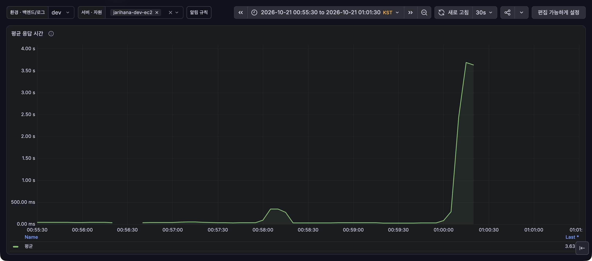
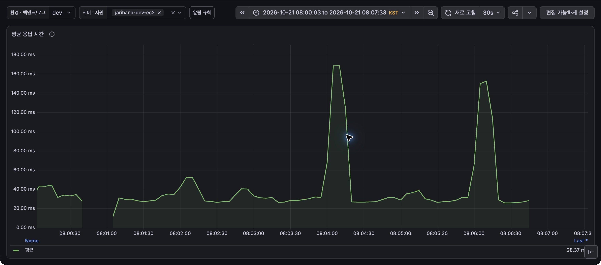

# 모임 하나 만드는 데 15.6초가 걸렸다?!

## 들어가며

우아한테크코스에서는 동아리나 스터디에 참여하려면 슬랙 채널을 여러 곳 찾아봐야 했습니다. 모임 소개 글과 모집 공지가 흩어져 있어서 무슨 활동을 하는지, 어떻게 참여하는지 알아보기 어려웠고 자리하나?는 그 불편에서 시작했습니다.

슬랙에 흩어져 있던 모임 정보를 한곳에 모아 관심 있는 모임을 찾고 참여하기 쉽게 했으며, 이제는 함께하고 싶은 사람들과 우리만의 모임을 직접 열어 꾸밀 수 있고 함께한 활동도 기록으로 남길 수 있습니다.

이 글은 Spring과 JPA(자바 영속성 API, Java Persistence API)로 데이터 생성, 조회, 수정, 삭제를 구현해 본 개발자를 대상으로 합니다. 이 글에서는 알림 저장이 왜 오래 걸렸고, 모임과 알림을 같은 트랜잭션에 저장하면서 반복 조회와 개별 저장을 어떻게 줄였는지와 저장 방식을 선택한 이유, 검증 결과도 함께 담았습니다.

[자리하나? 서비스 링크](https://jarihana.com)

## 1. 모임 생성 부하 테스트의 출발점

새 모임이 꾸준히 열려야 회원들이 관심 있는 모임을 찾아 참여할 기회도 늘어납니다. 그래서 저희는 새로 만들어지는 모임 수를 자리하나?의 핵심 지표 중 하나로 삼았고, 서비스 이용자가 늘어 모임 생성 요청이 많아졌을 때 서버가 어디까지 감당할 수 있는지 확인해 보기로 했습니다.

### 한 달에 모임 11건, 부족했던 시험 표본

처음에는 실제 이용 빈도를 바탕으로 테스트에서 보낼 요청량을 정하려고 PostHog를 확인했습니다. 그런데 2026년 9월 15일부터 10월 13일까지 약 한 달 동안 만들어진 모임은 11건이었습니다.

모임 하나당 생성, 첫 모집 개설, 상세 조회 요청이 각각 한 번씩 들어온다고 가정해도, 이 빈도로 15분간 테스트하면 예상 요청이 한 건도 채 되지 않아 응답 시간을 비교할 만큼 표본을 모으기 어려웠습니다.

### 수신자 999명, 모임 하나 만드는 데 15.6초

실제 요청은 드물었지만, 이용자가 늘면 모임 생성 요청 한 건이 처리해야 할 일도 많아질 수 있었습니다. 자리하나?에서는 새 모임이 만들어질 때 모임장을 제외한 푸시 알림 구독 회원 모두에게 알림을 남기기 때문에, 모임을 한 번만 만들어도 수신자가 많을수록 저장할 데이터가 늘어납니다.

이용자가 늘어난 상황을 가정해 우아한테크코스 전체 기수의 크루 1,000명이 모두 자리하나?를 이용하고, 모임장을 제외한 999명은 각자 브라우저 하나에서 푸시 알림을 구독하도록 설정했습니다. 이 조건에서 모임을 한 번 만들어 보니 **응답까지 15.6초가 걸렸습니다.** 요청을 한 번 하는데도 응답이 늦어, 이를 파헤쳐 보기로 했습니다.

## 2. 모임 생성 요청 한 건이 남기는 데이터

모임 생성 코드를 따라가 보니, 서버는 모임 정보와 함께 두 가지 기록을 저장하고 있었습니다. 하나는 회원이 서비스 알림함에서 볼 **알림**이고, 다른 하나는 어느 브라우저에 푸시를 보낼지 적어 둔 **전송 대기**입니다.

### 회원별 알림과 브라우저별 전송 대기

알림함에서 읽거나 지우는 알림은 회원마다 한 건씩 저장합니다. 전송 대기는 푸시를 보낼 대상을 기록하므로, 같은 회원이라도 여러 브라우저에서 푸시를 켜 두었다면 구독마다 한 건씩 저장합니다. 예를 들어 한 회원이 크롬과 사파리에서 각각 푸시를 켜 두면, 알림함에는 새 모임 소식이 한 번만 표시되지만 푸시는 두 브라우저에 각각 보내야 합니다.

| 저장하는 기록 | 저장 건수 | 어디에 쓰는지 |
| --- | --- | --- |
| 알림 | 1건 | 회원이 서비스 알림함에서 새 모임 소식을 확인합니다. |
| 전송 대기 | 2건 | 워커가 크롬과 사파리에 각각 푸시를 보냅니다. |

모임만 만들어지고 알림이 빠지는 상황을 막기 위해, 모임 정보와 알림, 전송 대기를 하나의 트랜잭션으로 저장했습니다. 어느 하나라도 저장에 실패하면 전체를 롤백하고, 세 가지 기록을 모두 저장해 커밋을 마쳐야 모임 생성에 성공했다고 응답합니다.

실제 푸시는 커밋이 끝난 뒤 워커가 별도로 보내지만, **알림과 전송 대기를 저장하는 작업은 모임 생성 응답 전에 끝나야 합니다.** 모임을 만드는 요청은 한 건이어도 함께 저장할 기록이 많으면 응답까지 기다리는 시간이 길어질 수 있어서, 다음 시험에서는 저장할 기록이 늘어날 때 모임 생성 응답 시간이 얼마나 달라지는지 확인했습니다.

## 3. 알림 수신자 수에 따른 모임 생성 지연

알림 수신자를 0명부터 단계적으로 늘리며 모임 생성 응답 시간을 비교했습니다.

요청이 겹치지 않아도 모임 생성이 느려지는지 알아보려고, 수신자 조건마다 먼저 **모임 생성 요청을 한 번 보내 응답이 2초 안에 돌아오는지** 확인했습니다. 2초를 넘으면 본 부하 테스트를 보류하고 지연 원인을 먼저 살펴보기로 했습니다.

사전 검사를 통과한 조건에서만 본 부하 테스트를 진행했습니다. 모임 생성, 첫 모집 개설, 상세 조회를 한 시나리오로 묶어 약 30초마다 한 번씩 실행하도록 설정했습니다. 수신자 수가 달라도 이 빈도는 같게 유지했습니다(세 API 합계 목표 0.1 HTTP RPS). **모임 생성 응답 시간**은 시나리오의 첫 요청인 `POST /api/groups`를 기준으로 봤고, 상세 조회에서 신청 가능한 상태까지 확인하면 **개설 흐름 완료**로 집계했습니다.

본 부하에서는 모임 생성과 첫 모집 개설 API 각각의 **p95가 1초 이내**일 때 통과로 봤습니다. p95는 응답 시간을 빠른 순으로 놓았을 때 95% 지점에 해당하는 값입니다. [부하테스트 실험일지](https://app.notion.com/p/3f86f304080b8013b3f0db8f65c14f9d)

### 175명까지 본 부하 통과, 200명에서 사전 검사 기준 초과

본 부하를 진행한 조건에서는 수신자가 늘수록 모임 생성 응답이 느려졌습니다. 수신자 175명에서는 모임 생성 p95가 974.18ms로, 통과 기준인 1초에 가까웠습니다.

| 알림 수신자 | 모임 생성 p95 |
| --- | --- |
| 0명 | 82.31ms |
| 100명 | 541.17ms |
| 150명 | 825.64ms |
| 175명 | 974.18ms |

수신자 200명 조건에서 본 부하에 앞서 측정한 단건 응답 시간은 아래와 같습니다.

| 단건 검사 | 모임 생성 응답 시간 | 2초 기준 |
| --- | --- | --- |
| 첫 요청 | 3.230초 | 초과 |
| 재검사 | 2.157초 | 초과 |

두 요청 모두 모임 생성에 성공했고, 요청마다 알림과 전송 대기도 각각 200건씩 저장됐습니다. 다만 응답 시간이 두 번 모두 2초를 넘어 본 부하를 **보류**하고, 수신자 200명 조건에서 어떤 SQL이 반복되고 어디에 시간이 걸리는지 살펴봤습니다.

## 4. 400행 저장에 SQL 600회

서버는 먼저 회원마다 알림을 한 건씩 저장했습니다. 전송 대기에 연결할 알림 ID를 얻으려고 방금 저장한 알림을 다시 조회했고, 그 ID를 사용해 브라우저 구독마다 전송 대기를 한 건씩 저장했습니다.

수신자 200명 모두에게 새 알림을 만들고 회원마다 브라우저 구독이 하나라면, 아래 세 작업이 각각 200번씩 실행됩니다.

| 작업 | SQL 실행 횟수 | 새로 저장하는 행 |
| --- | --- | --- |
| 알림 저장 (`INSERT`) | 200회 | 200행 |
| 방금 저장한 알림 다시 조회 (`SELECT`) | 200회 | 0행 |
| 전송 대기 저장 (`INSERT`) | 200회 | 200행 |
| **합계** | **600회** | **400행** |

표는 기존 코드에서 알림 저장, 재조회, 전송 대기 저장에 실행되는 SQL을 센 결과입니다.

개별 SQL이 짧게 끝나도 데이터베이스에 요청을 보내고 결과를 받는 데 드는 시간은 반복할수록 쌓입니다. 별도의 모임 생성 요청에서 처리 시간을 나눠 재보니, **전체 약 1,598ms 중 약 1,568ms가 알림 저장에 쓰였습니다.** 마지막 커밋에는 약 3.5ms가 걸렸고, 이 측정에서는 커밋 전에 반복하던 알림 처리에 시간이 몰려 있었습니다.

### 저장한 알림을 다시 조회한 이유

전송 대기를 저장하려면 어느 알림에 연결할지 알아야 했습니다. 그런데 기존 `insertIfAbsent()`는 삽입된 행 수만 돌려줬기 때문에, 알림 ID와 필요한 데이터를 얻으려면 저장 직후 `SELECT`를 한 번 더 실행해야 했습니다.

알림을 저장할 때 ID까지 받으면 재조회를 없앨 수 있었습니다. JPA의 `save()`로도 저장한 객체에서 ID를 얻을 수 있었지만, 같은 이벤트의 알림이 같은 회원에게 이미 있으면 유니크 제약 위반으로 트랜잭션이 실패할 수 있었습니다. 기존 쿼리는 이 경우 해당 알림만 건너뛰었으므로, 그 동작을 유지하면서 저장 결과로 ID를 받을 방법을 찾았습니다.

그래서 `ON CONFLICT DO NOTHING`으로 중복을 건너뛰고, `RETURNING`으로 실제로 삽입한 알림의 ID와 필요한 데이터를 바로 받았습니다. 반환된 알림에만 전송 대기를 만들어, 같은 이벤트를 다시 처리해도 삭제한 알림이 되살아나거나 나중에 추가한 브라우저에 과거 알림이 전송되는 일을 막는 기존 동작을 유지했습니다. [PostgreSQL INSERT 문서](https://www.postgresql.org/docs/17/sql-insert.html)

이렇게 수신자 200명 조건에서 알림을 다시 조회하는 **`SELECT` 200회**를 없앴습니다. 다만 알림과 전송 대기는 여전히 한 건씩 저장하고 있어서, **`INSERT` 400회**를 줄이는 방법을 이어서 살펴보겠습니다.

## 5. 남은 INSERT 400회와 세 가지 대안

알림을 다시 조회하는 과정은 없앴지만, 수신자 200명 조건에서는 알림과 전송 대기를 한 건씩 저장하는 `INSERT`가 여전히 400번 남아 있었습니다. 모임 생성 응답을 앞당기기 위해 저장을 응답 뒤로 옮기는 방법과, 여러 건을 묶어 저장하는 두 가지 방법을 검토했습니다.

### 알림 저장의 비동기 처리

모임을 먼저 커밋하고 알림과 전송 대기를 나중에 저장하면, 서버는 알림 저장이 끝날 때까지 기다리지 않고 응답할 수 있습니다. 다만 모임은 만들어졌는데 알림 저장만 실패할 수 있으므로, 실패한 작업을 다시 시도하고 진행 상태와 중복 실행을 관리할 방법이 필요했습니다. 이번에는 모임과 알림을 함께 커밋하는 기존 구조 안에서 저장 비용을 줄이기로 했습니다.

### `saveAll()`과 Hibernate INSERT 배치

같은 트랜잭션 안에서 여러 건을 저장하려고 `saveAll()`을 검토했습니다. 객체를 목록으로 넘겨도 Hibernate가 `INSERT`를 자동으로 묶어 보내는 것은 아닙니다. 당시 전송 대기는 데이터베이스가 삽입 시점에 ID를 생성하는 `IDENTITY` 전략을 사용하고 있어, Hibernate의 `INSERT` 배치를 그대로 적용할 수 없었습니다. 배치를 쓰려면 ID 생성 전략과 배치 설정을 바꾸는 데 더해, 기존처럼 중복 알림을 건너뛰는 처리도 마련해야 했습니다.

### JPA 네이티브 쿼리 벌크 저장

묶음 저장을 구현할 방법으로 `JdbcTemplate`도 검토했습니다. 이 도구로는 여러 `INSERT`를 JDBC 배치로 보내거나 한 SQL로 여러 행을 삽입할 수 있었습니다. 팀은 모임 생성 경로의 저장소를 JPA로 유지하기로 했기 때문에, 기존 JPA 저장소의 `@Query`에서 PostgreSQL 쿼리를 직접 실행하는 방식을 선택했습니다.

이 방식이면 기존 트랜잭션 안에서 여러 행을 한 번에 삽입하면서, 중복은 건너뛰고 새로 저장한 알림을 바로 돌려받는 동작도 유지할 수 있었습니다. 각 대안을 비교한 내용은 아키텍처 결정 기록에 남겼습니다. [ADR 0024](https://github.com/woowacourse-teams/2026-jarihana/blob/850eb7cf0da5b7a5a17cee997b231614690dfaf4/backend/docs/adr/0024-jpa-native-bulk-notification-inserts.md)

## 6. INSERT 400회에서 8회로 줄인 묶음 저장

5절에서 선택한 방식대로, JPA 저장소에서 PostgreSQL 쿼리를 직접 실행해 여러 행을 한 번의 `INSERT`로 저장했습니다. 알림과 전송 대기는 각각 다른 테이블에 들어가므로, 두 목록을 따로 나눠 저장했습니다.

### 초기 묶음 크기 50건

저장할 대상 목록을 JSON으로 넘기기 때문에, 목록 전체를 보내면 수신자나 구독이 늘어날수록 한 번의 `INSERT`에서 처리할 데이터도 많아집니다. 쿼리 한 번에 넘기는 대상 수에 상한을 두기 위해, 처음에는 묶음당 **최대 50건**으로 설정했습니다. 마지막 묶음에 50건보다 적게 남아도 그대로 저장하고, 빈 목록은 건너뛰었습니다.

수신자 200명 모두에게 새 알림을 만들고 회원마다 브라우저 구독이 하나인 조건이라면, 알림 200행과 전송 대기 200행을 각각 50행씩 나눠 저장합니다.

| 저장 대상 | 저장하는 행 | 한 건씩 저장 | 최대 50건씩 묶어 저장 |
| --- | --- | --- | --- |
| 알림 | 200행 | 200회 | 200 ÷ 50 = 4회 |
| 전송 대기 | 200행 | 200회 | 200 ÷ 50 = 4회 |
| **합계** | **400행** | **400회** | **8회** |

### 회원 ID로 연결한 알림과 전송 대기

회원 ID 목록을 JSON으로 넘기면 PostgreSQL이 목록을 행으로 펼치고, `INSERT ... SELECT` 한 번으로 해당 묶음의 알림을 저장합니다. 4절에서처럼 `ON CONFLICT DO NOTHING`으로 중복 알림을 건너뛰고, `RETURNING`으로 실제로 삽입한 알림의 ID와 회원 ID를 받았습니다. [실제 알림 저장 쿼리](https://github.com/woowacourse-teams/2026-jarihana/blob/cf6e777484e18fa16f9726ddef0a769c5c5d6f10/backend/src/main/java/com/project/jarihana/notification/command/repository/NotificationCommandRepository.java)

이때 입력 순서대로 전송 대기를 연결하면 문제가 생깁니다. 예를 들어 A, B, C의 알림을 저장할 때 B의 알림이 이미 있으면 결과에는 A와 C만 들어옵니다. 결과가 A, C 순서로 돌아왔을 때 두 번째 결과를 두 번째 입력인 B에 연결하면, C의 알림이 B의 브라우저로 갈 수 있습니다. 그래서 **반환된 알림의 회원 ID**로 처음 조회해 둔 구독을 찾아 연결했습니다. 전송 대기도 알림 ID, 구독 ID, 처음 조회한 구독 버전을 넘겨 여러 건을 묶어 저장했습니다.

### 알림 저장과 전체 롤백 검증

SQL로 직접 삽입하는 만큼, 기존 생성 로직으로 입력을 검증하고 생성 시각, 만료 시각, 구독 버전, 최초 전송 상태처럼 필요한 값도 쿼리에 반영했습니다. 묶음은 여러 개로 나눴지만 모두 같은 트랜잭션 안에서 처리해, 마지막 `INSERT`가 실패하면 앞서 저장한 모임과 알림, 전송 대기까지 함께 롤백되도록 했습니다.

통합 테스트에서는 **`INSERT` 8회로 알림과 전송 대기가 각각 200건씩 저장됐고, 알림 재조회도 없었음**을 확인했습니다. [SQL 횟수 테스트](https://github.com/woowacourse-teams/2026-jarihana/blob/cf6e777484e18fa16f9726ddef0a769c5c5d6f10/backend/src/test/java/com/project/jarihana/notification/NotificationCreationQueryTest.java)

별도 통합 테스트에서는 전송 대기 50건을 저장한 뒤 다음 삽입에서 오류를 일으켜, 앞서 저장한 모임과 알림, 전송 대기가 모두 롤백되는지 검증했습니다. [알림 저장과 전체 롤백 검증 테스트](https://github.com/woowacourse-teams/2026-jarihana/blob/cf6e777484e18fa16f9726ddef0a769c5c5d6f10/backend/src/test/java/com/project/jarihana/notification/NotificationBulkEventTest.java)

## 7. 수신자 200명 재시험, 이제는 통과

6절에서는 알림과 전송 대기를 저장하는 `INSERT`를 8회로 줄였습니다. 이 변경이 모임 생성 응답 시간에도 영향을 줬는지 확인하려고, 개선 전과 같은 **수신자 200명, 활성 브라우저 구독 200개** 조건으로 다시 시험했습니다.

### 단건 응답 2초 기준 통과

먼저 본 부하에 들어가기 전에 모임 생성 요청을 한 번 보내, 3절과 같은 기준으로 응답이 2초 안에 돌아오는지 확인했습니다.

| 단건 검사 | 개선 전 | 개선 후 |
| --- | --- | --- |
| 모임 생성 응답 시간 | 첫 요청 3.230초, 재검사 2.157초 | 1.030초 |
| 2초 기준 | 두 번 모두 초과 | 통과 |
| 요청당 저장 건수 | 알림과 전송 대기 각각 200건 | 알림과 전송 대기 각각 200건 |

개선 전에는 두 번 모두 2초를 넘어 본 부하를 보류했지만, 개선 후에는 같은 수의 알림과 전송 대기를 저장하면서 사전 기준을 통과해 본 부하를 진행할 수 있었습니다.

### 본 부하의 p95 1초 기준 통과

본 부하에서는 세 API를 합쳐 **0.1 HTTP RPS**를 목표로 요청을 보냈습니다. 모임을 만들고 첫 모집을 연 뒤 상세 조회까지 확인하는 시나리오를 10회 실행했으며, 각 API의 p95는 다음과 같았습니다.

| 본 부하 결과 | 개선 전 | 개선 후 |
| --- | --- | --- |
| 시험 진행 | 사전 기준 초과로 보류 | 시나리오 10회 모두 완료 |
| 모임 생성 p95 | 미측정 | **257.881ms** |
| 첫 모집 개설 p95 | 미측정 | **45.892ms** |
| 모임 상세 조회 p95 | 미측정 | 46.321ms |

모임 생성과 첫 모집 개설은 각각 p95 1초 이내 기준을 충족했고, 세 API에 보낸 요청 30건도 모두 성공했습니다. 모임 10개가 모두 활성 상태였고, 각 모임에 첫 모집이 연결됐습니다. 알림과 전송 대기는 모임당 각각 200건씩, 전체로는 각각 2,000건이 저장됐습니다.

부하 유지 시간은 300초로 설정했지만 실제로는 약 285초였으며, p95는 API마다 수집한 응답 10건을 바탕으로 계산했습니다. [부하테스트 실험일지](https://app.notion.com/p/3f86f304080b8013b3f0db8f65c14f9d)

## 8. 모임 생성 요청이 늘어난다면?

이번에는 알림 수신자를 200명으로 유지한 채 요청 빈도를 높이고, 모임 생성 응답 시간의 p99가 1초 이내인지 확인했습니다.

### 요청 빈도를 단계적으로 높인 시험

세 API를 합친 목표 요청 빈도를 0.5, 1, 2, 4, 8, 32, 128 HTTP RPS 순으로 높였습니다. 부하 유지 구간에서 수집한 모임 생성 응답으로 p99를 계산했습니다. p99는 응답 시간을 빠른 순으로 놓았을 때 99% 지점의 값입니다.

32 HTTP RPS에서는 기준을 충족했지만, 128 HTTP RPS에서는 응답이 늦어져 그 사이를 더 좁혀 보기로 했습니다. 먼저 64 HTTP RPS로 시험했고, 이 조건에서 시험이 중단되자 32와 64의 중간인 48 HTTP RPS로 낮춰 다시 확인했습니다.

### 64 HTTP RPS에서 중단, 48 HTTP RPS에서 5분 유지

| 비교 항목 | 64 HTTP RPS | 48 HTTP RPS |
| --- | --- | --- |
| 부하 유지 | 약 182초에 자동 중단 | **300초 유지 완료** |
| 모임 생성 p99, 완료된 응답 기준 | 5,001.773ms | **860.050ms** |
| 시작한 시나리오 중 완료 | 3,980 / 4,180회 | **5,039 / 5,039회** |
| 예정대로 시작하지 못한 시나리오 | 17회 | 0회 |

64 HTTP RPS에서는 k6의 가상 사용자 수가 설정 상한인 200개에 도달했습니다. 예정된 시나리오를 시작하지 못한 횟수인 `dropped_iterations`는 17회였고, 시험은 자동으로 중단됐습니다. [k6의 dropped\_iterations 설명](https://grafana.com/docs/k6/latest/using-k6/scenarios/concepts/dropped-iterations/)

48 HTTP RPS를 유지하는 동안 모임 생성부터 상세 조회까지 이어지는 시나리오를 초당 16회 실행했습니다. 각 모임에는 알림과 전송 대기가 각각 200건씩 저장됐습니다.

그림 1. 64 HTTP RPS 시험 전후의 평균 응답 시간. 실제 시험은 2026년 10월 21일 00:56:35부터 01:00:07까지 진행했습니다(KST).

그림 2. 48 HTTP RPS 시험 전후의 평균 응답 시간. 실제 시험은 2026년 10월 21일 08:01:03부터 08:06:33까지 진행했습니다(KST).

## 마치며

모임 하나를 만드는 데 15.6초가 걸렸을 때, 서버가 성공 응답을 보내기 전까지 무슨 일을 하는지부터 살펴봤습니다. 코드를 따라가 보니 방금 저장한 알림을 다시 읽고, 알림과 전송 대기를 한 건씩 저장하는 작업이 반복되고 있었습니다. 재조회를 없애고 여러 건을 묶어 저장하면서, 수신자 200명 조건에서 같은 400행을 저장하는 데 필요한 SQL을 600회에서 8회로 줄였습니다.

같은 수신자 조건에서 다시 시험했을 때는 앞서 보류했던 본 부하를 끝까지 마쳤고, 모임마다 알림과 전송 대기도 빠짐없이 저장됐습니다. 한 요청에서 여러 회원에게 푸시 알림을 보내는 기능을 만들거나 운영하는 분들께, 자리하나?에서 알림 저장 방식을 바꿔 본 과정이 참고가 되었으면 합니다.

## 참고 자료

- [부하테스트 실험일지](https://app.notion.com/p/3f86f304080b8013b3f0db8f65c14f9d)
- [자리하나? 알림 벌크 저장 변경](https://github.com/woowacourse-teams/2026-jarihana/commit/cf6e777484e18fa16f9726ddef0a769c5c5d6f10)
- [ADR 0024 JPA native 벌크 INSERT 선택 근거](https://github.com/woowacourse-teams/2026-jarihana/blob/850eb7cf0da5b7a5a17cee997b231614690dfaf4/backend/docs/adr/0024-jpa-native-bulk-notification-inserts.md)
- [알림 저장 SQL 횟수 통합 테스트](https://github.com/woowacourse-teams/2026-jarihana/blob/cf6e777484e18fa16f9726ddef0a769c5c5d6f10/backend/src/test/java/com/project/jarihana/notification/NotificationCreationQueryTest.java)
- [알림 벌크 저장 기능과 롤백 통합 테스트](https://github.com/woowacourse-teams/2026-jarihana/blob/cf6e777484e18fa16f9726ddef0a769c5c5d6f10/backend/src/test/java/com/project/jarihana/notification/NotificationBulkEventTest.java)
