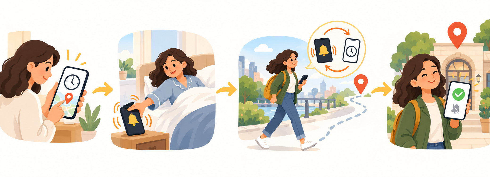
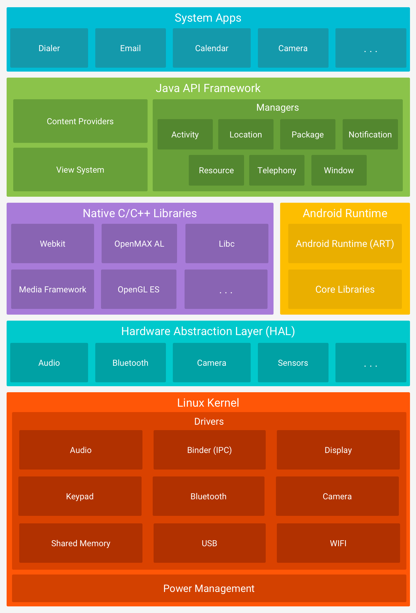
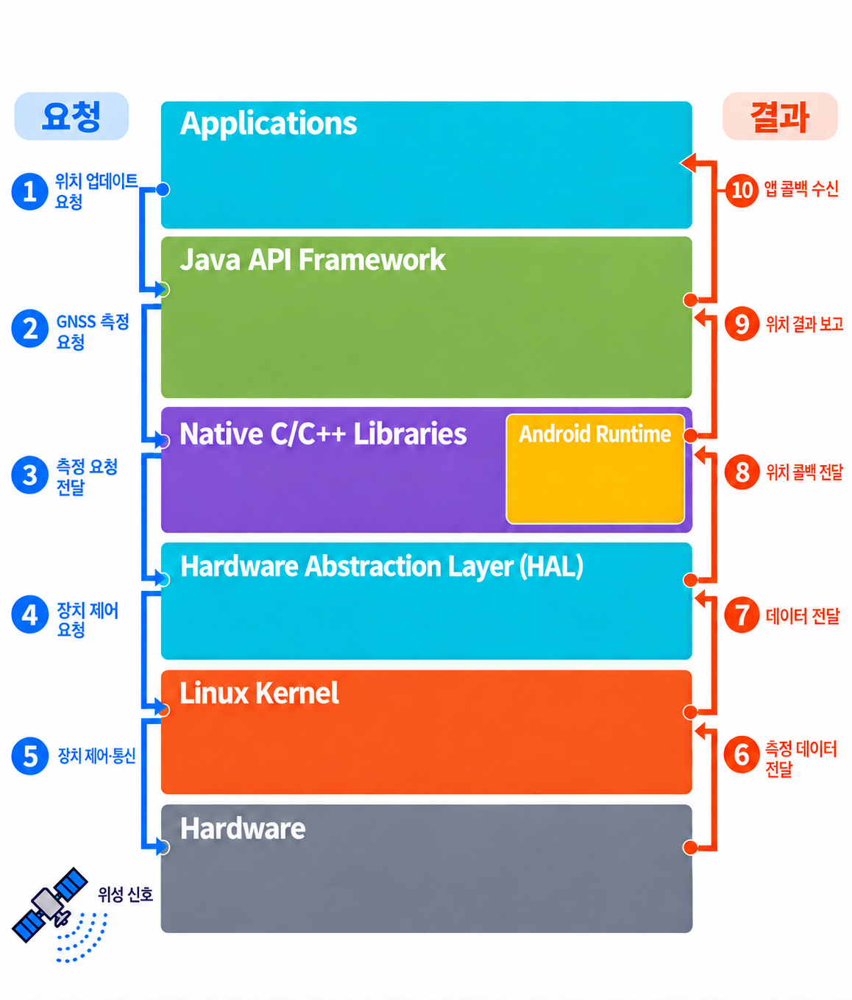
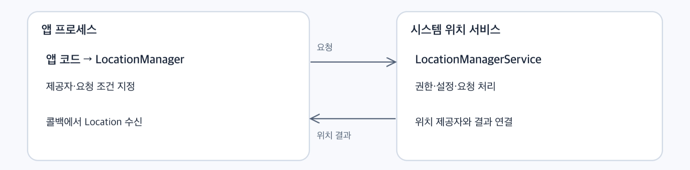
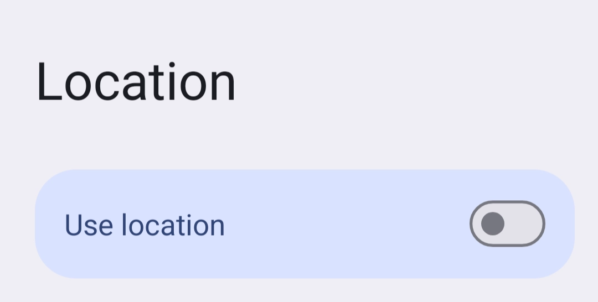
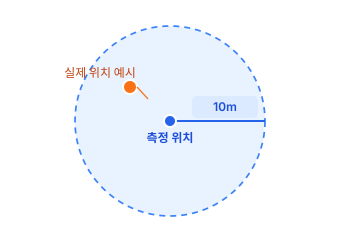

# 안드로이드의 위치 정보: 어떻게 수집하고 어떻게 활용되는가?

## 1. 문제: 알람 미션에는 네트워크가 반드시 필요할까?

사용자가 목표를 이룰 수 있도록 돕는 위치기반 자기개발 모바일 서비스 ‘링아웃’ 프로젝트를 진행하면서 위치정보 수집과 네트워크의 관계에 대한 문제를 마주했습니다. 이 글에서는 이 문제를 저희 팀이 어떻게 받아들이고 접근했는지 공유하고자 합니다.

‘링아웃’ 서비스가 사용자에게 제공하고자 한 가치는 ‘일단 시작하게 한다.’입니다. 저희 팀이 생각한 ‘시작’은 집 밖에서 이뤄집니다. ‘헬스장 가기’, ‘런닝 나가기’, ‘공부하러 카페가기’등 사용자가 활동을 시작할 장소에 도착하도록 돕는 서비스입니다.

이를 위해 ‘알람’과 ‘위치 정보’를 결합한 ‘알람 미션’을 만들었습니다. 알람이 울리면 사용자가 설정한 목적지에 도착할 때까지 일정한 간격으로 알람이 반복해서 울리는 기능입니다.



> 이미지 출처: codex 생성 이미지

이 기능을 개발하면서 네트워크 연결을 두고 서로 다른 의견이 나왔습니다.

> “알람 서비스니까 네트워크가 없어도 동작할 수 있어야한다.”<br /><br />“위치 정보의 정확도를 높여 기능을 안정적으로 제공하려면 네트워크가 필요하다.”

이 차이를 좁히고 팀의 방향을 결정하려면 먼저 위치를 어떻게 측정하는지, 측정한 위치를 앱까지 어떻게 전달하는지, 그리고 네트워크가 어느 과정에 관여하는지 구분할 필요가 있었습니다.

이 글에서는 GNSS 기반 위치가 안드로이드 앱에 전달되는 과정을 살펴보고, <code>LocationManager</code>를 사용해 위치를 요청하는 방법을 알아봅니다. 마지막으로 이 원리를 알람 미션의 도착 판정과 연결해 보겠습니다. 코드 예시는 별도 설명이 없는 한 Android 11(API 30) 이상을 기준으로 합니다.

---

## 2. 위성 신호가 앱의 위치 정보가 되기까지

위치 정보라고 하면 <code>GPS</code>를 먼저 떠올리기 쉽습니다. 하지만 <code>GPS</code>는 위치 정보 자체가 아니라, 위치를 구하는 데 사용하는 위성 항법 시스템입니다.

<code>GNSS</code>(Global Navigation Satellite System)는 위성 신호를 이용해 위치와 시각 등을 구하는 위성 항법 시스템을 통틀어 부르는 이름이며, <code>GPS</code>(Global Positioning System)는 그중 하나입니다. 단말의 <code>GNSS</code> 수신기는 위성이 보내는 신호를 이용해 자신의 위치를 추정합니다.

안드로이드 앱은 이 수신기를 직접 제어하지 않습니다. 프레임워크의 API를 통해 위치를 요청하고, 시스템이 전달하는 결과를 사용합니다. 위치 정보의 흐름을 이해하는 데 필요한 OS 구성 요소를 정리하면 다음과 같습니다.



| 구성 요소 | 위치 정보 처리에서의 역할 |
| --- | --- |
| 애플리케이션 | 위치를 요청하고 전달받은 결과를 기능에 사용합니다. |
| Java API 프레임워크 | 앱에 <code>LocationManager</code>를 제공하고, 시스템에서 위치 요청과 결과 전달을 관리합니다. |
| 네이티브 연결 코드 | 프레임워크의 GNSS 처리 코드와 하위 인터페이스를 연결합니다. |
| GNSS HAL | 제조사별 GNSS 구현을 안드로이드의 공통 인터페이스로 연결합니다. |
| 제조사 소프트웨어, 펌웨어, 하드웨어 | 위성 신호 수신과 위치 산출 등에 필요한 작업을 수행합니다. 커널 드라이버 등은 장치와 통신하는 기반을 제공합니다. |

HAL(Hardware Abstraction Layer)의 핵심은 제조사마다 다른 하드웨어 구현을 공통 인터페이스 뒤로 감추는 것입니다. 덕분에 상위 프레임워크는 각 칩셋의 구체적인 제어 방법을 모두 알지 않아도 됩니다.

Android Runtime(ART)은 앱 코드를 실행하는 환경입니다. 이를 위치 요청이 반드시 차례로 통과해야 하는 별도의 처리 단계로 이해할 필요는 없습니다. 위 표 역시 위치 처리에 관련된 역할을 단순화한 것으로, 모든 기기에서 동일한 내부 경로를 사용한다는 의미는 아닙니다.

<!-- Empty image block in source: no attached file -->

---

## 3. 위치 정보를 앱까지 전달하는 과정



> 출처: codex 생성 이미지

지도 앱에서 ‘현재 위치’ 버튼을 눌렀을 때 GNSS를 통해 위치 정보를 어떻게 받아오는지 그림을 보며 따라가보겠습니다.

사용자가 ‘현재 위치’ 버튼을 누르면 앱은 안드로이드에 위치 정보를 요청합니다. 안드로이드는 이 요청을 처리해 필요한 하드웨어를 동작시키고, 획득한 위치 정보를 다시 앱에 전달합니다.

이미지의 왼쪽 1\~5번은 요청이 내려가는 과정, 오른쪽 6\~10은 결과가 올라오는 과정입니다.

### 1. 애플리케이션이 위치 업데이트를 요청

<code>Applicaitons</code> 계층의 앱은 <code>JAVA API Framework</code> 가 제공하는 <code>LocationManager</code> 를 통해 위치를 요청합니다.  앱에서는 하드웨어를 직접 제어하는 대신 필요한 위치 제공자와 업데이트 조건을 지정합니다. 이때 위치 정보 접근 권한이 필요하며, 정확도와 백그라운드 접근 허용 여부에 따라 이용 범위가 달라집니다.

<code>LocationManager</code> 에 대해선 다음 파트에서 조금 더 자세히 다룰 예정입니다.

### 2. 프레임워크가 요청을 처리하고 GNSS 측정을 준비

<p>
앱 프로세스의 <code>LocationManager</code>는 Binder IPC를 통해 위치 제공자와 앱의 요청을 관리하는 <code>LocationManagerService</code> 에 요청을 전달합니다. 시스템은 권한과 위치 설정, 앱 상태 등의 조건을 확인하고, GNSS 제공자를 통해 필요한 동작을 요청합니다. 
</p>

### 3. Native C/C+ 연결 코드를 통해 GNSS HAL로 요청을 전달

<code>Native C/C++ Libraries</code> 를 통해 GNSS 요청을 HAL로 전달합니다.

HAL은 제조사마다 다른 하드웨어 구현을 공통 인터페이스로 연결하기 때문에, Android 프레임워크에서는 개별 GNSS 칩셋의 제어 방법을 모두 알고 있을 필요가 없습니다.

### 4\~5. 하드웨어의 위치 정보 실측 단계

칩셋의 제조사에서 구현한 GNSS HAL을 통해 측정 시작이나 중지 같은 요청을 시제 장치의 동작으로 연결합니다. 이 과정에서 <code>Linux Kernel</code> 의 드라이버가 하드웨어 접근을 지원합니다.

GNSS 수신기와 칩셋, 펌웨어 등은 위성 신호를 수신하고 측정하는 작업을 수행합니다.

위의 이미지는 하드웨어와의 통신을 단순화해서 표현했습니다. HAL의 요청이 모든 기기에서 동일한 드라이버 호출을 통해 동작하지는 않으며, 구체적인 처리는 제조사의 펌웨어와 소프트웨어에서 담당합니다.

### 6\~7. 측정 결과를 제조사 소프트웨어로 전달

하드웨어에서 얻은 데이터는 제조사가 구성한 통신 경로를 통해 상위 소프트웨어에 전달됩니다. 여기서 <code>Linux Kernel</code> 은 장치와 데이터를 주고받는 기반을 제공하며, GNSS 위치 산출에 필요한 처리는 제조사 구현에 따라 다르게 동작합니다.

### 8. GNSS HAL이 위치 결과를 콜백으로 보고

위치 정보 수집 결과가 준비되면 GNSS HAL은 등록된 콜백을 통해 Android 프레임워크에 결과를 보고합니다.

실제 GNSS HAL 인터페이스에는 위치 상태와 상태 정보를 프레임워크로 전달하기 위한 콜백이 정의되어 있습니다.

> GNSS HAL의 콜백 정의: [gnss/aidl/android/hardware/gnss/IGnssCallback.aidl - platform/hardware/interfaces - Git at Google](http://android.googlesource.com/platform/hardware/interfaces/+/refs/heads/main/gnss/aidl/android/hardware/gnss/IGnssCallback.aidl)

### 9. 프레임워크가 위치 결과를 처리

Native C/C+ 연결 코드를 통해 전달된 위치는 프레임워크의 GNSS 제공자와 위치 관리 경로에서 처리됩니다. 시스템은 등록된 요청과 접근 조건에 따라 어떤 앱에 위치를 전달할 것인지 결정합니다. 이 때 사용자에게 허용된 위치 정확도나 앱의 실행 상태 등이 결과 제공에 영향을 줄 수 있습니다.

### 10. 애플리케이션이 콜백으로 위치 정보를 수신

위치 정보 수집 결과가 앱 프로세스로 전달되면, 앱이 등록한 리스너의 콜백 함수가 호출됩니다. 앱은 전달받은 <code>Location</code>  객체에서 위도와 경도, 측정 시각, 정확도 추정치 등을 읽어 지도 표시나 이동 경로 기록에 활용할 수 있습니다.

---

## 4. 앱에서 위치를 요청하는 방법: LocationManager

### 1. 시스템 서비스 가져오기

앱의 <code>LocationManager</code>와 시스템 프로세스의 <code>LocationManagerService</code>는 실행 위치와 역할이 다릅니다. 앱이 <code>LocationManager</code>로 요청하면 시스템 서비스가 권한과 위치 설정, 앱 상태 등을 확인하고 요청과 결과 전달을 관리합니다.



> 출처: codex 생성 AI 이미지

앱에서는 시스템이 제공하는 <code>LocationManager</code> 객체를 가져와 위치 서비스에 접근합니다.

```kotlin
import android.content.Context
import android.location.LocationManager

val locationManager = context.getSystemService(LocationManager::class.java)
```

이 객체를 가져오는 것만으로 위치 측정이 시작되지는 않습니다. 위치를 받으려면 사용할 제공자와 요청 방식을 정해야 합니다.

### 2. 위치 제공자 선택하기

대표적인 위치 제공자는 다음과 같습니다.

| 제공자 | 위치 정보의 출처 | 고려할 점 |
| --- | --- | --- |
| <code>GPS_PROVIDER</code> | GNSS 위성 신호 | 응답 속도와 정확도가 위성 신호 환경의 영향을 받습니다. |
| <code>NETWORK_PROVIDER</code> | 기지국과 Wi-Fi 접근점 정보 등 | 네트워크 기반 위치를 제공하며 일반적으로 데이터 연결이 필요합니다. |
| <code>PASSIVE_PROVIDER</code> | 다른 앱이나 서비스의 요청으로 생성된 위치 | 자체적으로 측정을 시작하지 않아 원하는 시점에 결과를 받지 못할 수 있습니다. |

이 표는 주요 제공자를 소개한 것으로 전체 목록은 아닙니다. API 31부터는 여러 제공자의 입력을 결합할 수 있는 <code>FUSED_PROVIDER</code>도 정의되어 있습니다. 실제 제공자의 존재 여부는 기기에서 확인해야 합니다.

<code>GPS_PROVIDER</code>를 지정한 요청이 위성 신호가 약해졌다는 이유만으로 자동으로 <code>NETWORK_PROVIDER</code> 요청으로 전환되는 것은 아닙니다.

제공자를 사용하기 전에는 기기에 존재하는지, 현재 활성화되어 있는지 확인할 수 있습니다.

```kotlin
val provider = LocationManager.GPS_PROVIDER

val supported = locationManager.allProviders.contains(provider)
val locationEnabled = locationManager.isLocationEnabled
val providerEnabled = supported && locationManager.isProviderEnabled(provider)
```

제공자의 존재 여부와 활성화 여부는 앱의 위치 권한과 별개입니다. 필요한 권한 없이 위치 API를 호출하면 <code>SecurityException</code>이 발생할 수 있으며, 존재하지 않는 제공자를 지정하면 <code>IllegalArgumentException</code>이 발생할 수 있습니다.

> 여기서 말하는 <code>Security Exception</code>은 애플리케이션이 허용되지 않은 보안 작업이나 권한이 필요한 작업을 수행하려고 할 때 발생하는 런타임 Exception입니다.

### 3. 저장된 위치와 현재 위치 구분하기

위치를 받는 방식은 목적에 따라 달라집니다.

| API | 동작 |
| --- | --- |
| <code>getLastKnownLocation()</code> | 제공자가 마지막으로 저장한 위치를 읽습니다. 새 측정을 시작하지 않습니다. |
| <code>getCurrentLocation()</code> | 현재 위치를 나타내는 결과 하나를 콜백으로 받습니다. 아주 최근의 위치를 사용할 수도 있으며, 필요한 경우 새 위치를 구합니다. |
| <code>requestLocationUpdates()</code> | 위치 업데이트 요청을 등록하고 결과를 계속 받습니다. |

<code>getLastKnownLocation()</code>은 캐시가 없으면 <code>null</code>을 반환합니다. 결과가 있어도 오래된 위치일 수 있으므로, 반환됐다는 사실만으로 현재 위치라고 판단하면 안 됩니다.

<code>getCurrentLocation()</code>은 유효한 결과를 얻지 못하면 콜백에 <code>null</code>을 전달할 수 있습니다.

```kotlin
import android.annotation.SuppressLint
import android.content.Context
import android.location.Location
import android.location.LocationManager
import android.os.CancellationSignal

// 예제의 전제: 호출 전에 필요한 위치 권한과 제공자 상태를 확인합니다.
// SuppressLint는 권한을 부여하거나 런타임 검사를 수행하지 않습니다.
@SuppressLint("MissingPermission")
fun readCachedLocation(manager: LocationManager): Location? =
    manager.getLastKnownLocation(LocationManager.GPS_PROVIDER)

@SuppressLint("MissingPermission")
fun requestOneLocation(
    context: Context,
    manager: LocationManager,
    onResult: (Location?) -> Unit,
): CancellationSignal {
    val signal = CancellationSignal()

    manager.getCurrentLocation(
        LocationManager.GPS_PROVIDER,
        signal,
        context.mainExecutor,
    ) { location -> onResult(location) }

    return signal
}
```

<code>mainExecutor</code>는 콜백을 메인 스레드에서 실행하도록 지정합니다. 위치 측정 자체를 메인 스레드에서 동기적으로 처리하지는 않습니다. 다만 콜백 안에서 오래 걸리는 계산이나 입출력 작업을 실행하면 UI 응답을 막을 수 있으므로, 그런 작업은 별도로 처리해야 합니다.

더 이상 요청이 필요하지 않다면 반환받은 <code>CancellationSignal</code>의 <code>cancel()</code>을 호출해 위치 정보 수집을 중지할 수 있습니다.

### 4. 위치 업데이트 등록과 해제

이동 중 위치를 지속적으로 확인하려면 <code>requestLocationUpdates()</code>를 사용합니다.

```kotlin
import android.annotation.SuppressLint
import android.content.Context
import android.location.Location
import android.location.LocationListener
import android.location.LocationManager

// 호출 전 위치 권한과 제공자 상태 확인이 필요합니다.
@SuppressLint("MissingPermission")
fun startLocationUpdates(
    context: Context,
    manager: LocationManager,
    onLocation: (Location) -> Unit,
    onProviderState: (Boolean) -> Unit,
): LocationListener {
    val listener = object : LocationListener {
        override fun onLocationChanged(location: Location) {
            onLocation(location)
        }

        override fun onProviderDisabled(provider: String) {
            onProviderState(false)
        }

        override fun onProviderEnabled(provider: String) {
            onProviderState(true)
        }
    }

    manager.requestLocationUpdates(
        LocationManager.GPS_PROVIDER,
        5_000L,
        0f,
        context.mainExecutor,
        listener,
    )

    return listener
}

fun stopLocationUpdates(
    manager: LocationManager,
    listener: LocationListener,
) {
    manager.removeUpdates(listener)
}
```

등록할 때 지정하는 주요 값의 의미는 다음과 같습니다.

| 인자 | 예시 | 의미 |
| --- | --- | --- |
| <code>provider</code> | <code>GPS_PROVIDER</code> | 사용할 위치 제공자 |
| <code>minTimeMs</code> | <code>5_000L</code> | 업데이트 사이의 최소 시간 간격. 밀리초 단위 |
| <code>minDistanceM</code> | <code>0f</code> | 업데이트 사이의 최소 이동 거리. 미터 단위 |
| <code>executor</code> | <code>context.mainExecutor</code> | 콜백을 실행할 Executor |
| <code>listener</code> | <code>listener</code> | 결과와 제공자 상태를 받을 객체 |

예를 들어 최소 시간이 5초, 최소 거리가 10m라면 시간 조건과 거리 조건을 모두 충족해야 다음 위치가 전달됩니다. 거리를 <code>0f</code>로 지정하면 거리 제한을 두지 않습니다. 다만 5초마다 결과가 전달된다는 보장은 아닙니다. 위치를 구하지 못하거나 시스템이 전달을 제한하면 결과가 늦게 전달되거나 전달되지 않을 수 있습니다.

위치가 더 이상 필요하지 않으면 등록할 때 사용한 리스너 인스턴스를 <code>removeUpdates()</code>에 전달합니다. 같은 리스너로 여러 제공자에 등록했다면 해당 리스너와 연결된 요청들이 해제됩니다. 해제 시점은 화면이나 서비스 등 요청을 소유한 구성 요소의 생명주기에 맞춰 관리합니다.

### 5. 제공자가 활성화되어 있어도 위치를 얻지 못할 수 있다



일반 앱에서는 기기의 위치 설정을 끄면 위치 제공자가 비활성화됩니다. 등록된 제공자가 비활성화되면 <code>onProviderDisabled()</code>가 호출되지만 업데이트 요청이 해제되는 것은 아닙니다. 다시 활성화되면 <code>onProviderEnabled()</code>가 호출되고, 조건이 갖춰지면 위치 수신을 이어갑니다.

반면 실내나 터널에서 위성 신호를 받기 어려운 상태는 제공자 자체가 비활성화된 것은 아닙니다. 제공자가 활성화되어 있어도 새 위치가 전달되지 않을 수 있으며, 위치 정보를 받지 못했다고 반드시 <code>onProviderDisabled()</code>가 호출되는 것은 아닙니다.

## 5. 전달받은 위치를 어떻게 읽을 것인가

<code>Location</code> 객체의 주요 속성은 다음과 같습니다.

| 속성 | 의미 |
| --- | --- |
| <code>provider</code> | 위치를 제공한 제공자 이름 |
| <code>latitude</code>, <code>longitude</code> | 위도와 경도 |
| <code>time</code> | 측정 시각을 나타내는 UTC 시각 값 |
| <code>elapsedRealtimeNanos</code> | 부팅 후 경과 시간을 기준으로 한 측정 시각 |
| <code>accuracy</code> | 수평 정확도 추정 반경. 미터 단위 |
| <code>altitude</code> | 고도 |
| <code>speed</code> | 측정 시점의 속도 |

고도나 속도 등은 모든 위치 결과에 포함되지 않을 수 있습니다. 필요에 따라 <code>hasAltitude()</code>, <code>hasSpeed()</code>, <code>hasAccuracy()</code> 등으로 값이 측정됐는지 확인할 수 있습니다.

### accuracy는 실제 오차를 측정한 값이 아니다

Android 공식 문서는 수평 정확도를 68% 신뢰 수준의 추정 반경으로 설명합니다.

예를 들어 <code>location.accuracy</code>가 <code>10f</code>라면 보고된 위치를 중심으로 반경 10m 안에 실제 위치가 있을 확률이 약 68%라는 뜻입니다. 

실제 오차가 정확히 10m라는 의미도, 반드시 10m 안에 있다는 보장도 아닙니다. 

```kotlin
fun describeAccuracy(location: Location): String {
    return if (location.hasAccuracy()) {
        "수평 정확도 추정 반경: ${location.accuracy}m"
    } else {
        "수평 정확도 정보 없음"
    }
}
```



> 출처: codex 생성 이미지

### 위치의 최신성

정확도가 높은 위치라도 몇 분 전에 측정했다면 이동 중인 사용자의 현재 위치를 나타내지 못할 수 있습니다.

같은 부팅 기간 안에서 측정 후 경과 시간을 확인할 때는 기기 시계 변경의 영향을 받지 않는 경과 시간 기준을 사용할 수 있습니다.

> 부팅 기간: 기기 전원이 켜진 이후의 기간

```kotlin
import android.location.Location
import android.os.SystemClock

fun locationAgeMillis(location: Location): Long =
    (SystemClock.elapsedRealtimeNanos() - location.elapsedRealtimeNanos) /
        1_000_000L
```

이 예시는 같은 기기의 동일한 부팅 기간에 얻은 위치를 대상으로 합니다. 재부팅을 거쳐 저장된 위치에 그대로 적용할 수는 없습니다.

참고: [Location API 참조 문서](https://developer.android.com/reference/android/location/Location)

## 6. 위치 권한과 접근 범위

위치 정보를 사용하려면 Manifest에 권한을 선언하고 런타임에도 허용 상태를 확인합니다.

정확도에 따른 권한 구분은 다음과 같습니다.

| 권한 | 허용하는 위치 정보 |
| --- | --- |
| <code>ACCESS_COARSE_LOCATION</code> | 대략적인 위치 |
| <code>ACCESS_FINE_LOCATION</code> | 더 정밀한 위치에 대한 접근 |

```xml
<uses-permission android:name="android.permission.ACCESS_COARSE_LOCATION" />
<uses-permission android:name="android.permission.ACCESS_FINE_LOCATION" />
```

정확한 위치 권한을 선언하고 요청해도 사용자는 대략적인 위치만 허용할 수 있습니다. 정확한 위치를 허용하더라도 항상 일정한 정확도를 보장하는 것은 아닙니다.

권한은 사용자가 어느 범위의 위치 정보를 앱에 제공할지 선택하는 수단입니다. 측정 빈도와 제공자, 요청 정확도 등의 설정을 함께 고려해 필요한 정보와 소비 전력의 균형을 맞춰야 합니다.

정확도와 별개로 포그라운드(foreground), 백그라운드(background)라는 접근 범위 구분도 있습니다. 화면이 보이지 않는 동안 위치를 확인하는 기능에서는 실행 방식에 따라 백그라운드(background) 위치 권한과 위치 유형의 포그라운드 서비스(foreground service) 요건을 확인해야 합니다.

## 7. 알람 앱인데 네트워크가 필요할까?

이제 처음의 “알람 미션에는 네트워크가 반드시 필요할까?”라는 질문으로 돌아가 보겠습니다.

위치를 얻는 것 자체에 인터넷이 반드시 필요한 것은 아닙니다. GNSS 수신기는 위성 신호로 위치를 구하므로, 인터넷에 연결되지 않았더라도 수신 조건이 갖춰지면 위치 정보를 얻을 수 있습니다. 목적지 좌표가 기기에 저장되어 있다면 현재 위치와 목적지 사이의 거리도 기기 안에서 계산할 수 있습니다.

그렇다면 알람을 울리고 목적지까지의 거리를 확인하는 링아웃도 네트워크 없이 사용할 수 있도록 만들면 되는 것 아닐까요?

### 1. 위치를 얻을 수 있는 것과 미션에 사용할 수 있는 것

링아웃에서 위치 정보를 사용하는 목적은 사용자가 목적지에 도착했는지 확인하는 것입니다. 사용자는 집 안에서 알람을 끄고 밖으로 나가 카페나 헬스장으로 이동할 수 있습니다. 이 과정에서 사용자는 지하나 건물 내부를 통해 이동해 위성 신호가 닿지 않을 수도 있고, 주변의 건물이 높아 위성 신호가 반사되며 정학한 위치를 측정하지 못할 수도 있습니다.

또한 위치를 얻는 데 시간이 오래 걸리면 사용자가 이미 도착했는데도 알람이 다시 울릴 수 있습니다. 좌표의 오차가 크면 아직 도착하지 않은 사용자를 도착했다고 판단하거나, 도착한 사용자를 계속 기다리게 할 수도 있습니다. 링아웃에서는 위치를 얻을 수 있는지뿐 아니라, 도착 판정에 사용할 만한 위치를 제때 받을 수 있는지도 중요했습니다.

네트워크 연결은 이런 상황을 보완하는 데 도움이 됩니다. <code>A-GNSS</code>(Assisted GNSS)는 네트워크 등으로 받은 보조 정보를 이용해 첫 위치를 얻는 시간을 줄일 수 있습니다. 또한 Wi-Fi 접근점과 기지국 정보를 활용하면 위성 신호를 받기 어려운 환경에서도 위치를 추정하는 데 도움을 받을 수 있습니다. Android의 위치 정확도 서비스도 GPS, Wi-Fi, 기지국과 센서 정보를 함께 활용해 더 빠르고 정확한 위치 추정을 돕습니다.

다만 인터넷 연결과 주변 Wi-Fi, 기지국 신호의 활용은 같은 조건이 아닙니다. 네트워크에 연결했다고 언제나 더 정확한 좌표를 받는 것도 아닙니다. 네트워크는 위치 획득을 보완할 수 있는 수단이며, 실제 결과는 수신 환경과 기기 설정 등의 영향을 받습니다.

### 2. 여러 환경에서 미션을 제공하기 위한 선택

앞에서는 위치 정보의 전달 과정을 알아보기 위해 <code>LocationManager</code>를 사용했습니다. 실제 링아웃의 Android 미션에서는 Google Play services의 <code>FusedLocationProviderClient</code>를 사용하고, <code>PRIORITY_HIGH_ACCURACY</code>로 위치 업데이트를 요청합니다. GPS와 Wi-Fi 등 여러 위치 기술을 활용하면서 높은 정확도의 위치를 요청하는 방식입니다.

저희는 알람이 울리는 것뿐 아니라 목적지에 도착해 미션을 끝내는 과정까지 서비스의 품질로 보았습니다. 인터넷 없이도 위치를 얻을 수 있다는 이유만으로 네트워크가 필요 없다고 결정하기는 어려웠습니다. 여러 환경에서 위치 획득의 지연과 불확실성을 줄이는 데 도움이 되는 조건을 갖출 필요가 있다고 판단했습니다.

그래서 링아웃은 알람 앱임에도 네트워크 연결을 권장하기로 했습니다. 알람 실행이나 거리 계산에 인터넷이 반드시 필요해서가 아니라, 위치 기반 미션을 보다 안정적으로 제공하기 위한 선택이었습니다.

물론 네트워크를 요구한다고 모든 환경에서 같은 품질을 보장할 수는 없습니다. 연결된 상태에서도 위치를 얻지 못하거나 오차가 큰 위치를 받을 수 있습니다. 따라서 네트워크 연결 여부를 확인하는 것과 별개로, 전달받은 위치가 도착 판정에 적합한지 확인해야 합니다.

## 8. 받은 좌표를 도착 판정에 사용하기

네트워크 연결을 권장하기로 했더라도, 위치 API가 전달한 좌표를 그대로 도착 판정에 사용할 수는 없습니다. 앞에서 살펴본 정확도와 최신성을 실제 미션의 조건에 연결해야 합니다.

예를 들어 목적지까지의 거리가 20m인 위치를 받았다고 해보겠습니다. 이 위치의 <code>accuracy</code>가 100m라면 좌표상으로는 가까워도 실제 사용자는 목적지에서 멀리 떨어져 있을 수 있습니다. 반대로 정확도가 충분한 위치라도 몇 분 전에 측정했다면 실제 사용자가 있는 위치가 아닐 수도 있습니다.

링아웃에서는 이를 거리와 정확도, 측정 시각으로 나눠 확인합니다.

### 1. 거리와 정확도를 함께 확인하기

현재 링아웃의 미션 클리어 조건은 사용자의 위치가 목적지의 반경 30m 이내에 위치하는 것이며, accuracy가 50m 이하인 위치를 판정에 사용합니다. 좌표가 유효한지 확인한 뒤 현재 위치와 목적지 사이의 거리를 계산합니다. 기본 반경을 사용하는 경우의 조건은 다음과 같습니다.

```txt
accuracy ≤ 50m
목적지까지의 거리 ≤ 30m
```

여기서 도착 조건을 통과했다는 사실과 실제 사용자가 반드시 반경 안에 있다는 것은 구분해야 합니다. 앞에서 살펴봤듯 <code>accuracy</code>는 확률적인 추정치이므로, 거리와 정확도 조건을 만족해도 오판정 가능성은 남습니다.

실제로 서비스 제작 초기에 미션 클리어 조건을 100m로 설정했을 때 아직 집 밖으로 나가지도 않았는데 미션이 성공 처리되는 문제가 있었습니다. 하지만 미션 클리어 반경을 너무 좁게 설정하면 사용자는 목적지에 도착했는데, 미션이 끝나지 않는 문제가 발생할 수 있었습니다.

현재 설정되어 있는 30m라는 범위는 저희 팀에서 임의로 설정한 값입니다. 이후 별다른 문제 상황은 발견되지 않고 있어 별다른 수정 없이 유지되고 있지만, 문제가 발견되면 수정이 필요한 부분입니다.

### 2. 측정 시각 확인하기

위치 콜백을 방금 받았다는 이유만으로 방금 측정한 위치라고 볼 수는 없습니다. 링아웃의 Android 연속 추적에서는 측정 후 30초가 지난 위치와 미션 시작 전에 측정된 위치를 제외합니다. 측정 후 경과 시간은 앞에서 살펴본 <code>elapsedRealtimeNanos</code>를 기준으로 확인합니다.

이렇게 거리와 정확도뿐 아니라 측정 시각까지 확인해야, 과거에 측정한 위치를 현재의 위치로 판단하는 문제를 방지할 수 있습니다.

## 9. 마치며

이 글은 알람 미션에 네트워크가 반드시 필요한지에 대한 팀의 의견 차이에서 시작했습니다. 이를 알아보기 위해 위성 신호가 안드로이드 시스템을 거쳐 앱의 위치 정보가 되는 과정과 <code>LocationManager</code>로 위치를 요청하는 방법을 살펴봤습니다.

GNSS로 위치를 구하는 데 인터넷이 반드시 필요한 것은 아닙니다. 하지만 링아웃에서 필요했던 것은 좌표를 얻는 것만이 아니라, 사용자가 목적지에 도착했는지 제때 확인하는 것이었습니다. 저희는 여러 환경에서 위치 획득을 보완하고 미션을 안정적으로 제공하기 위해 네트워크 연결을 권장하기로 했습니다.

그렇다고 네트워크 연결이 도착 판정을 보장해 주지는 않습니다. 전달받은 위치의 정확도와 측정 시각을 확인하고, 판단하기 어려운 상황에서는 사용자가 무엇을 할 수 있을지 함께 정해야 합니다.

처음에는 단순히 위치 API로 좌표를 받아 목적지까지의 거리를 계산하면 될 것이라고 생각했습니다. 하지만 구현을 위해 알아볼수록, 위치 정보는 실제 위치를 추정한 결과이며 언제나 불확실성이 남는다는 점을 알게 되었습니다. 그 한계를 이해하고 서비스에서 사용할 기준을 정하는 것까지가 위치 기반 기능을 만드는 과정이었습니다.

### 참고 자료

- [안드로이드 LocationManager 공식 문서](https://developer.android.com/reference/android/location/LocationManager)
- [안드로이드 위치 정보 액세스 권한 요청](https://developer.android.com/develop/sensors-and-location/location/permissions?hl=ko)
- [안드로인드 위치 기반 기능 튜토리얼](https://developer.android.com/courses/pathways/location-based-features-in-android?hl=ko)
- [삼성 기술 블로그: Android 단말의 위치 데이터 활용 – 기본 개념 및 GPS 위치 제공자의 특성](https://techblog.samsung.com/blog/article/47)
- [링아웃 프로젝트](https://github.com/woowacourse-teams/2026-ringout)
