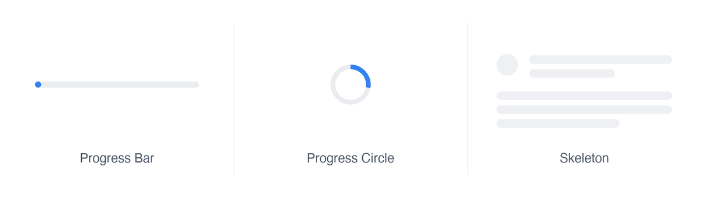
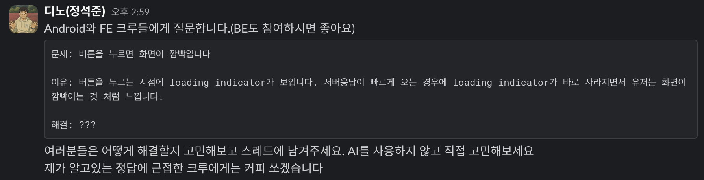
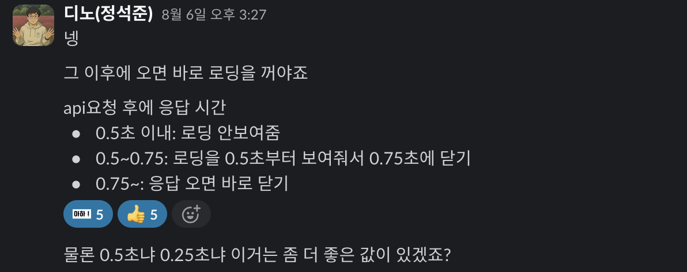
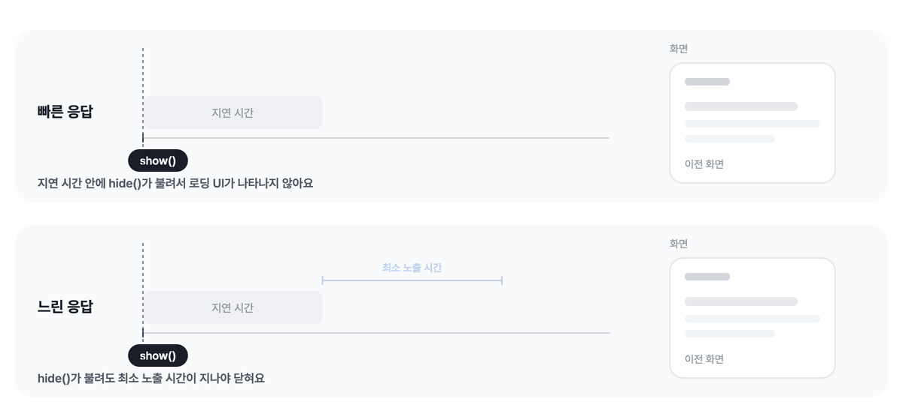
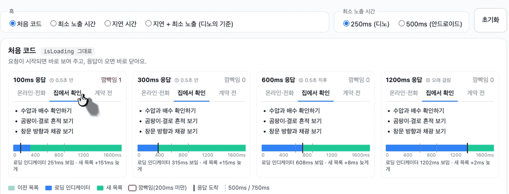
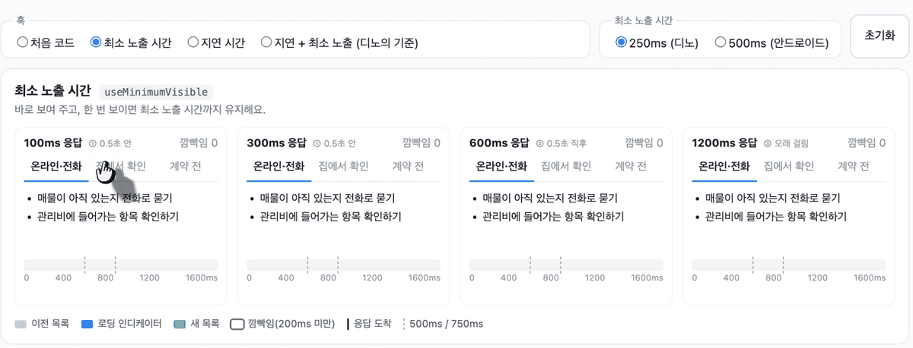
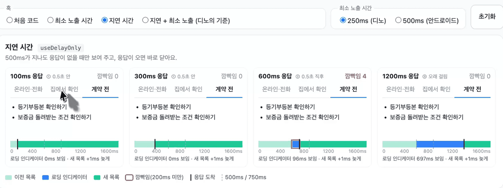
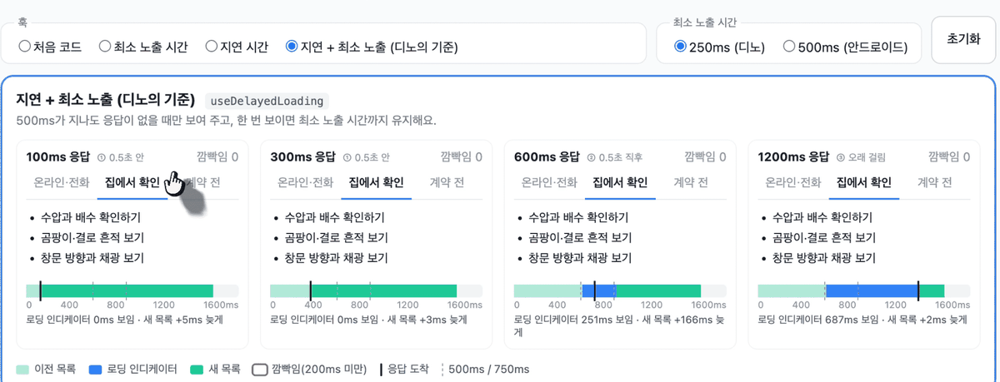
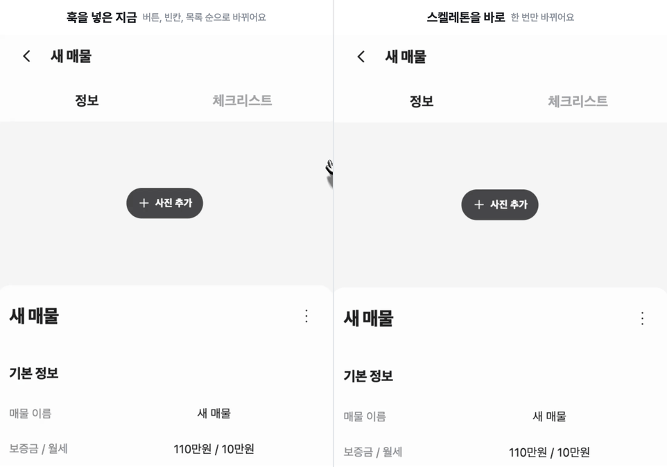
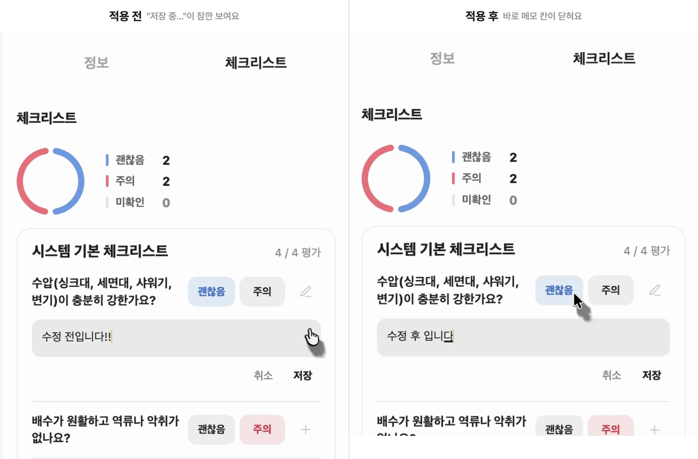

# 레벨 4 테크니컬 라이팅

> 네트워크 응답이 빨리 오면 로딩 UI가 생기자마자 사라지며 화면이 깜빡여요, 이 깜빡임을 해결하며 얻은 정보를 정리했어요

## 들어가며



안녕하세요, 여러분은 웹이나 앱을 쓰면서 로딩 UI를 본 적 있으신가요?

로딩 UI란 Progress Bar, Progress Circle, Skeleton처럼 네트워크 요청을 기다리는 중 보이는 요소를 뜻해요. 이 요소는 네트워크 응답이 오고 있다는 중임을 알려줘 기다리는 사용자의 답답함을 덜어줘요.

그런데 네트워크 응답이 빨리 오게 되면 로딩 UI가 잠깐 노출되어 화면이 깜빡이게 되며 사용자 경험을 저하시킬 수 있는데요. 이 글에서는 로딩 UI가 어떻게 사용자 경험을 해치는지, 그리고 이를 개선하는 방법을 다뤄요.

> 이 글을 읽고 나면 답할 수 있어요 💬
> - 응답이 빠른데 왜 로딩 UI가 오히려 화면을 흔들까요?
> - 로딩 UI는 언제 보여 주고, 언제 닫아야 할까요?

## 한적한 어느 날, 코치 디노의 메시지



> 서버 응답이 빠르게 오는 경우에 로딩 인디케이터가 바로 사라지며 깜빡이는 것처럼 동작하는 문제를 해결해봐라

디노 코치가 안드로이드와 프론트엔드 크루들에게 갑작스럽게 질문을 하나 던졌어요. 메시지를 보게 된 저는 공짜 커피를 먹기 위해 즉시 생각난 방법으로 답장을 보냈습니다.

#### 최소 시간을 정하는 건 어떻습니까?


제가 처음 생각해낸 답은 로딩 UI를 정해진 시간만큼은 꼭 보여 주는 것이었어요. 너무 빨리 사라져서 깜빡이는 문제는 단순히 사라지는 시점을 늦추면 된다고 생각했어요.


그리고 그 시간은 1초가 넘으면 이탈률이 높아진다는 이야기가 떠올라 1초 안쪽으로 정하자고 했습니다.

> 100~1,000ms: 이 창에서는 작업이 자연스럽고 연속적인 진행 과정의 일부로 느껴집니다. 웹의 대부분 사용자에게 페이지를 로드하거나 뷰를 변경하는 것은 하나의 작업입니다. - [구글의 RAIL 성능 모델](https://web.dev/articles/rail?hl=ko#focus_on_the_user)


슬프게도 디노가 원하는 답은 아니었어요🥲

서버 응답이 빨리 온 경우에 로딩 UI를 보여주는 것은 의미가 없지 않냐는 반문이었어요.

### 디노가 원하던 답



시간이 지난 뒤 디노가 원하는 답을 공개했어요. 네트워크 요청을 측정하고 그에 따라 로딩 UI의 분기 처리를 하는 것이었어요. 흥미가 생긴 저는 이를 설명하는 기법이 있는지 찾아보게 되었어요.

#### ContentLoadingProgressBar

찾아보니 안드로이드에는 디노의 답과 같은 일을 하는 컴포넌트가 있었어요.

`AndroidX` 라이브러리의 `ContentLoadingProgressBar` 문서에는 이렇게 적혀 있어요.

> ContentLoadingProgressBar implements a ProgressBar that waits a minimum time to be dismissed before showing. Once visible, the progress bar will be visible for a minimum amount of time to avoid "flashes" in the UI when an event could take a largely variable time to complete.
> - [ContentLoadingProgressBar](https://developer.android.com/reference/androidx/core/widget/ContentLoadingProgressBar)

- `show()`를 부르면 잠깐 기다렸다가 로딩 UI를 보여 주고 기다리는 사이에 `hide()`가 불리면 로딩 UI는 아예 나타나지 않음
- `hide()`를 불러도 로딩 UI가 최소 시간만큼 보이기 전에는 닫지 않음



*그림으로 보면 이해가 편합니다*

빠른 응답에서는 지연 시간이 끝나기 전에 hide()가 불려 로딩 UI가 아예 나타나지 않고, 화면은 이전 내용에서 새 내용으로 바로 바뀝니다.

느린 응답에서는 지연 시간이 끝나야 로딩 UI가 나타나요. 그 직후에 hide()가 불려도 바로 닫지 않고, 최소 노출 시간을 채운 뒤에 닫습니다

```java
private static final int MIN_SHOW_TIME_MS = 500; // 최소 노출 시간 
private static final int MIN_DELAY_MS = 500; // 지연 시간
```

[소스 코드](https://cs.android.com/androidx/platform/frameworks/support/+/androidx-main:core/core/src/main/java/androidx/core/widget/ContentLoadingProgressBar.java?q=file:androidx%2Fcore%2Fwidget%2FContentLoadingProgressBar.java%20class:androidx.core.widget.ContentLoadingProgressBar)를 열어 보니 두 시간이 상수로 들어 있었어요. 합리적이라고 생각한 저는 이것을 리액트에서 공용으로 사용할 수 있는 구조로 만들어보고 싶어졌어요.

## 각각의 조건 비교

### 1. 기본 로딩 UI 컴포넌트

```typescript
const TABS = ['온라인 전화', '집에서 확인', '계약 전'];

// ms만큼 기다렸다가 탭의 체크리스트를 돌려준다.
const fakeFetchChecklist = (tab: number, ms: number) =>
  new Promise<string[]>((resolve) => setTimeout(() => resolve(CHECKLISTS[tab]), ms));
```

네트워크 응답을 서버 동작을 흉내내도록 `setTimeout`으로 가짜 API를 만든 후

```tsx
function ChecklistTabs({ ms }: { ms: number }) {
  const [tab, setTab] = useState(0);
  const [items, setItems] = useState(CHECKLISTS[0]);
  const [isLoading, setIsLoading] = useState(false);

  const selectTab = async (next: number) => {
    setTab(next); // 탭은 바로 바뀐다.
    setIsLoading(true);
    setItems(await fakeFetchChecklist(next, ms));
    setIsLoading(false);
  };

  return (
    <>
      <div role="tablist">
        {TABS.map((label, i) => (
          <button key={label} role="tab" aria-selected={tab === i} onClick={() => selectTab(i)}>
            {label}
          </button>
        ))}
      </div>
      {isLoading ? <p role="status">체크리스트를 불러오는 중이에요.</p> : <Checklist items={items} />}
    </>
  );
}
```

화면을 탭 이동 시 다음 탭의 체크리스트를 불러오는 예제로 작성해봤습니다. 비교를 위해 예제 화면에는 응답 시간이 다른 칸을 네 개 뒀습니다.

- 100ms와 300ms는 0.5초 안에 오는 빠른 응답
- 600ms는 0.5초 직후
- 1200ms는 오래 걸리는 응답

탭을 누르면 네 칸이 함께 바뀌고, 칸 아래 타임라인에 로딩 인디케이터의 수명을 나타내도록 만들었어요.



이 코드는 요청이 시작되면 로딩 UI를 그리고 응답이 오면 바로 지우기 때문에 **로딩 UI가 보이는 시간이 응답 시간과 똑같아요.**

1200ms 응답이면 문제가 없지만, 100ms 응답이면 문구를 읽기도 전에 로딩 UI가 번쩍하고 사라집니다.

`isLoading`은 "요청이 진행 중"이라는 뜻이지, 사용자가 기다리고 있다는 뜻이 아니에요. 이제 디노의 기준을 한 줄씩 코드로 옮겨 볼게요.

### 2. 최소 노출 시간을 정하기

먼저 제 첫 답이었던 방법부터 넣어 봤어요. 요청이 시작되면 로딩 UI를 바로 보여 주고, 응답이 일찍 와도 최소 노출 시간(250ms)을 채운 뒤에 닫아요.

```tsx
function useMinimumVisible(isLoading: boolean, minimumVisibleMs = 250) {
  const [isVisible, setIsVisible] = useState(false);
  const since = useRef(0);

  useEffect(() => {
    if (isLoading && !isVisible) {
      since.current = Date.now();
      setIsVisible(true); // 요청이 시작되면 바로 보여 준다.
    }
    if (!isLoading && isVisible) {
      // 응답이 와도 최소 노출 시간에서 남은 만큼은 더 보여 준다.
      const remaining = Math.max(minimumVisibleMs - (Date.now() - since.current), 0);
      const timer = setTimeout(() => setIsVisible(false), remaining);
      return () => clearTimeout(timer);
    }
  }, [isLoading, isVisible, minimumVisibleMs]);

  return isVisible;
}

// 사용처
const showLoading = useMinimumVisible(isLoading);

{showLoading ? <p role="status">체크리스트를 불러오는 중이에요.</p> : <Checklist items={items} />}
```

화면 코드는 그대로 두고, `isLoading` 자리에 훅이 돌려주는 값만 넣어요. 뒤에 나오는 훅들도 같은 방식이에요.



100ms 응답에서도 로딩 인디케이터가 250ms 동안 보여서 번쩍이는 느낌은 사라졌지만 응답은 100ms에 왔는데 목록은 158ms 늦게 바뀌어요. **깜빡임을 없앤 대신 기다림을 만든 거예요.** 디노가 "서버 응답은 실제로 빨리 왔는데 로딩 인디케이터를 계속 보여주는 게 의미가 있을까요?"라고 물은 게 바로 이 부분인걸 알았습니다.

### 3. 로딩을 언제부터 보여줄지 정하기

이번에는 디노의 첫 줄처럼, 0.5초 안에 온 응답에는 로딩 UI를 보여 주지 않게 해 봤어요. 요청이 시작되면 500ms를 기다렸다가 로딩 UI를 보여 주고, 그 전에 응답이 오면 보여 주려던 타이머를 지워요.

```tsx
function useDelayOnly(isLoading: boolean, delayMs = 500) {
  const [isVisible, setIsVisible] = useState(false);

  useEffect(() => {
    if (!isLoading) {
      setIsVisible(false); // 응답이 오면 바로 닫는다.
      return;
    }
    const timer = setTimeout(() => setIsVisible(true), delayMs);
    return () => clearTimeout(timer); // 500ms 전에 응답이 오면 보여 주려던 타이머를 지운다.
  }, [isLoading, delayMs]);

  return isLoading && isVisible;
}
```



100ms와 300ms 응답은 로딩 인디케이터 없이 목록이 바로 바뀌지만 **600ms 응답에서는 로딩 인디케이터가 0.5초쯤 나타났다가 91ms 만에 사라져요.**

### 4. 디노 말대로 전부 적용하기

최소 노출 시간만 두면 빠른 응답이 늦어지고, 지연 시간만 두면 0.5초 직후 응답이 깜빡여요. 그래서 위 1~3번을 합쳐 지연 시간으로 빠른 응답을 걸러 내고, 최소 노출 시간으로 응답을 보여주는 예시를 가져왔습니다.

```typescript
function useDelayedLoading(isLoading: boolean, { delayMs = 500, minimumVisibleMs = 250 } = {}) {
  const [isVisible, setIsVisible] = useState(false);
  const visibleSince = useRef<number | null>(null);

  useEffect(() => {
    let timer: ReturnType<typeof setTimeout> | undefined;

    // 요청이 시작되면 delayMs 뒤에 보여 준다.
    if (isLoading && !isVisible) {
      timer = setTimeout(() => {
        visibleSince.current = Date.now();
        setIsVisible(true);
      }, delayMs);
    }

    // 요청이 끝났는데 보이는 중이면, 최소 노출 시간에서 남은 만큼만 더 보여 준다.
    if (!isLoading && isVisible) {
      const elapsed = Date.now() - (visibleSince.current ?? 0);
      timer = setTimeout(() => {
        visibleSince.current = null;
        setIsVisible(false);
      }, Math.max(minimumVisibleMs - elapsed, 0));
    }

    return () => clearTimeout(timer);
  }, [isLoading, isVisible, delayMs, minimumVisibleMs]);

  return isVisible;
}
```



600ms 칸을 보면 로딩 UI가 250ms 동안 보이고 닫히는데 목록은 163ms 늦게 바뀌어요. 기다림이 늘어나는 건 0.5~0.75초 사이에 온 응답뿐이고, 늘어나도 250ms를 넘지 않아요.

그렇게 만든 훅으로 제 로딩 문제를 전부 해결할 수 있었을까요?

## 막상 적용하니 별로 나아지지 않았어요

4번까지 만든 훅을 자취선배 곳곳에 넣었는데, 생각만큼 나아지지 않았어요. 매물 상세의 체크리스트 탭은 오히려 로딩 UI를 바로 보여 주는 쪽이 훨씬 자연스러웠어요.



차이는 기다리는 동안 화면에 남아 있는 게 있느냐였어요. 1~4번 예제에서 깜빡임이 사라진 건, 로딩 UI를 늦추는 동안 이전 탭의 목록이 그대로 남아 있었기 때문이에요. 체크리스트 탭은 처음 여는 칸이라 남아 있는 게 없었고, 늦춘 자리는 빈칸과 엉뚱한 버튼으로 채워졌어요. 이렇게 남아 있는 게 없는 곳에서는 늦추지 말고 칸 모양의 스켈레톤을 바로 보여 주는게 좋아요

### 그럼 적용해야 할 곳은?

대표적인 곳은 체크리스트 항목의 메모 저장이었어요. 메모를 쓰고 저장을 누르면 버튼이 "저장 중…"으로 바뀌고, 저장이 끝나면 메모 칸이 닫혀요.  바꾸기 전의 저장은 문구를 읽기도 전에 지워지는, 1번 예제와 같은 깜빡임이에요.



*커서 녹화를 실수했어요..*

```tsx
const isMemoSavingVisible = useDelayedLoading(memoMutation.isPending); // 추가

<button
  disabled={isMemoSavingVisible} // 변경: memoMutation.isPending → isMemoSavingVisible
  onClick={() => void saveMemo()}
>
  {isMemoSavingVisible ? '저장 중…' : '저장'} {/* 변경: memoMutation.isPending → isMemoSavingVisible */}
</button>
```

바뀐 건 버튼이 보는 값 하나예요. 원래는 `isPending`을 그대로 써서, 저장을 누르자마자 버튼이 "저장 중…"으로 바뀌었어요. 이제는 4번에서 만든 `useDelayedLoading`을 거친 `isMemoSavingVisible`을 봐서, 저장이 500ms를 넘길 때만 "저장 중…"을 보여 줘요. 저장이 빨리 끝나면 버튼은 "저장" 그대로 있다가 메모 칸이 닫힙니다.

여기서 늦춰도 괜찮은 건, 기다리는 동안 화면에 남아 있는 게 있기 때문인데요. 저장하는 동안에도 쓴 메모와 버튼은 그대로 보이고, 저장이 끝나면 메모 칸이 닫히는 것으로 결과를 알 수 있기 때문에 "저장 중…"이 없어도 사용자는 멈췄다고 느끼지 않아요. 그래서 적용했을 때 효과를 볼 수 있습니다.

> **\*Suspense의 fallback과 비슷하다?**
> React도 깜빡임의 원인을 같은 곳에서 봐요. [이미 보이는 화면을 바꿀 때(startTransition)](https://ko.react.dev/reference/react/Suspense#preventing-already-revealed-content-from-hiding)는 fallback으로 지우지 않고, 새 화면이 준비될 때까지 이전 화면을 그대로 둬요. 메모 저장에서 메모 칸과 버튼을 그대로 둔 것처럼, 보이던 내용을 지우지 않는 게 먼저예요.

## 정리하며

- **문제:** 응답이 빠르면 로딩 UI가 생기자마자 사라져 화면이 깜빡였어요. `isLoading`을 그대로 화면에 옮긴 게 원인이었어요.
- **개선:** 지연 시간(500ms)과 최소 노출 시간(250ms)을 함께 둔 `useDelayedLoading`을 만들었어요. 메모 저장처럼 기다리는 동안 화면이 그대로 남는 곳에서는 깜빡임이 사라졌어요.
- **한계:** 체크리스트 탭처럼 처음 열어 남아 있는 게 없는 곳에서는, 로딩 UI 대신 빈칸이 보였어요.
- **배운 점:** 로딩 UI를 언제 보여 줄지보다, 기다리는 동안 무엇을 남겨 둘지가 먼저예요.

위 방법은 로딩 UI 잘 보여주는 방법일 뿐 로딩 자체를 줄이지는 않기 때문에 로딩 자체를 줄이는 이야기는 다음 글에서 해보겠습니다!

> **참고한 자료**
> · Google, [RAIL 모델을 사용한 성능 측정](https://web.dev/articles/rail?hl=ko)
> · Android Developers, [ContentLoadingProgressBar API 문서](https://developer.android.com/reference/androidx/core/widget/ContentLoadingProgressBar)
> · AndroidX 소스, [ContentLoadingProgressBar.java](https://cs.android.com/androidx/platform/frameworks/support/+/androidx-main:core/core/src/main/java/androidx/core/widget/ContentLoadingProgressBar.java)
> · Jakob Nielsen, ["Response Times: The 3 Important Limits"](https://www.nngroup.com/articles/response-times-3-important-limits/)
> · React 공식 문서, [&lt;Suspense&gt;](https://ko.react.dev/reference/react/Suspense)
