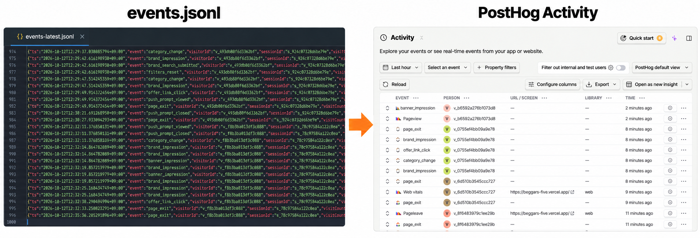

# 파일 로그에서 PostHog로 자동 전송하기까지

## 1. 과거 이벤트는 보이는데 새 이벤트가 들어오지 않았다

PostHog에서 과거의 사용자 행동을 볼 수 있게 됐습니다. 그런데 사용자가 계속 서비스를 이용해도 새 이벤트는 들어오지 않았어요. 서버가 수집한 로그를 한 번 수동으로 올렸을 뿐, 새 이벤트를 자동으로 보내는 경로는 만들지 않았기 때문입니다.

저희는 여러 배달앱의 할인 정보를 비교하는 웹 서비스를 만들고 있어요. 사용자가 어떤 브랜드를 살펴보고 어느 할인 링크를 눌렀는지 서버의 `events.jsonl`에 기록하고 있었습니다. 기록을 남기기는 쉬웠지만 방문한 사람이 할인 정보를 누르기까지 어떤 행동을 했는지 알아보려면 질문에 맞게 파일을 다시 집계해야 했어요.

이 탐색을 화면에서 할 수 있도록 수동으로 기존 로그를 PostHog 형식으로 정제해 올렸습니다. PostHog는 이벤트를 모아 사용자의 행동과 전환 흐름을 분석하는 도구입니다. 파일에만 있던 기록을 옮기고 나니 페이지 방문부터 할인 링크 클릭까지 이어지는 흐름을 시각화하여 살펴볼 수 있었어요.



첫 업로드로 과거 데이터의 시각화는 가능해졌지만 최신 데이터를 분석하려면 같은 작업을 반복해야 했습니다. 파일을 가져와 변환하고 업로드하는 일도 운영자가 계속 맡아야 했어요. 그래서 원본 로그를 유지하면서 새로운 이벤트를 PostHog로 자동 전송하기로 했습니다.

이 글은 그 자동 전송을 설계하고 구현한 과정을 담고 있습니다. 수동 업로드에서 자동 전송으로 넘어가며 남은 과거 구간을 백필하는 절차도 함께 다루려고 해요. 파일로 쌓인 이벤트를 기록을 분석 시각화 도구로 옮기는 일이 처음인 분들에게 조금이나마 도움이 되기를 바랍니다.

## 2. 원본 기록을 지키는 자동 전송 설계

자동 전송을 붙이면서도 `events.jsonl`은 남기기로 했습니다. 어떤 이벤트가 기록됐는지 확인하고 변환이 잘못됐거나 전달이 빠졌을 때 다시 처리할 근거가 필요했기 때문이죠. PostHog에서 특정 구간이 비어 있다면 원본에도 기록이 없는지, 외부로 전달하는 과정에서 빠진 것인지 구분할 수 있어야 했어요.

먼저 저희는 파일에 기록한 직후 PostHog로 보내고 응답까지 기다리는 방법을 생각했습니다. 구현 흐름은 단순하지만 외부 서비스가 느려지면 이벤트 수집 API도 함께 느려집니다. 분석 도구의 장애가 기존 수집 요청까지 막는 구조는 피하고 싶었어요.

요청을 기다리게 하지 않으려면 비동기로 전송할 수도 있었습니다. 다만 대기 작업을 메모리에만 두면, 서버가 재시작할 때 아직 보내지 않은 이벤트와 재시도 상태가 사라집니다. 파일에 원본이 남아 있더라도 어떤 이벤트를 다시 보내야 하는지는 별도로 찾아야 하죠.

당시 서비스는 데이터베이스 없이 JSONL을 원본으로 사용했고 단일 서버에서 실행되고 있었습니다. 이 조건에서 선택한 방법은 파일 기반 outbox 패턴이었어요. 여기서 outbox는 외부로 보낼 작업을 파일로 보관하는 대기열입니다. 서버가 재시작해도 아직 보내지 않은 작업과 재시도 상태를 유지할 수 있도록 했습니다.


서버는 브라우저에서 받은 이벤트를 먼저 `events.jsonl`에 기록합니다. 이 단계는 PostHog로 보내기 전에 원본을 확보하는 순서입니다. 이렇게 남긴 원본은 전송 결과를 확인하거나 누락된 이벤트를 다시 처리할 때 기준으로 사용할 수 있습니다. PostHog 전달 대상에서 제외된 이벤트도 원본 파일에는 그대로 남습니다.

원본 기록이 성공하면 PostHog로 전달할 이벤트를 골라 형식을 변환하고 outbox에 넣습니다. 그림의 ‘전송 대기’에 해당하는 단계죠. 이 서비스에서는 `pending` 폴더에 작업을 파일로 저장하는 방식으로 도입했어요. 서버는 이 과정까지 처리한 뒤 브라우저에 응답하고, 별도 worker가 대기 중인 파일을 읽어 PostHog로 전송합니다. 브라우저가 PostHog의 응답까지 기다리지 않으므로, PostHog가 느려지거나 일시적으로 중단되더라도 원본 기록과 브라우저에 대한 응답을 계속할 수 있어요.

전송에 실패한 작업은 바로 버리지 않고 일단 `pending`에 남깁니다. 이 폴더에는 처음 전송을 기다리는 작업과 실패 후 재시도를 기다리는 작업이 함께 들어갑니다. 실패한 작업에는 오류와 시도 횟수를 기록해 다음 전송을 준비합니다. 다만 같은 작업을 끝없이 재시도하지는 않아요. 반복해서 실패하면 `dead-letter` 폴더로 옮겨 자동 재시도를 멈춥니다. 전송할 내용과 실패 기록은 보관하므로, 이후 원인을 확인하고 다시 처리할 대상을 찾을 수 있죠.

재시도 과정에서는 같은 이벤트가 두 번 전달될 가능성도 고려해야 했어요. PostHog가 이벤트를 받았더라도 서버가 성공 응답을 받지 못하면, 서버는 실패로 판단해 같은 이벤트를 다시 보낼 수 있기 때문입니다. 이를 구분하기 위해 이벤트마다 고유한 `eventId`를 부여하고 재전송할 때도 처음 부여한 값을 유지했습니다. PostHog에는 이 값을 중복 판별에 사용하는 `$insert_id`로 전달했습니다. 전송을 여러 번 시도하더라도 같은 사용자 행동이 새로운 이벤트로 중복 집계되지 않도록 한 것이죠.

## 3. 이벤트 변환부터 비동기 전달까지 자동 전송 구현

### 서비스의 필드를 PostHog 속성으로 변환하기

원본에 방문자 식별자가 있어도 PostHog가 같은 의미로 해석할 수 있도록 전달해야 합니다. 예를 들어 `visitorId`를 일반 속성으로만 넣으면, 그 값이 자동으로 방문자를 묶는 기준이 되지는 않아요. 코드에서는 `PostHogEventMapper`에서 서비스의 필드를 전달 형식에 맞췄습니다.

| 원본 값 | PostHog로 전달하는 값 | 의도 |
|---|---|---|
| `event` | `event` | 행동을 구분하고 `page_view`는 `$pageview`로 변환 |
| `visitorId` | `properties.distinct_id` | 같은 방문자의 이벤트 연결 |
| `sessionId` | `properties.source_session_id` | 원본 세션 정보 보존 |
| `ts` | 최상위 `timestamp` | 업로드 시각 대신 원본 기록 시각 사용 |
| `eventId` | `properties.$insert_id` | 같은 이벤트의 재시도에서 식별자 유지 |
| 페이지 정보와 허용된 `props` | 이벤트 속성 | 행동이 발생한 화면과 대상 보존 |

이 표는 프로젝트에서 정한 매핑입니다. 특히 `source_session_id`는 원본 로그의 `sessionId`를 보관하기 위해 이 프로젝트에서 정의한 이벤트 속성이므로 PostHog의 자체 세션 기능과 같은 기준이라고 취급하지 않았습니다.

```java
public Optional<PostHogEvent> map(VisitEvent source) {
    if (source == null || Boolean.TRUE.equals(source.dev())) return Optional.empty();
    if (blank(source.eventId()) || blank(source.visitorId())) return Optional.empty();

    // Map 선언과 일반 속성 복사 생략
    properties.put("distinct_id", source.visitorId());
    put(properties, "source_session_id", source.sessionId());
    // 나머지 속성 설정 생략
    properties.put("$insert_id", source.eventId());

    String eventName = "page_view".equals(source.event()) ? "$pageview" : source.event();
    String timestamp = timestamp(source.ts());
    // 반환 부분 생략
}
```

클라이언트가 같은 속성을 보내더라도 방문자 식별자와 이벤트 ID가 덮어쓰이지 않게 하기 위해서 일반 `props`를 복사한 뒤 서버가 책임지는 속성을 설정했습니다. 시각도 서버 기록인 `ts`를 사용합니다. 과거 이벤트를 오늘 전송하더라도 오늘 발생한 이벤트처럼 배치돼서는 안 되기 때문이죠.

### 원본 기록 이후에 outbox에 등록하기

전체 순서는 `AnalyticsEventService.append()`가 조정합니다. 먼저 `eventLog.append(events)`로 수신한 이벤트를 `events.jsonl`에 기록합니다. 기록이 성공한 뒤 이벤트를 변환해 outbox에 넣고, 등록한 이벤트가 있으면 worker를 시작합니다.

```java
public void append(List<VisitEvent> events) {
    eventLog.append(events);
    if (!properties.enabled()) return;

    int enqueued = 0;
    for (VisitEvent event : events) {
        var mapped = mapper.map(event);
        if (mapped.isEmpty()) continue;
        try {
            outbox.enqueue(event.eventId(), mapped.get());
            enqueued++;
        } catch (RuntimeException ex) {
            log.error("failed to register in Posthog outbox: eventId={}",
                    event.eventId(), ex);
        }
    }
    if (enqueued > 0) worker.trigger();
}
```

이 경계에서 `/api/events`의 `accepted`는 원본 파일에 기록한 이벤트 개수예요. outbox 등록에 실패하면 오류를 남기지만 이미 끝난 원본 기록의 성공을 외부 전송 실패로 바꾸지는 않습니다.

outbox 등록 자체는 간단합니다. `PostHogOutbox.enqueue()`는 ID를 검사하고 전달할 이벤트와 초기 상태를 `pending` 폴더 안에 파일로 저장합니다. 내부의 `writeAtomically()`는 임시 파일을 작성한 뒤 이동하는 방식으로 저장합니다.

```java
public void enqueue(String eventId, PostHogEvent event) {
    validateEventId(eventId);
    writeAtomically(pendingPath(eventId),
            PostHogDelivery.pending(eventId, event, clock.instant()));
}
```

### worker에서 배치 전송과 실패 상태 처리하기

worker는 전송할 시각이 된 작업을 골라 PostHog로 보냅니다. 다음은 `PostHogForwardingWorker.processDue()`입니다. 만약 서버의 배치(batch) 크기는 20건이라면, worker는 전송할 시각이 된 작업을 최대 20건씩 묶어 PostHog로 보냅니다. HTTP 요청 전에 시도 횟수와 다음 시도 시각을 파일에 저장하므로 서버가 재시작하더라도 이전 상태를 기억하고 이어갈 수 있어요.

```java
void processDue() {
    while (true) {
        List<PostHogDelivery> deliveries = outbox.claimDue(BATCH_SIZE);
        if (deliveries.isEmpty()) return;

        PostHogClient.Result result = client.sendBatch(
                deliveries.stream().map(PostHogDelivery::payload).toList());
        if (result.success()) {
            outbox.markSucceeded(deliveries);
        } else {
            outbox.markFailed(deliveries, result.error());
            log.warn("PostHog 이벤트 {}건 전달 실패: {}",
                    deliveries.size(), result.error());
        }
    }
}
```

성공 응답을 받으면 `pending` 파일을 지웁니다. 실패하면 오류와 시도 횟수를 저장하고 한 시간 뒤 다시 전송합니다. 최초 시도를 포함해 다섯 번 모두 실패하면 `dead-letter` 폴더로 옮겨 자동 재시도를 중단합니다. 시도 횟수를 파일에 남기므로 전송 도중 서버가 재시작되더라도 횟수가 처음으로 돌아가지 않죠.

이렇게 구성한 자동 전송은 새로 받은 이벤트를 outbox에 등록하고 PostHog로 전달합니다. 그러나 worker는 outbox에 저장된 작업을 읽을 뿐, 기존 `events.jsonl` 전체를 훑어 과거 이벤트까지 자동으로 등록하지는 않습니다. 따라서 자동 전송을 도입했다고 해서 파일에 쌓여 있던 모든 이벤트가 PostHog로 옮겨진 것은 아니었어요.

특히 마지막 수동 업로드 이후부터 자동 전송을 시작하기 전까지 기록된 이벤트는 파일에만 남게 됩니다. 이 이벤트들은 수동 업로드 대상에도, 새로 만든 outbox에도 포함되지 않았습니다. 새 이벤트를 계속 전달하는 경로와 별개로 이 구간을 찾아 PostHog에 채워 넣는 작업이 필요했습니다.

## 4. 자동 전송을 켜도 남는 과거의 공백

백필은 이미 발생한 과거 데이터를 나중에 채워 넣는 작업이에요. 이 글에서는 파일에 기록돼 있지만 PostHog에 전달되지 않은 이벤트를 분석 데이터에 추가하는 일을 뜻합니다. 사용자가 행동을 다시 하도록 만드는 것이 아니라, 남아 있는 기록을 이용해 당시의 행동을 분석할 수 있도록 채우는 것이죠.

이때 중요한 것은 업로드하는 시각과 이벤트가 발생한 시각을 구분하는 일입니다. 예를 들어 어제 발생한 클릭을 오늘 업로드했다고 해서 오늘의 클릭으로 집계돼서는 안 되겠죠. 원본에 기록된 발생 시각을 함께 전달해야 해당 날짜의 방문이나 클릭 흐름을 살펴볼 수 있습니다.

만약 이 구간이 비게 되면 PostHog에서 보이는 이벤트 감소가 실제 사용자 행동의 변화인지, 전달되지 않은 기록 때문인지 구분하기 어렵습니다. 백필의 목적은 과거 기록도 같은 분석 기준으로 살펴볼 수 있게 하는 데 있어요. 이를 위해서는 원본을 전부 다시 올리기보다, 이미 전달된 기록과 채워야 할 기록을 구분하는 것부터 시작해야 했습니다.

### 어디부터 어디까지 보낼 것인가

백필의 시작점은 PostHog에 이미 업로드된 마지막 이벤트의 발생 시각입니다. 남아 있는 수동 업로드용 정제 파일 `posthog_cleaned_events.jsonl`에서 확인한 마지막 이벤트 시각은 **2026년 8월 8일 16:02**입니다.

한편, 자동 전송으로 넘어간 시점을 살펴볼 자료로는 원본 스냅샷 `events_0815.jsonl`이 있습니다. 이 파일에서는 **2026년 8월 14일 23:28**부터 `eventId`가 있는 기록을 발견했고, 해당 시각을 자동 전송으로 넘어간 시점으로 두었습니다.

백필 계획에서는 PostHog에 이미 업로드된 마지막 이벤트의 발생 시각을 `last_event`, 자동 전송 활성화 시각을 `T`로 두고 다음 범위를 정의했습니다. 파일에서 확인한 두 시각을 경계 대조의 근거로 삼았어요. 이어서 실제 PostHog 기록과 활성화 기록을 확인한 뒤 백필 범위를 확정했습니다.

```text
last_event < timestamp < T
```

### 원본에서 대상 구간을 추출하기

백필 폴더에는 원본 스냅샷 `events_0815.jsonl`과 수동 업로드용 정제 파일`posthog_cleaned_events.jsonl` 이 남아 있습니다. 두 파일을 비교하기 전에 포함한 기간과 형식을 먼저 살펴봤어요.

| 파일 | 행 수 | 포함 기간 | 형식 |
|---|---:|---|---|
| `events_0815.jsonl` | 20,172 | 7월 29일~8월 14일 | `ts`와 서비스 필드를 가진 원본 |
| `posthog_cleaned_events.jsonl` | 13,760 | 7월 29일~8월 8일 | `timestamp`와 `properties`를 가진 전달 형식 |

대상 기간을 정하기 위해 원본의 기록 시각을 의미하는 `ts`로 해당 행을 골랐습니다. 이어서 개발 환경에서 발생한 이벤트를 뜻하는 `dev=true`, 빈 `visitorId`를 제외하고 남은 행을 앞서 3번에서 설명한 PostHog 형식으로 변환합니다. 동시에 선택한 기간의 이벤트 개수, 조건에 따라 제외한 개수, 최종 전송할 개수를 각각 기록했습니다. 변환 후 건수가 줄었을 때 의도적으로 제외된 것인지, 아니면 처리 중 누락된 것인지 확인하기 위해서죠.

### 다시 올릴 때 중복을 만들지 않기

기존 정제 파일에는 `$insert_id`가 없었습니다. 원본에도 `eventId`가 있는 행은 11건뿐이었습니다. 즉, 새 이벤트에 도입한 식별자 규칙이 과거 데이터 전체에 적용돼 있다고 볼 수는 없었어요.

이벤트 ID가 있는 기록은 해당 ID를 유지해 전달하고 ID가 없는 이벤트는 재업로드 시 중복으로 수집될 위험이 있으므로 동일한 기간의 데이터를 한 번만 업로드하도록 했습니다. 이를 위해 백필 계획에는 원본 범위와 건수, 입력 파일의 해시값을 남기도록 했어요. 이렇게 남긴 값으로 나중에 같은 파일을 다시 올리려는 것인지 확인할 수 있었습니다.

수집 데이터 명세에서도 과거 데이터가 중복 업로드된 사례를 볼 수 있었습니다. 8월 5일의 `brand_expand` 이벤트를 비교하면 원장에는 208건이 있지만 PostHog에는 두 배인 416건이 있었어요. 같은 사용자의 이벤트가 중복으로 들어가면 방문자 수는 비슷해도 이벤트 횟수는 늘어나는 것이죠. 따라서 백필할 때는 누락된 이벤트를 채우는 것과 함께 중복 업로드 여부도 확인해야 합니다.

### 백필을 실행하고 결과 확인

대상 기간의 이벤트를 정제한 뒤 업로더로 PostHog에 전송합니다. 업로더에서는 이벤트 이름과 발생 시각, 방문자 식별자인 `properties.distinct_id`를 검사하고 이벤트를 최대 500건씩 묶어 보냈습니다.

```bash
python3 posthog-backfills/upload_to_posthog.py
  /tmp/posthog-backfill-selected.jsonl --batch-size 500
```

업로더는 `historical_migration=true`를 설정해 PostHog에 과거 데이터를 보내는 작업임을 표시합니다. 한편, PostHog의 과거 데이터 업로드 조건에 맞춰, 발생한 지 48시간이 지난 이벤트만 전송해야 했습니다. 이에 따라 백필은 자동 전송 활성화 시각인 `T`로부터 48시간이 지난 뒤 업로드하도록 계획했습니다. 그동안 새로 발생한 이벤트는 자동 전송이 처리해요.

전송이 끝난 뒤에는 이벤트가 정상적으로 전송됐는지 확인하기 위해 PostHog에서 대상 기간을 조회해 이벤트 수와 발생 시각, 주요 속성을 대조했습니다. 전송 요청이 성공했더라도 이벤트가 의도한 날짜에 들어갔는지, 중복으로 집계되지는 않는지도 확인해야 하죠. 이를 위해 입력 파일의 해시값과 전송 대상 건수, 제외 및 오류 건수, 업로드 건수를 함께 기록하도록 했습니다.

## 5. 자동 전송 도입에서 얻은 러닝과 남은 한계

### 자동 전송과 별개로 과거 데이터도 채워야 한다

자동 전송을 구현해도 이전에 쌓인 데이터까지 PostHog로 옮겨지지는 않았습니다. 새로 수신한 이벤트는 자동으로 전달됐지만, 마지막 수동 업로드부터 자동 전송 시작 전까지의 기록은 여전히 파일에만 남아 있었어요.

이 과정에서 배운 점은 분명했습니다. 자동 전송을 시작한 뒤에도 백필 같은 추가 조치가 필요하다는 것이었어요. 새 이벤트가 정상적으로 들어오는지 확인하는 데서 끝내지 않고, 과거 기록과 전환 구간에 빠진 이벤트가 없는지도 살펴봐야 했습니다. 자동 전송 도입과 백필을 처음부터 함께 계획했다면 이 부분을 더 일찍 다룰 수 있었을 거예요.

### 클라이언트 정보는 별도로 정의하고 전달해야 한다

자동 전송을 붙여도 브라우저와 운영체제, 현재 URL, 화면 크기 같은 정보가 저절로 채워지지는 않았어요. PostHog의 브라우저 SDK가 수집하는 정보를 서버 전송 경로에서도 활용하려면 필요한 필드를 별도로 정의해야 합니다. 브라우저에서 이 정보를 수집해 서버로 전달하고, 서버는 이를 기록한 뒤 PostHog의 분석 속성에 맞춰 보내야 합니다.

이 프로젝트의 mapper는 원본의 `path`, `referrer`, `device`, `viewport`를 전달합니다. 이미 수집한 페이지 경로나 화면 크기는 옮길 수 있지만, 원본에 없는 브라우저 이름이나 운영체제 정보를 만들어 주지는 않습니다. 현재 URL도 경로만 기록했다면 전체 URL을 사용하는 분석에는 부족할 수 있고요.

이번 작업으로 이벤트를 자동으로 보내는 경로는 만들었습니다. 다만 분석에 필요한 클라이언트 정보를 모두 갖춘 것은 아니었어요. 파일 로그를 PostHog로 옮기려면 과거 구간을 채우는 백필뿐 아니라, 분석에 쓸 정보를 정하고 그에 맞는 필드를 수집하는 작업도 필요했습니다.
