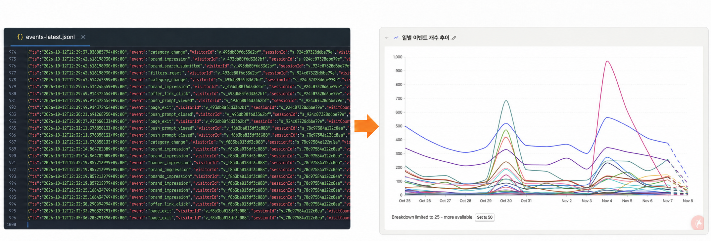
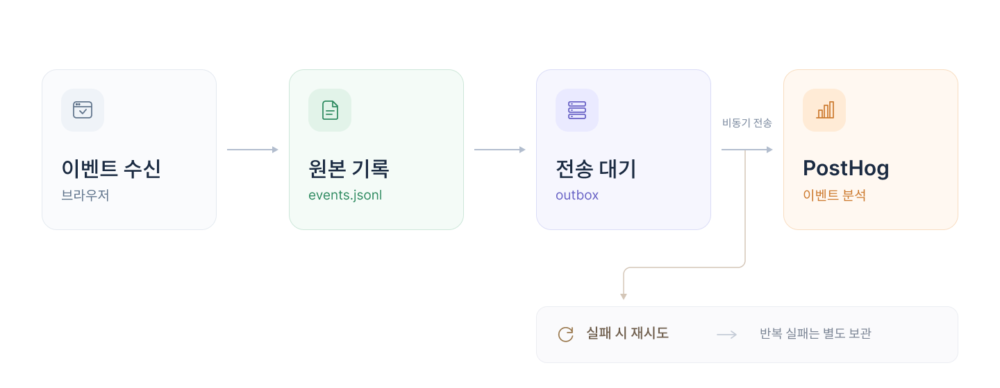

# PostHog 이벤트 자동 전송

## 1. 도입

지난주에 PostHog라는 사용자 이벤트 시각화 분석 서비스를 도입했습니다.

저희 팀은 4개의 주요 배달 플랫폼의 할인을 비교하는 서비스를 만들고 있습니다. 그리고 저희 서비스를 이용하며 남는 사용자 행동을 파일 형태로 기록합니다. 파일로만 기록하다보니 사용자의 행동 패턴을 분석하려면 파일에 있는 데이터를 일일이 살펴봐야 했어요. 그래서 저희는 사용자 행동 분석을 화면에서 바로 할 수 있도록 수동으로 기존 로그를 PostHog 형식으로 정제해 올렸습니다. 이렇게 하니 페이지 방문부터 할인 링크 클릭까지의 흐름을 손쉽게 살펴볼 수 있었어요.



그러나 여전히 수동으로 파일을 변환하고 업로드해야 했습니다. 이 불편함을 해소하기 위해 수동 방식을 자동으로 전환하는 작업을 진행했습니다.

이 글은 그 자동 전송을 설계하고 구현한 여정을 담고 있습니다. 더불어 수동 업로드에서 자동 전송으로 넘어가며 백필(backfill, 누락된 과거 데이터를 나중에 채워 넣는 작업)하는 절차도 함께 다룹니다. 파일로 쌓인 이벤트를 분석 시각화 도구로 옮기는 일이 처음인 분들에게 조금이나마 도움이 되기를 바랍니다.

## 2. 자동 전송 설계

### 전송 방식 결정

수동에서 자동으로 전환할 때 가장 많이 고민한 지점은 이벤트 정보 유실이었습니다. 수동 전송일 때는 보내기 전에 이벤트 정보가 제대로 들어가있는지, 누락된 이벤트가 없는지 직접 확인했었습니다. 그러나 자동으로 보낼 때는 네트워크 지연이나 서버 오류 등의 이유로 바로 알아차리기 어려울 수 있다고 봤습니다. 그래서 자동 전송 설계할 때 전송 실패한 이벤트를 어떻게 다시 보낼지, 누락 여부를 어떻게 확인할 수 있을지를 함께 고민했습니다.

먼저 파일에 기록한 직후 PostHog 동기 전송 방식을 생각했습니다. 구현은 단순하지만 외부 서비스가 느려지면 이벤트 수집 API도 함께 느려질 수 있었습니다. 이렇게 분석 도구의 장애가 기존 수집 요청까지 막는 구조는 피하려 했습니다. 그래서 요청을 비동기로 전송하는 방법도 고려했습니다. 다만 대기 작업을 메모리에만 두게 되면 서버가 재시작할 때 이벤트 전송 상태가 함께 사라집니다. 결국 파일에 원본이 남아 있어도 어떤 이벤트를 다시 보내야 하는지는 별도로 찾아야 하죠.

당시 서비스는 서버 한 대에서 운영했고 이벤트 원본은 파일에 기록하고 있었기에, 전송 대기열도 파일로 구성했습니다. 실제 전송은 별도 워커가 맡도록 하여 수집 API가 PostHog의 응답을 기다리지 않도록 했습니다.

### 전송 파이프라인


위 이미지는 이벤트를 기록하고 PostHog로 보내는 파이프라인을 나타내고 있습니다. 

먼저, 브라우저에서 사용자 이벤트를 서버에 보내게 되면 서버는 받은 이벤트를 파일에 기록합니다. 이렇게 남긴 원본은 전송 결과를 확인하거나 누락된 이벤트를 다시 처리할 때 기준으로 사용하게 됩니다.

원본 기록이 성공하면 PostHog로 전달할 이벤트를 골라 형식을 PostHog에 맞게 변환하여 outbox에 넣습니다. 그림의 ‘전송 대기’에 해당하는 단계죠. 여기서는 `pending` 폴더에 작업을 파일로 저장하는 방식을 사용했습니다. 서버는 이 과정까지 처리한 뒤 브라우저에 응답하고, 별도 워커가 대기 중인 파일을 읽어 PostHog로 전송합니다. 덕분에 PostHog가 느려지거나 일시적으로 중단돼도, 서버는 전송 결과를 기다리지 않고 브라우저 요청에 응답할 수 있어요.

한편, 전송에 실패한 작업은 바로 버리지 않고 일단 `pending`에 남깁니다. 이 폴더에는 처음 전송을 기다리는 작업과 실패 후 재시도를 기다리는 작업이 함께 들어갑니다. 이때, 실패한 작업이라면 오류와 시도 횟수도 함께 기록해둡니다. 다만 같은 작업을 끝없이 재시도하지는 않아요. 반복해서 실패하면 `dead-letter` 폴더로 옮겨 자동 재시도를 멈춥니다. 전송할 내용과 실패 기록은 보관하므로, 이후 원인을 확인하고 다시 처리할 대상을 찾을 수 있습니다.


## 3. 코드로 구현

### 이벤트를 PostHog에서 요구하는 형식으로 변환

저희는 이벤트를 형식을 자체적으로 정하고 기록했기에, 이벤트를 전송하기 전 PostHog에 요구하는 형식에 맞춰 변환해야 했습니다. PostHog 형식과 이에 대응하는 저희 이벤트 값을 찾고 매핑하는 로직을 추가했습니다. 

```java
public Optional<PostHogEvent> map(VisitEvent source) {
    if (source == null || Boolean.TRUE.equals(source.dev())) return Optional.empty();
    if (blank(source.eventId()) || blank(source.visitorId())) return Optional.empty();

    properties.put("distinct_id", source.visitorId());
    put(properties, "source_session_id", source.sessionId());

    properties.put("$insert_id", source.eventId());
    ...

    String eventName = "page_view".equals(source.event()) ? "$pageview" : source.event();
    String timestamp = timestamp(source.ts());
    ...
}
```

### 전송 대기열(outbox) 등록

`AnalyticsEventService`는 브라우저에서 받은 이벤트를 먼저 로그 파일에 기록합니다. 기록에 성공하면 PostHog로 보낼 이벤트를 변환해 outbox에 넣습니다. 대기열에 추가한 이벤트가 있으면 워커를 실행합니다.

```java
public void append(List<VisitEvent> events) {
    eventLog.append(events);
    if (!properties.enabled()) return;

    int enqueued = 0;
    for (VisitEvent event : events) {
        var mapped = mapper.map(event);
        if (mapped.isEmpty()) continue;
        try {
            outbox.enqueue(event.eventId(), mapped.get());
            enqueued++;
        } catch (RuntimeException ex) {
            log.error("failed to register in Posthog outbox: eventId={}",
                    event.eventId(), ex);
        }
    }
    if (enqueued > 0) worker.trigger();
}
```

outbox 등록 자체는 간단합니다. `PostHogOutbox.enqueue()`가 ID를 검사하고 전달할 이벤트와 초기 상태를 `pending` 폴더 안에 파일로 저장합니다. 내부의 `writeAtomically`는 임시 파일을 작성한 뒤 이동하는 방식으로 저장합니다.

```java
public void enqueue(String eventId, PostHogEvent event) {
    validateEventId(eventId);
    writeAtomically(pendingPath(eventId),
            PostHogDelivery.pending(eventId, event, clock.instant()));
}
```

만약 outbox 등록에 실패하면 서버는 해당 이벤트의 ID와 오류를 로그에 남기고 다음 이벤트를 처리합니다.

### 워커의 배치 전송과 실패 상태 처리

워커는 전송할 시각이 된 작업을 골라 PostHog로 보냅니다. 워커는 이벤트를 1개씩 보내지 않고, 여러개를 하나의 요청으로 묶어 보냅니다. 만약 서버의 배치(batch) 크기가 20건이라면, 최대 20건씩 묶어 보내는 셈이죠. 여기서 워커는 요청을 보ㅓ내기 전에 각 작업의 시도 횟수 및 다음 시도 시각을 파일에 저장합니다. 전송 도중 서버가 재시작해도, 워커는 파일에 남은 작업을 읽어 다음 시도 시각이 되면 다시 전송합니다. 아래는 이 흐름을 구현한 `PostHogForwardingWorker` 의 `processDue()`입니다. 

```java
void processDue() {
    while (true) {
        List<PostHogDelivery> deliveries = outbox.claimDue(BATCH_SIZE);
        if (deliveries.isEmpty()) return;

        PostHogClient.Result result = client.sendBatch(
                deliveries.stream().map(PostHogDelivery::payload).toList());
        if (result.success()) {
            outbox.markSucceeded(deliveries);
        } else {
            outbox.markFailed(deliveries, result.error());
            log.warn("PostHog 이벤트 {}건 전달 실패: {}",
                    deliveries.size(), result.error());
        }
    }
}
```

PostHog에서 성공 응답을 받으면 워커는 대상 작업을 outbox에서 제거합니다. 반대로 실패했을 때는 제거하는 대신 실패 원인과 시도 횟수를 기록하고, 실패한 시점으로부터 1시간 뒤에 다시 전송합니다. 최초 시도를 포함하여 다섯 번 모두 실패하면 `dead-letter` 폴더로 옮겨 자동 재시도를 중단합니다.

이렇게 구성한 자동 전송은 새로 받은 이벤트를 outbox에 등록하고 PostHog로 전달합니다. 그러나 워커는 outbox에 저장된 작업을 읽을 뿐, 기존 이벤트 파일 전체를 훑어 과거 이벤트까지 자동으로 등록하지는 않습니다. 따라서 자동 전송을 도입했다고 해서 파일에 쌓여 있던 모든 이벤트가 PostHog로 옮겨진 것은 아니었어요. 특히 수동 업로드와 자동 전송 사이에 기록된 이벤트는 여전히 파일에 남아있었습니다. 결국 이벤트를 빠짐없이 넣기 위해서는 이 공백을 찾아 PostHog에 채워 넣는 작업이 필요했습니다.

## 4. 백필로 공백 매꾸기

만약 이 구간이 비게 된다면 PostHog에서 기간 내에 이벤트 수가 줄어든 이유를 판단하기 어렵습니다. 실제 사용자 행동의 변화인지, 전달되지 않은 기록 때문인지 알 수 없습니다. 이 공백을 메우기 위해 먼저 이벤트 범위를 정했습니다.

범위를 정하기 위해 마지막 수동 업로드 시각과 자동 전송을 시작한 시각을 확인했습니다. 그리고 두 시각 사이에 있는 이벤트를 백필 대상으로 삼았습니다. 이때 중요한 것은 업로드하는 시각과 이벤트가 발생한 시각을 구분하는 것이었습니다.

### 범위 정하기

백필의 시작점은 PostHog에 수동 업로드된 마지막 이벤트 발생 시각입니다. 남아 있는 수동 업로드용 정제 파일에서 확인한 마지막 이벤트 시각은 8월 8일 16:02 이었습니다.

한편, 자동 전송으로 넘어간 시점을 살펴보기 위해 자동 전송이 시작된 날쯤 만들어진 이벤트 로그를 찾아봤습니다. 8월 14일 23:28부터 ID가 존재하는 이벤트를 발견했고, 해당 이벤트에 기록된 시각을 자동 전송으로 넘어간 시점으로 두었습니다.

백필 계획에서는 8월 8일 16:02을 `last_event`, 8월 14일 23:28을 `T`로 두고 다음 범위를 정의했습니다.

```text
last_event < timestamp < T
```

### 서버 이벤트 로그에서 대상 추출

백필 폴더에는 원본 스냅샷 `events_0815.jsonl`과 수동 업로드용 정제 파일`posthog_cleaned_events.jsonl` 이 남아 있었습니다. 두 파일을 비교하기 전에 포함한 기간과 형식을 먼저 살펴봤어요.

| 파일 | 행 수 | 포함 기간 | 형식 |
|---|---:|---|---|
| `events_0815.jsonl` | 20,172 | 7월 29일~8월 14일 | `ts`와 서비스 필드를 가진 원본 |
| `posthog_cleaned_events.jsonl` | 13,760 | 7월 29일~8월 8일 | `timestamp`와 `properties`를 가진 전달 형식 |

대상 기간을 정하기 위해 `ts`로 조건에 맞는 행을 골랐습니다. 이어서 개발 환경에서 발생한 이벤트를 뜻하는 속성 `dev=true`와 빈 `visitorId`를 제외하고 남은 행을 PostHog 형식으로 변환합니다. 동시에 이벤트 개수가 줄었을 때 그 원인을 파악하기 위해 선택한 기간의 이벤트 개수, 조건에 따라 제외한 개수, 최종 전송할 개수를 각각 기록했습니다.

### 이벤트 중복 방지

기존 정제 파일에는 중복을 판별할 수 있는 ID로 쓸 수 있는 필드가 거의 찾아볼 수 없었습니다. 새로 도입한 식별자 규칙이 데이터 전체에 적용돼 있다고 보기 어려웠습니다.

ID가 없는 이벤트는 다시 올리게 되면 중복으로 집계될 수 있었기에 동일 기간의 데이터를 한 번만 업로드하도록 했습니다. 이를 위해 백필 계획에는 원본 범위와 건수, 입력 파일의 해시값을 남기도록 했어요. 이렇게 남긴 값으로 나중에 같은 파일을 다시 올리려는 것인지 확인할 수 있었습니다.

### 백필을 실행하고 결과 확인

대상 기간의 이벤트를 정제한 뒤 업로더로 PostHog에 전송합니다. 업로더에서는 이벤트 이름과 발생 시각, 방문자 식별자인 `properties.distinct_id`를 검사한 후 전송했습니다. 그리고 요청에 `historical_migration=true`를 추가하여 PostHog에 과거 데이터를 보내는 작업임을 표시했습니다. 

한편, PostHog의 과거 데이터 업로드 조건인 발생 후 48시간이 지난 이벤트만 전송해야 했습니다. 이를 위해 백필은 자동 전송 활성화로부터 48시간이 지난 뒤에 진행하도록 계획했습니다.

전송이 끝난 뒤에는 PostHog에서 대상 기간을 조회해 원본과 대조하여 정상적으로 전송됐는지 확인헀습니다.

## 5. 자동 전송 도입에서 얻은 러닝과 남은 한계

### 자동 전송과 별개로 과거 데이터 백필도 필요하다

자동 전송을 구현해도 이전에 쌓인 데이터까지 PostHog로 옮겨지지는 않았습니다. 새로 수신한 이벤트는 자동으로 전달됐지만, 마지막 수동 업로드부터 자동 전송 시작 전까지의 기록은 여전히 파일에만 남아 있었어요.

이 과정에서 배운 점은 분명했습니다. 자동 전송을 시작한 뒤에도 백필 같은 추가 조치가 필요하다는 것이었어요. 새 이벤트가 정상적으로 들어오는지 확인하는 데서 끝내지 않고, 과거 기록과 전환 구간에 빠진 이벤트가 없는지도 살펴봐야 했습니다. 자동 전송 도입과 백필을 처음부터 함께 계획했다면 이 부분을 더 일찍 다룰 수 있었을 거예요.

### 클라이언트 정보는 별도로 정의하고 전달해야 한다

자동 전송을 붙여도 브라우저와 운영체제, 화면 크기 같은 정보가 저절로 채워지지는 않았어요. PostHog의 브라우저 SDK가 수집하는 정보를 서버 전송 경로에서도 활용하려면 필요한 필드를 별도로 정의해야 합니다. 브라우저에서 이 정보를 수집해 서버로 전달하고, 서버는 이를 기록한 뒤 PostHog의 분석 속성에 맞춰 보내야 합니다.

이번 작업으로 이벤트를 자동으로 보내는 경로는 만들었습니다. 다만 분석에 필요한 클라이언트 정보를 모두 갖춘 것은 아니었습니다. 파일 로그를 PostHog로 옮기려면  분석에 쓸 정보를 정하고 그에 맞는 필드를 수집하는 작업이 필요합니다.
