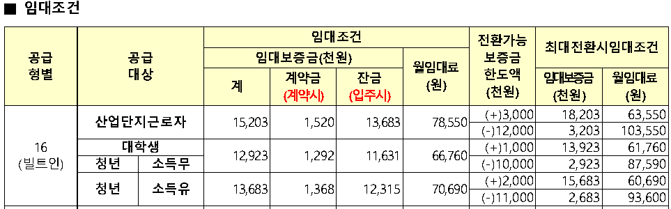
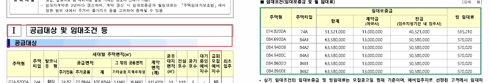

# 공고 PDF의 금액을 서비스 데이터로 바꾸기

## LH 공고 3건에서 주택형과 임대조건의 관계를 복원한 과정

공공임대주택 정보를 보여주는 서비스를 만들다 보면 공개 API만으로 채우기 어려운 항목을 만난다. 이때 모집 공고 PDF가 상세 정보의 출처가 된다. 하지만 PDF에서 보증금 숫자를 찾아내는 일과, 그 보증금이 어느 주택형의 어떤 조건인지 알아내는 일은 다르다.

이 글은 LH 공고 3건에서 임대조건을 추출한 기술검증(PoC, proof of concept)을 다룬다. 거대 언어 모델(LLM, large language model)을 사용하지 않고 문자 위치와 표의 선, 제목을 이용했다. 추출한 원문과 단위, 병합 관계를 구조화된 결과로 남기는 데까지 구현했다. 서비스의 업무 데이터베이스에 적재하는 단계는 후속 과제로 남았다.

결과부터 말하면 세 공고의 임대조건 표 5개를 복원했고, 보증금과 계약금, 잔금을 연결한 31행에서 합계가 맞았다. 다만 이 결과가 모든 셀의 정확성이나 다른 공고 양식의 처리를 보장하지는 않는다. PDF 추출을 처음 구현하는 개발자가 어떤 정보를 보존하고 무엇을 검증해야 하는지 판단할 수 있도록, 실제 공고와 실패 사례를 따라 설명한다.

## 1. 보증금 하나에도 주택형과 조건이 붙는다

부산명지 공고에는 보증금 `15,203`과 월임대료 `78,550`이 나온다. 두 숫자만 보면 비슷한 금액 데이터처럼 보인다. 그러나 보증금의 단위는 천 원이고 월임대료의 단위는 원이다. 원 단위로 바꾸면 각각 15,203,000원과 78,550원이다.



*그림 1. 부산명지 공고의 임대조건 표 일부. PDF 파일의 2쪽 왼쪽에 있으며, 분할한 논리 페이지로는 3쪽이다. 출처: 해당 모집 공고 원문.*

이 금액은 16형 전체에 공통인 값도 아니다. 공급대상에 따라 조건이 나뉘고, 보증금을 더 내거나 돌려받을 때의 전환 조건도 같은 표에 들어 있다. 서비스를 이용하는 사람이 조건을 비교하려면 다음 관계를 함께 알아야 한다.

| 확인할 정보 | 부산명지 공고의 대표 사례 | 추출할 때 보존할 관계 |
| --- | --- | --- |
| 주택형 | 16형, 빌트인 | 어떤 주택의 조건인가 |
| 공급대상 | 산업단지근로자 | 누구에게 적용하는가 |
| 기본 임대조건 | 보증금 15,203,000원, 월임대료 78,550원 | 두 금액이 같은 조건인가 |
| 전환 후 임대조건 | 보증금 18,203,000원, 월임대료 63,550원 | 기본 조건에서 무엇을 바꾼 값인가 |

따라서 추출의 목표를 ‘공고에서 금액 찾기’보다 구체적으로 정했다. **주택형과 공급대상, 임대조건의 구분을 유지하면서 금액과 단위를 읽고, 원문의 위치까지 되찾을 수 있어야 한다.** 숫자가 모두 남아 있더라도 서로 다른 조건의 값을 한 행에 섞었다면 이 목표를 충족하지 못한다.

## 2. 먼저 텍스트와 문서 구조를 확인했다

PDF를 읽는 코드를 작성하기 전에 대상 문서에서 글자를 직접 추출할 수 있는지 확인했다. 화면에서 텍스트를 선택할 수 있는지 살펴보고, 실제 추출 결과에 한글과 숫자가 남는지도 확인했다. 이번 세 공고의 대상 영역에는 문자 데이터와 벡터 선이 있었다. 따라서 이미지를 글자로 바꾸는 광학 문자 인식(OCR, optical character recognition)을 거치지 않고 접근할 수 있었다.

PDF의 표가 항상 행과 열을 갖춘 데이터로 저장되는 것은 아니다. 글자와 선을 특정 좌표에 배치해 표처럼 보이게 만든 문서도 있다. 이 경우 추출기는 위치를 바탕으로 행과 열을 다시 판단해야 한다. [pypdf의 텍스트 추출 문서](https://pypdf.readthedocs.io/en/stable/user/extract-text.html#why-text-extraction-is-hard)도 이런 어려움을 설명한다.

확보한 LH 공고 3건에는 다음과 같은 차이가 있었다. 이 구성을 통해 한 면에 두 쪽이 놓인 문서와 세로 문서, 조건을 여러 표로 나눈 경우를 함께 확인했다.

| 공고 | PDF 파일의 페이지 수 | 분할 후 논리 페이지 수 | 확인할 구조 |
| --- | ---: | ---: | --- |
| 부산명지 | 15 | 30 | 두 쪽 배치, 공급대상과 전환 조건을 합친 표 |
| 김해진영 | 9 | 18 | 두 쪽 배치, 중복 문자, 기본, 증액, 감액 조건의 분리 |
| 전주삼천6 | 23 | 23 | 세로 문서, 한 행에 기본 조건과 최대전환 조건 배치 |

이 세 건은 다양한 양식의 처리 가능성을 살펴보는 고정 표본이다. LH 전체 공고를 대표하는 통계 표본은 아니다. 또한 추출 규칙을 만들면서 계속 확인한 문서이므로, 처음 보는 공고에서도 같은 결과를 낼지는 별도로 검증해야 한다.

추출 도구로는 `pdfplumber 0.11.9`를 사용했다. 문자와 선의 위치를 읽고, 영역을 자르거나 표 후보의 셀 경계를 조사할 수 있어 이번 접근에 필요한 정보를 제공했다. 완성된 임대조건 데이터를 반환하는 도구는 아니므로, 문서의 제목과 표의 의미를 판단하는 규칙은 별도로 구현했다.

## 3. 숫자를 읽기 전에 읽기 순서를 복원했다

부산명지와 김해진영 공고는 가로 한 면에 문서 두 쪽을 배치한 형태였다. PDF 파일의 한 페이지를 그대로 읽으면 왼쪽과 오른쪽 문장이 섞일 수 있다. 같은 높이에 있다는 이유로 왼쪽의 공급대상과 오른쪽의 임대조건을 한 줄로 묶으면, 이후에 표를 찾아도 문맥이 이미 어긋난다.

그래서 파일에 저장된 면을 ‘물리 페이지’, 사람이 읽는 한 쪽을 ‘논리 페이지’로 구분했다. 가로 페이지의 중앙 부근에서 글자가 없는 세로 간격을 찾고, 양쪽에 본문이 있는지 확인한 뒤 나눴다. 읽기 순서는 왼쪽 논리 페이지 전체, 오른쪽 논리 페이지 전체 순으로 정했다. 특정 파일의 몇 쪽인지를 조건으로 넣는 대신 페이지의 폭과 문자 배치를 사용했다.

이 과정에서 원문의 위치도 함께 보존했다. 예를 들어 ‘물리 2쪽, 왼쪽, 논리 3쪽’이라는 정보가 있어야 추출값을 원문과 대조하기 쉽다. 논리 페이지 번호만 저장하면 실제 PDF 뷰어에서 어느 면을 열어야 하는지 다시 찾아야 한다.

김해진영 공고에는 같은 위치에 겹쳐 찍힌 문자도 있었다. 눈으로는 강조된 제목처럼 보이지만 추출 결과에는 글자나 괄호가 반복됐다. 이런 중복은 제목 검색과 단어 묶기에 영향을 준다. 각 페이지에서 `dedupe_chars(tolerance=1)`을 먼저 적용해 겹친 문자를 정리했다. 이 메서드는 문자 내용과 위치, 글꼴 속성을 기준으로 중복을 제거한다. 허용 오차의 의미는 [pdfplumber 문서](https://github.com/jsvine/pdfplumber/tree/v0.11.9#extracting-text)에서 확인할 수 있다.

문자열 비교용 정규화와 원문 보존도 구분했다. 비교할 때는 Unicode의 호환 정규화 방식인 NFKC와 공백 정리를 적용했지만, 셀의 `raw` 값에는 원래 공백과 줄바꿈을 남겼다. NFKC는 호환 문자를 다른 표현으로 바꿀 수 있으므로, 원문 자체를 덮어쓰는 용도로 사용하지 않았다. [Python의 Unicode 정규화 문서](https://docs.python.org/3/library/unicodedata.html#unicodedata.normalize)가 이 차이를 설명한다.

문자 중복 제거, 논리 페이지 분리, 비교용 정규화는 모두 표 검출보다 먼저 수행했다. 뒤 단계의 규칙을 늘리기 전에 입력 문맥부터 바로잡아야 했기 때문이다.

## 4. 사각형을 찾았다고 임대조건 표는 아니다

표를 찾는 과정에서는 장식용 도형도 문제가 됐다. 같은 김해진영 공고를 사각형 테두리까지 표의 선으로 사용하는 설정으로 읽어 보니, 물리 2쪽의 ‘공급대상 및 임대조건 등’ 제목 영역이 4행 49열짜리 표 후보로 잡혔다. 제목을 꾸민 선이 많은 열 경계로 해석된 결과였다.



*그림 2. 같은 물리 2쪽의 두 영역. 빨간색은 단순 검출에서 49열로 나뉜 장식 제목이고, 초록색은 6열짜리 기본 임대조건 표다. 원문에 검출 영역을 표시했다.*

이 사례는 표 후보를 찾는 일과 필요한 표를 고르는 일을 나눠야 한다는 근거가 됐다. `find_tables()`가 반환한 개수를 곧바로 추출 성공 수로 세면 장식 영역도 성과에 포함된다.

우선 제목을 찾아 필요한 절의 범위를 정했다. ‘임대조건’이라는 단어가 처음 등장한 위치를 바로 선택하지 않고, 독립된 제목인지, 번호와 강조가 있는지, 뒤에 관련 표가 이어지는지 확인했다. 본문의 ‘임대조건을 참조하십시오’ 같은 문장을 제목으로 잡지 않기 위해서다. 절은 다음 동급 제목까지 이어지며 페이지를 넘어갈 수도 있다. 김해의 감액 조건처럼 다음 논리 페이지에 이어지는 표도 이 범위에 포함했다.

그다음 해당 영역 안에서 선을 기준으로 표 후보를 찾았다. `lines_strict`는 사각형 객체의 테두리를 표 경계에서 제외한다. 반면 `lines`는 그 테두리도 사용한다. 두 설정의 차이는 [pdfplumber의 표 추출 문서](https://github.com/jsvine/pdfplumber/tree/v0.11.9#table-extraction-settings)에 명시돼 있다.

아래 코드는 실제 처리에서 사용하는 핵심 호출을 발췌해 줄인 것이다. `section_bbox`는 앞 단계에서 찾은 절의 영역이며, `(왼쪽, 위쪽, 오른쪽, 아래쪽)` 좌표로 전달한다.

```python
page = source_page.dedupe_chars(tolerance=1)
section_page = page.crop(section_bbox)

table_settings = {
    "vertical_strategy": "lines_strict",
    "horizontal_strategy": "lines_strict",
    "snap_tolerance": 2,
    "join_tolerance": 2,
    "intersection_tolerance": 2,
    "edge_min_length": 5,
}
table_candidates = section_page.find_tables(table_settings)
```

이 호출만으로 전체 파서가 완성되지는 않는다. 반환된 후보에서 비어 있는 셀이 지나치게 많거나 한 글자씩 잘린 격자를 걸러내고, 머리글에 보증금과 임대료 등 필요한 항목이 있는지도 검사했다. 위치와 셀 구조를 확인한 뒤 임대조건 표로 채택했다.

반대로 사각형 테두리를 모두 무시하면 실제 표의 바깥 열을 놓칠 수도 있다. 현재 구현은 사각형 테두리를 포함한 후보도 조사하되, 기존 표를 포함하면서 필요한 바깥 열을 복구하는 경우에 한해 선택한다. 어느 설정이든 모든 문서에 적용하면 된다는 결론보다, 후보를 채택할 근거와 누락을 드러낼 검사가 필요했다.

## 5. 머리글과 병합 셀을 숫자와 함께 저장했다

표를 찾은 뒤에도 숫자의 의미는 저절로 정해지지 않는다. 부산명지 표의 ‘계’라는 머리글만 저장하면 보증금 합계인지 다른 합계인지 알기 어렵다. 상위 머리글까지 이어서 다음처럼 보존해야 한다.

```text
임대조건 → 임대보증금(천원) → 계
임대조건 → 임대보증금(천원) → 계약금(계약시)
최대전환시임대조건 → 임대보증금(천원)
```

이 경로를 저장하면 같은 ‘임대보증금’ 열도 기본 조건인지 최대전환 조건인지 구분할 수 있다. 원래 머리글 격자도 함께 남겨, 평탄화한 이름만으로 설명하기 어려운 구조를 다시 확인할 수 있게 했다.

병합 셀은 빈칸과 구분했다. 한 주택형이 여러 공급대상 행에 걸쳐 있으면 두 번째 행의 주택형 칸은 독립된 값이 없을 수 있다. 이 칸을 무조건 바로 위 값으로 채우면, 병합 관계를 복원한 것인지 단순히 빈칸을 추측한 것인지 알 수 없다.

그래서 셀을 세 가지로 표현했다. 실제 값이 있는 셀에는 원문과 병합 크기를 저장한다. 병합 영역의 나머지 칸에는 시작 셀을 가리키는 `merged_from`을 넣는다. 경계를 확정하지 못한 칸은 `null`로 남긴다. 후속 처리에서 값을 펼친 행이 필요하면 이 관계를 이용해 파생 결과를 만든다.

단위 역시 열의 문맥을 따라 판단했다. 부산 공고에서 보증금 `15,203`은 천 원 단위이고, 같은 행의 월임대료 `78,550`은 원 단위다. 표 전체에 하나의 단위를 적용하면 둘 중 하나가 틀린다. 주택형처럼 숫자를 포함한 식별자에도 금액 단위를 붙여서는 안 된다.

다음은 부산명지 공고에서 추출한 보증금 셀의 주요 필드다. 원문 `15,203`을 보존하면서 원 단위로 환산한 값을 함께 저장했다.

```json
{
  "raw": "15,203",
  "row_span": 2,
  "column_span": 1,
  "normalized_value": 15203000,
  "normalized_unit": "원"
}
```

머리글 경로는 `columns[].path`에, 출처 정보는 표의 `provenance`에 저장한다. 위 셀은 물리 2쪽 왼쪽의 논리 3쪽에 있다. 표의 경계 좌표도 보존하므로 검수자가 해당 영역을 다시 열 수 있다.

금액과 면적의 계산에는 십진수 계산을 지원하는 `Decimal`을 사용했다. 이진 부동소수점의 표현 오차가 합계 검사에 끼어들지 않게 하려는 선택이다. [Python의 Decimal 문서](https://docs.python.org/3/library/decimal.html)는 십진수의 정확한 표현과 합계 비교의 특성을 설명한다.

원문의 `-`도 0으로 바꾸지 않았다. 숫자값은 `null`로 두고 `raw`에 `-`를 보존했다. 이 경우와 추출 실패로 값을 알 수 없는 경우는 수치 필드만 보면 같지만 원문을 보면 구분할 수 있다. 데이터가 없다는 이유로 ‘금액이 0원’이라는 의미를 새로 만들지 않기 위한 처리다.

## 6. 추출 개수보다 원문과의 대응을 확인했다

2026년 8월에 LH 공고 3건을 처리하고, 추출한 표의 개수와 수치 사이의 관계를 확인했다. 임대조건에서는 원 단위로 정규화한 뒤 `계약금 + 잔금 = 보증금`을 검사했다. 임대대상에서는 면적 구성 항목의 부분합을 합계와 비교했다.

| 공고 | 임대대상 / 임대조건 표 | 보증금 합계 검사 | 면적 부분합 검사 | 두 검사의 불일치 |
| --- | --- | ---: | ---: | ---: |
| 부산명지 | 1개 / 1개 | 22행 | 9행 | 0건 |
| 김해진영 | 1개 / 3개 | 6행 | 6행 | 0건 |
| 전주삼천6 | 1개 / 1개 | 3행 | 3행 | 0건 |
| 합계 | 3개 / 5개 | 31행 | 18행 | 0건 |

두 영역의 주택형을 비교용으로 정규화해 대응 여부도 확인했다. 부산은 4개 중 4개, 김해는 6개 중 6개, 삼천은 3개 중 3개가 연결됐다. 김해의 기본, 증액, 감액 조건은 각각 다른 표로 남겨, 같은 주택형의 여러 조건을 보존했다. 공급대상과 전환 조건까지 검증하려면 원문의 각 행을 추가로 대조해야 한다.

대표 행에서는 주택형, 기본 보증금, 월임대료가 함께 유지됐는지 대조했다.

| 공고와 주택형 | 원 단위로 정규화한 기본 보증금 | 월임대료 |
| --- | ---: | ---: |
| 부산명지 16형, 산업단지근로자 | 15,203,000원 | 78,550원 |
| 김해진영 074.8200A, 74A | 51,521,000원 | 515,210원 |
| 전주삼천6 39.51, 17-A | 15,071,000원 | 209,670원 |

그림 1의 산업단지근로자 조건은 계약금 1,520,000원과 잔금 13,683,000원을 더하면 보증금 15,203,000원이 된다. 단위와 머리글을 따라 연결한 세 값을 비교한 예다. 합계 검사는 구성 항목과 합계가 있는 행에 적용했으며, 표의 모든 숫자를 검사한 결과를 뜻하지 않는다.

이런 합계 검사는 한 열이 빠졌거나 단위를 잘못 붙였을 때 문제를 발견하는 데 도움이 된다. 그러나 같은 조건에 속하지 않는 세 금액을 잘못 묶어도 우연히 합계가 맞을 수 있다. 합계가 맞는지만 확인해서는 행의 의미를 검증할 수 없다. 원문에서 대표 행을 직접 대조하는 절차를 함께 둔 이유다.

불일치가 생겨도 계산 결과로 원문값을 고치지 않았다. 예를 들어 계약금과 잔금의 합이 보증금과 다르다고 해서 보증금을 합계로 덮어쓰면, 추출 오류인지 원문의 기재 방식 때문인지 조사할 근거가 사라진다. 대신 원문을 유지하고 경고와 `PARTIAL` 상태를 남기도록 했다.

처리 상태의 `SUCCESS`는 필요한 구조를 찾고 구현한 검사들을 경고 없이 통과했다는 뜻이다. 일부 구조나 검사에 문제가 남으면 `PARTIAL`로 기록했다. 현재 검증에는 모든 셀의 정답 집합이 없어 전체 정확도나 재현율을 계산하지 않았다. 다음 문서를 추가할 때도 처리 건수와 필드별 원문 대조 결과를 구분해 기록해야 한다.

## 7. 구현 후 pdf-inspector와 같은 문서를 비교했다

기존 파서를 구현한 뒤, 다른 추출 엔진으로 같은 수준의 결과를 만들 수 있는지 살펴봤다. 비교 대상은 Firecrawl의 오픈소스 `pdf-inspector 1.14.2`였다. 이 실험은 처음 도구를 고르기 위한 사전 비교가 아니라 구현 후의 대안 평가다.

기존 방식은 `pdfplumber`에서 문자와 선, 셀 경계를 읽고 구조를 복원한다. 비교 후보는 `pdf-inspector`의 문서 분류, 페이지별 Markdown, 좌표를 가진 텍스트를 읽은 뒤 별도 규칙으로 구조화했다. 후보가 사용하는 공개 API는 `detect_pdf`, `extract_pages_markdown`, `extract_text_with_positions` 세 가지였다. 해당 버전의 결과 타입은 [공식 Python API 문서](https://github.com/firecrawl/pdf-inspector/blob/v1.14.2/docs/python.md)에서 확인했다.

세 공고의 임대조건 표는 두 방식 모두 5개를 찾았다. 임대대상 표는 기존 파서가 3개를 열 구조와 함께 복원했고, 후보는 1개만 Markdown 표로 남겼다. 후보는 나머지 2개도 텍스트 좌표로 원문 행을 복구했지만 열 경계를 확정하지 못했다. 임대조건의 처리 상태는 기존 파서가 세 공고 모두 `SUCCESS`, 후보가 모두 `PARTIAL`이었다.

부산명지 표에서는 그림 1의 ‘대학생’ 조건과 ‘청년, 소득 없음’ 조건이 후보의 Markdown에서 한 행으로 합쳐졌다. 원문에서는 다음처럼 두 조건을 구분한다.

| 공급대상 | 전환가능 보증금 한도액(천원) | 전환 후 보증금(천원) | 전환 후 월임대료(원) |
| --- | ---: | ---: | ---: |
| 대학생 | (+)1,000 | 13,923 | 61,760 |
| 청년, 소득 없음 | (-)10,000 | 2,923 | 87,590 |

후보가 만든 Markdown의 해당 행에서 금액 부분을 추리면 다음과 같다.

```text
전환가능 보증금 한도액: (+)1,000 (-)10,000
전환 후 보증금: 13,923 2,923
전환 후 월임대료: 61,760 87,590
```

각 금액의 문자열은 남았지만 두 조건이 한 행에 섞였다. 이를 사용하려면 어느 공급대상에 어떤 금액을 연결할지 다시 복원해야 한다. 임대조건 표가 두 방식 모두 5개였어도 부산의 행 수가 22개에서 21개로 줄어든 이유다. 표 개수와 함께 행, 열, 조건의 대응을 확인해야 이런 손실을 발견할 수 있다.

좌표가 있는 텍스트를 쓰면 일부 관계를 더 복구할 수 있다. 다만 평가한 공개 API에는 원래 셀의 병합 범위와 벡터 선을 직접 반환하는 정보가 없어, 기존의 병합 관계와 셀 경계 보존 수준까지 같다고 볼 수 없었다. 이는 해당 버전과 사용한 공개 API, 세 문서에서 확인한 결론이다. 다른 버전이나 별도 서비스의 성능으로 확대하지 않는다.

따라서 이번 요구에서는 기존 파서를 유지했다. Markdown은 사람이 읽고 내용을 찾는 데 유용하지만, 임대조건을 데이터로 연결하려면 행과 열, 단위와 병합 관계가 추가로 필요했다. 도구를 비교할 때도 ‘텍스트가 얼마나 많이 나왔는가’보다 ‘후속 기능에 필요한 관계가 남았는가’를 기준으로 삼아야 했다.

## 8. 구조화한 결과를 서비스 데이터로 확정하려면

현재 파서는 신청자격, 임대대상, 임대조건, 일정과 처리 보고서를 CSV 5개로 출력한다. 각 CSV에는 입력 PDF 하나당 한 행을 만들고, 표와 문단처럼 중첩된 정보는 JSON으로 저장한다. 이 글에서 다룬 임대조건도 원문과 정규화 값, 머리글 경로, 출처 위치를 포함한 중간 결과다.

이를 서비스 데이터베이스에 연결하려면 별도의 업무 매핑이 필요하다. 예를 들어 주택형 하나에 행 하나만 만들면 부산 공고의 공급대상별 조건이 사라진다. 김해 공고의 세 표도 기본 조건, 보증금 증액, 보증금 감액으로 구분해야 한다. 추출 결과를 담을 수 있다는 사실과 서비스에서 바로 조회할 수 있는 모델을 완성했다는 사실은 다르다.

후속 단계에서는 원문 보존형 결과를 먼저 저장하고, 서비스의 필수 항목으로 매핑한 뒤 검증을 통과한 값만 업무 데이터로 확정하는 흐름이 필요하다. 같은 이름의 수정 PDF나 재실행 결과를 구분할 문서 식별자와 추출기 버전도 있어야 한다. 이 PoC는 그 적재와 이력 관리를 구현하지 않았다.

새 문서에 적용할 때는 다음 순서로 범위를 넓힐 수 있다.

1. 서비스에 필요한 항목과 한 행이 나타내는 조건을 정한다.
2. 문자 데이터와 선의 존재, 두 쪽 배치와 병합 구조를 확인한다.
3. 대표 행의 금액뿐 아니라 주택형, 공급대상, 단위와 머리글을 대조한다.
4. 누락과 미확정 값을 구분하고 합계 검사와 처리 상태를 확인한다.
5. 규칙을 만들 때 사용하지 않은 공고에 적용해 새로 드러나는 실패를 기록한다.

스캔 이미지 중심의 문서, 선이 없는 표, 새로운 머리글 구성은 이번 세 공고에서 확인한 처리 범위를 벗어날 수 있다. 그때는 지원하지 않는 조건을 드러내고 추가 검증을 진행해야 한다. 비어 있는 값을 추측으로 채워 성공 건수를 늘리면 오히려 서비스가 잘못된 조건을 보여줄 위험이 커진다.

이번 작업에서 얻은 기준은 분명하다. PDF를 서비스 데이터로 바꾸려면 값과 함께 그 값의 소속과 근거를 보존해야 한다. 보증금 숫자를 읽는 데서 끝내지 않고, 어떤 주택형의 어떤 조건이며 원문의 어디에서 확인할 수 있는지까지 연결해야 다음 단계로 넘어갈 수 있다.

---

### 참고 자료

- [pypdf: Why Text Extraction is hard](https://pypdf.readthedocs.io/en/stable/user/extract-text.html#why-text-extraction-is-hard): PDF에서 텍스트와 표 구조를 추출할 때 생기는 문제.
- [pdfplumber 0.11.9 문서](https://github.com/jsvine/pdfplumber/tree/v0.11.9): 영역 자르기, 중복 문자 제거, 표 추출 설정.
- [pdf-inspector 1.14.2 Python API](https://github.com/firecrawl/pdf-inspector/blob/v1.14.2/docs/python.md): 비교 실험에 사용한 공개 API와 반환 타입.
- [Python: unicodedata.normalize](https://docs.python.org/3/library/unicodedata.html#unicodedata.normalize), [Decimal](https://docs.python.org/3/library/decimal.html): 문자 비교와 수치 계산에 사용한 기능.
