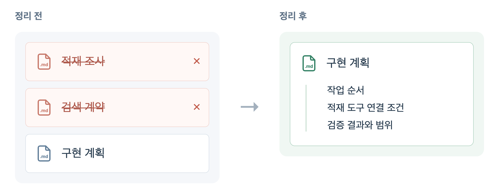
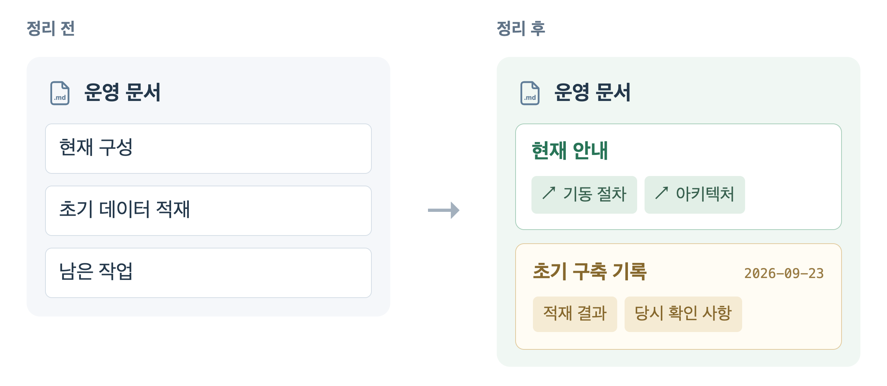

# AI와 쓰는 문서, 무엇을 어디에 남길까

## 들어가며

우아한테크코스에서 화장품 정보 서비스 앱 파우디를 개발하고 있습니다. 현재 파우디 팀은 AI 에이전트를 적극 활용해 개발하고, 작업 계획과 진행 상황, 결과도 이슈와 PR에 남기고 있습니다.

하지만 기록이 늘어도 서로의 작업을 따라가기는 어렵습니다. 필요한 문서를 찾아도 지금의 서비스와 맞는 설명인지 다시 확인해야 할 때가 있습니다.

실행 방법은 바뀐 코드와 환경에 맞게 고치고, 과거 결정과 작업 결과는 당시 기록으로 구분해야 합니다. 중복 파일은 필요한 정보가 다른 곳에 남는지 확인한 뒤 정리할 수 있습니다. 이 글에서는 파우디의 문서 삭제, 수정, 이동 사례를 비교하며 이 기준을 설명합니다.

AI를 활용해 GitHub 이슈와 PR, Markdown 문서를 관리하는 개발 팀을 위해 썼습니다. 문서의 역할을 먼저 구분하고, 실제 변경 사례와 이후 적용할 규칙을 살펴봅니다.

## 기록은 남겼는데 읽는 사람이 없다

파우디의 이슈와 PR은 AI의 작업 현황을 확인하고 팀원에게 진행 상황을 알리는 데 쓰입니다. 하지만 사람마다 사용하는 에이전트와 템플릿, 글의 구조가 다릅니다. AI가 작성한 이슈는 설명이 길고 복잡해 필요한 정보를 찾기 어렵습니다. 한글 문장인데도 몇 번씩 읽어야 뜻을 알 수 있는 경우가 많습니다.

결국 이슈를 쓰면서도 서로의 이슈는 잘 읽지 않은 채 작업을 이어갑니다. 서로의 작업 현황과 서비스 상태는 대화와 각자의 기억에 의존해 파악합니다. 짧은 시간 안에 결정과 설계가 이어지고 그보다 많은 기록이 생기니, 읽고 이해하는 속도가 작업 속도를 따라가지 못하는 것처럼 느껴졌습니다.

회의에서도 이 문제는 반복해서 나왔습니다. “한글 윤문 스킬을 돌리고 써라”, “제목이라도 읽어라” 같은 이야기가 오갔습니다. 배경지식이 없는 사람도 이해하도록 설명하게 하거나, 이슈 템플릿을 바꾸는 방법도 찾아보고 권했습니다. 하지만 문서의 역할과 관리 방법까지 논의를 이어가지는 못했습니다. 기능 개발과 버그 해결, 데이터 수집이 더 급했고, 저도 문서 정리를 얼마나 요구해야 할지 확신이 없었습니다.

제 문서도 예외는 아니었습니다. 부하 테스트와 캐시 적용, 빌드 캐시 도입 과정을 이슈에 모두 적었지만, 팀원은 글의 길이를 보고 읽기 어렵다고 했습니다. 이슈에서는 같은 설명의 반복과 어색한 번역투를 줄였습니다. 노션에는 결과 공유용 보고서를 따로 만들면서 「문제 → 해결 과정 → 결과」의 틀을 정해 AI에게 다시 구성하도록 했습니다. 각 절에는 필요한 내용만 남기고, 제가 직접 읽으며 문장도 고쳤습니다. 작업 진행 상태와 실험 기록을 함께 쌓던 이슈에서, 문제와 개선 과정, 측정 결과를 전달하는 글로 바꾼 것입니다.

인프라 문서에는 이전 진행 상황과 환경 설명이 남아 있었습니다. 필요한 문서를 찾아도 현재 상태와 맞는지 다시 확인해야 했습니다.

보고서를 다시 쓰면서는 작업 결과가 읽히도록 내용을 구성하는 문제를 다뤘습니다. 저장소 문서를 정리할 때는 어떤 설명을 계속 갱신하고 어떤 기록을 보존할지 판단해야 했습니다. 이 글은 그중 저장소 문서의 관리 방법에 집중합니다.

## 문서의 역할과 관리 방법

같은 문서라도 현재 절차를 확인하려는 사람과 과거 결정을 찾아보는 사람에게 필요한 내용은 다릅니다. 저는 문서별로 읽는 목적을 나누고, 어떤 설명을 갱신해야 하는지 살펴봤습니다.

예를 들어 README의 실행 명령은 지금 서비스를 실행하려는 사람이 읽습니다. 명령이나 전제 조건이 달라졌다면 설명도 고쳐야 합니다. 반면 설계 결정 기록인 ADR은 왜 그 선택을 했는지 알아보려고 읽습니다. ADR(Architecture Decision Record)은 중요한 설계 결정의 배경과 대안, 결과를 남기는 문서입니다. 당시의 제약을 현재 상황으로 덮어쓰면 선택의 이유를 알기 어려워집니다. Michael Nygard는 기존 결정을 보존하고, 새 결정으로 대체했다면 두 기록을 연결하도록 제안합니다. [Documenting Architecture Decisions](https://cognitect.com/blog/2011/11/15/documenting-architecture-decisions)

파우디의 검색 ADR에는 Java에서 처리하거나 별도 검색 엔진을 운영하는 대신 PostgreSQL을 선택한 이유와 감수할 비용이 있습니다. 현재 SQL만 읽어서는 그 선택의 이유를 알기 어렵습니다. 실행 방법이 바뀌면 README를 고쳐야 하지만, 새 구조를 선택했다고 이전 결정의 배경까지 다시 쓸 필요는 없습니다. [검색 ADR](https://github.com/woowacourse-teams/2026-poudy/blob/447489f51ece82c8eab3d09e2eb460f446f4d8a1/server/docs/adr/postgresql-catalog-search.md)

파우디의 문서를 역할별로 분류하고 관리 방법을 정리했습니다.

| 구분 | 문서 예 | 관리 방법 |
| --- | --- | --- |
| 현재 동작과 실행 방법 | README, 운영 안내 | 코드나 환경이 바뀌면 관련 설명도 수정 |
| 설계 결정의 배경 | 검색 ADR | 당시 제약과 대안을 보존하고, 결정이 바뀌면 대체 기록을 연결 |
| 진행 중인 작업 | 이슈, 구현 계획 | 진행 상태를 갱신하고 완료 후 진행 중 목록에서 제외 |
| 과거 작업과 측정 결과 | PR, 실험 보고서 | 당시 조건과 결과를 보존하고 현재 상태와 구분 |

한 문서에 현재 절차와 과거 기록이 함께 있다면 날짜와 제목으로 구분할 수 있습니다. 같은 설명이 여러 파일에 있다면 어느 문서를 기준으로 삼을지도 정해야 합니다. 파우디의 실제 정리에서는 문서의 역할과 중복 여부에 따라 삭제, 수정, 이동을 선택했습니다.

## 실제 변경: 문서 삭제, 수정, 이동

아래 세 사례는 팀 저장소에 남은 문서 정리 커밋의 변경 전후를 제가 대조한 내용입니다. 커밋에서 확인한 작업과, 그 변경에서 제가 읽은 관리 기준을 구분해 설명합니다. 대상은 화장품 제품과 성분 데이터의 PostgreSQL 검색 전환 문서와 인프라 문서입니다.

| 작업 | 대상 문서 | 변경 내용 |
| --- | --- | --- |
| 삭제 | [검색 조사 기록과 상세 계약](https://github.com/woowacourse-teams/2026-poudy/commit/7eda7db040c827d0ee7c1792c5763d678dce6917) | 두 파일을 삭제하고 필요한 인수인계는 구현 계획에 보존 |
| 수정 | [운영 안내와 제품 맥락 문서](https://github.com/woowacourse-teams/2026-poudy/commit/447489f51ece82c8eab3d09e2eb460f446f4d8a1) | 과거 기록에 시점을 표시하고 현재 동작과 안내 링크를 갱신 |
| 이동 | [완료된 구현 계획](https://github.com/woowacourse-teams/2026-poudy/commit/447489f51ece82c8eab3d09e2eb460f446f4d8a1) | 본문 변경 없이 active에서 completed로 이동 |

삭제 사례는 9월 20일, 검색 구현을 시작하기 전의 정리입니다. 현재 안내를 고치고 완료 계획을 옮긴 사례는 10월 16일, 검색 전환을 마친 뒤의 정리입니다. 후자의 변경은 문서 정리 브랜치에서 확인했으며, 팀에 공통 절차로 정착한 상태는 아닙니다.

### 검색 문서 삭제

검색 문서 정리 당시에는 기존 DB 구조 조사를 마쳤고, 새 검색 구현과 테스트는 시작 전이었습니다. 구현 계획 외에 DB 적재 구조 조사 기록과 PostgreSQL 검색 계약 문서가 있었습니다. 조사 기록에는 적재 원천, DB 구조와의 호환성, 로컬 실행 결과가 있었습니다. 검색 계약에는 API 입력, 검색 순위, 오타 교정 등의 동작과 기대 결과가 적혀 있었습니다.

저는 이 변경을 구현 전에 관리할 문서의 범위를 좁힌 사례로 읽었습니다. 상세 명세를 별도로 계속 유지하면 이후 동작이 바뀔 때 코드와 문서를 함께 고쳐야 합니다. 정리 커밋에서는 검색 동작과 기대 결과를 이후 구현과 실행 가능한 테스트에서 관리하고, 계획에는 작업 순서와 다음 구현자에게 필요한 제약을 남기는 방향을 명시했습니다.

실제 변경에서는 조사 기록인 `postgres-local-baseline.md`와 검색 계약인 `postgres-search-contract.md`를 삭제하고 구현 계획을 줄였습니다. 변경 후 계획에 적힌 내용은 다음과 같습니다. 줄바꿈만 읽기 좋게 나눴습니다.

```text
구체적인 동작과 기대 결과는 구현 및 실행 가능한 테스트에 둔다.
문서에는 작업 순서와 코드만으로 알기 어려운 결정 이유만 남긴다.
```

구현 계획에는 삭제한 조사 기록의 적재 도구 연결 조건이 남아 있었습니다. 적재기는 데이터를 넣은 뒤 검색용으로 구성한 세 DB 뷰를 순서대로 갱신합니다. 검색 구현을 바꿔도 적재기가 갱신하는 뷰의 이름과 순서를 유지해야 하므로, 다음 내용을 인수인계에 보존한 것입니다.

```text
product_search_document → ingredient_search_term → search_vocabulary
```

이 조건이 없으면 서버의 검색 SQL만 고치면서 기존 적재 도구에 미칠 영향을 놓칠 수 있습니다. [변경 후 구현 계획](https://github.com/woowacourse-teams/2026-poudy/blob/7eda7db040c827d0ee7c1792c5763d678dce6917/server/docs/exec-plans/active/postgres-search-migration.md)



그림 1. 삭제한 문서와 구현 계획에 남긴 내용을 변경 이력에서 발췌해 재구성했습니다. [원본 변경](https://github.com/woowacourse-teams/2026-poudy/commit/7eda7db040c827d0ee7c1792c5763d678dce6917)

변경 후 계획에는 기존 Java 검색 단위 테스트 79개의 통과와 DB 연결 거부로 인한 검증 스크립트 실패도 적혀 있었습니다. 새 DB 검색의 검증 결과는 아니라고 구분해, 다음 구현자가 이미 검증한 범위를 잘못 이해하지 않도록 했습니다.

미구현 요구사항은 남은 구현 계획에서도 일부 확인할 수 있습니다. 성분 제안은 최대 5개를 반환해야 한다는 조건, 상품 목록과 전체 개수가 같은 검색 및 필터 조건을 사용해야 한다는 조건이 구현 단계에 남았습니다. 다만 삭제한 상세 계약의 모든 입력별 기대 결과를 이 계획으로 옮긴 것은 아닙니다. 예를 들어 기호만 있는 검색어의 기대 결과 같은 상세 사례는 [삭제 직전 검색 계약](https://github.com/woowacourse-teams/2026-poudy/blob/3e528d78c18c90a1ce605cde09fb73e27cca6014/server/docs/product/postgres-search-contract.md)의 Git 이력에서 확인할 수 있습니다.

이 변경에서 확인한 것은 두 파일의 삭제와 구현 계획의 축약입니다. 상세 계약의 모든 사례가 이후 테스트에 반영됐는지는 확인하지 못했습니다. 따라서 파일을 삭제했다는 사실만으로 요구사항을 빠짐없이 보존했다고 판단할 수는 없습니다. 저는 다음 작업에서는 미구현 요구사항을 진행 중 계획이나 이슈에서 계속 확인할 수 있게 한 뒤, 중간 명세를 정리하려 합니다.

### 현재 안내와 과거 기록 구분

PostgreSQL 전환 이후에도 운영 문서에는 원격 `dev`와 스테이징이 JSON 기반이며, DB 전환 브랜치를 머지하고 배포해야 한다는 안내가 남아 있었습니다. `deploy/postgresql-ec2.md`에는 이 설명과 함께 초기 적재 건수, 임시 SQL 파일의 상태, 백업과 복원 확인 기록도 있었습니다. 현재 운영 방법을 알아보려고 읽으면 어느 내용이 아직 유효한지 판단하기 어려웠습니다.

DB 전환 전 안내는 고쳐야 했지만, 초기 작업 결과까지 현재값으로 바꾸면 당시 무엇을 확인했는지 알 수 없게 됩니다. 해당 정리 커밋에서는 현재 절차를 바뀐 구성에 맞추고, 초기 구축 이력은 날짜를 표시해 보존했습니다.

변경 후 운영 문서에는 초기 적재 날짜와 함께, 적재 건수와 임시 파일 상태가 당시 확인한 값이라는 설명이 추가됐습니다. 「남은 작업」도 「초기 구축 때 남긴 확인 사항」으로 바꿔 지금의 할 일과 구분했습니다. 현재 사용법은 바뀐 구성에 맞게 설명을 고치고 실행 안내를 연결했으며, 실제 인스턴스 설정은 운영 확인 명령으로 재확인하도록 했습니다.



그림 2. 같은 운영 문서 안에서 현재 안내와 초기 구축 기록을 구분한 구조입니다. 별도 파일로 나눈 것은 아닙니다. [변경 후 문서](https://github.com/woowacourse-teams/2026-poudy/blob/447489f51ece82c8eab3d09e2eb460f446f4d8a1/deploy/postgresql-ec2.md)

임시 파일 정리와 실제 데이터 복원 여부는 문서 정리 과정에서 확인하지 않았습니다. 초기 구축 당시 미완료였다는 기록을 유지하고, 문서를 정리하면서 서버 작업을 하거나 완료를 확인하지는 않았다고 명시했습니다. 초기 운영 구성을 기록한 [이슈 #534](https://github.com/woowacourse-teams/2026-poudy/issues/534)는 종료됐지만, 실제 서비스 데이터 적재와 새 EC2에서의 전체 복구 시험은 그 이슈의 범위 밖이었습니다. 따라서 이슈가 닫혔다는 사실만으로 복구 검증까지 마쳤다고 볼 수는 없습니다.

이 기록만으로는 당시 미완료 항목이 지금도 필요한 작업인지, 별도 이슈에서 추적하는지 확인할 수 없었습니다. 과거 목록을 그대로 현재 할 일로 읽지 않도록 시점을 표시한 이유입니다. 이후에는 담당자와 실제 상태를 확인하고, 여전히 필요한 작업은 완료 조건과 원문 링크를 붙여 별도 이슈로 관리하려 합니다. 이는 이번 정리에서 이미 시행한 절차가 아니라 앞으로 보완할 부분입니다.

같은 커밋에서 제품 맥락 문서는 바뀐 조회 방식에 맞게 수정됐습니다. JSON을 메모리에 적재한다는 설명이 PostgreSQL에서 조회한다는 내용으로 바뀌었습니다. 초기 구축 문서에서는 당시의 결과를 보존하고, 제품 문서에서는 현재 동작을 설명하도록 수정한 것입니다. [제품 맥락 문서](https://github.com/woowacourse-teams/2026-poudy/blob/447489f51ece82c8eab3d09e2eb460f446f4d8a1/server/docs/product/overview.md)

Docker 도입 전 측정 문서도 과거 기준선임을 표시하고 현재 배포 안내를 연결해, 당시 측정 조건과 현재 절차를 구분했습니다. [Docker 기준선 문서](https://github.com/woowacourse-teams/2026-poudy/blob/447489f51ece82c8eab3d09e2eb460f446f4d8a1/docs/deploy/docker-adoption-baseline.md)

### 완료 계획 이동

이 사례는 앞의 문서 삭제 이후 검색 구현과 검증을 마친 시점의 정리입니다. 검색 전환 계획은 `server/docs/exec-plans/active/`에 있었지만, 본문 상태에는 1~5단계를 완료했고 테스트와 검증 스크립트를 통과했다고 적혀 있었습니다. 완료 기록이 진행 중 계획을 모아 둔 폴더에 남아 있었습니다.

본문에는 이미 완료 상태가 있었으므로 진행 중 작업을 찾는 경로에서 제외할 필요가 있었습니다. 정리 커밋에서는 당시 작업 범위와 수행 순서를 다시 볼 수 있도록 본문은 유지하고 `completed/`로 옮겼습니다. 다음은 Git diff에서 확인한 파일 이동을 관련 경로만 발췌한 것입니다.

```text
server/docs/exec-plans/
  active/postgres-search-migration.md
                   ↓ 이동, 본문 변경 없음
  completed/postgres-search-migration.md
```

루트 README에도 개발, 서비스 구조, 배포 등 목적에 따라 먼저 읽을 문서 링크를 추가했습니다. 진행 중 계획과 과거 기록의 경로도 나눴습니다. 완료 계획은 새 작업의 미완료 목록으로 사용하지 않는다는 설명도 넣었습니다. README에서 문서를 찾는 사람도 진행 중 작업과 과거 기록을 구분할 수 있도록 했습니다. [변경 후 README](https://github.com/woowacourse-teams/2026-poudy/blob/447489f51ece82c8eab3d09e2eb460f446f4d8a1/README.md)

이 커밋에서 확인한 처리는 완료 계획을 옮겨 보존한 것까지입니다. 다만 완료 폴더도 계속 쌓일 수 있으므로, 이후에는 각 계획을 파일로 유지할 이유가 있는지 다시 판단하려 합니다. 필요한 정보를 다른 곳에 보존했다면 더는 쓰이지 않는 중간 기록은 삭제할 수 있습니다.

## 이후 작업에 적용할 문서 관리 규칙

세 사례에서 확인한 처리를 바탕으로 문서 작성 전, 결과 공유 시점, 작업 종료 후에 적용할 규칙을 정리했습니다. 아직 팀의 합의된 절차는 아니며, 다음 작업부터 제가 시도하려는 방식입니다.

### 문서 추가 전 중복 확인

기능 개발용 문서는 가능하면 추가하지 않으려 합니다. 코드와 테스트, 기존 기록만으로 설명하기 어려운 내용이 있을 때만 새로 작성합니다. 기능의 개수와 복잡도가 늘었다고 문서도 같은 비율로 늘릴 필요는 없습니다. 작은 변경이라도 코드만 읽어서는 알 수 없는 결정 이유는 남길 수 있습니다.

작업 계획은 지금처럼 이슈에서 공유할 수 있습니다. 작업마다 요구사항 문서, 상세 명세, 구현 계획과 결과 보고서를 모두 만들 필요는 없습니다. 앞의 결과 공유용 보고서를 노션에 따로 작성한 것도 팀원에게 결과를 전달할 구성이 필요했기 때문입니다. 공유용 문서를 만들었다면 결과를 전달한 뒤에도 갱신할 문서인지, 당시 결과로 남길 기록인지 정해야 합니다.

ADR에는 나중에 다시 판단할 때 필요한 결정 이유를 남기려 합니다. 클래스 목록은 코드에서 확인할 수 있지만, 다른 대안을 선택하지 않은 이유나 책임을 특정 경계 안에 둔 이유는 별도로 설명해야 할 수 있습니다. 기존 ADR로 설명할 수 있으면 새 결정 문서를 만들지 않습니다.

### PR에 문서 정리 범위 명시

문서를 삭제하거나 과거 기록으로 바꿀 때는 읽는 팀원에게 무엇이 없어지고 어디에서 다시 확인할 수 있는지 알려야 합니다. 저는 PR에서 정리 대상, 남긴 정보, 확인하지 못한 항목을 먼저 설명하려 합니다. 문서의 내용만 고친 작업인지 실제 운영 환경도 바꾼 작업인지도 구분해야 합니다.

다음은 앞서 살펴본 운영 문서 수정과 완료 계획 이동을 바탕으로 재구성한 PR 예시입니다. 실제 PR 원문은 아닙니다.

```markdown
## 변경 내용
- PostgreSQL 운영 문서에 초기 구축 날짜를 표시하고 현재 실행 안내를 연결했습니다.
- 완료된 검색 전환 계획을 active에서 completed로 옮겼습니다.
  계획 본문은 바꾸지 않았습니다.

## 남긴 기록
- 초기 적재 결과와 당시 미완료 사항: deploy/postgresql-ec2.md
- 완료된 작업 범위와 수행 순서:
  server/docs/exec-plans/completed/postgres-search-migration.md

## 확인한 내용
- 파일 이동 diff에서 검색 전환 계획의 본문 변경이 없음을 확인했습니다.
- 운영 문서 diff에서 초기 구축 날짜 표시와 현재 안내 링크 추가를 대조했습니다.

## 미확인 사항
- 운영 서버의 임시 파일 정리와 실제 데이터 복원 여부는 확인하지 않았습니다.
```

이렇게 쓰면 읽는 팀원은 변경 내용, diff에서 확인한 범위, 별도로 확인할 운영 작업을 구분할 수 있습니다. 실제 PR을 작성할 때는 링크도 직접 연결하고, 수행한 검증만 기록하려 합니다. 상세 로그나 과거 논의가 필요하면 원문을 연결하되 PR 안에서도 정리 범위를 알 수 있게 쓰겠습니다.

### 작업 종료 후 문서 갱신과 정리

현재 팀에서는 코드 변경 때 어떤 문서를 고칠지 각자 판단하고 있습니다. 관련 문서를 같은 커밋에 넣으라는 기여 기준은 있지만, 내용까지 매번 확인하는 절차가 정착한 상태는 아닙니다. 작업이 늘면서 팀원 리뷰를 건너뛰는 일도 생겼고, 자체 에이전트로 검토하는지도 작업마다 다릅니다. 따라서 문서 점검을 매번 리뷰어에게 맡기기는 어렵습니다. [기여 기준 변경](https://github.com/woowacourse-teams/2026-poudy/commit/18c2586db937b772c012c36e153d9882c9034142)

우선 제 작업의 PR에 어떤 문서를 고쳐야 하는지 짧게 남기려 합니다. 앞서 살펴본 사례를 다음 변경에 적용한다면 아래처럼 정리할 수 있습니다.

| 변경 상황 | 문서 정리 방법 |
| --- | --- |
| JSON 메모리 조회를 DB 조회로 전환 | 제품 문서의 조회 방식 설명을 수정 |
| 초기 구축이나 실험 이후 환경 변경 | 당시 기록에 시점을 표시하고 현재 운영 안내를 연결 |
| 구현 계획의 작업 완료 | 완료 상태를 확인하고 active에서 제외한 뒤 보존 여부를 판단 |
| 같은 설명을 여러 문서에 작성 | 기준으로 삼을 문서를 정하고 필요한 정보와 참조 링크를 확인한 뒤 중복 정리 |

문서 수정 여부는 코드나 환경의 변경이 기존 설명에 영향을 주는지 보고 판단하려 합니다. 고칠 필요가 없다면 PR에 그 이유를 짧게 남기는 것부터 시작하겠습니다.

완료 기록을 삭제하기 전에는 결정 이유와 검증 근거가 다른 문서나 이력에 남아 있는지 확인하려 합니다. Git에 커밋한 파일은 과거 버전에서 복원할 수 있지만, 커밋하지 않은 파일이나 노션에만 있는 기록은 그렇지 않습니다. 다른 문서에서 참조하는 링크도 함께 확인해야 합니다.

## 마치며

정리 커밋에서는 검색 관련 파일을 삭제하면서 인수인계를 구현 계획에 남겼고, 초기 구축 기록에 날짜를 붙여 현재 안내와 구분했으며, 완료 계획을 진행 중 폴더에서 옮겼습니다. 현재 안내는 갱신하고, 과거 판단과 결과는 당시 기록으로 읽을 수 있게 남겼습니다.

이번에는 문서의 수정 내용과 파일 이동을 확인했습니다. 팀원의 문서 탐색 시간이나 에이전트의 작업 정확도와 속도는 측정하지 않았습니다. 오래된 기록을 현재 지침으로 사용하는 일이 줄었는지도 확인하지 못했습니다.

다음에는 자주 바꾸는 기능 하나부터 관련 문서를 검토하고, 다른 팀원이 현재 안내와 결정 이유를 찾을 수 있는지 살펴보려 합니다. 문서 수정과 기록 정리에 드는 수고까지 확인한 뒤 팀에 함께 적용할 범위를 제안하고 싶습니다.

지금은 새 문서를 만들기 전에 기존 설명을 확인하고, 작업이 끝나면 다음 사람이 계속 읽을 내용인지 검토하는 것부터 시작하려 합니다. 문서를 찾고도 현재 상태인지 다시 확인해야 했던 불편을 줄이는 것이 목표입니다.

---

이슈와 결과 공유용 보고서는 작성자의 경험을 바탕으로 설명했습니다. 노션 원문과 이슈 번호는 대조하지 못해 구성 변경은 기억하는 범위에서 썼습니다. 저장소 사례는 연결한 커밋과 직전 버전을 비교했습니다. 검증 결과는 문서에 남은 당시 기록이며, 이번 집필에서 실행하지 않았습니다.
