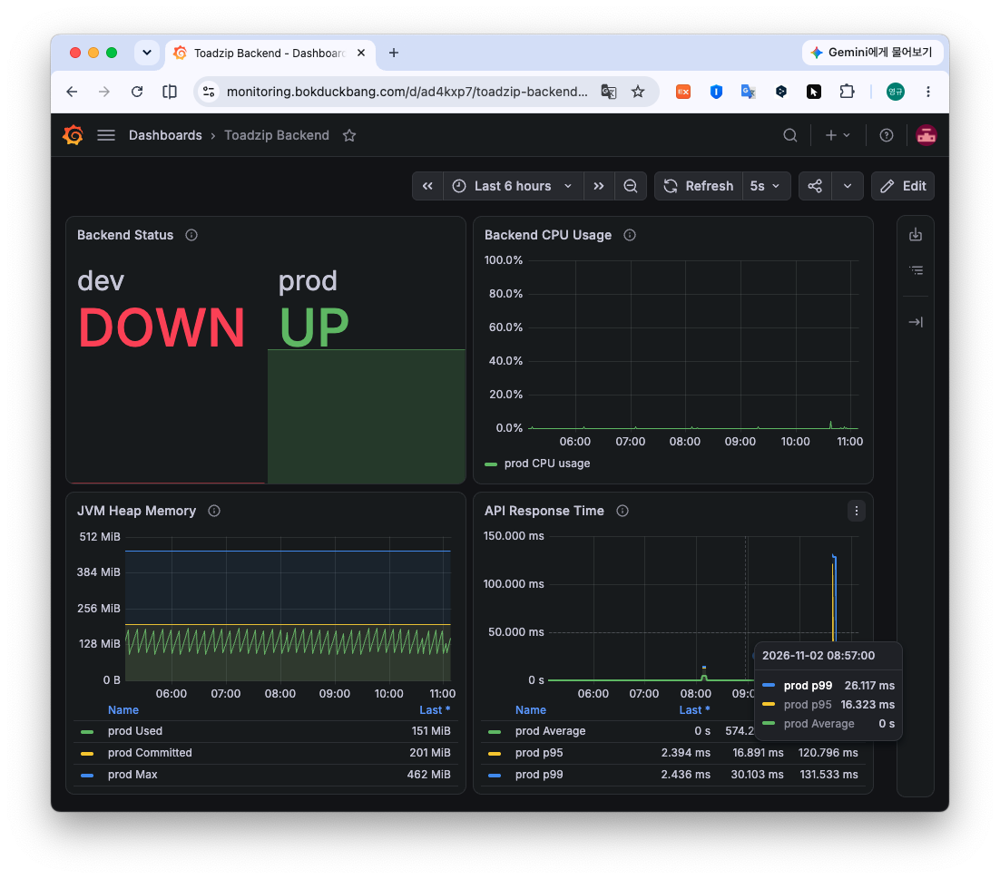
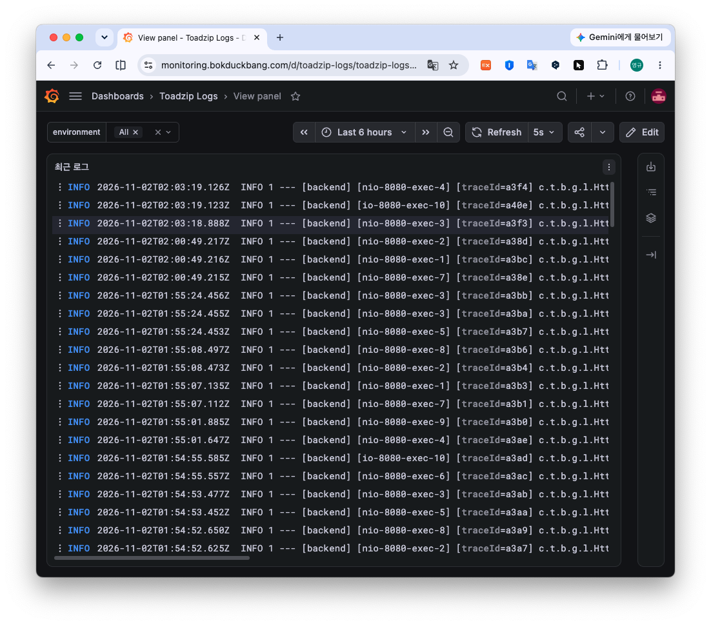
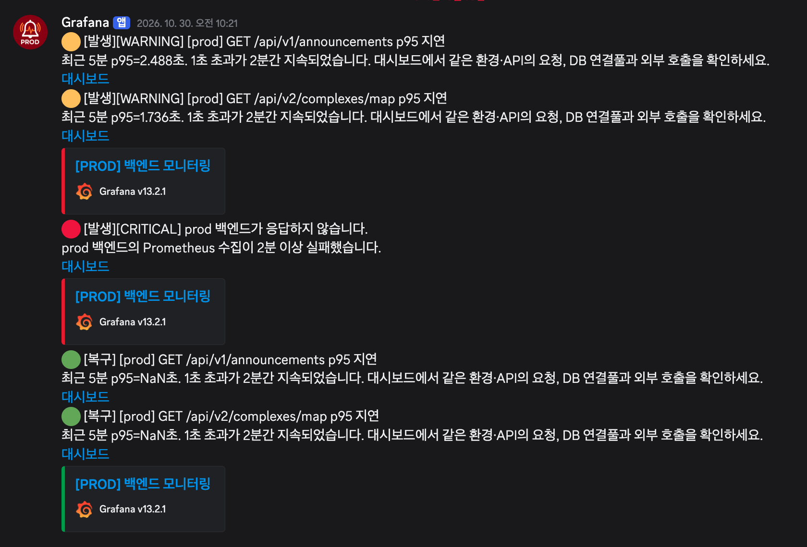

# Grafana 대시보드 구축기: 서비스 운영에 필요한 지표를 한눈에 확인하기

## 1. 들어가며

웹 서비스를 개발할 때는 기능이 정상적으로 동작하는지 확인하는 데 많은 시간을 사용한다. API가 예상한 응답을 반환하는지, 데이터베이스에 데이터가 정상적으로 저장되는지, 예외 상황에서 오류가 적절하게 처리되는지 테스트한다.

그러나 개발 환경에서 기능이 정상적으로 동작한다고 해서 실제 운영 환경에서도 문제가 발생하지 않는 것은 아니다. 서버의 CPU 사용률이 급격하게 증가하거나 메모리 부족으로 애플리케이션의 응답이 느려질 수 있다. 서버 프로세스가 실행 중이더라도 특정 API에서 지속적으로 오류가 발생할 수도 있다.

5인 팀으로 공공주택 정보 서비스를 개발하면서 인프라 구축과 운영을 담당했다. 개발 서버와 운영 서버, 데이터베이스 서버를 구성하고 배포 환경을 구축한 이후에는 서비스의 상태를 지속적으로 확인할 방법이 필요해졌다.

서버에 직접 접속해 명령어를 실행하거나 로그 파일을 확인할 수도 있지만 이 방식으로는 여러 서버의 상태를 한눈에 파악하기 어렵다. 서버가 정상적으로 실행 중인지뿐 아니라 자원 사용량이 어떻게 변화하고 있는지, 애플리케이션에서 오류가 발생하고 있는지도 확인해야 했다.

이를 해결하기 위해 Prometheus로 지표를 수집하고 Grafana 대시보드에서 확인할 수 있도록 구성했다. 이후 Loki를 연동해 애플리케이션 로그를 조회하도록 했으며 서버 중단이나 HTTP 5xx 오류가 발생하면 Discord로 알림을 받을 수 있도록 개선했다.

이 글에서는 Grafana를 활용해 대시보드를 구축한 과정을 중심으로 설명한다. 먼저 모니터링에 필요한 지표와 도구의 역할을 살펴보고 Grafana에서 패널을 직접 생성하는 방법과 JSON을 이용해 대시보드를 구성하는 방법을 다룬다. 마지막으로 로그 연동과 알림을 통해 운영 환경을 개선한 과정을 소개한다.

## 2. 왜 모니터링 대시보드가 필요한가?

### 2.1 서버가 실행 중이라는 사실만으로는 충분하지 않다

서비스 운영에서 가장 기본적인 확인 사항은 서버의 실행 상태이다. 그러나 서버가 실행 중이라는 사실이 서비스가 정상적으로 동작한다는 의미는 아니다.

예를 들어 애플리케이션 프로세스가 실행되고 있더라도 CPU 사용량이 높아 요청 처리 속도가 느려질 수 있다. 메모리 사용량이 지속적으로 증가하거나 디스크 공간이 부족해질 수도 있다.

또한 서버 자원에는 문제가 없지만 애플리케이션 내부에서 예외가 발생하는 상황도 존재한다. 일부 API가 HTTP 500 응답을 반환하는 경우가 대표적이다.

서비스를 운영하려면 서버와 애플리케이션의 상태를 다양한 관점에서 확인해야 한다. CPU와 메모리 같은 자원 사용량은 서버의 상태를 파악하는 데 도움이 된다. HTTP 요청 수와 오류 응답 수는 애플리케이션의 동작 상태를 이해하는 데 유용하다.

여러 지표를 시간에 따라 수집하면 현재 상태를 확인하고 이전과 비교해 어떤 변화가 발생했는지도 살펴볼 수 있다.

### 2.2 Metric과 Log의 차이

모니터링 시스템을 구성할 때는 지표(Metric)와 로그(Log)의 역할을 구분할 필요가 있다.

지표는 시스템의 상태나 동작을 수치로 표현한 데이터이다. CPU 사용률, 메모리 사용량, 초당 HTTP 요청 수 등이 대표적이다.

이러한 지표는 시간에 따른 변화를 파악하는 데 적합하다. 예를 들어 CPU 사용률이 특정 시점부터 증가했다면 해당 시간대에 서버의 작업량이 증가했거나 비정상적인 작업이 발생했을 가능성을 살펴볼 수 있다.

반면 지표만으로는 정확히 어떤 코드나 요청에서 문제가 발생했는지 확인하기 어렵다.

로그는 애플리케이션 실행 중 발생한 사건을 기록한 데이터이다. 오류 메시지나 예외 발생 위치, 요청 처리 과정 등이 기록될 수 있다.

지표를 통해 HTTP 5xx 오류가 증가한 시점을 확인했다면 같은 시간대의 로그를 조회해 어떤 예외가 발생했는지 조사할 수 있다.

즉, 지표는 시스템의 상태와 변화를 파악하는 데 사용하고 로그는 구체적인 사건을 조사하는 데 활용할 수 있다.

이번 프로젝트에서는 두 정보를 함께 조회할 수 있도록 모니터링 환경을 구성했다.

## 3. 모니터링 시스템 구성

### 3.1 프로젝트 인프라

공공주택 정보 서비스는 개발 서버와 운영 서버를 분리해 구성했다. 각 서버에서는 웹 애플리케이션이 실행되며 PostgreSQL 데이터베이스는 별도의 서버에서 관리한다.

또한 모니터링 전용 서버를 구성해 여러 서버의 상태를 중앙에서 확인할 수 있도록 했다.

모니터링에 사용한 주요 도구는 Prometheus, Grafana, Loki이다. Prometheus는 서버와 애플리케이션의 메트릭을 수집하고 저장하는 역할을 한다. Grafana는 수집한 데이터를 그래프 등의 형태로 시각화한다. Loki는 애플리케이션 로그를 저장하고 조회하는 데 사용한다.

이 세 도구를 활용하면 여러 서버의 지표와 로그를 하나의 인터페이스에서 확인할 수 있다.

### 3.2 Prometheus와 Grafana의 역할

Grafana가 모든 메트릭을 직접 수집하고 저장하는 도구는 아니라는 점을 먼저 이해해야 한다.

일반적인 Prometheus 기반 모니터링 환경에서는 Prometheus가 메트릭을 수집하고 저장하는 역할을 담당한다.

Prometheus는 설정된 수집 대상에 주기적으로 HTTP 요청을 보내 메트릭을 가져오는 Pull 방식을 사용한다.

수집 대상이 서버 메트릭을 제공하는 Exporter라면 CPU, 메모리 등의 정보를 얻을 수 있다. 애플리케이션에서 메트릭 엔드포인트를 제공한다면 HTTP 요청이나 응답 시간과 같은 지표도 수집할 수 있다.

Grafana는 Prometheus를 데이터 소스(Data Source)로 등록하고 저장된 메트릭을 조회한다.

이때 데이터는 다음 흐름으로 전달된다.

**수집 대상 → Prometheus → Grafana → Dashboard**

Grafana에서 패널에 데이터가 표시되지 않는 경우, Grafana 설정뿐 아니라 Prometheus에서 해당 메트릭을 수집하고 있는지도 확인해야 한다.

수집과 시각화의 역할이 분리되어 있으므로 각 단계에서 문제가 발생할 수 있기 때문이다.

## 4. Grafana 대시보드 직접 구성하기

### 4.1 Dashboard와 Panel

Grafana에서 여러 지표를 하나의 화면에 모아 보여주는 구성을 Dashboard라고 한다.

대시보드는 여러 개의 Panel로 구성된다. 패널은 데이터를 시각화하는 기본 단위이다. 예를 들어 CPU 사용률, 메모리 사용량, HTTP 오류를 보여주는 패널을 각각 만들 수 있다.

패널마다 데이터 소스와 쿼리, 시각화 유형, 표시 단위 등을 설정할 수 있다.

대시보드를 구성할 때는 단순히 많은 패널을 추가하기보다 운영 중 어떤 정보를 확인할 것인지 먼저 결정해야 한다.

이번 프로젝트의 대시보드도 서버와 애플리케이션의 운영 상태를 확인하려고 구성했다.

*그림 2. 공공주택 정보 서비스의 운영 상태를 확인하기 위해 구성한 Grafana 대시보드.*

### 4.2 패널 직접 생성

Grafana에서 대시보드를 구성할 때는 UI에서 패널을 하나씩 생성하는 방법이 가장 직관적이다.

새로운 대시보드를 생성하고 패널을 추가한 다음 데이터 소스와 쿼리를 설정한다. 이후 조회 결과를 확인하면서 시각화 유형이나 단위를 변경할 수 있다.

이 방식은 설정 결과를 즉시 확인할 수 있다는 장점이 있다.

예를 들어 CPU 사용률을 표시하기 위해 패널을 생성했다고 가정하자. 먼저 Prometheus를 데이터 소스로 선택하고 CPU 사용률을 계산하는 PromQL을 입력한다.

PromQL은 Prometheus에 저장된 시계열 데이터를 조회하고 계산하는 쿼리 언어이다.

Node Exporter 기반 환경에서 CPU 사용률을 계산하는 일반적인 예시는 다음과 같다.

`100 * (1 - avg by (instance) (rate(node_cpu_seconds_total{mode="idle"}[5m])))`

이 쿼리는 최근 5분 동안 CPU가 유휴 상태였던 시간의 비율을 계산하고 이를 이용해 CPU 사용률을 구한다.

`rate()`는 Counter 메트릭의 초당 평균 증가율을 계산하고 `avg by (instance)`는 동일 인스턴스의 CPU 코어별 데이터를 평균 내는 역할을 한다.

결과는 0부터 100 사이의 백분율 값으로 표현할 수 있다.

Grafana의 Time series 패널을 선택하면 시간에 따른 CPU 사용률 변화를 그래프로 확인할 수 있다.

이때 패널 단위를 Percent로 지정하면 수치의 의미가 더 명확해진다.

위 쿼리는 설명을 위한 일반적인 예시이다. 실제 환경에 적용할 때는 수집 중인 메트릭과 라벨에 맞는지 확인해야 한다.

### 4.3 어떤 지표를 보여줄 것인가?

모니터링 대시보드에서는 표시할 지표를 선택하는 것도 중요하다.

CPU 사용률은 서버의 작업 부하를 이해하는 데 도움이 된다. 사용률이 일정 시간 동안 높게 유지된다면 어떤 작업이 자원을 사용하고 있는지 확인할 필요가 있다.

메모리 사용량은 애플리케이션이나 시스템의 메모리 사용 상태를 파악하는 데 사용한다.

다만 Linux에서는 사용하지 않는 메모리를 캐시로 활용하기 때문에 단순히 Free 메모리가 적다는 이유만으로 메모리 부족이라고 판단할 수 없다. 사용 가능한 메모리와 실제 애플리케이션의 상태를 함께 확인해야 한다.

HTTP 오류 지표도 중요하다.

서버의 CPU나 메모리 사용률이 정상적인 범위에 있더라도 애플리케이션에서 예외가 발생해 HTTP 5xx 응답이 증가할 수 있기 때문이다.

서버 지표와 애플리케이션 지표를 함께 확인하면 문제를 조사할 때 어느 부분부터 살펴봐야 하는지 판단하는 데 도움이 된다.

### 4.4 패널을 구성하면서 고려할 사항

대시보드에서는 지표를 수집하고 이해하기 쉽게 표현하는 일이 중요하다. 예를 들어 현재 CPU 사용률이 80%라는 사실만으로는 충분한 정보를 얻기 어렵다. 해당 수치가 잠깐 발생한 것인지, 장시간 유지되고 있는지에 따라 의미가 달라지기 때문이다.

시간에 따른 변화가 중요한 지표는 Time series 형태로 표시하는 것이 적절하다.

반면 현재 값이나 상태를 빠르게 확인해야 하는 경우에는 Stat 패널이 유용하다.

또한 여러 서버의 지표를 하나의 대시보드에서 확인한다면 어느 서버의 데이터인지 구분할 수 있도록 범례와 패널 제목을 설정해야 한다.

대시보드에 많은 데이터를 담더라도 필요한 정보를 빠르게 이해할 수 있도록 돕는다는 목적에 맞아야 한다.

## 5. JSON을 이용해 대시보드 한 번에 생성하기

### 5.1 직접 생성 방식의 한계

Grafana에서 패널을 하나씩 만드는 방법은 직관적이지만 패널 수가 늘어나면 반복 작업이 발생한다.

패널마다 데이터 소스와 쿼리를 지정하고 제목과 단위를 입력한 뒤 화면에서 위치를 조정해야 한다. CPU 사용률, 메모리 사용량, HTTP 요청 수, 오류 응답 수 등 여러 지표를 표시하는 경우 이러한 설정을 반복하게 된다.

또한 기존에 구성한 대시보드를 다른 환경에서도 사용하려면 동일한 설정을 다시 적용해야 할 수 있다.

JSON을 이용하면 이러한 작업을 줄일 수 있다.

### 5.2 Grafana 대시보드 JSON

Grafana는 대시보드의 구성을 JSON 형태로 표현할 수 있다.

대시보드 JSON에는 패널의 제목과 종류, 데이터 소스, 쿼리, 표시 단위, 배치 정보 등의 설정이 포함된다. 패널을 하나씩 생성하는 대신 여러 패널의 설정을 JSON에 정의해 한 번에 가져올 수 있다.

이번 프로젝트에서는 패널을 직접 생성하기도 하고 JSON으로 대시보드를 구성하기도 했다.

대시보드 구성을 하나의 파일로 다룰 수 있다는 장점이 있다. 예를 들어 여러 패널의 설정을 파일로 보관할 수 있고 JSON을 수정해 일부 패널의 쿼리나 시각화 설정을 변경할 수도 있다.

설정 파일을 버전 관리 시스템에 저장한다면 대시보드의 변경 이력을 관리하는 데에도 활용할 수 있다.

### 5.3 JSON Import 과정

JSON을 이용해 대시보드를 생성하려면 먼저 대시보드의 구성이 정의된 JSON 파일을 준비한다.

이후 Grafana의 Dashboard Import 기능에서 JSON 파일을 업로드하거나 JSON 내용을 입력한다.

Import 과정에서는 필요한 데이터 소스를 선택하고 대시보드를 생성할 수 있다.

대시보드가 생성되었다면 각 패널에서 실제 데이터가 올바르게 표시되는지 확인해야 한다. JSON 파일의 형식이 올바르더라도 해당 대시보드가 참조하는 메트릭이 수집되지 않고 있다면 패널에 데이터가 표시되지 않을 수 있다.

또한 JSON에서 참조하는 데이터 소스가 현재 Grafana 환경과 일치하지 않는 경우에도 문제가 발생할 수 있다.

JSON으로 대시보드를 생성할 때는 파일을 Import한 뒤 실제 데이터를 조회할 수 있는지 검증하는 과정까지 포함해야 한다.

### 5.4 두 방식의 비교

Grafana에서 패널을 직접 생성하는 방식과 JSON을 이용하는 방식은 각각 장단점이 있다.

| 구분 | UI에서 직접 생성 | JSON으로 생성 |
|---|---|---|
| 작업 방식 | 패널을 하나씩 설정 | 구성 파일을 가져와 일괄 생성 |
| 주요 장점 | 결과를 즉시 확인하며 수정 가능 | 여러 패널을 한 번에 구성 가능 |
| 학습 측면 | 각 설정을 이해하기 쉬움 | JSON 구조를 이해해야 함 |
| 재사용 | 설정을 다시 적용할 수 있음 | 파일을 이용해 재사용 가능 |
| 주의 사항 | 반복적인 설정 작업 | 메트릭·데이터 소스 호환성 검증 |

직접 생성하는 방법은 Grafana를 처음 접하거나 특정 패널의 쿼리와 시각화를 시험할 때 적합하다.

반면 JSON을 이용하는 방법은 필요한 패널의 구성이 정해져 있고 여러 설정을 한 번에 적용하려는 상황에서 유용하다.

두 방법을 함께 쓰는 것도 가능하다. 직접 패널을 구성하면서 설정을 이해한 다음 완성된 대시보드를 JSON으로 내보내 다른 환경에 적용할 수 있다.

JSON을 이용하더라도 설정을 이해할 필요는 있다.

실제 메트릭과 쿼리가 올바른지 확인하지 않으면 여러 패널을 한 번에 생성하더라도 활용할 수 없는 대시보드가 만들어질 수 있다.

## 6. Loki를 이용해 로그 함께 조회하기

### 6.1 지표만으로 알 수 없는 문제

Grafana 대시보드를 구성하면서 서버와 애플리케이션의 주요 지표를 확인할 수 있게 되었다.

그러나 지표만으로 모든 문제를 파악할 수 있는 것은 아니었다.

예를 들어 HTTP 5xx 오류가 증가했다는 사실은 지표를 통해 확인할 수 있다. 하지만 어떤 요청에서 예외가 발생했는지, 어떤 코드에서 문제가 발생했는지까지 알기 위해서는 로그를 확인해야 한다.

여러 서버에 직접 접속해 로그를 확인하는 대신 중앙에서 로그를 조회할 수 있다면 문제를 조사하기가 수월해진다.

이를 위해 Loki를 연동했다.

### 6.2 Loki와 Grafana 연동

Loki는 로그 데이터를 저장하고 조회할 수 있는 시스템이다.

로그 수집 구성 요소가 애플리케이션 로그를 Loki로 전달하면 Grafana에서 Loki를 데이터 소스로 등록해 로그를 조회할 수 있다.

Grafana의 Explore 화면에서는 LogQL을 사용해 원하는 로그를 검색할 수 있다.

예를 들어 로그 스트림에 `job="application"` 라벨이 존재한다면 다음과 같은 쿼리를 사용할 수 있다.

`{job="application"} |= "ERROR"`

이는 해당 로그 스트림에서 `ERROR`라는 문자열이 포함된 로그를 조회하는 예시이다.

실제 사용한 라벨과 로그 형식에 따라 쿼리는 달라질 수 있다.

Loki를 연결하면 Grafana에서 지표를 확인한 뒤 필요한 시간대의 로그를 검색할 수 있다.

예를 들어 HTTP 오류가 증가한 시간대를 확인했다면 같은 시간 범위의 로그를 조회해 예외 메시지와 발생 상황을 조사할 수 있다.

*그림 6. Grafana 로그 패널에서 애플리케이션의 최근 로그를 조회한 화면.*

### 6.3 지표와 로그를 함께 활용하는 이유

지표와 로그를 같은 인터페이스에서 조회할 수 있다는 점은 운영 과정에서 유용하다. 지표는 문제의 발생 시점과 추세를 파악하는 데 적합하고 로그는 구체적인 오류 내용을 확인하는 데 유용하기 때문이다.

두 데이터를 함께 사용하면 문제를 조사할 때 서로 다른 도구와 서버를 오가는 작업을 줄일 수 있다.

다만 로그가 수집된다고 해서 문제의 원인이 자동으로 분석되는 것은 아니다.

필요한 정보가 로그에 기록되어 있어야 하고 지표와 로그의 시간 범위를 일치시켜 살펴볼 수 있어야 한다.

로그 수집 환경을 구성할 때는 로그의 형식과 수집 대상, 조회 방법도 함께 고려해야 한다.

## 7. 모니터링에서 알림까지

### 7.1 대시보드만으로는 장애를 즉시 인지하기 어렵다

Grafana 대시보드를 구축한 이후 서버와 애플리케이션의 상태를 확인할 수 있게 되었다.

그러나 대시보드를 통해 상태를 확인할 수 있다는 것과 문제가 발생했을 때 즉시 인지할 수 있다는 것은 다른 문제이다.

대시보드는 사용자가 직접 화면을 열어 확인해야 한다. 실제로 대시보드를 구축한 이후에도 서버 중단을 뒤늦게 알게 되는 문제가 있었다.

운영 담당자가 항상 대시보드를 보고 있을 수는 없으므로 중요한 이상 상황이 발생했을 때 알림을 받을 필요가 있었다.

### 7.2 Discord 알림 구성

이 문제를 해결하려고 서버 중단이나 HTTP 5xx 오류가 발생하면 Discord로 알림을 받을 수 있도록 구성했다.

모니터링 지표가 특정 조건을 충족했을 때 알림을 전송하는 방식이다.

예를 들어 Prometheus에서 제공하는 `up` 메트릭을 이용하면 특정 수집 대상의 메트릭을 정상적으로 수집할 수 있는지 확인할 수 있다.

`up=0`은 Prometheus가 대상의 메트릭 수집에 실패했다는 의미이다. 다만 이것만으로 서버 전체가 중단되었다고 단정할 수는 없다.

HTTP 5xx 오류에 대해서도 알림 조건을 설정할 수 있다. 이때 오류가 한 번 발생할 때마다 알림을 보낼 것인지, 일정 시간 이상 문제가 발생했을 때 알림을 보낼 것인지 판단해야 한다.

알림이 지나치게 자주 발생하면 중요한 메시지를 놓칠 수 있고 반대로 조건이 너무 느슨하면 장애를 늦게 인지할 수 있기 때문이다.

*그림 7. API 응답 지연과 메트릭 수집 실패, 복구 상황을 Discord로 전달한 모니터링 알림.*

### 7.3 모니터링과 알림의 역할

대시보드와 알림은 서로 다른 역할을 한다. 대시보드는 현재 상태와 과거의 변화를 확인하는 데 사용한다. 알림은 특정 조건이 발생했음을 담당자에게 전달하는 수단이다.

두 기능을 함께 사용하면 문제가 발생했을 때 알림으로 상황을 인지하고 Grafana 대시보드에서 관련 지표를 살펴볼 수 있다. 그런 다음 Loki 로그로 구체적인 원인을 조사하는 흐름을 구성할 수 있다.

즉, 대시보드는 상태를 이해하기 위한 도구이고 알림은 문제를 놓치지 않기 위한 장치이다.

## 8. 구축 과정에서 얻은 점

### 8.1 대시보드는 지표의 수보다 목적이 중요하다

Grafana는 다양한 메트릭과 시각화 기능을 제공한다.

하지만 모든 지표를 하나의 화면에 표시한다고 해서 좋은 대시보드가 되는 것은 아니다.

서비스의 운영 상태를 확인하기 위해서는 어떤 정보를 먼저 확인해야 하는지, 문제가 발생했을 때 어떤 지표를 살펴봐야 하는지 고려해야 한다.

예를 들어 CPU 사용률이 높다는 사실만으로 장애가 발생했다고 판단할 수는 없다.

해당 수치가 일시적으로 증가했는지, 장시간 지속되는지, 실제 서비스의 응답에도 영향을 주는지를 함께 살펴봐야 한다.

대시보드는 수치를 보여주고 시스템의 상태를 해석할 수 있도록 정보를 구성하는 화면이자 도구이다.

### 8.2 JSON으로 생성하더라도 동작 검증은 필요하다

JSON을 이용한 대시보드 구성은 반복적인 작업을 줄이는 데 도움이 된다. 그러나 Import에 성공했다고 해서 대시보드가 정상적으로 동작한다고 볼 수는 없다.

데이터 소스가 올바르게 지정되어 있는지, 쿼리에서 사용하는 메트릭이 실제로 수집되는지, 패널의 단위와 표시 방식이 적절한지 확인해야 한다.

대시보드를 JSON으로 구성할 때에도 각 패널의 의미와 설정을 이해하는 과정은 필요하다.

### 8.3 운영 환경은 배포 이후에도 개선해야 한다

처음에는 서버와 애플리케이션의 상태를 확인할 수 있도록 대시보드를 만드는 것이 목적이었다.

이후 지표만으로는 오류의 구체적인 상황을 파악하기 어려워 로그를 함께 조회할 수 있도록 개선했다.

또한 대시보드가 존재하더라도 직접 확인하지 않으면 서버 중단을 늦게 알 수 있다는 문제를 발견해 알림 기능을 추가했다.

한 번 구축한 모니터링 환경도 실제 운영 과정에서 드러나는 문제에 맞춰 개선해야 한다.

## 9. 마치며

이번 프로젝트에서는 Prometheus와 Grafana를 활용해 서버와 애플리케이션의 상태를 확인할 수 있는 모니터링 대시보드를 구축했다.

Grafana에서 패널을 직접 생성하는 방식과 JSON으로 대시보드를 한 번에 구성하는 방식을 모두 사용하면서 각 방법의 특징을 이해할 수 있었다.

또한 Loki를 연결해 애플리케이션 로그를 함께 조회하고 Discord 알림을 추가해 중요한 이상 상황을 인지할 수 있는 환경을 마련했다.

이 과정에서 CPU 사용률이나 메모리 사용량을 그래프로 표시하는 작업만으로는 모니터링이 충분하지 않다는 것을 알게 되었다.

어떤 상태를 확인해야 하는지 결정하고 필요한 지표를 수집하는 과정이 중요했다. 문제가 발생했을 때 원인을 조사할 수 있도록 구성하는 일도 함께 고려해야 했다.

**서비스를 운영한다는 것은 정상적으로 실행되는 환경을 마련하는 것뿐 아니라 문제가 발생했을 때 상태를 이해하고 대응할 수 있는 환경까지 준비하는 일이다.**

---

## 참고 자료

- Grafana 공식 문서: https://grafana.com/docs/grafana/latest/
- Grafana Dashboard Import: https://grafana.com/docs/grafana/latest/visualizations/dashboards/build-dashboards/import-dashboards/
- Prometheus 공식 문서: https://prometheus.io/docs/
- Grafana Loki 공식 문서: https://grafana.com/docs/loki/latest/
