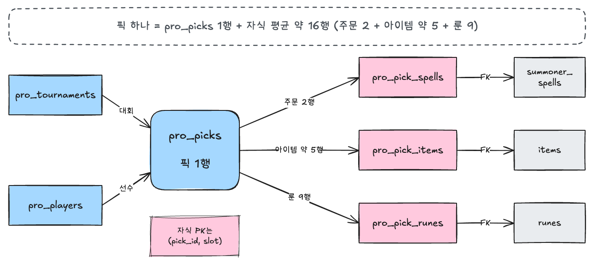
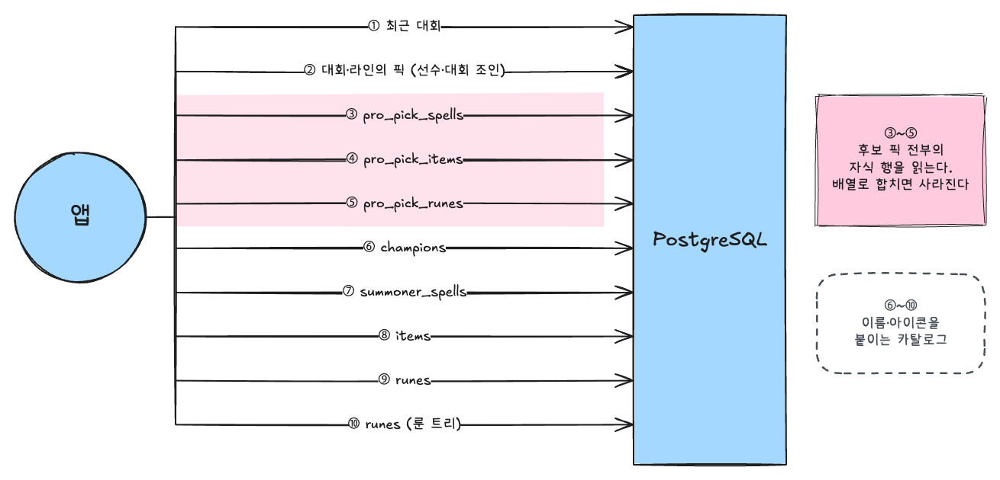
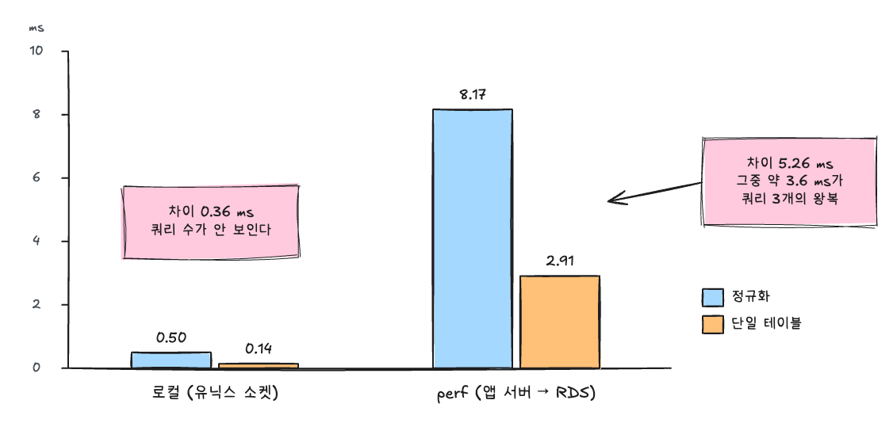
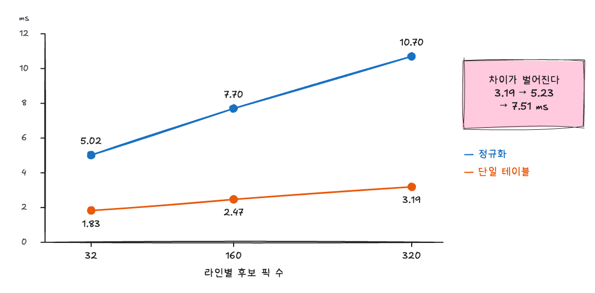
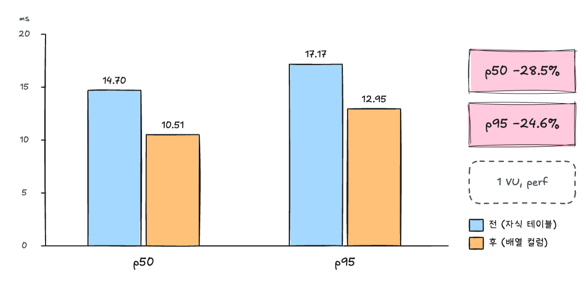

# 데이터베이스 정규화를 포기하여 성능을 28% 개선했습니다.

## 들어가며

DFGG는 리그 오브 레전드 플레이어에게 챔피언과 아이템을 추천하는 서비스입니다. 
그중 "오늘의 추천 픽"은 가장 최근 대회에서 내 라인 선수들이 고른 픽 다섯 개를 무작위로 보여 주는 기능입니다. 
픽마다 선수, 챔피언, 소환사 주문 2개, 아이템 최대 7개, 룬 9개가 함께 나갑니다. 
대회 픽 데이터는 Leaguepedia에서 배치로 받아 옵니다.

처음에는 이 데이터를 정규화해서 저장했습니다. 
그런데 앱 서버에서 DB로 붙는 실제 경로에서 재 보니, 요청 하나에 쿼리가 10개 나갔고 그중 3개는 소환자 주문, 아이템, 룬만 읽었습니다. 
이 자식 테이블 3개를 픽 테이블의 배열 컬럼으로 합치자 **API 응답 시간 p50이 28.5% 줄었습니다.** 
대신 배열 안의 값에는 FK(foreign key, 다른 테이블의 행을 가리키는 키)를 걸 수 없게 됐습니다.

이 글에서는 다음을 다룹니다.
- 정규화한 구조가 요청 하나에 무엇을 읽었는지
- 측정하면서 틀린 세 가지와 바로잡은 방법
- 구조를 바꾸기로 한 근거 세 가지와 결과
- 잃은 것과 자식 테이블이 더 나은 경우

정규화를 언제 깰지 기준이 애매한 개발자, PA와 PostgreSQL로 1:N 데이터를 저장해 본 백엔드 개발자를 대상으로 합니다.

## 픽 하나에 행 17개

### 정규화한 구조

정규화(normalization)는 중복을 없애려고 데이터를 여러 테이블로 나누는 설계입니다. 대회 픽은 다음과 같이 나눴습니다.



| 테이블 | 한 행의 의미 | 픽 하나당 행 수 |
|---|---|---|
| `pro_picks` | 한 경기에서 선수 한 명의 픽 | 1 |
| `pro_pick_spells` | 소환사 주문 한 칸 | 2 |
| `pro_pick_items` | 아이템 한 칸 (빈칸은 행 없음) | 평균 약 5 |
| `pro_pick_runes` | 룬 한 칸 | 9 |

자식 테이블의 기본 키는 (`pick_id`, `slot`)이고, 칸마다 `summoner_spells`·`items`·`runes` 카탈로그로 FK를 걸었습니다. 
픽 하나를 표현하려면 약 17개의 행이 필요합니다.

정규화를 고른 이유는 무결성이었습니다. 
카탈로그에 없는 아이템 id가 들어오면 DB가 INSERT를 거부합니다. 

### 요청 하나가 보내는 쿼리 10개

JPA 엔티티는 자식 테이블을 `@ElementCollection`으로 매핑했습니다.

```java
@ElementCollection
@CollectionTable(name = "pro_pick_runes", joinColumns = @JoinColumn(name = "pick_id"))
@OrderBy("slot")
@BatchSize(size = 500)
private List<ProPickRune> runes = new ArrayList<>();
// spells, items도 같은 모양
```

오늘의 추천 픽 요청 하나는 다음 순서로 쿼리를 보냈습니다.




3~5에서 `@BatchSize`는 화면에 나갈 다섯 개가 아니라 **그 대회, 라인의 후보 픽 전부**의 자식 행을 읽습니다. 
후보 픽이 32개면 자식 512행을 읽고, 그중 다섯 픽의 80행 정도만 응답에 씁니다.

쓰기 쪽도 비슷합니다. 
대회 픽을 다시 수집하면 Hibernate가 자식 컬렉션 3개를 지우고 행마다 INSERT를 보냅니다. 
JDBC 배치를 켜지 않았기 때문에, 픽 하나를 갱신하는 데 SQL 문장 22개가 나갔습니다.

## 세 가지 저장 방식

1:N 데이터를 저장하는 방법은 자식 테이블만 있는 것이 아닙니다. 
이 프로젝트 안에서도 세 가지 방식을 모두 찾을 수 있습니다.

| | 자식 테이블 | 고정 칸 펼치기 | 배열 컬럼 |
|---|---|---|---|
| 이 프로젝트 사례 | 대회 픽 룬 (전) | 랭크 게임 참가자 룬 | 대회 픽 룬 (후) |
| 픽 하나 읽기 | 자식 테이블마다 조회 | 한 행 | 한 행 |
| 원소에 FK | 가능 | 가능 | **불가** |
| 칸 수 검사 | `slot` CHECK | 컬럼이 곧 칸 | `cardinality()` CHECK |
| 칸 수가 바뀌면 | 행 추가 | 스키마 변경 | 값만 바뀜 |
| JPA 매핑 | `@ElementCollection` | 필드 여러 개 | `@JdbcTypeCode(SqlTypes.ARRAY)` |

측정을 위해 **단일 테이블**도 만들었습니다. 
대회, 선수 정보까지 복사하고 소환사 주문, 아이템, 룬을 배열로 둔 측정용 테이블이라 조인이 없습니다.
실제로 바꾼 구조는 대회, 선수 조인을 유지한 **배열 컬럼**이므로 둘은 다릅니다. 
그래서 3, 4절의 DB 구간 수치는 판단 근거로만 쓰고, 효과는 5절의 API 전후 값으로 말하겠습니다.

## 로컬에서의 차이

측정 도구는 두 가지를 썼습니다.

| 도구 | 재는 구간 | 조건 |
|---|---|---|
| pgbench | 비교 구간: 두 구조에서 다른 쿼리만 (정규화 5개, 단일 테이블 2개. 카탈로그 조회 제외) | 워밍업 1회 버림, 20초 × 3회 중앙값, 동시 접속 1·8 |
| k6 | API 전체 (nginx → 앱 → DB) | 워밍업 30초 버림, 1 VU × 60초 × 3회 중앙값, 8 VU × 60초. VU(virtual user, k6의 가상 사용자입니다.) |

측정하면서 세 번 틀렸습니다. 셋 다 측정 조건이 실제 앱과 달라서 생긴 일입니다.

### 틀린 것 1: 네트워크가 없는 곳에서 쟀습니다

처음에는 로컬 Docker PostgreSQL에서 컨테이너 안의 pgbench로 쟀습니다. 
데이터는 실제 수집분 약 1,000개의 데이터를 복사해 약 2.5만개의 데이터로 맞췄습니다.

| 환경 | 정규화 | 단일 테이블 | 차이 |
|---|---|---|---|
| 로컬 (유닉스 소켓) | 0.50 ms | 0.14 ms | 0.36 ms |
| perf (앱 서버 → RDS) | 8.17 ms | 2.91 ms | 5.26 ms |




로컬에서는 차이가 0.36 ms뿐이라 "바꿀 필요가 없다"고 생각했습니다. 
부하 테스트용 환경에서 앱 서버와 같은 EC2로 RDS(db.t4g.micro, PostgreSQL 16.14)에서 다시 측정하자 차이가 5.26 ms로 벌어졌습니다.

원인은 앱이 쿼리를 보내고 응답을 받기까지 걸리는 시간이었습니다.
`SELECT 1`만 보내 재 보니 쿼리 하나에 1.21 ms가 걸렸습니다. 
정규화는 쿼리가 3개 더 많으니 왕복만으로 약 3.6 ms를 더 씁니다. 
반면 쿼리 하나의 DB 실행 시간은 로컬 실행 계획 기준으로 0.1 ms 안팎이었습니다. 
유닉스 소켓에서는 왕복이 거의 없어 쿼리 수 차이가 드러나지 않았습니다.

### 틀린 것 2: 스크립트가 앱과 다른 실행 계획을 탔습니다

처음 쓴 pgbench 스크립트는 자식 쿼리를 이렇게 썼습니다.

```sql
SELECT pick_id, slot, rune_id FROM pro_pick_runes
WHERE pick_id IN (SELECT id FROM pro_picks WHERE tournament_id = :tid AND position = :position);
```

플래너는 기본 키 인덱스 대신 `pro_pick_runes` 전체를 훑었고(Seq Scan), 정규화가 실제보다 4배쯤 느리게 나왔습니다. 
앱은 이미 가진 후보 픽 id 목록을 넘기므로 기본 키 인덱스를 탑니다. 
같은 계획이 나오도록 `WHERE pick_id = ANY(ARRAY(SELECT id ...))`로 고쳤습니다.

### 틀린 것 3: pgbench 기본값은 앱과 쿼리 방식이 다릅니다

pgbench는 기본으로 `-M simple`을 써서 쿼리마다 실행 계획을 새로 세웁니다. 
앱이 쓰는 PostgreSQL JDBC 드라이버(pgjdbc)는 같은 문장의 5번째 실행부터 prepared statement로 계획을 재사용합니다(`prepareThreshold` 기본값 5). 
`-M prepared`로 바꾸자 정규화는 6.04 ms에서 5.02 ms로 17% 줄었고, 단일 테이블은 0.28 ms 줄었습니다. 
쿼리가 많고 조인이 있는 쪽이 계획 비용을 더 냈습니다. 
그림 3과 수치가 다른 이유는 RDS를 다시 켜면서 왕복이 0.76 ms로 줄었기 때문입니다.

`EXPLAIN (ANALYZE)`의 계획 시간도 처음에는 2.1~2.4 ms로 크게 나왔습니다. 
측정할 때마다 새 연결로 돌려서 카탈로그 캐시가 비어 있었기 때문입니다. 
그래서 이 글에서 시간 비교는 pgbench와 k6 값으로만 하고, `EXPLAIN`은 계획 모양과 읽은 행·버퍼를 보여 주는 데만 씁니다.

## 구조를 바꾸기로 한 근거 세 가지

아래 표의 값은 모두 RDS를 한 번 켠 동안 prepared 방식으로 연달아 쟀습니다. 
RDS를 켤 때마다 왕복이 달라져서, 다른 때 잰 값과는 섞지 않았습니다.

| 근거 | 정규화 | 단일 테이블 | 차이 |
|---|---|---|---|
| 1. 조회 (후보 픽 32개) | 5.02 ms | 1.83 ms | 3.19 ms |
| 2. 조회 (후보 픽 160개) | 7.70 ms | 2.47 ms | 5.23 ms |
| 3. 조회 (후보 픽 320개) | 10.70 ms | 3.19 ms | 7.51 ms |
| 픽 하나 갱신 | 19.71 ms (문장 22개) | 4.30 ms (문장 4개) | 15.41 ms |

모두 동시 접속 1의 p50입니다.

**1. 조회** 
차이 3.19 ms는 대부분 쿼리 3개의 왕복입니다. 
같은 때 k6로 잰 API 전체 p50이 15.33 ms였으므로, 구조를 바꾸면 약 21% 줄어들 것으로 추정했습니다.

**2. 후보 픽 수.** 
처음에는 데이터를 10배로 늘려도 지연이 그대로였습니다(정규화 8.17 → 8.27 ms). 
하지만 그때 늘린 것은 대회 수였습니다. 
요청은 최근 대회 하나만 읽으므로 대회 수와는 상관이 없습니다. 
정규화가 느려지는 축은 **대회 하나에 든 후보 픽 수**입니다. 
`@BatchSize`가 후보 픽 전부의 자식 행을 읽기 때문입니다. 
후보 픽을 10배(320개)로 늘리자 자식 행이 5,120개가 되고 차이도 7.51 ms로 벌어졌습니다. 
동시 접속 8에서는 p50이 30.43 ms 대 7.65 ms로 4배였습니다. 
수집 기간을 늘리거나 정규 시즌 막바지처럼 경기가 쌓이면 후보 픽은 실제로 늘어납니다.



**3. 쓰기.** 
정규화는 자식 16행을 지우고 다시 넣느라 문장이 22개이고, 단일 테이블은 UPDATE 한 번이라 4개입니다. 
차이 15.41 ms 중 약 13.7 ms가 늘어난 문장 18개의 왕복입니다. 
지금은 수동 배치라 사용자 응답과는 무관하지만, 다시 수집할 픽이 늘면 수집 시간도 그만큼 늘어납니다.

측정 전에 예시로 적어 둔 기준은 "p95 30% 감소"였습니다. 
p95는 전체 요청의 95%가 이 시간 안에 끝난다는 뜻입니다. 
1만으로는 p95 기준 약 22%로 이 기준에 못 미칠 것으로 보였습니다. 
그래서 측정 결과를 본 뒤에 2와 3을 더해 판단 기준을 다시 세웠습니다. 
조회가 지금 20% 남짓 빨라지고, 후보 픽이 늘수록 차이가 커지고, 갱신 시간도 4.6배 줄어든다면, FK를 내주더라도 바꿀 가치가 있다고 판단했습니다.

## 결과

### API p50 −28.5%

자식 테이블 3개를 `pro_picks`의 배열 컬럼 3개로 합쳤습니다. 
대회와 선수는 복사하지 않고 FK와 조인을 그대로 두었습니다.


마이그레이션은 칸 번호를 배열 위치로 옮깁니다. 
PostgreSQL 배열은 1부터 시작하므로 배열 위치는 칸 번호 + 1입니다. 
`generate_series`로 칸을 먼저 만들고 자식 행을 LEFT JOIN해서 빈칸은 NULL로 채웁니다.

```sql
UPDATE pro_picks p
SET rune_ids = (SELECT array_agg(r.rune_id ORDER BY g.slot)
                FROM generate_series(0, 8) g(slot)
                LEFT JOIN pro_pick_runes r ON r.pick_id = p.id AND r.slot = g.slot);
-- spell_ids(0~1), item_ids(0~6)도 같은 모양

ALTER TABLE pro_picks
    ADD CONSTRAINT ck_pro_picks_rune_slots CHECK (cardinality(rune_ids) = 9);

DROP TABLE pro_pick_spells, pro_pick_items, pro_pick_runes;
```

엔티티의 컬렉션 3개는 배열 필드 3개가 됐습니다.

```java
@JdbcTypeCode(SqlTypes.ARRAY)
@Column(name = "rune_ids", nullable = false)
private Integer[] runeIds = new Integer[RUNE_SLOTS];
```

이제 요청 하나의 쿼리는 7개입니다. 
후보 픽이 많아도 7개로 끝나는지 Hibernate Statistics로 세는 테스트를 추가했습니다.

### API 전후

perf 환경에서 RDS를 한 번 켠 동안 "전 측정 → 배포 → 후 측정" 순서로 쟀습니다. 
데이터는 대회 1개, 선수 21명, 픽 160개(라인별 후보 픽 32개)입니다.

| VU | 지표 | 전 (자식 테이블) | 후 (배열 컬럼) | 변화 |
|---|---|---|---|---|
| 1 | p50 | 14.70 ms | **10.51 ms** | **−28.5%** |
| 1 | p95 | 17.17 ms | **12.95 ms** | **−24.6%** |
| 1 | p99 | 24.26 ms | 18.72 ms | −22.8% |
| 1 | 처리량 | 63.6건/초 | 87.8건/초 | +38% |
| 8 | p95 | 27.62 ms | 21.85 ms | −20.9% |
| 8 | 처리량 | 361건/초 | 480건/초 | +33% |



후 측정은 앱을 다시 띄운 직후라 오히려 불리한 조건이었습니다. 
1회차 p50이 11.30 ms였고 2, 3회차에 10.5 ms로 안정됐습니다. 
다만 k6를 같은 VPC 안에서 돌렸으므로 사용자와 서버 사이의 인터넷 구간은 이 수치에 없습니다. 
실제 사용자가 느끼는 감소 비율은 이보다 작습니다.

### 버퍼로 보면

같은 데이터(로컬, MID 후보 픽 44개)로 전후 실행 계획을 비교했습니다. 
버퍼는 PostgreSQL이 읽은 페이지 수입니다.

| | 쿼리 | 읽은 행 | 읽은 버퍼 |
|---|---|---|---|
| 전 | 픽 1개 + 자식 3개 = 4개 | 픽 44 + 자식 703 | 339 |
| 후 | 픽 1개 | 픽 44 (배열 포함) | 15 |

후의 픽 쿼리는 전과 모양이 같습니다. 
픽 인덱스로 44행을 찾고 선수와 Hash Join합니다. 
행이 배열만큼 넓어졌지만 읽는 버퍼는 17개에서 15개로 거의 같고, 뒤따르던 자식 쿼리 3개가 사라졌습니다.

```
-- 후: 픽 쿼리 하나로 끝
Sort (actual time=0.046..0.048 rows=44 loops=1)
  Buffers: shared hit=15
  ->  Nested Loop (actual time=0.021..0.034 rows=44 loops=1)
        ->  Seq Scan on pro_tournaments t (rows=1)
        ->  Hash Join (actual time=0.018..0.028 rows=44 loops=1)
              ->  Bitmap Heap Scan on pro_picks p (rows=44)
                    ->  Bitmap Index Scan on idx_pro_picks_tournament_position (rows=44)
              ->  Hash -> Seq Scan on pro_players pl (rows=101)
```


## 트레이드 오프

### 잃은 것

**FK를 잃었습니다.** 
PostgreSQL은 배열 원소에 FK를 걸 수 없습니다. 
이제 카탈로그에 없는 아이템 id도 DB에 들어갈 수 있습니다. 
그래서 앱이 두 곳에서 막습니다. 
수집 변환이 카탈로그에 없는 값을 건너뛰고, 응답을 만들 때도 카탈로그에 없는 id를 건너뜁니다.

**DB는 칸 수만 검사합니다.** 
`cardinality` CHECK로 주문 2칸, 아이템 7칸, 룬 9칸은 지키지만, 칸 안의 값이 올바른 종류인지와 순서는 앱이 책임집니다.

**자식 테이블에 기대던 도구가 깨졌습니다.** 
측정 스크립트와 데이터 병합 스크립트는 새 구조의 DB에서 돌지 않고, 데이터 복원 절차도 새 구조에 맞게 고쳐야 합니다.

### 대회와 선수는 왜 그대로 두었나

단일 테이블은 대회, 선수 이름까지 픽 행에 복사해 조인도 없앴습니다. 
배열 컬럼에서는 그렇게 하지 않았습니다. 
선수 사진과 소속은 수집할 때마다 갱신되는데, 복사해 두면 그 선수가 나온 모든 행을 고쳐야 합니다.
소환사 주문, 아이템, 룬은 경기가 끝나면 바뀌지 않는 값이고, 선수 정보는 계속 바뀌는 값입니다.
이처럼 읽기 성능을 위해 정규화를 일부 되돌리는 반정규화에서는 범위를 갱신 빈도로 정했습니다.

### 자식 테이블이 더 나은 경우
- 칸마다 속성이 붙을 때: 같은 프로젝트의 랭크 게임 구매 기록은 구매마다 골드 범위와 구매 유형이 붙어서 행으로 나눴습니다.
- 원소로 검색할 때.: "아이템 X를 산 픽"을 찾아야 한다면 배열에 GIN(generalized inverted index, 값 안의 원소를 찾는 인덱스) 인덱스를 따로 걸어야 합니다. 
PostgreSQL 문서도 원소 검색이 잦으면 별도 테이블을 고려하라고 안내합니다.
- 칸 수가 정해져 있지 않을 때: 룬 9칸, 주문 2칸은 게임 규칙이 정한 값이라 배열을 고를 수 있었습니다.
- 무결성이 성능보다 중요할 때: 잘못된 id 하나가 결제나 정산처럼 큰 문제로 이어진다면 FK를 지키는 편이 낫습니다.

## 마치며

이번 작업의 판단 기준은 "모든 데이터를 정규화한다"가 아니라 "이 데이터는 어떤 단위로 읽히고 쓰이는가"였습니다. 
대회 픽의 소환사 주문, 아이템, 룬은 언제나 픽과 함께 읽히고 픽과 함께 바뀝니다. 
저장 단위를 그 단위에 맞추자 쿼리 10개가 7개로 줄고, API 응답 시간 p50이 28.5% 줄었습니다.
대가로 FK를 내주고 그 검증을 앱으로 옮겼습니다.

측정에서 배운 점도 세 가지 남깁니다.

1. 로컬 측정만으로 판단하지 않습니다.
      - 유닉스 소켓에서는 차이가 0.36 ms로 묻혔습니다. 실제 경로(앱 서버 → DB)에서 재야 쿼리 수가 보입니다.
2. 측정 조건을 앱과 맞춥니다.
      - 서브쿼리 모양 하나가 결과를 4배 부풀렸고, pgbench 옵션 하나가 정규화 쪽 값을 17% 바꿨습니다.
3. 비율은 API 전체로 봅니다.
      - 비교 구간에서 2.7배였던 차이가 API에서는 28.5% 감소였습니다. 카탈로그 조회와 앱 처리는 양쪽에 똑같이 붙습니다.

다음에는 후보 픽이 늘었을 때의 API 응답 시간과, JDBC 배치를 켰을 때 쓰기 비용이 얼마나 줄어드는지 재 볼 계획입니다.

## 참고 자료

- "Server Prepared Statements", pgJDBC, https://jdbc.postgresql.org/documentation/server-prepare/
- "pgbench", PostgreSQL 16 Documentation, https://www.postgresql.org/docs/16/pgbench.html
- "8.15. Arrays", PostgreSQL 16 Documentation, https://www.postgresql.org/docs/16/arrays.html
- "12.8. Batch fetching", Hibernate ORM User Guide, https://docs.hibernate.org/orm/6.6/userguide/html_single/Hibernate_User_Guide.html
