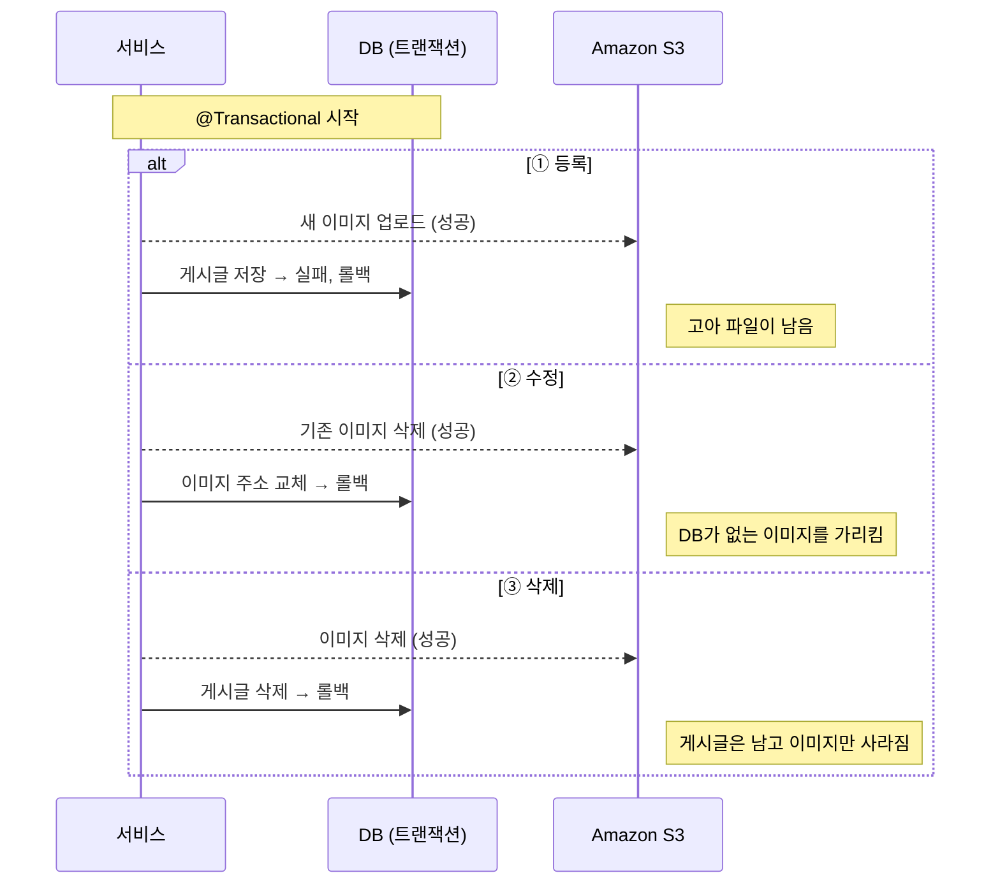
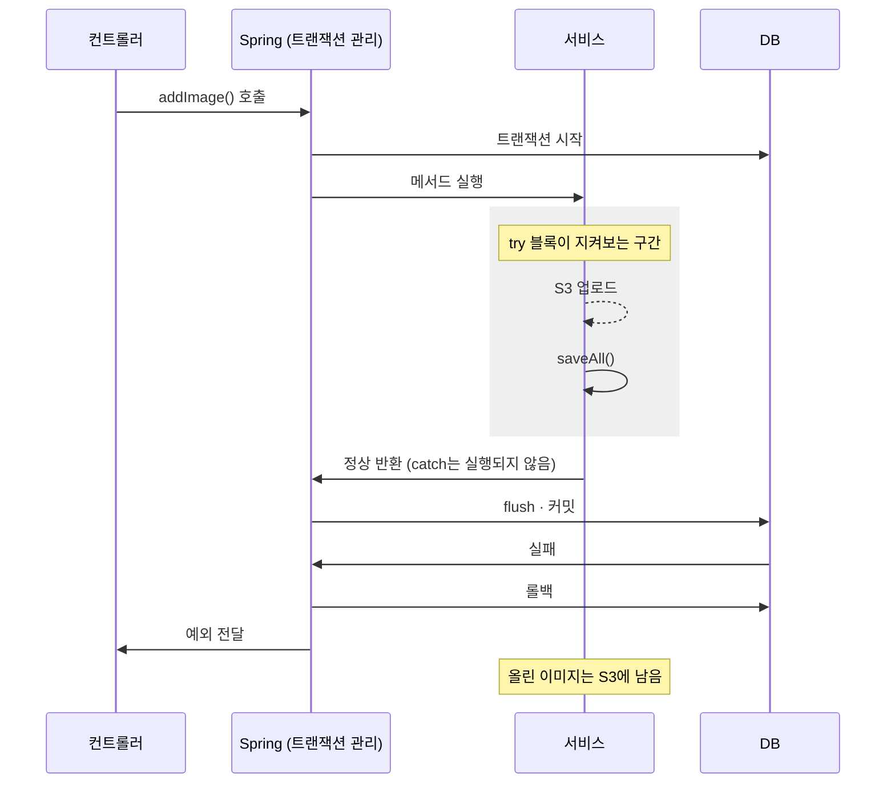
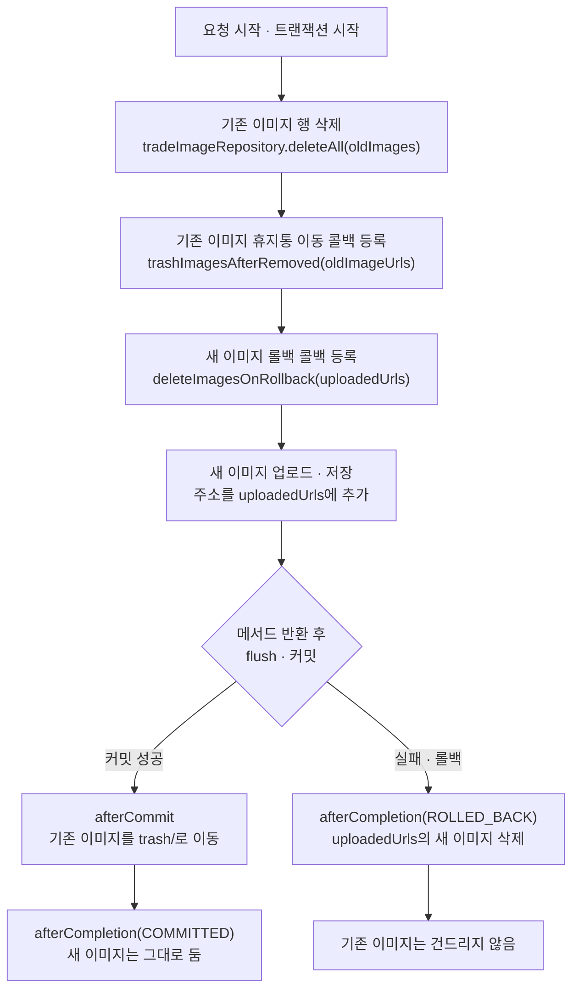
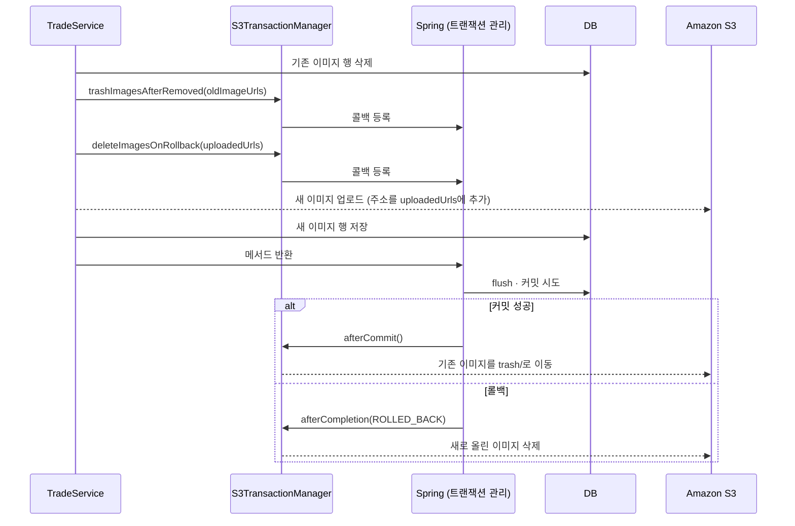
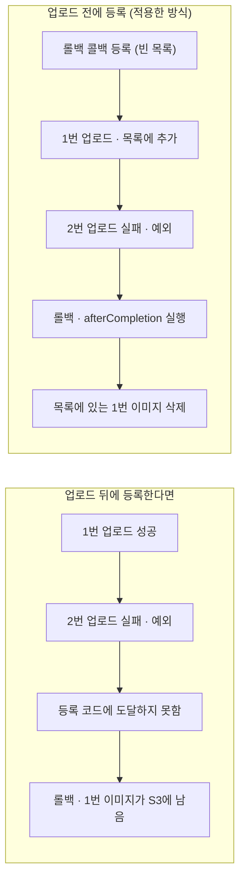
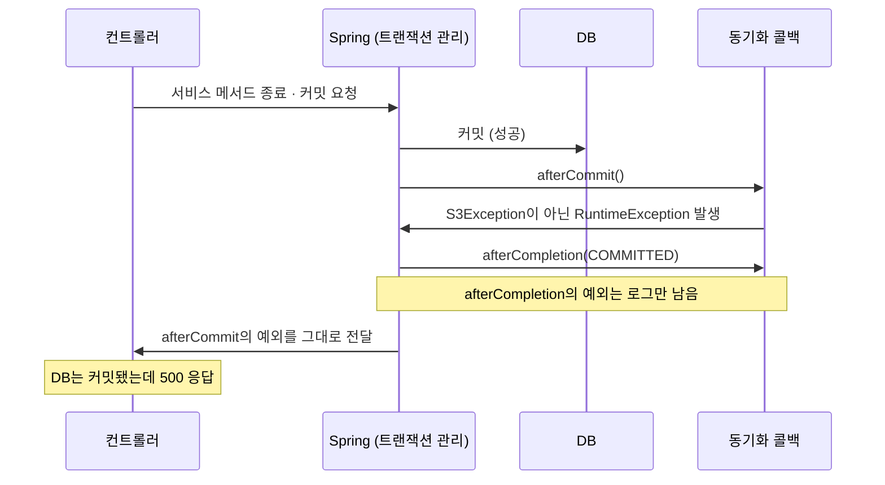

# DB는 롤백됐는데 S3 이미지는 남았다: 트랜잭션 결과에 S3 작업을 맞추며 만난 함정 2가지

가치가챠는 가챠샵(캡슐 토이 매장)의 위치를 지도에서 찾고, 사용자끼리 중복된 가챠를 교환할 수 있는 서비스입니다. 매장, 가챠, 교환 게시글에는 사진을 올릴 수 있고, 저는 이 이미지 업로드 기능을 맡았습니다.

이미지는 Amazon S3(Simple Storage Service, 이하 S3)라는 파일 저장소에 올리고, 그 주소는 PostgreSQL DB(데이터베이스)에 저장합니다. 저장소가 두 곳으로 나뉘어 있다 보니, DB 저장이 실패해 작업이 취소되어도 S3에 올린 이미지는 그대로 남을 수 있었습니다. 반대로 S3에서 이미지를 먼저 지웠는데 DB 작업이 취소되면, 게시글은 남아 있는데 이미지만 사라집니다.

이 문제를 막으려고 S3 작업을 DB 작업이 확정된 뒤로 미뤘습니다. 이 방법은 이미 여러 글에서 소개하고 있지만, 실제 코드에 적용해 보니 놓치기 쉬운 지점이 두 군데 있었습니다. 하나는 처음에 사용한 try-catch가 잡지 못하는 실패였고, 다른 하나는 아래 커밋 메시지로 남았습니다.

> fix: afterCommit 콜백에서 S3Exception 외의 예외가 나면 API가 500을 반환

DB에는 요청이 반영됐는데 사용자는 서버 오류(HTTP 500) 응답을 받는 문제였습니다. 같은 구조를 적용하려는 분들이 같은 지점에서 막히지 않도록, 해결 방법을 고른 과정과 함께 정리했습니다.

**다루는 내용**

- DB 트랜잭션이 S3 작업을 되돌리지 못해서 생기는 세 가지 실패
- Spring의 TransactionSynchronizationManager로 S3 작업을 트랜잭션 결과에 맞춘 구조와 실제 코드
- 적용 과정에서 만난 함정 두 가지와 원인
- S3가 아닌 다른 외부 저장소에도 적용할 수 있는 판단 기준

**대상 독자**

트랜잭션을 막 사용하기 시작한 백엔드 개발자부터, 외부 저장소와 DB의 정합성을 고민하는 경력 개발자까지 염두에 두고 작성했습니다. 개발자가 아니라면 1장과 10장만 읽어도 어떤 문제를 어떻게 풀었는지 알 수 있습니다.

---

## 1. @Transactional의 경계

트랜잭션은 여러 DB 작업을 하나로 묶어서, 모두 반영하거나(커밋) 모두 없던 일로 되돌리는(롤백) 장치입니다. 예를 들어 게시글과 이미지 주소를 함께 저장하다가 하나라도 실패하면, 둘 다 저장되지 않은 상태로 돌아갑니다. Spring에서는 메서드에 @Transactional을 붙이면 그 메서드 안의 DB 작업이 하나의 트랜잭션으로 묶입니다.

다만 트랜잭션이 되돌릴 수 있는 범위는 DB 안의 작업뿐입니다. S3에 이미지를 올리거나 지우는 일은 네트워크 너머의 다른 시스템에 보내는 요청이라, DB가 롤백되어도 S3에서 이미 일어난 일은 취소되지 않습니다. 이 차이 때문에 세 가지 실패가 생길 수 있었습니다.

1. 등록: S3에 이미지를 올린 뒤 DB 저장이 실패해 롤백되면, 어떤 게시글도 가리키지 않는 이미지가 S3에 남습니다. 이 글에서는 이런 이미지를 고아 파일이라고 부릅니다.
2. 수정: 기존 이미지를 먼저 지웠는데 트랜잭션이 롤백되면, DB는 기존 이미지 주소를 그대로 가지고 있지만 S3에는 그 이미지가 없습니다.
3. 삭제: DB에서 게시글을 지우기 전에 S3 이미지부터 지우거나 옮겼는데 롤백되면, 게시글은 남아 있고 이미지만 사라집니다.

실제로 처음 작성한 가챠 삭제 코드가 3번 순서를 따르고 있었습니다. S3 이미지를 먼저 휴지통 경로로 옮긴 뒤 DB 데이터를 지웠기 때문에, 그 뒤의 DB 작업이 실패하면 S3만 바뀐 상태로 남습니다. (주석은 설명을 위해 덧붙였습니다.)

```java
// GachaService (트랜잭션 동기화 적용 전)
@Transactional
public GachaDeleteResult remove(final Long gachaId) {
    Gacha gacha = gachaRepository.getById(gachaId);

    deleteGachaImagesFromS3(gachaId);                 // ① S3 이미지를 먼저 휴지통으로 이동
    gachaImageRepository.deleteAllByGachaId(gachaId);
    gachaRepository.deleteById(gachaId);              // ② 여기서 실패하면 S3만 바뀐 채로 남음

    return GachaDeleteResult.from(gacha);
}
```



*그림 1. 적용 전 실패 시나리오. 실선은 트랜잭션 안의 DB 작업, 점선은 트랜잭션 밖의 S3 요청입니다.*

세 실패는 무게가 다릅니다. 고아 파일은 저장 공간만 차지할 뿐 사용자 눈에는 보이지 않습니다. 반면 수정과 삭제에서 생기는 문제는 화면에 이미지가 뜨지 않는 장애로 바로 드러납니다. 이 차이는 4장에서 작업마다 다른 처리 시점을 고르는 기준이 됩니다.

처음 기능을 구현할 때는 이 문제를 놓쳤고, 이후 코드를 다시 검토하는 과정에서 DB와 S3의 상태가 어긋날 수 있다는 것을 발견해 고쳤습니다.

---

## 2. 일곱 가지 선택지와 판단 기준

해결 방법을 고르기 전에 판단 기준부터 정했습니다.

1. 실패한 뒤에 되돌리는 방식보다, 되돌릴 일이 처음부터 생기지 않는 방식을 먼저 본다.
2. 매장, 가챠, 교환 게시글이 같은 문제를 겪으니 같은 방식으로 푼다.
3. 다른 팀원이 자기 도메인에서 바로 가져다 사용할 수 있을 만큼 구현과 재사용 비용이 낮아야 한다.

여기에 원칙을 하나 더 두었습니다. 아직 일어나지 않은 문제를 위해 기술부터 도입하지 않는다는 원칙입니다. 이 원칙에 따라 비동기 처리(@Async)와 Outbox 패턴(실행할 작업을 DB에 기록해 두고 별도로 실행·재시도하는 방식)은 보류했습니다.

| 선택지 | 장점 | 단점 | 결과 |
| --- | --- | --- | --- |
| 위험 수용 | 추가 구현 없음 | 고아 파일과 깨진 이미지가 쌓임 | 제외 |
| 수동 try-catch | 익숙하고 단순함 | 커밋 단계의 실패를 못 잡고, 원래 예외를 가릴 수 있음 | 처음 시도 후 제거 (3장) |
| TransactionSynchronizationManager | 트랜잭션 결과를 확인한 뒤 실행, 추가 인프라 없음 | 서비스 코드가 Spring 트랜잭션 API에 의존 | 채택 |
| @TransactionalEventListener | 이벤트로 분리해 결합도가 낮음 | 이벤트·리스너 클래스가 늘고 흐름을 따라가기 어려움 | 후속 과제로 보류 |
| @Async | 응답 지연을 줄임 | 스레드 풀 관리가 필요하고, 아직 지연 문제가 없음 | 보류 |
| Outbox + 스케줄러 | 실패 시 재시도 가능 | 테이블과 스케줄러 추가, 현재 규모에 과함 | 보류 |
| S3 Lifecycle Rule | 코드 변경 없이 오래된 이미지 정리 | 고아 여부를 알 수 없고, 수정·삭제 문제는 못 막음 | 제외 |

*표 1. 검토한 선택지와 결과*

마지막까지 TransactionSynchronizationManager와 @TransactionalEventListener를 비교했습니다. 두 방식은 같은 기반 위에 있습니다. @TransactionalEventListener를 붙인 리스너도 내부에서는 트랜잭션 동기화 콜백(트랜잭션이 끝날 때 실행되도록 미리 맡겨 두는 코드, 4장에서 자세히 설명)을 등록해서 동작합니다. 차이는 코드를 읽는 쪽에서 드러납니다. 이벤트 방식은 서비스가 이벤트만 발행하고 S3 작업은 리스너 클래스에 따로 있어서, 서비스 코드만 읽어서는 롤백될 때 무엇이 정리되는지 알기 어렵습니다. 반대로 TransactionSynchronizationManager를 사용하면 "이 트랜잭션이 롤백되면 이 이미지를 지운다"는 내용이 서비스 메서드 안에 그대로 보입니다. 표에 적은 대로 이벤트·리스너 클래스가 늘어나는 비용도 있어서, 이번에는 TransactionSynchronizationManager를 골랐습니다. Spring API(Application Programming Interface, 다른 코드가 기능을 호출할 수 있게 열어 둔 창구)에 직접 의존하는 부분은 별도 컴포넌트로 감쌌습니다(4장).

한 가지 덧붙이면, 두 방식은 콜백이 실행되는 흐름도 다릅니다. Spring 문서에 따르면 @TransactionalEventListener의 기본 단계인 `AFTER_COMMIT`은 afterCommit 콜백이 아니라 afterCompletion 콜백과 같은 흐름에서 실행됩니다. 6장에서 다룰 예외 처리 방식이 이 두 콜백에서 다르기 때문에, 나중에 이벤트 방식으로 옮긴다면 이 차이를 테스트로 다시 확인해야 합니다.

---

## 3. 함정 ① 수동 try-catch의 사각지대

삭제와 교체는 먼저 트랜잭션 동기화 콜백으로 옮겼지만(커밋 `984034d`), 이미지 등록은 한동안 익숙한 방법으로 처리했습니다. 올린 이미지의 주소를 목록에 모아 두고, 예외가 나면 catch 블록에서 그 이미지들을 지운 뒤 예외를 다시 던지는 방식입니다. 아래는 당시 가챠 이미지 등록 코드입니다.

```java
// GachaImageService (수정 전)
@Transactional
public List<GachaImageInfo> addImage(final Long gachaId, final List<MultipartFile> files) {
    Gacha gacha = gachaRepository.getById(gachaId);

    List<String> uploadedImageUrls = new ArrayList<>();
    try {
        List<GachaImage> gachaImages = files.stream()
                .map(file -> {
                    String imageUrl = imageUploader.upload(file, imagePath());
                    uploadedImageUrls.add(imageUrl);
                    return new GachaImage(gacha, imageUrl);
                })
                .toList();

        List<GachaImage> savedGachaImages = gachaImageRepository.saveAll(gachaImages);
        return savedGachaImages.stream()
                .map(GachaImageInfo::from)
                .toList();
    } catch (RuntimeException e) {
        uploadedImageUrls.forEach(imageUploader::delete);
        throw e;
    }
}
```

빈틈이 없어 보이지만 이 catch가 잡지 못하는 실패가 있습니다. Spring Boot에서 JPA(Java Persistence API, 자바 객체를 DB에 저장하는 표준 기술)를 사용하면 기본 구현체로 Hibernate가 동작합니다. Hibernate 문서는 엔티티의 변경 내용을 메모리에 모아 두었다가 정해진 시점에 SQL(DB에 보내는 명령문)로 바꿔 DB에 보낸다고 설명하고, 이 작업을 flush라고 부릅니다. 기본 설정에서는 트랜잭션을 커밋하기 직전에도 flush가 일어나고, 이때 제약조건 위반 같은 예외가 날 수 있습니다. 커밋 자체가 실패하는 경우도 마찬가지입니다.

실행 순서를 따라가 보면 catch가 왜 닿지 않는지 보입니다.

1. 서비스 메서드 본문이 실행됩니다. try 블록이 지켜보는 구간은 여기까지입니다.
2. 메서드가 정상적으로 반환됩니다.
3. Spring이 커밋을 시작하고, 커밋 직전 flush에서 SQL이 실행됩니다.
4. 이 단계에서 실패하면 트랜잭션이 롤백됩니다.

4번의 실패가 일어날 때 실행 흐름은 이미 catch 블록을 빠져나온 뒤입니다. 그래서 DB는 롤백되는데 올린 이미지는 S3에 그대로 남습니다.



*그림 2. 수동 try-catch가 닿지 않는 구간. 회색 상자 밖에서 난 실패는 catch로 잡을 수 없습니다.*

문제가 하나 더 있었습니다. catch 안의 `imageUploader::delete`도 실패하면 예외를 던집니다. 그러면 정리 중에 난 예외가 원래 예외를 가려서, 로그에는 S3 삭제 실패만 남고 정작 저장이 왜 실패했는지는 사라집니다.

결국 이 방식은 메서드 안에서 난 실패만 다룰 수 있었습니다. 실패가 어디서 났든 "트랜잭션이 롤백됐다"는 결과에 반응하는 장치가 필요했습니다.

---

## 4. 트랜잭션 결과에 맞춘 S3 작업: S3TransactionManager

### 트랜잭션 동기화 콜백과 선택 규칙

Spring은 현재 트랜잭션이 끝나는 시점에 실행할 코드를 미리 맡겨 둘 수 있게 해 줍니다. 이렇게 맡겨 두는 코드를 콜백이라고 합니다. `TransactionSynchronizationManager.registerSynchronization()`에 `TransactionSynchronization` 구현체를 넘기면, Spring이 트랜잭션을 끝내면서 그 메서드를 호출합니다. 이 글에서 사용하는 콜백은 두 가지입니다.

- afterCommit(): 커밋이 성공했을 때만 호출됩니다.
- afterCompletion(int status): 커밋이든 롤백이든 트랜잭션이 끝나면 항상 호출되고, 결과를 `STATUS_COMMITTED`나 `STATUS_ROLLED_BACK` 같은 값으로 알려 줍니다.

두 콜백 모두 메서드가 반환되고 커밋까지 시도한 다음에 실행됩니다. 3장에서 catch가 놓친 커밋 단계의 실패도 결국 롤백으로 끝나기 때문에, afterCompletion은 그 실패까지 "롤백됐다"는 결과로 받습니다.

어떤 콜백을 사용할지는 S3 작업의 성격으로 정했습니다. 1장에서 본 실패의 무게 차이가 기준입니다.

- 새로 올리는 작업은 먼저 실행하고, 롤백되면 지웁니다. afterCompletion에서 상태가 `STATUS_ROLLED_BACK`일 때 정리합니다.
- 기존 이미지를 지우는 작업은 커밋이 확정된 뒤에만 실행합니다. afterCommit을 사용합니다.

지우는 작업을 커밋 뒤로 미루면, 롤백됐을 때 기존 이미지는 손대지 않은 채로 남습니다. 화면에 이미지가 뜨지 않는 무거운 실패를 구조로 막는 방법입니다. 대신 커밋 뒤에 삭제가 실패하면 고아 파일이 남는데, 이는 사용자에게 보이지 않는 가벼운 실패입니다.

매장과 가챠의 이미지 서비스, 매장과 가챠의 삭제 서비스까지 네 곳에 비슷한 콜백 코드가 반복돼서, 이 규칙을 `S3TransactionManager`라는 컴포넌트 하나로 모았습니다(커밋 `3e0f44b`). 이후 교환 게시글 서비스도 같은 컴포넌트를 사용합니다.

| 메서드 | 콜백 | 동작 | 사용하는 곳 |
| --- | --- | --- | --- |
| `deleteImagesOnRollback` | afterCompletion | 롤백되면 올린 이미지를 삭제, 커밋되면 아무것도 하지 않음 | 이미지 등록 |
| `trashImagesAfterRemoved` | afterCommit | 커밋된 뒤에만 이미지를 `trash/` 경로로 이동 | 가챠·교환 게시글 삭제, 교체 시 기존 이미지 |
| `deleteImagesAfterRemoved` | afterCommit | 커밋된 뒤에만 이미지를 완전히 삭제 | 매장 삭제 |
| `cleanupAfterImageReplaced` | afterCompletion | 커밋이면 기존 이미지를 휴지통으로, 롤백이면 새 이미지를 삭제 | 이미지 1장 교체 |

*표 2. S3TransactionManager의 메서드*

실제 코드에서 등록과 삭제를 담당하는 두 메서드는 아래와 같습니다. 각 메서드는 콜백을 등록만 하고, 실제 S3 작업은 트랜잭션이 끝난 뒤에 실행됩니다.

```java
// S3TransactionManager (일부)
public void deleteImagesOnRollback(
        final DomainType imageType,
        final Long domainId,
        final List<String> imageUrls
) {
    TransactionSynchronizationManager.registerSynchronization(new TransactionSynchronization() {
        @Override
        public void afterCompletion(final int status) {
            if (status == TransactionSynchronization.STATUS_ROLLED_BACK) {
                imageUrls.forEach(imageUrl -> deleteImage(imageType, domainId, imageUrl));
            }
        }
    });
}

public void trashImagesAfterRemoved(
        final DomainType imageType,
        final Long domainId,
        final List<String> imageUrls
) {
    TransactionSynchronizationManager.registerSynchronization(new TransactionSynchronization() {
        @Override
        public void afterCommit() {
            imageUrls.forEach(imageUrl -> moveImageToTrash(imageType, domainId, imageUrl));
        }
    });
}
```

삭제를 휴지통 이동과 완전 삭제 두 갈래로 나눈 데는 이유가 있습니다. 교환 게시글처럼 사용자가 올린 콘텐츠는 잘못 지웠거나 신고에 대응해야 할 때 원본이 필요할 수 있어서, 바로 지우지 않고 `trash/` 경로로 옮겨 둡니다. 반면 매장은 DB에서 데이터가 사라지면 이미지를 되살려도 사용할 곳이 없어서 완전히 지웁니다. S3에는 원자적인 이동 연산이 없기 때문에, 휴지통 이동은 새 위치로 복사한 뒤 원본을 지우는 방식으로 구현했습니다. AWS(Amazon Web Services) 문서도 객체를 옮기거나 이름을 바꿀 때 복사 후 원본 삭제 방식을 안내합니다.

```java
// ImageUploader (일부)
public void moveToTrash(final String imageUrl) {
    String key = extractKeyFromUrl(imageUrl);
    String trashKey = generateTrashKey(key);  // gachigacha/store/xxx.png → gachigacha/trash/store/xxx.png
    // CopyObjectRequest, DeleteObjectRequest 생성 생략
    try {
        s3Client.copyObject(copyRequest);
        s3Client.deleteObject(deleteRequest);
    } catch (final SdkException e) {
        log.error("이미지를 휴지통으로 이동하는 중 오류가 발생했습니다. key={}, trashKey={}", key, trashKey, e);
        throw new S3Exception(ErrorCode.S3_IMAGE_MOVE_ERROR);
    }
}
```

### 처리 흐름

아래는 교환 게시글의 이미지를 교체하는 요청 하나가 거치는 흐름입니다. 기존 이미지 삭제와 새 이미지 업로드가 한 요청에 함께 들어 있어서, 두 규칙이 어떻게 맞물리는지 한 번에 볼 수 있습니다.



*그림 3. 교환 게시글 이미지 교체 요청의 처리 흐름. 어느 쪽으로 끝나든 DB와 S3가 같은 상태를 가리킵니다.*

같은 흐름을 시간 순서로 그리면 그림 1과 짝이 됩니다.



*그림 4. 적용 후 시퀀스. 기존 이미지를 지우는 S3 요청이 모두 커밋 결과가 정해진 뒤로 옮겨졌습니다.*

교환 게시글 서비스의 실제 코드는 다음과 같습니다.

```java
// TradeService (일부)
private List<String> replaceImages(final Trade trade, final List<MultipartFile> images) {
    if (images == null || images.isEmpty()) {
        return findImageUrls(trade.getId());
    }

    List<TradeImage> oldImages = tradeImageRepository.findAllByTradeIdOrderByIdAsc(trade.getId());
    List<String> oldImageUrls = oldImages.stream()
            .map(TradeImage::getImageUrl)
            .toList();
    tradeImageRepository.deleteAll(oldImages);
    s3TransactionManager.trashImagesAfterRemoved(DomainType.TRADE, trade.getId(), oldImageUrls);

    return uploadImages(trade, images);
}
```

서비스 코드에서 S3 정리를 위한 try-catch가 사라지고, 콜백을 등록하는 한 줄만 남았습니다. `uploadImages()`는 다음 장에서 살펴봅니다.

---

## 5. 업로드 도중의 실패와 콜백 등록 위치

3장의 try-catch에도 장점이 하나 있었습니다. 업로드에 성공할 때마다 목록에 주소를 쌓았기 때문에, 세 장을 올리다 두 번째에서 실패해도 catch에서 첫 번째 이미지를 지울 수 있었습니다. try-catch를 콜백으로 바꾸면서 이 장점을 잃지 않으려면, 콜백을 어디서 등록할지가 중요했습니다.

업로드를 모두 마친 뒤에 콜백을 등록한다고 가정해 보겠습니다. 두 번째 업로드에서 예외가 나는 순간 실행 흐름이 등록 코드까지 가지 못합니다. 트랜잭션은 롤백되지만 정리할 콜백이 없으니 첫 번째 이미지가 S3에 남습니다.

그래서 업로드 전에 빈 목록으로 콜백을 먼저 등록했습니다. 콜백은 이미 트랜잭션에 걸려 있고, 업로드에 성공할 때마다 같은 목록에 주소가 쌓입니다. 두 번째에서 실패해도 롤백 시점에 콜백이 목록을 읽어 첫 번째 이미지를 지웁니다.



*그림 5. 콜백 등록 위치에 따른 차이. 등록이 늦으면 실패 직전까지 올라간 이미지가 정리 대상에서 빠집니다.*

교환 게시글 서비스의 업로드 메서드는 이 순서를 따릅니다. 메서드 위의 주석도 같은 이유를 설명합니다.

```java
// TradeService (일부)
/**
 * 업로드는 지금 일어나지만 DB 저장은 커밋 시점에야 확정된다. 그래서 업로드를 시작하기 전에 롤백 훅을 먼저 걸어 두고,
 * 훅이 바라보는 리스트에 업로드한 URL을 누적한다. 중간에 실패해도 그때까지 올라간 파일이 정리된다.
 */
private List<String> uploadImages(final Trade trade, final List<MultipartFile> images) {
    if (images == null || images.isEmpty()) {
        return List.of();
    }

    List<String> uploadedUrls = new ArrayList<>();
    s3TransactionManager.deleteImagesOnRollback(DomainType.TRADE, trade.getId(), uploadedUrls);

    for (MultipartFile image : images) {
        String imageUrl = multipartUploader.upload(image, DomainType.TRADE);
        uploadedUrls.add(imageUrl);
        tradeImageRepository.save(TradeImage.builder()
                .trade(trade)
                .imageUrl(imageUrl)
                .build());
    }

    return uploadedUrls;
}
```

콜백이 목록의 복사본이 아니라 같은 목록 객체를 가리키기 때문에 이 구조가 동작합니다. 등록할 때 비어 있던 목록이 업로드가 진행될수록 채워지고, 콜백은 트랜잭션이 끝나는 시점의 목록을 읽습니다.

이 변경은 매장 이미지, 가챠 이미지, 매장 등록 서비스의 수동 catch를 걷어낸 커밋(`53fb6ef`)에 함께 들어 있습니다. 커밋 메시지에는 "실패 시점과 무관하게 롤백되면 항상 정리되도록"이라고 적었습니다. 메서드 본문에서 실패하든, 업로드 도중에 실패하든, 커밋 단계에서 실패하든 결과가 롤백이면 같은 콜백이 정리합니다.

---

## 6. 함정 ② 커밋됐는데 500: afterCommit의 예외 전파

### 좁아진 catch 범위

삭제 작업을 afterCommit 콜백으로 옮길 때(커밋 `984034d`), S3 정리 메서드의 catch 범위도 함께 바꿨습니다. 원래 `RuntimeException`을 잡던 코드를 `S3Exception`만 잡도록 좁혔습니다.

```diff
// GachaService (커밋 984034d)
 private void moveFileToTrash(final Long gachaId, final GachaImage gachaImage) {
     try {
         imageUploader.moveToTrash(gachaImage.getImageUrl());
-    } catch (RuntimeException e) {
+    } catch (S3Exception e) {
         log.warn("가챠 삭제 중 S3 이미지 삭제에 실패했습니다. gachaId={}, imageUrl={}", gachaId, gachaImage.getImageUrl(), e);
     }
 }
```

여기서 `S3Exception`은 AWS 라이브러리의 예외가 아니라 프로젝트에서 직접 만든 예외입니다. 4장의 `ImageUploader` 코드처럼, AWS SDK(Software Development Kit, 자바 코드에서 AWS를 사용하게 해 주는 공식 라이브러리)가 던지는 `SdkException`을 잡아서 `S3Exception`으로 바꿔 던집니다. 그래서 S3와 통신하다 실패하면 이 catch에 잡힙니다.

하지만 S3 호출 앞뒤의 코드에서 나는 예외는 `S3Exception`이 아닙니다. 예를 들어 휴지통 경로를 만드는 메서드는 이미지 키에 `/`가 없으면 `indexOf`가 -1을 돌려주고, 이어지는 `substring(0, -1)`에서 `StringIndexOutOfBoundsException`이 납니다. 당시 실제로 어떤 예외가 났는지는 기록에 남아 있지 않지만, 이런 예외는 좁아진 catch를 그대로 빠져나갑니다.

```java
// ImageUploader (일부)
private String generateTrashKey(final String key) {
    int rootFolderEndIndex = key.indexOf('/');  // '/'가 없으면 -1
    String rootFolder = key.substring(0, rootFolderEndIndex);
    String pathAfterRootFolder = key.substring(rootFolderEndIndex + 1);

    return "%s/trash/%s".formatted(rootFolder, pathAfterRootFolder);
}
```

이 예외가 afterCommit 콜백 밖으로 나가면, DB는 이미 커밋됐는데 예외가 컨트롤러까지 올라가 API가 500을 반환합니다.

### 콜백별 예외 처리 차이

같은 예외가 나도 afterCommit과 afterCompletion은 다르게 처리됩니다. Spring의 `TransactionSynchronization` 문서가 이를 명시합니다.

| 콜백 | 예외가 나면 | 문서 표현 |
| --- | --- | --- |
| afterCommit() | 호출자에게 전파됨 | "will be propagated to the caller" |
| afterCompletion(int) | 로그만 남고 전파되지 않음 | "will be logged but not propagated" |

*표 3. 콜백별 예외 처리 방식*

커밋이 이미 끝난 트랜잭션은 되돌릴 수 없습니다. 그런데 afterCommit에서 난 예외는 호출자에게 그대로 전달되니, 결과적으로 "데이터는 저장됐고 호출자는 예외를 받는" 상태가 됩니다.



*그림 6. afterCommit 예외가 응답까지 올라가는 경로*

4장의 표를 다시 보면, 삭제와 교체 시 기존 이미지를 다루는 메서드는 모두 afterCommit을 사용합니다. 커밋 뒤에만 지운다는 설계는 맞았지만, 그 콜백 안의 catch 범위가 좁아서 새로운 문제가 생겼습니다.

### 수정 내용

커밋 `9559e9c`에서 두 가지를 바꿨습니다.

1. catch 범위를 다시 `RuntimeException`으로 넓혔습니다. afterCommit 시점에는 데이터가 이미 저장됐으므로, 클라이언트에 돌려줄 올바른 응답은 성공입니다. 그래서 콜백 안의 예외는 종류와 상관없이 밖으로 내보내지 않습니다.
2. 로그 레벨을 WARN에서 ERROR로 올렸습니다. 정리에 실패하면 고아 파일이 하나 생기고, 저절로 해결되지 않아 사람이 확인해야 하기 때문입니다.

```diff
// S3TransactionManager (커밋 9559e9c)
 private void moveImageToTrash(final ImageType imageType, final Long domainId, final String imageUrl) {
     try {
         imageUploader.moveToTrash(imageUrl);
-    } catch (final S3Exception e) {
-        log.warn("{} 이미지를 휴지통으로 이동하는 데 실패했습니다. domainId={}, imageUrl={}",
+    } catch (final RuntimeException e) {
+        log.error("{} 이미지를 휴지통으로 이동하는 데 실패했습니다. domainId={}, imageUrl={}",
                 imageType.getLabel(), domainId, imageUrl, e);
     }
 }
```

같은 커밋에서 완전 삭제를 담당하는 `deleteImage()`도 똑같이 바꿨습니다. 정리하면, afterCommit 안의 코드는 예외를 밖으로 내보내지 않도록 작성해야 합니다. 실패를 클라이언트에 알려야 하는 작업이라면 커밋 뒤가 아니라 커밋 전에 실행해야 합니다.

---

## 7. 검증 범위와 한계

`S3TransactionManagerTest`(커밋 `3962779`)로 네 메서드의 동작을 확인했습니다.

- 커밋되면 기존 이미지는 휴지통으로 옮겨지거나 삭제되고, 새로 올린 이미지는 그대로 남는다.
- 롤백되면 새로 올린 이미지만 삭제되고, 기존 이미지는 건드리지 않는다.
- 콜백 안에서 S3 작업이 `RuntimeException`을 던져도 그 예외가 밖으로 전파되지 않는다.

5장의 "목록을 참조로 넘긴다"는 설계도 테스트에 그대로 담았습니다. 콜백을 등록한 뒤에 목록을 채우고, 롤백 시점에 채워진 주소가 모두 삭제되는지 확인합니다.

```java
// S3TransactionManagerTest (일부)
@Test
@DisplayName("롤백되면 그 시점까지 업로드된 이미지를 전부 삭제한다.")
void rollback_deletesAllUploadedImages() {
    // given: 등록 시점엔 비어있다가, 이후 실제 업로드가 진행되며 채워지는 리스트를 그대로 참조로 넘긴다.
    List<String> uploadedImageUrls = new ArrayList<>();
    s3TransactionManager.deleteImagesOnRollback(ImageType.STORE, 1L, uploadedImageUrls);
    uploadedImageUrls.add("url-1");
    uploadedImageUrls.add("url-2");

    // when
    triggerAfterCompletion(TransactionSynchronization.STATUS_ROLLED_BACK);

    // then
    verify(imageUploader).delete("url-1");
    verify(imageUploader).delete("url-2");
}
```

다만 이 테스트에는 한계가 있습니다. S3와 통신하는 `ImageUploader`는 가짜 객체(mock)로 바꿨고, 콜백도 실제 트랜잭션 매니저가 아니라 테스트 코드에서 `afterCommit()`과 `afterCompletion()`을 직접 호출해 실행했습니다. 그래서 두 가지는 아직 실험으로 확인하지 못했습니다. 하나는 네트워크 오류나 타임아웃처럼 실제 S3 환경에서 나는 실패이고, 다른 하나는 실제 트랜잭션에서 커밋 단계 실패가 일어났을 때 afterCompletion이 끝까지 정리하는지입니다. 두 번째는 Spring과 Hibernate 문서, 그리고 코드 흐름을 근거로 한 추론입니다.

같은 문제를 검증하려는 분께는 두 가지 방법을 권합니다. 첫째, Testcontainers(테스트할 때 도커 컨테이너를 띄워 주는 라이브러리)의 LocalStack 모듈로 S3 호환 환경을 띄우고, 실제 트랜잭션 안에서 롤백을 일으켜 버킷의 객체 목록을 비교하는 통합 테스트를 만드는 방법입니다. 둘째, 운영 버킷의 객체 목록과 DB에 저장된 이미지 주소를 대조해 실제로 쌓인 고아 파일 수를 세는 방법입니다. 이 수치가 있으면 "그럴 수 있다"가 아니라 "실제로 몇 개가 쌓여 있었다"로 문제를 설명할 수 있습니다.

---

## 8. 트랜잭션이 없는 경로와 적용 기준

이 문제는 S3에만 있지 않습니다. 트랜잭션 밖의 저장소에 데이터를 저장하거나 지우는 코드라면 어디서든 같은 모양으로 나타납니다. 다만 모든 작업에 같은 구조를 적용할 수 있는 것은 아니어서, 이 프로젝트에도 콜백을 사용하지 않은 경로가 있습니다.

채팅 파일 업로드 API(`POST /files`)가 그렇습니다. 이 API는 파일만 올리고 DB에는 아무것도 저장하지 않아서 트랜잭션이 없습니다. Spring 문서에 따르면 트랜잭션 동기화가 비활성 상태에서 콜백을 등록하면 `IllegalStateException`이 납니다. 그래서 여기서는 콜백을 사용하지 않고, 여러 파일을 올리다 중간에 실패하면 catch에서 앞서 올린 파일을 지우게 했습니다. 트랜잭션이 없으니 3장의 커밋 단계 사각지대도 없습니다. 파일만 올리고 메시지는 보내지 않아서 생기는 고아 파일은 S3 Lifecycle Rule(일정 기간이 지난 객체를 자동으로 지우는 S3 설정)로 정리하기로 하고 보류했습니다.

이 경험을 바탕으로, 외부 저장소를 다루는 작업을 만났을 때 적용할 수 있는 기준을 표로 정리했습니다.

| 상황 | 처리 방법 | 실패 시 남는 것 |
| --- | --- | --- |
| 트랜잭션 안에서 외부에 새로 만듦 | 실행 전에 afterCompletion 콜백 등록, 롤백이면 삭제 | 정리 실패 시 고아 데이터 |
| 트랜잭션 안에서 외부의 기존 것을 지우거나 바꿈 | afterCommit에서 실행 | 실행 실패 시 고아 데이터 |
| 교체 (새로 만들고 기존 것을 지움) | 위 두 가지를 함께 등록 | 위와 같음 |
| 트랜잭션 없음 | 호출한 쪽에서 직접 정리, 남는 것은 주기적으로 정리 | 정리 누락분 |
| 반드시 성공해야 함 (재시도 필요) | Outbox 패턴 같은 재시도 구조 | 지연은 있어도 유실 없음 |

*표 4. 외부 저장소 작업 유형별 처리 기준*

어떤 방법을 사용해도 실패를 완전히 없앨 수는 없고, 실패했을 때 무엇을 남길지만 고를 수 있습니다. 이 프로젝트에서는 사용자 눈에 보이는 깨진 이미지 대신, 보이지 않는 고아 파일이 남는 쪽을 골랐습니다.

---

## 9. 남은 과제

지금 구조에도 알고 있는 한계가 네 가지 있습니다. 아직 실제 문제로 관측되지 않아서, 2장의 원칙대로 보류해 두었습니다.

첫째, 업로드가 트랜잭션 안에서 실행됩니다. S3에 이미지를 올리는 동안 DB 커넥션을 계속 붙잡고 있다는 뜻입니다. 이 프로젝트의 S3 클라이언트는 apiCallTimeout을 60초, 재시도 횟수를 2회로 설정했습니다. AWS 문서에 따르면 apiCallTimeout은 재시도를 포함한 API 호출 전체에 걸리는 최대 시간입니다. 따라서 S3가 느려지면 업로드 한 건마다 최대 60초를 기다릴 수 있고, 그동안 DB 커넥션도 함께 묶입니다. 외부 요청이 트랜잭션 안에 있을 때 커넥션 풀이 병목이 되는 문제는 Tecoble의 「트랜잭션 내에 외부 리소스 요청이 담기게 되면 어떤 문제가 발생할까?」에서도 다룹니다. 개선 방향은 업로드를 트랜잭션 밖으로 빼거나, Presigned URL(AWS 자격 증명 없이도 정해진 시간 동안 특정 객체를 올릴 수 있게 해 주는 서명된 주소)로 클라이언트가 S3에 직접 올리게 하는 것입니다. 다만 업로드를 트랜잭션 밖으로 빼면 업로드 시점에 콜백을 걸 트랜잭션이 없으므로, 정리 방식도 함께 다시 설계해야 합니다.

```java
// S3Config (일부)
private static final Duration SOCKET_TIMEOUT = Duration.ofSeconds(30);
private static final Duration API_CALL_TIMEOUT = Duration.ofSeconds(60);
private static final int MAX_RETRIES = 2;
```

둘째, 콜백이 요청을 처리하는 스레드에서 순서대로 실행됩니다. afterCommit의 S3 작업이 끝나야 응답이 나갑니다. `TransactionSynchronization` 문서도 콜백이 실행되는 시점에 트랜잭션 자원이 아직 활성 상태일 수 있다고 설명합니다.

셋째, 정리에 실패하면 로그만 남고 재시도는 없습니다. 6장에서 예외를 밖으로 내보내지 않기로 한 대가입니다. 고아 파일이 조용히 쌓일 수 있으니, 주기적으로 버킷과 DB를 대조하는 정리 배치나 Outbox 패턴이 다음 단계입니다. Outbox 패턴은 실행할 작업을 같은 DB 트랜잭션 안에 기록해 두고, 별도 작업이 그 기록을 읽어 실행하고 실패하면 다시 시도하는 방식입니다. 우아한형제들 기술블로그의 「회원시스템 이벤트기반 아키텍처 구축하기」는 이벤트를 도메인 데이터와 같은 DB에 저장하고, 저장 후 5분이 지나도 발행되지 않은 이벤트를 배치가 다시 발행하는 구조를 소개합니다.

넷째, 병렬 업로드와 충돌할 수 있습니다. `TransactionSynchronizationManager`는 ThreadLocal(스레드마다 따로 값을 보관하는 자바 기능)을 기반으로 동작해서, 콜백과 트랜잭션 정보가 현재 스레드에만 묶여 있습니다. 업로드를 빠르게 하려고 `CompletableFuture`로 여러 스레드에서 동시에 올리면, 그 스레드들에서는 콜백을 등록할 수 없습니다. 이때는 원래 스레드에서 콜백을 먼저 등록하고, 업로드를 맡은 스레드는 주소만 돌려주고, 원래 스레드가 결과를 모아 목록에 넣는 구조가 필요합니다. 계획 단계에서 검토만 했고 아직 구현하지 않았습니다.

---

## 10. 정리와 적용 체크리스트

DB 트랜잭션은 S3에서 일어난 일을 되돌리지 못합니다. 이 글에서는 S3 작업을 트랜잭션 결과에 맞추는 방법과, 그 과정에서 만난 함정 두 가지, 그리고 콜백 등록 위치처럼 설계에서 고려한 점을 다뤘습니다.

- 새로 올린 이미지는 롤백되면 afterCompletion에서 지우고, 기존 이미지는 커밋이 확정된 뒤 afterCommit에서 지웁니다.
- 콜백은 S3 작업보다 먼저 등록해야 실패 시점과 상관없이 롤백되면 항상 정리됩니다.
- afterCommit 안의 예외는 호출자에게 전파되므로, 이미 커밋된 요청을 500으로 만들지 않으려면 콜백 안에서 모든 예외를 잡아야 합니다.

처음에는 실패하면 어떻게 되돌릴지를 고민했지만, 되돌릴 일이 생기지 않는 순서로 바꾸는 편이 더 단순했습니다. 지우는 작업을 커밋 뒤로 미루자 롤백을 되돌리는 코드 자체가 필요 없어졌습니다. 다만 언제 등록하고 어떤 예외를 잡아야 하는지 같은 세부 사항은 직접 부딪히기 전까지 보이지 않았습니다. 같은 구조를 적용하려는 분이라면 아래 항목부터 확인해 보세요.

- [ ] 트랜잭션 안에서 S3, 다른 DB, 외부 API처럼 롤백되지 않는 저장소를 건드리는가?
- [ ] 새로 만드는 작업이라면, 실행 전에 롤백 콜백을 등록했는가?
- [ ] 기존 것을 지우는 작업이라면, afterCommit으로 미뤘는가?
- [ ] afterCommit 콜백 안의 예외를 종류와 상관없이 모두 잡고 있는가?
- [ ] 정리 실패가 ERROR 로그처럼 사람이 알아챌 수 있는 형태로 남는가?
- [ ] 트랜잭션이 없는 경로는 따로 처리했는가?

### 참고 자료

- Spring Framework, [TransactionSynchronization](https://docs.spring.io/spring-framework/docs/current/javadoc-api/org/springframework/transaction/support/TransactionSynchronization.html)
- Spring Framework, [TransactionSynchronizationManager](https://docs.spring.io/spring-framework/docs/current/javadoc-api/org/springframework/transaction/support/TransactionSynchronizationManager.html)
- Spring Framework, [TransactionPhase](https://docs.spring.io/spring-framework/docs/current/javadoc-api/org/springframework/transaction/event/TransactionPhase.html)
- Hibernate ORM, [Flushing](https://docs.jboss.org/hibernate/orm/5.3/userguide/html_single/chapters/flushing/Flushing.html)
- AWS, [Handling errors in the AWS SDK for Java 2.x](https://docs.aws.amazon.com/sdk-for-java/latest/developer-guide/handling-exceptions.html)
- AWS, [Configure timeouts in AWS SDK for Java 2.x](https://docs.aws.amazon.com/sdk-for-java/latest/developer-guide/timeouts.html)
- AWS, [Copying, moving, and renaming objects](https://docs.aws.amazon.com/AmazonS3/latest/userguide/copy-object.html)
- AWS, [Download and upload objects with presigned URLs](https://docs.aws.amazon.com/AmazonS3/latest/userguide/using-presigned-url.html)
- Testcontainers, [LocalStack Module](https://java.testcontainers.org/modules/localstack)
- 권용근, ["회원시스템 이벤트기반 아키텍처 구축하기"](https://techblog.woowahan.com/7835/), 우아한형제들 기술블로그, 2022.04
- 4기 매트, ["트랜잭션 내에 외부 리소스 요청이 담기게 되면 어떤 문제가 발생할까?"](https://tecoble.techcourse.co.kr/post/2022-09-20-external-in-transaction/), Tecoble, 2022.09.20
