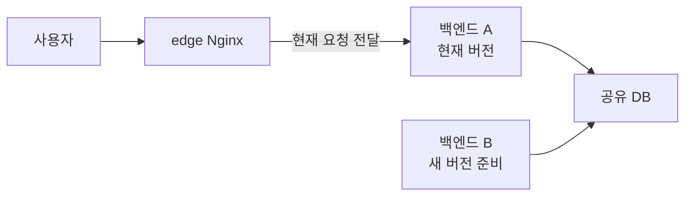

# 총총은 배포 중에도 어떻게 서비스를 이어 갈까요

## 배포 시간에도 계속되는 스터디

총총은 스터디의 공지와 과제를 확인하고, 과제를 제출하는 등의 활동을 지원하는 서비스입니다. 사용자가 스터디 활동을 이어 가는 동안 개발자는 기능을 추가하고 오류를 수정합니다. 변경한 프로그램을 운영 환경에 반영하려면 배포가 필요하지만, 그 시간에 사용자의 활동까지 멈출 수는 없습니다.

사용자가 제출 버튼을 누르는 순간 백엔드 교체가 시작됐다고 생각해 보겠습니다. 기존 프로그램은 종료됐고 새 프로그램은 아직 준비 중이라면, 요청을 처리할 백엔드가 없습니다. 사용자는 오류를 받거나 응답을 기다리다 실패할 수 있습니다. 제출 결과를 확인하지 못해 같은 작업을 다시 시도할 수도 있습니다.

기존 총총은 서버 한 대에서 백엔드 컨테이너를 교체했습니다. 기존 프로그램을 종료한 다음 새 프로그램을 실행하는 방식입니다. 구성이 단순하지만 새 프로그램이 준비될 때까지 요청을 처리하지 못하는 구간이 생겼습니다.

접속자가 적은 시간에 배포하면 영향을 줄일 수 있습니다. 프로그램의 시작 시간을 줄이는 방법도 있습니다. 하지만 기존 프로그램을 먼저 종료하는 순서가 유지된다면 요청을 받지 못하는 순간은 남습니다.

총총에 필요한 조건은 **새 버전을 준비하는 동안에도 기존 버전이 요청을 처리할 수 있어야 한다는 것**이었습니다. 이를 위해 다른 환경에 새 버전을 먼저 실행하고, 준비가 끝나면 요청을 넘기는 방향으로 배포 순서를 바꿨습니다.

```text
기존 배포
기존 프로그램 종료 → 새 프로그램 준비 → 요청 처리 재개

무중단 배포
기존 프로그램이 계속 요청 처리
          + 새 프로그램 준비 → 준비 확인 후 요청 전환
```

이 방식에서는 새 프로그램을 준비하는 데 시간이 걸려도 기존 프로그램이 서비스를 이어 갑니다. 배포 시간과 서비스 중단 시간을 분리할 수 있습니다. 대신 두 프로그램을 함께 실행할 공간과, 요청을 넘길 지점이 필요해집니다.

## 두 프로그램을 담을 공간

두 버전을 함께 실행하는 방법으로는 서버 한 대의 사양을 높이는 선택이 있습니다. 기존 프로그램 옆에 새 프로그램을 띄우고 준비가 끝나면 연결 대상을 바꾸면 됩니다.

하지만 두 프로그램이 같은 EC2에 있으면 서버 장애를 함께 겪습니다. EC2 한 대가 멈추면 기존 버전과 새 버전 모두 사용할 수 없습니다. 프로그램을 두 개 실행해도 서버 한 대의 장애에 대응할 여지는 남지 않습니다.

총총은 백엔드 A와 B를 서로 다른 EC2에 배치했습니다. 한쪽을 교체하거나 한 서버에 문제가 생겨도 다른 백엔드는 실행될 수 있도록 했습니다. 배포를 위한 공간을 확보하면서 백엔드 한 대의 장애가 다른 백엔드까지 직접 중단시키지 않도록 나눈 것입니다.

서버 크기를 정할 때는 백엔드 실행 후에도 사용할 수 있는 메모리가 얼마나 남는지 살펴봤습니다. 처음 사용한 `t4g.micro`에서는 백엔드가 정상 응답했지만, 가용 메모리는 102 MiB였습니다. 이후 `t4g.small`로 변경하고 백엔드를 실행한 상태에서는 896 MiB가 남았습니다.

| 백엔드 실행 환경 | OS에서 확인한 전체 메모리 | 백엔드 실행 후 가용 메모리 |
|---|---:|---:|
| t4g.micro | 903 MiB | 102 MiB |
| t4g.small | 1,834 MiB | 896 MiB |

두 값은 측정 시점과 부하가 같지 않아 성능 비교로 볼 수는 없습니다. 다만 micro에서 프로그램이 한 번 정상 응답했다는 사실만으로 운영 여유가 충분하다고 판단하기는 어려웠습니다.

백엔드는 힙 외에도 클래스 정보, 스레드, 네트워크 버퍼 등에 메모리를 사용합니다. 운영체제와 Docker도 함께 실행됩니다. 요청이 늘거나 운영 작업을 수행할 때 사용할 공간까지 고려해 백엔드는 small 두 대를 사용하기로 했습니다.

요청을 전달하는 Nginx와 메트릭 수집기는 별도 edge 서버로 분리했습니다. 최종적으로 각 구성 요소는 다음 역할을 맡습니다.

| 구성 | 역할 |
|---|---|
| edge 서버 | 사용자 요청 전달, 배포 조정, 메트릭 수집 |
| 백엔드 A/B | 서비스 제공과 다음 버전 준비 |
| 공유 DB | 두 백엔드가 사용하는 데이터 저장 |

이 구조에서 A와 B는 독립적으로 교체할 수 있습니다. 다만 DB와 edge는 함께 사용하므로 그곳의 장애는 두 백엔드에 영향을 줄 수 있습니다. 백엔드 서버를 나눈 효과는 백엔드 교체와 한쪽 서버의 장애를 분리하는 범위에 있습니다.

실행 공간을 나눈 다음에는 같은 서비스 주소로 들어오는 요청을 어느 백엔드에 보낼지 정해야 했습니다.

## 바뀌지 않는 주소, 바뀌는 백엔드

총총에서는 edge 서버의 Nginx가 사용자 요청을 먼저 받습니다. Nginx는 현재 서비스하는 백엔드에 요청을 전달하고, 그 응답을 사용자에게 돌려줍니다. 사용자는 배포 전후에 같은 주소로 접속합니다.

A가 현재 버전을 실행하고 B에 새 버전을 준비하는 상태를 보겠습니다.



B의 프로그램을 교체하는 동안 Nginx는 A로 요청을 보냅니다. B가 준비되면 전달 대상을 B로 바꿉니다. 사용자가 새 서버를 찾아 접속하지 않아도 앞단에서 요청 경로를 전환할 수 있습니다.

Nginx를 백엔드와 분리한 이유도 이 흐름과 연결됩니다. 백엔드를 교체할 때 요청을 받는 Nginx까지 함께 재시작하지 않도록 했습니다. 일상적인 앱 배포는 뒤의 프로그램을 바꾸는 작업이고, Nginx는 그동안 요청을 계속 받습니다.

A와 B는 고정된 구버전·신버전 이름이 아닙니다. A가 서비스하면 B에 새 버전을 준비하고, 다음 배포에서는 역할을 바꿉니다. 두 환경을 번갈아 사용하는 블루그린 배포 구조입니다.

배포 자동화도 이 구성을 따릅니다. 새 프로그램을 만들고 배포 파일을 edge에 전달하면, edge가 현재 요청을 받지 않는 백엔드를 골라 적용합니다. 프로그램을 준비하는 경로와 사용자 요청이 움직이는 경로는 분리됩니다.

```text
배포 작업
새 버전 생성 → 비활성 백엔드에 전달 → 실행·준비 확인

사용자 요청
사용자 → Nginx → 현재 활성 백엔드
```

따라서 새 이미지를 내려받거나 프로그램을 시작하는 데 시간이 걸려도 사용자 요청은 기존 백엔드가 처리할 수 있습니다. 이 구조를 지키려면 현재 어느 백엔드가 요청을 받고 있는지 정확히 알아야 합니다. 총총은 실제 요청 경로를 확인한 뒤 비활성 백엔드를 변경합니다. 현재 상태가 불분명하면 배포를 진행하지 않고 먼저 확인하도록 합니다.

## 요청을 넘기기 전의 확인

새 프로그램이 실행됐다고 바로 요청을 받을 수 있는 것은 아닙니다. 프로세스가 시작된 뒤에도 애플리케이션 초기화가 진행 중일 수 있습니다. 이때 전환하면 정상인 기존 서버를 두고 준비 중인 서버로 사용자를 보내게 됩니다.

총총은 새 백엔드가 요청을 받을 준비를 마쳤는지 확인한 다음에만 Nginx의 대상을 바꿉니다. 준비되지 않았다면 기다렸다가 다시 확인하고, 끝내 준비되지 않으면 배포를 중단합니다. 그동안 기존 요청 경로는 유지합니다.

현재 배포 제어기는 다음 기준으로 준비 상태를 확인합니다.

| 확인 항목 | 판단 기준 |
|---|---|
| 요청 경로 | 후보 백엔드의 `/actuator/health/readiness`와 `/actuator/health` |
| 정상 응답 | 두 경로 모두 HTTP 오류 없이 응답하고, 응답 본문의 `status`가 `UP`인 경우 |
| 재확인 | 한 번의 확인이 실패하면 2초 뒤 다시 시도하며, 최대 30회 확인 |
| 대기 한도 | 각 HTTP 요청은 최대 3초 대기하므로, 두 경로 확인과 재시도 대기를 합하면 약 4분 이내 |

예를 들어 준비 상태 요청에 `{"status":"UP"}`이 돌아와도 일반 상태 확인이 실패하면 아직 요청을 넘기지 않습니다. 두 확인을 모두 통과해야 전환을 진행합니다. 위 대기 시간은 프로그램을 실행한 뒤 준비 상태를 확인하는 구간의 기준이며, 이미지 다운로드 등을 포함한 전체 배포 시간은 아닙니다.

이 구조에서는 새 버전 배포의 실패가 곧바로 기존 서비스의 중단으로 이어지지는 않습니다. B가 시작되지 않아도 A가 정상이라면 사용자는 기존 버전으로 서비스를 이용할 수 있습니다. 새 기능을 반영하지 못한 상황과 기존 기능까지 이용하지 못하는 상황을 나눈 것입니다.

준비 확인 이후에는 실제로 새 백엔드가 응답하는지도 살펴봅니다. 프로그램 자체가 정상인 것과 사용자 요청이 그 프로그램에 도착하는 것은 다른 조건이기 때문입니다. 기존 백엔드가 계속 응답하는 상황을 새 버전 전환 성공으로 판단하지 않도록 합니다.

다만 이 확인만으로 모든 기능 오류를 발견할 수는 없습니다. 프로그램이 요청을 받을 상태여도 특정 과제 제출이나 조회 조건에서 오류가 날 수 있습니다. 준비 상태 검사는 전환해도 되는 시점을 판단하는 데 사용하고, 업무 기능의 정확성은 테스트와 운영 관측으로 확인해야 합니다.

전환에 성공한 뒤에도 이전 백엔드를 바로 종료하지 않습니다. 전환 직전에 그 서버가 받은 요청이 아직 처리 중일 수 있기 때문입니다.

A가 과제 제출 요청을 처리하는 중에 새 요청의 목적지가 B로 바뀌었다고 하겠습니다. 이때 A의 작업이 B로 옮겨 가는 것은 아닙니다. A가 맡은 요청은 A가 끝내야 합니다. 총총은 Nginx의 기존 연결이 마무리될 수 있도록 설정을 변경하고, A도 계속 실행합니다.

여기서 **새 요청을 넘기는 시점과 이전 서버의 역할이 끝나는 시점은 다릅니다.** 다음 배포에서도 이전 연결이 남아 있다면 서버 교체를 기다려야 합니다. 연결을 보존하는 대신 다음 배포가 지연될 수 있다는 비용을 받아들인 구성입니다.

이전 백엔드는 진행 중인 요청을 처리하면서, 새 버전에 문제가 생겼을 때 돌아갈 대상으로도 남습니다. 그렇다면 이 서버를 언제까지 이전 버전으로 유지해야 할까요.

## 대기 서버의 두 가지 역할

이전 버전을 계속 실행해 두면 새 배포의 결함에 빠르게 대응할 수 있습니다. B의 새 버전에 문제가 발견됐을 때 A로 요청만 돌리면 됩니다. 별도로 이미지를 내려받고 프로그램을 시작할 필요가 없습니다.

하지만 대기 서버를 오래된 버전으로 유지하면 평상시 장애 대응에서 다른 문제가 생깁니다. 활성 서버 B에 장애가 발생해 A로 전환할 때 서버뿐 아니라 기능과 동작도 이전 버전으로 바뀝니다.

이전 버전은 배포 결함에 대비하는 데 유용하고, 같은 버전은 서버 한 대의 장애에 대비하는 데 유용합니다. 총총은 이 두 역할을 시간에 따라 나누기로 했습니다.

**배포 직후에는 이전 버전을 남기고, 안정화 뒤에는 A/B를 같은 버전으로 맞춥니다.**

평상시 A와 B가 모두 v1이고 A가 요청을 처리한다고 하겠습니다. B에 v2를 준비해 전환한 다음에는 A를 v1으로 유지합니다. 새 버전으로 넘어간 직후에는 이전 버전으로 빠르게 돌아갈 여지를 확보합니다.

이후 10분간 상태를 관찰합니다. 상태 확인이 계속 정상이고 기존 연결도 마무리됐다면 A를 v2로 바꿉니다. 그 뒤에는 B가 서비스하고 A가 같은 버전으로 대기합니다.

| 단계 | 백엔드 A | 백엔드 B |
|---|---|---|
| 평상시 | v1로 서비스 | v1로 대기 |
| 새 버전 준비 | v1로 서비스 | v2 준비 |
| 전환 후 관찰 | v1 유지 | v2로 서비스 |
| 안정화 이후 | v2로 대기 | v2로 서비스 |

관찰 중 상태 확인에 실패하거나 관측이 끊기면 시간이 지났다는 이유만으로 대기 서버를 교체하지 않습니다. 이전 버전으로 돌아갈 여지를 없애기 전에 새 버전의 상태를 확인해야 하기 때문입니다.

물론 10분 동안 모든 결함을 발견할 수는 없습니다. 특정 기능의 문제는 나중에 사용하면서 드러날 수 있습니다. 총총은 이 가능성을 남겨 둔 채 평상시에는 같은 버전의 대기를 유지하는 쪽을 선택했습니다.

그 결과 안정화 뒤의 구버전 복구에는 재배포가 필요해집니다. 이전 버전이 실행 중인 서버는 없어지지만, 프로그램과 설정을 보관해 필요할 때 다시 준비할 수 있도록 합니다. 빠른 경로 복귀가 가능한 기간과 재배포로 복구해야 하는 기간을 나눈 것입니다.

## 장애의 원인에 따라 달라지는 복구

같은 버전을 실행하는 A/B 중 한 서버에 문제가 생겼다면 정상 대기로 요청을 넘길 수 있습니다. 프로그램의 버전은 유지하면서 실행 위치를 바꾸는 대응입니다.

반면 새 버전의 코드에 결함이 있다면 같은 버전의 다른 서버로 옮겨도 문제가 이어질 수 있습니다. 이 경우에는 이전 버전으로 돌아가거나 수정한 버전을 배포해야 합니다.

배포 직후 이전 버전이 아직 남아 있을 때는 자동 롤백을 허용할 조건을 정했습니다. 새 활성 백엔드의 상태 확인이 3회 연속 실패하고, 이전 백엔드는 3회 연속 정상이어야 합니다. 감시는 앞선 확인이 끝난 뒤 5초 후 다시 실행하므로, 응답을 기다리는 시간에 따라 장애 판단까지 걸리는 시간은 달라집니다. 여기에 이전 버전이 현재 DB에서도 동작한다는 호환성 확인이 있어야 자동으로 되돌릴 수 있습니다.

구버전으로 복귀한 뒤에는 자동 재배포와 대기 동기화를 멈춥니다. 원인을 확인하기 전에 문제가 있는 새 버전을 다시 적용하거나, 남아 있는 정상 버전까지 바꾸지 않도록 하기 위해서입니다.

양쪽을 이미 같은 버전으로 맞췄다면 운영자가 복구할 버전을 선택합니다. 비활성 서버에 이전 프로그램과 당시 설정을 준비하고, 확인한 뒤 요청을 넘깁니다. 이후 다시 상태를 관찰하고 다른 서버도 복구한 버전으로 맞춥니다.

```text
A/B 모두 v2, B가 서비스 중
        ↓
운영자가 v1 복구 결정
        ↓
A에 v1과 당시 설정을 준비
        ↓
준비 확인 후 요청을 A로 전환
        ↓
상태 관찰 후 B도 v1으로 변경
```

복구 후보가 준비될 때까지 현재 활성 서버는 요청 처리를 유지합니다. 다만 현재 버전에 이미 결함이 있다면 모든 기능이 정상이라는 뜻은 아닙니다. 복구 준비 때문에 요청 처리까지 추가로 중단시키지 않도록 하는 것입니다.

복구한 버전에서 다시 문제가 생겼을 때도 자동으로 직전 버전으로 돌아가지는 않습니다. 직전 버전은 이미 결함을 확인한 대상일 수 있기 때문입니다. 이때는 자동 진행을 멈추고 다음 대응을 판단합니다.

복구할 버전과 시작 시점은 사람이 결정하고, 선택한 버전을 준비하고 전환하는 반복 작업은 자동화합니다. 상태만으로 판단할 수 있는 작업과 결함의 의미를 살펴야 하는 판단을 구분한 것입니다.

대기 서버를 같은 버전으로 맞추는 작업이 실패했을 때도 정상 활성 서버는 유지합니다. 준비되지 않은 대기는 전환 대상에서 제외하고, 두 서버가 모두 준비됐다는 가정으로 다음 작업을 진행하지 않습니다.

## 앱을 되돌려도 남아 있는 데이터

이전 프로그램을 다시 실행할 수 있다고 해서 복구가 가능한 것은 아닙니다. 그 프로그램이 현재 데이터베이스에서도 동작해야 합니다.

총총의 A와 B는 같은 DB를 사용합니다. A에서 제출한 과제를 B로 전환한 뒤에도 읽을 수 있어야 하므로 데이터는 백엔드별로 나뉘지 않습니다. 이 구조에서는 새 버전의 DB 변경이 기존 버전에도 영향을 줍니다.

B가 시작하면서 DB 구조를 변경한 뒤 준비에 실패했다고 생각해 보겠습니다. 사용자 요청은 계속 A로 보내더라도 A가 사용하는 DB는 이미 바뀌었을 수 있습니다. 요청 전환을 취소한다고 DB 변경까지 취소되지는 않습니다.

총총은 앱을 롤백하더라도 성공적으로 적용한 DB 변경은 유지하기로 했습니다. 배포 이후에도 사용자가 과제를 제출하거나 정보를 수정할 수 있으므로, DB를 과거 상태로 돌리는 작업은 그동안의 데이터에 영향을 줄 수 있습니다. 앱 버전 복구와 데이터 복구는 별도로 판단해야 합니다.

이 선택의 전제는 **이전 앱이 변경된 DB에서도 읽고 쓸 수 있어야 한다는 것**입니다. 총총은 이를 변경 작성과 리뷰 과정에서 확인하도록 정했습니다.

예를 들어 이전 앱이 사용하는 컬럼을 새 배포에서 바로 삭제하면 구버전으로 돌아갈 수 없습니다. 새 구조를 추가하고, 데이터와 앱을 전환한 뒤, 이전 버전 지원이 끝났을 때 기존 구조를 정리하는 식으로 변경을 나눌 필요가 있습니다.

컬럼이 유지돼도 저장하는 값의 의미가 달라지면 문제가 생길 수 있습니다. 새 앱이 저장한 상태값을 이전 앱이 처리하지 못한다면 같은 테이블을 사용해도 호환되지 않습니다. 새 버전이 데이터를 쓴 뒤 이전 버전이 그 데이터를 어떻게 읽고 처리하는지도 확인해야 합니다.

호환성을 확인하지 못한 변경은 자동 구버전 복귀 대상으로 삼지 않습니다. 상태 확인에 성공했다는 사실만으로 이전 앱의 모든 동작이 가능하다고 판단할 수는 없기 때문입니다.

이 제약은 이미지 보존과도 연결됩니다. 오래된 이미지가 남아 있으면 프로그램을 다시 실행할 재료는 있습니다. 그러나 현재 DB와 함께 사용할 수 있는지는 복구 시점에 다시 확인해야 합니다.

## 복구할 수 있을 만큼 남기는 기준

안정화 뒤 A/B를 같은 버전으로 맞추면 실행 중인 이전 프로그램은 사라집니다. 나중에 구버전이 필요할 때는 보관한 이미지와 설정으로 다시 준비해야 합니다. 따라서 이미지 정리는 무엇을 지울지보다 복구를 위해 무엇을 남길지 정하는 일에서 시작했습니다.

총총은 서버 로컬과 Docker Hub의 역할을 나눴습니다. 서버에는 가까운 버전으로 복구할 자료를 남기고, 원격에는 더 오래된 이미지를 넓게 보관합니다.

여기서 버전은 프로그램의 변경 상태를, 릴리스는 해당 버전의 이미지와 실행에 필요한 설정을 함께 묶은 배포 단위를 뜻합니다.

각 백엔드 서버에는 현재 릴리스와 이전 성공 릴리스 두 개를 기본으로 남깁니다. 최근에 내려받은 이미지 세 개를 남기는 방식은 아닙니다. 실패한 배포 이미지가 여러 개 쌓였다는 이유로 실제 복구에 사용할 성공 버전이 밀려나지 않도록 했습니다.

실행 중이거나 복구에 필요한 이미지는 기본 개수와 관계없이 보호합니다. 정리는 A/B를 같은 버전으로 맞추고 양쪽 상태를 확인한 뒤에 진행합니다. 먼저 서비스와 대기를 준비하고, 그다음 불필요한 이미지를 제거하는 순서입니다.

정리에 실패했다고 정상 배포를 되돌리지는 않습니다. 디스크 정리 문제와 서비스의 실행 상태는 따로 다뤄야 합니다. 현재 서비스를 유지하면서 정리 실패를 처리하도록 했습니다.

Docker Hub에는 최근 90일 안에 업로드한 이미지와 최신 이미지 10개를 모두 보존합니다. 예를 들어 90일 안에 올린 이미지가 4개라면 그보다 오래된 이미지 6개를 더 남겨 최소 10개를 확보합니다. 반대로 90일 안에 15개를 올렸다면 15개 모두 남깁니다. 같은 이미지에 태그만 여러 개 붙인 경우에는 하나로 셉니다.

따라서 **업로드 후 90일이 지났고, 최신 10개에도 포함되지 않으며, 사용·복구를 위한 보호 대상도 아닌 이미지**가 삭제 후보가 됩니다. 보호 대상과 같은 이미지를 가리키는 태그도 함께 남깁니다.

원격 보존에서는 관리 복잡도를 줄이는 선택도 했습니다. 성공한 배포만 정확하게 추적하려면 성공 여부를 모으는 추가 이력 관리가 필요합니다. 총총은 별도 이력 저장소를 두는 대신 Docker Hub의 업로드 정보를 기준으로 삼았습니다. 배포하지 않았거나 실패한 이미지도 일부 남지만, 이미지 정리를 위해 새로운 시스템을 운영하는 부담을 줄였습니다.

원격에서는 삭제 후보 조회까지만 자동화합니다. GitHub Actions가 후보를 보여 주면 운영자가 배포가 없는 때 보호 대상을 다시 확인한 뒤 삭제합니다. 배포와 삭제가 겹치는 모든 상황을 자동으로 조율하는 대신 수동 확인을 남겼습니다.

| 위치 | 보존 기준 | 정리 방식 |
|---|---|---|
| 백엔드 서버 | 현재 릴리스 1개 + 이전 성공 릴리스 2개, 사용·복구 대상 추가 보호 | A/B 동기화와 확인 후 자동 정리 |
| Docker Hub | 최근 90일과 최소 최근 10개, 사용·복구 대상 추가 보호 | 후보 자동 조회 후 수동 삭제 |
| 설정과 실행 구성 | 이전 릴리스를 재현하는 데 필요한 자료 | 이미지와 구분해 보존 |

이미지에 대응하는 설정도 함께 필요합니다. 같은 프로그램이라도 설정이 달라지면 연결 대상과 동작이 바뀔 수 있습니다. 이전 릴리스를 복구하려면 프로그램만 되찾는 것이 아니라 당시의 실행 조건도 재구성할 수 있어야 합니다.

## 배포 이후까지 생각한 구성

그렇다면 요청 경로를 바꾸는 동안 실제 응답은 어땠을까요. 10월 29일 운영 환경에서 이전 버전으로 되돌린 뒤 다시 배포하면서, 외부에서 서비스의 HTTPS 상태 확인 주소로 약 0.2초마다 요청을 보냈습니다. 약 180초 동안 보낸 868건은 모두 정상 응답했습니다. 그중 재배포 작업 중에 보낸 요청은 212건, 롤백 작업 중에 보낸 요청은 13건이었으며 실패는 없었습니다.

정상 전환 외에도 새 백엔드가 준비되지 않거나 기존 연결이 남아 있는 상황을 개발 환경에서 확인했습니다.

| 확인한 상황 | 기대한 동작 | 실제 결과 |
|---|---|---|
| 운영 환경에서 롤백 후 재배포 | 요청을 계속 처리하며 대상 전환 | 전체 868건 중 실패 0건, 응답 백엔드가 B → A → B로 변경 |
| 개발 환경에서 후보 백엔드의 준비 검사 통신 차단 | 배포 중단, 기존 요청 경로 유지 | 배포가 실패로 종료되고 기존 B 경로 유지 |
| 개발 환경에서 전환 전에 연 HTTP 연결 유지 | 기존 연결은 A에서 완료, 새 연결은 B로 전달 | 기존 연결은 A에서 정상 응답, 새 연결은 B에서 응답 |

이 결과는 당시의 배포·롤백에서 상태 확인 요청과 연결 전환이 동작한 범위를 보여 줍니다. 실제 과제 제출을 배포와 겹쳐 실행한 결과는 아니며, 요청 사이의 짧은 구간까지 중단이 없었다고 단정할 수는 없습니다. 이후 추가한 10분 관찰과 대기 서버 동기화까지 이 수치로 확인한 것은 아닙니다.

총총의 무중단 배포는 기존 프로그램을 종료하기 전에 새 프로그램을 준비하는 데서 출발했습니다. 그 과정에서 두 백엔드를 서로 다른 서버에 배치하고, Nginx가 요청을 넘기도록 역할을 나눴습니다.

이후에는 배포가 끝난 다음의 상태도 정해야 했습니다. 이전 버전을 오래 남기면 배포 결함에서 빠르게 돌아갈 수 있지만, 평상시 서버 장애로 전환할 때 기능까지 과거로 바뀔 수 있습니다. 총총은 배포 직후에는 이전 버전을 유지하고, 안정화 뒤에는 같은 버전의 대기를 두는 방향을 선택했습니다.

그 선택으로 뒤늦게 발견한 결함은 이전 릴리스를 재배포해 복구하게 됐습니다. 이를 위해 이미지와 설정을 보존하고, 앱을 되돌려도 DB는 유지한다는 원칙 아래 호환성을 확인하도록 했습니다. 배포, 대기, 복구, 정리가 서로 연결된 것입니다.

운영할 대상과 절차는 늘어났습니다. 백엔드 두 대와 edge를 관리해야 하고, 긴 연결 때문에 다음 배포를 기다릴 수도 있습니다. 원격 이미지 삭제에는 사람의 확인이 남습니다. 대신 새 버전을 준비하는 동안 현재 서비스를 유지하고, 백엔드 한 대의 장애와 새 코드의 결함에 서로 다른 방식으로 대응할 수 있도록 했습니다.

배포 구조를 설계할 때도 자신의 서비스에서 같은 질문을 해 볼 수 있습니다. 새 버전이 준비되는 동안 누가 요청을 처리할지, 대기 서버는 어떤 문제에 대비할지, 이전 버전으로 돌아가려면 무엇이 남아 있어야 할지 정하는 것입니다. 이 질문의 답에 따라 필요한 서버와 자동화 범위도 달라집니다.

총총의 구성이 모든 서비스의 정답은 아닙니다. 다만 배포 도구를 고르기 전에 서비스가 지켜야 할 조건을 생각하고, 그 조건에 맞춰 구성과 복구 방법을 연결한 과정은 다른 환경에서도 참고할 수 있을 것입니다.

이 글이 배포 구조를 고민하는 분들께, 자신의 서비스에 필요한 대기와 복구의 기준을 정하는 데 도움이 되었으면 좋겠습니다.
