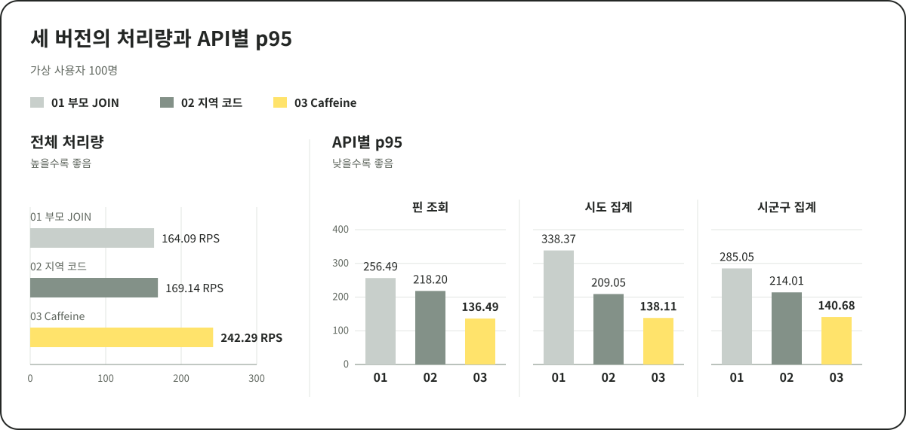
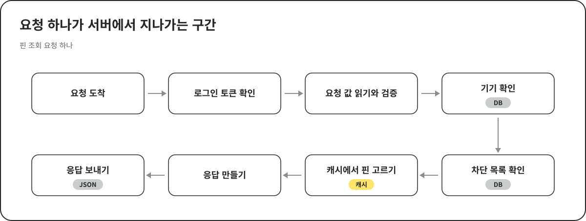
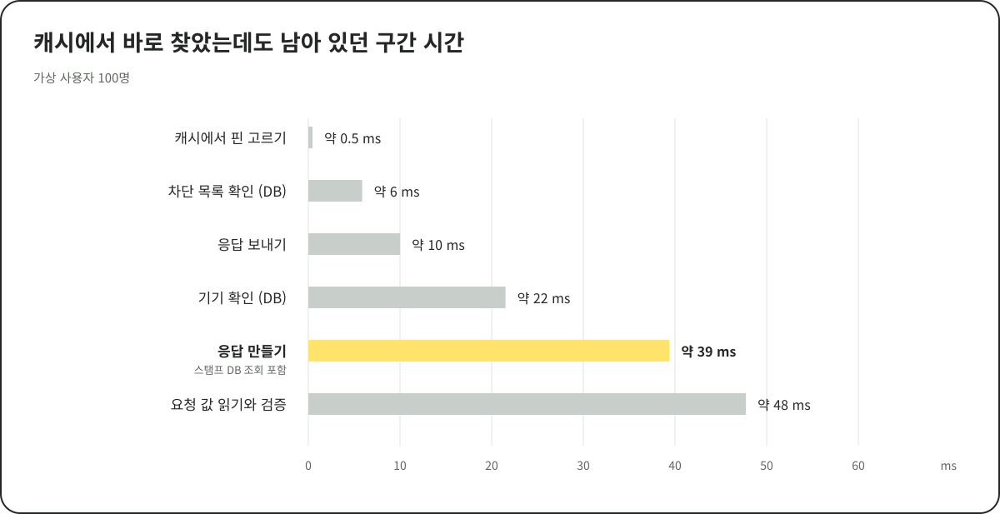
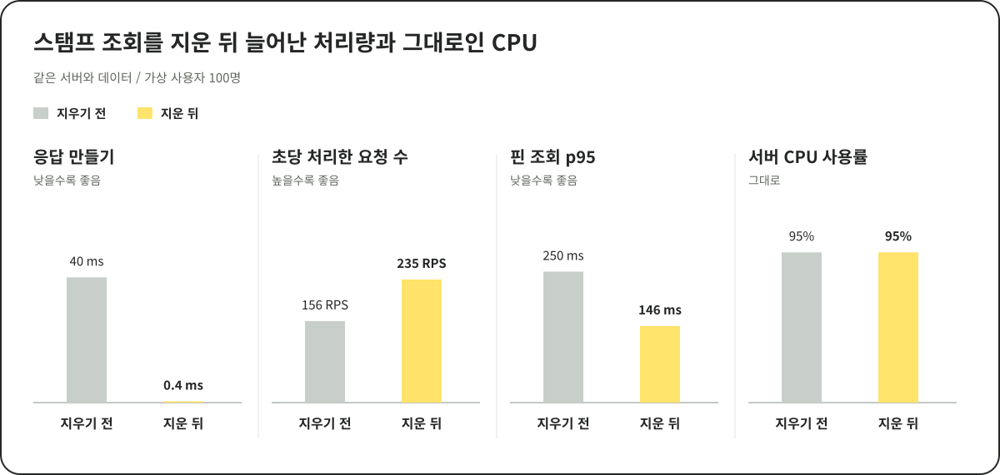
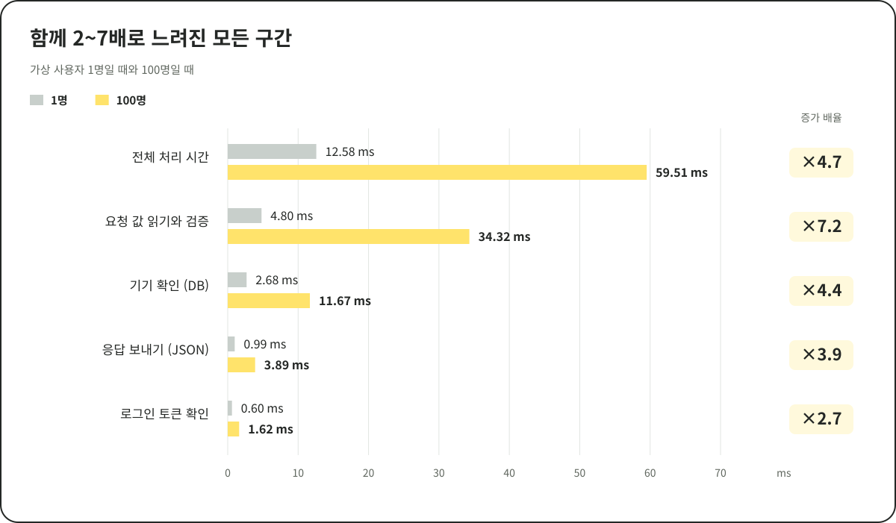
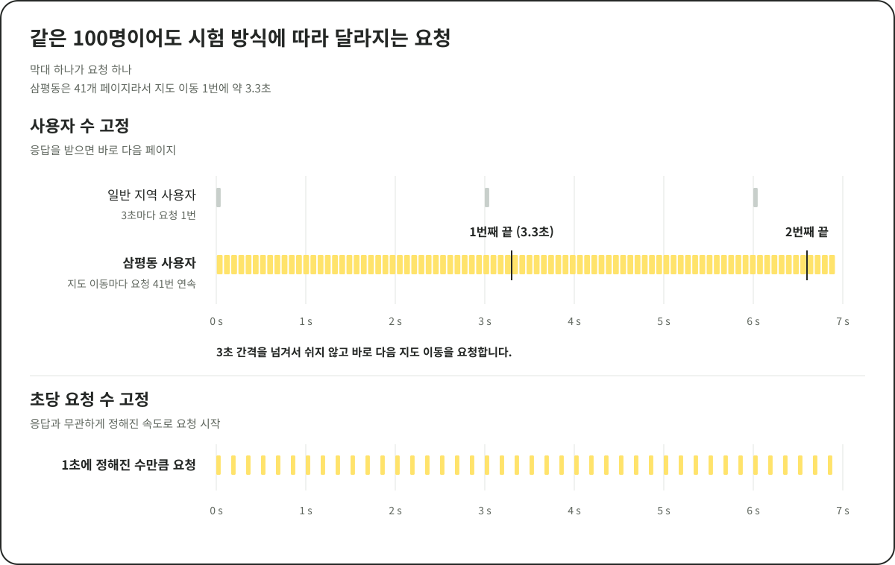
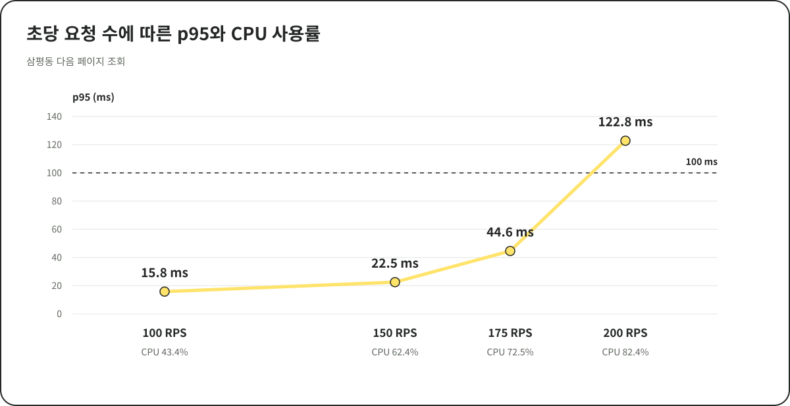
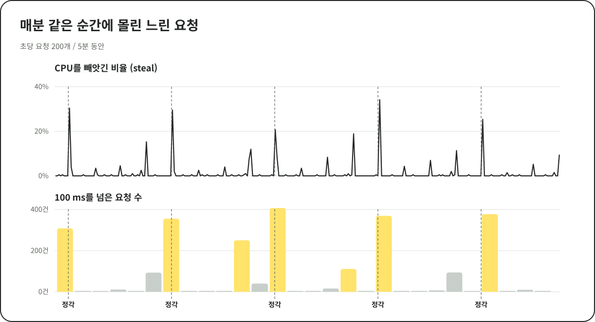
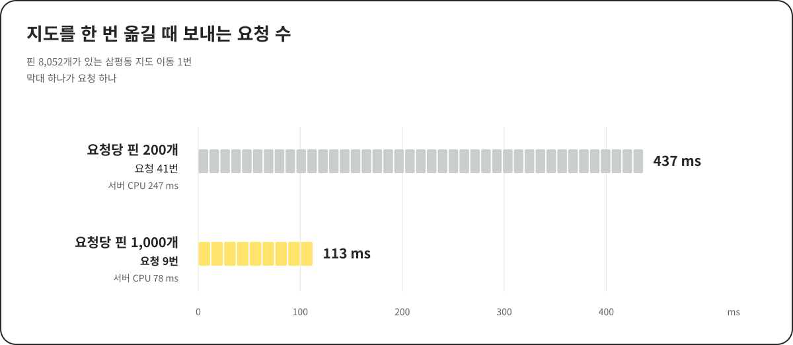
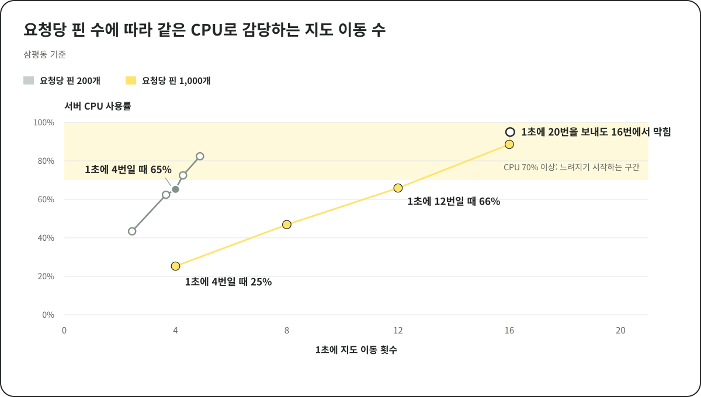

# 캐시를 붙여도 136ms였던 지도 조회를 부하 테스트부터 다시 보기

Pheeeew(히유)는 사용자가 남긴 감정을 지도 위의 핀과 지역 집계로 보여주는 서비스입니다.  
이 글은 지도 조회를 빠르게 만든 과정과 그 결과를 재다가 부하 테스트의 잘못을 찾은 과정을 다룹니다.

캐시를 적용하기까지는 지도를 움직일 때마다 반복하던 경계 교차 검사와 부모 지역 JOIN 그리고 같은 조회의 반복 집계를 줄였습니다.  
가상 사용자 100명 부하에서 처리량이 47.7% 늘었습니다.  
같은 시험에서 API별 p95도 46.8\~59.2% 줄었습니다.  
다만 이 p95는 뒤에서 설명할 이유로 서버가 꽉 찬 상태에서 잰 값입니다.

> **p95**는 요청 100개를 응답 시간 순으로 세웠을 때 95번째 값입니다.  
> 대부분의 사용자가 겪는 느린 쪽 경험을 나타냅니다.  
> **RPS**는 서버가 1초에 처리한 요청 수입니다.  
> **가상 사용자**는 부하 테스트 도구가 흉내 내는 사용자 한 명입니다.

그런데 캐시를 적용했는데도 지도 위 핀 조회 p95가 136ms였습니다.  
원인을 찾다 보니 더 이상 쓰지 않는 코드가 남아 있었습니다.  
가장 큰 원인은 제가 잘못 건 부하 테스트였습니다.

결론부터 적으면 이렇습니다.

1. 캐시 뒤에 쓰지 않는 코드가 남아 있었습니다.  
   이미 없앤 그룹 기능의 스탬프를 응답을 만들 때마다 DB에서 다시 조회하고 있었습니다(약 36ms).  
   구간별로 재 보기 전까지는 발견하지 못했습니다.  
   지우자 처리량이 49% 늘었습니다.
2. 그래도 p95는 145ms였습니다.  
   남은 지연은 특정 코드가 아니라 서버가 꽉 찬 데서 왔습니다.  
   요청 안의 모든 구간이 사용자 1명일 때보다 최소 2배에서 최대 7배로 모두 느려졌고 CPU 코어 2개짜리 서버의 CPU 사용률은 95%였습니다.
3. 제가 건 부하 테스트가 서버를 꽉 채웠습니다.  
   정해진 수의 가상 사용자가 응답을 받자마자 다음 페이지를 요청하는 구조라서 서버가 빨라질수록 요청이 더 들어왔습니다.  
   그동안 본 p95는 코드의 응답 속도가 아니라 꽉 찬 서버에서 잰 숫자였습니다.
4. 초당 요청 수를 고정해서 다시 재자 p95는 150 RPS에서 22.5ms였고 175 RPS에서 44.6ms였습니다.  
   응답은 175\~200 RPS 사이에서 급격히 느려졌습니다.
5. 지도를 한 번 옮길 때 보내는 요청 수를 줄이자 같은 서버로 약 3배의 사용자 부하를 감당했습니다.

---

# 캐시를 적용하기까지

## 1. 초기 지도 조회의 지연 원인

### 기존 지역 집계의 처리 방식

기존에는 화면과 조금이라도 겹치는 행정구역을 고른 뒤 그 행정구역 전체의 감정을 집계했습니다.  
서울의 일부만 보여도 서울 전체를 집계했습니다.

*그림 1. 지도 화면 하나에 서울과 인천 및 경기도의 일부가 함께 들어옵니다.  
기존에는 이 세 지역 전체의 감정을 집계했습니다.*

해안선과 섬이 포함된 복잡한 행정구역의 MultiPolygon과 지도 화면이 겹치는지 `ST_Intersects`로 검사했습니다.  
매 조회마다 이 경계 검사와 감정 집계를 반복하면서 조회 비용과 DB 연결 대기가 커졌습니다.

> **MultiPolygon**은 떨어져 있는 여러 다각형을 하나로 묶은 도형입니다.  
> 본토와 여러 섬으로 나뉜 행정구역의 경계를 이렇게 저장합니다.  
> 해안선이 복잡할수록 경계를 이루는 점이 많아져서 검사 비용도 커집니다.  
> `ST_Intersects`는 두 도형이 조금이라도 겹치는지 검사하는 PostGIS 함수입니다.

### 반복 경계 검사의 비용과 지연 사례

해안선과 붙어 있는 시도 5개의 원본 경계 도형은 합계 약 371만 점이고 크기는 59.6MB였습니다.  
그리고 해안선과 붙어 있는 시도의 지역 집계를 조회할 때 드는 비용은 다음과 같았습니다.

| 경계 선택 조건 | DB 실행 시간 중앙값 |
| --- | ---: |
| 경계 도형을 감싸는 사각형과 화면의 겹침만 검사 | 0.906ms |
| 경계 교차 판정까지 포함 | 69.540ms |

운영 서버의 느린 요청 20건을 보니 경계 교차 검사 조회에 걸린 시간의 중앙값이 90.22초였고 최대는 173.08초였습니다.  
DB의 커넥션 풀 10개가 모두 사용 중이었고 뒤따른 요청은 연결을 기다렸습니다.

이어서 개발 서버에 가상 사용자 100명을 목표로 건 시험은 측정 구간에 들어가기도 전인 약 84.5초에 오류가 이어져 멈췄습니다.  
기록된 요청 460건 중 390건이 실패했습니다.

화면이 바뀔 때마다 복잡한 경계를 검사하고 집계하는 반복 작업을 먼저 줄이기로 했습니다.

## 2. 지역 경계 교차 검사 없애기

### 서버는 전국 요약을 보내고 앱이 지역을 고르기

시도와 시군구는 서버가 전국 요약을 한 번에 보내고 앱이 화면 안에 들어오는 표시점을 고르도록 바꿨습니다.  
지역을 조회할 때마다 반복하던 경계 검사를 없애기 위해서였습니다.  
그래서 시도와 시군구 조회에서 큰 경계 도형을 읽는 일과 `ST_Intersects` 검사가 사라졌습니다.

| 단계 | 기존 | 변경 후 |
| --- | --- | --- |
| 지역 정보 조회 | 큰 경계 도형을 읽음 | 해당 계층의 지역 코드와 이름 및 표시점 등을 읽음 |
| 화면에 맞는 지역 선택 | 서버가 화면과 경계 도형의 교차를 판정 | 앱이 전국 요약에서 화면에 필요한 표시점을 선택 |
| 감정 집계 범위 | 화면과 교차하는 지역 전체 | 해당 계층의 전국 지역 |

### 전국 요약의 전송량과 압축 효과

전국 요약으로는 지역별 감정 수와 대표 감정 및 표시 위치를 전달했습니다.  
지역 수는 시도 17개와 시군구 252개로 정해져 있었습니다.  
지도상 핀의 개수가 늘어나도 지역의 개수가 고정되어 있기 때문에 핀 수에 비례해서 응답 크기가 커지지 않았습니다.

| 합성 핀 수 | 시도 요약 | 시군구 요약 |
| --- | ---: | ---: |
| 100,000건 | 890B | 8,965B |
| 1,000,000건 | 900B | 8,955B |

핀이 총 100만 건이어도 모두 gzip으로 압축한 결과가 10KB보다 작았습니다.  
핀이 늘어나도 전송량 변화가 작았기 때문에 전국 요약을 한 번에 전달하는 방식을 선택했습니다.

## 3. 전국 집계의 불필요한 JOIN 없애기

### 저장된 지역 코드를 활용한 계층 탐색 생략

기존에는 감정에 저장된 읍면동 코드에서 부모 지역을 JOIN해 시군구와 시도를 찾았습니다.  
전국 집계에서도 전국 코드 목록에 포함되는지 다시 검사했습니다.

그런데 저장된 SGIS 읍면동 코드에는 다음 정보가 들어 있었습니다.

- **앞 2자리:** 시도 코드
- **앞 5자리:** 시군구 코드
- **DB 제약:** 코드 형식과 부모 외래 키 그리고 부모 코드와 앞자리의 일치 보장

> **SGIS**는 통계청의 통계지리정보서비스입니다.  
> 감정에는 이 서비스의 행정구역 코드를 저장합니다.

그래서 부모 지역을 따라가지 않고 감정에 저장된 코드로 바로 묶어 집계했습니다.  
시도는 앞 2자리로 묶고 시군구는 앞 5자리로 묶었습니다.  
부모 지역 JOIN과 전국 코드 IN 조건은 없앴고 기존 조회 필터와 일부 지역 조회의 지역 제한은 그대로 두었습니다.

### 기존 방식과 개선 방식의 집계 예시

설명용 가상 코드로 감정 3건의 집계를 비교했습니다.

| 감정 | 저장된 읍면동 코드 |
| --- | --- |
| A | `1234567` |
| B | `1234568` |
| C | `1239961` |

**기존 방식: 부모 지역을 찾아 집계**

- **A:** 읍면동 `1234567` → 시군구 `12345` → 시도 `12`
- **B:** 읍면동 `1234568` → 시군구 `12345` → 시도 `12`
- **C:** 읍면동 `1239961` → 시군구 `12399` → 시도 `12`

부모 지역을 JOIN해 찾은 결과로 시도 `12`에 3건을 집계했습니다.  
시군구는 `12345`에 2건과 `12399`에 1건을 집계했습니다.

**개선 방식: 저장된 코드로 바로 집계**

- **시도 집계:** 앞 2자리가 모두 `12`이므로 3건
- **시군구 집계:** 앞 5자리가 `12345`인 감정 2건과 `12399`인 감정 1건
- **결과:** 부모 지역 JOIN 없이도 집계 결과가 같았습니다.

### 실행 계획 비교와 결과 동일성 검증

쿼리는 개발 DB에서 비교했습니다.  
감정은 22,258건이고 그중 기본 조회 대상은 10,005건이었습니다.  
지역은 시도 17개와 시군구 252개 및 읍면동 3,559개입니다.  
두 쿼리 모두 같은 DB 연결과 같은 시점의 데이터를 읽는 읽기 전용 트랜잭션에서 두 번 예열한 뒤 다섯 번씩 쟀습니다.

> PostgreSQL은 같은 쿼리라도 실행 계획을 두 가지 방식으로 만들 수 있습니다.  
> **custom** 계획은 입력값에 맞춰 매번 새로 만들고 **generic** 계획은 입력값이 달라도 공통 계획을 재사용합니다.

기본 시도 custom 실행 계획에서는 계층을 따라 반복 조회하던 작업이 줄었습니다.

| 실행 계획의 차이 | 기존 | 개선 후 |
| --- | --- | --- |
| 지역 탐색 | 부모 지역을 순서대로 연결 | 저장된 지역 코드로 직접 집계 |
| 감정 테이블 접근 | 인덱스 조회 3,559회 반복 | 전체 스캔 1회로 대상 10,005건 조회 |
| 메모리 내 DB 블록 참조 횟수 | 22,356회 | 1,470회 |

반복 조회가 줄면서 DB 실행 시간도 감소했습니다.

custom과 generic 두 방식 모두에서 DB 시간을 비교했습니다.

| 기본 전국 조회 | 계획 | 기존 DB 시간 중앙값 | 개선 DB 시간 중앙값 |
| --- | --- | ---: | ---: |
| 시도 | custom | 33.492ms | 8.702ms |
| 시도 | generic | 35.306ms | 6.928ms |
| 시군구 | custom | 18.083ms | 8.880ms |
| 시군구 | generic | 19.434ms | 7.355ms |

표의 DB 시간은 쿼리를 실제로 실행하고 걸린 시간을 알려 주는 EXPLAIN ANALYZE로 쟀습니다.  
custom과 generic 계획을 각각 강제해서 다섯 번 잰 값의 중앙값입니다.

쿼리를 바꾼 뒤에도 결과는 그대로였습니다.  
지역 단계(시도와 시군구)와 범위 및 내용 종류와 날짜를 조합한 36개 조건을 두 실행 계획으로 실행해 보니 72쌍 모두 기존 쿼리와 결과가 같았습니다.

## 4. 같은 조회 결과는 캐시로 재사용하기

### 기본 조회 경로의 캐시 적용 범위

같은 기본 조회는 결과를 Caffeine 캐시에 두고 재사용했습니다.  
집계 쿼리를 고쳐도 같은 조회가 반복될 때마다 DB가 같은 일을 다시 했기 때문입니다.  
캐시는 전체 범위와 기간 조건이 없는 기본 지역 집계와 핀 후보에만 적용했습니다.  
사용자마다 다른 차단 정보는 요청마다 따로 조회했습니다.

> **Caffeine**은 Java 애플리케이션의 메모리에 값을 저장해 두는 캐시 라이브러리입니다.

### 캐시 구조별 비용 비교와 선택 근거

로컬에서 핀 캐시의 세 가지 구조를 비교했습니다.  
지역 집계는 모두 같은 Caffeine을 사용했습니다.

1. **Caffeine 기존 방식 — 최종 선택:** 변경마다 전체 Map을 복사하고 조회에는 게시된 불변 스냅샷을 사용했습니다.
2. **Caffeine + 변경 가능한 Map 방식:** 쓰기 전용 Map의 개별 항목을 변경하고 게시 시 조회용 불변 스냅샷을 만들었습니다.
3. **Redis Hash + Sorted Set 방식:** 시간순 후보를 청크로 가져온 뒤 Java에서 화면 범위에 포함되는 핀을 골랐습니다.

#### 핀이 있는 영역의 조회 성능

요청한 지도 범위 안에 핀이 있는 경우입니다.  
모든 핀 후보가 범위 안에 들어오는 넓은 영역을 조회해서 핀 200개와 다음 페이지가 있다는 응답을 받았습니다.  
표의 값은 핀 조회 API의 p95 응답 시간이고 핀 후보 수는 캐시가 관리하는 전체 핀 수입니다.

| 핀 후보 수 | Caffeine 기존 방식 | Caffeine 변경 가능한 Map | Redis Hash + Sorted Set |
| --- | ---: | ---: | ---: |
| 1,000건 | 11.97ms | 11.26ms | 25.41ms |
| 10,000건 | 9.38ms | 13.82ms | 24.61ms |
| 50,000건 | 11.25ms | 15.71ms | 22.06ms |
| 99,990건 | 10.81ms | 12.73ms | 20.47ms |

#### 핀이 없는 영역의 조회 성능

서버에는 핀 데이터가 있지만 요청한 지도 범위 안에는 핀이 없는 경우입니다.  
사용자가 핀이 없는 곳으로 지도를 옮긴 상황입니다.  
핀 0개와 다음 페이지가 없다는 응답을 받았고 표의 값은 같은 API의 p95 응답 시간입니다.

| 핀 후보 수 | Caffeine 기존 방식 | Caffeine 변경 가능한 Map | Redis Hash + Sorted Set |
| --- | ---: | ---: | ---: |
| 1,000건 | 11.49ms | 11.08ms | 36.25ms |
| 10,000건 | 9.32ms | 13.39ms | 376.13ms |
| 50,000건 | 11.69ms | 25.49ms | 993.11ms |
| 99,990건 | 12.38ms | 12.99ms | 1,609.19ms |

Redis 방식은 후보에서 뺐습니다.  
이번 구현은 빈 영역에서도 시간순 후보를 가져와 화면 범위를 검사해서 후보가 늘수록 전송과 역직렬화 비용이 커졌습니다.  
핀 후보 99,990건에서 빈 영역 조회의 p95는 1,609.19ms였고 핀이 있는 영역에서도 두 Caffeine 방식보다 느렸습니다.

#### 두 Caffeine 방식의 비교와 최종 선택

쓰기 성능까지 비교한 뒤에도 기존 Caffeine 방식을 선택했습니다.  
변경 가능한 Map 방식은 캐시를 고치는 구간만 빨라졌고 등록 API 전체는 빨라지지 않았기 때문입니다.  
조회와 등록과 수정 및 삭제를 함께 보낸 시험에서 핀 후보 99,990건일 때 등록 내용을 캐시에 반영하는 구간의 p95는 10.955ms에서 0.129ms로 줄었습니다.  
하지만 등록 API 전체의 p95는 기존 방식이 36.324ms였고 변경 가능한 Map 방식이 45.204ms였습니다.  
변경 가능한 Map 방식도 조회용 스냅샷을 만들 때는 전체 복사와 정렬이 필요했고 쓰기 전용 Map을 따로 관리해야 했습니다.

### 변경을 캐시에 반영하는 규칙

캐시를 쓰면 등록과 수정 및 삭제를 언제 캐시에 반영할지 정해야 합니다.  
새 감정은 DB 커밋 후 1초 동안 모아서 캐시에 반영하고 3초 안에 반영하지 못하면 SQL로 조회했습니다.  
수정과 삭제는 성공한 뒤 새로 시작한 조회부터 보이도록 새 스냅샷으로 바로 교체했습니다.

신고로 여러 건을 한꺼번에 지우면 캐시를 다시 만들고 그동안은 SQL로 조회했습니다.  
캐시에 문제가 생기거나 핀 후보가 10만 건을 넘을 때도 SQL로 조회했습니다.  
재시작하면 캐시를 새로 만들고 프로세스 밖에서 바뀐 DB 값은 10분마다 다시 맞췄습니다.  
재집계와 쓰기가 겹쳐도 삭제한 감정이 다시 나타나거나 등록이 두 번 집계되지 않도록 둘이 같은 잠금을 쓰게 하고 오래된 재집계 결과는 게시하지 않았습니다.

## 5. 개발 서버의 단계별 성능 개선 결과

### 개선 단계별 세 버전의 성능 비교

로컬에서 캐시 구조를 고른 뒤 개발 서버에서 개선 단계별 세 버전을 비교했습니다.

1. **부모 지역 JOIN 집계 버전**
2. **지역 코드 집계 버전**
3. **지역 코드 집계에 Caffeine을 적용한 버전**

세 버전 모두 같은 EC2 부하 발생기와 요청 패턴으로 쟀습니다.  
데이터는 감정 22,442건이고 그중 조회 대상은 10,005건이었습니다.  
시험 전후로 데이터가 바뀌지 않았는지도 확인했습니다.

부하는 k6 1.4.2로 가상 사용자 100명을 걸었습니다.  
60초 동안 사용자를 늘리고 60초 예열한 뒤 600초 동안 측정했고 버전마다 한 번씩 쟀습니다.  
가상 사용자는 응답을 받은 뒤 다음 요청을 보냅니다.  
통과 기준은 API별 p95 300ms 이하와 실패율 0.1% 이하였습니다.

*그림 2. 부모 지역 JOIN 집계와 지역 코드 집계 및 Caffeine의 성능 비교입니다.  
왼쪽은 핀과 시도 및 시군구의 합산 완료 처리량입니다.  
오른쪽은 각 API의 p95입니다.*

| 지표 | 01 부모 지역 JOIN 집계 | 02 지역 코드 집계 | 03 Caffeine |
| --- | ---: | ---: | ---: |
| 핀 조회 p95 | 256.49ms | 218.20ms | 136.49ms |
| 시도 집계 p95 | 338.37ms | 209.05ms | 138.11ms |
| 시군구 집계 p95 | 285.05ms | 214.01ms | 140.68ms |
| 완료 처리량 | 164.09 RPS | 169.14 RPS | 242.29 RPS |
| 요청 오류 / 600초 완료 요청 | 0 / 98,452 | 0 / 101,482 | 0 / 145,373 |

개선 결과는 비교 기준에 따라 다음과 같습니다.

- **지역 코드 집계 → Caffeine:** 처리량 약 43.3% 증가와 API별 p95 약 33.9\~37.4% 감소
- **부모 지역 JOIN 집계 → Caffeine:** 처리량 약 47.7% 증가와 API별 p95 약 46.8\~59.2% 감소

캐시를 적용하기까지 바꾼 내용은 다음과 같습니다.

| 개선 | 기존 | 변경 후 |
| --- | --- | --- |
| 경계 검사 제거 | 화면과 복잡한 지역 경계를 요청마다 비교 | 시도와 시군구의 전국 요약을 전달하고 앱에서 화면 안의 표시점을 선택 |
| 지역 코드 집계 | 읍면동에서 부모 지역을 JOIN해 시도와 시군구 탐색 | 저장된 지역 코드의 앞 2자리와 5자리로 바로 묶어 집계 |
| Caffeine 캐시 | 같은 기본 조회에서도 집계와 핀 후보 SQL 반복 | 기본 지역 집계와 핀 후보를 JVM 메모리에서 재사용 |

---

# 캐시를 적용한 뒤

## 6. 캐시에서 바로 읽어도 느린 핀 조회

캐시까지 적용한 세 버전 비교에서 처리량은 크게 늘었습니다.  
하지만 캐시에서 바로 읽는 요청이 136ms나 걸렸습니다.  
캐시에서 결과를 찾으면 DB를 거치지 않으니 훨씬 빨라야 했습니다.

### 1명이 보낼 때와 100명이 보낼 때

이 의문을 확인하려고 다시 측정했습니다.  
데이터는 감정 10,040건이고 그중 10,003건에 그룹 스탬프가 연결돼 있었습니다.  
앞의 세 버전 비교 때와는 데이터와 서버 코드가 달라서 두 시험의 수치를 직접 비교하지는 않습니다.

먼저 가상 사용자 1명이 요청을 하나씩 보낼 때의 응답 시간을 기준으로 쟀습니다.

| 조건 | 핀 조회 p95 |
| --- | ---: |
| 가상 사용자 1명이 하나씩 요청 | 약 29ms |
| 가상 사용자 100명이 600초 동안 요청 (3회) | 247\~257ms |

같은 요청을 1명이 보내면 29ms였고 100명이 함께 보내면 250ms 안팎이었습니다.  
세 번 반복해도 같았습니다.  
100명 시험의 핀 요청은 전부 캐시에서 바로 결과를 찾았습니다.  
DB 때문도 아니고 캐시 때문도 아니라면 시간은 요청 안의 어딘가에서 쓰이고 있었습니다.

## 7. 요청 안을 구간별로 재 보기

### 구간별 측정 방법

요청이 서버에 들어와서 응답이 나갈 때까지를 여러 구간으로 나누고 구간마다 스톱워치를 달았습니다.  
Spring의 필터와 인터셉터처럼 요청이 지나가는 길목에 시간을 재는 코드를 넣는 방식입니다.

*그림 3. 요청 하나가 서버에서 지나가는 구간입니다.*

### 요구 사항의 변화로 쓰지 않게 된 조회 코드

*그림 4. 캐시에서 바로 찾은 요청의 구간별 평균 시간(가상 사용자 100명 3회).  
막대는 3회 범위의 중간값입니다.  
"응답 보내기"와 "요청 값 읽기와 검증"은 핀과 지역 API를 합친 평균입니다.*

캐시에서 핀을 고르는 데는 0.5ms도 걸리지 않았습니다.  
대신 **응답을 만드는 데 36ms**가 걸렸습니다.

히유에는 원래 그룹 기능이 있었습니다.  
그룹에 속해서 남긴 감정은 지도에서 감정 이모지 대신 그 그룹이 고른 **스탬프**로 표시됐습니다.  
스탬프는 티켓이나 꽃 같은 모양에 색과 글자를 더한 그룹의 표시입니다.  
이후 그룹 기능을 없애면서 지도 핀은 감정 이모지 하나로 통일했고 응답에서도 그룹 정보를 뺐습니다.

그런데 응답을 만드는 코드에는 스탬프를 DB에서 조회하는 부분이 그대로 남아 있었습니다.  
핀 200개의 스탬프와 그룹을 페이지마다 조회한 뒤 응답에 넣지 않고 버리고 있었습니다.  
이번 데이터는 거의 모든 핀에 스탬프가 연결돼 있어서 거의 모든 페이지에서 이 조회가 일어났습니다.  
구간별로 재 보기 전까지는 발견하지 못했습니다.

그래서 응답을 만들 때 스탬프를 조회하지 않도록 지웠습니다.  
이제 응답은 캐시에 있는 값만으로 만들고 DB를 다시 거치지 않습니다.  
같은 서버와 데이터에서 지우기 전과 지운 뒤를 3회씩 번갈아 측정했습니다.  
지우기 전 쪽은 그룹 정보를 아직 응답에 담던 기존 API로 쟀습니다.  
앱이 쓰는 새 API도 같은 코드로 응답을 만들고 있어서 같은 조회를 하고 있었기 때문입니다.

*그림 5. 스탬프 조회 제거 전후(같은 서버와 데이터에서 가상 사용자 100명으로 각 3회).  
막대는 3회 범위의 중간값이고 항목마다 눈금이 다릅니다.  
정확한 범위는 아래 표에 있습니다.  
지우기 전 응답에는 그룹 정보도 들어 있어 응답 크기가 조금 더 컸습니다.*

| 가상 사용자 100명 600초 3회 | 지우기 전 | 지운 뒤 |
| --- | ---: | ---: |
| 응답 만들기 | 39.4\~40.3ms | **0.38\~0.44ms** |
| 스탬프 DB 조회 횟수 | 76,803\~78,550회 | **0회** |
| 초당 처리한 요청 수 | 153.9\~157.5 RPS | **233.6\~236.3 RPS (+49%)** |
| 핀 조회 p95 | 243.4\~256.6ms | **145.5\~146.8ms** |
| 서버 CPU 사용률 | 95% | 95% |

남아 있던 조회를 지우자 응답 만들기 시간이 사라졌고 처리량도 49% 늘었습니다.  
그런데 p95는 여전히 145ms였고 CPU 사용률도 95% 그대로였습니다.

## 8. 모든 구간이 함께 느려진 이유

### 1명이 보낼 때와 100명이 보낼 때의 구간 비교

스탬프 조회를 지운 뒤의 구간별 시간을 가상 사용자 1명일 때와 100명일 때로 나란히 놓아 봤습니다.

*그림 6. 같은 구간의 평균 시간을 가상 사용자 1명과 100명에서 비교했습니다.  
1명일 때는 같은 페이지만 반복했고 100명일 때는 여러 행동을 섞었기 때문에 조건이 완전히 같지는 않습니다.*

어느 한 코드가 느리다면 그 구간만 길어져야 합니다.  
그런데 **모든 구간이 최소 2배에서 최대 7배로 모두 느려졌습니다.**  
DB도 네트워크도 쓰지 않고 요청에 담긴 값만 확인하는 "요청 값 읽기와 검증" 구간도 4.8ms에서 34ms가 됐습니다.

요청마다 할 일은 그대로였고 CPU가 꽉 차서 요청들이 일할 차례를 기다리고 있었습니다.

서버 안에는 평균 15개 정도의 요청이 동시에 머물러 있었습니다.  
초당 233개를 처리하면서 15개가 늘 머물러 있으려면 요청 하나가 서버에 약 66ms 머물러야 합니다(동시에 머문 요청 수 ÷ 초당 처리 수).  
그런데 요청 하나가 실제로 CPU를 쓴 시간은 약 6ms였습니다.  
나머지 약 60ms는 CPU 차례를 기다린 시간입니다.

서버 사정도 CPU를 더 빠듯하게 만들었습니다.  
개발 서버는 CPU 코어가 2개뿐인 작은 서버(AWS t4g.small)이고 이 안에서 앱과 함께 HTTPS 연결을 처리하는 nginx와 모니터링 수집기도 돌아갑니다.  
또 Java는 다 쓴 메모리를 주기적으로 정리하는데 이 작업을 GC라고 부릅니다.  
앱에 준 메모리가 작아서 Java가 가장 단순한 정리 방식(SerialGC)을 골랐고 이 방식은 정리하는 동안 모든 요청 처리를 잠깐 멈춥니다.  
시험 중에는 1초에 약 8번 평균 8ms씩 멈췄고 멈춘 시간은 전체의 약 6%였습니다.

로그 기록과 모니터링 수집 그리고 DB 연결 대기 같은 다른 후보도 확인했지만 원인이라 할 만한 신호는 없었습니다.

## 9. 잘못 건 부하 테스트

### 사용자 수를 고정한 시험의 문제

제가 작성한 부하 테스트 스크립트가 CPU를 95%까지 채웠습니다.

스크립트는 사용자 수를 고정하는 방식이었습니다.  
가상 사용자 100명이 각자 정해진 간격(1초나 3초 또는 15초)마다 지도를 엽니다.  
지도를 열면 응답을 받는 즉시 다음 페이지를 요청합니다.

시험에 쓴 지도 위치 74곳 중 **다음 페이지가 있는 곳은 한 곳(판교 삼평동)뿐**이었습니다.  
그곳의 핀은 8,052개로 41페이지였습니다.

> 이 글에서는 사용자가 지도를 한 번 옮겼을 때 그 화면 안의 핀을 끝까지 받는 일을 **지도 이동 1번**이라고 부르겠습니다.  
> 핀이 많으면 지도 이동 1번에 요청을 여러 번 보냅니다.

*그림 7. 사용자 수를 고정한 시험과 초당 요청 수를 고정한 시험의 차이입니다.*

- 삼평동을 보는 가상 사용자 약 11명은 지도를 한 번 옮길 때마다 요청을 41번 연속으로 보냈습니다.
- 41번에 약 3.3초가 걸려 다음 행동 간격(3초)보다 길었습니다.  
  그래서 쉬지 않고 계속 요청을 보냈습니다.
- 그 결과 핀 요청의 89%가 이 연속 다음 페이지 요청이었습니다.

| 가상 사용자 100명 시험 (스탬프 조회를 지운 뒤) | 값 |
| --- | ---: |
| 스크립트 간격대로라면 초당 지도 열기 | 약 45회 |
| 실제 초당 지도 열기 | 43.3회 |
| 요청 하나가 쓰는 서버 CPU 시간 | 약 8ms |
| 이 비용으로 계산한 서버의 최대 처리량 | 초당 약 245개 |
| 실제 처리량 | 초당 233개 |

스탬프 조회를 지운 뒤에는 스크립트가 요구하는 부하를 거의 다 처리했습니다.  
그런데 그 부하가 서버가 감당할 수 있는 최대치와 거의 같았습니다.  
지우기 전에는 요청 하나가 더 무거워서 요구 부하를 다 처리하지 못하고 초당 155개에 머물렀습니다.  
그래서 지우기 전과 지운 뒤 모두 CPU 95%로 끝났습니다.

이 시험은 같은 사용자 수로 서버를 한계까지 밀어붙였을 때의 처리량을 쟀습니다.  
버전끼리 처리량을 비교하는 데는 쓸 수 있습니다.  
하지만 저는 이 시험의 p95를 보고 응답이 100ms를 넘는다고 판단하고 있었습니다.  
이 방식에서는 서버가 빨라지면 가상 사용자가 더 자주 요청해서 남는 CPU를 다시 채웁니다.  
그래서 p95는 코드의 응답 속도가 아니라 꽉 찬 서버에서 차례를 기다린 시간을 보여주고 있었습니다.  
처음에 이상하다고 느꼈던 136ms도 같은 스크립트로 잰 값이라 차례를 기다린 시간이 섞여 있었습니다.

## 10. 초당 요청 수를 고정한 재측정

### 초당 요청 수별 p95

이번에는 응답 시간과 상관없이 1초에 정해진 수만큼 요청을 보내도록 바꿨습니다.  
실제 사용자는 서버가 느리든 빠르든 자기 속도로 들어오기 때문에 이 방식이 실제 상황에 더 가깝습니다.

요청은 삼평동의 다음 페이지 조회 하나로 고정했습니다.  
앞 시험에서 부하의 89%를 차지한 요청입니다.  
매번 같은 속도로 2분 동안 먼저 요청을 보내 서버를 데운 뒤 5분 동안 측정했습니다.

*그림 8. 초당 요청 수에 따른 p95와 서버 CPU 사용률.*

> **p50**은 요청 100개 중 가운데 값이고 **p99**는 99번째 값입니다.  
> p99는 가장 느린 1%의 요청이 어땠는지를 보여줍니다.

| 초당 요청 수 | 측정 횟수 | p50 | p95 (범위) | p99 | 서버 CPU 사용률 |
| ---: | ---: | ---: | --- | ---: | ---: |
| 100 | 1 | 9.5ms | 15.8ms | 371ms | 43% |
| 150 | 3 | 9.6\~9.9ms | **22.0\~23.9ms** (중앙값 22.5) | 221\~265ms | 62% |
| 175 | 3 | 10.7\~11.4ms | **44.5\~45.9ms** (중앙값 44.6) | 300\~343ms | 72.5% |
| 200 | 1 | 11.8ms | **122.8ms** | 390ms | 82% |

같은 코드와 데이터에서 가상 사용자 100명 시험의 핀 조회 p95는 145ms였는데 초당 100개로 고정하자 15.8ms였습니다.  
요청 구성이 달라서 몇 배 빨라졌다고 말할 수는 없습니다.  
대신 서버가 꽉 차지 않으면 p95는 수십 ms 이하였습니다.  
요청 하나의 CPU 시간으로 미리 계산한 CPU 사용률(약 40%)과 실제 값(43%)도 맞았습니다.

p95는 **초당 175개(CPU 72.5%)까지 3회 모두 100ms 안쪽**이었고 회차 간 차이는 2ms 이내였습니다.  
p95는 초당 150개에서 175개로 갈 때 2배가 됐고 175개에서 200개로 갈 때 약 2.8배가 됐습니다.  
응답은 초당 175\~200개(CPU 72\~82%) 사이에서 급격히 느려졌습니다.

### 매분 정각에 몰린 느린 요청

p95는 낮아졌지만 p99는 200ms 이상으로 남았습니다.  
서버가 기록한 응답 시간 분포를 10초 단위로 나눠 보니 100ms를 넘는 요청이 거의 전부 매분 정각 부근에 몰려 있었습니다.  
초당 200개로 5분 동안 보낸 시험에서는 100ms를 넘은 요청이 2,456건이었고 그 대부분이 정각 부근에 있었습니다.

개발 서버는 AWS의 물리 서버 한 대를 여러 고객이 나눠 쓰는 가상 서버입니다.  
같은 물리 서버의 다른 가상 서버가 CPU를 많이 쓰면 우리 서버는 CPU를 쓰고 싶어도 차례를 잠깐 빼앗길 수 있습니다.  
리눅스는 이렇게 빼앗긴 시간의 비율을 **steal**이라는 이름으로 기록합니다.  
그래서 1초 간격으로 steal을 함께 기록했습니다.

*그림 9. 초당 200개 시험에서 1초마다 기록한 steal(위)과 10초 구간별 100ms 초과 요청 수(아래).*

- 매분 00초(가장 큼)와 45초 그리고 30초에 steal이 수 %에서 최대 51%까지 튀었습니다.  
  가장 높을 때는 CPU의 절반을 빼앗겼습니다.
- 6회 반복 모두 100ms를 넘은 요청의 94\~98%가 이 순간들에 있었습니다.
- 5분과 15분 그리고 30분 경계에서 더 컸습니다.  
  30분 경계에서는 51%까지 올라갔습니다.
- 시험을 하지 않을 때도 매분 00초에 steal이 튀었습니다.  
  그 순간 우리 앱과 모니터링 수집기는 CPU를 거의 쓰지 않았고 1분마다 도는 작업도 없었습니다.

CPU 여유가 적을수록 같은 steal이 더 큰 지연으로 번졌습니다.  
초당 150개에서는 정각 구간의 100ms 초과 요청이 70\~190건이었는데 초당 200개에서는 300\~400건이었습니다.

## 11. 지도를 한 번 옮길 때 드는 비용 줄이기

### 지도 이동 1번에 나가는 요청 수

사용자가 느끼는 단위는 요청 하나가 아니라 지도를 한 번 옮기는 일입니다.  
지도 이동 1번에는 요청이 여러 번 나갑니다.  
핀 조회는 앞 페이지 응답에 다음 페이지의 위치(커서)가 들어 있어서 앞 응답을 받아야 다음 요청을 보낼 수 있습니다.  
그래서 지도 이동 1번에 걸리는 시간은 요청 시간을 모두 더한 값이 됩니다.

가상 사용자 1명일 때의 구간 시간을 다시 보면 요청 하나의 비용 대부분이 핀 개수와 상관없이 매번 드는 비용이었습니다.

| 구간 | 1명일 때 | 핀 수와의 관계 |
| --- | ---: | --- |
| 요청 값 읽기와 검증 | 4.8ms | 매번 같음 |
| 기기 확인 (DB) | 2.7ms | 매번 같음 |
| 요청 진입과 보안 처리 | 1.7ms | 매번 같음 |
| 차단 목록 확인 (DB) | 0.7ms | 매번 같음 |
| 로그인 토큰 확인 | 0.6ms | 매번 같음 |
| 응답 만들기 + 응답 보내기 | 약 1.2ms | 핀 수에 따라 늘어남 |

그래서 한 번에 더 많이 받으면 지도 이동 1번의 비용이 줄 것이라고 예상했습니다.  
핀 조회 API는 요청 하나에 담을 핀 개수를 정할 수 있습니다.  
기본은 요청당 핀 200개이고 개발 서버에서는 1,000개까지 허용합니다.  
핀 1,000개를 받을 때 200개씩이면 요청을 5번 보내야 하지만 1,000개씩이면 1번이면 됩니다.  
핀이 가장 많은 삼평동은 요청당 핀 200개로 받으면 요청 41번이 필요하고 1,000개로 받으면 요청 9번이면 됩니다.

### 요청당 핀 200개와 1,000개 비교

지도 이동 1번을 첫 페이지부터 마지막 페이지까지 받는 것을 한 번으로 세는 스크립트를 새로 만들었습니다.  
그리고 1초에 지도 이동을 몇 번 할지를 고정했습니다.  
위치는 핀이 가장 많은 삼평동(8,052개)으로 했습니다.  
핀이 가장 많아서 느린 경우입니다.

*그림 10. 지도를 한 번 옮길 때 보내는 요청 수와 걸린 시간(1초에 지도 이동 4번일 때의 p50).*

| 1초에 지도 이동 4번 | 요청당 핀 200개 | 요청당 핀 1,000개 |
| --- | ---: | ---: |
| 지도 이동 1번의 요청 수 / 초당 요청 수 | 41 / 164 | 9 / 36 |
| 지도 이동 1번에 걸린 시간 p50 / p95 | 437 / 574ms | **113 / 175ms** |
| 첫 페이지 p95 | 18ms | 18ms |
| 요청 1번의 CPU 시간 | 6.0ms | 8.7ms |
| **지도 이동 1번의 CPU 시간** | **247ms** | **78ms** |
| 서버 CPU 사용률 | 65% | 25% |

요청 하나의 비용은 1.4배 늘었지만 요청 수가 41번에서 9번으로 줄었습니다.  
그래서 **지도 이동 1번의 서버 비용이 약 1/3**이 됐습니다.  
초당 요청 수는 164에서 36으로 줄었지만 보낸 핀은 초당 약 32,000개로 같았습니다.

요청당 핀 1,000개로 1초에 지도 이동 횟수를 올려 한계를 찾았습니다.

*그림 11. 1초에 지도 이동 횟수에 따른 서버 CPU 사용률. 요청당 핀 200개의 속 빈 점은 초당 요청 수를 고정한 앞의 시험 결과를 지도 이동 1번을 요청 41번으로 계산해 바꾼 값입니다.*

| 요청당 핀 1,000개 | 1초에 12번 | 1초에 16번 | 1초에 20번 |
| --- | ---: | ---: | ---: |
| 서버 CPU 사용률 | 66% | 89% | 95% |
| 첫 페이지 p95 | 32ms | 99ms | 989ms |
| 지도 이동 1번에 걸린 시간 p95 | 259ms | 906ms | 6.2초 |
| 판정 | 여유 | 경계 | 한계 초과 (1초에 16번에서 막힘) |

핀이 가장 많은 삼평동 기준으로 여유 있게 처리하는 부하가 1초에 지도 이동 약 4번에서 약 12번으로 3배가 됐습니다.  
같은 CPU 사용률(약 65%)에서 요청당 핀 200개로는 1초에 4번을 처리했고 1,000개로는 1초에 12번을 처리했습니다.

## 12. 마치며

처음에는 지도 조회가 느린 이유를 코드에서만 찾았습니다.  
경계 교차 검사와 JOIN을 줄이고 캐시를 붙이자 처리량은 크게 늘었습니다.  
그런데 캐시에서 바로 읽는데도 136ms가 걸린다는 점은 설명되지 않았습니다.

요청 안을 구간별로 재 보니 그 숫자에는 두 가지가 섞여 있었습니다.  
하나는 요구 사항이 바뀌면서 더 이상 쓰지 않게 된 스탬프 조회였습니다.  
더 큰 몫은 제가 건 부하 테스트였습니다.  
사용자 수를 고정한 시험에서 서버를 꽉 채운 채로 잰 p95를 코드의 응답 속도로 읽고 있었습니다.  
초당 요청 수를 고정해 다시 재자 같은 코드가 초당 175개까지 p95 50ms 안쪽으로 응답했습니다.

돌아보면 처음부터 사용자 1명일 때의 응답 시간을 재 두었다면 136ms가 어디서 왔는지도 사용자 수를 고정한 시험이 서버를 꽉 채우고 있다는 것도 더 일찍 찾았을 것 같습니다.  
숫자가 기대와 다를 때는 코드만큼 그 숫자를 잰 방법도 의심해 봐야 했습니다.  
비슷하게 부하 테스트 숫자로 성능을 판단하고 계신 분께 시험 조건을 한 번 더 살펴보는 계기가 되었으면 좋겠습니다.
