# 지도 조회 개선기: 반복 연산을 줄이고 부하 테스트를 다시 보기까지

Pheeeew(히유)는 사용자가 남긴 감정을 지도 위의 핀과 지역 집계로 보여주는 서비스입니다.  
이 글은 지도 조회의 반복 연산을 줄인 과정과 그 결과를 잰 부하 테스트를 다시 들여다본 기록입니다.

> **이 글에서 자주 쓰는 말**
> - **p95:** 요청 100개를 응답 시간 순으로 세웠을 때 95번째 값입니다.  
>   대부분의 사용자가 겪는 느린 쪽 경험을 나타냅니다.  
>   **p50**은 가운데 값이고 **p99**는 100개 중 99번째 값입니다.
> - **VU (가상 사용자):** 부하 테스트 도구 k6가 흉내 내는 사용자 한 명입니다.
> - **RPS:** 서버가 1초에 처리한 요청 수입니다.
> - **캐시 hit:** DB까지 가지 않고 캐시에서 바로 결과를 찾은 경우입니다.

- **캐시를 적용하기까지: 반복 연산 줄이기.** 지도를 움직일 때마다 반복하던 경계 교차 검사와 부모 지역 JOIN 그리고 같은 조회의 반복 집계를 줄였습니다.  
  동시 사용자 100명 부하에서 처리량이 47.7% 늘고 API별 p95가 46.8\~59.2% 줄었습니다.
- **캐시를 적용한 뒤: 부하 테스트를 다시 보기.** 캐시를 적용했는데도 핀 조회 p95가 136ms였습니다.  
  원인을 찾다 보니 더 이상 쓰지 않는 코드가 남아 있었습니다.  
  그리고 무엇보다 부하 테스트를 잘못 걸고 있었습니다.

캐시를 적용한 뒤에 확인한 것을 먼저 말씀드리겠습니다.

1. 캐시 뒤에 쓰지 않는 코드가 남아 있었습니다.  
   앱이 더 이상 쓰지 않는 그룹 스탬프 표시를 위해 응답을 만들 때마다 스탬프를 DB에서 다시 조회하고 있었습니다(약 36ms).  
   구간별로 재 보기 전까지는 발견하지 못했습니다.  
   지우자 처리량이 49% 늘었습니다.
2. 그래도 p95는 145ms였습니다.  
   남은 지연은 특정 코드가 아니라 서버가 꽉 찬 데서 왔습니다.  
   요청 안의 모든 구간이 사용자 1명일 때보다 2\~7배로 고르게 길어져 있었고 CPU 코어 2개짜리 서버의 CPU 사용률은 95%였습니다.
3. **서버를 꽉 채운 건 제가 건 부하 테스트였습니다.**  
   정해진 수의 가상 사용자가 응답을 받자마자 다음 페이지를 요청하는 구조라서 서버가 빨라질수록 요청이 더 들어왔습니다.  
   그동안 본 p95는 코드의 응답 속도가 아니라 꽉 찬 서버에서 잰 숫자였습니다.
4. 초당 요청 수를 고정해서 다시 재자 p95는 150 RPS에서 22.5ms였고 175 RPS에서 44.6ms였습니다.  
   응답이 급격히 느려지는 지점은 175\~200 RPS 사이였습니다.
5. 화면 하나를 받는 데 필요한 요청 수를 줄이자 같은 서버로 약 3배의 사용자 부하를 감당했습니다.

---

# 캐시를 적용하기까지: 지도 조회의 반복 연산 개선

지도 조회에서 긴 지연과 DB 연결 대기가 관측됐습니다.  
초기에는 화면과 겹치는 행정구역을 고른 뒤 감정을 집계했습니다.  
지도 이동으로 요청이 반복될 때마다 경계 교차 검사와 집계도 다시 수행했습니다.

반복 작업을 줄이기 위해 먼저 시도와 시군구의 경계 교차 검사를 제거했습니다.  
이후 전국 집계에 남은 불필요한 JOIN을 줄였습니다.  
같은 기본 조회의 결과는 캐시로 재사용했습니다.

| 개선 | 이전에는 | 이렇게 바꿨어요 |
| --- | --- | --- |
| 01 경계 검사 제거 | 화면과 복잡한 지역 경계를 요청마다 비교 | 시도와 시군구의 전국 요약을 전달하고 앱에서 화면 안의 표시점을 선택 |
| 02 지역 코드 집계 | 읍면동에서 부모 지역을 JOIN해 시도와 시군구 탐색 | 저장된 지역 코드의 앞 2자리와 5자리로 바로 묶어 집계 |
| 03 Caffeine 캐시 | 같은 기본 조회에서도 집계와 핀 후보 SQL 반복 | 기본 지역 집계와 핀 후보를 JVM 메모리에서 재사용 |

## 1. 초기 지도 조회의 지연 원인

### 기존 지역 집계의 처리 방식

기존 지역 집계의 기준은 다음과 같았습니다.

- **지역 선택:** 화면과 조금이라도 겹치는 행정구역을 선택했습니다.
- **집계 범위:** 선택된 행정구역 전체의 감정을 집계했습니다.  
  서울의 일부만 보여도 서울 전체가 대상이었습니다.

해안선과 섬이 포함된 복잡한 행정구역의 MultiPolygon과 지도 화면이 겹치는지 `ST_Intersects`로 검사했습니다.  
매 조회마다 이 경계 검사와 감정 집계를 반복하면서 조회 비용과 DB 연결 대기가 커졌습니다.

### 반복 경계 검사의 비용과 지연 사례

- **격리 DB:** 해안 시도 5개의 원본 경계 도형이 합계 약 371만 점이고 크기는 59.6MB였습니다.  
  해당 조건의 단독 실행 6회에서 경계 교차 판정을 포함한 조회의 비용을 확인했습니다.

| 경계 선택 조건 | DB 실행 시간 중앙값 |
| --- | ---: |
| 경계 도형을 감싸는 사각형과 화면의 겹침만 검사 | 0.906ms |
| 경계 교차 판정까지 포함 | 69.540ms |

- **운영 지연:** 2026년 10월 14일의 느린 요청 20건에서 경계 교차 Repository 호출의 중앙값은 90.22초이고 최대는 173.08초였습니다.  
  이 구간에는 JDBC 실행과 결과 수신이 포함됩니다.  
  Hikari 연결 10개가 모두 사용 중인 상태와 후속 요청의 연결 대기도 관측됐습니다.
- **개발 부하:** 다음 날 100명을 목표로 진행한 시험은 정상 측정 구간 진입 전 약 84.5초에 중단됐습니다.  
  지속 오류가 발생했으며 기록된 460요청 중 390건이 실패했습니다.

화면이 바뀔 때마다 복잡한 경계를 검사하고 집계하는 반복 작업을 먼저 줄이기로 했습니다.

## 2. 첫 번째 개선: 지역 경계 교차 검사 제거

### 전국 요약 반환으로 조회 계약 변경

- **변경 이유:** 기존에는 화면과 겹치는 지역 전체를 집계했습니다.  
  그래서 지역을 매번 조회할 때마다 수행하던 경계 검사를 줄이고자 했습니다.
- **변경 방식:** 서버는 시도와 시군구의 전국 요약을 반환하고 앱은 화면 안의 표시점을 선택하도록 변경했습니다.
- **결과:** 시도와 시군구 조회에서 큰 경계 도형 조회와 `ST_Intersects`를 제거했습니다.

| 단계 | 기존 | 변경 후 |
| --- | --- | --- |
| 지역 정보 조회 | 큰 경계 도형을 읽음 | 해당 계층의 지역 코드와 이름 및 표시점 등을 읽음 |
| 화면에 맞는 지역 선택 | 서버가 화면과 경계 도형의 교차를 판정 | 앱이 전국 요약에서 화면에 필요한 표시점을 선택 |
| 감정 집계 범위 | 화면과 교차하는 지역 전체 | 해당 계층의 전국 지역 |

### 전국 요약의 전송량과 압축 효과

- **반환 대상:** 지역별 감정 수와 대표 감정 및 표시 위치를 전달합니다.  
  지역 수는 시도 17개와 시군구 252개로 정해져 있습니다.
- **핀 증가의 영향:** 핀이 늘어도 지역별 집계값만 달라지므로 응답 크기가 핀 수에 비례해 커지지 않습니다.

| 합성 핀 수 | 시도 요약 | 시군구 요약 |
| --- | ---: | ---: |
| 100,000건 | 890B | 8,965B |
| 1,000,000건 | 900B | 8,955B |

- **확인 방식:** 10만 건은 로컬 HTTP 응답으로 측정했습니다.  
  100만 건은 같은 읍면동 균등 분포의 합성 응답으로 확인했습니다.
- **판단:** 두 조건 모두 gzip 본문이 10KB보다 작았습니다.  
  핀이 늘어도 전송량 변화가 작아 전국 요약을 한 번에 전달하는 방식을 선택했습니다.

## 3. 두 번째 개선: 전국 집계의 불필요한 JOIN 제거

### 저장된 지역 코드를 활용한 계층 탐색 생략

- **기존 비용:** 감정에 저장된 읍면동 코드에서 부모 지역을 JOIN해 시군구와 시도를 찾았습니다.  
  전국 집계에서도 전국 코드 목록에 포함되는지 다시 검사했습니다.

저장된 SGIS 읍면동 코드는 다음 정보를 포함하고 있었습니다.

1. **앞 2자리:** 시도 코드
2. **앞 5자리:** 시군구 코드
3. **DB 제약:** 코드 형식과 부모 외래 키 그리고 부모 코드와 앞자리의 일치 보장

이 정보를 활용해 부모 지역을 따라가지 않고 감정에 저장된 코드로 바로 묶어 집계했습니다.

1. **시도 집계:** 지역 코드의 앞 2자리 사용
2. **시군구 집계:** 지역 코드의 앞 5자리 사용

- **변경 결과:** 부모 지역 JOIN과 전국 코드 IN 조건을 제거했습니다.  
  기존 조회 필터와 일부 지역 조회의 지역 제한은 유지했습니다.

### 기존 방식과 개선 방식의 집계 예시

설명용 가상 코드로 감정 3건의 집계를 비교했습니다.

| 감정 | 저장된 읍면동 코드 |
| --- | --- |
| A | `1234567` |
| B | `1234568` |
| C | `1239961` |

**기존 방식: 부모 지역을 찾아 집계**

- **A:** 읍면동 `1234567` → 시군구 `12345` → 시도 `12`
- **B:** 읍면동 `1234568` → 시군구 `12345` → 시도 `12`
- **C:** 읍면동 `1239961` → 시군구 `12399` → 시도 `12`

부모 지역을 JOIN해 찾은 결과로 시도 `12`에 3건을 집계했습니다.  
시군구는 `12345`에 2건과 `12399`에 1건을 집계했습니다.

**개선 방식: 저장된 코드로 바로 집계**

- **시도 집계:** 앞 2자리가 모두 `12`이므로 3건
- **시군구 집계:** 앞 5자리가 `12345`인 감정 2건과 `12399`인 감정 1건
- **결과:** 같은 집계 결과를 부모 지역 JOIN 없이 구할 수 있었습니다.

### 실행 계획 비교와 결과 동일성 검증

쿼리 비교에 사용한 개발 DB와 측정 조건은 다음과 같습니다.

- **감정 데이터:** 전체 22,258건 중 기본 조회 대상 10,005건
- **지역 데이터:** 시도 17개와 시군구 252개 및 읍면동 3,559개
- **조회 조건:** 같은 물리 연결과 같은 스냅샷의 읽기 전용 트랜잭션
- **측정 횟수:** 두 번 예열 후 다섯 번 측정

기본 시도 custom 실행 계획에서는 계층을 따라 반복 조회하던 작업이 줄었습니다.

| 실행 계획의 차이 | 기존 | 개선 후 |
| --- | --- | --- |
| 지역 탐색 | 부모 지역을 순서대로 연결 | 저장된 지역 코드로 직접 집계 |
| 감정 테이블 접근 | 인덱스 조회 3,559회 반복 | 전체 스캔 1회로 대상 10,005건 조회 |
| 메모리 내 DB 블록 참조 횟수 | 22,356회 | 1,470회 |

반복 조회가 줄면서 DB 실행 시간도 감소했습니다.

실행 계획을 만드는 방식에 따른 차이도 확인했습니다.

- **custom:** 입력값에 맞춰 실행 계획을 만드는 방식
- **generic:** 입력값이 달라도 공통 실행 계획을 재사용하는 방식

| 기본 전국 조회 | 계획 | 기존 DB 시간 중앙값 | 개선 DB 시간 중앙값 |
| --- | --- | ---: | ---: |
| 시도 | custom | 33.492ms | 8.702ms |
| 시도 | generic | 35.306ms | 6.928ms |
| 시군구 | custom | 18.083ms | 8.880ms |
| 시군구 | generic | 19.434ms | 7.355ms |

- **측정 방식:** custom과 generic 계획을 각각 강제한 뒤 EXPLAIN ANALYZE의 Execution Time 사용
- **대표값:** 다섯 번 측정한 DB 시간의 중앙값

결과 동일성도 함께 검증했습니다.

- **비교 조건:** 지역 단계(시도와 시군구)와 범위 및 내용 종류와 날짜를 조합한 36개 조건
- **비교 결과:** 두 실행 계획에서 72쌍의 결과 모두 일치

기존 조회 결과를 유지하면서 집계 비용을 줄였습니다.

## 4. 세 번째 개선: 캐시를 통한 기본 조회 결과 재사용

### 기본 조회 경로의 캐시 적용 범위

- **변경 이유:** 집계 쿼리를 개선해도 같은 조회가 반복될 때마다 DB 작업이 발생했습니다.
- **적용 범위:** 전체 범위와 기간 조건이 없는 기본 지역 집계와 감정 핀 조회에 Caffeine을 적용했습니다.
- **처리 방식:** 지역 집계 결과와 핀 후보를 재사용했습니다.  
  사용자별 차단 정보와 최종 스탬프는 요청마다 조회했습니다.

### 캐시 구조별 비용 비교와 선택 근거

로컬에서 개별 핀 캐시의 세 가지 구조를 비교했습니다.  
지역 집계는 모두 같은 Caffeine을 사용했습니다.

1. **Caffeine 기존 방식 — 최종 선택:** 변경마다 전체 Map을 복사하고 조회에는 게시된 불변 스냅샷을 사용했습니다.
2. **Caffeine + 변경 가능한 Map 방식:** 쓰기 전용 Map의 개별 항목을 변경하고 게시 시 조회용 불변 스냅샷을 만들었습니다.
3. **Redis Hash + Sorted Set 방식:** 시간순 후보를 청크로 가져온 뒤 Java에서 화면 범위에 포함되는 핀을 골랐습니다.

#### 핀이 있는 영역의 조회 성능

요청한 지도 범위 안에 핀이 있는 경우입니다.  
실험에서는 모든 핀 후보가 범위 안에 들어오는 넓은 영역을 조회했습니다.

- **응답:** 핀 200개와 다음 페이지 있음 반환
- **측정값:** 개별 핀 조회 `/map`의 p95 응답시간
- **핀 후보 수:** 캐시가 관리하는 전체 핀 수

| 핀 후보 수 | Caffeine 기존 방식 | Caffeine 변경 가능한 Map | Redis Hash + Sorted Set |
| --- | ---: | ---: | ---: |
| 1,000건 | 11.97ms | 11.26ms | 25.41ms |
| 10,000건 | 9.38ms | 13.82ms | 24.61ms |
| 50,000건 | 11.25ms | 15.71ms | 22.06ms |
| 99,990건 | 10.81ms | 12.73ms | 20.47ms |

#### 핀이 없는 영역의 조회 성능

서버에는 핀 데이터가 있지만 요청한 지도 범위 안에는 핀이 없는 경우입니다.  
사용자가 핀이 등록되지 않은 곳으로 지도를 이동한 상황에 해당합니다.

- **응답:** 핀 0개와 다음 페이지 없음 반환
- **측정값:** 같은 `/map` API에서 빈 영역을 조회한 p95 응답시간

| 핀 후보 수 | Caffeine 기존 방식 | Caffeine 변경 가능한 Map | Redis Hash + Sorted Set |
| --- | ---: | ---: | ---: |
| 1,000건 | 11.49ms | 11.08ms | 36.25ms |
| 10,000건 | 9.32ms | 13.39ms | 376.13ms |
| 50,000건 | 11.69ms | 25.49ms | 993.11ms |
| 99,990건 | 12.38ms | 12.99ms | 1,609.19ms |

- **Redis 제외 이유:** 이번 구현은 빈 영역에서도 시간순 후보를 가져와 화면 범위를 검사했습니다.  
  후보가 늘수록 전송과 역직렬화 비용이 커졌습니다.  
  조회 응답시간도 두 Caffeine 방식보다 길어 후보에서 제외했습니다.

#### 두 Caffeine 방식의 비교와 최종 선택

조회와 함께 등록과 수정 및 삭제를 병행한 조건에서 두 Caffeine 방식의 쓰기 성능도 비교했습니다.

- **캐시 갱신 구간의 개선:** DB 커밋 후 핀 캐시에 등록 내용을 반영하는 구간을 측정했습니다.  
  핀 후보 99,990건에서 전체 Map 복사를 줄이자 이 구간의 p95가 10.955ms에서 0.129ms로 감소했습니다.
- **등록 API 결과:** 전체 등록 API p95는 기존 방식 36.324ms와 변경 가능한 Map 방식 45.204ms였습니다.  
  등록 콜백의 개선이 전체 API 응답시간의 일관된 개선으로 이어지지는 않았습니다.
- **남은 구현 비용:** 변경 가능한 Map도 게시 시에는 전체 스냅샷 복사와 정렬이 필요했습니다.  
  쓰기 전용 Map도 별도로 관리해야 했습니다.
- **최종 선택:** 추가 구조로 바꿀 만큼의 전체 API 성능 이점이 없어 구현이 단순한 기존 Caffeine 방식을 유지했습니다.

### 변경 유형별 갱신과 무효화 규칙

결과를 재사용하면서 변경 유형별 반영 시점을 정했습니다.

- **등록:** 짧은 반영 지연 허용
- **수정과 삭제:** 성공 후 새로 시작한 조회에 변경 반영

이 요구에 맞춰 갱신과 무효화 규칙을 나눴습니다.

| 변경 또는 상황 | 처리 규칙 |
| --- | --- |
| 새 감정 등록 | DB 커밋 후 기여분 반영. 첫 변경부터 1초 동안 게시를 모으고 미게시가 3초를 넘으면 SQL로 대체 |
| 수정과 일반 삭제 | 대기 중 등록을 포함한 새 스냅샷을 즉시 교체 |
| 신고 일괄 삭제 | 커밋 후 지역 캐시와 핀 캐시의 무효화와 재생성 시도. 복구 전에는 SQL 사용 |
| 캐시 장애나 무효 상태 또는 핀 후보 10만 건 초과 | SQL 경로로 전환 |
| 재시작과 프로세스 밖 DB 변경 | 재시작 시 기준선 재생성. 외부 변경은 10분 보정으로 복구 |

### 재집계와 쓰기의 경합 그리고 과거 결과의 재게시 방지

- **해결 대상:** 재집계와 쓰기가 겹칠 때 삭제된 감정이 다시 나타나거나 등록이 중복 집계되는 문제를 방지해야 했습니다.
- **쓰기 순서:** 일반 쓰기와 재집계가 트랜잭션 시작 전부터 커밋 후 처리까지 같은 JVM 잠금을 사용하도록 했습니다.
- **조회와 게시:** 조회에는 게시된 불변 스냅샷을 사용했습니다.  
  재집계가 끝나면 현재 유효한 작업인지 확인해 취소되거나 새 작업으로 대체된 결과가 게시되지 않도록 했습니다.
- **외부 트랜잭션:** 이미 트랜잭션이 열린 경로는 종료될 때까지 SQL로 조회하고 종료 후 캐시를 재생성했습니다.

## 5. 개발 서버의 단계별 성능 개선 결과

### 개선 단계별 세 버전의 성능 비교

로컬에서 캐시 구조를 선택한 뒤 개발 서버에서 개선 단계별 성능을 비교했습니다.  
동일한 EC2 발생기와 요청 패턴을 사용했습니다.

1. **부모 지역 JOIN 집계 버전**
2. **지역 코드 집계 버전**
3. **지역 코드 집계에 Caffeine을 적용한 버전**

- **감정 데이터:** 전체 22,442건 중 활성 조회 대상 10,005건
- **데이터 확인:** 전후 활성 데이터 지문 확인
- **부하 도구:** k6 1.4.2

부하와 판정 기준은 다음과 같습니다.

- **부하 규모:** 동시 사용자 100 VU
- **진행 구간:** 60초 증원 후 60초 예열과 정상 부하 600초
- **통과 기준:** API별 p95 300ms 이하와 실패율 0.1% 이하
- **측정 횟수:** 동일한 동시 사용자 수로 버전별 1회
- **요청 모델:** 사용자가 응답을 받은 뒤 다음 요청 진행

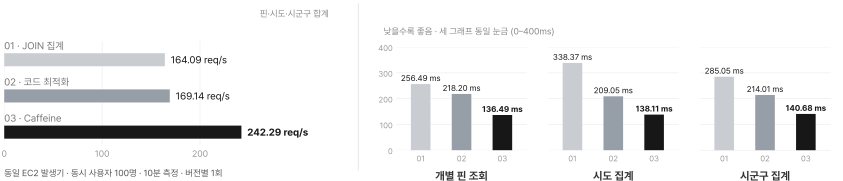

*그림 2. 부모 지역 JOIN 집계와 지역 코드 집계 및 Caffeine의 성능 비교입니다.  
왼쪽은 핀과 시도 및 시군구의 합산 완료 처리량입니다.  
오른쪽은 각 API의 p95입니다.*

| 지표 | 01 부모 지역 JOIN 집계 | 02 지역 코드 집계 | 03 Caffeine |
| --- | ---: | ---: | ---: |
| 개별 핀 p95 | 256.49ms | 218.20ms | 136.49ms |
| 시도 집계 p95 | 338.37ms | 209.05ms | 138.11ms |
| 시군구 집계 p95 | 285.05ms | 214.01ms | 140.68ms |
| 완료 처리량 | 164.09 RPS | 169.14 RPS | 242.29 RPS |
| 요청 오류 / 600초 완료 요청 | 0 / 98,452 | 0 / 101,482 | 0 / 145,373 |

개선 결과는 비교 기준에 따라 다음과 같습니다.

- **지역 코드 집계 → Caffeine:** 처리량 약 43.3% 증가와 API별 p95 약 33.9\~37.4% 감소
- **부모 JOIN 집계 → Caffeine:** 처리량 약 47.7% 증가와 API별 p95 약 46.8\~59.2% 감소

같은 지도 이동에서 세 방식의 응답 차이를 화면으로 옮기면 다음과 같습니다.  
측정한 시도 집계 p95를 10배 느리게 재생한 비교이며 실제 앱의 실시간 응답 속도를 잰 화면은 아닙니다.

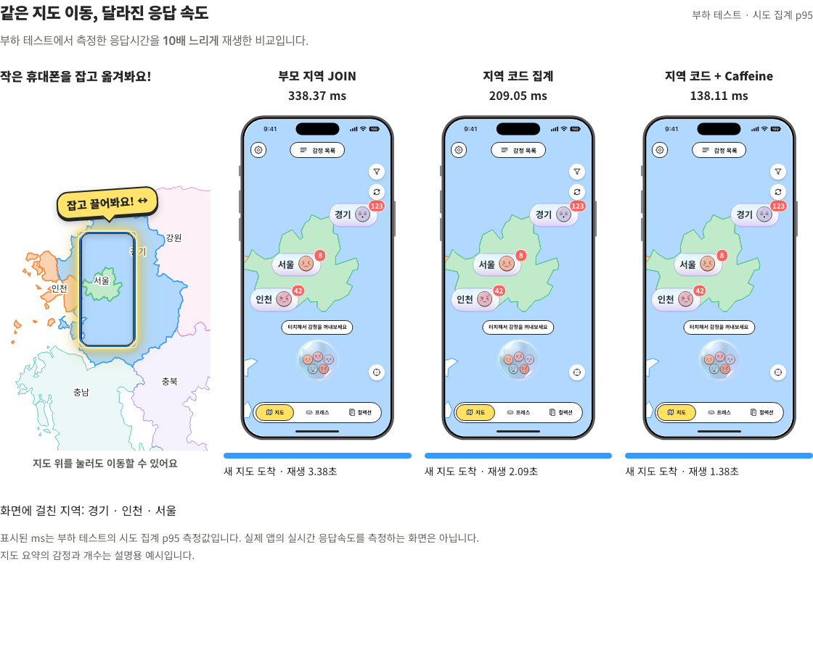

*그림 3. 히유 소개 페이지의 지도 이동 비교. 시도 집계 p95를 10배 느리게 재생했습니다.  
지도 요약의 감정과 개수는 설명용 예시입니다.*

---

# 캐시를 적용한 뒤: 부하 테스트 다시 보기

## 6. 이상했던 점: 캐시에서 바로 읽는데 왜 느릴까요?

5절의 결과에서 처리량은 크게 늘었습니다.  
하지만 캐시에서 바로 읽는 요청이 136ms나 걸린다는 점이 이상했습니다.  
캐시에서 결과를 찾으면 DB를 거치지 않으니 훨씬 빨라야 했습니다.

### 혼자 보낼 때와 100명이 보낼 때

이 의문을 확인하려고 10월 31일에 현재 데이터로 다시 측정했습니다.  
데이터는 감정 10,040건이고 그중 10,003건에 그룹 스탬프가 연결돼 있었습니다.  
5절의 10월 21일 시험과는 데이터와 서버 코드가 달라서 두 날짜의 수치를 직접 비교하지는 않습니다.

먼저 가상 사용자 1명이 요청을 하나씩 보낼 때의 응답 시간을 기준으로 쟀습니다.

| 조건 (2026-10-31 기존 v2 API) | 핀 조회 p95 |
| --- | ---: |
| 가상 사용자 1명이 하나씩 요청 | 약 29ms |
| 가상 사용자 100명이 600초 동안 요청 (3회) | 247\~257ms |

같은 요청이 혼자 보내면 29ms였고 100명이 함께 보내면 250ms 안팎이었습니다.  
세 번 반복해도 같았습니다.  
서버 기록을 보니 100명 시험의 핀 요청은 **전부 캐시에서 바로 결과를 찾은 요청**이었습니다.  
DB 때문도 아니고 캐시 때문도 아니라면 요청 안의 어딘가에서 시간이 쓰이고 있다는 뜻이었습니다.

## 7. 요청 안을 구간별로 재 보기

### 무엇을 쟀나

요청이 서버에 들어와서 응답이 나갈 때까지를 여러 구간으로 나누고 구간마다 스톱워치를 달았습니다.  
Spring의 필터와 인터셉터처럼 요청이 지나가는 길목에 시간을 재는 코드를 넣는 방식입니다.

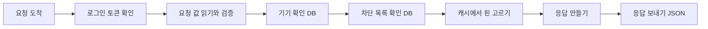

구간은 서로 겹쳐 있습니다.  
예를 들어 "서비스 처리" 구간 안에 "기기 확인" 구간이 들어 있습니다.  
그래서 구간 시간을 단순히 더하지 않았습니다.

### 첫 번째로 보인 것: 쓰지 않는 스탬프 조회가 남아 있었습니다

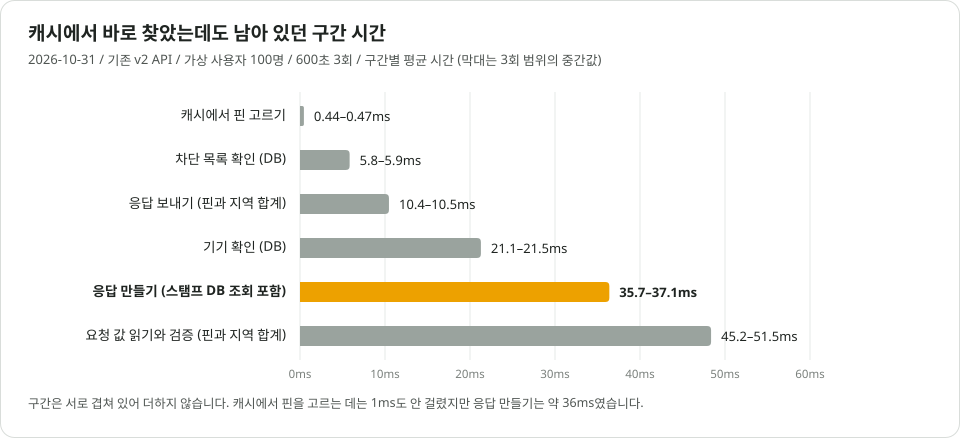

*그림 4. 캐시에서 바로 찾은 요청의 구간별 평균 시간(2026-10-31 기존 v2 API 가상 사용자 100명 3회).  
"핀과 지역 합계"는 두 API를 합친 평균입니다.*

캐시에서 핀을 고르는 데는 0.5ms도 걸리지 않았습니다.  
대신 **응답을 만드는 데 36ms**가 걸렸습니다.  
코드를 보니 응답을 만들 때마다 핀 200개의 그룹 스탬프와 그룹을 DB에서 다시 조회하고 있었습니다.  
그런데 지도 핀의 그룹 스탬프 표시는 앱이 더 이상 쓰지 않는 필드였습니다.  
쓰지 않게 된 뒤에도 조회 코드가 남아 있었고 구간별로 재 보기 전까지는 발견하지 못했습니다.  
이번 데이터는 거의 모든 핀에 스탬프가 연결돼 있어서 거의 모든 페이지에서 이 조회가 일어났습니다.

새 v4 API에서는 쓰지 않는 그룹 필드와 그 조회를 지도 핀 응답에서 지웠습니다.  
이제 응답은 캐시에 있는 값만으로 만들고 DB를 다시 거치지 않습니다.  
같은 서버와 데이터에서 기존 v2와 새 v4를 각각 3회씩 번갈아 측정했습니다.

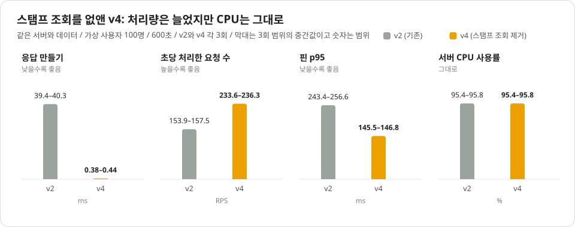

*그림 5. 스탬프 조회 제거 전후(같은 서버와 데이터에서 가상 사용자 100명으로 각 3회).*

| 가상 사용자 100명 600초 3회 | v2 | v4 |
| --- | ---: | ---: |
| 응답 만들기 | 39.4\~40.3ms | **0.38\~0.44ms** |
| 스탬프 DB 조회 횟수 | 76,803\~78,550회 | **0회** |
| 초당 처리한 요청 수 | 153.9\~157.5 RPS | **233.6\~236.3 RPS (+49%)** |
| 핀 조회 p95 | 243.4\~256.6ms | **145.5\~146.8ms** |
| 서버 CPU 사용률 | 95% | 95% |

남아 있던 조회를 지우자 응답 만들기 시간이 사라졌고 처리량도 49% 늘었습니다.  
그런데 p95는 여전히 145ms였습니다.  
**서버 CPU 사용률도 그대로 95%**였습니다.

## 8. 두 번째로 보인 것: 모든 구간이 함께 느려졌습니다

### 혼자 보낼 때와 100명이 보낼 때의 구간 비교

v4의 구간별 시간을 가상 사용자 1명일 때와 100명일 때로 나란히 놓아 봤습니다.

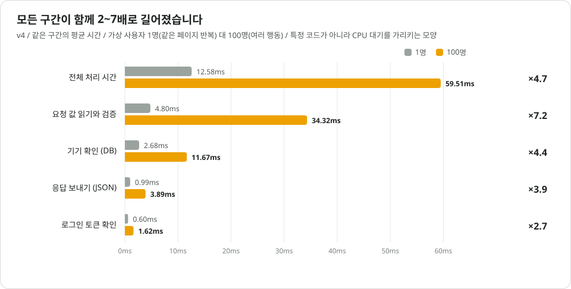

*그림 6. 같은 구간의 평균 시간을 가상 사용자 1명과 100명에서 비교했습니다(v4).  
1명일 때는 같은 페이지만 반복했고 100명일 때는 여러 행동을 섞었기 때문에 조건이 완전히 같지는 않습니다.*

어느 한 코드가 느리다면 그 구간만 길어져야 합니다.  
그런데 **모든 구간이 2\~7배로 고르게 길어졌습니다.**  
"요청 값 읽기와 검증" 구간은 DB도 네트워크도 쓰지 않습니다.  
요청에 담긴 값을 읽어 확인하는 일만 합니다.  
그런데도 4.8ms에서 34ms가 됐습니다.

이건 요청마다 할 일이 늘어난 게 아니라 **일할 차례를 기다리는 시간이 늘어난 것**입니다.  
CPU가 꽉 차서 요청들이 줄을 서고 있었다는 뜻입니다.

### 줄을 서고 있었다는 근거

- **서버가 작았습니다.**  
  개발 서버는 CPU 코어가 2개뿐인 작은 서버(AWS t4g.small)입니다.  
  이 서버 안에서 앱과 함께 HTTPS 연결을 처리하는 nginx와 모니터링 수집기도 돌아갑니다.  
  시험 중 CPU 사용률은 95%였습니다.
- **요청 시간의 대부분이 기다림이었습니다.**  
  서버 안에는 평균 15개 정도의 요청이 동시에 머물러 있었습니다.  
  초당 233개를 처리하면서 15개가 늘 머물러 있으려면 요청 하나가 서버에 약 66ms 머물러야 합니다(동시에 머문 요청 수 ÷ 초당 처리 수).  
  그런데 요청 하나가 실제로 CPU를 쓴 시간은 약 6ms였습니다.  
  나머지 약 60ms는 CPU 차례를 기다린 시간입니다.
- **메모리 정리 때문에 주기적으로 멈췄습니다.**  
  Java는 다 쓴 메모리를 주기적으로 정리하고 이 작업을 GC라고 부릅니다.  
  이 서버는 앱에 준 메모리가 작아서 Java가 가장 단순한 정리 방식(SerialGC)을 골랐습니다.  
  이 방식은 정리하는 동안 모든 요청 처리를 잠깐 멈춥니다.  
  1초에 약 8번 평균 8ms씩 멈췄고 멈춘 시간은 전체의 약 6%였습니다.

로그 기록과 모니터링 수집 그리고 DB 연결 대기 같은 다른 후보도 확인했지만 원인이라 할 만한 신호는 없었습니다.

## 9. 부하 테스트를 잘못 걸고 있었습니다

### 사용자 수를 고정하면 서버가 빨라질수록 요청이 늘어납니다

그러면 왜 CPU가 95%까지 찼을까요? 답은 제가 작성한 부하 테스트 스크립트에 있었습니다.

스크립트는 **사용자 수를 고정하는 방식**이었습니다.  
가상 사용자 100명이 각자 정해진 간격(1초나 3초 또는 15초)마다 지도를 엽니다.  
지도를 열면 응답을 받는 즉시 다음 페이지를 요청합니다.  
이렇게 앞 응답을 받아야 다음 요청을 보내는 방식을 closed model이라고 부릅니다.

데이터를 확인해 보니 시험에 쓴 지도 위치 74곳 중 **다음 페이지가 있는 곳은 한 곳(판교 삼평동)뿐**이었습니다.  
그곳의 핀은 8,052개로 41페이지였습니다.

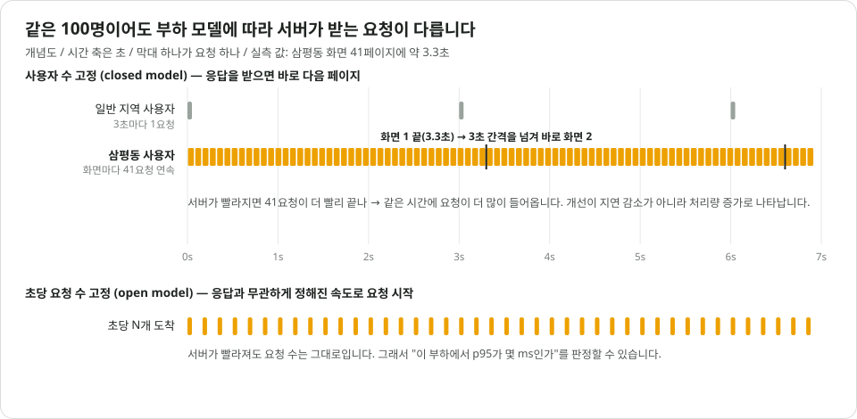

*그림 7. 사용자 수를 고정한 시험과 초당 요청 수를 고정한 시험의 차이(개념도).*

- 삼평동을 보는 가상 사용자 약 11명은 화면 하나를 받는 데 41번 연속으로 요청했습니다.
- 41번에 약 3.3초가 걸려 다음 행동 간격(3초)보다 길었습니다.  
  그래서 쉬지 않고 계속 요청을 보냈습니다.
- 그 결과 핀 요청의 **89%가 이 연속 다음 페이지 요청**이었습니다.

| 가상 사용자 100명 시험 (v4) | 값 |
| --- | ---: |
| 스크립트 간격대로라면 초당 지도 열기 | 약 45회 |
| 실제 초당 지도 열기 | 43.3회 |
| 요청 하나가 쓰는 서버 CPU 시간 | 약 8ms |
| 이 비용으로 계산한 서버의 최대 처리량 | 초당 약 245개 |
| 실제 처리량 | 초당 233개 |

v4는 스크립트가 요구하는 부하를 거의 다 처리했습니다.  
그런데 그 부하가 서버가 감당할 수 있는 최대치와 거의 같았습니다.  
v2는 요청 하나가 더 무거워서 요구 부하를 다 처리하지 못하고 초당 155개에 머물렀습니다.  
그래서 두 버전 모두 CPU 95%로 끝났습니다.

정리하면 이 시험은 **같은 사용자 수로 서버를 한계까지 밀어붙였을 때 얼마나 처리하는지**를 잰 것입니다.  
버전끼리 처리량을 비교하는 데는 쓸 수 있습니다.  
하지만 저는 이 시험의 p95를 보고 응답이 100ms를 넘는다고 판단하고 있었습니다.  
이 방식에서는 서버가 빨라지면 가상 사용자가 더 자주 요청해서 남는 CPU를 다시 채웁니다.  
그래서 p95는 코드의 응답 속도가 아니라 꽉 찬 서버에서 차례를 기다린 시간을 보여주고 있었습니다.  
5절의 136ms도 같은 스크립트로 잰 값이라 같은 한계를 가집니다.

## 10. 초당 요청 수를 고정해서 다시 쟀습니다

### 초당 요청 수를 고정한 시험

이번에는 응답 시간과 상관없이 1초에 정해진 수만큼 요청을 보내도록 바꿨습니다.  
이런 방식을 open model이라고 부르고 k6의 `constant-arrival-rate` 기능으로 만들 수 있습니다.  
실제 사용자는 서버가 느리든 빠르든 자기 속도로 들어오기 때문에 이 방식이 실제 상황에 더 가깝습니다.

요청은 삼평동의 다음 페이지 조회 하나로 고정했습니다.  
앞 시험에서 부하의 89%를 차지한 요청입니다.  
매번 같은 속도로 2분 동안 먼저 요청을 보내 서버를 데운 뒤 5분 동안 측정했습니다.

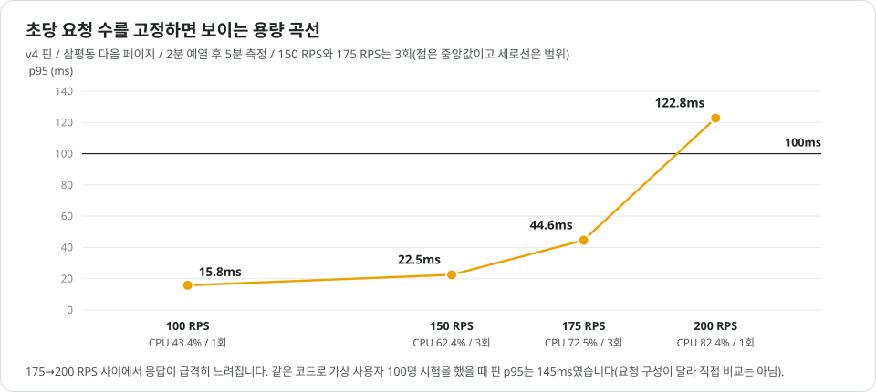

*그림 8. 초당 요청 수에 따른 p95와 서버 CPU 사용률.*

| 초당 요청 수 | 측정 횟수 | p50 | p95 (범위) | p99 | 서버 CPU 사용률 |
| ---: | ---: | ---: | --- | ---: | ---: |
| 100 | 1 | 9.5ms | 15.8ms | 371ms | 43% |
| 150 | 3 | 9.6\~9.9ms | **22.0\~23.9ms** (중앙값 22.5) | 221\~265ms | 62% |
| 175 | 3 | 10.7\~11.4ms | **44.5\~45.9ms** (중앙값 44.6) | 300\~343ms | 72.5% |
| 200 | 1 | 11.8ms | **122.8ms** | 390ms | 82% |

- 같은 코드와 데이터에서 가상 사용자 100명 시험의 핀 p95는 145ms였습니다.  
  초당 100개로 고정하자 **15.8ms**였습니다.  
  요청 구성이 달라서 몇 배 빨라졌다고 말할 수는 없습니다.  
  대신 "서버가 꽉 차지 않으면 p95가 수십 ms 이하"라는 예상을 확인했습니다.  
  요청 하나의 CPU 시간으로 미리 계산한 CPU 사용률(약 40%)과 실제 값(43%)도 맞았습니다.
- p95 100ms 이내는 **초당 175개(CPU 72.5%)까지 3회 모두 유지**됐습니다.  
  회차 간 차이는 2ms 이내였습니다.
- p95는 초당 150개에서 175개로 갈 때 2배가 됐고 175개에서 200개로 갈 때 약 2.8배가 됐습니다.  
  **응답이 급격히 느려지는 지점은 초당 175\~200개(CPU 72\~82%) 사이**입니다.

### 느린 요청은 매분 정각에 몰려 있었습니다

p95는 낮아졌지만 p99는 200ms 이상으로 남았습니다.  
서버가 기록한 응답 시간 분포를 10초 단위로 나눠 보니 **100ms를 넘는 요청이 거의 전부 매분 정각 부근에 몰려 있었습니다.**

원인을 보려면 클라우드 서버의 구조를 알아야 합니다.  
개발 서버는 AWS의 물리 서버 한 대를 여러 고객이 나눠 쓰는 가상 서버입니다.  
같은 물리 서버의 다른 가상 서버가 CPU를 많이 쓰면 우리 서버는 CPU를 쓰고 싶어도 차례를 잠깐 빼앗길 수 있습니다.  
리눅스는 이렇게 빼앗긴 시간의 비율을 **steal**이라는 이름으로 기록합니다.  
그래서 1초 간격으로 steal을 함께 기록했습니다.

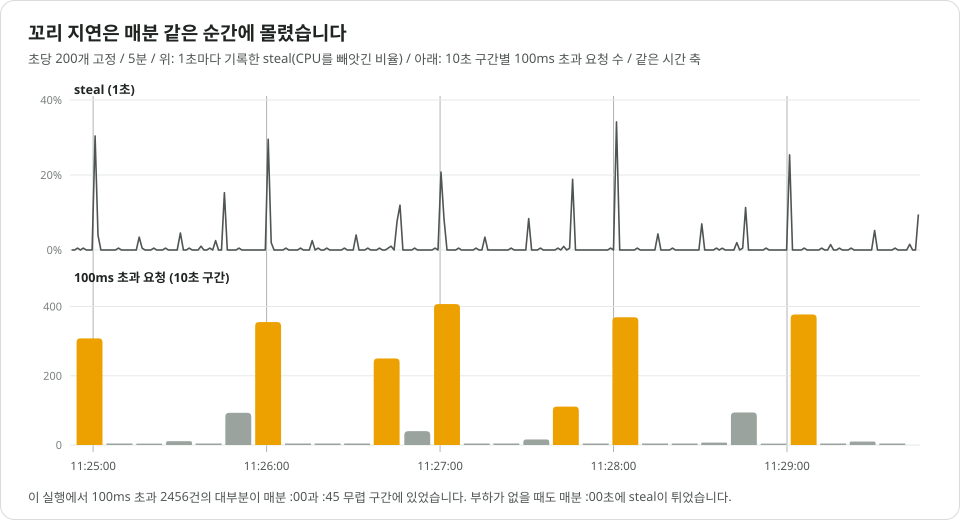

*그림 9. 초당 200개 시험에서 1초마다 기록한 steal(위)과 10초 구간별 100ms 초과 요청 수(아래).  
세로선은 매분 정각입니다.*

- 매분 :00초(가장 큼)와 :45초 그리고 :30초에 steal이 수 %에서 최대 51%까지 튀었습니다.  
  51%는 그 순간 CPU의 절반을 빼앗겼다는 뜻입니다.
- 6회 반복 모두 100ms를 넘은 요청의 **94\~98%가 이 순간들**에 있었습니다.
- 5분과 15분 그리고 30분 경계에서 더 컸습니다.  
  12시 30분에는 51%였습니다.
- **시험을 하지 않을 때도** 매분 :00초에 steal이 튀었습니다.  
  그 순간 우리 앱과 모니터링 수집기는 CPU를 거의 쓰지 않았고 1분마다 도는 작업도 없었습니다.

같은 물리 서버를 쓰는 다른 고객의 정각 작업이 CPU를 가져가는 것으로 보입니다.  
다만 이건 시간이 일치한다는 근거로 낸 추론이고 직접 확인한 사실은 아닙니다.  
확실한 건 두 가지입니다.  
이런 저렴한 공유형 서버(AWS t계열)에서는 p99를 코드만으로 통제할 수 없습니다.  
그리고 CPU 여유가 적을수록 같은 steal이 더 큰 지연으로 번집니다.  
초당 150개에서는 정각 구간의 100ms 초과 요청이 70\~190건이었는데 초당 200개에서는 300\~400건이었습니다.

### 부하를 거는 쪽도 느려질 수 있습니다

초당 요청 수를 고정한 첫 시도에서는 목표 100개 중 16개만 나갔습니다.  
서버 CPU는 5.6%로 놀고 있었습니다.  
반면 부하를 거는 서버의 k6는 CPU를 다 쓰고 있었습니다.

원인은 제 부하 테스트 스크립트가 응답 크기를 세는 방식이었습니다.  
42KB짜리 응답을 글자 하나씩 세느라 응답 하나에 **85ms**를 쓰고 있었습니다.  
k6에 들어 있는 빠른 함수로 같은 값을 계산하도록 바꾸자 0.17ms가 됐습니다.  
앞선 100명 시험의 스크립트는 이미 빠른 방식을 써서 영향이 없었습니다.

결과가 이상할 때는 서버만 볼 게 아니라 **부하를 거는 쪽의 CPU도 같은 시간대에 함께 기록해야** 합니다.

## 11. 요청이 아니라 화면 단위로 보면

### 화면 하나 = 연속 요청 여러 번

사용자가 느끼는 단위는 요청 하나가 아니라 화면 하나입니다.  
핀 조회는 앞 페이지 응답에 다음 페이지의 위치(커서)가 들어 있어서 앞 응답을 받아야 다음 요청을 보낼 수 있습니다.  
그래서 화면 하나를 다 받는 시간은 요청 시간을 모두 더한 값이 됩니다.

가상 사용자 1명일 때의 구간 시간을 다시 보면 요청 하나의 비용 대부분이 핀 개수와 상관없이 매번 드는 비용이었습니다.

| 요청마다 드는 비용 | 1명일 때 | 핀 수에 따라 늘어나는 비용 | 1명일 때 |
| --- | ---: | --- | ---: |
| 요청 값 읽기와 검증 | 4.8ms | 응답 만들기 + 응답 보내기 | 약 1.2ms |
| 기기 확인 (DB) | 2.7ms | | |
| 요청 진입과 보안 처리 | 1.7ms | | |
| 차단 목록 확인 (DB) | 0.7ms | | |
| 로그인 토큰 확인 | 0.6ms | | |

그렇다면 한 번에 더 많이 받으면 화면 하나의 비용이 줄 것이라고 예상했습니다.  
핀 API에는 한 번에 받을 개수를 정하는 `limit` 값이 있습니다.  
기본값은 200이고 개발 서버에서는 1000까지 허용합니다.

### limit 200 대 1000 비교

화면 하나를 첫 페이지부터 마지막 페이지까지 받는 것을 한 번으로 세는 스크립트를 새로 만들었습니다.  
그리고 **초당 화면 수**를 고정했습니다.  
화면은 핀이 가장 많은 삼평동(8,052개)으로 했습니다.  
가장 불리한 경우입니다.

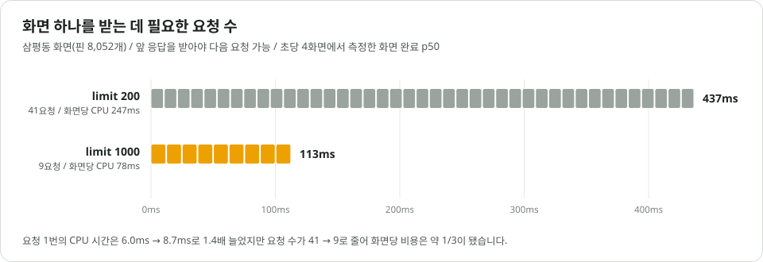

*그림 10. 화면 하나를 받는 데 필요한 요청 수와 시간(초당 4화면에서 측정한 화면 완료 p50).*

| 같은 초당 4화면 | limit 200 | limit 1000 | 첫 200 + 이후 1000 |
| --- | ---: | ---: | ---: |
| 화면당 요청 수 / 초당 요청 수 | 41 / 164 | 9 / 36 | 9 / 36 |
| 화면 완료 p50 / p95 | 437 / 574ms | **113 / 175ms** | 116 / 162ms |
| 첫 페이지 p95 | 18ms | 18ms | **15ms** |
| 요청 1번의 CPU 시간 | 6.0ms | 8.7ms | 8.7ms |
| **화면 1개의 CPU 시간** | **247ms** | **78ms** | **78ms** |
| 서버 CPU 사용률 | 65% | 25% | 25% |

요청 하나의 비용은 1.4배 늘었지만 요청 수가 41번에서 9번으로 줄었습니다.  
그래서 **화면 하나의 서버 비용이 약 1/3**이 됐습니다.  
초당 요청 수가 164에서 36으로 줄어든 건 일을 덜 해서가 아닙니다.  
같은 핀(초당 약 32,000개)을 더 적은 요청에 나눠 담았기 때문입니다.

`limit=1000`으로 초당 화면 수를 올려 한계를 찾았습니다.

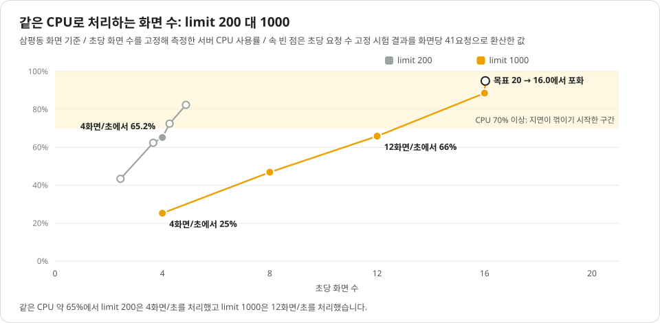

*그림 11. 초당 화면 수에 따른 서버 CPU 사용률. limit 200의 속 빈 점은 10절의 시험 결과를 화면당 41요청으로 환산한 값입니다.*

| limit 1000 | 초당 12화면 | 초당 16화면 | 초당 20화면 |
| --- | ---: | ---: | ---: |
| 서버 CPU 사용률 | 66% | 89% | 95% |
| 첫 페이지 p95 | 32ms | 99ms | 989ms |
| 화면 완료 p95 | 259ms | 906ms | 6.2초 |
| 판정 | 여유 | 경계 | 한계 초과 (초당 16화면에서 막힘) |

가장 불리한 화면 기준으로 여유 있게 처리하는 부하가 **초당 약 4화면에서 약 12화면으로 3배**가 됐습니다.  
같은 CPU 사용률(약 65%)에서 limit 200은 초당 4화면을 처리했고 limit 1000은 초당 12화면을 처리했습니다.

이 결과는 아직 서비스에 적용하지 않았습니다.  
적용하려면 운영 서버의 허용 개수를 올리고 앱이 `limit`을 보내도록 바꿔야 합니다.  
응답이 약 200KB로 커지면 휴대폰이 받고 읽는 시간과 메모리도 확인해야 합니다.  
첫 화면을 빨리 띄워야 한다면 첫 페이지만 200개로 받고 이후는 1000개씩 받는 방법도 있습니다.  
서버 비용은 같고 첫 페이지는 더 빨랐습니다.

## 12. 정리: 다음 부하 테스트에 적용할 것

캐시를 적용하기까지는 요청마다 반복하던 경계 검사와 JOIN 그리고 집계를 줄였습니다.  
캐시를 적용한 뒤에는 쓰지 않는 코드를 찾아 지웠고 무엇보다 부하 테스트를 잘못 걸고 있었다는 것을 알게 됐습니다.  
이번 작업에서 얻은 판단 기준을 정리하면 다음과 같습니다.

| 상황 | 확인할 것 |
| --- | --- |
| 결과가 기대보다 느리다 | 사용자 1명일 때의 기준값부터 잰다. 구간별로 시간을 재서 1명일 때와 많을 때를 같은 구간끼리 비교한다 |
| 한 구간만 길어졌다 | 그 구간의 코드나 DB 조회가 원인이다 (이번에는 쓰지 않는 스탬프 조회가 남아 있었다) |
| 모든 구간이 고르게 길어졌다 | 코드보다 서버 자원이 꽉 찼는지 의심한다. CPU 사용률과 GC로 멈춘 시간 그리고 동시에 처리 중인 요청 수를 함께 본다 |
| 개선했는데 p95는 그대로고 처리량만 늘었다 | 사용자 수를 고정한 시험인지 확인한다. 응답 시간 목표는 초당 요청 수를 고정한 시험에서 판정한다 |
| 결과가 너무 나쁘거나 이상하다 | 부하를 거는 서버의 CPU도 같은 시간대에 기록한다 |
| p99만 유독 높다 | 느린 요청이 언제 몰리는지 시간대별로 나눠 본다. 공유형 서버라면 steal을 1초 단위로 함께 기록한다 |
| 목표를 정해야 한다 | 초당 요청 수가 아니라 사용자 행동(초당 화면 수)으로 정한다. 한 번에 받는 개수가 바뀌면 같은 사용자 부하에서도 초당 요청 수가 바뀐다 |

캐시는 핀을 고르는 시간을 0.5ms 아래로 줄였습니다.  
하지만 응답 시간은 캐시 뒤에 남은 일과 서버의 여유 그리고 부하를 어떻게 걸었는지가 함께 만듭니다.  
처음 본 136ms는 이 셋이 섞인 값이었고 그중 가장 큰 몫은 부하를 건 방식이었습니다.  
구간별로 나눠 재고 나서야 지울 코드와 서버 용량의 한계 그리고 측정 방법의 문제를 따로 볼 수 있었습니다.  
숫자가 기대와 다를 때는 코드만큼 측정 방법도 함께 의심해야 한다는 것을 배웠습니다.

## 한계와 남은 작업

- **측정 환경:** 개발 서버 한 대(AWS t4g.small)에서 시험용 데이터로 측정했습니다.  
  운영 트래픽이나 다른 서버 사양의 결과로 일반화하지 않습니다.
- **반복 횟수:** 5절의 세 버전 비교와 10절의 초당 100개와 200개 그리고 11절의 limit 비교는 1회씩 측정했습니다.  
  7절의 v2와 v4 비교 그리고 10절의 초당 150개와 175개는 3회 반복했습니다.
- **steal 해석:** 다른 고객의 영향이라는 해석은 시간 일치에 근거한 추론입니다.
- **초당 요청 수 고정 시험의 범위:** 삼평동의 다음 페이지라는 한 종류의 요청만 썼습니다.  
  첫 페이지와 지역 조회를 섞은 상황에서 limit 1000을 확인하는 일은 남아 있습니다.
- **남은 CPU 비용:** 요청 하나가 쓰는 약 1.8MB의 메모리와 약 6ms의 CPU 시간이 정확히 어디에 쓰이는지는 프로파일링 도구로 확인하지 않았습니다.  
  GC 방식 비교도 하지 않았습니다.
- **100ms의 성격:** 이번에 검토한 기대 기준이며 공식 서비스 목표로 정한 값은 아닙니다.
