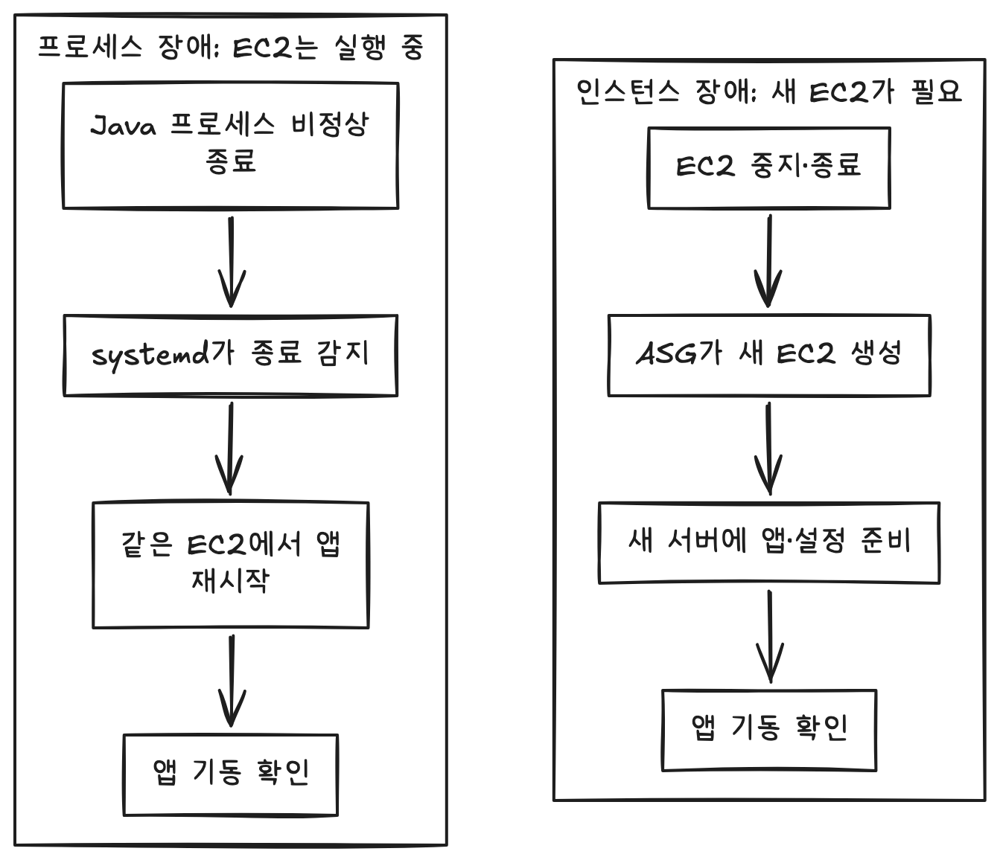
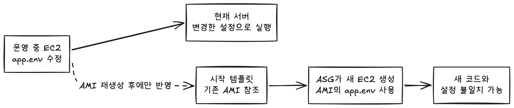
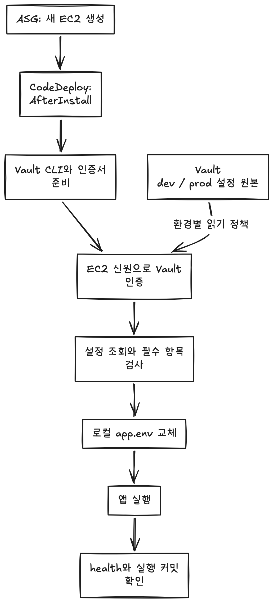
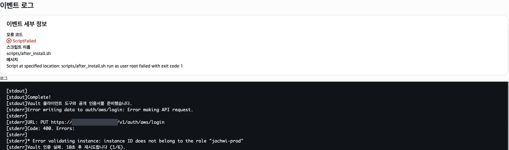
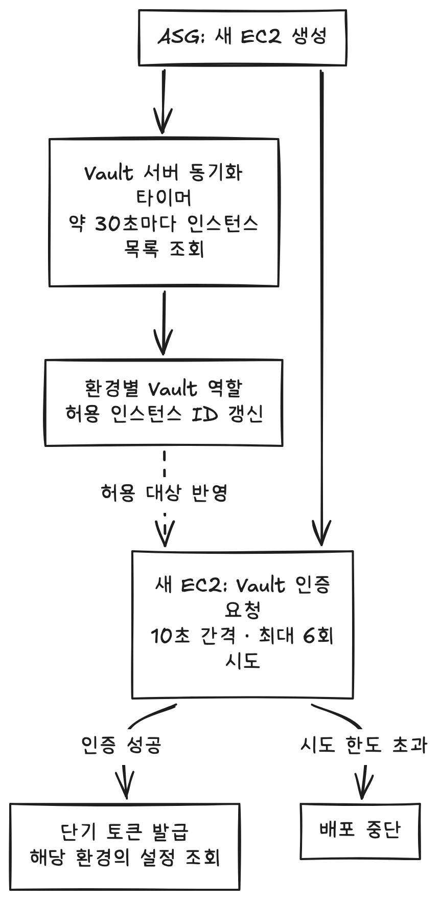
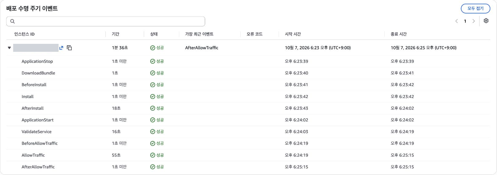
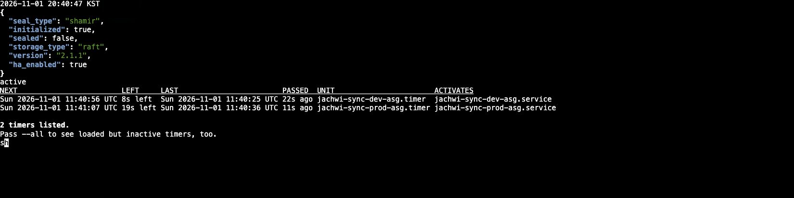

# Vault로 교체 서버에 환경변수 전달하기

서버 장애가 발생했을 때 운영자가 새 EC2를 만들고 앱을 배포하는 과정을 줄이고 싶었습니다. 프로세스를 다시 실행하는 데서 나아가, 서버가 멈춰도 새 서버가 요청을 처리할 수 있도록 복구를 자동화하는 것이 목표였습니다.

서버를 자동으로 교체하도록 구성했지만, 새 EC2가 만들어져도 앱이 실행되지 않는 문제를 겪었습니다. 이 과정에서 AMI에 묶인 환경변수의 전달 방식을 다시 살펴보게 됐습니다.

이 글에서는 서버 복구를 자동화한 배경부터 환경변수를 Vault로 분리한 이유, 새 서버의 인증 문제를 해결한 과정까지 설명합니다. 직접 Vault를 운영하면서 생긴 부담도 함께 다룹니다. EC2 배포 경험은 있지만 서버 교체 시 설정 전달까지 연결해 본 경험이 많지 않은 백엔드 개발자를 대상으로 합니다.

## 1. 서버 장애 복구를 자동화하고 싶었습니다

### systemd로 복구할 수 없는 장애

자취선배는 개발 환경(dev)과 운영 환경(prod)의 앱을 EC2에서 실행했습니다. 먼저 리눅스의 서비스 관리 도구인 systemd를 이용해 Java 프로세스가 비정상 종료되면 다시 시작하도록 구성했습니다.

하지만 systemd도 EC2 안에서 실행됩니다. EC2 자체가 중지되거나 종료되면 운영체제와 systemd가 함께 멈추므로, 앱을 다시 실행할 주체도 사라집니다. 운영자가 새 서버를 만들고 배포한다면 복구가 알림을 확인하고 조작하는 속도에 의존하게 됩니다.

### ASG로 운영 대수 유지

이 범위를 자동화하기 위해 Amazon EC2 Auto Scaling의 인스턴스 그룹인 Auto Scaling Group(이하 ASG)을 사용했습니다. ASG는 그룹이 관리하는 인스턴스의 수와 상태를 확인하며, 인스턴스가 사라지거나 비정상으로 판정되면 새 EC2를 만들어 지정한 대수를 유지합니다. 프로세스 재시작은 systemd에, 인스턴스 교체는 ASG에 맡긴 것입니다.



*그림 1. systemd는 같은 EC2에서 앱을 다시 실행하고, ASG는 교체용 EC2를 생성합니다. 새 서버에는 앱과 설정을 준비하는 과정이 필요합니다.*

dev와 prod는 각각 기본 운영 대수를 1대로 정했습니다. 여러 대를 상시 운영하는 비용을 고려해, 우선 장애 후 서버를 자동으로 교체하는 구성을 선택했습니다. 트래픽 증가에 따라 서버를 추가하는 정책은 적용하지 않았으므로 CPU 사용률이 높아지는 것만으로 대수가 늘어나지는 않습니다.

운영 대수가 1대이므로 장애가 발생하면 새 서버의 생성과 배포가 끝날 때까지 서비스가 중단될 수 있습니다. 이 구성의 목표는 운영자가 직접 서버를 다시 만드는 작업을 줄이는 것이었습니다.

## 2. 새 서버는 만들어졌지만 앱은 실행되지 않았습니다

### 현재 서버의 설정과 AMI의 설정

서버 교체를 자동화한 뒤에도, 새 서버에 앱 실행에 필요한 설정을 전달하는 과정은 함께 관리해야 했습니다. 당시 환경변수는 각 EC2의 `/etc/jachwi-sunbae/app.env` 파일에 저장했고, systemd가 앱을 시작할 때 이 파일의 값을 전달했습니다. 설정을 변경할 때는 서버에 접속해 파일을 수정하고 앱을 재시작했습니다.

ASG는 시작 템플릿에 지정한 서버 이미지인 Amazon Machine Image(AMI)로 EC2를 생성합니다. 시작 템플릿은 사용할 AMI와 인스턴스 유형 등 새 서버의 생성 조건을 담은 설정입니다.

문제는 AMI에 담긴 환경변수였습니다. 기존 서버에서 `app.env`를 수정해도 이미 만들어 둔 AMI에는 반영되지 않습니다.



*그림 2. 현재 서버에서 수정한 설정과 기존 AMI로 생성한 서버의 설정은 달라질 수 있습니다.*

따라서 설정 변경에는 현재 서버의 파일 수정뿐 아니라 AMI와 시작 템플릿 갱신도 필요했습니다. 이를 놓치면 현재 서버는 실행되더라도 교체된 서버는 새 코드에 필요한 설정을 받지 못할 수 있었습니다.

### 반복되는 배포 실패에서 확인한 문제

EC2 시작·종료와 CodeDeploy 배포 실패 알림이 반복됐습니다. CodeDeploy는 앱 파일을 EC2에 설치하고, 앱 시작과 검증에 필요한 스크립트를 순서대로 실행하는 AWS 배포 서비스입니다.

기록을 살펴보니 앱이 정상적으로 시작했는지 검사하는 `ValidateService` 단계가 실패했습니다. 앱 로그에는 `MapProvider` 빈을 찾지 못했다는 오류가 있었습니다. 새 EC2는 생성됐지만 앱 실행은 실패한 상태였습니다.

새 서버가 이전 AMI의 설정을 사용하면서 배포된 코드와 설정이 맞지 않는 것으로 판단했습니다.

**실행 중인 서버에서 수정한 설정을 이미지에 다시 담아야 다음 서버에 전달할 수 있는 구조였습니다.** 이를 개선하기 위해 새 서버가 실행 시점에 필요한 설정을 받도록 경로를 바꾸기로 했습니다.

## 3. 환경변수를 어디에서 전달할까요?

### 대안과 당시의 제약

선택 기준은 설정 변경과 AMI 갱신을 분리하면서, 새 EC2가 수동 접속 없이 해당 환경의 설정을 받도록 하는 것이었습니다. dev·prod 접근 구분과 당시 사용할 수 있는 권한, 도입 후 관리 부담도 함께 고려했습니다.

설정을 전달하는 방법은 크게 두 가지였습니다. JAR와 배포 스크립트를 묶은 배포 패키지에 환경변수 파일도 넣거나, 별도 저장소에서 서버가 직접 설정을 조회하는 방식입니다. 패키지에 포함할 비밀값은 GitHub Actions의 워크플로에서 사용할 값을 저장하는 GitHub Secrets로 관리할 수 있었습니다.

| 방법 | 설정 전달 방식 | 당시 고려한 점 |
| --- | --- | --- |
| GitHub Secrets와 배포 산출물 | 설정을 앱과 함께 배포합니다. | 비밀값이 포함된 패키지의 접근·보관 범위를 관리해야 합니다. |
| Secrets Manager·Parameter Store | 별도 저장소에서 설정을 조회합니다. | 필요한 사용 권한이 없어 권한을 요청했습니다. |
| 직접 운영하는 Vault | EC2가 인증 후 환경별 설정을 조회합니다. | 설정 저장소와 인증·복구 절차를 직접 운영해야 합니다. |

GitHub Secrets를 배포 산출물에 포함하는 방법으로도 AMI와 설정을 분리할 수 있었습니다. CodeDeploy가 기존 패키지를 새 인스턴스에 자동 배포할 수 있으므로, 서버 교체마다 GitHub Actions를 다시 실행할 필요도 없습니다.

다만 기존 배포 경로에 연결하는 작업이 필요했습니다. 우리 팀은 GitHub Actions에서 검사를 수행하고, 소스 조회·빌드·배포를 연결하는 CodePipeline에서 배포 패키지를 별도로 만들었습니다. 따라서 Actions에서 생성한 설정 파일을 실제 배포 패키지에 전달하는 연결을 추가해야 했지만, 팀에서 AWS 액세스 키와 서비스 역할 정책을 직접 관리하기는 어려웠습니다.

### Vault를 선택한 이유

Vault는 비밀값을 저장하고, 인증된 주체가 정책에 따라 접근하도록 구성할 수 있는 도구입니다. 이번에는 환경변수 원본 저장과 EC2의 설정 조회에 사용했습니다.

선택에 영향을 준 또 다른 차이는 설정 오류를 수정하는 과정이었습니다. 앱이 이미 설치된 서버에서 환경변수만 잘못된 경우, 두 방식은 다음과 같이 진행할 수 있습니다.

| GitHub Secrets를 패키지에 포함 | Vault에서 설정 조회 |
| --- | --- |
| Secrets 수정 → 패키지 갱신 → 재배포 | Vault 수정 → 설정 재조회 → 앱 재시작 |

패키지 방식도 기존 빌드 결과를 재사용할 수 있지만, 수정한 설정을 포함한 패키지는 다시 준비해야 합니다. **Vault에서는 앱 패키지 갱신과 설정 수정을 분리할 수 있었습니다.**

당시 허용된 EC2 인프라에서 별도 서버를 구축할 수 있었고, 기존 CodePipeline·CodeDeploy 경로에 설정 조회 단계를 추가할 수 있어 Vault를 선택했습니다. 관리형 서비스를 사용할 권한이 있었다면 선택이 달라질 수 있었습니다.

대신 서버 비용과 접근 정책, 인증서, 백업·복구를 직접 관리해야 했습니다. 이 부담은 뒤에서 확인한 결과와 함께 설명하겠습니다.

## 4. 새 서버가 Vault에서 설정을 받도록 만들었습니다

### 앱 실행 전에 설정 조회

AMI에는 Java와 EC2에서 배포를 수행하는 CodeDeploy 에이전트 등 기반 실행 환경을 준비했습니다. 앱과 배포 스크립트는 CodeDeploy로 전달하고, 환경변수 원본은 Vault에서 관리하도록 역할을 나눴습니다.

새 EC2가 생성되면 배포 과정에서 Vault에 인증하고 설정을 조회합니다. 이를 로컬 `app.env`로 저장한 뒤 앱을 실행합니다.



*그림 3. 새 서버는 앱 실행 전에 Vault에서 설정을 받아 로컬 파일로 준비합니다.*

설정 조회는 앱 파일 설치가 끝나고 앱을 시작하기 전인 `AfterInstall` 단계에서 수행합니다. 이 단계에서 실행하는 `fetch_env.sh`는 CodeDeploy의 배포 대상 묶음인 배포 그룹을 기준으로 dev와 prod를 선택합니다. 알 수 없는 그룹이면 잘못된 환경의 설정을 받지 않도록 배포를 중단합니다.

Vault에는 인증을 허용할 서버의 조건과 인증 후 부여할 정책을 정한 역할을 환경별로 준비했습니다. 서버는 인증에 성공하면 설정 조회에 사용할 토큰을 받습니다. 토큰은 유효기간과 접근 권한이 정해진 자격증명입니다.

1. EC2 내부에서 자신의 정보를 조회할 수 있는 메타데이터 서비스를 통해 AWS가 서명한 인스턴스 신원 정보를 받습니다.
2. 해당 환경의 Vault 역할로 인증해 토큰을 받습니다.
3. 토큰으로 설정을 조회해 임시 파일에 저장합니다.
4. 내용과 필수 항목을 검사하고, 파일 권한을 설정해 `app.env`를 교체합니다.

앱 EC2와 Vault 사이에는 HTTPS를 사용하고 서버 인증서를 검증합니다. 조회 결과가 비었거나 `DB_HOST`, `DB_PASSWORD`, `JWT_SECRET` 등 필수 항목이 없으면 기존 파일을 덮어쓰지 않고 배포를 중단합니다.

이 검사는 잘못된 조회 결과로 설정을 교체하는 것을 막기 위한 것입니다. 실제 DB 접속이나 외부 API 권한까지 검증하지는 않으므로, 이후 앱 기동과 기능 확인이 필요합니다.

### 환경별 저장 경로와 읽기 권한

Vault에서는 키·값(Key/Value) 형태로 비밀값을 저장하고 변경 이력을 버전으로 남기는 KV v2를 사용했습니다. `app_env`라는 필드에 환경변수 파일 내용을 저장하고, dev와 prod의 저장 경로를 나눴습니다.

앱에는 해당 환경의 설정을 읽는 정책만 연결했습니다. 예를 들어 dev 정책은 다음과 같습니다.

```hcl
path "secret/data/jachwi-sunbae/dev" {
  capabilities = ["read"]
}
```

위 정책은 `path`에 지정한 dev 설정 경로에 읽기(`read`)만 허용합니다. prod 설정을 읽거나 값을 수정하는 권한은 포함하지 않습니다.

인증이 요청한 서버의 신원을 확인한다면, 정책은 인증 후 어떤 경로에서 무엇을 할 수 있는지 제한합니다. prod에는 별도 경로의 읽기 정책을 적용하고, 조회용 토큰의 최대 유효기간은 5분으로 제한했습니다. 토큰은 설정을 내려받는 데 사용하므로, 만료돼도 이미 받은 파일로 실행 중인 앱이 중단되지는 않습니다.

설정 저장과 조회 경로는 준비됐습니다. 이제 ASG가 만든 새 서버도 이 인증을 통과해야 했습니다.

## 5. 설정은 옮겼지만, 새 서버의 인증이 실패했습니다

### 기존 서버 ID에 묶인 인증

prod에 적용하는 과정에서 새 인스턴스의 `AfterInstall` 단계가 실패했습니다. 로그에는 다음 오류가 남았습니다.

```text
Error validating instance:
instance ID does not belong to the role "jachwi-prod"
```



*그림 4. 새 인스턴스 ID가 Vault 역할의 허용 대상에 없어 인증이 거절됐습니다.*

원인은 Vault의 prod 역할에 기존 인스턴스 ID가 등록돼 있었다는 점이었습니다. ASG가 교체용 EC2를 생성하면 기존 서버와 다른 ID가 부여됩니다. 이 ID가 Vault 역할의 허용 대상에 없어 환경변수를 읽지 못했습니다.

기존 EC2에서 조회가 성공한 것만으로는 부족했습니다. 서버가 교체될 때마다 운영자가 ID를 등록해야 한다면, 수동 접속 없이 복구하려던 목표를 달성할 수 없었습니다.

### 인스턴스 ID를 제한한 배경

Vault의 AWS 인증에는 IAM 방식과 EC2 방식이 있습니다. IAM(Identity and Access Management)은 AWS의 접근 권한을 관리하는 서비스입니다. IAM 인증은 AWS 자격증명으로 서명한 요청을, EC2 인증은 AWS가 서명한 인스턴스 신원 정보를 검증합니다. 공식 문서는 일반적인 선택으로 IAM 인증을 권장하지만, 이번에는 EC2 인증을 사용했습니다.

당시에는 다른 팀의 EC2도 사용하는 공용 IAM 역할인 `ec2-project`만 사용할 수 있었습니다. IAM 역할은 서버가 AWS 리소스에 접근할 때 사용할 권한을 부여하는 설정으로, 앞서 설명한 Vault 인증 역할과는 별개입니다.

공용 IAM 역할 이름만으로는 우리 팀의 dev·prod 서버를 구분하기 어려웠습니다. 이에 계정·리전·네트워크 범위와 함께 허용 인스턴스 ID를 Vault의 인증 조건에 포함했습니다.

이 조건으로 접근 대상을 제한했지만, **서버 교체에 따라 허용 대상도 바뀌어야 한다는 처리가 빠져 있었습니다.**

### ASG 목록으로 인증 대상 갱신

Vault 서버에 환경별 동기화 작업과 이를 주기적으로 실행하는 타이머를 구성했습니다. 약 30초마다 ASG의 실행·시작 중인 인스턴스 목록을 조회하고, 해당 환경의 Vault 역할에 허용 ID를 반영하도록 했습니다. 서버가 교체돼도 현재 ASG에 속한 서버 목록에 맞춰 인증 조건을 갱신하는 방식입니다.



*그림 5. ASG의 인스턴스 변경을 인증 조건에 반영하고, 새 서버는 제한된 횟수만큼 인증을 재시도합니다.*

타이머가 목록을 갱신하기 전에 배포가 시작될 수도 있어 인증 재시도도 넣었습니다. 실패하면 10초 뒤 다시 시도하되 최대 6회로 제한하고, 스크립트 전체에도 제한시간을 뒀습니다. 재시도는 목록 반영을 기다리는 장치이므로, 제한 안에 인증되지 않으면 배포를 실패 처리했습니다.

동기화 서비스에는 허용 ID 갱신에 필요한 권한을 부여하고, 조회 결과가 비어도 인증 제한을 해제하지 않도록 했습니다. 이 동기화는 공용 역할이라는 제약에 맞춰 직접 추가한 구성이므로, 타이머의 실행 상태와 권한도 관리 대상이 됐습니다.

## 6. 무엇을 확인했고, 어떤 부담이 남았을까요?

### 설정이 없는 AMI에서 배포와 기동 확인

기존 서버에는 이미 설정 파일이 있습니다. 새 서버에 필요한 준비가 빠져 있어도 조회 시험만으로는 드러나지 않을 수 있어, **환경변수 파일이 없는 AMI로 새 인스턴스를 생성해 검증했습니다.**

서비스 중인 서버와 분리한 작업용 인스턴스에서 AMI를 준비하며 `app.env`와 백업 파일, 인스턴스별 재인증 정보인 nonce를 제외했습니다. 새 서버가 자신의 인증 정보를 만들고 설정을 받아 기동하는지 확인하기 위해서입니다.

dev·prod의 새 ASG 인스턴스에서 다음 항목을 확인했습니다. 아래의 health는 앱의 상태 확인 응답이며, 실행 커밋은 실제 실행 중인 코드의 Git 버전 식별자입니다.

| 확인 대상 | 확인 결과 |
| --- | --- |
| 설정 수신 | 해당 환경의 `app.env` 갱신과 인스턴스별 nonce 생성 |
| 배포 | CodeDeploy 단계 성공 |
| 앱 기동 | 서비스 실행 상태와 health `UP` |
| 실행 코드 | 실행 커밋과 배포 커밋 일치 |
| 트래픽 대상 | Application Load Balancer(ALB)의 대상 상태 `healthy` |

ALB는 요청을 대상 서버로 전달하는 로드 밸런서입니다. `healthy`는 대상 서버가 ALB의 상태 검사를 통과했다는 뜻입니다. 앱의 health 응답뿐 아니라 실행 커밋도 비교해, 배포한 코드가 실제 실행 중인지 함께 확인했습니다.

prod에서는 기존 서버를 유지하면서 운영 대수를 일시적으로 늘려 새 서버를 확인한 뒤, 기본 대수인 1대로 돌아왔습니다.



*그림 6. prod 신규 인스턴스의 배포에서 설정 조회·기동 검증·트래픽 허용 단계가 성공했습니다.*

### 설정 변경과 앱 반영은 별도 작업

환경변수 변경만으로 AMI를 다시 만들 필요는 없어졌습니다. 다만 Vault의 값을 수정해도 실행 중인 앱에 즉시 반영되지는 않습니다. 현재 앱은 내려받은 로컬 파일을 사용하므로 다음 절차가 필요합니다.

```text
Vault 값 수정 → 설정 재조회 → app.env 갱신 확인 → 앱 재시작 → 기능 확인
```

재배포할 때는 `AfterInstall`에서 설정을 다시 조회하지만, 앱 재시작만으로는 최신 값을 받지 않습니다. 설정을 변경할 때는 로컬 파일 갱신과 앱 반영까지 확인해야 합니다.

잘못된 값을 수정하는 대신, KV v2에 보관된 정상 버전을 복원한 뒤 같은 절차로 적용할 수도 있습니다. 이때도 Vault의 버전 복원과 서버의 설정 재조회·재시작은 각각 수행해야 합니다.

다만 배포 도중 설정 오류로 실패했다면 파일 설치나 이후 단계의 스크립트 실행이 끝나지 않았을 수 있습니다. 이 경우에는 Vault 값을 수정한 뒤 같은 앱 패키지로 CodeDeploy 배포를 다시 실행해야 할 수 있습니다. 설정 수정만으로 실패한 배포가 자동 완료되는 것은 아닙니다.

### Vault에도 복구 절차가 필요했습니다

Vault를 도입하면서 서버 복구 과정에 운영자가 개입해야 하는 지점도 생겼습니다. Vault는 데이터를 암호화해 저장하며, 프로세스가 시작되면 이 데이터를 복호화할 수 없는 잠금 상태(sealed)로 대기합니다. 저장된 환경변수를 제공하려면 먼저 잠금을 해제하는 unseal 과정이 필요합니다.

이번에 사용한 Shamir 방식은 잠금 해제 키를 여러 조각으로 나누어 보관하고, 정해진 수 이상의 조각을 모아야 잠금을 해제할 수 있도록 합니다. 따라서 Vault 프로세스나 서버가 재시작되면 운영자가 키 조각을 입력해 다시 잠금을 해제해야 했습니다. 프로세스를 자동으로 재시작하더라도 설정을 제공할 준비까지 끝나는 것은 아니었습니다.

이 차이는 새 앱 서버를 복구할 때 영향을 줍니다. 이미 환경변수를 받아 실행 중인 앱은 로컬 설정 파일을 사용하지만, 새로 생성된 앱 서버는 시작에 필요한 설정을 Vault에서 가져와야 합니다. Vault가 잠겨 있다면 ASG가 새 EC2를 생성해도 앱을 실행할 수 없으므로, Vault까지 재시작된 상황에서는 운영자의 잠금 해제가 복구에 필요한 단계로 남았습니다.



*그림 7. Vault의 잠금 해제 상태와 dev·prod 동기화 타이머의 실행 상태를 확인한 화면입니다.*

또한 Vault는 단일 서버로 구성했습니다. Vault 중단과 sealed 상태에서 기존 앱·새 서버·재배포에 미치는 영향은 별도 환경에서 더 검증해야 합니다.

운영 부담도 늘었습니다. Vault용 EC2와 스토리지 비용에 더해, 인증서 갱신과 정책 관리, 동기화 타이머 점검, 백업·복원 절차가 필요해졌습니다.

ASG의 인스턴스 유지·교체 기능 자체에는 별도 이용료가 없지만 사용하는 AWS 자원에는 비용이 발생합니다. ASG를 쓰는 목적과 Vault를 직접 운영하는 비용은 나눠 평가해야 합니다.

관리형 서비스 권한을 사용할 수 있게 된다면, 같은 설정 전달 요구사항을 기준으로 운영 비용과 복구 부담을 다시 비교할 필요가 있습니다.

## 마무리

이번 작업으로 환경변수와 AMI를 분리하고, 새 ASG 인스턴스가 설정을 받아 기동하는 경로를 확인했습니다. 그 과정에서 기존 인스턴스 ID에 묶인 인증 조건을 발견하고, ASG 목록에 맞춰 갱신하도록 바꿨습니다.

가장 크게 달라진 점은 자동 복구를 확인하는 범위였습니다. EC2가 생성되는지에 더해, 새 서버가 인증하고 설정을 받아 앱을 실행하는지까지 살펴봐야 했습니다.

다음에는 Vault 장애와 백업·복원을 검증하고, 실제 비용과 관리 작업을 정리하려고 합니다. 설정 전달을 자동화해 얻은 효과가 저장소를 직접 운영하는 부담에 비해 적절한지 판단하는 것이 남은 과제입니다.

## 참고 자료

- [AWS — Amazon EC2 Auto Scaling 개요](https://docs.aws.amazon.com/autoscaling/ec2/userguide/what-is-amazon-ec2-auto-scaling.html)
- [AWS — ASG 상태 검사와 인스턴스 교체](https://docs.aws.amazon.com/autoscaling/ec2/userguide/ec2-auto-scaling-health-checks.html)
- [AWS — Auto Scaling 시작 템플릿](https://docs.aws.amazon.com/autoscaling/ec2/userguide/launch-templates.html)
- [AWS — CodeDeploy와 EC2 Auto Scaling 연동](https://docs.aws.amazon.com/codedeploy/latest/userguide/integrations-aws-auto-scaling.html)
- [AWS — EC2 인스턴스 메타데이터](https://docs.aws.amazon.com/AWSEC2/latest/UserGuide/ec2-instance-metadata.html)
- [AWS — EC2 Auto Scaling 요금](https://docs.aws.amazon.com/autoscaling/ec2/userguide/what-is-amazon-ec2-auto-scaling.html#as-pricing)
- [HashiCorp — Vault KV v2](https://developer.hashicorp.com/vault/docs/secrets/kv/kv-v2)
- [HashiCorp — Vault 접근 정책](https://developer.hashicorp.com/vault/docs/concepts/policies)
- [HashiCorp — Vault AWS 인증](https://developer.hashicorp.com/vault/docs/auth/aws)
- [HashiCorp — EC2 인증의 nonce](https://developer.hashicorp.com/vault/docs/auth/aws#client-nonce)
- [HashiCorp — KV v2 설정 버전 복원](https://developer.hashicorp.com/vault/docs/commands/kv/rollback)
- [HashiCorp — Seal과 Unseal](https://developer.hashicorp.com/vault/docs/concepts/seal)
