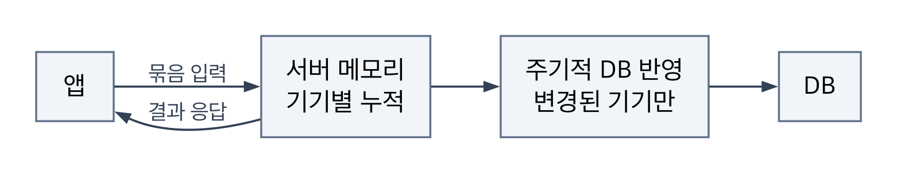
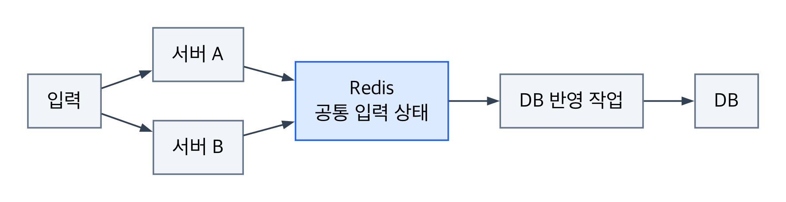
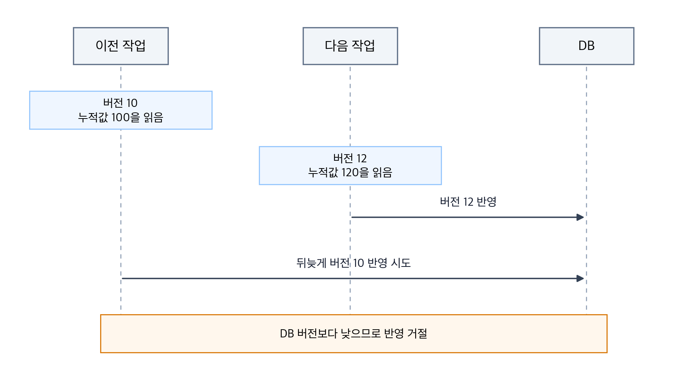
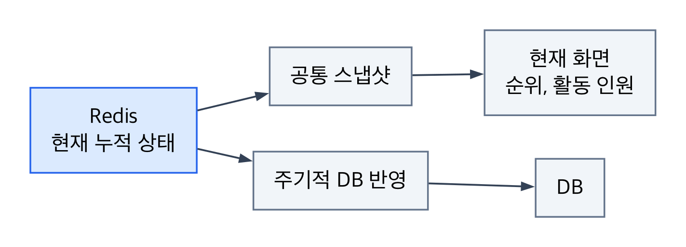

# 실시간 카운터의 DB 쓰기 부하 줄이기

## 개요

히유는 감정 버튼을 누른 횟수와 순위, 함께 활동하는 사람 수를 보여줍니다. 앱은 클릭을 묶어 보내지만 서버는 요청마다 DB에 저장했습니다.

입력이 늘면 DB 쓰기도 함께 늘어납니다. 이를 줄이려고 메모리와 Redis에 입력을 모아 반영하는 구조로 바꿨습니다.

## 1. 입력을 모아서 DB에 반영하기

### 문제 상황

여러 사용자가 버튼을 계속 누르면 입력 요청이 늘어납니다. 요청마다 DB에 저장하면 쓰기 트랜잭션도 함께 늘어납니다. 이 작업이 쌓이면 응답이 늦어질 수 있습니다.

### 원인 분석

요청마다 입력 제한 확인, 카운터 증가, 합계 갱신, 응답용 조회를 반복합니다. 트랜잭션이 끝날 때까지 커넥션도 점유합니다. 입력이 많아질수록 DB 왕복과 반복 저장의 부담이 커집니다.

### 해결 아이디어

횟수는 누적해서 저장할 수 있습니다. 3번 누른 뒤 2번 누르면 최종값 5만 DB에 반영해도 됩니다.

기기별 카운터와 입력 제한을 서버 메모리에 두었습니다. 요청에는 메모리 갱신 후 응답하고, 변경된 기기를 모아 5초 간격으로 DB에 반영합니다.

### 적용 결과

요청 처리와 DB 반영을 분리했습니다. 같은 기기의 여러 입력을 누적값 하나로 모아 저장하도록 바꿨습니다.

### 대안들

- 앱에서 더 오래 묶기: 전송 대기 시간 증가
- SQL과 트랜잭션 경로 단축: 요청마다 DB 저장
- 서버 사양이나 커넥션 풀 확대: 입력당 저장 비용 유지

여러 입력의 DB 저장을 합치기 위해 메모리 누적 방식을 선택했습니다.

### 정리, 남은 문제

DB 저장을 요청별 작업에서 주기적 작업으로 옮겼습니다. 대신 DB 반영 전 입력은 서버 메모리에만 남습니다.

## 2. 서버 밖에서 입력 상태 공유하기

### 문제 상황

서버가 강제 종료되면 DB 반영 전 입력을 잃을 수 있습니다. 서버가 여러 대면 누적값과 입력 제한도 각각 나뉩니다.

### 원인 분석

같은 기기의 입력이 서버 A와 B로 나뉘면 각 메모리에 다른 누적값이 생깁니다. 각자 DB에 덮어쓰면 서로의 입력을 지울 수 있습니다.

### 해결 아이디어

누적값과 입력 제한을 Redis로 옮겼습니다. 서버가 달라도 같은 상태에서 입력을 판정하도록 구성했습니다.

날짜 확인, 중복 확인, 입력 제한, 카운터 갱신은 Lua 한 번으로 묶었습니다. 실행 중 다른 요청이 끼어들지 않게 합니다. 날짜와 입력 시각도 Redis 시각을 씁니다.

Lua는 실행 중 오류를 자동으로 롤백하지 않습니다. 거절 조건을 먼저 검사한 뒤 값을 갱신하도록 구성했습니다.

Redis에는 현재 누적값과 변경된 기기 목록을 둡니다. DB에 없는 입력이 있으므로 `noeviction`으로 임의 축출을 막습니다. 메모리가 차면 쓰기 오류가 날 수 있습니다.

### 적용 결과

Redis 저장소에 입력 판정과 갱신을 모았습니다. Lua에서 중복 ID, 같은 ID의 다른 내용, 입력 제한, 날짜 불일치를 처리하도록 구현했습니다.

### 대안들

- 같은 기기를 같은 서버로 보내기: 서버 종료와 재배치
- 서버별 파일 기록: 기록 복구와 서버 간 이동
- 메시지 큐: 소비 지연과 중복 반영 처리

입력별 사건을 보관하는 대신 최신 누적값을 공유하는 방식을 선택했습니다.

### 정리, 남은 문제

입력 상태를 서버 밖으로 옮겼습니다. 다음은 DB 반영 작업이 겹치거나 재실행돼도 값을 지키는 일입니다.

## 3. 중복 반영과 과거 값 덮어쓰기 막기

### 문제 상황

DB 커밋 뒤 작업이 종료되면 같은 데이터를 다시 반영할 수 있습니다. 이전 작업이 늦게 끝나 최신값을 덮을 수도 있습니다.

### 원인 분석

Redis 읽기, DB 커밋, 변경 표시 삭제는 별도 작업입니다. 전체가 한 번만 실행된다고 가정할 수 없습니다.

### 해결 아이디어

증가분 대신 누적값을 덮어씁니다. 100을 두 번 저장해도 결과는 100입니다.

DB의 `source_version`보다 높은 버전만 반영합니다. 합계와 감정별 횟수는 같은 트랜잭션에서 갱신합니다. 반영 중 새 입력이 왔다면 변경 표시를 남겨 다음 회차에 처리합니다.

Redis 임대 락은 중복 작업을 줄이는 데 씁니다. 임대 만료로 작업이 겹쳐도 누적값과 버전 조건으로 값을 지킵니다.

### 적용 결과

같거나 낮은 버전은 DB에 반영하지 않도록 구현했습니다. 반영 중 들어온 새 입력은 변경 표시를 남겨 다음 회차로 넘깁니다.

### 대안들

- 분산 락만 사용: 임대 만료 뒤 작업 겹침
- 증가분별 반영 이력 저장: 이력 관리와 DB 쓰기 증가
- 누적값만 저장: 늦은 값이 최신값을 덮음

### 정리, 남은 문제

재실행은 누적값으로, 순서 역전은 버전으로 다룹니다. 하지만 현재 화면이 DB를 읽으면 반영 전까지 이전 값이 보입니다.

## 4. 현재 화면도 Redis에서 읽기

### 문제 상황

입력에는 성공을 응답했는데 순위는 이전 값으로 보일 수 있습니다.

### 원인 분석

입력은 Redis에 반영됐지만 조회는 아직 갱신되지 않은 DB를 읽기 때문입니다.

### 해결 아이디어

현재 순위와 활동 인원도 Redis에서 읽어 공통 스냅샷을 만듭니다.

버전이 같으면 참가자 전체를 다시 받지 않습니다. 시각은 계속 갱신합니다. 최근 5초 활동 인원은 새 입력이 없어도 줄어들기 때문입니다.

### 적용 결과

현재 상태의 조회 출처를 Redis로 바꿨습니다. 순위와 활동 인원이 DB 반영을 기다리지 않도록 조회 경로를 분리했습니다.

초기 적재, 기기 확인, 닉네임 보충, 지난 날짜 조회는 DB에 남습니다.

### 대안들

- DB 반영 주기 단축: DB 쓰기 증가
- DB 반영까지 화면 갱신 대기: 현재 상태 표시 지연
- 내 입력만 앱에서 먼저 표시: 다른 사람과 전체 순위의 기준 필요

### 정리, 남은 문제

현재 화면의 조회 출처를 입력 상태와 맞춥니다. 이제 Redis 장애가 입력과 조회에 함께 영향을 줍니다.

## 5. Redis 장애에 대비하기

### 문제 상황

성공을 응답했지만 DB에는 아직 없는 입력이 Redis에 남습니다. Redis 장애 때 이 입력을 복구해야 합니다.

### 원인 분석

Redis 메모리 반영과 디스크 저장은 다릅니다. Redis 반영 후 응답했다고 디스크 저장까지 끝난 것은 아닙니다.

### 해결 아이디어

로컬 Redis에 AOF와 `everysec`을 적용했습니다. 쓰기 명령을 파일에 기록하고 재시작 때 복구합니다. 장애 시 최근 약 1초 데이터를 잃을 수 있습니다.

Redis 오류 때는 DB로 우회하지 않고 503으로 알립니다. 두 저장소에서 입력을 받으면 이후 누적값 반영이 서로의 입력을 지울 수 있습니다.

DB의 누적값과 버전을 Redis에 채우는 초기 적재를 추가했습니다. 빈 누적값으로 기존 DB 값을 덮어쓰는 상황을 막기 위한 처리입니다.

### 적용 결과

AOF 기록, 저장소 오류 응답, 초기 적재 처리를 추가했습니다. Redis에 문제가 생겨도 DB로 입력을 나눠 받지 않도록 했습니다.

### 대안들

- AOF always: 디스크 동기화 비용
- Redis 복제: 복제 지연에 따른 유실 가능성
- DB 커밋 뒤 응답: 요청이 DB 저장을 기다림

Redis 복제는 두지 않았습니다. AOF가 저장된 볼륨 자체를 잃으면 파일로 복구할 수 없습니다.

### 정리, 남은 문제

AOF로 재시작 시 복구 경로를 마련했습니다. Redis가 정상이어도 DB 반영이 오래 밀리면 미반영 상태는 남습니다.

## 남은 문제, DB 반영 지연

DB가 멈춰도 Redis는 입력을 받을 수 있습니다. 장애가 길어지면 미반영 시간이 늘고, 새 기기가 늘수록 보관량도 커집니다.

반영 주기 5초는 지연 상한이 아닙니다. 실행 시간과 재시도가 더해집니다. Redis 메모리와 DB 반영 지연은 이 구조에서 계속 관리할 대상입니다.

## 전체 정리

입력은 메모리와 Redis에서 누적하고, DB에는 주기적으로 반영하도록 바꿨습니다. 누적값과 버전으로 재실행과 순서 역전을 다루고, 현재 화면도 Redis에서 읽도록 구성했습니다.

DB 저장을 요청 경로에서 분리한 대신, Redis의 입력 보관과 DB의 지연된 반영을 함께 관리하는 구조가 됐습니다.
