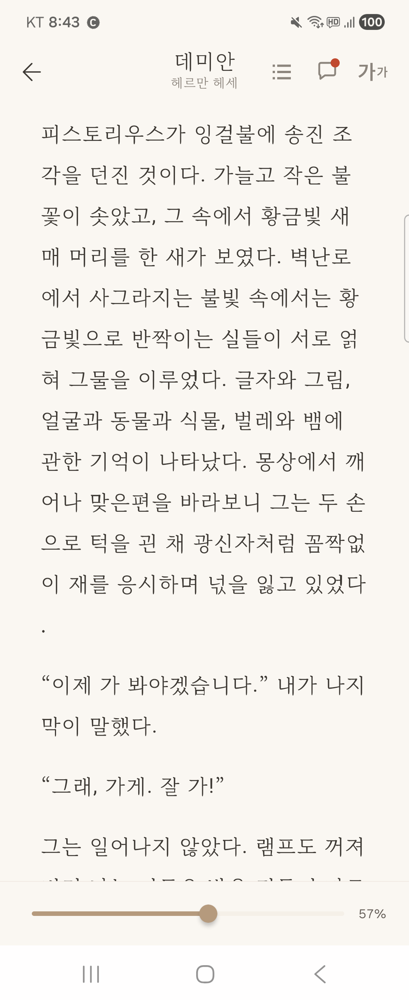
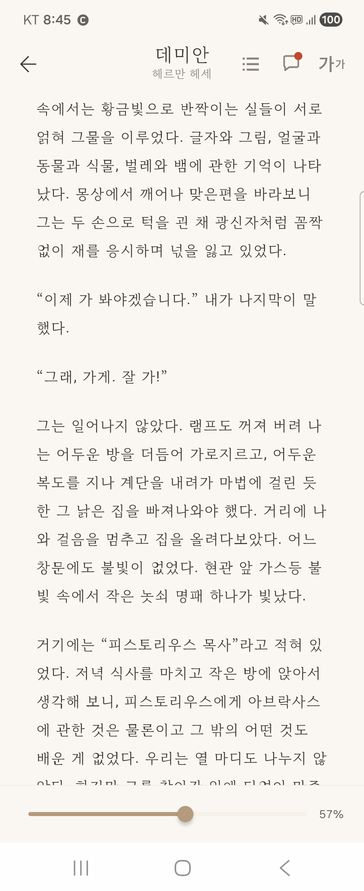
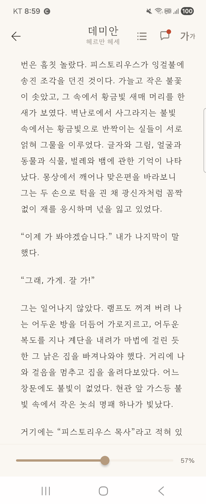

# 글자 크기가 바뀌어도 읽던 곳 유지하기: 평균 줄 오차 3.17줄에서 0줄로

글자 크기를 줄이자 읽던 내용이 화면 위로 사라졌다. 반대로 글자를 키우자 이미 읽은 문장부터 다시 보였다. 전자책 리더를 만드는 과정에서 겪은 문제다. 읽기 편하도록 크기를 조절했는데 오히려 읽던 곳을 다시 찾아야 했다.

글자 크기가 바뀌면 줄바꿈과 문단 높이도 달라진다. 같은 스크롤 거리를 유지해도 같은 내용을 보여 주지는 않는다. 그렇다면 읽던 위치를 유지하려면 무엇을 저장해야 할까?

`LazyColumn`의 기본 동작, 문단 ID와 픽셀 offset, 문장 ID와 문자 위치를 차례로 비교했다. **한 기기의 같은 본문 위치에서 단일 변경을 방식당 6건씩 측정한 결과, 평균 줄 오차는 기본 동작과 문단 방식의 3.17줄에서 문자 방식의 0줄로 줄었다.**

이 글은 Compose에서 긴 콘텐츠를 표시하는 개발자를 위한 글이다. 전자책을 사례로 위치를 표현하는 방법과 복원 기준을 유지하는 시점을 살펴본다.

## 같은 위치에서 같은 기준으로 비교하기

리더에서는 문단 하나가 `LazyColumn`의 항목 하나다. 문단 안의 여러 문장은 하나의 `Text`로 이어 표시하며, 문단과 문장은 각각 고유한 ID를 가진다.

데미안을 18sp로 표시했을 때 첫 줄이 ‘피스토리우스가…’로 시작하는 곳을 출발점으로 삼았다. 문단 ID는 172777, 문장 ID는 754400, 문장 안의 문자 위치는 0이다. 이 첫 문자 ‘피’를 추적했다. 픽셀 offset은 문단 위쪽에서 스크롤한 거리다. 시작할 때 이 값은 829px이었다.



*그림 1. 세 방식이 출발한 같은 위치. 첫 문자 ‘피’를 기준으로 삼았다.*

기기는 SM-F721N(Android 16, 1080×2640px), density 3.0, 시스템 글꼴 배율 1.0이었다. 마루부리 글꼴, 좌우 여백 36dp, 문단 간격 32dp를 유지했다. 조절한 설정은 글자 크기지만, 줄 높이도 기존의 `fontSize × 2` 규칙에 따라 함께 바뀐다.

성공 조건은 다음과 같다.

> 처음 정한 ‘피’가 크기 변경 후에도 첫 번째로 보이는 줄에 포함되어야 한다.

위쪽이 일부 잘린 줄도 본문 영역과 겹치면 **첫 가시 줄**로 셌다. 줄바꿈이 달라질 수 있으므로 기준 문자가 줄의 첫 글자일 필요는 없다. 사용자가 스크롤하기 전까지는 같은 문장 ID와 문자 위치를 기준으로 평가했다.

`줄 오차 = abs(기준 문자가 포함된 줄 번호 - 첫 가시 줄 번호)`

두 줄 번호는 **변경 후의 같은 레이아웃**에서 구한다. 오차가 0이면 성공이다. 시작 위치는 로그와 이미지로 맞췄으며, 크기 변경 후의 복원은 각 방식에 맡겼다. 기본 동작과 문단 방식에 문자 기준 보정을 적용하지 않았다.

## 첫 번째 시도는 LazyColumn의 기본 동작이었다

먼저 위치를 직접 복원하지 않고 글자 크기만 갱신했다. 아래는 여백·간격 등 공통 설정을 생략한 코드다.

```kotlin
val listState = rememberLazyListState()

LazyColumn(state = listState) {
    items(passages, key = { it.passageId }) { passage ->
        PassageItem(
            passage = passage,
            fontSize = fontSize,
            onSentenceClick = {},
        )
    }
}
```

`LazyListState`는 첫 가시 항목의 인덱스와 픽셀 offset을 제공한다. 안정적인 `key`로 같은 문단을 식별하는 구성도 유지했다.

14sp로 줄이든 26sp로 키우든 offset은 829px이었다. 하지만 기준 줄은 14sp에서 본문 상단보다 352px 위로, 26sp에서는 836px 아래로 이동했다. **같은 문단의 같은 픽셀 거리는 유지했지만 읽던 내용은 달라졌다.**

## 두 번째 시도는 문단 ID와 픽셀 offset을 직접 복원하는 것이었다

기본 동작 대신 복원할 대상과 시점을 직접 관리하면 결과가 달라지는지 확인했다. 크기 변경 전에 문단 ID와 offset을 저장했다. 새 레이아웃이 준비되면 ID로 문단을 찾아 저장한 거리를 적용했다.

```kotlin
// 글자 크기를 바꾸기 전에 저장한다.
val passageId = passages[listState.firstVisibleItemIndex].passageId
val offsetPx = listState.firstVisibleItemScrollOffset

// 새 글자 크기를 적용한 뒤 실행한다.
val index = passages.indexOfFirst { it.passageId == passageId }
if (index < 0) return

listState.scrollToItem(index)
val layout = awaitLayout(passageId, newFontSize)
val restoredOffset = offsetPx.coerceAtMost(
    (layout.size.height - 1).coerceAtLeast(0),
)
listState.scrollToItem(index, restoredOffset)
```

예제의 `awaitLayout()`은 해당 문단을 새 글자 크기로 측정할 때까지 기다리는 보조 함수다. offset이 새 문단 높이를 넘지 않도록 상한도 두었다.

결과는 기본 동작과 같았다. 이번 위치에서는 상한에 걸리지 않아 829px을 그대로 적용했다. 이미 기본 동작이 유지하던 위치를 다시 복원한 셈이다. **새 레이아웃을 기다려도, 픽셀 거리만으로는 그 안에서 읽던 ‘피’를 다시 찾을 수 없었다.**

## 세 번째 시도는 읽던 문자를 저장하는 것이었다

이번에는 문장 ID와 원문 안의 문자 위치를 저장했다. 여기서 문자 위치는 픽셀 거리가 아닌 **원문 문자열의 UTF-16 인덱스**다. 줄 번호와 화면 안의 Y 좌표는 저장하지 않고, 새 레이아웃에서 계산했다.

`savedAnchor`는 처음 선택한 문장 ID와 문자 위치를 보관하는 상태다. 값이 없을 때만 현재 화면에서 기준을 고른다.

```kotlin
data class CharacterPosition(
    val sentenceId: Long,
    val sourceOffset: Int,
)

val anchor = savedAnchor ?: captureFirstVisibleCharacter() ?: return
savedAnchor = anchor
```

### 변경 전에 읽던 문자를 고르기

`captureFirstVisibleCharacter()`는 문단의 `onTextLayout` 결과와 목록에서의 항목 위치를 이용한다. 각 줄이 본문 영역과 겹치는지 확인하고, 첫 가시 줄에서 공백과 보조 문자를 제외한 첫 문자를 고른다. 처음에는 위쪽이 화면 밖인 줄을 건너뛰었는데, 일부 잘린 첫 줄도 포함하도록 위·아래 좌표를 함께 확인해야 했다.

표시 문자열의 인덱스를 원문 위치로 변환하는 처리도 필요했다. 이 리더는 줄바꿈을 돕기 위해 문자 사이에 ZWSP라는 폭이 없는 공백을 넣는다. 원문 `가나`에서 ‘나’는 인덱스 1이지만, 표시 문자열 `가\u200B나\u200B`에서는 2다. 렌더링과 위치 계산이 같은 대응 정보를 공유하도록 했다.

### 새 레이아웃에서 위치 계산하기

문장 ID로 복원할 문단을 찾았다. 화면 밖에 있는 문단도 측정할 수 있도록 먼저 해당 항목으로 이동한 뒤, 그 문단이 새 글자 크기로 측정되기를 기다렸다. 18sp에서 26sp로 바꿔도 새 측정이 끝나기 전까지는 18sp 결과가 남아 있을 수 있다. 그 결과로 줄 번호와 줄의 상단 좌표를 구하면 26sp 화면에서 기준 문자와 다른 줄로 이동할 수 있다.

아래는 측정 결과를 기다리는 부분만 간추린 Kotlin 예제다. `onTextLayout`이 호출될 때 문단 ID로 결과를 저장하고, 그 문단을 그릴 때 적용한 글자 크기를 함께 기록했다. `awaitLayout()`은 상태를 관찰하다가 대상 문단과 요청한 글자 크기가 모두 맞는 결과를 반환한다.

```kotlin
data class MeasuredLayout(val fontSize: Int, val result: TextLayoutResult)

val layouts = remember { mutableStateMapOf<Long, MeasuredLayout>() }

// 각 PassageItem에 전달하는 콜백
onTextLayout = { result ->
    layouts[passage.passageId] = MeasuredLayout(fontSize, result)
}

suspend fun awaitLayout(passageId: Long, targetFontSize: Int): TextLayoutResult =
    snapshotFlow {
        layouts[passageId]?.takeIf { it.fontSize == targetFontSize }?.result
    }.filterNotNull().first()
```

측정 결과를 받은 뒤에는 측정한 문자열이 현재 표시 문자열과 같은지도 확인했다. 문단 ID와 크기가 같아도 본문이 바뀌었다면 문자 인덱스가 어긋날 수 있기 때문이다. `passageText`는 현재 문단의 원문 위치를 표시 문자열의 위치로 변환한다.

```kotlin
listState.scrollToItem(passageIndex)
val layout = awaitLayout(passageId, targetFontSize)
if (layout.layoutInput.text.text != passageText.text) return

val displayOffset = passageText.displayOffsetOf(anchor) ?: return
val line = layout.getLineForOffset(displayOffset)
val offsetPx = (
    layout.getLineTop(line) - listState.layoutInfo.viewportStartOffset
).roundToInt()

listState.scrollToItem(passageIndex, offsetPx)
```

글자 크기를 연달아 바꿀 때는 이전 복원 작업을 취소하고, 요청 ID로 최신 복원 요청을 구분했다.

문단 방식은 저장한 픽셀 거리를 다시 적용했다. 문자 방식은 **같은 원문 위치를 찾고, 그 문자가 포함된 줄을 상단에 놓을 거리를 새로 계산한다.** 실제로 14sp에서는 477px, 26sp에서는 1665px로 이동해 두 경우 모두 기준 줄의 상단 Y가 0px이 됐다.

### 스크롤 전까지 기준 고정하기

‘피’가 새 줄의 중간에 왔을 때, 다음 변경에서 그 줄의 첫 글자를 새 기준으로 잡으면 처음보다 앞선 문자를 고르게 된다. 반복하면 스크롤하지 않아도 위치가 밀릴 수 있다.

그래서 **복원 요청이 끝나도 `savedAnchor`는 유지했다.** 설정 창을 닫았다 다시 열어도 같은 기준을 사용하고, 사용자가 본문을 드래그하거나 목차·진행률로 이동했을 때만 초기화했다.

## 화면에서 확인한 차이

아래는 같은 18sp 위치에서 14sp로 줄인 대표 화면이다. 기본 동작과 문단 방식은 같은 내용을 보여 줬다.

**기본 동작**



*그림 2. 기본 동작과 문단 방식에서는 읽던 ‘피’가 화면 위로 사라졌다.*

**문자 기준**



*그림 3. 문자 방식은 앞 문장에서 시작한 첫 가시 줄 안에 기준 ‘피’를 포함했다.*

화면 아래에 같은 이름이 다시 나와도 기준 문장과는 다른 문장일 수 있다. 위치 유지는 이름의 등장 여부가 아닌 같은 문장 ID와 문자 위치로 확인했다.

## 숫자로 확인한 결과

### 단일 변경 6건

매번 같은 18sp 위치에서 출발해 여섯 크기로 바꿨다. 측정 사이에 18sp로 돌아온 값은 시작 위치 확인용이므로 평균에서 제외했다. ‘성공’은 기준 문자가 첫 가시 줄에 포함된 횟수다.

| 변경·집계 | 기본 | 문단 | 문자 |
| --- | ---: | ---: | ---: |
| 18→14sp | 4줄 | 4줄 | 0줄 |
| 18→16sp | 1줄 | 1줄 | 0줄 |
| 18→20sp | 1줄 | 1줄 | 0줄 |
| 18→22sp | 3줄 | 3줄 | 0줄 |
| 18→24sp | 4줄 | 4줄 | 0줄 |
| 18→26sp | 6줄 | 6줄 | 0줄 |
| 평균 오차 | 3.17줄 | 3.17줄 | 0.00줄 |
| 최대 오차 | 6줄 | 6줄 | 0줄 |
| 성공 | 0 / 6 | 0 / 6 | 6 / 6 |

기본 동작과 문단 방식의 평균은 `(4 + 1 + 1 + 3 + 4 + 6) / 6`을 반올림한 **3.17줄**이다. 문자 방식은 여섯 크기 모두 0줄이었다. 제목의 수치는 이 단일 변경 결과를 기준으로 한다.

### 반복 변경 12건

본문을 스크롤하지 않고 `18→26→14→22→18`을 세 차례 반복했다. 처음 정한 문자를 기준으로 중간 단계도 평가했으며, 경로 안의 18sp 복귀까지 방식당 12건에 포함했다.

| 방식 | 성공 | 평균 | 최대 |
| --- | ---: | ---: | ---: |
| 기본 동작 | 3 / 12 | 3.25줄 | 6줄 |
| 문단 ID + offset | 3 / 12 | 3.25줄 | 6줄 |
| 문자 기준 | 12 / 12 | 0.00줄 | 0줄 |

기본 동작과 문단 방식의 줄 오차는 경로마다 `6→4→3→0`이었다. 성공한 3건은 18sp로 돌아온 시점이다. 문자 방식은 중간 단계를 포함한 12건 모두 0줄이었다. **마지막에 원래 크기로 돌아온 화면만 비교했다면 이 차이를 놓쳤을 것이다.**

변경 평가는 세 방식에서 총 **54건**, 즉 `3 × (6 + 12)`건이다. 시작 상태 3건과 단일 변경 후 복귀 확인 18건을 더하면 관측값은 75건이며, 이 확인값들은 평균 집계에서 제외했다. 한 기기의 같은 본문 위치를 비교한 결과로, 복원 시간이나 프레임 속도는 측정하지 않았다.

## 적용하기 전에 확인할 조건

문자 위치를 저장해도 다음 조건은 따로 확인해야 한다.

- **본문 수정:** 같은 문장 ID라도 내용이 바뀌면 문자 인덱스가 달라진다. 본문 버전이나 주변 텍스트로 기준의 유효성을 확인하고, 기준이 삭제됐을 때의 대체 위치를 정해야 한다.
- **문자 경계:** UTF-16 인덱스는 눈에 보이는 글자 수와 다르다. 현재 구현은 서로게이트 쌍을 보존하지만, 결합 문자와 여러 문자로 된 이모지까지 한 글자로 처리하지는 않는다. 지원할 본문에 맞춰 grapheme cluster 경계도 검토해야 한다.
- **레이아웃 변경:** 줄 간격·여백·글꼴·본문 폭까지 바꾸려면 해당 설정을 반영한 측정 결과를 기다려야 한다. 이미지 로딩처럼 나중에 높이가 달라지는 경우도 별도로 검증해야 한다.
- **목록 끝:** 아래 내용이 부족하면 기준 줄을 상단에 놓을 만큼 스크롤할 수 없다. 여백을 허용할지, 화면 안에 남으면 충분한지 정해야 한다. 이번 시작 위치는 이 경계에 해당하지 않았다.

## 긴 콘텐츠에서 읽던 위치를 유지하려면

이번 조건에서 단일 변경의 평균 줄 오차는 **3.17줄에서 0줄로 줄었다.** 원문 위치로 새 좌표를 계산하고, 스크롤 전까지 기준을 고정한 결과다.

긴 게시글이나 채팅 기록, 문서에서도 먼저 **유지할 콘텐츠의 단위, 복원할 레이아웃이 준비됐다는 조건, 기준을 새로 잡을 시점**을 정해 볼 수 있다. 같은 메시지가 화면에 남으면 충분한지, 특정 문자가 첫 줄에 있어야 하는지에 따라 필요한 정보는 다르다.

기본 동작으로 요구를 충족하면 그대로 사용하고, 더 세밀한 복원이 필요할 때 원문을 다시 찾을 정보를 추가하면 된다. 처음 정한 같은 기준으로 변경 중간까지 확인한 뒤, 본문 폭이나 콘텐츠 수정처럼 실제 화면의 조건으로 검증 범위를 넓혀 보자.

## 참고자료

- [Android Developers — LazyListState](https://developer.android.com/reference/kotlin/androidx/compose/foundation/lazy/LazyListState)
- [Android Developers — 목록과 항목 key](https://developer.android.com/develop/ui/compose/lists#item-keys)
- [Android Developers — TextLayoutResult](https://developer.android.com/reference/kotlin/androidx/compose/ui/text/TextLayoutResult)
- [Kotlin — Characters](https://kotlinlang.org/docs/characters.html), [Unicode — Text Segmentation](https://www.unicode.org/reports/tr29/)
