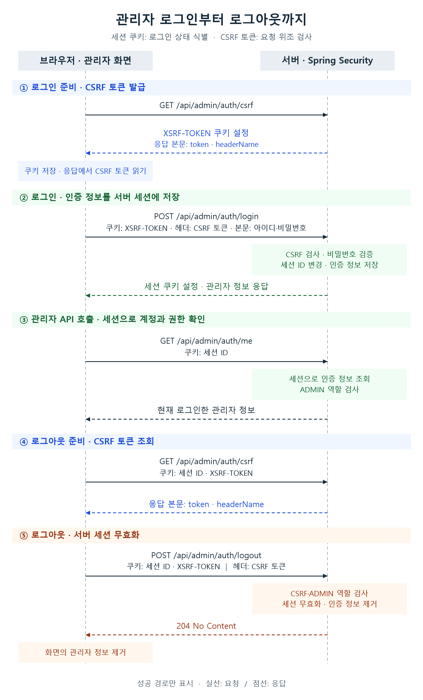

# **관리자 인증에 JWT 대신 세션을 선택한 이유**

‘공공주택 복덕방’은 사용자가 지도에서 공공주택 단지와 입주자 모집 공고를 찾아보는 웹 서비스입니다. 관리자 인증을 도입할 당시 일반 사용자는 로그인 없이 단지와 공고를 조회했고, 관리자는 별도 관리 화면에서 공공주택 단지와 공고 데이터를 등록하거나 수정했습니다.

우리 팀은 단지와 공고의 등록·수정 기능을 보호하기 위해 세션 기반 로그인을 선택했습니다. 로그아웃할 때 서버의 세션을 무효화하면, 이전 세션 ID로 보내는 관리자 API 요청을 차단할 수 있기 때문입니다. 어떤 기준으로 JWT와 세션을 비교했고, 로그인부터 로그아웃까지 어떻게 연결했는지 설명하겠습니다.

이 글은 Java와 Spring으로 API를 구현해 봤지만 인증 기능은 처음 만드는 개발자를 대상으로 합니다. HTTP 요청·응답과 기본적인 API 구현 경험을 전제로, 세션을 선택한 기준과 Spring Security로 로그인 상태를 저장하고 확인하는 흐름을 설명합니다. React 코드는 브라우저와 서버가 쿠키와 CSRF 토큰을 주고받는 과정을 중심으로 살펴봅니다.

## **공고 수정은 관리자에게만 허용해야 했다**

관리자는 공고 수정 API로 단지와 공고 데이터를 변경합니다.

관리자 화면에서 수정 버튼을 숨겨도 API 자체를 보호한 것은 아닙니다. 화면을 거치지 않고 서버에 직접 수정 요청을 보낼 수 있기 때문입니다. 따라서 서버는 요청을 받을 때마다 누가 보냈는지, 그 사람에게 수정 권한이 있는지 확인해야 했습니다. 잘못된 수정이 사용자에게 제공하는 공고 정보에 영향을 줄 수 있어 이 구분이 필요했습니다.

누구인지 확인하는 과정을 ‘인증’, 어떤 작업을 허용할지 판단하는 과정을 ‘인가’라고 합니다. 아이디와 비밀번호로 로그인하는 것은 인증입니다. 로그인한 사람에게도 관리자 역할이 있어야 공고 수정을 허용하는 것은 인가입니다.

이 구분을 바탕으로 관리자 API가 지켜야 할 조건을 정했습니다.

- 단지·공고 등록과 수정 등 관리자 API는 로그인한 계정만 호출할 수 있게 합니다.
- 로그인했더라도 관리자 역할이 없으면 단지·공고 등록과 수정을 허용하지 않습니다.
- 다른 사이트가 관리자의 브라우저를 이용해 의도하지 않은 공고 수정 등의 요청을 보내게 하는 공격을 막습니다.
- 로그아웃한 뒤에는 이전 세션 ID로 관리자 API에 다시 접근할 수 없어야 합니다.
- 어떤 아이디로 로그인을 시도했고 성공하거나 실패했는지, 누가 언제 로그아웃했는지 기록해야 합니다.

이제 로그인한 계정을 식별하고 관리자 권한을 확인할 근거를 어디에 보관할지 정해야 했습니다. 비밀번호를 관리자 API 요청마다 다시 보내지 않으면서도, 로그아웃 후에는 이전 로그인으로 관리자 API를 호출하지 못하게 해야 했습니다.

## **로그아웃을 서버에서 처리하기 위해 세션을 골랐다**

### **세션은 로그인 상태를 서버에 보관한다**

서버 세션 방식에서는 로그인한 계정의 아이디와 권한 같은 인증 정보를 서버에 보관합니다. 로그인에 성공하면 서버는 저장된 인증 정보를 찾을 수 있는 세션 ID를 브라우저에 전달합니다. 이후 관리자 API 요청에서는 아이디와 비밀번호를 다시 검증하는 대신, 세션 ID로 계정과 권한을 확인합니다.

이 ID를 전달할 때 쿠키를 사용합니다. 쿠키는 브라우저에 저장되는 값으로, 브라우저는 쿠키의 도메인·경로·보안 설정에 맞는 요청에 쿠키를 자동으로 붙입니다. 즉, 세션은 서버가 관리하는 로그인 상태이고 세션 쿠키는 그 상태를 찾을 ID를 전달하는 수단입니다.

로그아웃하면 서버가 해당 세션을 무효화합니다. 브라우저가 이전 세션 ID로 관리자 API를 호출하더라도, 서버는 유효한 세션을 찾을 수 없어 접근을 거절할 수 있습니다.

### **JWT는 만료 전 차단 방법을 따로 마련해야 한다**

JWT는 JSON Web Token의 약자로, 사용자 식별자나 만료 시각 같은 정보를 담는 토큰 형식입니다. 토큰은 서버가 발급하고 브라우저가 요청에 실어 보내는 문자열입니다. 서명된 JWT를 자체 검증하는 구성에서는 서버가 서명으로 내용이 바뀌지 않았는지 확인하고, 만료 시각 등을 검사해 요청을 처리합니다. [1]

이 구성은 여러 서버가 같은 토큰을 검증하기에 편리합니다. 다만 브라우저에서 토큰을 삭제하는 것과 서버가 그 토큰을 더는 허용하지 않는 것은 다릅니다. 이미 복사된 토큰은 만료 전까지 유효할 수 있기 때문입니다. JWT가 만료되기 전에 접근을 차단하려면 사용을 금지할 토큰 목록을 두거나, 요청에 담긴 토큰이 폐기됐는지 서버에서 별도로 확인해야 합니다. 만료된 토큰을 새로 발급하는 기능을 넣는다면 재발급과 폐기 과정도 관리해야 합니다.

| **비교한 항목** | **서명 JWT를 자체 검증하는 구성** | **서버 세션** |
| --- | --- | --- |
| 로그인 상태 확인 | 토큰의 서명·내용·만료 시각 검사 | 세션 ID로 서버의 로그인 상태 조회 |
| 로그아웃 후 차단 | 만료 전 차단을 위한 별도 정책 필요 | 서버에서 해당 세션 무효화 |
| 여러 서버로 확장 | 검증 키와 규칙 공유 | 세션 공유 저장소 또는 요청 배분 규칙 필요 |

우리 팀이 만들던 것은 관리자 전용 로그인과 ADMIN 역할 검사였습니다. 여러 서비스가 토큰을 각각 검증하는 기능보다, 로그아웃 시 해당 세션을 서버에서 무효화하는 기능이 먼저 필요했습니다. 세션을 선택하면 Spring Security로 계정·권한을 세션에 저장하고 로그아웃 시 세션을 무효화할 수 있었습니다. Spring Security는 Java 서버에서 인증과 권한 검사 등을 지원하는 보안 프레임워크입니다.

JWT와 세션 모두 권한 검사를 구현할 수 있습니다. 우리 팀은 성능 차이를 측정해 선택한 것이 아니라, 관리자 인증에 필요한 상태 관리와 로그아웃을 구현하는 작업을 비교해 세션을 골랐습니다. 대신 쿠키가 자동으로 전송되는 만큼 요청 위조를 막는 장치도 함께 마련해야 했습니다.

## **로그인부터 로그아웃까지 요청을 연결했다**

관리자 화면은 React로, 서버 API는 Spring으로 구현했습니다. 화면을 담당하는 프런트엔드와 요청을 처리하는 서버를 다음 흐름으로 연결했습니다.

1. 관리자 화면은 로그인 전에 CSRF 토큰 발급 API를 호출해 요청 위조 방어용 토큰을 받습니다.
2. 관리자 화면은 아이디·비밀번호를 로그인 요청 본문에, CSRF 토큰을 요청 헤더에 담아 보냅니다.
3. 서버는 비밀번호를 확인하고 관리자 아이디와 권한을 담은 인증 정보를 세션에 저장합니다.
4. 서버는 이후 관리자 API 요청에 포함된 세션 ID로 인증 정보를 찾고 관리자 권한을 검사합니다.
5. 로그아웃하면 서버는 해당 세션을 무효화하고, 관리자 화면은 로그인한 아이디와 역할을 지웁니다.



위 그림은 각 요청이 성공하는 흐름을 나타냅니다. 세션 쿠키는 서버에 저장된 로그인 상태를 찾는 데 사용하고, CSRF 토큰은 요청 위조를 검사하는 데 사용합니다. 브라우저는 쿠키를 자동으로 보내고, 관리자 화면은 CSRF 발급 API의 응답 본문에서 읽은 토큰을 요청 헤더에 넣습니다.

### **비밀번호를 확인하고 인증 정보를 세션에 저장한다**

관리자 화면은 POST /api/admin/auth/login으로 아이디와 비밀번호를 보냅니다. 서버는 Spring Security의 AuthenticationManager에 검증을 맡기고, AdminUserDetailsService를 통해 DB에 저장된 로그인 아이디·비밀번호 해시·역할을 읽습니다.

DB에는 비밀번호 원문 대신 BCrypt로 만든 해시를 저장합니다. 해시는 비밀번호에서 계산한 값으로, 원문을 그대로 보관하지 않고 일치 여부를 검사하는 데 사용합니다. 비밀번호 검증에 성공하면 관리자 아이디와 ROLE_ADMIN 권한을 담은 Authentication 객체를 얻습니다.

그다음에는 세션을 가져오거나 새로 만들고, 세션 ID를 변경한 뒤 관리자 아이디와 권한을 저장합니다. 아래는 관리자 로그인 코드에서 해당 부분만 가져온 것입니다.

```java
Authentication authentication =
        adminAuthenticationService.authenticate(
                request.loginIdentifier(), request.password());
servletRequest.getSession();
servletRequest.changeSessionId();
saveAuthentication(authentication, servletRequest, servletResponse);
```

getSession()은 기존 세션이 있으면 그 세션을 반환하고, 없으면 새 세션을 만듭니다. changeSessionId()는 로그인 전의 ID가 인증 후에도 그대로 쓰이지 않게 합니다. 공격자가 미리 알고 있는 세션 ID를 피해자가 사용하도록 만드는 ‘세션 고정 공격’에 대응하기 위한 처리입니다. [2]

saveAuthentication()은 관리자 아이디와 권한을 현재 요청에서 사용할 수 있게 설정하고, 이후 관리자 API 요청에서도 읽을 수 있게 세션에 저장합니다.

```java
SecurityContext securityContext =
        SecurityContextHolder.createEmptyContext();
securityContext.setAuthentication(authentication);
SecurityContextHolder.setContext(securityContext);
securityContextRepository.saveContext(
        securityContext, servletRequest, servletResponse);
```

SecurityContext는 Authentication 객체에 담긴 관리자 아이디와 권한을 보관합니다. SecurityContextHolder에 설정한 SecurityContext는 현재 요청의 권한 검사 등에 사용합니다. 마지막 saveContext()는 같은 관리자 아이디와 권한을 이후 요청에서도 읽을 수 있게 저장합니다. 프로젝트에서는 HttpSessionSecurityContextRepository를 사용해 세션에 보관했습니다. 로그인 요청을 직접 처리하는 코드에서는 이 저장 호출을 빠뜨리지 않아야 합니다. [2]

로그인에는 성공했는데 이어서 호출한 /api/admin/auth/me가 401을 반환한다면, 관리자 인증 정보가 세션에 저장됐는지와 /me 요청에 세션 쿠키가 포함됐는지를 나눠 확인할 수 있습니다. 비밀번호 검증 성공만으로는 요청 사이의 로그인 유지까지 확인한 것이 아니기 때문입니다.

### **요청을 보낸 계정에 관리자 역할이 있는지 검사한다**

관리자 API 요청에 세션 쿠키가 오면 서버는 세션에서 계정의 아이디와 권한을 꺼냅니다. 이어서 이 계정에 관리자 역할이 있는지 검사합니다. 관리자 기능의 주소는 /api/admin/ 아래에 모았고, 이 경로에 ADMIN 역할을 요구했습니다. 로그인·요청 위조 방어용 토큰 발급·서버 상태 확인은 로그인 전에 사용할 수 있도록 예외로 열어 뒀습니다.

다음은 [AdminSecurityConfiguration](https://github.com/woowacourse-teams/2026-toadzip/blob/fbb5a7cffb1659c7b8418435acdfe388c213773f/backend/src/main/java/com/toadzip/backend/admin/configuration/AdminSecurityConfiguration.java)에서 관리자 접근과 관련된 규칙을 발췌한 코드입니다. 다른 경로의 권한 규칙은 생략했습니다.

```java
.authorizeHttpRequests(authorize -> authorize
        .requestMatchers(HttpMethod.GET, "/api/health", "/api/admin/auth/csrf").permitAll()
        .requestMatchers(HttpMethod.POST, "/api/admin/auth/login").permitAll()
        .requestMatchers("/api/admin/**").hasRole(AdminRole.ADMIN.name())
        // 다른 경로의 권한 규칙은 생략
)
```

로그인 전에 필요한 상태 확인·CSRF 토큰 발급·로그인 경로를 먼저 허용하고, 그 뒤에 관리자 경로 전체에 ADMIN 역할을 요구하는 규칙을 두었습니다. permitAll()은 로그인하지 않은 요청도 허용한다는 설정이며, 로그인 요청의 CSRF 검사를 생략하는 것은 아닙니다.

AdminRole.ADMIN.name()은 "ADMIN"을 반환하므로, hasRole(AdminRole.ADMIN.name())은 hasRole("ADMIN")과 같습니다. Spring Security는 기본적으로 역할 이름 앞에 ROLE_를 붙여 권한을 표현하므로, 인증 객체에는 ROLE_ADMIN이 들어갑니다. 화면에서 관리자 메뉴가 보이는지와 관계없이 서버가 이 권한을 검사합니다.

### **쿠키 외에 CSRF 토큰도 검사한다**

세션 쿠키에는 편리함과 주의점이 함께 있습니다. 브라우저가 쿠키를 자동으로 보내므로 프런트엔드가 매번 세션 ID를 읽어 넣을 필요는 없습니다. 반면 다른 사이트가 관리자의 브라우저에 원하지 않는 요청을 보내게 하면, 쿠키 전송 조건에 따라 로그인된 요청처럼 보일 수 있습니다.

이런 공격을 CSRF, 즉 ‘사이트 간 요청 위조’라고 합니다. 서버는 쿠키 외에 별도의 CSRF 토큰도 확인하도록 구성했습니다. 관리자 화면은 CSRF 발급 API에서 받은 토큰을 로그인·로그아웃 등의 요청 헤더에 넣고, 서버는 요청에 담긴 토큰이 유효한지 검증합니다. 공격 사이트가 토큰을 읽어 같은 헤더를 채우지 못하도록 출처 제한도 함께 적용해야 합니다. [3]

프런트엔드는 먼저 GET /api/admin/auth/csrf를 호출합니다. 서버는 XSRF-TOKEN 쿠키를 발급하고, 응답 본문에 토큰 값인 token과 헤더 이름인 headerName을 담습니다. 로그인 함수는 headerName을 요청 헤더의 이름으로, token을 해당 헤더의 값으로 사용합니다.

```TypeScript
const csrfToken = await requestCsrfToken()
return request<AdminSession>(
  '/api/admin/auth/login', {
    method: 'POST',
    headers: {
      'Content-Type': 'application/json',
      [csrfToken.headerName]: csrfToken.token,
    },
    body: JSON.stringify({ loginIdentifier, password }),
  },
)
```

headers에는 CSRF 토큰을, body에는 아이디와 비밀번호를 넣습니다. 현재 프런트엔드는 쿠키 값을 직접 읽지 않고 발급 API의 응답에서 토큰을 가져옵니다. XSRF-TOKEN 쿠키는 브라우저가 전송합니다.

로그인은 누구나 시도할 수 있지만 CSRF 검사를 생략하지는 않습니다. 따라서 비밀번호가 맞더라도 토큰이 없으면 요청을 거절합니다. 이때는 비밀번호 검증 코드를 고치기 전에 토큰 발급 응답과 로그인 요청의 쿠키·헤더부터 확인해야 합니다. JWT도 쿠키에 넣을 수 있으므로, JWT를 선택한다고 이런 검토가 자동으로 없어지는 것은 아닙니다.

### **화면과 서버가 쿠키를 주고받도록 CORS를 설정한다**

서버가 관리자 인증 정보를 세션에 저장해도, 이후 요청에 세션 쿠키가 없으면 어떤 계정이 로그인했는지 확인할 수 없습니다. 공통 요청 함수에 credentials: 'include'를 설정한 이유입니다. 이 옵션은 다른 출처의 서버에 요청할 때도 쿠키 같은 인증 정보를 포함하도록 합니다.

출처는 URL에서 스킴(https 같은 접속 방식), 호스트(서버 주소), 포트(접속 번호)를 합친 구분입니다. 예를 들어 https://admin.example.com과 https://api.example.com은 호스트가 달라 서로 다른 출처입니다. 이 예에서 admin.example.com의 화면이 api.example.com의 응답을 읽으려면, API 서버가 CORS 규칙으로 관리자 화면의 출처를 허용해야 합니다.

우리 서버는 관리자 화면의 정확한 출처와 쿠키를 포함한 요청을 허용했습니다. 요청 본문의 형식을 알리는 Content-Type과 CSRF 헤더인 X-XSRF-TOKEN도 허용했습니다. 쿠키를 사용하는 CORS 응답에는 허용 출처를 뜻하는 별표(*)를 쓸 수 없습니다.

브라우저는 JSON 본문과 CSRF 헤더를 다른 출처의 API에 보내기 전에, OPTIONS 요청으로 해당 메서드와 헤더가 허용되는지 확인할 수 있습니다. 이를 ‘사전 요청’이라고 합니다. 사전 요청에는 세션 쿠키가 없으므로, 서버가 로그인부터 요구하면 본 요청을 보내기도 전에 막힙니다. CORS 처리를 인증 검사보다 먼저 해야 하는 이유입니다. CORS는 관리자 권한 검사를 대신하지 않으므로 앞서 설정한 역할 검사도 유지합니다. [5]

### **새로고침 뒤에는 로그인 상태를 다시 확인한다**

관리자 화면에 표시하는 로그인 여부와 관리자 아이디·역할도 서버 세션의 인증 정보와 맞아야 합니다. 브라우저를 새로고침하면 React가 메모리에 보관하던 관리자 아이디·역할은 사라지지만, 서버 세션에는 관리자 인증 정보가 남아 있을 수 있습니다. 그래서 AdminAuthProvider는 관리자 화면을 열 때 GET /api/admin/auth/me로 현재 로그인한 계정의 아이디와 ADMIN 역할을 조회합니다.

조회 중에는 로그인 여부를 단정하지 않고 로딩 상태를 유지합니다. /me에서 관리자 아이디와 역할을 받으면 React의 로그인 상태에 저장하고, 401 응답을 받으면 로그인하지 않은 것으로 판단합니다. 네트워크 오류는 인증 실패와 구분해 안내합니다.

응답 순서가 바뀌는 경우도 고려했습니다. 예를 들어 관리자 화면을 열 때 보낸 /me 응답이 늦어지는 동안 사용자가 로그아웃할 수 있습니다. 로그아웃을 마치고 화면에서 관리자 아이디와 역할을 지웠는데, 이전 /me의 성공 응답을 뒤늦게 반영하면 로그아웃한 계정이 다시 로그인한 것처럼 표시될 수 있습니다.

로그아웃 이전에 시작한 조회가 화면을 다시 로그인 상태로 바꾸지 못하게, /me 조회·로그인·로그아웃을 시작할 때마다 번호를 하나씩 올립니다. 각 요청은 시작할 때의 번호를 기억하고, 응답을 받으면 현재 번호와 비교합니다. 번호가 같을 때만 관리자 아이디·역할, 인증 확인 중임을 나타내는 로딩 상태, 인증 관련 오류 메시지를 바꿉니다. 코드의 ‘요청 세대 번호’는 이처럼 최신 동작을 구분하는 번호입니다.

예를 들어 /me 조회를 시작한 뒤 사용자가 로그아웃하면 다음처럼 처리합니다. 번호는 설명을 위한 예시입니다.

| **순서** | **발생한 동작** | **현재 세대 번호** | **화면에 반영할지** |
| --- | --- | --- | --- |
| 1 | /me 조회 시작, 요청이 번호 1을 기억 | 1 | 응답 대기 |
| 2 | 로그아웃 시작, 로그아웃 요청이 번호 2를 기억 | 2 | 응답 대기 |
| 3 | 로그아웃 성공 | 2 | 번호가 같으므로 관리자 정보 제거 |
| 4 | 이전 /me의 성공 응답 도착 | 2 | 요청 번호 1과 다르므로 반영하지 않음 |

이 비교는 늦게 도착한 응답이 화면의 로그인 상태를 되돌리는 것을 막습니다. 서버 세션의 무효화는 로그아웃 API가 담당합니다.

### **로그아웃은 세션을 끝내고 실패한 로그인은 제한한다**

로그아웃할 때도 CSRF 토큰을 받은 뒤 POST /api/admin/auth/logout을 보냅니다. 서버는 SecurityContextLogoutHandler로 요청에 연결된 세션을 무효화하고 인증 정보를 제거합니다. 프런트엔드는 로그아웃 요청이 성공하면 React에 저장된 관리자 아이디와 역할을 지웁니다. 이미 세션이 만료돼 401을 받은 경우에도 로그아웃 상태로 정리하지만, 그 밖의 네트워크·서버 오류는 성공으로 간주하지 않습니다. [6]

로그인 실패에 대한 규칙도 정했습니다. 계정이 없거나 비밀번호가 틀리면 같은 INVALID_ADMIN_CREDENTIALS 오류를 반환합니다. 응답만 보고 계정이 존재하는지 구분하지 못하게 하기 위해서입니다.

같은 IP와 로그인 식별자 조합에서 최근 10분 동안 실패가 5회 쌓이면, 여섯 번째 요청을 차단하고 그 시점부터 10분간 제한합니다. IP는 서버가 확인한 접속 주소이고, 로그인 식별자는 로그인에 사용하는 아이디입니다. 성공한 로그인은 해당 조합의 시도 기록을 초기화합니다. 단, 이미 제한에 걸린 요청은 비밀번호가 맞아도 인증 단계로 넘어가지 않습니다.

로그인 성공, 계정이 없거나 비밀번호가 틀린 로그인 실패, 로그아웃을 감사 로그로 남깁니다. 감사 로그는 누가 어떤 행동을 했고 결과가 어땠는지 나중에 확인하는 기록입니다. 행동, 결과, 로그인 식별자, 요청 추적 ID, 발생 시각을 저장합니다. 요청 추적 ID는 오류 응답과 서버 기록을 연결하는 값이며, 응답에서는 traceId로 전달합니다. 비밀번호·세션 ID·CSRF 토큰은 로그에 남기지 않아야 합니다.

## **테스트는 로그인 성공부터 로그아웃 이후까지 다룬다**

구현을 마친 뒤의 기준은 ‘로그인 버튼을 누르면 성공하는가’에서 끝나지 않았습니다. 로그아웃한 세션으로 /api/admin/auth/me를 조회하면 거절되는지, 관리자 역할이나 CSRF 토큰 없이 관리자 API를 호출하면 거절되는지도 확인해야 했습니다.

프로젝트는 HTTP 상태 코드와 오류 코드를 함께 사용해 실패 원인을 구분합니다.

| **확인할 상황** | **테스트 코드에 정의한 응답** |
| --- | --- |
| 로그인하지 않고 /me 조회 | 401 AUTHENTICATION_REQUIRED |
| 관리자 역할 없이 /me 조회 | 403 ACCESS_DENIED |
| CSRF 토큰 없이 로그인 | 403 ACCESS_DENIED |
| 아이디 또는 비밀번호가 틀림 | 401 INVALID_ADMIN_CREDENTIALS |
| 같은 IP·아이디로 반복 실패 | 제한된 여섯 번째 요청부터 429 LOGIN_ATTEMPTS_EXCEEDED |
| 동일 세션으로 로그인 후·로그아웃 후 /me 조회 | 로그인 후 200과 아이디·역할, 로그아웃 후 401 |

AdminAuthenticationIntegrationTest에서는 로그인·세션 저장·권한 검사를 연결해 확인합니다. CSRF 발급 API에서 받은 XSRF-TOKEN 쿠키와 토큰으로 로그인한 뒤, 로그인 과정에서 생성된 세션으로 /me 조회와 로그아웃을 요청합니다. 로그아웃 후 같은 세션으로 /me를 다시 조회하면 401을 기대하도록 작성했습니다.

로그인 성공·실패와 로그아웃 각각에 대해 감사 로그의 행동과 결과가 맞는지, 로그인 아이디·요청 추적 ID·발생 시각이 저장됐는지도 검사합니다. 로그인 제한을 따로 검사하는 테스트에서는 Clock으로 시간을 제어합니다. 실제로 10분을 기다리는 대신 테스트의 시간을 이동시켜 제한 해제 시점을 확인하는 방법입니다.

실패 상황을 검사할 때는 조건을 하나씩 바꾸는 것이 중요합니다. 관리자 권한 검사를 확인하려면 유효한 CSRF 토큰을 넣고 역할만 바꿉니다. CSRF 검사를 확인하려면 관리자 인증을 갖춘 상태에서 토큰만 뺍니다. 둘 다 빠뜨리면 앞선 검사에서 거절돼 나머지 규칙이 맞는지 알기 어렵습니다.

서버 테스트만으로 실제 브라우저의 쿠키 전송까지 확인할 수는 없습니다. 배포한 주소에서 로그인·새로고침·로그아웃을 이어서 점검해야 합니다. 로그인 후 /me 조회가 401을 반환하면 개발자 도구에서 세션 쿠키가 저장됐고 /me 요청에 포함됐는지 확인합니다. 로그인·로그아웃이 403으로 거절되면 CSRF 쿠키와 토큰 헤더를, 다른 출처의 API 호출이 막히면 CORS 응답을 살펴볼 수 있습니다.

위 표는 연결한 테스트 소스의 기대 동작이며, 이 글에 새로 실행한 테스트 결과를 제시한 것은 아닙니다.

## **서버 확장과 계정 변경에 대비한 운영 규칙도 필요하다**

### **여러 서버가 세션과 로그인 제한 기록을 공유해야 한다**

서버 한 대에 저장한 로그인 상태를 다른 서버가 자동으로 알게 되는 것은 아닙니다. A 서버에서 로그인한 뒤 다음 요청을 B 서버가 받으면, B도 같은 세션을 찾을 수 있어야 합니다. 여러 서버가 함께 쓰는 세션 저장소를 두거나, 같은 브라우저의 요청을 로그인했던 서버로 보내는 규칙이 필요합니다. 로그인했던 서버로 요청을 모으는 방식을 선택하면 장애나 배포로 그 서버를 사용할 수 없을 때 로그인 상태를 어떻게 유지할지도 정해야 합니다.

같은 IP·아이디 조합의 로그인 시도 횟수와 차단 종료 시각도 현재는 애플리케이션 메모리에 있습니다. 프로그램을 다시 시작하면 사라지고 서버 사이에 공유되지 않습니다. 여러 서버를 운영할 때는 Redis 같은 공유 저장소나 별도 요청 제한기를 검토해야 합니다. 앞단에서 요청을 전달하는 프록시 서버가 있다면 getRemoteAddr()에 실제로 어떤 접속 주소가 보이는지도 확인해야 합니다.

### **쿠키의 용도에 맞춰 읽기와 전송 범위를 제한해야 한다**

세션 쿠키에는 로그인한 계정의 인증 정보를 찾을 세션 ID가 들어갑니다. HttpOnly 속성은 JavaScript가 이 세션 ID를 직접 읽지 못하게 합니다. CSRF 쿠키는 요청 위조 방어용 토큰을 저장하며, 프로젝트에서는 withHttpOnlyFalse()로 설정했습니다. 현재 프런트엔드는 CSRF 쿠키를 직접 읽는 대신 /api/admin/auth/csrf 응답에서 토큰을 가져옵니다.

HttpOnly만으로 모든 스크립트 공격을 막을 수는 없습니다. 악성 JavaScript가 페이지에서 실행되는 XSS 공격이 발생하면, 세션 쿠키 값을 읽지 않고도 관리자의 브라우저에서 공고 수정 같은 관리자 API 요청을 보낼 수 있습니다. 쿠키 보호와 별개로 외부 입력이 실행 가능한 코드로 삽입되지 않게 해야 합니다.

운영에서는 HTTPS를 사용하고 쿠키의 Secure와 SameSite 속성도 확인해야 합니다. Secure는 HTTPS 연결에서 쿠키를 전송하게 하고, SameSite는 다른 사이트에서 시작된 요청에 쿠키를 붙일 조건을 정합니다. 화면과 API가 서로 다른 사이트에 있다면 브라우저의 제3자 쿠키 제한까지 영향을 줄 수 있으므로, credentials와 CORS 설정만 보고 전송을 보장해서는 안 됩니다. [4]

### **다른 기기의 로그인 상태를 끝낼 방법도 정해야 한다**

현재 로그아웃은 로그아웃 요청의 세션 ID에 해당하는 서버 세션만 무효화합니다. 다른 기기에서 로그인한 세션까지 모두 종료하지는 않습니다. 관리자 계정의 비밀번호나 역할을 바꿨을 때, 변경 전에 만들어진 로그인 세션을 즉시 무효화할지도 따로 정해야 합니다. 최초 관리자 계정을 만드는 기능 역시 환경 변수의 비밀번호를 바꾼다고 이미 저장된 비밀번호 해시를 갱신하지는 않으므로, 기존 계정의 비밀번호 변경 절차가 필요합니다.

감사 기록의 범위도 정해야 합니다. 현재 로그인 처리 코드가 남기는 실패 기록에 CSRF 차단과 로그인 시도 제한까지 모두 포함되지는 않습니다. 모든 거절을 추적하려면 요청을 검사하는 필터와 제한기의 기록을 보완해야 합니다. 누가 로그인했는지와 누가 공고를 어떻게 고쳤는지도 다른 기록이므로, 데이터 변경 이력은 별도로 관리해야 합니다.

우리 팀은 관리자 로그인 상태를 서버에서 관리하고 로그아웃할 때 끝내기 위해 세션을 선택했습니다. 세션 기반 관리자 로그인을 완성하려면 계정·권한을 세션에 저장하고, 관리자 API에서 권한과 CSRF 토큰을 검사하며, 새로고침 후 관리자 아이디와 역할을 다시 조회하도록 연결해야 했습니다. 비슷한 기능을 만든다면 로그인 성공과 함께 ‘언제 접근을 거절하고 언제 로그인 상태를 끝낼 것인가’를 먼저 정해 보길 권합니다.

## **참고 자료**

[[1] RFC 7519 JSON Web Token](https://www.rfc-editor.org/rfc/rfc7519)

[[2] Spring Security 인증 상태 저장과 세션 관리](https://docs.spring.io/spring-security/reference/servlet/authentication/session-management.html)

[[3] Spring Security CSRF 방어](https://docs.spring.io/spring-security/reference/servlet/exploits/csrf.html)

[[4] MDN Set Cookie 속성](https://developer.mozilla.org/en-US/docs/Web/HTTP/Reference/Headers/Set-Cookie)

[[5] Spring Security CORS](https://docs.spring.io/spring-security/reference/servlet/integrations/cors.html)

[[6] Spring Security 로그아웃 처리](https://docs.spring.io/spring-security/reference/servlet/authentication/logout.html)

[관리자 인증 구현](https://github.com/woowacourse-teams/2026-toadzip/tree/fbb5a7cffb1659c7b8418435acdfe388c213773f/backend/src/main/java/com/toadzip/backend/admin)

[관리자 인증 통합 테스트](https://github.com/woowacourse-teams/2026-toadzip/blob/fbb5a7cffb1659c7b8418435acdfe388c213773f/backend/src/test/java/com/toadzip/backend/admin/controller/AdminAuthenticationIntegrationTest.java)

[로그인 시도 제한 테스트](https://github.com/woowacourse-teams/2026-toadzip/blob/fbb5a7cffb1659c7b8418435acdfe388c213773f/backend/src/test/java/com/toadzip/backend/admin/service/AdminLoginAttemptLimiterTest.java)

[React 관리자 인증 구현](https://github.com/woowacourse-teams/2026-toadzip/tree/fbb5a7cffb1659c7b8418435acdfe388c213773f/frontend/src/admin/auth)
