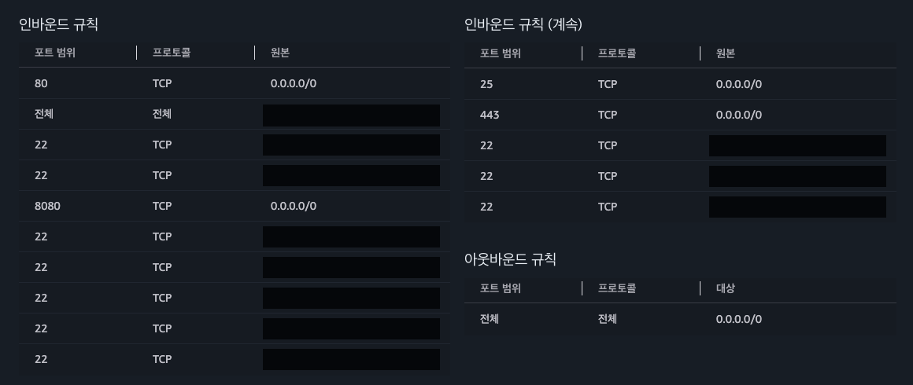
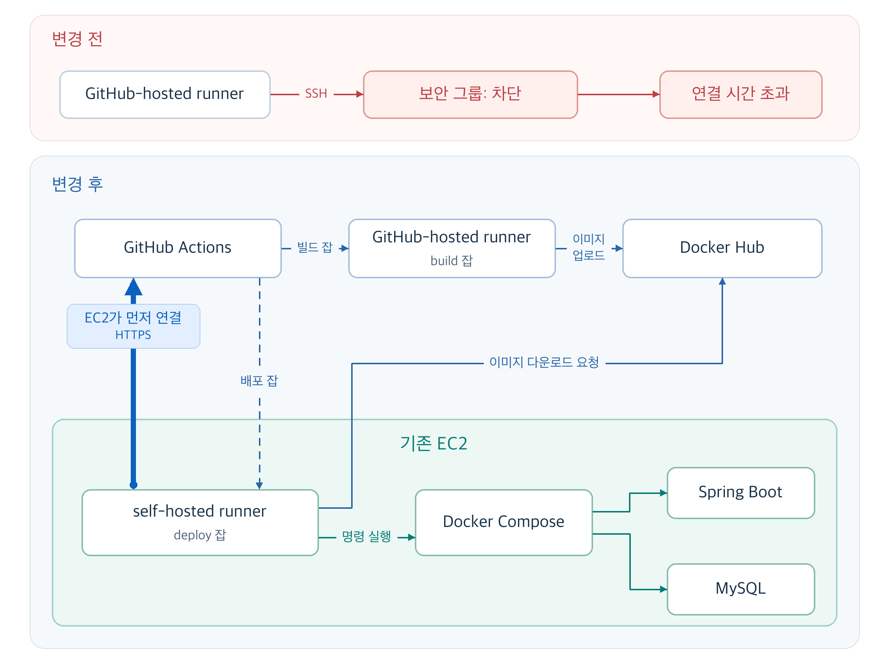
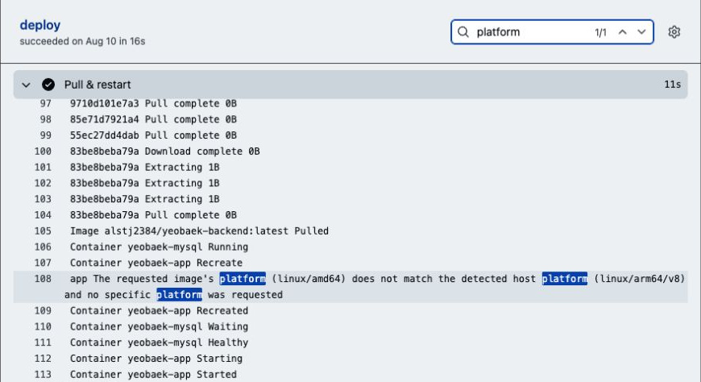
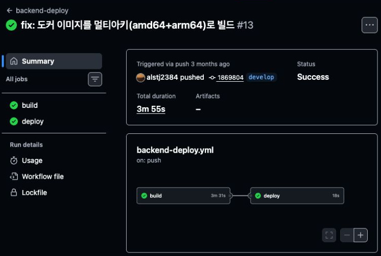

# SSH 없이 EC2에 배포하기

저희 팀은 소규모 독서 모임을 위한 온라인 교환 독서 서비스 ‘여백’을 만들었습니다. 개발 교육 과정인 우아한테크코스에서 제공받은 EC2에 서비스를 배포했는데요. 처음에는 SSH로 서버에 원격 접속해서 배포 명령을 직접 실행했습니다.

이 작업을 GitHub Actions로 자동화하려다 예상하지 못한 곳에서 막혔습니다. 코드 빌드도 끝났고 Docker Hub에 이미지도 올라갔는데, 교육장에서는 잘되던 SSH 접속이 Actions에서는 되지 않았습니다.

`ssh: connect to host *** port 22: Connection timed out`

## 교육장에서는 되던 SSH 접속

당시에는 EC2 한 대에서 Spring Boot 애플리케이션과 MySQL을 컨테이너로 실행하고, Docker Compose로 관리했습니다.

자동화하려던 작업도 수동으로 배포할 때와 크게 다르지 않았습니다. GitHub Actions에서는 여러 단계를 **잡**(job)으로 묶고, 이를 **러너**(runner)에서 실행합니다. 저희는 GitHub가 제공하는 **GitHub-hosted runner** 하나에서 다음 작업을 순서대로 실행하도록 했습니다.

1. 소스 코드를 가져와 Gradle로 빌드합니다.
2. Docker 이미지를 빌드하고 Docker Hub에 올립니다.
3. EC2에 SSH로 접속합니다.
4. EC2에서 새 이미지를 내려받고 Docker Compose로 실행합니다.

앞의 두 단계는 성공했습니다. 하지만 세 번째인 SSH 접속에서 실패하면서, EC2에서 배포 명령을 실행하는 단계까지는 가지 못했습니다. SSH 명령이 남긴 종료 코드는 `255`였습니다. [`255`는 SSH 오류를 나타내는 코드](https://man.openbsd.org/ssh.1#EXIT_STATUS)여서, 구체적인 원인은 함께 출력된 `Connection timed out` 메시지에서 찾아야 했습니다.

### SSH 키를 확인하기 전에

`Connection timed out`은 지정한 호스트와 포트에 제한 시간 안에 연결하지 못했다는 뜻입니다. 서버에 연결한 다음 SSH 키로 인증하는데, 그 첫 단계부터 실패한 셈입니다. 그래서 네트워크 연결부터 살펴봤습니다.

물론 이 메시지만으로 문제의 설정을 바로 알 수는 없습니다. [서버 주소나 라우팅이 잘못돼도, 접근 규칙이 연결을 막아도](https://docs.aws.amazon.com/AWSEC2/latest/UserGuide/TroubleshootingInstancesConnecting.html) 같은 오류가 납니다. 저희에게는 교육장 네트워크에서는 접속할 수 있다는 단서가 있었습니다. 같은 서버인데 접속하는 곳에 따라 결과가 달랐으니, 어떤 IP에서 보낸 요청을 허용하는지 확인해 보기로 했습니다.

이때 확인한 것이 EC2의 **보안 그룹**입니다. 서버로 들어오는 **인바운드 트래픽**과 나가는 **아웃바운드 트래픽**을 어디까지 허용할지 정하는 설정입니다.

확인해 보니 SSH 접속에 쓰는 22번 포트는 교육장과 VPN 등 특정 IP에서만 접근할 수 있었습니다. GitHub-hosted runner의 IP는 여기에 포함되지 않았습니다. 보안 그룹이 요청을 버려 응답이 오지 않자, 러너에서 실행한 SSH 명령이 연결 시간 초과 오류를 낸 것이었습니다.



*보안 그룹 규칙 일부. IP 주소와 리소스 식별자는 가렸습니다.*

### 22번 대신 다른 포트를 쓰면 어떨까요?

22번 포트에서 막혔으니 다른 포트를 쓰는 방법도 생각해 볼 수 있습니다. SSH의 기본 포트는 22번이지만, [서버의 `Port` 설정](https://man.openbsd.org/sshd_config#Port)을 바꾸면 다른 포트에서도 접속을 받을 수 있습니다.

하지만 포트 번호와 접속을 허용할 IP는 별개의 조건입니다. 예를 들어 SSH 포트를 2222번으로 바꿔도, 그 포트에 GitHub-hosted runner의 IP를 허용하지 않으면 접속할 수 없습니다.

결국 GitHub-hosted runner가 접속할 수 있도록 허용 IP를 늘려야 하는데, 일반 러너의 [IP 범위는 넓고 목록도 주기적으로 바뀝니다](https://docs.github.com/en/actions/reference/runners/github-hosted-runners#ip-addresses). 그에 맞춰 보안 그룹 규칙을 관리하는 일까지 생깁니다. 저희는 SSH 접속을 허용하는 범위는 그대로 두고, 서버에서 명령을 실행할 다른 방법을 찾기로 했습니다.

## 명령 두 개를 실행하려고 어디까지 바꿔야 할까

이미지는 Docker Hub에 올라가 있었습니다. EC2에서 `docker compose pull`로 이미지를 내려받고, `docker compose up -d`로 컨테이너를 실행하면 배포할 수 있었습니다. 이 두 명령을 SSH 없이 실행할 수 있는 방법들을 비교했습니다.

| 방법 | 동작 방식 | 장점 | 추가로 필요한 작업 |
| --- | --- | --- | --- |
| AWS Systems Manager(SSM) Run Command | EC2의 SSM Agent가 명령을 받아 실행 | 기존 셸 명령 사용 | 에이전트·권한 설정, 명령 실행 결과를 Actions에 반영 |
| self-hosted runner | EC2에 러너를 설치해 GitHub Actions 잡 실행 | 기존 워크플로에서 명령 실행과 로그 확인 | 러너의 실행 상태·권한·업데이트·디스크 관리 |
| AWS CodeDeploy | EC2의 에이전트가 정해진 절차에 따라 지정한 버전을 배포 | 배포 단계 관리, 자동 롤백 | 배포 파일 저장소·권한·배포 절차·대상 서버 그룹 설정 |
| Watchtower | 레지스트리의 이미지 변경을 감지해 컨테이너 교체 | 새 이미지로 자동 교체 | 별도 빌드·업로드, 컨테이너 교체 결과를 Actions에서 확인할 구성 |

SSM Run Command는 기존 명령을 그대로 실행할 수 있다는 점이 좋았습니다. 다만 명령을 보내는 것과 실행 결과를 확인하는 것은 별개였습니다. API나 명령줄 도구로 [완료 여부를 조회한 뒤](https://docs.aws.amazon.com/systems-manager/latest/userguide/monitor-commands.html), 그 결과에 따라 Actions 잡도 성공하거나 실패하도록 구성해야 했습니다.

CodeDeploy를 쓰면 [자동 롤백](https://docs.aws.amazon.com/codedeploy/latest/userguide/deployments-rollback-and-redeploy.html)까지 맡길 수 있었습니다. 대신 저희가 검토한 구성에서는 Amazon S3에 배포 파일을 저장하고, IAM 권한과 AppSpec 배포 절차를 설정해야 했습니다. 당시에는 자동 롤백이 필수는 아니었습니다. EC2 한 대에서 Compose 명령을 실행하려는 상황에 비해 준비할 것이 많다고 느꼈습니다.

[Watchtower](https://containrrr.dev/watchtower/)는 이미지 변경을 감지해 컨테이너를 새 이미지로 교체합니다. 하지만 이 작업은 Actions와 별도로 실행됩니다. 빌드·업로드 로그와 컨테이너 교체 결과를 같은 Actions 실행 화면에서 보려면 추가 설정이 필요했습니다.

이 방법들과 비교했을 때 self-hosted runner는 기존 구성을 가장 적게 바꿔도 됐습니다. EC2에 러너를 설치하면 기존 워크플로의 배포 명령을 그 안에서 실행할 수 있었습니다. 빌드부터 배포까지 어느 단계에서 실패했는지 Actions에서 로그를 이어서 확인할 수 있다는 점도 좋았습니다. 러너를 직접 관리해야 한다는 부담을 감수하고, 이 방식을 선택했습니다.

## 밖에서 들어갈 수 없다면 안에서 연결하기

외부인이 들어올 수 없는 사무실이라도 안에서 전화를 걸어 업무를 전달받을 수는 있습니다. self-hosted runner도 비슷합니다. EC2에 설치한 러너가 GitHub로 먼저 아웃바운드 HTTPS 연결을 맺고, 실행할 잡을 받아옵니다. 따라서 이 방식에는 [443번 포트의 아웃바운드 HTTPS 통신과 필요한 도메인 접근](https://docs.github.com/en/actions/reference/runners/self-hosted-runners)이 허용되어 있어야 합니다.



*배포 방식 변경 전후*

그림에서 GitHub가 러너 쪽으로 잡을 보내는 점선이 보입니다. 이 흐름을 위해 인바운드 포트를 새로 여는 것은 아닙니다. 러너가 먼저 맺은 연결을 이용하고, 보안 그룹은 [허용된 아웃바운드 요청에 대한 응답](https://docs.aws.amazon.com/AWSEC2/latest/UserGuide/ec2-security-groups.html)을 인바운드 규칙과 무관하게 허용합니다.

이렇게 받은 잡은 EC2 안에서 실행되므로 배포 명령을 전달하려고 SSH에 접속할 필요가 없어집니다. SSH는 러너를 설치하거나 장애에 대응할 때처럼, 관리자가 직접 서버에 접속하는 용도로 남겨 뒀습니다.

## 빌드까지 우리 서버에서 해야 할까요?

연결 문제를 해결할 방법은 찾았지만, 러너에 맡길 작업은 더 생각해 봐야 했습니다. 기존 잡을 통째로 EC2로 옮기면 Gradle 빌드부터 컨테이너 실행까지 한 서버에서 처리하게 됩니다. 빌드한 이미지를 바로 실행하니 레지스트리에 올렸다가 내려받는 과정도 생략할 수 있습니다. 설치해 둔 빌드 도구와 이전 빌드의 캐시를 계속 쓸 수 있다는 장점도 있습니다.

다만 빌드가 돌아갈 곳은 서비스를 운영하는 바로 그 서버였습니다. 저희가 선택한 인스턴스는 [vCPU 2개와 메모리 4 GiB를 제공하는 t4g.medium](https://aws.amazon.com/ec2/instance-types/general-purpose/)이었습니다. Spring Boot와 MySQL을 함께 실행해야 해서, 메모리가 2 GiB인 t4g.small보다 여유가 있는 구성을 고른 상태였습니다.

여기에 Gradle 빌드와 테스트, Docker 이미지 빌드까지 더하면 애플리케이션과 빌드가 CPU와 메모리를 나눠 써야 합니다. 빌드는 이미 GitHub-hosted runner에서 잘되고 있었으니 굳이 서비스 서버로 옮기지 않기로 했습니다. 이미지를 올리고 내려받는 과정은 남지만, EC2에서는 빌드를 제외한 배포 작업만 실행하도록 나눴습니다.

| 실행 환경 | 맡긴 작업 |
| --- | --- |
| GitHub-hosted runner | Gradle 빌드, 테스트·정적 분석, Docker 이미지 빌드와 Docker Hub 업로드 |
| EC2의 self-hosted runner | Docker 이미지 다운로드, Compose 실행, 이미지 정리 |

## EC2에 러너 설치하기

역할을 나눴으니 먼저 EC2에 배포용 러너를 설치해야 했습니다. 그런데 설치한 프로그램을 실행하는 첫 단계부터 오류가 났습니다.

### Linux용 파일인데 왜 실행이 안 될까

Linux용 러너를 내려받아 설정 스크립트를 실행했더니 다음 메시지가 나왔습니다.

```text
./config.sh: line 80: ./bin/Runner.Listener: cannot execute binary file: Exec format error
```

다운로드한 파일은 `actions-runner-linux-x64-…tar.gz`였습니다. Linux용인지는 확인했지만 CPU 아키텍처까지 맞춰야 한다는 점을 놓쳤습니다. 저희 EC2는 ARM64 기반이어서 x64용 실행 파일을 실행할 수 없었습니다.

서버의 아키텍처는 다음 명령으로 확인할 수 있습니다.

```bash
uname -m
```

결과가 `aarch64`라면 ARM64용 러너를, `x86_64`라면 x64용 러너를 선택하면 됩니다. x64는 Docker에서는 amd64로 표기하기도 합니다. 서버에 맞는 파일로 다시 설치하자 이번에는 `Connected to GitHub` 로그가 나왔습니다.

### 그룹과 라벨을 혼동했습니다

GitHub와 연결한 다음에는 러너를 등록해야 했습니다. 여기서 그룹을 묻는 항목에 `ec2-prod`를 입력했다가 또 오류가 났습니다.

```text
Could not find any self-hosted runner group named "ec2-prod".
```

워크플로에서 러너를 지정할 때 쓸 `ec2-prod`를 그룹 이름으로 입력한 것이 문제였습니다. 러너를 등록할 때 나오는 이름, 라벨, 그룹은 비슷해 보여도 각각 쓰임이 달랐습니다.

| 항목 | 용도 | 저희 설정 |
| --- | --- | --- |
| 이름 | 관리 화면과 실행 기록에서 러너를 구분 | 러너 이름은 `ec2` |
| 라벨 | 잡을 배정할 러너의 조건 | 배포 잡에 필요한 라벨은 `self-hosted`, `ec2-prod` |
| 그룹 | 러너를 묶어 접근 권한 관리 | `ec2-prod`라는 그룹은 없었음 |

일반적인 등록 과정에서는 [`self-hosted`, 운영체제, 아키텍처 라벨](https://docs.github.com/en/actions/how-tos/manage-runners/self-hosted-runners/use-in-a-workflow)이 기본으로 붙습니다. 저희는 여기에 `ec2-prod` 라벨을 추가했습니다. 이후 워크플로에서 이 라벨로 배포할 러너를 지정했습니다.

## 빌드와 배포 잡 연결하기

배포할 러너를 등록했으니, 이제 워크플로에서 그 러너에게 작업을 맡길 차례입니다. 러너가 계속 잡을 받을 수 있도록 서비스로 실행하고, 러너 계정에 Docker를 사용할 권한을 부여해야 합니다. 워크플로에 적은 배포 명령도 이 계정으로 실행되기 때문입니다.

워크플로에서는 `build`와 `deploy` 두 잡이 각자 다른 러너를 사용하도록 했습니다. 아래 코드에서는 빌드 단계의 세부 명령을 생략했습니다.

```yaml
jobs:
  build:
    runs-on: ubuntu-latest
    # steps: 소스 체크아웃, Gradle 빌드, 이미지 빌드·푸시

  deploy:
    needs: build
    runs-on: [self-hosted, ec2-prod]
    steps:
      - name: Pull & restart
        run: |
          cd ~/yeobaek
          docker compose pull
          docker compose up -d
          docker image prune -f
```

`build`의 `runs-on`은 `ubuntu-latest`로 두어 GitHub가 제공하는 Ubuntu 러너에서 실행합니다. `deploy`에는 `[self-hosted, ec2-prod]`를 지정했습니다. 두 라벨이 모두 붙어 있는 EC2의 러너에게 배포를 맡기는 설정입니다.

[`needs: build`](https://docs.github.com/en/actions/how-tos/write-workflows/choose-what-workflows-do/use-jobs)는 빌드가 성공한 뒤에 배포를 시작하도록 넣었습니다. 빌드가 실패하거나 생략되면 배포 잡도 실행되지 않습니다.

잡의 실행 순서는 `needs`로 정했지만, 서로 다른 서버 사이에 이미지도 전달해야 합니다. 이 역할은 Docker Hub가 맡습니다. 빌드 잡이 이미지를 올리면, 배포 잡은 `docker compose pull`로 가져옵니다.

EC2에서는 완성된 이미지를 실행하므로 Git 저장소의 소스 코드를 가져오는 체크아웃 단계는 넣지 않았습니다. 대신 서버에 미리 둔 `~/yeobaek/docker-compose.yml`과 `.env`를 사용합니다. 이 파일들을 사용하는 만큼, Compose 설정이나 환경 변수를 바꿀 때는 서버의 파일도 갱신해야 합니다.

### 러너를 고쳤더니 이번에는 이미지가 문제였습니다

이제 배포 잡은 EC2에서 실행됐습니다. 그런데 컨테이너가 `exec format error`를 내며 재시작을 반복했습니다. 러너 설치 때 겪었던 아키텍처 문제가 이번에는 Docker 이미지에서 나타난 것입니다. GitHub-hosted runner에서 만든 이미지는 amd64용이었고, 실행할 EC2는 ARM64였습니다.

배포 로그에도 이미지의 플랫폼은 `linux/amd64`인데 호스트는 `linux/arm64/v8`라는 경고가 나왔습니다.



*[수정 전 배포 잡](https://github.com/woowacourse-teams/2026-yeobaek/actions/runs/31368847746/job/93393932500#step:2:109)의 플랫폼 불일치 경고입니다. 컨테이너 내부의 `exec format error` 로그와는 별개의 메시지입니다.*

이미지도 서버에 맞게 빌드해야 했습니다. 이를 위해 여러 플랫폼의 이미지 빌드를 지원하는 Docker Buildx를 사용했습니다. x64 러너에서 ARM64용 이미지를 빌드할 수 있도록 에뮬레이션 도구인 QEMU도 준비했습니다.

아래는 [당시 설정](https://github.com/woowacourse-teams/2026-yeobaek/blob/186980431b2f1d1e342290c17dd0e4f05a9927bb/.github/workflows/backend-deploy.yml)에서 ARM64용 이미지 빌드만 남긴 예제입니다. 소스 체크아웃, Gradle 빌드, Docker Hub 로그인 뒤에 실행합니다.

```yaml
- name: Set up QEMU
  uses: docker/setup-qemu-action@v3

- name: Set up Docker Buildx
  uses: docker/setup-buildx-action@v3

- name: Build and push image (arm64)
  run: |
    IMAGE="${{ secrets.DOCKERHUB_USERNAME }}/yeobaek-backend"
    docker buildx build --platform linux/arm64 \
      -t "$IMAGE:latest" -t "$IMAGE:${{ github.sha }}" --push .
```

`--platform linux/arm64`를 지정하면 빌드가 실행되는 러너의 아키텍처와 관계없이 ARM64용 이미지를 만듭니다. 이렇게 만든 이미지를 EC2에서 내려받아 실행하면 됩니다.

## 두 잡이 모두 초록색이 됐습니다

이미지의 아키텍처를 수정한 뒤 [빌드와 배포를 다시 실행했습니다](https://github.com/woowacourse-teams/2026-yeobaek/actions/runs/31369922821). GitHub-hosted runner가 이미지를 올리고, EC2의 러너가 받아서 배포 명령을 실행했습니다. 두 잡 모두 성공했습니다.



*멀티 아키텍처 빌드를 적용한 뒤의 실행 결과입니다. `build` 다음에 `deploy`가 실행됐고, 두 잡 모두 성공했습니다.*

워크플로에서 SSH 명령과 SSH 키를 사용하는 부분도 지웠습니다. 빌드 로그와 EC2에서 실행한 Compose 명령의 로그는 GitHub Actions에서 함께 확인할 수 있었습니다.

다만 여기서 배포 성공을 판단하는 기준도 다시 볼 필요가 있었습니다. 앞서 아키텍처 경고가 나왔던 배포도 잡 상태는 성공이었기 때문입니다. [`docker compose up -d`](https://docs.docker.com/reference/cli/docker/compose/up/)는 컨테이너를 백그라운드로 실행합니다. 명령이 끝나도 Spring Boot는 아직 시작 중이거나, 직후 오류로 종료될 수 있습니다. 초록불은 배포 명령이 끝났다는 표시이지, 애플리케이션이 요청에 응답한다는 확인은 아니었습니다.

저희는 MySQL에 `healthcheck`를 설정해 DB가 준비된 뒤 애플리케이션이 시작하도록 했지만, 애플리케이션의 응답까지 검사하지는 않았습니다. 배포 후 HTTP 요청으로 정상 응답을 확인하고, 응답이 없거나 오류가 나면 잡도 실패하도록 바꾸는 일이 남았습니다.

## Self-hosted runner를 운영하며 챙겨야 할 일

배포 명령을 EC2 안에서 실행하면서 SSH 접속 문제는 해결했습니다. 그 대신 서비스 서버에 러너라는 관리 대상이 하나 더 생겼습니다.

### 이 서버에서 실행해도 되는 코드인지

러너가 실행하는 코드에 악성 명령이 들어 있으면 [서버 파일이나 자격 증명에 접근할 수 있습니다](https://docs.github.com/en/actions/concepts/security/compromised-runners). SSH 접근 제한으로는 서버 안에서 실행되는 이 명령을 막을 수 없습니다.

그래서 외부 풀 리퀘스트(PR)의 코드를 검증하는 작업을 운영 러너에서 실행해서는 안 됩니다. 워크플로를 누가 수정할 수 있는지, 배포 브랜치는 어떻게 보호하는지, 어떤 외부 Action을 사용하는지도 확인해야 합니다.

### 배포가 시작되지 않는다면

러너의 실행 상태도 애플리케이션과 따로 살펴봐야 합니다. 서비스가 정상이어도 러너가 멈추면 새 배포는 대기 상태로 남습니다. GitHub Actions가 [잡을 실행할 온라인 러너](https://docs.github.com/en/actions/reference/runners/self-hosted-runners)를 찾지 못하기 때문입니다. 이때는 러너가 온라인인지, 필요한 라벨이 붙어 있는지, GitHub와 통신할 수 있는지부터 확인합니다.

### 이미지를 지우기 전에

배포를 반복하면 이전 이미지가 쌓이므로 스크립트 마지막에 [`docker image prune -f`](https://docs.docker.com/reference/cli/docker/image/prune/)를 넣었습니다. 태그가 없고 컨테이너에서도 참조하지 않는 dangling 이미지를 정리합니다. 태그가 남은 이미지의 정리와 보관 기간은 별도로 정해야 합니다.

롤백에 쓸 이미지도 남겨 둬야 합니다. 앞의 빌드 코드에서는 이미지에 `latest`와 커밋 식별자(SHA) 태그를 함께 붙였습니다. SHA 태그를 보면 어떤 커밋으로 만든 이미지인지 알 수 있습니다. 다만 EC2의 Compose는 새 이미지를 올릴 때마다 바뀌는 `latest`를 사용했습니다. 이전 버전으로 되돌리려면 해당 이미지의 태그를 지정해 다시 실행해야 합니다.

### 방금 빌드한 이미지가 배포되는지

`latest`를 사용하는 데는 또 다른 주의점이 있습니다. `needs: build`로 빌드가 끝나기를 기다려도, 그사이에 다른 워크플로나 수동 업로드로 `latest`가 바뀔 수 있습니다. 그러면 배포 잡은 방금 빌드한 이미지가 아니라 나중에 올라온 이미지를 내려받습니다.

이를 막으려면 빌드한 이미지의 SHA 태그나 digest(이미지 내용을 식별하는 값)를 배포 잡에 전달하고, Compose에서도 `latest` 대신 그 값을 사용해야 합니다.

### 롤백도 직접 만들게 된다면

이전 이미지를 남겨 두고 배포할 버전을 지정할 수 있게 해도, 자동 롤백까지 되는 것은 아닙니다. HTTP 응답 검사에 실패했을 때 이전 이미지를 다시 실행하는 절차를 워크플로에 작성해야 합니다.

지금처럼 애플리케이션 컨테이너 하나를 교체하면 서비스가 잠시 중단될 수 있습니다. 무중단 배포를 하려면 새 버전을 먼저 실행해 정상 동작을 확인한 뒤, 사용자 요청이 새 버전으로 가도록 전환해야 합니다.

자동 롤백이나 여러 서버에 순서대로 배포하는 기능까지 필요해진다면 CodeDeploy 같은 도구를 다시 비교할 만합니다.

## 마치며

배포를 위해 EC2로 들어가는 대신, EC2가 GitHub에 연결해 작업을 받도록 바꿨습니다. SSH 접근 범위를 유지하면서 빌드와 배포를 한 워크플로에서 실행할 수 있었습니다.

EC2 한 대에 Compose로 배포하던 저희에게는 기존 워크플로와 배포 명령을 살릴 수 있다는 점이 잘 맞았습니다. 서비스 서버에서 러너도 함께 실행하는 만큼, 어떤 잡을 실행하는지와 러너가 정상적으로 동작하는지를 직접 챙겨야 합니다.
