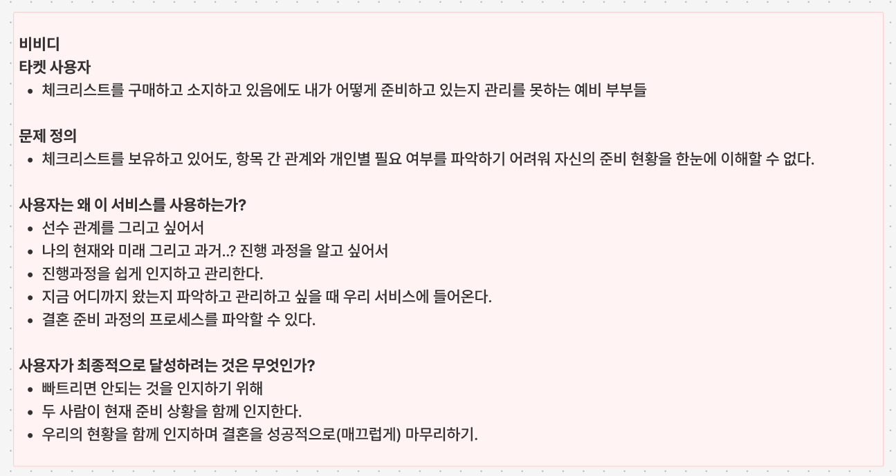
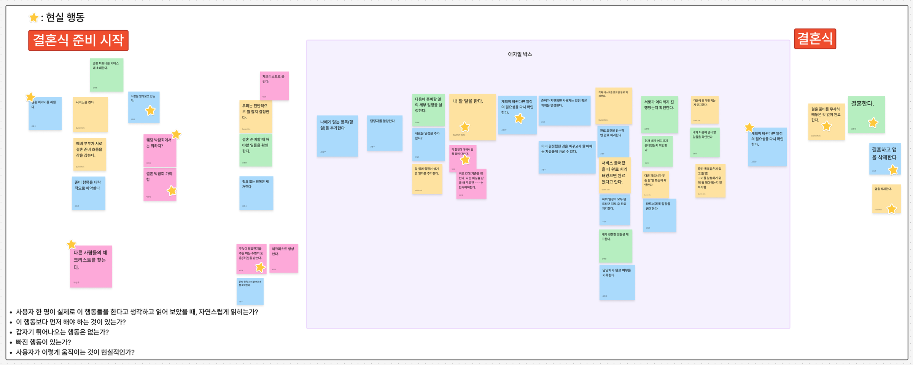
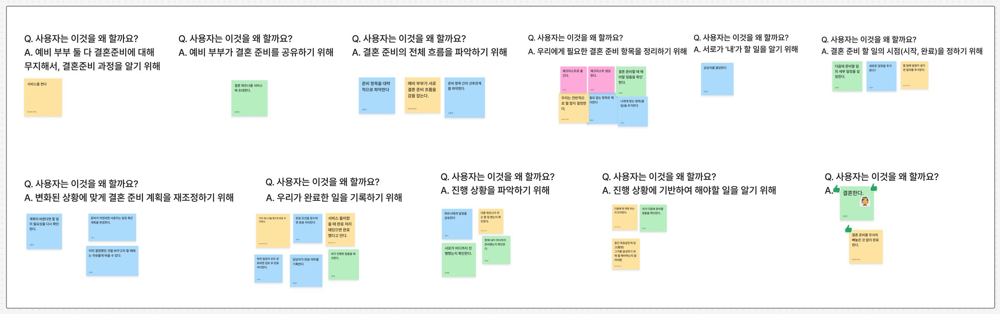
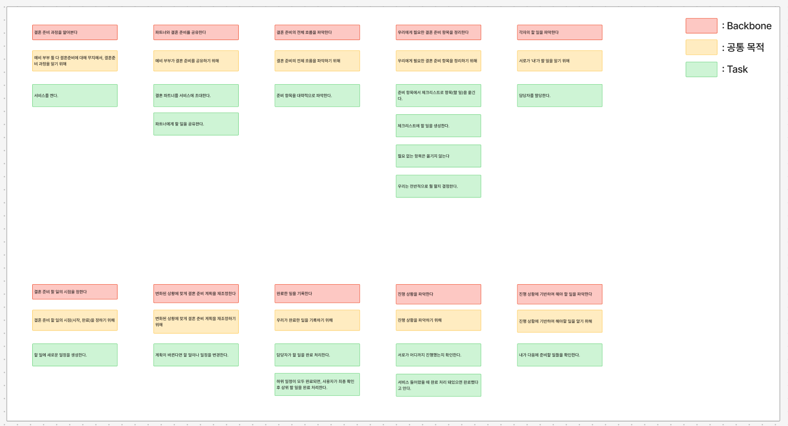
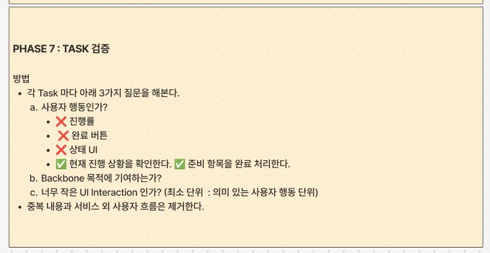
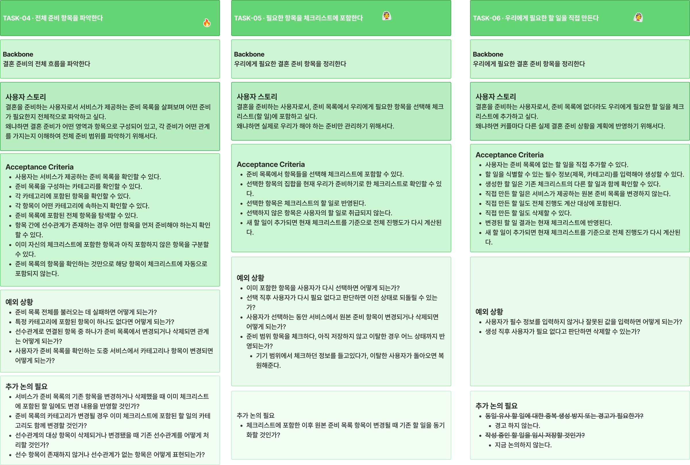
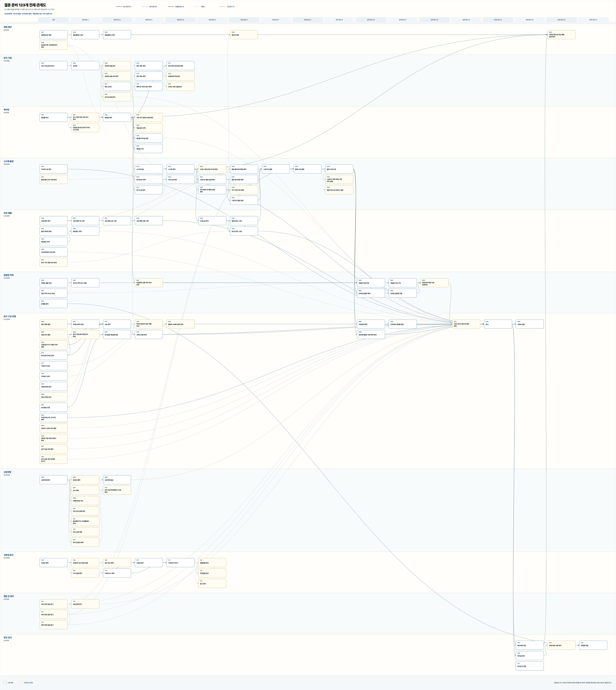
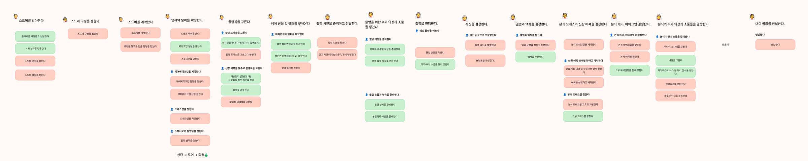

# 기능 목록으로는 안 맞던 팀의 그림, 사용자 스토리 맵으로 맞추기

## 이 글을 읽으면 좋은 사람

이 글은 새 서비스를 기획 중인 3~5명 팀의 개발자를 위해 썼다. 특히 아래 상황에 해당하면 도움이 될 것이다.

- 기능 명세서를 써 두었는데도 팀원마다 떠올리는 서비스가 다르다.
- MVP에 무엇을 넣을지를 두고 같은 논쟁이 몇 번째 반복되고 있다.
- 사용자 스토리 맵이라는 말은 들어 봤지만 실제로 해 본 적은 없다.

따로 알아야 하는 배경 지식은 없다. 사용자 스토리, Backbone 같은 용어는 본문에서 우리 팀이 실제로 쓴 예시와 함께 설명한다.

글의 순서는 이렇다. 먼저 우리 팀에 어떤 문제가 있었는지 적는다. 그다음 기능 명세서와 사용자 스토리 맵을 어떤 기준으로 비교했는지, 워크숍을 실제로 어떻게 진행했는지를 적는다. 마지막으로 무엇이 달라졌는지와, 이 방법을 쓰면 안 되는 경우를 적는다. 워크숍 진행표와 카드 양식은 그대로 가져다 쓸 수 있게 본문에 넣었다.

## 1. 문제: 기능 목록으로는 생각이 맞춰지지 않았다

우리 팀은 4명이었다. 우아한테크코스 레벨3 프로젝트로 결혼 준비 체크리스트 서비스 비비디를 기획하고 있었다.

처음에는 익숙한 방법으로 생각을 맞추려고 했다. 기능 명세서를 쓰고, 그 명세서로 인수 조건을 써 보는 방식이다. 인수 조건은 기능을 만들기 전에 "사용자 입장에서 무엇이 되면 다 된 것인가"를 문장으로 먼저 정해 두는 것이다. 8월 11일 밤에 우리는 인수 조건을 "사용자는 준비 목록에서 체크리스트로 항목을 옮길 수 있다" 같은 시나리오 아홉 개로 정리했다. 그리고 반드시 할 것, 하지 않을 것, 아직 결정해야 할 것으로 나눴다.

그런데 이 목록을 놓고 이야기할수록 생각이 더 어긋났다. 어떤 기능이 필요한지는 다들 말할 수 있었다. 하지만 사용자가 서비스에서 실제로 어떤 행동을 하는지, 그 행동을 왜 하는지, 행동들이 어떤 순서로 이어지는지는 한 번도 하나의 흐름으로 정리해 본 적이 없었다. 큰 방향을 말할 때는 다들 비슷했는데, 캘린더 하나, 항목 하나로 들어가면 생각이 다 달랐다.

이 어긋남은 두 가지로 드러났다.

첫째, 회의가 길어졌다. UI 이야기를 하다가 도메인으로, 다시 DB와 API로 넘어가면서 원래 무엇을 정하려던 회의였는지를 잃었다. 회의가 4~5시간씩 이어졌다.

둘째, MVP 범위를 정하는 기준부터 갈렸다. 나는 인수 조건을 쓰면 나오는 시나리오 개수를 세고, 그 수가 많으면 MVP가 크다는 뜻이니 줄여야 한다고 봤다. 다른 팀원은 핵심 가치가 분명하다면 시나리오 개수는 MVP의 기준이 아니라고 했다. 외부 캘린더 연동을 MVP에 넣을지도 같은 이유로 결론이 나지 않았다. 둘 다 근거가 있었고, 서로를 설득할 공통 기준이 없었다.

돌아보면 문제는 기능 목록이라는 형식에 있었다. 기능 목록은 "무엇을 만들지"는 보여 준다. 하지만 "사용자가 왜, 어떤 순서로 쓰는지"는 보여 주지 않는다. 그래서 목록에 합의한 것처럼 보여도 디테일로 들어가면 계속 어긋났다.

## 2. 비교한 방법: 무엇을 기준으로 골랐나

8월 12일, 결론이 나지 않은 두 의견을 들고 코치와 커피챗을 했다. 그 자리에서 사용자 스토리 맵을 처음 알게 됐다. 다만 바로 갈아탄 것은 아니고, 이미 쓰고 있던 방법과 무엇이 다른지를 먼저 따져 봤다.

### 판단 기준

우리가 겪은 문제에서 거꾸로 기준 세 개를 뽑았다.

1. 사용자의 행동 순서가 보이는가
2. 중간에 빠진 단계가 보이는가
3. MVP에 넣고 뺄 근거를 주는가

### 기능 명세서와 인수 조건

기능 명세서는 기능이 목록으로 나란히 적힌다. 그래서 무엇이 먼저인지, 무엇이 덜 중요한지가 드러나지 않는다. 인수 조건은 각 기능이 "다 된 상태"를 분명하게 해 주지만, 그 기능이 왜 필요한지는 말해 주지 않는다.

커피챗에서 코치가 우리 시나리오를 보고 한 지적도 같은 내용이었다. "준비 목록에서 내 체크리스트로 항목 가져오기", "체크리스트 항목 수정·삭제하기" 같은 시나리오만으로는 사용자가 왜 이 기능을 쓰는지가 보이지 않는다고 했다. 그래서 일반적인 할 일 앱과 다르지 않은 CRUD처럼 보인다는 것이었다.

### 사용자 스토리 맵

사용자 스토리 맵은 사용자가 하는 행동을 시간 순서대로 왼쪽에서 오른쪽으로 늘어놓고, 그 위에 그 행동을 하는 목적을 적어 한 장으로 보는 방법이다. 이 글에서 계속 쓸 말 두 개를 먼저 정리한다.

- **Task**: 서비스의 기능이 아니라 사용자가 실제로 하는 행동 하나다. 예를 들어 "체크리스트 기능"은 Task가 아니고, "앞으로 해야 할 일을 확인한다"는 Task다.
- **Backbone**: 같은 목적을 가진 Task 여러 개를 묶어 이름을 붙인 큰 활동이다. Backbone만 순서대로 읽으면 사용자가 무엇부터 무엇까지 하는지가 보인다.

세 기준으로 놓고 보면 차이가 분명했다.

| 기준 | 기능 명세서·인수 조건 | 사용자 스토리 맵 |
| --- | --- | --- |
| 행동 순서가 보이는가 | 목록이라 순서가 없다 | 행동을 시간순으로 늘어놓는다 |
| 빠진 단계가 보이는가 | 목록에 없는 것은 안 보인다 | 흐름 중간에 빈 칸이 생긴다 |
| 넣고 뺄 근거를 주는가 | 기준이 없어 의견이 갈린다 | "이 행동이 사용자의 목적에 기여하는가"를 물을 수 있다 |

세 번째 기준이 가장 중요했다. 기능 목록에는 무엇을 넣고 무엇을 뺄지 가르는 기준이 없었다. 사용자 스토리 맵은 "사용자의 목적"이라는 기준을 준다. 목적이 기준이 될 수 있는 이유는, 어떤 기능을 두고 "이게 없으면 사용자의 흐름이 끊기는가"를 물어볼 수 있기 때문이다. 각자 필요하다고 생각하는 이유를 내세우는 대신, 같은 질문 하나에 답하면 됐다.

코치는 앞의 MVP 논쟁도 이 방법으로 합칠 수 있다고 했다. 전체 시나리오는 넓게 뽑아 두고, 그중 이번 MVP에서 검증할 것만 고른다. 고르지 않은 것은 지우지 않고 다음 후보로 남겨 둔다. MVP는 기능 개수가 아니라 가장 중요한 가설을 검증할 수 있는 최소 범위라는 설명이었다. "시나리오가 많다"와 "핵심 가치가 분명하다"는 두 의견이 같은 보드 위에서 각자 자리를 찾을 수 있었다.

### AI는 비교 대상이 아니었다

AI에게 맡기면 되지 않느냐는 이야기도 나왔다. 하지만 AI는 위 방법들과 같은 줄에 놓을 대상이 아니라 진행을 돕는 도구라고 봤다. 커피챗에서도 사용자 스토리 맵은 결과물보다 팀이 함께 만드는 과정에서 생각을 맞추는 것이 중요하니, AI가 맵을 대신 완성하는 것은 목적과 맞지 않는다는 이야기가 나왔다. 그래서 카드 초안만 AI에게 맡기고, 목적과 우선순위 판단은 사람이 했다.

## 3. 해 본 일: 진행표를 만들어 워크숍을 했다

커피챗 다음 날인 8월 13일 오후, 네 명이 FigJam 보드에 모여 워크숍을 했다. 진행은 팀원 한 명이 맡았고, 단계마다 무엇을 묻고 언제 멈출지를 정리한 진행표를 미리 만들어 왔다. 진행표가 있었던 덕분에 "지금 이 이야기를 할 단계인가"를 매번 확인할 수 있었다.

### 시작 전에 정한 것: 누구의 어떤 문제인가

보드 맨 위에는 누구의 어떤 문제를 푸는지부터 적었다. 이게 없으면 뒤에서 "이 행동이 목적에 기여하는가"를 물을 때 기준이 될 사용자가 없다.

- **타깃 사용자**: 체크리스트를 사고도 자기가 어떻게 준비하고 있는지 관리하지 못하는 예비 부부
- **문제 정의**: 체크리스트가 있어도 항목 사이의 관계와 우리에게 필요한 항목인지를 알기 어려워, 지금 어디까지 준비했는지를 한눈에 볼 수 없다



그리고 워크숍 내내 기억할 규칙 하나를 적었다. 기능보다 사용자의 행동을 중심으로 생각하자는 것이다.

```txt
❌ 체크리스트 기능, 진행률 기능, 알림, 캘린더, 대시보드
✅ 해야 할 일을 확인한다. 지금까지 완료한 준비를 확인한다.
✅ 앞으로 해야 할 일을 확인한다. 준비 항목의 선후관계를 파악한다.
```

### 진행표

실제로 쓴 진행표를 단계별로 줄이면 아래와 같다. 각 단계에는 시간을 정해 두었다. 완벽하게 정리하겠다고 한 단계에 오래 머물지 않기 위해서다.

| 단계 | 묻는 질문 | 시간 | 결과물 |
| --- | --- | --- | --- |
| 1. Task 쏟아내기 | 이 사용자가 결혼 준비를 시작해서 매끄럽게 마무리하기까지 실제로 무엇을 하나요? | 10분 (최대 15분) | 사용자 행동 포스트잇 |
| 2. 시간순 정렬 | 사용자가 가장 먼저 하는 행동은? 그다음은? | 10분 | 대표 흐름 하나 |
| 3. 같은 목적끼리 묶기 | 같은 목적을 위해 하는 행동은 무엇인가요? | 10분 (최대 15분) | Task 그룹 |
| 4. 목적 찾기 | 사용자는 이 행동들을 무엇을 위해 하나요? | 8분 | 그룹마다의 목적 |
| 5. Backbone 정하기 | 이 목적을 큰 사용자 활동으로 표현하면? | 8분 (최대 10분) | Backbone |
| 6. Backbone 검증 | Backbone만 읽어도 목표까지 가나요? | 8분 (최대 10분) | 처음부터 끝까지의 흐름 |
| 7. Task 검증 | 사용자 행동인가? Backbone 목적에 기여하나? 너무 작은 UI 동작은 아닌가? | 10분 (최대 15분) | 걸러진 Task |
| 8. 사용자 스토리 카드 | 구현 논의가 필요한 Task를 카드로 푼다 | 정하지 않음 | 카드 + 인수 조건 + 예외 |

시간만큼 중요했던 것이 멈추는 기준이다. 1단계에서는 아래 조건이 보이면 다음 단계로 넘어갔다.

- 새 Task가 잘 나오지 않는다.
- 서로 적은 Task가 겹치기 시작한다.
- 시작부터 끝까지의 행동이 대부분 나왔다.

멈추는 기준이 없으면 "혹시 빠진 게 있을까" 하면서 끝없이 붙들게 된다. 기준을 미리 정해 두니 다 같이 넘어갈 시점을 알 수 있었다.

진행표에는 우선순위 정렬, MVP 선 긋기, MVP만으로 처음부터 끝까지 가는지 확인하는 단계도 있었다. 이 세 단계는 실제로는 생략했다. 범위는 8단계에서 카드를 지우는 방식으로 정했다. 이 부분은 4장에서 다시 적는다.

### 1~2단계: 포스트잇을 붙이고 순서대로 늘어놓았다

1단계에서는 순서도, 중요도도, 만들 수 있는지도 따지지 않았다. 판단을 섞기 시작하면 사람마다 머릿속에 있던 행동이 보드에 나오지 않는다.

2단계에서는 쏟아낸 Task를 사용자가 실제로 움직일 순서대로 왼쪽에서 오른쪽으로 늘어놓았다. 순서를 두고 의견이 갈리면 완벽한 답을 찾기보다 대표적인 흐름 하나를 먼저 만들기로 했다. 예를 들어 예산부터 잡는 사람도 있고 웨딩홀부터 알아보는 사람도 있다. 이럴 때는 "두 방식 모두 실제로 있을 수 있다"고 인정하고, "우리 핵심 사용자의 가장 대표적인 흐름을 하나 정한다면 무엇인가"를 물었다. 반복되는 행동과 중복도 일단 그대로 두었다.



### 3~4단계: 기능이 아니라 목적으로 묶었다

3단계의 규칙은 하나였다. 하는 일이 비슷한 것끼리 묶지 않고, 사용자가 그 행동들로 이루려는 것이 같은 것끼리 묶는다. 기능이 비슷하다고 묶기 시작하면 "알림 관련", "캘린더 관련", "체크리스트 관련"처럼 결국 서비스의 메뉴 구조로 돌아간다.

진행표에는 이런 예시를 넣어 두었다.

```txt
완료한 준비를 확인한다.
진행 중인 준비를 확인한다.
앞으로 해야 할 준비를 확인한다.
  → 왜 할까요? 현재 결혼 준비 상황을 파악하기 위해서
```

세 행동은 화면으로 보면 서로 다른 곳에 있을 수 있다. 하지만 사용자는 같은 목적으로 이 행동들을 한다. 그래서 한 묶음이 된다.

4단계에서는 묶음마다 "사용자는 이 행동들을 무엇을 위해 하는가"를 묻고 답을 그룹 위에 적었다. 실제 보드에서 서비스를 켜는 행동 위에는 "예비 부부 둘 다 결혼 준비를 잘 몰라서 그 과정을 알기 위해서"라고 적었다. 파트너를 초대하는 행동 위에는 "예비 부부가 결혼 준비를 공유하기 위해서"라고 적었다.



이 질문이 워크숍에서 가장 쓸모 있었다. 그전까지는 어떤 기능이 꼭 필요한지를 두고 의견이 갈렸고, 각자 이유가 있으니 설득이 잘 안 됐다. 사용자가 이걸 왜 하는지부터 물으니 판단이 금방 됐다. 목적과 이어지지 않는 행동은 그럴듯해 보여도 들어갈 자리가 없었다.

### 5~7단계: Backbone을 만들고 다시 걸렀다

4단계에서 찾은 목적을 큰 활동의 문장으로 바꾼 것이 Backbone이다. 예를 들어 "나에게 실제로 필요한 준비를 파악하기 위해"라는 목적은 "필요한 준비를 파악한다"라는 Backbone이 된다.

우리 보드에서는 Backbone 열 개가 나왔다. 결혼 준비 계정을 만든다, 파트너와 결혼 준비를 공유한다, 결혼 준비의 전체 흐름을 파악한다, 우리에게 필요한 결혼 준비 항목을 정리한다, 진행 상황을 파악한다 같은 문장들이다.



Backbone은 사용자가 하는 일이어야 한다. 그래서 "홈", "체크리스트", "캘린더", "마이페이지" 같은 화면 이름은 Backbone이 될 수 없다. 6단계에서는 Task를 가리고 Backbone만 순서대로 읽으면서 아래를 물었다.

1. Backbone만 읽어도 뭐 하는 서비스인지 이해되는가
2. 마지막 Backbone까지 가면 사용자의 목표에 닿는가
3. 실제 행동 순서와 맞는가
4. 빠진 큰 단계는 없는가
5. 하나의 Backbone에 목적이 너무 많지는 않은가
6. 화면이나 기능 이름이 들어가 있지 않은가

7단계에서는 Backbone 아래의 Task를 하나씩 걸렀다. 질문은 세 개였다.

1. 사용자 행동인가
2. Backbone의 목적에 기여하는가
3. 너무 작은 UI 동작은 아닌가

이 단계에서 "진행률", "완료 버튼", "상태 UI"는 Task에서 빠졌다. 대신 "현재 진행 상황을 확인한다", "준비 항목을 완료 처리한다"처럼 사용자가 하는 일로 다시 적었다. 반대로 "체크박스를 클릭한다"처럼 너무 작은 행동이 나오면 "사용자는 왜 클릭하나요?"를 물어 "준비가 끝난 항목을 완료 처리한다"로 바꿨다.



### 8단계: 카드 한 장에 정할 것까지 적었다

구현을 이야기해야 하는 Task는 사용자 스토리 카드로 풀었다. 모든 Task를 카드로 만들 필요는 없다. 카드 양식은 아래와 같이 정했다.

```txt
### 사용자 스토리
[사용자]로서 [무엇]을 하고 싶다.
왜냐하면 [목적/가치]를 얻기 위해서다.

### 인수 조건
- [ ]

### 예외 상황
-

### 추가 논의 필요
-
```

"왜냐하면"을 양식에 넣은 이유가 있다. 무엇을 만들지와 왜 만드는지가 카드 한 장에 같이 남는다. 나중에 이 기능이 필요한지를 다시 이야기할 때 근거를 처음부터 찾지 않아도 된다. 어떤 UI로 풀지는 카드에 적지 않고 나중 설계로 미뤘다. 카드에 UI를 적기 시작하면 다시 기능 목록으로 돌아가기 때문이다.

실제 카드 하나를 그대로 옮긴다. 준비 목록에서 필요한 항목을 체크리스트에 담는 TASK-05 카드다.

```txt
### 사용자 스토리
결혼을 준비하는 사용자로서
준비 목록에서 우리에게 필요한 항목을 선택해 체크리스트(할 일)에 포함하고 싶다.
왜냐하면 수많은 준비 항목 중 실제로 우리가 해야 하는 준비만 관리하기 위해서다.

### 인수 조건
- [ ] 사용자는 준비 목록에 있는 항목을 선택할 수 있다.
- [ ] 선택한 항목은 사용자의 체크리스트에 할 일로 포함된다.
- [ ] 체크리스트에 포함한 항목과 아직 포함하지 않은 항목을 구분할 수 있다.
- [ ] 선택하지 않은 항목은 사용자의 할 일로 취급되지 않는다.

### 예외 상황
- 이미 체크리스트에 존재하는 항목을 다시 선택하는 경우
- 항목을 선택한 뒤 다시 필요 없다고 판단하는 경우
- 체크리스트에 포함한 뒤 원본 준비 항목의 내용이 변경되거나 삭제되는 경우
```



이 단계부터 AI를 썼다. 사용자 스토리와 인수 조건, 예외 상황을 AI가 먼저 뽑았다. 우리는 그걸 그대로 쓰지 않고 하나씩 보면서 필요 없는 것을 지웠다. 써 보니 쓰는 것보다 지우는 데 시간이 더 걸렸다.

예외 상황을 정리할 때도 기준을 하나 더 세웠다. 네트워크가 끊기면 어떻게 되는지, 저장에 실패하면 어떻게 되는지 같은 기술적인 실패는 카드에서 뺐다. 사용자가 하는 일이 아니라 개발하면서 정할 일이라고 봤다. 질문 형태로 적어 둔 예외는 마지막에 모아 처리 규칙으로 바꿨다. 팀이 합의해야 정할 수 있는 것에는 [결정 필요]를 붙였다. 그러자 개발을 시작할 때 무엇부터 합의하고 들어가야 하는지가 목록으로 남았다.

카드 작성은 하루에 끝나지 않았다. 8월 14일 금요일 오후 6시 전까지 검증을 끝내는 게 목표였지만 주말까지 이어졌고, 8월 17일 월요일 아침에도 네 명이 다시 보드를 열었다.

### 마지막으로 같은 말을 쓰기로 했다

8월 19일에는 서비스에 나오는 말을 한 단어씩 정했다. 준비 목록은 Catalog, 항목은 CatalogItem, 체크리스트는 Checklist, 할 일은 ChecklistItem, 선후관계는 Precedence, 진행도는 Progress처럼 모두 13개였다.

이름을 정하면서 준비 목록과 체크리스트가 다르다는 것도 분명해졌다. 준비 목록은 서비스가 보여 주는 전체 항목이다. 체크리스트는 사용자가 거기서 골라 담은 항목과 직접 추가한 할 일의 목록이다. 카드를 쓸 때 이 두 단어를 섞어 쓰고 있었는데, 이름을 정하고 나서야 서로 다른 것을 같은 말로 부르고 있었다는 게 보였다.

## 4. 달라진 점과 근거

8월 12일부터 8월 22일까지 열흘 동안 우리는 코드를 한 줄도 쓰지 않았다. 대신 판단 기준이 "이 기능이 필요한가"에서 "사용자의 어떤 목적에 기여하는가"로 바뀌었고, 범위와 쟁점이 코드를 쓰기 전에 정리됐다. 구체적으로는 아래 네 가지가 달라졌다.

### 범위가 줄었다

카드 번호는 16번까지 붙였는데, 보드에 남은 카드는 11장이다. 지운 카드는 파트너를 초대하는 카드, 파트너와 할 일을 공유하는 카드처럼 파트너와 엮인 것들이었다. "이게 없으면 사용자의 흐름이 끊기는가"를 물으니, 파트너 없이도 한 사람이 준비 목록을 보고 체크리스트를 만들어 관리하는 흐름은 끊기지 않았다. 그래서 파트너가 꼭 필요한지부터 다시 이야기했고, 일단 빼기로 했다.

이 결정은 이후 코드에도 그대로 이어졌다. 이 글을 쓰는 시점의 비비디 백엔드 코드에는 파트너나 할 일 담당자에 관한 코드가 없다.

앞에서 적었듯이 우선순위 정렬과 MVP 선 긋기 단계는 생략했다. 그래서 MVP 선을 그어 위아래로 나눈 것이 아니라, 목적과 이어지지 않는 카드를 지우는 방식으로 범위를 정했다. 진행표를 그대로 따라 한다면 이 단계를 생략하지 않는 편이 지운 카드를 다음 후보로 남겨 두기에 더 낫다고 본다.

### 쟁점이 카드 위에서 정리됐다

예전에는 회의 중에 나온 쟁점이 회의가 끝나면 흐지부지됐다. 카드에는 "추가 논의 필요" 칸이 있어서, 쟁점이 그 자리에서 결론까지 적혔다. 예를 들어 비슷한 할 일이 중복으로 만들어질 때 경고를 띄울지는 띄우지 않기로 정했다. 작성 중인 할 일을 임시 저장할지는 지금 논의하지 않기로 하고 줄을 그었다.

### 카드가 개발 작업 문서로 이어졌다

커피챗에서 정한 원칙이 하나 있었다. 사용자 문제, 스토리 맵, 시나리오, 인수 조건까지는 팀 전체가 같이 합의한다. 세부 API, UI, DB 설계와 테스트, 구현은 담당자가 나눠 맡고 리뷰로 확인한다.

이 원칙대로, 카드의 스토리와 인수 조건은 개발 작업 문서의 목표와 완료 조건으로 이어졌다. 내가 맡은 준비 목록 조회 작업(TSK-22)을 예로 들면 이렇다.

| 스토리 맵 카드 (TASK-04 인수 조건) | 개발 작업 문서 (TSK-22 완료 조건) |
| --- | --- |
| 체크리스트에 포함한 항목과 아직 선택하지 않은 항목을 구분할 수 있다. | 포함 여부는 사용자 체크리스트에 따라 달라진다. |
| 준비 목록을 확인하는 것만으로 항목이 체크리스트에 자동으로 포함되지 않는다. | 조회로 준비 목록이나 체크리스트가 변경되지 않는다. |

작업 문서의 목표 문장도 카드에서 왔다. "로그인한 사용자가 서비스의 전체 준비 범위와 자신의 체크리스트 포함 여부를 확인한다." 그래서 API를 설계할 때 "이 응답에 포함 여부가 왜 있어야 하는가"를 다시 정할 필요가 없었다. 카드에 이유가 이미 적혀 있었다.

### 개발 기간의 기록

내 첫 백엔드 PR은 8월 25일에 올라갔다. 그날부터 9월 3일까지 9일 동안 내가 올린 백엔드 PR은 17건이었다. 운영 서버 배포 워크플로는 9월 2일에 처음 성공했다.

다만 이 숫자를 사용자 스토리 맵 덕분에 빨라졌다는 근거로 쓰지는 않는다. 비교할 대상이 없기 때문이다. 같은 팀이 스토리 맵 없이 개발했을 때의 기록은 없다. 이 숫자는 범위를 카드 11장으로 줄인 뒤의 기록일 뿐이다.

## 5. 주의할 점: 언제 쓰면 위험한가

사용자 스토리 맵은 "무엇을, 왜" 만들지를 맞춘다. "어떻게 만들지"와 "사용자가 정말 원하는지"는 맞춰 주지 않는다. 우리 팀이 실제로 부딪힌 한계를 적는다.

### 어떻게 만들지는 따로 합의해야 한다

스토리 맵으로 무엇을 만들지는 맞췄지만, 코드 스타일과 설계 방식은 전혀 맞추지 않은 상태였다. 그 결과는 개발을 시작하자마자 드러났다. 팀의 첫 회원가입 API PR에는 리뷰 코멘트가 52개 달렸다. DTO를 어느 계층에 둘지, `@Valid`와 `@Validated` 중 무엇을 쓸지, Mapper를 어디에 둘지, 테스트 메서드 이름을 어떤 형식으로 쓸지 같은 이야기였다. 기능이 무엇을 해야 하는지가 아니라, 코드를 어떻게 쓸지에 대한 합의가 PR 위에서 처음 이뤄지고 있었다.

스토리 맵을 마친 뒤에는 코드 컨벤션과 설계 방식을 따로 합의하는 시간을 잡아야 한다.

### 팀 합의일 뿐 사용자 검증이 아니다

스토리 맵의 모든 판단은 팀원 네 명이 "사용자는 이럴 것이다"라고 생각한 것에서 나왔다. 실제 사용자에게 물어본 것은 아니다. 그리고 그 합의에 열흘을 쓰는 동안 기능 코드는 0줄이었다.

8월 말에 다른 코치와 MVP 검증에 관한 커피챗을 했을 때도 같은 이야기가 나왔다. 결혼 준비 카페와 오픈 채팅방에서 사용자를 모으려 했지만 커뮤니티가 폐쇄적이라 접근이 어려웠다. 코치는 서비스를 다 만든 뒤에 사용자를 찾지 말고 실제로 쓸 사람을 먼저 확보하라고 했다. 또 논의를 완벽하게 끝낸 뒤 개발하려 하지 말고, 충분히 합의했으면 빠르게 만들어서 결과를 보고 다시 판단하라고 했다.

레벨3를 마치고 한 팀 회고에서는 더 아픈 이야기도 나왔다. 한 팀원은 스토리 맵으로 MVP와 서로의 생각만 맞췄을 뿐 개발이 바로 쓸 결과물은 남기지 않았다고 했다. 개발을 위한 문서가 없어서 결국 UI를 보고 개발하게 됐다는 것이다. 내 작업 문서에는 앞에서 본 것처럼 카드가 이어졌지만, 모든 팀원에게 그렇게 이어진 것은 아니었다. 카드를 개발 작업 문서로 옮기는 일을 개인에게 맡기지 말고, 팀의 정해진 절차로 두는 편이 낫다.

### AI 초안은 빠르지만 판단 근거는 주지 않는다

카드 초안을 AI에게 맡긴 것은 쓸 만했다. 하지만 판단까지 맡기면 문제가 생겼다. 우리는 MVP 성공 기준을 AI로 60퍼센트, 30퍼센트, 40퍼센트처럼 먼저 잡아 두었다. 그런데 그 숫자가 적절한지 판단할 기준이 우리에게 없었다. 결국 우리가 어떤 서비스가 되길 원하는지부터 다시 이야기하고 기준을 새로 정해야 했다.

결혼 준비 항목의 선후관계도 처음에는 AI에게 정리를 시켜 봤지만 쓸 만한 답이 나오지 않았다. 그래서 카페 글 본문과 댓글에서 무엇을 먼저 해야 하는지를 하나씩 확인해 직접 그렸다. AI가 잘하는 것은 이미 정한 기준에 맞춰 초안을 늘리는 일이었다. 기준을 정하는 일은 사람이 해야 했다.

### 관계가 복잡하면 한 장에 그리지 않는다

스토리 맵과 같은 방식으로 결혼 준비 항목 123개의 선후관계를 한 장에 그려 본 적이 있다. 필요한 정보는 다 들어갔지만 읽히지 않았다. 계약금, 중도금, 잔금처럼 웨딩홀과 스드메, 예식 비용 정산 세 곳에서 모두 생기는 항목은 선이 화면 끝에서 끝까지 이어졌다. 그런 선이 겹치니 어떤 항목이 어떤 항목을 막고 있는지 눈으로 따라갈 수 없었다.



그래서 영역별로 쪼갰다. 웨딩홀, 스드메, 초대, 가족, 그 외 다섯 영역으로 나누고, 각 영역 안에서만 순서를 정했다. 영역 사이의 선후관계를 보여 주는 것은 포기했다.



항목 사이의 관계가 복잡한 서비스라면, 처음부터 한 장에 다 담으려 하지 말고 영역별로 나눠 그리는 편이 낫다.

### 쓰지 말아야 할 때

정리하면, 아래 경우에는 사용자 스토리 맵을 권하지 않는다.

- **흐름이 이미 정해진 작은 기능을 추가할 때.** 사용자의 행동 순서가 이미 분명하다면 열흘씩 들일 이유가 없다. 인수 조건만 써도 충분하다.
- **사용자 검증을 팀 합의로 대신하려 할 때.** 스토리 맵은 팀원끼리 같은 그림을 보게 해 줄 뿐이다. 그 그림이 맞는지는 실제 사용자만 알려 줄 수 있다.

## 6. 따라 해 보려는 팀을 위한 점검표

워크숍을 마치기 전에 아래 항목을 하나씩 읽어 보면 빠진 것을 찾을 수 있다. 우리 진행표의 마무리 점검표에서 가져왔다.

- [ ] 우리가 정의한 핵심 사용자를 기준으로 작성했는가
- [ ] Backbone만 읽어도 전체 과정이 이해되는가
- [ ] 빠진 큰 단계가 없는가
- [ ] Task가 기능 이름이 아니라 사용자 행동인가
- [ ] 너무 작은 UI 동작이 Task에 들어가 있지 않은가
- [ ] 구현 논의가 필요한 Task가 카드로 구체화됐는가
- [ ] 주요 예외 상황이 정리됐는가
- [ ] MVP에서 뺀 카드가 다음 후보로 남아 있는가
- [ ] 카드가 개발 작업 문서로 어떻게 이어질지 정했는가
- [ ] 코드 컨벤션과 설계 방식을 따로 합의할 시간을 잡았는가

마지막 두 항목은 원래 점검표에는 없었다. 우리가 놓쳤다가 개발을 시작하고 나서야 알게 된 것이라 덧붙였다.

## 마치며

기능 목록으로 이야기할 때 우리는 "이 기능이 필요한가"를 두고 각자의 이유로 부딪혔다. 사용자 스토리 맵은 그 질문을 "사용자의 어떤 목적에 기여하는가"로 바꿔 주었다. 같은 질문에 답하니 넣을지 뺄지가 빨리 정해졌고, 카드 한 장에 무엇을 만들지와 왜 만드는지, 개발 전에 무엇을 합의해야 하는지가 같이 남았다.

다만 스토리 맵이 맞춰 준 것은 팀 안의 그림까지였다. 어떻게 만들지는 따로 맞춰야 했고, 그 그림이 사용자에게 맞는지는 서비스를 내놓고 나서야 확인할 수 있었다. 이 방법을 쓰려는 팀이라면 두 가지를 같이 준비하기를 권한다.

## 참고

- 비비디: https://www.bibbidi.kr
- 레벨3 4~5주차 회고(기능을 줄이자고 했다): https://johnprk.github.io/woowacourse/level3-week4-5/
- 레벨3 6주차 회고(개발 전에 싱크를 다 맞췄다): https://johnprk.github.io/woowacourse/level3-week6/
