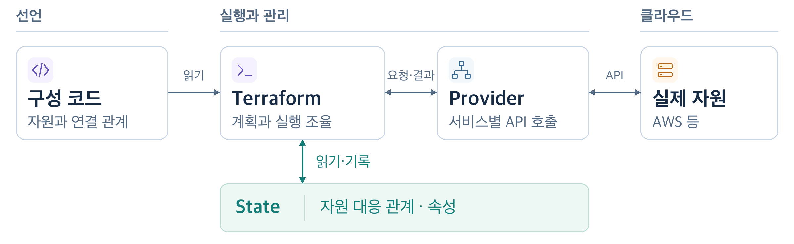
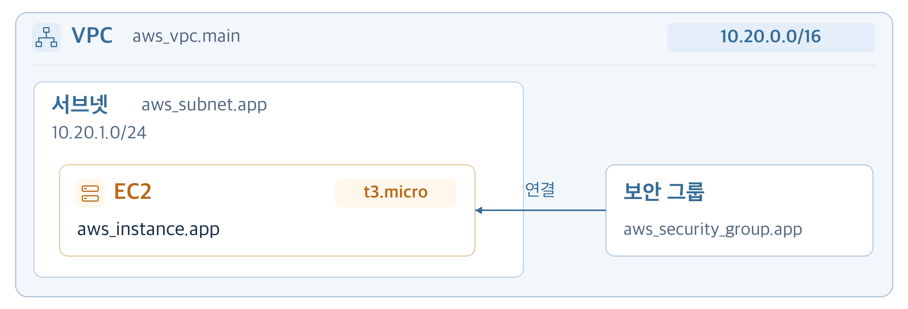
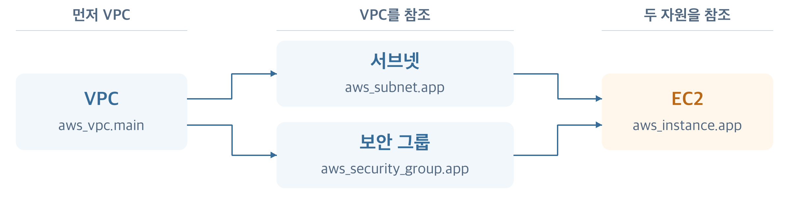
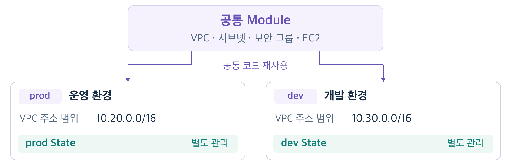
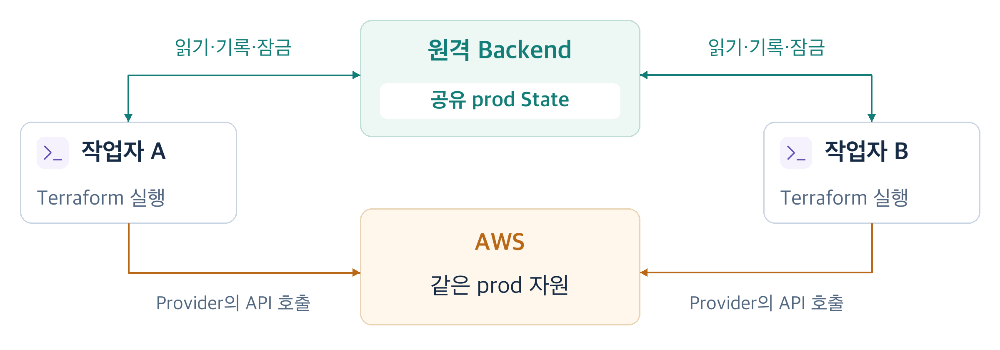

# AWS 예시로 이해하는 Terraform: 필요한 이유와 동작 원리

친구의 프로젝트에 참여하면서 이름만 들어 봤던 Terraform을 직접 다루게 됐습니다. 웹 애플리케이션 배포 플랫폼인 Vercel에 올린 홈페이지에 도메인을 연결해야 했는데, 이미 Terraform으로 인프라를 관리하던 프로젝트라 DNS 레코드도 코드로 추가해야 했습니다. AI의 도움으로 작업은 해결했지만, 이를 계기로 Terraform이 어떻게 동작하는지 더 알고 싶어졌습니다.

[Terraform](https://developer.hashicorp.com/terraform/intro)은 원하는 인프라 구성을 코드로 표현하고, 그 구성에 맞게 자원을 생성하거나 변경하는 도구입니다. **원하는 구성을 코드로 적으면, Terraform은 실제 자원을 어떻게 만들고 계속 관리할까요?**

이 글은 AWS 콘솔에서 EC2 등을 만들고 배포해 봤지만 Terraform은 처음인 개발자를 위한 글입니다. 설명에는 앞선 경험과 별도로 구성한 AWS 예시를 사용합니다. Terraform이 필요한 이유부터 자원을 만들고 변경하는 원리, 여러 환경과 작업자를 위한 관리 방법까지 살펴보겠습니다.

## 1 인프라는 만든 뒤에도 관리해야 한다

AWS 콘솔에서 서버와 네트워크를 구성해 서비스를 배포했다고 가정해 보겠습니다. 시간이 지나 서버 사양을 바꾸거나 비슷한 개발 환경을 만들려면, 먼저 어떤 자원들이 어떻게 연결되어 있는지 확인해야 합니다. 인프라 관리는 자원을 처음 만드는 것으로 끝나지 않습니다.

원하는 구성과 변경 이유를 코드로 남기면 동료가 같은 코드를 읽고 변경을 검토할 수 있습니다. 검토한 코드는 실제 자원을 구성하는 데도 사용합니다.

**IaC**(Infrastructure as Code)는 인프라 구성을 코드로 정의하고 그 코드를 사용해 자원을 관리하는 방식입니다. 서버 사양과 자원 사이의 연결을 코드에 담고, Git으로 변경 이력을 남기며 코드 리뷰를 하는 개발 방식을 인프라에도 적용할 수 있습니다.

Terraform은 IaC를 구현하는 도구 중 하나입니다. HashiCorp는 [2014년 Terraform을 처음 공개할 때부터](https://www.hashicorp.com/en/blog/terraform-announcement) AWS의 서버나 다른 서비스의 DNS처럼 여러 서비스의 자원을 코드로 표현하고 함께 구성하는 것을 목표로 제시했습니다.

Terraform에서는 “이 서브넷에 이 사양의 EC2가 있어야 한다”처럼 **원하는 결과를 선언**합니다. Terraform은 관리 중인 자원을 확인해 그 구성을 만들기 위한 작업을 계획합니다. 코드 저장만으로 인프라가 바뀌지는 않으며, 계획을 검토하고 적용하는 단계가 따로 있습니다.

## 2 코드가 실제 인프라로 이어지는 전체 흐름

코드에 적힌 원하는 구성이 실제 자원의 변경으로 이어지려면, 서비스와 통신하고 어떤 자원을 관리하는지 식별할 수 있어야 합니다. 예시에서는 개발자의 컴퓨터에서 Terraform과 Provider를 실행하고, 실제 자원은 AWS에 존재한다고 가정합니다.



*그림 1. 구성 요소 사이의 관계. 화살표는 실행 순서가 아니라 정보와 요청이 오가는 관계를 나타냅니다.*

그림 제작: AI 도구(Codex) 활용  |  참고 자료: [Provider](https://developer.hashicorp.com/terraform/language/providers), [State](https://developer.hashicorp.com/terraform/language/state/purpose)

[**Provider**](https://developer.hashicorp.com/terraform/language/providers)는 Terraform과 서비스의 API를 연결하는 플러그인입니다. AWS Provider는 EC2와 VPC 같은 자원 타입을 제공하며, 이 자원들을 조회하거나 변경하는 기능을 구현합니다. Terraform이 작업을 조율하면 Provider가 서비스별 API를 호출합니다.

[**State**](https://developer.hashicorp.com/terraform/language/state/purpose)는 코드의 자원과 실제 자원의 대응 관계, 속성 등의 관리 정보를 담습니다. 예를 들어 코드에 선언한 EC2가 AWS의 어느 인스턴스인지 기록해 다음 작업에서도 같은 자원을 식별합니다.

Terraform으로 인프라를 관리하는 기본 작업 흐름은 [**Write → Plan → Apply**](https://developer.hashicorp.com/terraform/intro/core-workflow)입니다.

**Write:** 원하는 자원과 연결 관계를 코드로 작성합니다.

**Plan:** Terraform이 State로 관리 대상을 식별하고, Provider를 통해 현재 자원을 조회해 필요한 작업을 계획합니다. 처음 만드는 자원은 생성 대상으로 나타납니다.

**Apply:** 검토한 계획에 따라 Provider가 서비스의 API를 호출해 자원을 변경하고, Terraform은 결과를 State에 기록합니다.

최초 생성과 이후 변경 모두 이 흐름을 사용합니다. 다음 예시는 VPC, 서브넷, 보안 그룹, EC2를 생성한 뒤 설정을 변경하는 과정입니다.

## 3 원하는 구성을 선언하고 첫 자원을 만들기

### 만들 자원과 코드 읽기

가상 네트워크인 VPC 안에 서브넷(Subnet)을 만들고, 그 안에 서버인 EC2를 배치합니다. EC2에는 트래픽을 제어할 보안 그룹(Security Group)을 연결합니다. 서브넷은 VPC 안에서 나눈 IP 주소 범위입니다.



*그림 2. 예시의 AWS 구성. 상자는 포함 관계, 화살표는 보안 그룹의 연결을 나타냅니다. 생성 순서나 트래픽 경로를 나타내는 그림은 아닙니다.*

그림 제작: AI 도구(Codex) 활용  |  참고 자료: [AWS VPC](https://docs.aws.amazon.com/vpc/latest/userguide/what-is-amazon-vpc.html)

이 예시는 네 자원의 관계를 설명하는 발췌이며, 완성된 배포 구성은 아닙니다. 인터넷 접속 경로와 통신 규칙, 애플리케이션 배포, 일부 변수와 Provider 설정은 생략했습니다. 이미지 ID와 인스턴스 ID는 가상 값이고, Plan은 필요한 부분만 재구성했습니다.

구성은 [**HCL**](https://developer.hashicorp.com/terraform/language/syntax/configuration)(HashiCorp Configuration Language) 문법을 바탕으로 `.tf` 파일에 작성합니다. 이 예시에서는 [같은 작업 디렉터리의 파일들](https://developer.hashicorp.com/terraform/language/files)을 하나의 구성으로 읽고, 그 디렉터리에서 명령을 실행합니다.

다음 코드에서는 **자원 선언과 자원 사이의 참조**에 집중하겠습니다. `cidr_block`은 `10.20.0.0/16`과 같이 [IP 주소 범위](https://docs.aws.amazon.com/vpc/latest/userguide/vpc-cidr-blocks.html)를 지정하는 설정입니다.

```hcl
resource "aws_vpc" "main" {
  cidr_block = "10.20.0.0/16"
}

resource "aws_subnet" "app" {
  vpc_id     = aws_vpc.main.id
  cidr_block = "10.20.1.0/24"
}

resource "aws_security_group" "app" {
  name   = "prod-app"
  vpc_id = aws_vpc.main.id
}
```

`resource` 블록은 관리할 자원을 선언합니다. `aws_subnet`은 AWS Provider가 제공하는 자원 타입이고, `app`은 코드 안에서 붙인 이름입니다. 둘을 합친 **자원 주소** `aws_subnet.app`은 AWS가 부여하는 실제 서브넷 ID와 다릅니다.

서브넷과 보안 그룹의 `vpc_id = aws_vpc.main.id`는 앞서 선언한 VPC의 ID를 참조합니다. 이 참조를 사용하면 ID를 직접 복사해 넣지 않고 자원 사이의 관계를 코드에 표현할 수 있습니다.

EC2를 선언하는 코드에서도 서브넷과 보안 그룹의 ID를 참조합니다.

```hcl
resource "aws_instance" "app" {
  ami                    = var.ami_id
  instance_type          = var.instance_type
  subnet_id              = aws_subnet.app.id
  vpc_security_group_ids = [aws_security_group.app.id]

  tags = {
    Name = "prod-app"
  }
}
```

`subnet_id`와 `vpc_security_group_ids`는 EC2에 연결할 서브넷과 보안 그룹을 참조합니다. `Name` 태그는 이 EC2의 이름을 `prod-app`으로 표시합니다.

[**입력 변수**](https://developer.hashicorp.com/terraform/language/values/variables)로 전달받은 AMI ID와 사양은 각각 `var.ami_id`와 `var.instance_type`으로 참조합니다. 처음에는 EC2를 시작할 이미지인 [**AMI**](https://docs.aws.amazon.com/AWSEC2/latest/UserGuide/AMIs.html)(Amazon Machine Image)의 ID로 `ami-0123456789abcdef0`(가상 값), 사양으로 `t3.micro`를 사용합니다.

### 참조가 생성 순서로 이어지는 방식

그림 2의 네 자원을 만들 때는 VPC가 먼저 필요합니다. 서브넷과 보안 그룹은 VPC의 ID를, EC2는 서브넷과 보안 그룹의 ID를 참조하기 때문입니다. Terraform은 이 참조에서 의존 관계를 파악합니다.



*그림 3. 먼저 필요한 자원에서 그것을 참조하는 자원으로 화살표를 그린 의존 관계 도식입니다. Terraform 내부 그래프의 전체 출력은 아닙니다.*

그림 제작: AI 도구(Codex) 활용  |  참고 자료: [Terraform 참조 규칙](https://developer.hashicorp.com/terraform/language/expressions/references), 본문 코드

VPC 다음에는 서브넷과 보안 그룹을 준비하고, 둘을 만든 뒤 EC2를 만들 수 있습니다. 서브넷과 보안 그룹 사이에는 이 코드가 만든 선후 관계가 없습니다. Terraform은 자원 사이의 [의존 관계에 따라 실행 순서를 정합니다](https://developer.hashicorp.com/terraform/internals/graph). `.tf` 파일에 블록을 적은 순서는 실행 순서에 영향을 주지 않습니다.

### 생성 계획을 확인하고 적용하기

설치와 AWS 인증 설정을 마쳤다면 [`terraform init`](https://developer.hashicorp.com/terraform/cli/commands/init)으로 작업 디렉터리와 필요한 Provider 등을 준비합니다. 아직 자원은 생성되지 않습니다. 이어서 `plan`으로 생성 계획을 만들고 `first.tfplan`에 저장합니다.

```sh
terraform init
terraform plan -out=first.tfplan
```

아래는 네 자원을 생성하는 Plan의 설명용 발췌입니다. 각 자원의 작업 표시와 마지막 합계에서 무엇이 달라지는지 확인할 수 있습니다.

```text
+ resource "aws_vpc" "main" { ... }
+ resource "aws_subnet" "app" { ... }
+ resource "aws_security_group" "app" { ... }
+ resource "aws_instance" "app" {
    + subnet_id = (known after apply)
    + id        = (known after apply)
    ...
  }

Plan: 4 to add, 0 to change, 0 to destroy.
```

`+`는 생성을 뜻합니다. 합계는 코드에서 직접 관리할 자원 네 개를 추가하고, 기존 자원을 수정하거나 삭제하지 않는다는 의미입니다. AWS 내부의 부속 객체까지 센 숫자는 아닙니다.

`(known after apply)`는 적용 후 알 수 있는 값입니다. 실제 ID가 아직 없어도 Terraform은 자원 사이의 참조를 알고 있으므로, 생성된 값을 뒤의 작업에서 사용하도록 계획할 수 있습니다.

계획을 검토한 뒤 저장한 파일을 Apply에 전달합니다.

```sh
terraform apply first.tfplan
```

저장한 Plan 파일을 전달하면 [별도의 승인 질문 없이 해당 계획을 적용합니다](https://developer.hashicorp.com/terraform/cli/commands/apply). 따라서 실행 전에 어떤 자원을 만들고, 바꾸고, 삭제하는지 검토해야 합니다. 파일 없이 `terraform apply`만 실행하면 새 계획을 만들고 승인을 요청합니다.

Apply에서는 Terraform이 의존 관계에 맞춰 작업을 조율하고, AWS Provider가 API를 호출해 자원을 만듭니다. 생성이 성공하면 Terraform은 자원 주소와 실제 ID 등을 State에 기록합니다. EC2의 대응 관계를 개념적으로 나타내면 다음과 같습니다.

```text
코드의 자원 주소       실제 EC2의 ID
aws_instance.app  ↔  i-0123456789abcdef0
```

첫 생성은 끝났습니다. 이후 설정을 바꾸면 Terraform은 이 자원에 어떤 작업이 필요한지 어떻게 판단할까요?

## 4 이미 만든 자원은 어떻게 변경할까

### 관리 중인 자원의 현재 정보를 확인하기

첫 생성이 성공했고 State가 보존되어 있다고 가정하겠습니다. 다음 [Plan](https://developer.hashicorp.com/terraform/cli/commands/plan)에서 Terraform은 State로 관리 대상을 식별하고, Provider를 통해 현재 자원을 조회합니다. 그런 다음 코드에 선언한 원하는 구성과 비교해 필요한 작업을 계획합니다.

| 대상 | EC2 예시에서 담는 정보 |
| --- | --- |
| 코드 | 사용하려는 이미지, 사양, 이름 |
| State | 코드의 자원 주소가 어느 실제 EC2에 대응하는지, 관리 속성이 무엇인지 |
| 실제 AWS 자원 | 현재 EC2에 어떤 설정이 적용되어 있는지 |

State는 실제 환경의 변경을 항상 따라가는 실시간 복제본은 아닙니다. 예를 들어 콘솔에서 설정을 바꾸어도 저장된 State가 그 순간 자동으로 갱신되지는 않습니다. 다음 계획을 만들 때 현재 자원을 조회하는 이유가 여기에 있습니다.

코드와 실제 구성에 차이가 없고 다른 변경 요인도 없다면 Plan에는 `No changes`가 표시됩니다. 같은 코드를 다시 적용한다고 매번 새 EC2를 만들지는 않습니다.

### 사양을 바꾸는 경우

기존 EC2의 사양을 `t3.micro`에서 `t3.small`로 바꾼다고 가정하겠습니다. 이 예시에서는 입력값을 `terraform.tfvars` 파일로 전달합니다. 파일에서 `instance_type` 값을 다음과 같이 바꿉니다. 이 사례와 뒤에서 다룰 이미지 변경, 콘솔 변경 사례는 모두 최초 생성 직후 상태에서 각각 출발합니다.

```hcl
instance_type = "t3.small"
```

다음은 EC2 하나를 수정하는 Plan의 설명용 발췌입니다.

```text
# aws_instance.app will be updated in-place
~ resource "aws_instance" "app" {
      id            = "i-0123456789abcdef0"
    ~ instance_type = "t3.micro" -> "t3.small"
    ...
  }

Plan: 0 to add, 1 to change, 0 to destroy.
```

`~`는 기존 자원을 수정한다는 뜻입니다. 여기서는 EC2를 새로 만들지 않고 기존 인스턴스의 사양을 바꾸므로 ID를 유지합니다. 다만 **기존 자원을 수정한다는 것이 무중단을 뜻하지는 않습니다.** AWS Provider는 이 사양 변경을 위해 [EC2를 정지한 뒤 다시 시작합니다](https://github.com/hashicorp/terraform-provider-aws/blob/main/website/docs/r/instance.html.markdown). Plan의 작업 표시만으로는 서비스 중단 여부를 판단할 수 없으므로, Provider 문서와 실제 서비스 구성도 함께 확인해야 합니다.

### 이미지를 바꾸는 경우

이번에는 `terraform.tfvars`의 `ami_id` 값을 바꿔, 처음 생성한 EC2에 다른 이미지를 지정한다고 가정하겠습니다. 이 사례에서는 [**EBS**](https://docs.aws.amazon.com/AWSEC2/latest/UserGuide/ComponentsAMIs.html)(Elastic Block Store) 볼륨으로 부팅하는 EC2에 호환되는 다른 AMI를 지정합니다. EBS는 EC2에 연결하는 블록 스토리지입니다.

```hcl
ami_id = "ami-0fedcba9876543210"
```

입력값 하나를 바꾸었지만, AWS Provider는 이 변경에 [EC2 교체를 요구합니다](https://github.com/hashicorp/terraform-provider-aws/blob/main/internal/service/ec2/ec2_instance.go). 다음은 이 변경에 대한 Plan의 설명용 발췌입니다.

```text
# aws_instance.app must be replaced
-/+ resource "aws_instance" "app" {
    ~ id  = "i-0123456789abcdef0" -> (known after apply)
    ~ ami = "ami-0123456789abcdef0"
          -> "ami-0fedcba9876543210" # forces replacement
    ...
  }

Plan: 1 to add, 0 to change, 1 to destroy.
```

`-/+`는 기존 자원을 먼저 삭제한 뒤 새로 생성한다는 뜻입니다. 이 예시에는 순서를 바꾸는 별도 설정이 없어, 기존 EC2를 삭제한 뒤 다른 AMI로 새 EC2를 만듭니다. ID도 새로 정해집니다. 이 EC2 하나로 서비스를 운영한다면, 기존 인스턴스가 삭제된 뒤 새 인스턴스에서 애플리케이션이 준비될 때까지 서비스가 중단됩니다.

사양을 바꿀 때는 기존 EC2를 수정하도록, AMI를 바꿀 때는 교체하도록 계획했습니다. 어떤 속성을 제자리에서 바꿀 수 있는지는 자원과 Provider의 규칙에 따라 달라지므로, 적용 전에 Plan의 작업 종류와 대상을 확인해야 합니다.

### 코드 밖에서 설정을 바꾼 경우

코드를 수정하지 않아도 Plan에 변경 작업이 나타날 수 있습니다. AWS 콘솔에서 EC2의 `Name` 태그를 `prod-app`에서 `manual-name`으로 바꾸었다고 가정하겠습니다. 코드에는 여전히 `prod-app`이 적혀 있습니다.

| 코드에서 원하는 값 | AWS에서 조회한 현재 값 | Plan이 제안하는 변경 |
| --- | --- | --- |
| `prod-app` | `manual-name` | `Name` 태그를 `prod-app`으로 수정 |

코드 밖에서 설정을 바꿔 실제 자원과 선언한 구성이 달라지는 현상을 드리프트(drift)라고 합니다. 이 예시의 기본 Plan은 코드에 적힌 값으로 되돌리는 작업을 제안합니다. 콘솔에서 바꾼 이름을 유지하려면 그 의도를 코드에도 반영해야 합니다. 실제 변경은 Apply에서 일어나며, Terraform이 계속 실행되면서 자동으로 복구하는 것은 아닙니다.

**기존 자원을 가져오려면:** AWS 계정의 모든 자원이 자동으로 관리되지는 않습니다. 콘솔에서 만든 EC2는 [Import](https://developer.hashicorp.com/terraform/language/import)로 코드의 자원 주소와 연결하고 관리할 구성을 맞춰야 합니다.

## 5 환경을 늘리고 함께 관리하기

### 다른 환경에도 비슷한 구성이 필요한 경우

지금까지 다룬 구성을 운영 환경용 예시로 두고, 비슷한 개발 환경이 하나 더 필요하다고 가정하겠습니다. 환경마다 코드를 복사하면 공통 설정을 바꿀 때 각 복사본에도 같은 변경을 반영해야 합니다.

하나의 디렉터리에 있는 Terraform 구성 파일의 묶음을 [**Module**](https://developer.hashicorp.com/terraform/language/modules)이라고 합니다. 앞에서 작업한 구성도 하나의 Module입니다. 네 자원 선언을 공통 Module로 분리하면, prod와 dev에서 환경별 입력값을 전달해 재사용할 수 있습니다. 각 환경에서 실행하는 구성은 루트 Module, 여기서 불러오는 공통 구성은 하위 Module입니다.

앞에서 고정했던 주소 범위와 `prod-app`이라는 이름도 입력값으로 바꿉니다. 이 예시에서는 `environment` 값에 따라 이름을 `prod-app` 또는 `dev-app`으로 만들고, 주소 범위는 다음처럼 구분합니다.

| 입력 | prod | dev |
| --- | --- | --- |
| `environment` | `prod` | `dev` |
| `instance_type` | `t3.micro` | `t3.micro` |
| `vpc_cidr` | `10.20.0.0/16` | `10.30.0.0/16` |
| `subnet_cidr` | `10.20.1.0/24` | `10.30.1.0/24` |

이 예시에서는 prod와 dev용 작업 디렉터리에서 같은 Module을 불러오고, 각각 별도의 State를 사용하도록 설정합니다. 기존 prod의 State를 사용한 채 dev용 입력값으로 Plan을 만들면, 새 dev 환경을 추가하는 대신 prod 자원을 변경하는 계획이 나올 수 있습니다. 이를 그대로 Apply하면 운영 환경이 의도치 않게 바뀔 수 있습니다. Module 자체가 State를 분리해 주지는 않습니다.



*그림 4. 공통 구성을 재사용하되 환경별 자원과 관리 정보를 구분하는 예시입니다.*

그림 제작: AI 도구(Codex) 활용  |  참고 자료: [Module](https://developer.hashicorp.com/terraform/language/modules)

**기존 코드를 옮길 때:** 하위 Module로 옮기면 자원 주소도 바뀝니다. 같은 실제 자원을 계속 관리하도록 이전 주소와 새 주소를 연결하는 방법은 [Module 리팩터링 문서](https://developer.hashicorp.com/terraform/language/modules/develop/refactoring)를 참고하세요.

### 여러 사람이 같은 환경을 관리하는 경우

여러 작업자가 앞의 prod 구성을 함께 관리할 때는 같은 State를 사용해야 합니다. 코드만 Git으로 공유하고 각자의 State를 사용하면, 같은 자원에 대한 관리 정보가 서로 달라질 수 있습니다.

[**Backend**](https://developer.hashicorp.com/terraform/language/backend)는 State의 저장 위치와 접근 방식을 정합니다. 기본적으로는 로컬 파일에 저장하지만, 팀에서는 원격 저장소에 보관하는 Backend를 사용해 같은 State에 접근할 수 있습니다.



*그림 5. 같은 prod 구성의 작업자가 원격 State를 공유하는 구조입니다. 잠금을 지원하고 사용하도록 구성한 Backend를 가정합니다.*

그림 제작: AI 도구(Codex) 활용  |  참고 자료: [Backend](https://developer.hashicorp.com/terraform/language/backend), [State 잠금](https://developer.hashicorp.com/terraform/language/state/locking)

동시 작업도 조정해야 합니다. 지원하는 Backend에서 [**State 잠금**](https://developer.hashicorp.com/terraform/language/state/locking)을 사용하면 State에 영향을 주는 Terraform 작업의 동시 진행을 막을 수 있습니다. 잠금을 얻지 못한 작업은 진행하지 않지만, AWS 콘솔이나 다른 도구의 자원 변경까지 막지는 않습니다.

State에는 [민감한 값](https://developer.hashicorp.com/terraform/language/manage-sensitive-data)이 들어갈 수 있으므로 코드와 함께 공개 저장소에 올리는 방식으로 공유해서는 안 됩니다. 원격 저장소의 접근 권한도 관리해야 합니다.

이 예시에서는 환경별로 State를 분리하면서 공통 코드를 재사용합니다. 같은 환경을 여러 사람이 관리할 때는 해당 환경의 State를 공유합니다.

## 6 내 프로젝트에서 Terraform을 바라보는 기준

예시에서 Terraform은 코드에 선언한 네 자원을 참조 관계에 맞춰 생성했습니다. 이후에는 같은 EC2의 현재 설정을 확인하고, 사양을 바꿀 때는 기존 자원을 수정하도록, AMI를 바꿀 때는 교체하도록 계획했습니다. **Terraform은 원하는 구성을 코드로 받아, 실제 자원에 필요한 변경을 계획하고 적용합니다.**

구성을 파악할 때는 자원과 연결을 담은 코드가, 변경을 검토할 때는 Plan이, 비슷한 환경을 추가할 때는 Module과 입력값이 도움이 됩니다. 프로젝트에서 설정을 자주 바꾸거나 비슷한 환경을 반복해서 만들고, 여러 사람이 함께 관리한다면 Terraform을 도입할 이유가 있습니다.

서비스에 맞는 구성과 변경 시점은 사람이 판단해야 합니다. 기존 자원을 수정해도 중단이 생길 수 있고, State도 관리해야 합니다. AI로 작성한 코드도 자원의 역할과 관리 대상, Plan의 작업을 이해하면 검토할 수 있습니다.

더 살펴보기: [AWS 입문 실습](https://developer.hashicorp.com/terraform/tutorials/aws-get-started), [자원별 설정과 동작](https://registry.terraform.io/providers/hashicorp/aws/latest/docs), [State 관리](https://developer.hashicorp.com/terraform/language/state)

