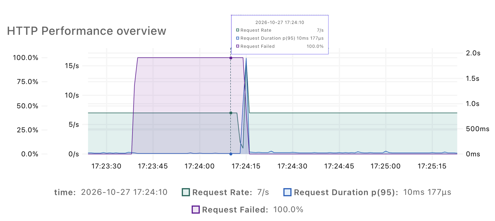
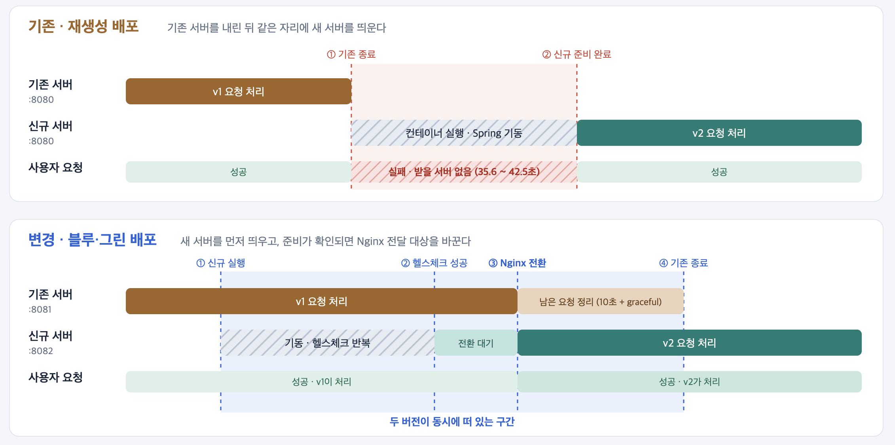
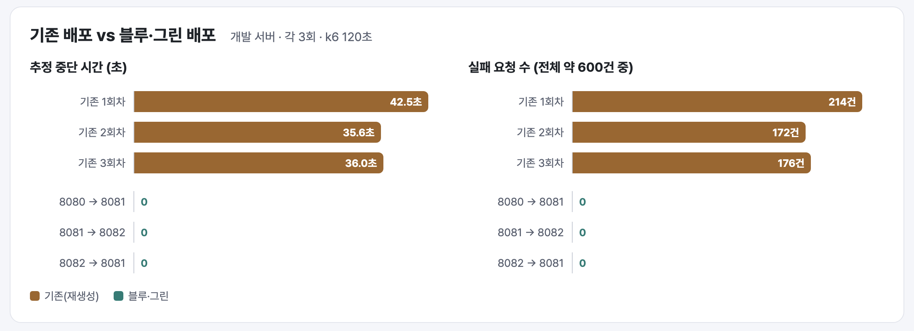
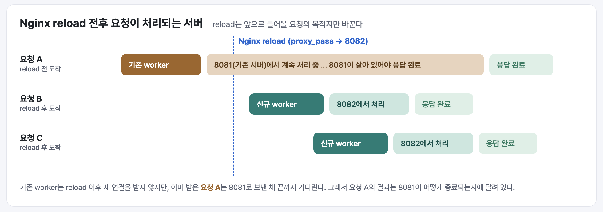
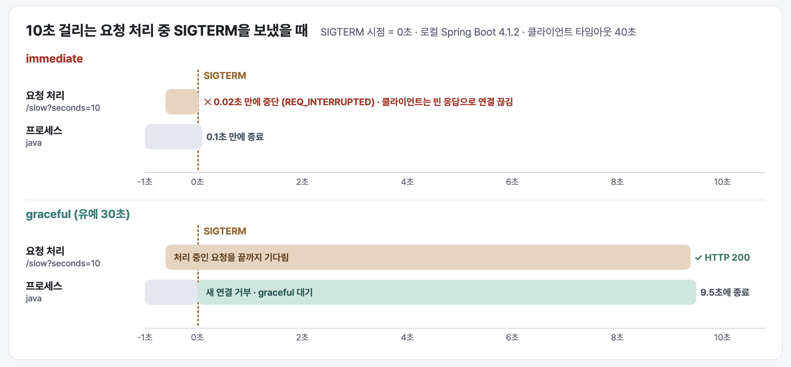
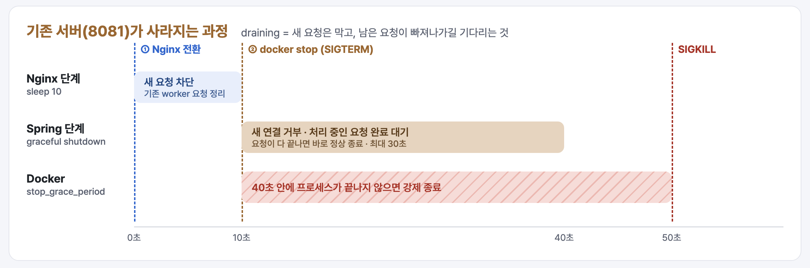
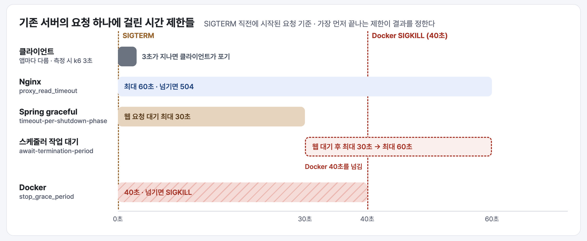

# 배포 중에도 요청은 끝까지 처리될까?

**블루·그린 배포와 graceful shutdown으로 확인한 무중단 배포**

"배포 잠깐만 할게요."

팀 채널에 이 메시지가 올라오면 그동안 앱이 잠시 응답하지 않는 것을 다들 당연하게 여겼다. 배포는 금방 끝났고, 끝나고 나면 서버는 다시 잘 응답했다. 그래서 '잠깐'이 실제로 얼마나 긴지는 아무도 재 보지 않았다.

처음으로 재 보니 그 '잠깐'은 **35초가 넘었다.** 그 사이 들어온 요청은 모두 실패했다.

이 글은 그 공백을 측정하고 없앤 과정, 그리고 기존 서버를 언제 꺼야 하는지 실험으로 확인한 기록이다. Docker와 Nginx로 Spring 서버를 배포해 본 개발자를 독자로 생각하고 썼다.

> 새 서버로 요청을 넘긴 뒤, 기존 서버는 언제 꺼도 될까?

---

## 1. 배포할 때마다 35초 넘게 요청이 실패했다

### 기존 배포 방식

기존 배포는 단순했다. 새 이미지를 받아 실행 중인 컨테이너를 내리고, 같은 자리에 새 컨테이너를 올린다.


> **[그림 1]** 기존 재생성 배포의 흐름

구현이 쉽고 서버 자원도 한 벌만 쓴다. 대신 기존 서버가 꺼진 순간부터 새 서버의 Spring 애플리케이션이 기동을 마칠 때까지 요청을 처리할 서버가 없다.

### 무엇을 '중단'으로 볼 것인가

"끊겼다"를 숫자로 만들려면 먼저 기준이 필요했다. 다음 두 가지를 정했다.

- **성공한 요청:** `/actuator/health`가 HTTP 200을 반환하고, 응답 본문의 `status`가 `UP`인 경우
- **중단 시간:** 첫 실패 요청을 보낸 시각부터 그다음 성공 요청을 보낸 시각까지의 구간

요청은 배포 서버가 아닌 외부 컴퓨터에서 서비스 도메인으로 보냈다. 사용자와 같은 경로(도메인 → Nginx → Spring)를 거쳐야 사용자가 겪는 중단을 볼 수 있기 때문이다.

### 측정 결과

개발 서버에서 기존 방식으로 세 번 배포하며 측정했다. 한 번의 결과만으로는 그 값이 우연인지 아닌지 판단할 수 없기 때문이다.

| 실행 | 추정 중단 시간 | 실패 요청 / 전체 요청 | 요청 실패율 |
| --- | ---: | ---: | ---: |
| 1회차 | 42.499초 | 214 / 600 | 35.67% |
| 2회차 | 35.642초 | 172 / 601 | 28.62% |
| 3회차 | 36.001초 | 176 / 601 | 29.28% |
| 평균·합계 | 평균 **38.05초** | 합계 **562 / 1,802** | **31.19%** |



> **[그림 2]** 기존 방식 배포 중 요청 실패율(보라색)과 응답 시간 p95(전체 요청 중 95%가 이 시간 안에 응답한 값, 파란색). 약 35초 동안 모든 요청이 실패했다. (3회차 측정)

배포 작업 자체는 매번 성공했다. 하지만 **"배포가 성공했다"와 "배포 중에도 서비스를 쓸 수 있었다"는 다른 문제**였다. 목표를 배포를 빨리 끝내는 것이 아니라, 배포하는 동안에도 요청을 받을 서버가 항상 있게 만드는 것으로 정했다.

---

## 2. 새 서버를 먼저 준비한 뒤 포트를 전환하면 어떨까?

### 왜 블루·그린인가

요청을 받을 서버가 비는 구간을 없애려면, 새 서버가 준비될 때까지 기존 서버가 계속 요청을 받아야 한다.

**RingOut**은 알람을 만들 때 목적지를 함께 설정하고, 알람이 울리면 그 목적지에 도착할 때까지 반복해서 울려 주는 알람 서비스다. 서버는 EC2 한 대에서 Nginx 뒤에 Spring 컨테이너 하나를 띄우는 구조다. 이 구성을 기준으로 대표적인 배포 방식을 비교하면 다음과 같다.

| 방식 | 교체 과정 | RingOut 구성에서의 판단 |
| --- | --- | --- |
| 재생성 | 기존 서버 종료 후 새 서버 실행 | 지금 방식. 기동 시간만큼 공백이 생긴다. |
| 블루·그린 | 새 서버를 따로 띄운 뒤 트래픽 대상을 바꾼다 | 서버 한 대에서 두 버전을 잠시 함께 띄우면 된다. |
| 롤링 | 여러 인스턴스를 하나씩 교체 | 인스턴스가 여러 대여야 의미가 있다. |
| 카나리 | 일부 트래픽만 새 서버로 보내고 점차 늘린다 | 트래픽 분배와 버전별 지표 관측이 추가로 필요하다. |

그래서 인스턴스를 늘리지 않고 적용할 수 있는 블루·그린 방식을 택했다. 두 컨테이너가 `8081`과 `8082` 포트를 번갈아 쓰고, Nginx의 `proxy_pass` 대상만 바꾼다.

```text
기존 서버(8081)가 요청 처리 중
        ↓
새 서버(8082) 컨테이너 실행
        ↓
8082 헬스체크 성공 확인
        ↓
Nginx proxy_pass를 8082로 변경 → nginx -t → reload
        ↓
10초 대기 후 기존 컨테이너(8081) 종료
```



> **[그림 3]** 재생성 배포와 블루·그린 배포의 구조 비교

포트 번호는 중요하지 않다. 핵심은 **새 버전이 준비됐는지 확인한 다음에 요청을 넘기는 순서**다.

### '준비됐다'는 어떻게 판단하나

배포는 GitHub Actions에서 시작된다. 워크플로가 실행되면 Actions runner가 배포 스크립트 `deploy.sh`를 실행하고, 위 흐름의 모든 단계(새 컨테이너 실행, 헬스체크, Nginx 전환, 기존 컨테이너 종료)를 이 스크립트가 차례로 처리한다.

배포 스크립트는 새 컨테이너를 띄운 뒤 해당 포트의 헬스체크를 반복해서 호출한다.

```bash
for attempt in {1..30}; do
  if curl --fail --silent --connect-timeout 2 --max-time 3 \
      "http://127.0.0.1:$SERVER_PORT/actuator/health" > /dev/null; then
    break  # 준비 완료 → Nginx 전환
  fi
  sleep 5
done
# 30번 모두 실패하면 새 컨테이너를 내리고 배포를 중단한다
```

헬스체크가 성공해야만 Nginx를 바꾸고, 끝까지 실패하면 새 컨테이너만 정리한다. 기존 서버는 그대로 요청을 계속 받는다. Nginx 설정 검사(`nginx -t`)나 reload가 실패해도 백업해 둔 설정으로 되돌린다. 배포가 실패하더라도 서비스는 멈추지 않는다.

여기서 주의할 점이 있다. 헬스체크 통과는 **"설정한 검사 항목이 성공했다"**는 뜻이지, 새 버전의 모든 기능이 정상이라는 보장이 아니다. 로그인 API에 버그가 있어도 `/actuator/health`는 `UP`을 반환할 수 있다. 전환 이후의 기능 오류를 어떻게 감지하고 되돌릴지는 이 글에서 다루지 않는다.

---

## 3. k6로 배포 전후 요청을 관찰했다

### 측정 구성

측정에는 k6를 사용했다. 짧은 간격으로 헬스체크를 호출해 **언제부터 언제까지 끊겼는지**를 본다.

| 구분 | 설정 |
| --- | --- |
| 측정 시간 | 120초 |
| 대상 경로 | `/actuator/health` |
| 요청 간격 | 0.5초 |
| 요청 타임아웃 | 1초 |
| 성공 기준 | HTTP 200 + 응답 본문의 `status: UP` |
| 중단 시간 | 첫 실패부터 다음 성공까지의 구간 합 |
| 실패 수·응답 시간 | 같은 경로로 초당 5회(타임아웃 3초) 보낸 요청에서 따로 집계 |

측정 시간은 배포 소요 시간을 기준으로 정했다. 배포 한 번에 약 70초가 걸리는데, 배포 중의 구간뿐 아니라 배포 전후의 평소 상태도 함께 기록해야 비교할 수 있다. 그래서 앞뒤로 여유를 두어 120초로 잡았다.

### 측정이 유효했는지도 기록했다

"실패 0건"이 의미를 가지려면 측정기가 요청을 계획대로 보냈어야 한다. 측정기가 바빠 요청을 시작조차 못 했다면, 실패가 없었던 것이 아니라 **확인하지 않은 것**이다.

k6는 정해진 간격대로 요청을 시작하지 못하면 `dropped_iterations`로 기록한다. 이 값을 함께 확인해, 누락이 1회 정도면 측정 오차로 보고 그보다 많으면 해당 실행을 **'유효하지 않음'**으로 판정했다. 결과표에도 이 판정을 함께 적었다.

### 포트 전환 후 결과

블루·그린 배포를 적용한 뒤 개발 서버에서 포트를 바꿔 가며 세 번 측정했다. 블루·그린 배포에서는 포트 전환이 세 가지 경우로 일어난다. 기존 포트(8080)에서 처음 블루·그린 포트로 넘어가는 경우, 8081에서 8082로 가는 경우, 8082에서 다시 8081로 돌아오는 경우다. 어느 방향으로 전환해도 끊기지 않는지 확인하기 위해 각 경우를 한 번씩 측정했다.

| 전환 | 추정 중단 시간 | 실패 / 전체 | p95 (ms) | 측정 유효 |
| --- | ---: | ---: | ---: | :---: |
| 8080 → 8081 | 0초 | 0 / 600 | 27.1 | O |
| 8081 → 8082 | 0초 | 0 / 601 | 31.8 | O |
| 8082 → 8081 | 0초 | 0 / 601 | 35.3 | O |

기존 방식과 나란히 놓으면 차이가 분명하다.

| 구분 | 추정 중단 시간 | 실패 / 전체 | p95 범위 (ms) |
| --- | ---: | ---: | ---: |
| 기존(재생성) | 35.6 ~ 42.5초 | 562 / 1,802 | 29.4 ~ 32.4 |
| 블루·그린 | 0초 | 0 / 1,802 | 27.1 ~ 35.3 |



> **[그림 4]** 기존 배포와 블루·그린 배포의 실행별 추정 중단 시간과 실패 요청 수

35초 넘게 이어지던 실패 구간이 세 방향의 전환 모두에서 사라졌다. 성공한 요청의 p95는 두 방식 모두 30ms 안팎으로, 응답 시간에도 눈에 띄는 악화는 없었다.

---

## 4. 실패 0건이면 무중단이라고 말해도 될까?

### 0초가 말해 주는 것

블루·그린 배포 후 기록된 중단 시간은 0초였다. 하지만 정확히 말하면 이 값은 **"이 측정 조건에서 실패한 요청이 관측되지 않았다"**는 뜻이다.

- 0.5초 간격으로 확인했으므로 그보다 짧은 중단은 놓칠 수 있다.
- 측정에 쓴 요청은 수십 ms 안에 끝나는 헬스체크였다. 종료 순간에 처리 중인 요청이 거의 없었을 가능성이 높다.
- 헬스체크 성공은 로그인, 데이터 저장 같은 실제 기능의 성공과 다르다.

### 운영 서버에서 본 실패

이 점은 운영 서버 측정에서 실제로 드러났다. 블루·그린 배포를 운영에 적용하며 두 번 측정했는데, 첫 번째 측정에서는 실패가 나왔다.

| 측정 | 추정 중단 시간 | 실패 / 전체 | p95 (ms) | 측정 유효 |
| --- | ---: | ---: | ---: | :---: |
| 운영 1차 | 4.749초 이상 | 24 / 301 | 3,000.7 | X (헬스체크 102회 누락) |
| 운영 2차 | 0초 | 0 / 601 | 32.0 | X (헬스체크 29회 누락) |

1차 측정의 p95가 3,000ms라는 것은 초당 5회로 보낸 요청이 타임아웃(3초)까지 응답을 받지 못했다는 뜻이다. 중단 구간도 측정이 끝날 때까지 회복이 관측되지 않아 **실제로는 4.7초보다 길었을 수 있다.** 2차 측정에서는 실패가 없었다.

두 측정 모두 헬스체크 일부가 누락돼 '유효하지 않음'으로 판정됐다. 그래서 운영 2차의 결과는 "실패가 없었다"보다 **"관측한 범위에서는 실패가 없었다"**로 읽어야 한다. 이 경험 이후 결과를 볼 때 실패 수보다 측정이 유효했는지를 먼저 확인하게 됐다.

### 아직 보지 못한 것: 누가 처리했나

3장의 측정에는 빠진 것이 하나 더 있다. **각 요청을 어느 버전이 처리했는지**다. 응답이 성공했다는 사실만 기록했기 때문에, 전환 직후의 요청이 정말 새 서버로 갔는지, 기존 서버로 갔다가 운 좋게 성공했는지는 구분할 수 없다.

처리 버전을 확인하려면 다음 기록이 필요하다.

| 위치 | 남길 정보 |
| --- | --- |
| 클라이언트(k6) | 요청 ID, 시작·완료 시각, 상태 코드, 본문 검사 결과 |
| Nginx | 요청 ID, `$upstream_addr`, `$upstream_status`, `$request_time` |
| 애플리케이션 | 요청 ID, 인스턴스(포트)·버전, 시작·완료·예외 로그 |
| 배포 스크립트 | 신규 준비 확인, Nginx 전환, 기존 서버 종료 시각 |

요청 ID 하나로 이 기록들을 연결해야 "전환 시점에 들어온 요청이 어디서 처리됐는가"에 답할 수 있다. 이 질문이 다음 장의 출발점이다.

---

## 5. 전환 전에 들어온 요청은 어디로 갈까?

### 포트 전환은 요청을 옮기지 않는다

Nginx 설정을 8082로 바꾸는 순간, 기존 요청까지 새 서버로 옮겨 갈 것처럼 생각하기 쉽다. 하지만 **이미 8081에서 처리 중인 요청은 8081에서 끝나야 한다.** 포트 전환이 바꾸는 것은 앞으로 들어올 요청의 목적지뿐이다.

Nginx reload도 순간적인 전체 교체가 아니다. reload 신호를 받으면 Nginx는 새 설정으로 worker 프로세스를 띄운다. 기존 worker는 새 연결을 받지 않고, 처리 중이던 요청을 마친 뒤 종료한다([Nginx 문서](https://nginx.org/en/docs/control.html)). 그래서 reload 직후 잠깐 동안은 **기존 worker가 기존 서버(8081)로 보낸 요청이 아직 남아 있을 수 있다.**



> **[그림 5]** 포트 전환 전후 요청 A·B·C가 처리되는 서버. reload 전에 들어온 요청 A는 끝까지 8081에서 처리된다.

결국 요청 A가 무사히 끝나는지는 **8081이 어떻게 종료되는가**에 달려 있다.

### immediate와 graceful의 차이

Spring Boot는 종료 방식을 두 가지로 제공한다.

```properties
# 즉시 종료: 종료 신호를 받으면 웹 서버를 바로 멈춘다
server.shutdown=immediate
```

```properties
# 우아한 종료: 새 요청은 받지 않고, 처리 중인 요청을 기다린다
server.shutdown=graceful
spring.lifecycle.timeout-per-shutdown-phase=30s
```

[Spring Boot 문서](https://docs.spring.io/spring-boot/reference/web/graceful-shutdown.html)를 기준으로 두 방식에서 요청 A가 겪는 일을 정리하면 다음과 같다.

| 상황 | `immediate` | `graceful` |
| --- | --- | --- |
| 종료 신호 이후 새 요청 | 받지 않음 | 받지 않음 (Tomcat은 네트워크 단에서 연결을 받지 않는다) |
| 처리 중이던 요청 A | 응답 도중 연결이 끊길 수 있다 | 유예 시간 안에 끝나면 정상 응답 |
| 유예 시간을 넘긴 요청 | 해당 없음 | 유예 시간이 지나면 남은 요청과 상관없이 종료 진행 |
| 프로세스 종료 시점 | 신호 직후 | 처리 중인 요청이 끝나거나 유예 시간이 지난 뒤 |

Spring Boot 3.4부터는 graceful이 기본값이다([3.4 릴리스 노트](https://github.com/spring-projects/spring-boot/wiki/Spring-Boot-3.4-Release-Notes)). RingOut은 Spring Boot 4.1을 사용하므로 따로 설정하지 않아도 graceful로 동작하고, 단계별 유예 시간 기본값은 30초다.

### 직접 비교해 본 실험

문서의 설명과 실제 동작이 같은지 확인하기 위해, 프록시 없이 Spring Boot 애플리케이션 하나만으로 종료 동작을 비교했다. 실험은 로컬 환경(Java 21, RingOut과 같은 Spring Boot 4.1 계열인 4.1.2)에서 진행했다.

1. 응답까지 10초가 걸리는 테스트용 API를 만든다. 요청 ID와 인스턴스 정보를 시작·완료 로그에 남긴다.
2. `immediate`로 실행하고, 클라이언트 타임아웃을 40초로 둔 채 이 API를 호출한다.
3. 서버에서 시작 로그를 확인한 뒤, 응답 전에 Java 프로세스에 `SIGTERM`(프로세스에 정상 종료를 요청하는 신호)을 보낸다.
4. 클라이언트가 받은 상태 코드·본문·오류, 서버 완료 로그, 프로세스 종료 시각을 수집한다.
5. `graceful`로 바꿔 같은 절차를 반복한다.

여기서 10초 지연은 실제 부하를 흉내 내려는 것이 아니다. **종료 신호가 들어오는 순간에 처리 중인 요청이 반드시 있도록** 만드는 장치다. IDE의 강제 종료 버튼이나 `SIGKILL`(프로세스를 즉시 강제 종료하는 신호)은 정상 종료 경로를 거치지 않으므로 사용하지 않는다.

| 기록 항목 | 확인하려는 것 |
| --- | --- |
| 요청 시작 시각 | 종료 신호 전에 요청이 처리 중이었는가 |
| 종료 신호 시각 | 요청과 종료가 실제로 겹쳤는가 |
| 서버 완료 로그 | 핸들러가 끝까지 실행됐는가 |
| 클라이언트 상태·본문 | 응답이 끝까지 도착했는가 |
| 프로세스 종료 시각 | 종료 대기가 실제로 일어났는가 |

판단 기준은 상태 코드만이 아니다. 서버가 핸들러를 끝까지 실행했어도 응답 본문이 클라이언트에 도착하지 않았다면 사용자 입장에서는 실패다.

### 실험 결과

| 조건 | 클라이언트 결과 | 서버 완료 로그 | SIGTERM → 프로세스 종료 |
| --- | --- | --- | ---: |
| `immediate` | 응답 없이 연결 끊김 (SIGTERM 후 0.03초) | 없음 (처리 도중 중단) | 0.1초 |
| `graceful` | HTTP 200, 본문 정상 수신 | 있음 | 9.5초 |



> **[그림 6]** immediate·graceful 조건별 요청 처리와 프로세스 종료 타임라인. SIGTERM 시점을 0초로 맞췄다.

결과는 문서의 설명과 같았다. `immediate`에서는 SIGTERM을 받자마자 웹 서버가 멈췄다. 처리 중이던 요청은 0.02초 만에 중단됐고, 클라이언트는 응답을 한 글자도 받지 못한 채 연결이 끊겼다(curl 종료 코드 52, `Empty reply from server`). `graceful`에서는 서버가 `Commencing graceful shutdown` 로그를 남긴 뒤 요청이 끝날 때까지 기다렸다. 클라이언트는 정상 응답을 받았고, 프로세스는 요청이 끝난 직후인 9.5초에 종료됐다.

`immediate`에서 유예 시간을 60초로 늘려 한 번 더 실행해 봤지만 결과는 같았다. `immediate`는 처리 중인 요청을 기다리지 않으므로 유예 시간을 쓸 일이 없다. **유예 시간은 `graceful`일 때만 의미가 있는 값이다.**

---

## 6. 기존 서버를 언제 종료해도 될까?

### 지금 배포 스크립트의 종료 흐름

현재 RingOut의 배포 스크립트는 Nginx 전환 뒤 다음 순서로 기존 서버를 정리한다.

```bash
log TRAFFIC_SWITCHED "port=$SERVER_PORT"
sleep 10                                   # 기존 worker가 보낸 요청이 빠져나갈 시간
docker stop "ringout-server-$ACTIVE_PORT"  # SIGTERM → graceful shutdown 시작
```

`docker stop`은 컨테이너에 `SIGTERM`을 보내고, 정해진 시간 안에 끝나지 않으면 `SIGKILL`로 강제 종료한다([Docker 문서](https://docs.docker.com/reference/cli/docker/container/stop/)). 이 시간은 Compose의 `stop_grace_period`로 40초를 지정했다.

정리하면 기존 서버는 다음 단계를 거쳐 사라진다.



> **[그림 7]** Nginx 전환 이후 기존 서버(8081)가 종료되기까지의 단계

### draining: 새 요청은 막고, 남은 요청은 끝까지

이 흐름에서 기존 서버가 하는 일은 하나다. **새 요청은 더 받지 않고, 이미 받은 요청은 끝까지 처리한 뒤 사라지는 것.** 이 과정을 **draining**이라고 부른다. 욕조의 마개를 막아 물이 더 들어오지 않게 한 뒤, 남은 물이 다 빠질 때까지 기다리는 모습을 떠올리면 된다. AWS 로드 밸런서의 'connection draining'([AWS 문서](https://docs.aws.amazon.com/elasticloadbalancing/latest/classic/config-conn-drain.html)), 쿠버네티스의 Pod 종료 과정([Kubernetes 문서](https://kubernetes.io/docs/concepts/workloads/pods/pod-lifecycle/#pod-termination))도 같은 개념이다.

draining에는 두 가지 조건이 모두 필요하다.

1. **입구를 막는다.** 트래픽을 보내는 쪽(Nginx)이 더 이상 기존 서버로 새 요청을 보내지 않아야 한다.
2. **안쪽을 기다린다.** 받는 쪽(Spring)이 처리 중인 요청을 끝낼 때까지 프로세스가 살아 있어야 한다.

둘 중 하나만 있으면 요청을 잃는다. 입구를 막지 않고 종료를 시작하면, 종료 중인 서버로 새 요청이 계속 들어와 연결 거부를 받는다. 반대로 입구는 막았는데 바로 프로세스를 내리면, 이미 들어와 있던 요청이 응답 도중에 끊긴다.

RingOut에서는 이 두 조건을 다음 장치가 맡는다.

| 단계 | 장치 | 하는 일 |
| --- | --- | --- |
| 입구 막기 | Nginx `proxy_pass` 변경 + reload | 새 요청은 8082로만 간다 |
| 입구 쪽 잔여 요청 정리 | `sleep 10` | reload 전 기존 worker가 8081로 보낸 요청이 끝날 시간을 준다 |
| 안쪽 기다리기 | Spring graceful shutdown | `SIGTERM`을 받으면 새 연결을 거부하고, 처리 중인 요청을 최대 30초 기다린다 |
| 안전망 | Docker `stop_grace_period: 40s` | 그래도 끝나지 않으면 `SIGKILL`로 강제 종료한다 |

`sleep 10`과 graceful shutdown은 역할이 겹쳐 보이지만 기다리는 대상이 다르다. `sleep 10`은 **Nginx가 아직 8081로 보내고 있을 수 있는 요청**을 위한 대기다. `SIGTERM` 이후 Spring은 새 연결을 거부하므로, 이 시간 없이 바로 종료를 시작하면 reload 직전에 기존 worker가 보낸 요청이 거부될 수 있다. graceful shutdown은 **이미 Spring 안에 들어와 처리 중인 요청**을 위한 대기다.

이 중 애플리케이션 쪽 draining은 5장의 실험으로 확인했다. `graceful`이면 SIGTERM 이후에도 처리 중인 요청이 끝까지 응답한다. 다만 Nginx 전환과 `docker stop`까지 포함한 실제 배포 경로에서 기존 요청이 지켜지는지는 아직 확인하지 못했다. 3장의 측정에 쓴 요청은 수십 ms 안에 끝나는 헬스체크라서, 종료 순간에 처리 중인 요청이 거의 없었기 때문이다.

### 요청이 오래 걸리면 어떻게 되나

기존 서버의 마지막 요청이 오래 걸리더라도 **새 서버가 기다리지는 않는다.** 트래픽은 이미 새 서버로 넘어갔고, 두 컨테이너의 요청 처리는 서로 독립적이다. 다만 두 버전이 동시에 떠 있는 동안 CPU, 메모리, DB 커넥션을 나눠 쓰므로 간접적인 영향은 있을 수 있다.

문제는 기존 요청 쪽이다. 요청 하나에는 여러 계층의 시간 제한이 동시에 걸려 있고, **가장 먼저 끝나는 제한이 결과를 정한다.**

| 계층 | RingOut의 현재 값 | 이 시간이 지나면 |
| --- | --- | --- |
| 클라이언트 | 앱마다 다름 (측정에 쓴 k6는 1초·3초) | 클라이언트가 응답을 포기한다 |
| Nginx | `proxy_read_timeout` 기본값 60초([Nginx 문서](https://nginx.org/en/docs/http/ngx_http_proxy_module.html#proxy_read_timeout)) | Nginx가 504를 반환한다 |
| Spring graceful | 단계별 30초 (기본값) | 남은 요청과 상관없이 종료를 진행한다 |
| 스케줄러 작업 대기 | `await-termination-period: 30s` | 실행 중인 예약 작업을 더 기다리지 않는다 |
| Docker | `stop_grace_period: 40s` | `SIGKILL`로 프로세스를 강제 종료한다 |

애플리케이션의 유예 시간을 아무리 늘려도, Docker가 먼저 프로세스를 죽이면 요청을 지킬 수 없다. 그래서 **Docker의 종료 대기는 Spring의 유예 시간보다 길어야 한다.** 지금 설정은 Spring 30초, Docker 40초로 이 순서를 지키고 있다.

그런데 Spring의 대기는 하나가 아니다. 웹 요청을 기다리는 단계와 예약 작업을 기다리는 단계가 따로 있다. 두 대기가 동시에 진행되는지, 차례로 진행되는지에 따라 최악의 종료 시간이 달라진다.

로컬에서 20초짜리 웹 요청과 20초짜리 예약 작업이 모두 실행 중일 때 SIGTERM을 보내 확인했다. 두 대기 시간을 각각 5초로 줄여 두고 종료 로그를 보면 다음과 같다.

```text
00.000  SIGTERM
00.004  Commencing graceful shutdown          ← 웹 요청 대기 시작
05.019  Shutdown phase ... still running after timeout of 5000ms
05.037  Stopping beans in phase 1073741823    ← 웹 대기가 끝난 뒤에야 스케줄러 단계 시작
10.044  PRE_DESTROY                            ← 스케줄러 대기 5초 후 종료
```

두 대기는 **차례로** 진행됐다. 동시에 진행됐다면 5초 만에 끝났겠지만, 실제로는 5초 + 5초로 약 10초가 걸렸다. Spring은 종료 단계를 phase 순서대로 하나씩 멈추는데, 웹 서버 단계가 스케줄러 단계보다 먼저 오기 때문이다.

이 결과를 RingOut의 설정에 대입하면 문제가 보인다. 웹 요청 대기 30초와 예약 작업 대기 30초가 이어지면 Spring 쪽 종료는 최악의 경우 약 60초가 걸린다. Docker는 40초가 지나면 `SIGKILL`을 보내므로, 이때는 **Spring의 대기가 끝나기 전에 프로세스가 강제 종료될 수 있다.** "Docker의 대기가 Spring보다 길다"는 조건을 하나의 유예 시간만 보고 판단하면 안 되는 이유다.



> **[그림 8]** 클라이언트·Nginx·Spring·Docker 계층의 시간 제한을 한 시간축에 나란히 놓은 그림. 예약 작업 대기는 웹 요청 대기가 끝난 뒤 시작하므로 Spring 쪽 종료는 최대 60초까지 걸릴 수 있고, 이는 Docker의 40초를 넘는다.

### 한 번에 하나의 제한만 바꿔 보기

어느 계층이 먼저 끝났을 때 무슨 일이 생기는지 보려면, 제한을 하나씩만 바꿔야 원인을 구분할 수 있다. 5장과 같은 로컬 환경에서 다음 세 조건을 실험했다.

| 조건 | 요청 처리 시간 | Spring 유예 | 클라이언트 타임아웃 | 클라이언트 결과 | 서버 완료 로그 | SIGTERM → 종료 |
| --- | ---: | ---: | ---: | --- | --- | ---: |
| 유예 안에 완료 | 10초 | 30초 | 40초 | HTTP 200 | 있음 | 9.5초 |
| Spring 유예 초과 | 20초 | 5초 | 40초 | 연결 끊김 (SIGTERM 후 5초) | 없음 (처리 도중 중단) | 5.1초 |
| 클라이언트가 먼저 포기 | 20초 | 30초 | 5초 | 타임아웃 | **있음** | 19.5초 |

- **유예 안에 완료:** 5장의 `graceful` 결과와 같다. 요청이 끝나는 대로 바로 종료되므로, 유예 시간 30초를 다 채우지 않았다.
- **Spring 유예 초과:** 5초가 지나자 `Shutdown phase ... ends with 1 bean still running after timeout of 5000ms` 로그와 함께 종료가 진행됐고, 처리 중이던 요청은 중단됐다. 유예 시간은 "이 시간 안에 끝내 준다"가 아니라 **"이 시간까지만 기다린다"**는 뜻이다.
- **클라이언트가 먼저 포기:** 가장 눈여겨볼 결과다. 클라이언트는 5초 만에 타임아웃으로 실패했지만, 서버는 그 사실을 모른 채 요청을 끝까지 처리했다. 아무도 기다리지 않는 요청 때문에 종료도 19.5초까지 늘어났다.

두 번째와 세 번째 결과는 각 계층의 시간 제한이 끝났다는 것을 "작업이 안전하게 취소됐다"나 "DB가 롤백됐다"로 해석하면 안 된다는 점을 보여 준다. 세 번째 실험처럼 클라이언트가 포기한 시점과 서버가 작업을 끝낸 시점은 다를 수 있다. 서버는 저장을 마쳤는데 응답만 전달되지 않았다면, 클라이언트의 재시도가 중복 저장으로 이어질 수도 있다. 무엇이 어디까지 끝났는지는 각 계층의 기록을 맞춰 봐야 알 수 있다.

---

## 마치며

배포할 때마다 35초 넘게 이어지던 실패 구간은, 새 서버를 먼저 띄우고 준비를 확인한 뒤 트래픽을 넘기는 방식으로 바꾸자 관측되지 않았다. 개발 서버의 세 번 측정에서 1,802개 요청이 모두 성공했다.

하지만 숫자를 들여다볼수록 질문이 늘었다. 실패 0건은 빠른 헬스체크 요청으로 얻은 결과였고, 운영 서버의 첫 측정에서는 실패가 나왔으며, 측정 자체가 유효하지 않은 경우도 있었다.

그래서 기존 서버가 떠나는 과정을 따로 실험했다. `graceful`이면 처리 중인 요청이 끝까지 응답했고, `immediate`면 응답 도중 끊겼다. 동시에 새로운 문제도 찾았다. Spring의 웹 요청 대기와 예약 작업 대기가 차례로 이어지면서, 지금 설정에서는 Spring의 종료가 Docker의 강제 종료 시간보다 길어질 수 있다.

정리하면, 처음의 질문 "새 서버로 요청을 넘긴 뒤 기존 서버는 언제 꺼도 될까?"에 대한 지금의 답은 이렇다. **Nginx가 기존 서버로 보낸 요청이 빠져나가고, graceful shutdown으로 남은 요청이 끝난 뒤에 꺼야 한다. 그리고 그 모든 대기가 Docker의 강제 종료 시간 안에 끝나야 한다.**

이번 작업으로 얻은 가장 큰 교훈은 무중단 배포가 포트를 바꾸는 순간이 아니라 **기존 서버의 마지막 응답이 도착하는 순간**에 완성된다는 것이다. 새 서버가 준비되는 과정과 기존 서버가 안전하게 떠나는 과정을 함께 확인해야 무중단이라고 말할 수 있다. 다음에는 로컬에서 확인한 종료 동작이 Nginx 전환과 `docker stop`을 거치는 실제 배포 경로에서도 같은지 확인해 보려 한다.

---

## 참고 자료

- Controlling nginx, nginx documentation, https://nginx.org/en/docs/control.html
- Module ngx_http_proxy_module(proxy_read_timeout), nginx documentation, https://nginx.org/en/docs/http/ngx_http_proxy_module.html#proxy_read_timeout
- Graceful Shutdown, Spring Boot Reference Documentation, https://docs.spring.io/spring-boot/reference/web/graceful-shutdown.html
- Spring Boot 3.4 Release Notes, spring-projects/spring-boot Wiki(GitHub), https://github.com/spring-projects/spring-boot/wiki/Spring-Boot-3.4-Release-Notes
- docker container stop, Docker Docs, https://docs.docker.com/reference/cli/docker/container/stop/
- Configure connection draining for your Classic Load Balancer, AWS Documentation, https://docs.aws.amazon.com/elasticloadbalancing/latest/classic/config-conn-drain.html
- Pod Lifecycle: Termination of Pods, Kubernetes Documentation, https://kubernetes.io/docs/concepts/workloads/pods/pod-lifecycle/#pod-termination
- Dropped iterations, Grafana k6 documentation, https://grafana.com/docs/k6/latest/using-k6/scenarios/concepts/dropped-iterations/
