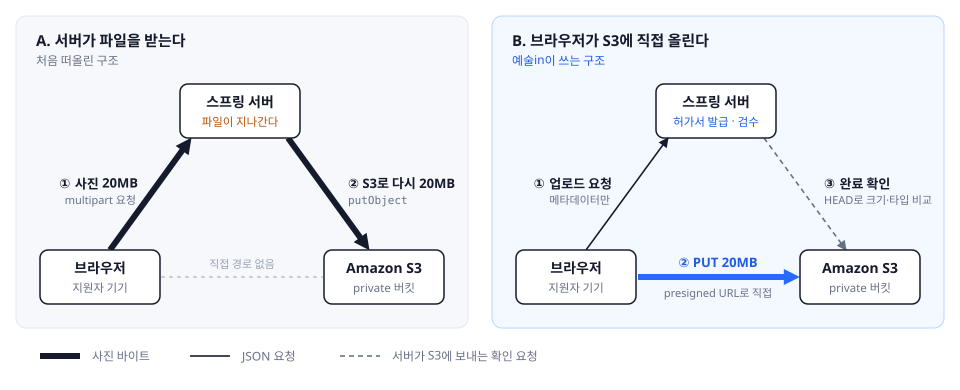
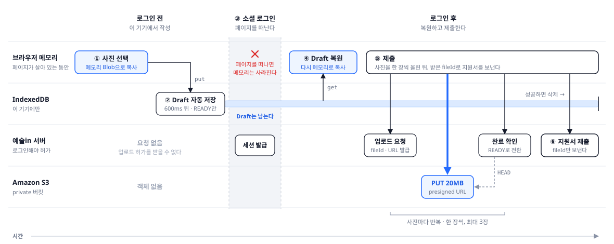
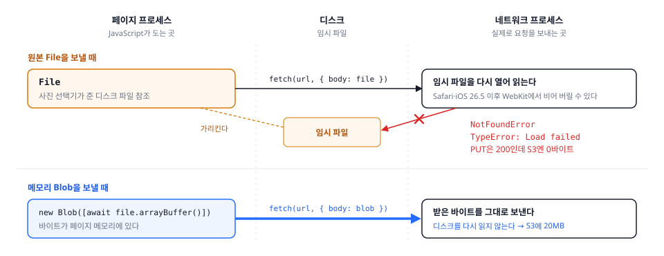
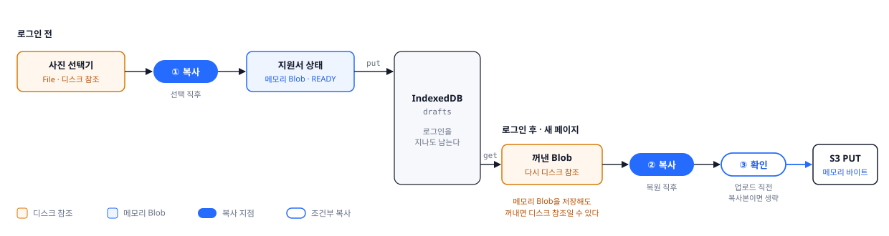

# 아직 로그인하지 않은 회원에게 파일 업로드를 맡기는 방법

브라우저에 맡겨 둔 사진을, 로그인한 뒤 서버가 믿을 수 있는 파일로 바꾸기까지. 예술in 지원서의 사진 업로드 이야기입니다.


## 1. 파일은 로그인한 사람이 올린다고 생각했습니다

스프링으로 파일 업로드를 만들어 본 백엔드 개발자라면 이런 흐름이 익숙할 겁니다. 로그인한 사용자가 파일을 보내면 컨트롤러가 `MultipartFile`로 받아 S3에 올리고, 누가 올렸는지 함께 저장합니다. 저도 파일 업로드는 당연히 **로그인한 사람이 하는 일**이라고 생각했습니다.

예술in에서는 그 전제가 깨졌습니다. 예술in은 뮤지컬 및 연극 오디션 공고를 보고 지원서를 내는 서비스입니다. 사용자는 공고를 보고, 배역을 고르고, 자기소개와 경력을 쓰고, 프로필 사진까지 첨부할 수 있는데, 로그인은 마지막 제출 버튼을 누를 때만 합니다. 공고 링크를 처음 연 사람에게 로그인은 지원서와 상관없는 숙제처럼 보이기 때문입니다.

이건 증명된 결론이 아니라 "로그인 문턱을 뒤로 미루면 덜 떠날 것"이라는 가설이었습니다. 영국 정부의 GOV.UK 디자인 시스템은 가입 전에 할 수 있는 일을 최대한 열어 두라고 권하고, Baymard의 2025년 조사에서는 미국 성인 1,026명 중 18%가 계정을 만들기 싫어 주문을 그만뒀다고 답했습니다. 오디션 지원과 쇼핑은 다르니, 최종 근거는 우리 이탈률을 직접 재 보는 것입니다.

글자만 다룬다면 어렵지 않습니다. 브라우저에 저장했다가 로그인 후 다시 읽으면 됩니다. 문제는 **사진**이었습니다. 지원서에는 사진이 최대 3장, 배우 프로필 사진 특성상 한 장에 20MB까지 들어갑니다. 서버에 올리자니 주인을 정할 수 없고, 브라우저 메모리(React 상태)에만 두자니 로그인하러 페이지를 떠나는 순간 사라집니다.

> 로그인 전의 사진을 어디에 보관했다가, 로그인한 뒤 서버가 믿을 수 있는 파일로 어떻게 바꿀까?

결론부터 말하면, 예술in은 로그인 전 사용자에게 S3에 올릴 권한을 주지 않습니다. 로그인 전에는 브라우저 안의 저장소(IndexedDB)가 사진을 보관하고, 로그인 후 제출하는 순간에야 서버가 짧게 유효한 업로드 URL을 내줍니다. 브라우저가 그 URL로 S3에 올리면, 서버가 검사를 통과한 파일만 지원서에 붙입니다.

> **[스크린샷 자리]** 로그인 전 지원서의 사진 단계. 사진 세 칸이 모두 "선택 완료"로 표시된 화면.
> 캡션: 로그인 전의 "선택 완료"는 아직 업로드가 아닙니다. 사진은 이 브라우저 안에만 있습니다.

## 2. 세 번의 선택과 그 이유

### 첫 번째 선택: 파일이 꼭 서버를 거쳐야 할까

처음 떠올린 `MultipartFile` 방식은 서버가 파일을 직접 보니 검사하기는 쉽지만, 사진이 서버를 두 번 지나갑니다. 지원서 한 건의 사진은 최대 60MB(20MB × 3장)이고 이게 서버로 들어왔다가 S3로 다시 나가니, 서버는 지원서 한 건마다 최대 120MB를 주고받습니다. 업로드가 끝날 때까지 요청 스레드도 붙잡혀 있고, 동시에 제출하는 사람이 N명이면 여기에 N이 곱해집니다. 측정값이 아니라 한도로 계산한 값입니다.

다른 방법은 **presigned URL**입니다. 서버는 파일을 나르는 대신 "이 위치에, 이 방식으로, 10분 안에 파일 하나를 올려도 된다"는 **서명된 허가서(URL)**만 만들어 줍니다. 브라우저는 이 URL로 S3에 직접 올리고, 서버에는 몇 KB짜리 JSON 요청만 지나갑니다. 브라우저에 AWS 비밀 키를 주는 것이 아니라, 서버가 자기 권한으로 요청 하나를 미리 서명해 둔 것입니다. 인증이 사라지는 것도 아닙니다. 인증하는 시점이 "파일을 받을 때"에서 "허가서를 내줄 때"로 옮겨 갈 뿐입니다.



|           | 서버가 받는다                                           | 브라우저가 S3에 직접 올린다                                  |
| --------- | ------------------------------------------------------- | ------------------------------------------------------------ |
| 얻는 것   | 구조가 단순하다. 서버가 파일을 직접 보고 검사할 수 있다 | 서버의 네트워크, 스레드 부담이 사라진다                      |
| 내주는 것 | 파일 크기와 동시 요청만큼 서버 부담이 커진다            | 요청이 세 번으로 늘어난다. 서버가 파일을 못 보니 검사 방법을 따로 설계해야 한다 |

예술in은 오른쪽을 골랐습니다. 서버는 로그인과 지원서 검증처럼 우리 서비스만 할 수 있는 판단에 집중하고, 파일을 나르는 일은 저장소인 S3에 맡기고 싶었습니다. 대신 "파일을 못 보는 서버"라는 숙제가 생겼고, 이건 3장의 완료 확인으로 메우고 있습니다. 앞으로는 업로드가 끝난 사진을 별도 이미지 처리 서버나 람다(Lambda)가 넘겨받아 검사하고 가공하는 방식도 시험해 볼 계획입니다.

### 두 번째 선택: 로그인 전의 사진은 어떻게 할까

presigned 방식을 로그인 전의 지원자에게 대입하면 첫 단계에서 막힙니다. 허가서를 내주는 업로드 요청 API는 로그인한 배우만 부를 수 있고, 서버의 파일 기록은 만들 때부터 주인이 꼭 있어야 하기 때문입니다. 누가 사진을 볼 수 있는지, 누가 지원서에 붙일 수 있는지를 모두 주인으로 판단합니다.

판단 기준은 세 가지였습니다. 사용자가 로그인 없이 지원서를 끝까지 쓸 수 있는가, 서버에 새로 만들고 지켜야 할 규칙이 얼마나 늘어나는가, 그 대가를 감당할 수 있는가.

|                    | A. 쓰기 전에 로그인              | B. 익명으로 먼저 올리기                                      | C. 브라우저에 맡겨 두기                                      |
| ------------------ | -------------------------------- | ------------------------------------------------------------ | ------------------------------------------------------------ |
| 사진이 기다리는 곳 | S3                               | S3 (주인 없음)                                               | 지원자 기기                                                  |
| 로그인하는 시점    | 작성 시작                        | 제출                                                         | 제출                                                         |
| 얻는 것            | 구현이 가장 단순하다             | 사진을 미리 올려 두니 제출이 빠르다                          | 제출하지 않은 사진이 서버나 저장소에 쌓이지 않는다. 서버 규칙을 바꾸지 않는다 |
| 내주는 것          | 쓰기도 전에 로그인 화면을 만난다 | 익명 업로드 토큰, 임시 주인, 만료·정리 정책을 새로 만들고 지켜야 한다 | 제출이 느려진다. 이 브라우저에서만 이어 쓸 수 있다. 브라우저마다 다르게 동작한다 |

예술in은 **C**를 골랐습니다. A는 미루기로 한 로그인 문턱을 다시 세우는 일입니다. B는 제출이 빨라지지만, 익명 사용자를 위한 규칙을 서버에 새로 만들고 계속 지켜야 합니다. 반면 C의 대가인 제출 지연은 사진이 최대 3장이라 큰 병목이 아니라고 봤습니다. B의 복잡도에 비해 얻는 것이 크지 않았고, C는 "주인 없는 파일은 없다"는 서버 규칙도 그대로 지킵니다. 그래서 로그인 전에 누른 "사진 선택"은 **아직 업로드가 아닙니다.** 사진은 사용자의 기기, 그 브라우저 안에만 있습니다.

### 세 번째 선택: 브라우저의 어디에 맡길까

소셜 로그인은 로그인 제공자의 화면으로 페이지를 떠났다가 돌아오는 과정입니다. 그래서 페이지를 떠나도 남고, 20MB 사진을 여러 장 담을 수 있는 곳이 필요했습니다.

| 후보                          | 좋은 점                                        | 우리 흐름에서의 문제                                         |
| ----------------------------- | ---------------------------------------------- | ------------------------------------------------------------ |
| 메모리 (React 상태)           | 가장 단순하다                                  | 제출 직전 로그인은 꼭 해야 하는데, 로그인하러 페이지를 떠나면 사라진다 |
| localStorage · sessionStorage | 페이지를 떠나도 남는다                         | 글자만 담는다. 용량도 보통 몇 MB라 사진에 맞지 않는다        |
| 서버 Draft                    | 기기가 바뀌어도 이어 쓸 수 있다                | 익명 사용자 식별, 접근 제어, 보관 기간과 삭제 정책이 필요하다 |
| IndexedDB                     | 로그인 없이 지원서와 사진 파일을 함께 저장한다 | 그 브라우저 안에서만 읽을 수 있고, 공간이 부족하면 브라우저가 지울 수 있다 |

우리에게 필요한 것은 기기 간 동기화가 아니라, **같은 브라우저에서 로그인 화면을 다녀오는 짧은 시간 동안 작성 내용을 잃지 않는 것**이었습니다. 이 정도라면 익명 사용자를 서버에서 새로 관리하는 것보다 IndexedDB를 쓰는 편이 만들 것도, 서버가 떠안는 개인정보도 적다고 판단했습니다. IndexedDB는 브라우저 안에 만들어지는 작은 데이터베이스로, 글자뿐 아니라 파일 데이터도 담을 수 있습니다. 로그인 후 돌아올 주소 같은 짧은 글자는 sessionStorage에, 작성 중인 지원서(이하 Draft)는 IndexedDB에 둡니다.



## 3. 만든 것: 업로드 3단계와 브라우저 Draft

같은 구조를 만들 때 그대로 따라 할 수 있도록, 만든 순서대로 정리했습니다.

**① 업로드를 세 번의 요청으로 나눕니다.**

1. **업로드 요청**: 브라우저가 파일 이름·종류·크기만 보냅니다. 서버는 파일 기록을 `PENDING`(대기)으로 만들고 presigned URL을 돌려줍니다. 저장 위치는 서버가 정하므로 브라우저가 고를 수 없습니다.
2. **S3에 올리기**: 브라우저가 그 URL로 사진을 직접 올립니다(PUT).
3. **완료 확인**: 브라우저가 "다 올렸어요"라고 알리면, 서버가 S3에 실제로 저장된 크기와 종류를 확인하고 처음 신고한 값과 같을 때만 `READY`(사용 가능)로 바꿉니다.

서버는 파일을 받지 않는 대신 결과를 검사합니다. 20MB 제한도 이 흐름에서 세 번 확인합니다. 브라우저가 사진을 고를 때, 서버가 업로드 요청을 받을 때, 그리고 완료 확인에서 실제로 저장된 파일을 볼 때입니다. 지원서에는 `READY`인 파일만 붙습니다. 다만 이 검사는 신고한 종류와 크기를 대조하는 것이지 사진 내용을 들여다보는 것은 아닙니다. magic byte 확인, 악성 파일 검사, 위치 정보(EXIF) 제거는 아직 하지 않고, 이 몫은 앞서 말한 이미지 처리 서버나 람다에서 다룰 계획입니다.

**② 로그인 전에는 Draft에 자주 저장합니다.**

- **입력이 멈추고 0.6초 뒤마다 저장합니다.** 휴대폰에서는 페이지를 떠날 때 실행되는 코드가 항상 실행된다고 기대할 수 없어서, "로그인 버튼을 누를 때 한 번"으로는 부족합니다. 반대로 글자 하나마다 저장하면 기기에 부담이 됩니다.
- **메모리로 복사가 끝난 사진만 저장합니다.** 이유는 4장에서 나옵니다.
- **저장이 끝나기 전에는 떠나지 못하게 합니다.** 저장 중이거나 실패한 상태에서는 로그인 버튼을 잠그고, 창을 닫으려 하면 경고합니다.

IndexedDB는 영구 저장소가 아니라 "브라우저가 빌려주는 임시 서랍"입니다. 할당량을 넘으면 저장이 실패하고, 기기 공간이 부족하거나 Safari처럼 한동안 방문하지 않은 사이트라면 브라우저가 지울 수도 있습니다. 그래서 저장 실패를 흔히 일어나는 경우로 보고, 실패하면 화면에 알리고 다시 저장할 수 있게 합니다.

> **[스크린샷 자리]** 지원서 검토 화면. 저장이 끝나지 않아 "소셜 로그인하고 제출 계속" 버튼이 잠기고, "작성 내용 저장이 끝난 뒤 이동할 수 있어요" 안내가 보이는 상태.
> 캡션: 저장이 끝나기 전에는 로그인하러 떠날 수 없습니다.

**③ 로그인하러 떠날 때 돌아올 곳을 적어 둡니다.**

돌아올 주소에 공고, 단계, 고른 배역과 함께 "저장된 Draft를 이어서 쓰라"는 표시를 담습니다. 이 주소는 우리 사이트 안의 경로만 허용해서, 로그인 뒤 엉뚱한 외부 사이트로 튕겨 나가지 않게 합니다.

**④ 제출할 때 사진을 한 장씩 올리고, 파일 번호만 보냅니다.**

돌아오면 Draft를 꺼내 화면을 다시 채웁니다. 제출 버튼을 누르면 사진을 한 장씩 ①의 3단계로 올려 파일 번호(fileId)를 받고, 그 번호만 담아 지원서를 보냅니다. 성공하면 Draft를 지웁니다.

- **한 장씩 올리는 이유는 메모리입니다.** 세 장을 동시에 올리면 사진마다 원본과 복사본이 한꺼번에 메모리에 올라가 휴대폰에 부담이 됩니다. 제출이 조금 느려지는 것은 받아들였습니다.
- **서버는 파일 번호를 그대로 믿지 않습니다.** 모두 이 지원자의 파일인지, `READY`인지, 이미지인지 다시 확인합니다. 브라우저에 일을 맡긴 만큼, 브라우저가 보낸 값은 서버가 끝까지 의심합니다.
- **제출을 다시 눌러도 두 번 처리되지 않게 합니다.** 사진을 다 올린 뒤 제출 응답만 네트워크에서 잃어버리면, 사용자는 접수됐는지 모르니 다시 누릅니다. 그래서 사진 업로드가 끝나면 완성된 지원서 내용을 "멱등 키"(같은 요청을 여러 번 보내도 한 번만 처리되게 하는 표시)와 함께 저장해 둡니다. 다시 제출하면 사진은 건너뛰고 같은 내용과 키를 보내고, 서버는 처음 결과를 그대로 돌려줍니다.

## 4. 막힌 곳 네 군데

### 첫 번째: presigned POST를 만들 수 없었다

처음에는 20MB 제한을 S3에서 막으려면 POST가 필요하다고 생각했습니다. POST는 크기 상한 같은 조건을 서명에 넣어, 넘는 파일은 S3가 아예 받지 않게 할 수 있기 때문입니다. 그런데 AWS SDK for Java v2에는 presigned POST를 만들어 주는 기능이 없었습니다. POST를 쓰려면 서명을 직접 구현해야 했습니다.

|             | PUT                                                          | POST                                                         |
| ----------- | ------------------------------------------------------------ | ------------------------------------------------------------ |
| 올리는 방법 | URL에 파일을 그대로 PUT한다                                  | URL과 서명 필드를 폼 데이터로 POST한다                       |
| 얻는 것     | AWS SDK for Java v2가 바로 만들어 준다. 클라이언트도 단순하다 | 크기 상한 같은 조건을 서명에 넣어, 넘는 파일은 S3가 아예 받지 않게 할 수 있다 |
| 내주는 것   | 크기를 서명하지 않아서, S3가 큰 파일도 일단 받는다           | Java SDK v2에 같은 수준의 기능이 없어 서명을 직접 구현해야 한다 |

결국 SDK가 기본으로 지원하고 공식 예제도 안내하는 PUT을 택했습니다. PUT이면 S3가 20MB가 넘는 파일도 일단 받아 버리는데, 그 구멍은 3장의 완료 확인에서 막습니다. 업로드가 끝난 뒤 서버가 S3에 저장된 실제 크기를 확인해 신고한 값과 다르면 `READY`로 바꾸지 않고, `READY`가 아닌 파일은 지원서에 붙지 못합니다. 정리하면 **S3에 올라오는 것 자체는 못 막고, 올라온 파일이 쓰이는 것을 막습니다.** 잘못 올라온 파일을 치우는 일은 아직 남은 숙제입니다.

### 두 번째: iOS에서만 사진이 비어서 올라갔다

데스크톱 Edge에서는 JPEG 세 장(약 2.4MB, 12.5MB, 12.5MB)을 올리고 제출하는 것까지 모두 성공했습니다. 그런데 베타를 운영하던 중 iOS에서 제출이 실패했습니다. 증상은 세 가지였습니다.

- `NotFoundError`: 파일을 찾을 수 없다는 오류
- `TypeError: Load failed`: iOS Safari의 네트워크 오류 (Chrome이라면 `Failed to fetch`)
- S3 업로드는 성공(200)했는데, S3에 저장된 파일은 0바이트

가장 무서운 건 세 번째였습니다. 겉으로는 성공이라, 완료 확인이 없었다면 빈 사진이 `READY`가 되어 심사 화면에 올라갔을 겁니다. 3장에서 만든 서버 검수가 여기서 사고를 막았습니다.

원인은 "사물함 번호표"였습니다. 사진 선택기나 IndexedDB가 주는 `File`은 사진 데이터를 직접 들고 있지 않고, 기기 어딘가의 임시 파일을 가리키기만 할 수 있습니다. 사진이 아니라 사물함 번호표를 들고 있는 셈입니다. 그리고 브라우저 안에서도 우리 JavaScript가 도는 페이지와 실제로 요청을 내보내는 네트워크 담당이 나뉘어 있습니다. 번호표를 그대로 넘기면 네트워크 담당이 그 사물함을 직접 열어야 하는데, iOS에서는 이 사물함이 열리지 않는 일이 있었습니다. 그때마다 오류가 나거나, 빈 봉투를 보낸 것처럼 0바이트가 전송됐습니다.



우리만 겪은 일은 아니었습니다. Safari와 iOS 브라우저의 엔진인 WebKit에도 같은 현상이 [Bug 319985](https://bugs.webkit.org/show_bug.cgi?id=319985)로 신고돼 있습니다. Safari·iOS 26.5 이후에서 디스크를 가리키는 `File`을 그대로 보내면 본문이 빈 채로(`Content-Length: 0`) 전송된다는 내용입니다. 이 신고는 아직 `NEW`, 즉 브라우저 쪽에서는 고쳐지지 않은 상태입니다. 우리는 기다리는 대신 피해 가기로 했습니다. 번호표를 넘기지 말고, **페이지에서 사진을 직접 꺼내 복사한 다음 그 복사본을 보내는** 것입니다.

```ts
// frontend/src/features/files/safe-upload.ts
export async function prepareMemoryBlob(source: Blob): Promise<Blob> {
  const buffer = await source.arrayBuffer();
  const body = new Blob([buffer], { type: source.type });
  if (body.size !== source.size) throw new MemoryBlobSizeMismatchError("memory Blob size differs from source");
  preparedMemoryBlobs.add(body);
  return body;
}
```

파일을 끝까지 읽어 새 Blob을 만들고, 크기가 원본과 다르면 보내기 전에 멈춥니다. 대가는 사진마다 메모리를 한 번 더 쓰는 것이고, 사진을 한 장씩 처리하는 이유이기도 합니다.

그래도 브라우저 내부 문제를 완전히 막았다고 장담할 수는 없어서, 위의 세 증상만 **같은 URL로 딱 한 번** 다시 시도합니다. 모든 실패를 여러 번 재시도하면 소용없는 실패에서도 사용자를 기다리게 하고, 전혀 하지 않으면 일시적인 문제에도 처음부터 다시 해야 하기 때문입니다. presigned URL은 10분 동안 유효하고 같은 위치에 다시 써도 되기 때문에 새 URL은 필요 없습니다.

### 세 번째: 고쳤는데, 로그인하고 돌아오면 또 실패했다

사진을 고르고 바로 제출하는 경우는 이걸로 해결됐습니다. 그런데 이 글의 주제인 경우, 즉 **로그인 전에 사진을 고르고 → 로그인하고 돌아와 → 제출하는** 경우에 실패가 남았습니다. 원인은 복원 코드의 가정이었습니다.

```ts
// 처음: File일 때만 복사했다
if (!(blob instanceof File)) return blob;

// 고친 뒤: IndexedDB에서 꺼낸 Blob은 항상 복사한다
const blob = photo.blob ? await prepareMemoryBlob(photo.blob) : undefined;
```

사진을 고를 때 이미 복사해서 저장했으니, 꺼낼 때도 복사본 그대로일 거라고 생각했습니다. 틀렸습니다. IndexedDB는 넣을 때 데이터를 디스크에 쓰고, 꺼낼 때는 **다시 그 디스크를 가리키는 번호표**를 돌려줄 수 있습니다. 그래서 꺼낸 사진도 종류를 따지지 않고 항상 다시 복사합니다. 같은 사진을 여러 번 복사하면 낭비이므로, 이미 복사한 것에는 표시를 해 두고 업로드 직전에는 건너뜁니다.



### 네 번째: 어디서 실패했는지 보이지 않았다

브라우저가 S3로 직접 보내는 구조는 서버 부담을 줄이지만, 서버가 볼 수 있는 구간도 잘라 놓습니다. 스프링 로그에는 업로드 요청과 완료 확인만 보이고, 그 사이의 S3 전송은 보이지 않습니다. 그래서 실패를 준비 → 업로드 요청 → S3 전송 → 완료 확인 → 제출로 나누고, 업로드마다 오류 ID를 만들어 화면과 서버 로그에 함께 남겼습니다. 사용자는 사진 대신 이 ID만 알려 주면 됩니다. 기록에는 실패 단계, 오류 종류, 대략적인 기기·브라우저 종류만 남기고 사진·파일 이름·URL 같은 개인정보는 남기지 않습니다.

> **[스크린샷 자리]** 업로드 실패 화면. "사진 전송을 완료하지 못했습니다. 네트워크를 확인한 뒤 다시 시도해 주세요. 문의 시 오류 ID ○○를 알려 주세요." 안내가 보이는 상태.
> 캡션: 사용자는 사진 대신 오류 ID만 전달하면 됩니다.

> **[로그 자리]** 0바이트 업로드를 잡아낸 서버 경고 로그 한 줄을 이미지가 아닌 텍스트로 붙여 넣습니다.
> 형식: `FILE_METADATA_MISMATCH fileId=… expectedSize=… actualSize=0 expectedContentType=… actualContentType=…`

테스트로도 잡을 수 없었습니다. CI에서 자동으로 도는 테스트용 브라우저는 실제 iPhone의 이 동작을 재현하지 못할 수 있습니다. 그래서 **IndexedDB 저장 → 로그인 왕복 → 사진 복원 → S3 전송 → 완료 확인**의 전체 경로를 실제 기기에서 따로 확인합니다. "코드로 고쳤다", "자동 테스트가 통과했다", "실제 기기에서 성공했다"는 서로 다른 상태입니다.

> **[그래프 자리 · 데이터가 있을 때만]** 진단 기록의 iOS 업로드 실패 건수와 재시도 성공 건수를 #174 배포 전후로 비교한 막대그래프.

## 5. 배운 것

**검증은 포기하는 게 아니라 옮기는 것입니다.** 서버가 파일을 받지 않아도, 올라간 뒤에 저장된 결과를 확인하면 됩니다. 그리고 성공 응답을 믿으면 안 됩니다. PUT이 200을 돌려줘도 저장된 파일은 0바이트일 수 있었습니다. 믿을 것은 응답이 아니라 실제로 저장된 결과입니다.

**브라우저가 준 파일은 데이터가 아니라 위치일 수 있습니다.** 저장소에 넣었다가 꺼낸 뒤에도 마찬가지입니다. 파일을 다른 곳으로 보내기 직전에는, 데이터가 정말 내 손(페이지 메모리)에 있는지 확인하는 편이 안전합니다.

**문제 브라우저를 맞히려 하지 말고, 모든 브라우저에서 같은 방어를 합니다.** 예술in은 브라우저 종류를 보고 동작을 바꾸지 않고, 메모리 복사를 모든 브라우저에서 똑같이 합니다. 문제없는 브라우저에서는 복사 한 번이 낭비지만, iOS가 업데이트되어 증상이 바뀌어도 코드는 그대로 둘 수 있습니다. 한국에서 쓰는 iOS 브라우저는 Chrome이든 인앱 브라우저든 Safari와 같은 WebKit 엔진을 쓰니, 이름이 달라도 같은 위험군으로 봅니다.

**서버가 못 보는 구간을 먼저 찾습니다.** 로그를 많이 남기는 것보다, 서버 밖에서 일어나는 구간을 구분할 최소한의 정보를 남기는 것이 중요했습니다.

그리고 만들고 나서 보니, 가장 중요한 질문이 하나 남았습니다.

> **서버를 지나가지 않는 동안, 그 파일은 누가 책임지는가?**

예술in은 로그인 전에는 브라우저의 Draft에, 로그인 후에는 주인이 정해진 서버의 파일 기록에 그 책임을 나눴습니다. presigned URL은 그 둘을 잇는 짧은 다리였고, 완료 확인은 브라우저가 "올렸다"고 주장한 파일을 서버가 믿을 수 있는 파일로 바꾸는 관문이었습니다.

## 6. 비슷한 기능을 만드는 분께

### 만들기 전에 스스로 물어보세요

- 파일이 서버를 지나가야 하는 이유가 있나요?
- 로그인 전의 파일은 어디서 기다리나요? 그곳은 페이지를 떠나도 남고, 파일 크기만큼 담을 수 있나요?
- 저장소가 실제로 받은 결과를 누가, 언제 확인하나요?
- 어디서부터 다시 시도하면 파일이나 지원서가 두 번 생기나요?
- 자동 테스트 말고, 실제 기기에서 끝까지 확인했나요?

### 이럴 때는 이 방식만으로는 부족합니다

| 이런 상황이라면                          | 이 방식의 한계                                         | 대신 고려할 것                    |
| ---------------------------------------- | ------------------------------------------------------ | --------------------------------- |
| 다른 기기나 브라우저에서 이어 써야 한다  | Draft가 그 브라우저에만 있다                           | 서버 Draft                        |
| 인앱 브라우저로 들어오는 사용자가 많다   | 로그인 중 다른 브라우저로 넘어가면 Draft를 찾지 못한다 | 실제 기기로 로그인 복귀 경로 확인 |
| 제출이 빨라야 한다                       | 제출하는 순간에 사진을 올린다                          | 익명 선업로드(B안)와 그 관리 규칙 |
| 동영상처럼 큰 파일을 받는다              | 메모리 복사와 한 번에 올리는 PUT은 20MB 사진 기준이다  | 조각 업로드, 이어 올리기          |
| 올라오기 전에 크기를 반드시 막아야 한다  | PUT은 S3가 일단 받는다                                 | presigned POST의 정책 조건        |
| 파일 내용까지 검사해야 한다              | 신고한 종류와 크기만 대조한다                          | 이미지 처리 서버, 람다            |

추가로 이 두 가지도 같이 꼭 챙겨야 하는데요, presigned URL은 가진 사람 누구나 쓸 수 있으니, 로그나 채팅에 남기지 말고 만료를 짧게 둬야합니다. 그리고 제출되지 않고 버려진 파일은 저절로 사라지지 않으니, 정리 방법(S3 수명 주기 규칙 등)을 미리 정해 두어야 한다는 것입니다.

어떤 답을 고르든 대가는 따라올 것입니다. 이러한 대가를 알고 고르는 것과 모르고 떠안는 것은 다르다고 생각합니다.

## 참고 자료

- [AWS: Download and upload objects with presigned URLs](https://docs.aws.amazon.com/AmazonS3/latest/userguide/using-presigned-url.html)
- [AWS SDK for Java 2.x: Work with Amazon S3 pre-signed URLs](https://docs.aws.amazon.com/sdk-for-java/latest/developer-guide/examples-s3-presign.html)
- [AWS: Creating a POST policy](https://docs.aws.amazon.com/AmazonS3/latest/API/sigv4-HTTPPOSTConstructPolicy.html)
- [MDN: IndexedDB API](https://developer.mozilla.org/en-US/docs/Web/API/IndexedDB_API)
- [MDN: Storage quotas and eviction criteria](https://developer.mozilla.org/en-US/docs/Web/API/Storage_API/Storage_quotas_and_eviction_criteria)
- [WebKit: Updates to Storage Policy](https://webkit.org/blog/14403/updates-to-storage-policy/)
- [WebKit Bug 319985](https://bugs.webkit.org/show_bug.cgi?id=319985)
- [GOV.UK Design System: Create accounts](https://design-system.service.gov.uk/patterns/create-accounts/)
- [Baymard Institute: Checkout UX best practices](https://baymard.com/blog/current-state-of-checkout-ux)
