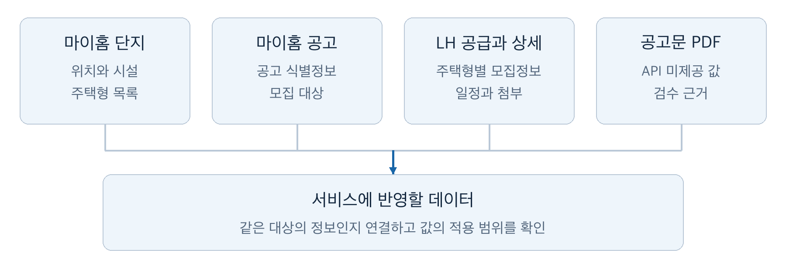
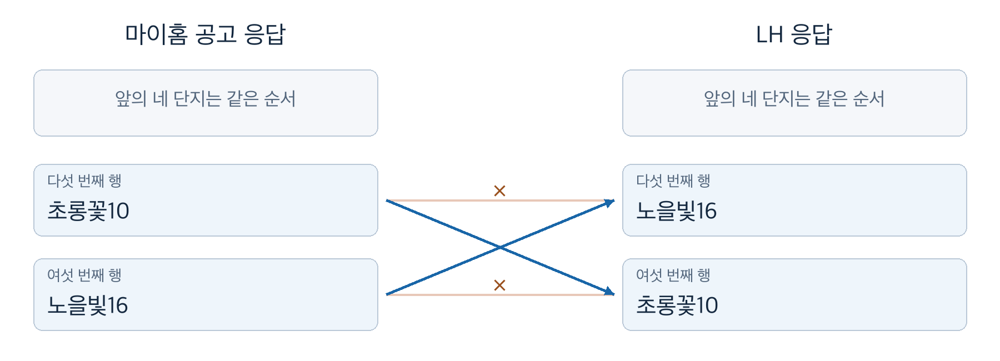
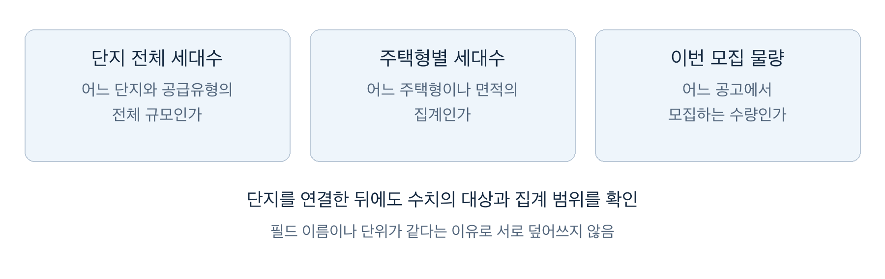

# 공통 키 없는 공공 API 응답을 연결하는 기준

‘공공주택 복덕방’은 공공임대주택의 단지 정보와 모집공고를 한곳에서 볼 수 있는 서비스입니다. 어느 단지에서 어떤 주택형을 몇 세대 모집하는지, 보증금과 월세는 얼마인지, 언제 신청할 수 있는지를 함께 보여 주려 했습니다. 그러려면 마이홈과 LH의 여러 공공 API에 흩어진 정보를 하나로 합쳐야 했습니다.

그런데 두 기관의 응답은 같은 공고까지는 맞출 수 있어도, 그 안의 단지·주택형 행끼리 맞춰 볼 공통 키가 없었습니다. 파주의 한 모집공고를 마이홈과 LH에서 조회했을 때는 단지 여섯 개 중 마지막 두 단지의 순서가 달랐습니다. 공고 ID와 행 개수가 같다는 이유로 같은 위치의 행을 연결했다면 한 단지에 다른 단지의 공급정보가 붙었을 것입니다.

연결 규칙을 정할 때마다 다음 기준으로 판단했습니다.

> 금액을 아직 모르는 상태는 허용한다. 다른 주택형의 금액이 붙는 것은 막는다.

값이 비어 있으면 사용자 화면에 ‘공고문 확인’이라고 표시되므로 사용자가 원문을 찾아볼 수 있습니다. 반면 다른 주택형의 금액은 정상 값처럼 보여서 사용자도 관리자도 틀렸다는 것을 알아채기 어렵습니다. 그래서 연결 근거가 부족하면 값을 채우기보다 비워 두는 쪽을 택했습니다. 뒤에서 다룰 세대수에도 같은 기준을 적용했습니다.

이 글은 공통 키 없이 여러 외부 API의 응답을 하나의 레코드로 합쳐야 하는 백엔드 개발자를 위해 썼습니다. 응답에서 무엇을 확인하고 어떤 근거가 있을 때 자동으로 연결했는지, 근거가 부족할 때 어디서 멈췄는지를 설명합니다. 공공임대 도메인을 몰라도 따라올 수 있도록 데이터의 구성부터 짚겠습니다.

## 모집정보의 구성과 데이터 원천

단지 안의 주택은 이름과 면적 등에 따라 주택형으로 나뉘고, 모집공고에는 이번에 모집하는 대상과 조건이 담깁니다. 같은 단지라도 공고마다 모집하는 주택형과 수량, 금액이 달라질 수 있습니다. 그래서 서비스에서도 단지의 전체 주택형 목록과 이번 공고의 모집 대상을 따로 다뤘습니다.

국민임대·행복주택 같은 공급유형과 `A1` 같은 주택형 이름도 다른 정보입니다. 공급유형이 같다고 같은 주택형은 아니며, 주택형 이름이 같아도 서로 다른 단지의 주택일 수 있습니다.

마이홈 [단지정보 API](https://www.data.go.kr/data/15110581/openapi.do)에서는 여러 공급기관의 단지와 주택형을, 마이홈 [모집공고 API](https://www.data.go.kr/data/15108420/openapi.do)에서는 공고 식별정보와 모집 대상을 얻었습니다. 그러나 이 두 API만으로는 공고별 주택형과 모집 수량, 임대조건, 신청 일정을 모두 채울 수 없었습니다. LH 공고의 부족한 모집정보는 LH의 [공급정보 API](https://www.data.go.kr/data/15056765/openapi.do)와 [상세정보 API](https://www.data.go.kr/data/15057999/openapi.do)에서 가져왔습니다. API가 숫자 대신 ‘공고문 참조’라는 문자열로 내려 주는 값은 서비스 값으로 반영하지 않고 비워 두었고, 관리자가 공고문을 보고 확인하도록 남겼습니다.



*그림 1. 공고의 모집정보를 구성할 때 대조한 자료를 도식화했습니다. 공고문 PDF는 관리자가 값을 확인하는 근거로 사용했습니다.*

단지의 주택형별 세대수는 LH 임대주택 목록에서도 보완했습니다. 이 글에서는 이 목록을 LH 임대 카탈로그라고 부릅니다.

공고의 모집 대상과 수량은 서비스 공급행이라는 레코드에 저장했습니다. 서비스 공급행 하나에 확인한 단지와 주택형을 연결하고, 그 모집 대상의 금액 등을 붙였습니다. 마이홈은 단지 하나의 모집 수량을 한 행으로 주고 LH는 주택형별로 나눠 주는 경우가 있어, 마이홈 응답 한 행에서 서비스 공급행 여러 개를 만들어야 하기도 했습니다.

그래서 API를 추가할 때는 제공하는 필드와 함께 기존 데이터에 연결할 근거도 조사했습니다. 주택형별 금액을 가져와도 어느 공고의 어느 주택형에 붙일지 알 수 없으면 서비스에 반영할 수 없었습니다.

이 글에서 다루는 연결은 다음 다섯 가지입니다. 연결마다 쓸 수 있는 근거가 달랐습니다.

| 무엇을 무엇에 붙이는가 | 사용한 근거 |
| --- | --- |
| LH 공고 → 마이홈 공고 | 마이홈 공고의 LH 상세 URL에 담긴 공고 ID와 조회 코드 |
| 마이홈 공고의 단지 → 서비스 단지 | PNU(필지고유번호, 필지를 구분하는 코드), 공급유형, 후보가 여럿이면 단지명 |
| LH 공급정보 행 → 마이홈 공고 행 | 같은 공고 안에서 단지명, 이름으로 못 맞추면 모집 수량 합계 |
| 공고의 주택형 → 서비스 주택형 | 주택형 이름, 전용면적, 공급면적 |
| LH 임대 카탈로그 세대수 → 서비스 단지·주택형 | 지역·공급유형·전체 세대수, 단지명, 전용면적 |

## 응답을 저장해 두고 연결 규칙을 다시 실행하기

외부 응답을 저장하는 수집과, 저장한 응답을 서비스의 단지·주택형·공고에 연결하는 정제를 나눴습니다. LH의 세대수·금액·일정을 서비스 데이터에 추가로 반영하는 단계는 보강이라고 불렀습니다. 이 글에서는 외부 API에서 받아 저장한 데이터를 원천이라고 부릅니다.

```text
외부 API 응답
    → 수집·응답 검증
    → 원천 데이터 저장
    → 정제·보강에서 연결 근거 확인
    → 서비스의 단지·주택형·공고에 반영
```

이렇게 나누면 연결 규칙을 고쳤을 때 API를 다시 호출하지 않고 저장한 원천으로 정제만 다시 실행할 수 있습니다. 입력을 그대로 둔 채 규칙만 바꿔 결과를 비교할 수 있어서, 뒤에서 설명할 이름 정규화 변경도 같은 입력으로 전후 연결 건수를 셌습니다. 다만 원천은 모든 HTTP 응답과 과거 버전을 보관하지 않고, 원천별로 필요한 필드와 응답 행을 관계형 테이블에 저장합니다. 다시 처리할 수 있는 범위는 실제로 저장한 정보까지입니다.

다시 실행할 수 있다고 규칙이 맞는 것은 아닙니다. 이름이 비슷한 두 단지를 잘못 연결하는 규칙이라면 같은 데이터로 다시 실행해도 같은 오연결이 나옵니다. 규칙이 맞는지는 원문과 대조해 따로 확인해야 했습니다.

## 응답 한 행이 가리키는 범위부터 확인하기

연결 기준을 정하기 전에 API 응답 한 행이 무엇을 나타내는지부터 확인했습니다. 조사한 마이홈 모집공고 표본에서는 72행에 공고 ID가 44개였고, 공고 하나에 단지 일곱 개가 포함된 사례도 있었습니다. 공고 ID가 같다는 이유로 여러 행을 하나로 합치면 그 안의 모집 대상을 잃습니다.

같은 공고끼리는 맞출 수 있었습니다. 마이홈 공고에는 LH 공고 상세 URL이 있어서, 그 URL의 공고 ID와 조회 코드로 LH 공급정보와 상세정보를 조회했습니다. LH 응답에 담긴 조회 조건이 요청과 같을 때만 저장해 다른 공고의 응답이 섞이지 않게 했습니다. 문제는 그 공고 안의 어느 행끼리 같은 대상인지였습니다.

마이홈과 LH는 대상을 나누는 방식부터 달랐습니다. 부천 A5·A6 사례에서는 마이홈의 공고 두 개가 각각 A5와 A6이라는 단지 하나씩을 가리켰지만, 두 공고로 LH를 조회하면 두 응답 모두 A5·A6 정보를 함께 담았습니다. 조회를 나눈 기준과 응답이 담는 범위는 같지 않았습니다. 그래서 LH 응답을 마이홈 공고에 통째로 붙이지 않고 행 단위로 대응시켰습니다. A5 공고에는 A5 이름의 LH 행만 붙고, 같은 응답에 섞인 A6 행은 붙지 않습니다.

행 개수가 같아도 순서는 연결 근거가 되지 않았습니다. 도입에서 언급한 파주 공고는 앞의 네 단지 순서가 같았지만, 마지막 두 단지인 초롱꽃10과 노을빛16은 서로 반대였습니다. 파주만의 예외도 아니었습니다. 주소를 정리해 비교했을 때 마이홈 128행 중 117행에서 LH 쪽 후보가 하나로 정해졌고, 그 117행 중 25행은 LH 응답에서의 순서가 달랐습니다.



*그림 2. 비교한 응답의 마지막 두 단지를 도식화했습니다. 같은 위치를 잇는 선은 잘못된 대응이고, 교차하는 파란 선은 같은 이름의 단지를 잇습니다.*

행을 맞출 공통 식별값도 없었습니다. 마이홈에는 필지를 구분하는 PNU가 있었지만, 조사한 LH 상세 단지 행에는 대응하는 값이 없었습니다. 서비스 DB의 ID는 외부 응답에 없으니 연결 근거가 될 수 없었습니다. ID가 있느냐보다 그 값이 어떤 대상을 어느 범위에서 구분하느냐가 먼저였습니다.

## 자동으로 연결한 근거와 멈춘 지점

### 원천마다 다른 조건으로 후보를 좁히기

공통 ID가 없을 때는 이름이 비슷한 대상을 바로 고르지 않고, 같은 대상으로 볼 근거가 있는 후보부터 찾았습니다. 마이홈 공고를 서비스 단지에 붙일 때는 PNU와 공급유형을 먼저 확인하고, 후보가 여러 개일 때 단지명을 비교했습니다. LH 공급정보 행은 PNU가 없으므로, 같은 공고로 확인한 마이홈 행 중에서 단지명이 맞는 행을 찾았습니다. 앞의 부천 사례도 이 규칙으로 풀었습니다. 이 단계는 단지명 하나에 기대므로, 뒤에서 설명할 이름 정규화의 영향을 가장 크게 받았습니다. LH 임대 카탈로그의 세대수를 보강할 때는 지역·공급유형·전체 세대수가 같은 단지로 후보를 좁힌 뒤 이름을 대조했습니다. 원천마다 주는 정보가 달라 연결 조건을 하나로 통일할 수는 없었습니다.

### 표기 차이는 흡수하고 단지 번호는 지키기

단지명을 비교할 때는 표기 차이와 실제 대상의 차이를 구별해야 했습니다. 처음에는 마이홈 정제와 LH 보강이 서로 다른 정규화 규칙을 썼습니다. 마이홈 정제는 `중동한라1 영구임대주택`에서 임대유형 접미어를 지워 `중동한라1`로 만들었지만, LH 보강은 공백과 하이픈만 지워 `중동한라1영구임대주택`으로 비교했습니다. 같은 단지가 두 규칙 사이에서 서로 다른 이름이 된 것입니다.

그래서 두 단계가 같은 정규화 규칙을 쓰도록 맞췄습니다. 임대유형 접미어, 공백·하이픈, 유니코드·대소문자 차이는 지우고, 단지와 블록을 구분하는 숫자는 원래 이름에서 묶음별로 뽑아 따로 비교했습니다. `1단지 10블록`과 `110블록`은 공백과 글자를 지우면 같아지지만, 숫자 목록 `[1, 10]`과 `[110]`은 다릅니다. 같은 이유로 `중동한라1단지`와 `중동한라10단지`도 연결하지 않습니다.

같은 원천으로 정제를 다시 실행해 변경 전후를 셌습니다.

| 항목 | 변경 전 | 변경 후 |
| --- | --- | --- |
| 단지를 찾지 못한 LH 보강 | 383건 | 182건 |
| LH와 연결된 서비스 공급행 | 192건 | 375건 |
| 활성 공고 중 LH와 연결된 서비스 공급행 | 130/378건 | 250/378건 |
| 단지는 찾았지만 주택형을 찾지 못함 | 12건 | 30건 |

연결 건수가 늘었다는 것만으로 규칙이 나아졌다고 볼 수는 없었습니다. 다른 단지를 잘못 연결한 경우도 늘어난 건수에 섞이기 때문입니다. 그래서 새로 연결된 표본 중 `중동한라1`과 `중동덕유1`을 LH 공식 원문과 대조해, 다른 단지에 연결되지 않았음을 확인했습니다. 다만 새로 연결된 180여 건 중 원문과 대조한 것은 이 두 건이고, 나머지는 숫자 목록 규칙이 단지·블록 번호를 지킨다는 테스트에 기대고 있습니다.

마지막 행의 증가는 규칙이 멈춰야 할 곳에서 멈춘 결과입니다. 단지가 연결되면서 그 아래 주택형의 불일치가 새로 드러났고, 주택형을 확정할 근거가 없는 서비스 공급행에는 금액을 붙이지 않았습니다.

### 이름으로 못 맞춘 행은 수량 합계로 확인하기

마이홈과 LH의 모집정보를 대응시킬 때는 같은 공고로 확인한 원천끼리만 비교했습니다. 단지명으로 대응할 수 있는 행부터 연결하고, 이름으로 맞추지 못한 마이홈 행이 하나만 남았을 때만 수량을 확인했습니다. 남은 LH 행의 공급 수량을 모두 읽을 수 있고 그 합계가 마이홈의 모집 수량과 같으면 LH 주택형별로 서비스 공급행을 나눴습니다.

아산읍내 사례에서는 마이홈의 모집 수량 240세대에 LH의 두 주택형 200세대와 40세대가 대응했습니다. 남은 마이홈 행이 여러 개이거나 합계가 맞지 않으면 자동으로 확정하지 않고 관리자 확인 대상으로 남겼습니다.

수량 비교는 같은 공고 안에서 이미 연결한 대상을 뺀 뒤에만 쓰는 보조 조건입니다. 수량이 같다는 이유만으로 임의의 두 단지를 연결하지는 않습니다. 합계가 맞아도 최초 응답에 필요한 행이 빠짐없이 들어왔는지까지 보장하지는 못합니다.

### 후보가 하나여도 근거가 있어야 고르기

서비스 주택형을 찾을 때도 후보의 수와 일치 근거를 구분했습니다. 마이홈 단지 응답에는 같은 단지의 `A1`이라는 이름에 전용면적 24.792㎡와 41.323㎡가 함께 있는 사례가 있었습니다. 이름만 같다고 두 주택형을 합칠 수는 없었습니다.

공고의 주택형은 이름, 전용면적, 공급면적 순서로 비교하고, 어느 단계에서든 유일하게 일치하는 후보가 나오면 선택했습니다. 저장된 후보가 하나뿐이라는 이유만으로는 고르지 않았습니다. 후보가 하나뿐이어도 이름이나 면적 중 하나는 맞아야 했습니다.

LH 임대 카탈로그 보강에서도 전용면적이 같은 서비스 주택형이 여러 개면 각각에 세대수를 복사하지 않았습니다. 한 면적의 집계를 여러 주택형에 나눌 근거가 없었기 때문입니다. 확정하지 못한 값은 비워 두고, 자동 연결을 보류한 이유를 기록했습니다.

## 연결한 값이 채우려는 항목에 맞는지 확인하기

단지를 찾았다고 필드값을 그대로 옮길 수 있는 것도 아니었습니다. 원천 비교 기록에서 영우예인촌의 전체 세대수는 양쪽이 280세대와 21세대로 달랐습니다. 이 비교만으로는 어느 쪽이 틀렸는지, 두 수치가 같은 범위를 집계했는지 결론 낼 수 없었습니다.

그래서 단지 전체 세대수, 주택형별 세대수, 이번 공고의 모집 수량을 구분했습니다. 모두 ‘세대’라는 단위를 쓰지만 적용 대상과 시점이 다릅니다. 단지 전체 수치도 해당 공급유형만 집계한 값일 수 있어, 건물 전체의 규모로 읽을 수 없었습니다.

영우예인촌의 두 값도 어느 한쪽으로 덮어쓰지 않았습니다. LH 임대 카탈로그 보강은 전체 세대수가 같은 단지만 후보로 삼으므로, 영우예인촌처럼 전체 세대수가 다르면 후보에서 빠지고 마이홈 세대수가 그대로 남습니다. LH 임대 카탈로그 보강은 연결되면 쓰고 연결되지 않으면 기존 값을 유지하는 보조 경로로 두었습니다.



*그림 3. 세대수의 적용 범위를 구분한 개념도입니다. 앞의 280세대와 21세대가 각각 어느 범위인지 확정한 그림은 아닙니다.*

임대조건도 같았습니다. 같은 단지·주택형의 금액이어도 카탈로그의 기본 임대조건과 이번 공고의 모집 조건은 다릅니다. 공고 금액을 단지 기본값으로 옮기지 않았고, 기본값을 이번 모집의 조건으로 대신 쓰지도 않았습니다.

값이 없으면 채우지 않았습니다. ‘공고문 참조’를 0원으로 바꾸면 비용이 없는 주택처럼 안내하게 되고, 다른 공고의 금액으로 채우면 모집 회차가 다른 조건을 안내하게 됩니다. 숫자로 확인한 금액만 반영하고 나머지는 원문 확인 대상으로 남겼습니다.

## 주택형을 바꿀 때 금액도 함께 바꾸기

연결 규칙을 고쳐 정제를 다시 실행하면, 이미 연결했던 서비스 공급행의 주택형이 바뀔 수 있습니다. A형에 붙어 있던 서비스 공급행을 B형으로 바꾸면서 A형의 금액을 그대로 두면, 연결과 금액은 각각 저장돼 있어도 사용자는 B형에 A형의 금액이 붙은 조합을 보게 됩니다. 이 글의 기준에서 가장 피하려던 상황입니다.

그래서 이미 LH 보강을 마친 공고를 다시 정제할 때는 주택형 재연결과 LH 금액 보강을 공고 단위의 한 트랜잭션으로 반영했습니다. 기존 주택형을 다른 주택형으로 바꾸는데 새 금액을 확보하지 못하면, 주택형만 먼저 바꾸지 않고 그 공고의 변경 전체를 보류했습니다.

주택형만 바꾸고 금액은 비우는 방법도 기준에 맞아 보이지만, 보강의 다른 규칙과 부딪혔습니다. 보강은 새 금액이 없을 때 같은 주택형에 저장된 기존 금액을 지우지 않고 유지합니다. 이 규칙 아래에서 주택형만 먼저 바꾸면 비워야 할 이전 금액이 유지되어 B형에 A형의 금액이 남습니다. 그래서 금액을 함께 확정할 수 없으면 연결도 바꾸지 않았습니다.

대신 보류된 공고는 바뀐 규칙의 연결을 반영하지 못하고 이전 상태로 남습니다. 이 변경은 롤백하고 매핑 실패로 기록해, 관리자가 확인할 대상이 되도록 했습니다.

이 보류 조건은 처음 연결하는 경우에는 적용하지 않았습니다.

| 상황 | 처리 |
| --- | --- |
| 기존 주택형을 다른 주택형으로 바꾸는데 새 금액이 없음 | 이전 주택형의 금액이 남지 않도록 공고 전체 변경 보류 |
| 연결되지 않았던 서비스 공급행에 처음 주택형을 연결함 | 남아 있을 이전 금액이 없으므로 보류하지 않음 |
| 처음 등록하는 공고에 금액이 없음 | 금액이 비어 있어도 공고를 등록함 |

첫 행은 다른 주택형의 금액이 붙는 것을 막고, 나머지 두 행은 금액을 모르는 상태를 허용합니다. 도입의 기준을 그대로 옮긴 표입니다.

## 연결 규칙을 검증한 조건

API 호출에 성공했는지, 응답을 저장했는지, 금액을 확보했는지, 그 금액을 붙일 주택형까지 연결했는지는 서로 다른 질문입니다. 수집한 값과 저장한 값이 일치해도 잘못된 주택형에 붙었다면 사용자에게 보이는 정보는 틀립니다. 그래서 다음 상황마다 기대 동작을 정해 두었습니다.

| 검증할 상황 | 기대 동작 |
| --- | --- |
| 같은 공고의 응답 순서가 다름 | 같은 위치라는 이유로 다른 단지의 정보를 연결하지 않음 |
| 정규화하면 같아지지만 단지·블록 번호가 다름 | 숫자 목록이 다르면 연결하지 않음 |
| 후보가 하나지만 이름과 면적이 모두 맞지 않음 | 후보 수만으로 주택형을 확정하지 않음 |
| 같은 전용면적의 주택형이 여러 개임 | LH의 집계 세대수를 각 주택형에 복사하지 않음 |
| 기존 주택형을 바꾸는데 새 금액을 확보하지 못함 | 공고 전체 변경을 보류해 이전 금액과 새 주택형이 섞이지 않게 함 |
| 처음 연결하거나 금액 없는 공고를 처음 등록함 | 위 보류 조건을 적용하지 않음 |

이 표는 규칙이 지켜야 할 동작이며, 실제 공고 전체의 연결 정확도를 집계한 표는 아닙니다. 연결 정확도는 앞의 이름 정규화처럼 건수와 원문 대조를 함께 봐야 했습니다.

## 비워 둔 값이 남긴 비용

근거가 부족한 연결을 보류한 대가로 빈 금액과 연결되지 않은 서비스 공급행이 남았습니다. 이름 정규화 뒤에도 단지를 찾지 못한 LH 보강이 182건, 주택형을 찾지 못한 경우가 30건 있었습니다. 이 데이터는 관리자가 원천과 공고문을 보고 확인할 대상으로 남습니다. 관리자가 고친 값을 다음 자동 갱신에서 어떻게 지킬지, 관리자가 정한 연결을 언제 다시 확인할지도 정해야 했지만 이 글의 범위를 넘어서 다루지 않았습니다.

구조에도 개선할 여지가 있습니다. 마이홈으로 먼저 만든 단지와 서비스 공급행에 LH 정보를 붙이면서 늘어난 규칙 중, 두 API의 응답 단위가 달라서 필요한 것과 현재 저장 구조 때문에 필요한 것을 아직 충분히 구분하지 못했습니다. 다만 구조를 단순하게 바꾸더라도 데이터의 범위까지 합쳐서는 안 됩니다. 공고에 나온 주택형만으로 단지 전체 주택형을 갱신하면, 이번에 모집하지 않는 주택형을 누락으로 판단해 지울 수 있습니다.

공통 키가 없는 응답을 합칠 때 연결 건수는 쉽게 늘릴 수 있습니다. 순서를 믿거나, 후보가 하나면 고르거나, 이름을 더 느슨하게 비교하면 됩니다. 이 연동에서는 그 대신 같은 대상이라는 근거가 있는 정보만 자동으로 연결하고, 근거가 없으면 값을 비워 두었습니다. 비어 있는 금액은 사람이 채울 수 있지만, 정상 값처럼 보이는 다른 주택형의 금액은 틀렸다는 것부터 알아채기 어렵기 때문입니다.
