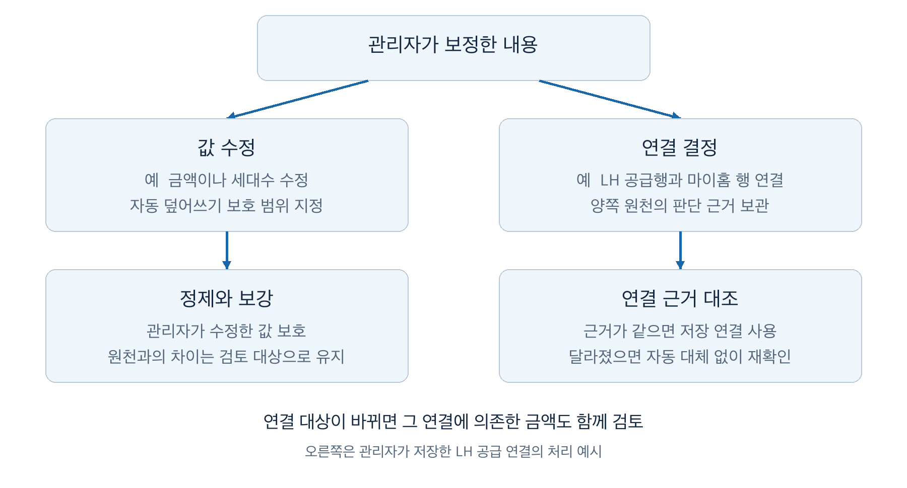

# 공공임대 데이터의 자동 연결과 보정 기준

‘공공주택 복덕방’은 공공임대주택의 단지 정보와 모집공고를 한곳에서 볼 수 있는 서비스입니다. 어느 단지에서 어떤 주택형을 몇 세대 모집하는지, 보증금과 월세는 얼마인지, 언제 신청할 수 있는지를 함께 보여 주려 했습니다. 그러려면 여러 공공 API와 공고문에 흩어진 정보를 모아 연결해야 했습니다.

그런데 응답을 비교해 보니 같은 공고라고 해서 바로 연결할 수는 없었습니다. 파주의 한 모집공고를 마이홈과 LH에서 조회했을 때는 단지 여섯 개 중 마지막 두 단지의 순서가 달랐습니다. 공고 ID와 행 개수가 같다는 이유로 같은 위치의 행을 연결하면 다른 단지의 공급정보가 붙을 수 있었습니다. 숫자 대신 ‘공고문 참조’로 내려오는 값도 있어 사람이 직접 확인해야 했고, 그렇게 고친 값은 다음 자동 갱신에서도 유지할 수 있어야 했습니다.

이 과정에서 이름·면적·모집 수량 등을 근거로 자동 연결할 범위를 정했습니다. 확정하지 못한 정보는 비워 두거나 관리자 확인 대상으로 남겼습니다. 관리자가 고친 값은 자동 갱신에서 보호했고, 선택한 연결은 판단 근거가 달라지면 다시 확인하도록 했습니다. 금액을 아직 모르는 상태는 허용하더라도 다른 주택형의 금액이 붙는 것은 막아야 했기 때문입니다.

이 글에서는 어떤 데이터를 보고 이 기준을 정했는지, 그 과정에서 무엇을 자동으로 처리하고 무엇을 사람의 판단으로 남겼는지 설명하려 합니다. 외부 API를 호출하고 DB에 저장해 본 백엔드 개발자가 읽을 수 있도록, 먼저 공공임대 데이터의 구성을 간단히 짚겠습니다.

## 모집정보의 구성과 데이터 원천

단지 안의 주택은 이름과 면적 등에 따라 주택형으로 나뉘고, 모집공고에는 이번에 모집하는 대상과 조건이 담깁니다. 같은 단지라도 공고마다 모집하는 주택형과 수량, 금액은 달라질 수 있습니다. 그래서 서비스에서도 단지의 전체 주택형 목록과 이번 공고의 모집 대상을 따로 다뤘습니다.

또한 국민임대·행복주택 같은 공급유형과 `A1` 같은 주택형 이름은 다른 정보입니다. 공급유형이 같다고 같은 주택형은 아니며, 주택형 이름이 같아도 서로 다른 단지의 주택일 수 있습니다.

마이홈 단지정보에서는 여러 공급기관의 단지와 주택형을 확보했습니다. 마이홈 모집공고에서는 공고 식별정보와 모집 대상을 얻었습니다. 그러나 이 두 API만으로 공고별 주택형과 모집 수량, 임대조건, 신청 일정을 모두 채울 수는 없었습니다. LH 공고에서 부족한 모집정보는 LH의 [공급정보 API](https://www.data.go.kr/data/15056765/openapi.do)와 [상세정보 API](https://www.data.go.kr/data/15057999/openapi.do)에서 확인했습니다. 숫자 대신 ‘공고문 참조’로 내려오는 값은 관리자가 공고문을 보고 확인해야 했습니다.


*그림 1. 공고의 모집정보를 구성할 때 대조한 자료를 도식화했습니다. 공고문 PDF는 관리자가 값을 확인하는 근거로 사용했습니다.*

이와 별도로 단지의 주택형별 세대수는 LH 임대주택 목록에서도 보완했습니다. 이 글에서는 이 목록을 LH 임대 카탈로그라고 부릅니다. 특정 공고에서 이번에 모집하는 수량을 얻는 경로와, 단지에 해당 면적의 주택이 얼마나 있는지 확인하는 경로는 구분했습니다.

공고의 모집 대상과 수량을 저장할 때는 서비스 공급행이라는 레코드를 뒀습니다. 여기에 확인한 단지와 주택형을 연결하고, 해당 모집 대상의 금액 등을 붙였습니다. 마이홈이 단지 하나의 모집 수량을 한 행으로 제공하고 LH는 주택형별로 나눠 제공한 경우에는, 마이홈 응답 한 행에서 여러 서비스 공급행을 만들어야 했습니다. 외부 응답 한 행이 서비스 레코드 한 개로 이어지는 구조로는 부족했습니다.

이 때문에 API를 추가할 때는 제공하는 필드와 함께 기존 데이터에 연결할 근거도 조사했습니다. 주택형별 금액을 가져와도 어느 공고의 어느 주택형에 붙일지 알 수 없으면 서비스에 반영할 수 없었습니다.

## 원천 저장과 서비스 반영의 분리

값이 잘못됐을 때는 API가 그렇게 응답했는지, 변환 과정에서 잘못 처리했는지 따로 확인할 수 있어야 했습니다. 서비스에 반영한 값만 남겨 두면 둘을 구별하기 어려웠기 때문입니다. 관리자가 값을 고친 뒤에도 API에서 받은 값과 비교할 수 있어야 했습니다.

그래서 외부 응답을 저장하는 수집과, 저장한 데이터를 서비스의 단지·주택형·공고에 연결하고 변환하는 정제를 나눴습니다. LH의 세대수·금액·일정 등을 추가로 반영하는 보강도 서비스 데이터에 값을 적용하는 단계로 뒀습니다. 이 글에서는 외부 API에서 받아 저장한 데이터를 원천이라고 부릅니다.

```text
외부 API 응답
    → 수집·응답 검증
    → 원천 데이터 저장
    → 정제·보강에서 연결 기준과 관리자 보정 여부 확인
    → 서비스의 단지·주택형·공고에 반영
```

관리자가 고친 값을 유지하면서 새 응답과 비교할 수 있도록, 응답은 수집 데이터로 저장하고 서비스 값을 갱신할 때 관리자 수정 여부를 확인했습니다.

이렇게 나눠 두니 이름 정규화 규칙을 고쳤을 때도 API를 다시 호출할 필요가 없었습니다. 저장한 응답으로 정제만 다시 실행할 수 있었고, 입력을 그대로 둔 채 규칙을 바꿨을 때의 결과를 살펴볼 수 있었습니다. 외부 응답이 달라진 영향과 처리 규칙을 바꾼 영향을 나눠 볼 수 있다는 점이 이 구조의 장점이었습니다.

다만 저장 원천이 모든 HTTP 응답과 과거 버전을 보관하는 것은 아닙니다. 원천별로 필요한 필드와 응답 행을 관계형 테이블에 저장하며, 일부는 원문 데이터도 함께 보관합니다. 다시 확인하고 처리할 수 있는 범위는 실제로 저장한 정보에 한정됩니다.

저장한 응답으로 처리를 반복할 수는 있었지만, 연결 기준이 맞는지는 별도로 검토해야 했습니다. 이름이 비슷한 두 단지를 잘못 연결하는 규칙이라면 같은 데이터로 다시 실행해도 결과는 같았을 것입니다.

## 응답 단위와 식별 범위의 차이

연결 기준을 정하기 전에 API 응답 한 행이 무엇을 나타내는지부터 확인했습니다. 조사한 마이홈 모집공고 표본에서는 72행에 포함된 공고 ID가 44개였고, 공고 하나에 단지 일곱 개가 포함된 사례도 있었습니다. 공고 ID가 같다는 이유로 여러 행을 하나로 합치면 그 안의 모집 대상을 잃을 수 있었습니다.

마이홈과 LH가 대상을 나누는 방식도 달랐습니다. 마이홈에서 단지 단위로 받은 모집 수량을 LH는 여러 주택형 행으로 나눠 제공하기도 했습니다. 부천 A5·A6 사례에서는 마이홈의 각 공고가 공급 대상 하나를 가리켰지만, 두 공고에 대응해 LH를 조회하면 두 응답 모두 A5·A6 정보를 포함했습니다. 조회를 나눈 기준과 응답이 포함하는 범위가 같다고 볼 수 없었습니다.

행 개수가 같은 경우에도 순서는 연결 근거가 되지 않았습니다. 도입에서 언급한 파주 공고는 앞의 네 단지 순서가 같았지만, 마지막 두 단지인 초롱꽃10과 노을빛16은 서로 반대였습니다.


*그림 2. 비교한 응답의 마지막 두 단지를 도식화했습니다. 같은 위치를 잇는 선은 잘못된 대응이고, 교차하는 파란 선은 같은 이름의 단지를 잇습니다.*

공통 식별값도 충분하지 않았습니다. 마이홈에는 필지를 구분하는 PNU 같은 값이 있었지만, 조사한 LH 상세 단지 행에는 대응하는 값이 없었습니다. LH의 공고 ID로 같은 공고까지 찾더라도, 그 안의 어느 단지끼리 같은 대상인지 별도로 판단해야 했습니다.

이 사례들을 비교하면서 공고 ID, 저장한 응답행의 식별값, 서비스 단지·주택형의 ID를 나눠 살펴봤습니다. 응답 순번으로 저장행을 찾을 수는 있어도 다른 API의 같은 순번을 같은 단지로 볼 수는 없었습니다. 서비스에서 발급한 DB ID 역시 외부 응답에 없어 연결 근거로 쓰기 어려웠습니다. ID의 유무보다 그 값이 어떤 대상을 어느 범위에서 구분하는지가 먼저였습니다.

## 자동 연결의 근거와 보류 기준

공통 ID가 없을 때는 이름이 비슷한 대상을 바로 선택하기보다, 같은 대상으로 볼 근거가 있는 후보부터 찾았습니다. 마이홈 공고를 서비스 단지에 붙일 때는 PNU와 공급유형을 먼저 확인하고, 후보가 여러 개면 단지명을 비교했습니다. LH 임대 카탈로그의 세대수를 보강할 때는 지역·공급유형·전체 세대수로 후보를 좁힌 뒤 이름을 대조했습니다. 원천마다 제공하는 정보가 달랐으므로 연결 조건도 하나로 통일할 수 없었습니다.

같은 단지명 비교라도 표기 차이와 실제 대상의 차이를 구별해야 했습니다. 공고 정제와 LH 보강의 공백·하이픈·유니코드 표기, ‘아파트’ 같은 표현의 처리 규칙을 맞췄습니다. 반면 단지와 블록을 구분하는 숫자는 원래 이름에서 묶음별로 추출해 비교했습니다. `1단지 10블록`과 `110블록`에서 공백과 글자를 지운 결과가 같아져도, 숫자 목록 `[1, 10]`과 `[110]`은 다르기 때문입니다.

이름 정규화 변경 후 새로 연결된 중동한라1·중동덕유1 표본은 공식 원문과 대조했습니다. 연결 건수가 늘었다는 것만으로 규칙을 평가하면 다른 단지를 잘못 연결한 경우도 개선으로 셀 수 있었습니다. 표기 차이를 해결했는지와 대상의 구분을 유지했는지를 함께 확인해야 했습니다.

마이홈과 LH의 모집정보를 대응시키는 과정에서는 한 원천행을 주택형별로 나눠야 했습니다. 비교 대상은 같은 공고로 연결을 확인한 현재 원천으로 제한했습니다. 관리자 연결이 있는 행을 별도로 처리한 뒤, 단지명으로 대응할 수 있는 행부터 연결했습니다. 이름으로 대응시키지 못한 마이홈 행이 하나만 남고 남은 LH 행의 공급 수량을 모두 읽을 수 있을 때는, 그 합계가 마이홈의 모집 수량과 같은지 추가로 확인했습니다.

예를 들어 기록에 있는 아산읍내 사례에서는 마이홈의 모집 수량 240세대에 LH의 두 주택형 수량 200세대와 40세대가 대응했습니다. 이런 조건을 만족하면 LH 주택형별로 서비스 공급행을 나눴습니다. 남은 마이홈 행이 여러 개이거나 수량이 맞지 않으면 자동으로 확정하지 않고 관리자 확인 대상으로 남겼습니다.

수량 비교는 같은 공고 안에서 이미 연결한 대상을 제외한 뒤 사용하는 보조 조건으로 한정했습니다. 수량이 같다는 이유만으로 임의의 두 단지를 연결할 수는 없었습니다. 최초 응답에 필요한 행이 빠짐없이 포함됐는지도 합계 비교만으로는 확인할 수 없었습니다.

서비스 주택형을 찾을 때도 후보의 수와 일치 근거를 구분했습니다. 마이홈 단지 응답에는 같은 단지의 `A1`이라는 이름에 전용면적 24.792㎡와 41.323㎡가 함께 있는 사례가 있었습니다. 이름만 같다고 두 주택형을 합칠 수는 없었습니다.

공고의 주택형은 이름, 전용면적, 공급면적 순서로 비교하고, 어느 단계에서든 유일하게 일치하는 후보를 찾으면 선택했습니다. 앞선 기준으로 확정하지 못하면 단지의 전체 주택형을 대상으로 다음 기준을 비교했습니다. 다만 저장된 후보가 하나뿐이라는 이유만으로 선택하지는 않았습니다. 후보가 하나여도 이름이나 면적 중 채택할 근거가 있어야 했습니다.

LH 세대수 보강에서도 전용면적이 같은 서비스 주택형이 여러 개면 각각에 세대수를 복사하지 않았습니다. 한 면적의 집계를 여러 주택형에 배분할 근거가 없었기 때문입니다. 확정하지 못한 값은 비워 두거나 자동 연결을 보류한 이유를 남겼습니다. 관리자가 확인할 일은 남았지만, 근거 없이 서비스 값을 채우는 것은 피하도록 했습니다.

## 연결한 값의 적용 범위

단지를 찾았다고 필드값을 그대로 옮길 수 있는 것도 아니었습니다. 원천 비교 기록에서 영우예인촌의 총세대수는 양쪽이 280세대와 21세대로 달랐습니다. 이 비교만으로 어느 쪽이 틀렸는지, 두 수치가 같은 범위를 집계했는지는 결론 내릴 수 없었습니다.

이 때문에 단지 전체 세대수, 주택형별 세대수, 이번 공고의 모집 수량을 구분했습니다. 모두 ‘세대’라는 단위를 썼지만 적용 대상과 시점은 달랐습니다. 단지 전체 수치라고 해도 해당 공급유형의 집계일 수 있어, 건물 전체의 규모로 받아들일 수는 없었습니다.


*그림 3. 세대수의 적용 범위를 구분한 개념도입니다. 앞의 280세대와 21세대가 각각 어느 범위인지 확정한 그림은 아닙니다.*

임대조건도 마찬가지였습니다. 같은 단지·주택형의 금액이어도 카탈로그의 기본 임대조건과 이번 공고의 모집 조건은 구분해야 했습니다. 그래서 공고 금액을 단지 기본값으로 옮기거나, 기본값을 이번 모집의 조건으로 대신 사용하지 않았습니다.

값이 없는 경우에는 채우지 않고 남겨 뒀습니다. ‘공고문 참조’를 0원으로 바꾸면 비용이 없는 주택처럼 안내할 수 있었고, 다른 공고의 금액으로 채우면 모집 회차가 다른 조건을 제공할 수 있었습니다. 숫자로 확인한 금액만 반영하고 나머지는 원문 확인 대상으로 남긴 이유였습니다.

이 경험에서는 같은 대상인지 확인하는 일과, 그 값이 지금 채우려는 항목에 맞는지 확인하는 일이 각각 필요했습니다. 관리자가 값을 보정할 때도 숫자의 형식과 함께 대상 주택형, 공고, 집계 범위를 확인해야 했습니다. 숫자가 올바르게 저장됐다는 사실만으로 사용자에게 올바른 정보를 제공한다고 볼 수는 없었습니다.

## 수동 수정과 자동 갱신의 보호 범위

연결을 보류하거나 값을 비워 둔 데이터는 관리자가 수집 데이터와 공고문을 보고 보정할 수 있게 했습니다. 그러고 나니 다음 수집에서 외부 값이 달라졌을 때 관리자 수정값을 유지할지, 새 값으로 바꿀지도 정해야 했습니다. 금액·세대수 같은 값을 고치는 경우와 연결 대상을 선택하는 경우에는 필요한 처리가 달랐고, 먼저 값 수정의 보호 범위를 정했습니다.

API 응답을 바탕으로 만든 서비스 레코드를 관리자가 수정하면 수정 여부를 기록하고, 정제·보강에서 해당 레코드의 자동 갱신을 막았습니다. 수정한 필드 하나만 잠그는 방식과는 다릅니다.

| 수정 대상 | 자동 처리에서 유지하는 범위 |
| --- | --- |
| 단지·공고 | 수동 수정한 레코드의 값을 유지 |
| 공급행 | 관리자가 정한 모집 수량과 표시 정보 등을 유지하되, 매칭에 필요한 원천 이름 갱신은 구분 |
| 임대금액 정보 | 수동 수정한 금액 레코드의 보증금·월 임대료 등을 유지 |
| 주택형 | 재정제와 LH 세대수 보강에서 값을 유지하고, 원천에서 사라진 주택형을 정리할 때도 보존 |

보호 범위를 이렇게 정하면서 감수해야 할 비용도 있었습니다. 보증금만 수정해도 같은 금액 레코드의 월 임대료까지 자동 갱신을 막도록 했습니다. 단지·공고도 한 항목을 고치면 같은 레코드의 다른 정상 정정까지 자동 반영하지 못할 수 있었습니다. 결국 수집한 값과 수정값을 비교해 어느 쪽을 반영할지 다시 판단하는 일은 관리자에게 남았습니다.

보호 대상은 수정한 레코드로 한정했습니다. 주택형을 수정했다고 그 주택형이 속한 단지의 기본정보 전체까지 자동 갱신을 막지는 않았습니다. 수집 데이터에서 사라진 주택형을 보존하는 것과 단지 정보의 갱신을 막는 것은 별도로 처리했습니다.

공급행의 표시용 이름과 매칭용 이름도 따로 저장했습니다. 관리자가 주택형 표기를 고칠 때 매칭용 이름까지 바뀌면 다음 정제에서 비교할 기준이 달라질 수 있었습니다. 그래서 관리자는 표시용 이름을 고치고, 매칭용 이름은 정제 과정에서 수집 데이터의 이름으로 갱신하도록 했습니다. 관리자의 표시 수정으로 수집 데이터 자체를 바꾸지는 않았습니다.

검수 기록도 자동 갱신을 막는 표시와 나눴습니다. 주소가 맞는지 확인했다고 해서 이후 외부 주소가 바뀌어도 지금 값을 유지하기로 결정한 것은 아니었습니다. 검수에서는 확인한 항목과 당시 값을 기록했고, 나중에 그 항목이 바뀌면 다시 확인할 대상으로 표시했습니다.

수정한 값을 보호하면 외부의 정상 정정도 사람이 검토해야 했고, 확인 기록만 남기면 이후 자동 갱신으로 값이 달라질 수 있었습니다. 수동 보정에서는 값을 고치는 방법과 함께, 다음 갱신에서 그 값을 어떻게 다룰지도 정해야 했습니다.

## 수동 연결의 재사용과 재확인

연결 보정에는 서비스 공급행이 참조하는 단지·주택형을 바꾸는 일과, 마이홈 원천행과 LH 공급 원천행의 대응을 고치는 일이 있습니다. 전자는 서비스의 어느 대상에 정보를 붙일지 정하는 일이고, 후자는 어떤 원천끼리 같은 모집 대상을 설명하는지 정하는 일입니다. 이 절에서는 두 원천 사이의 대응을 저장하고 다시 사용하는 정책을 다룹니다.

### 연결 근거의 재확인

이름과 수량으로 확정하지 못한 대응은 관리자가 공고문을 보고 연결할 수 있게 했습니다. 저장할 때는 확인한 출처 URL과 이유, 양쪽 원천에서 판단에 사용한 정보의 지문을 함께 남겼습니다. 지문은 이름·면적·수량과 원천행 식별정보 등을 해시로 계산한 값으로, 저장 당시와 현재의 근거가 같은지 비교하는 데 사용합니다.

보증금·월 임대료는 이 연결의 재확인 조건에 넣지 않았습니다. 같은 주택형의 금액이 바뀌었다는 이유만으로 연결 대상도 바뀌었다고 볼 수 없기 때문입니다. 반면 이름·면적·수량처럼 연결을 판단할 때 사용한 정보가 달라지면 예전 연결을 그대로 쓰지 않았습니다.

응답 순번은 저장한 LH 행을 찾고 변경을 감지하는 데도 사용했습니다. 서로 다른 API에서 같은 순번을 같은 단지로 가정하는 것과는 용도가 달랐습니다. 같은 순번에 다른 단지나 주택형이 오면 기존에 확인한 행이라고 볼 수 없었으므로, 순서 변경으로 저장 연결의 근거가 달라진 경우에도 새 위치의 행으로 자동 승계하지 않고 재확인 대상으로 남겼습니다.

근거가 달라진 수동 연결은 자동 이름 매칭으로 대체하지 않았습니다. 사람이 확정한 판단을 사용할 수 없게 됐는데 자동 규칙이 다른 대상을 선택하면, 관리자가 판단의 변경을 알아채기 어렵기 때문입니다. 원천행이 사라진 경우에도 저장 연결은 자동으로 지우지 않고 확인할 대상으로 남겼습니다.



*그림 4. 값 수정과 원천 간 연결 결정의 후속 처리를 구분했습니다. 오른쪽은 관리자가 저장한 LH 공급 연결의 처리 개요입니다.*

다만 지문으로 확인할 수 있었던 것은 저장 당시와 판단 근거가 같은지까지였습니다. 두 응답행이 실제로 같은 대상을 가리키는지는 공고문과 수집 데이터를 대조해야 했습니다. 지문에 어떤 정보를 넣느냐에 따라 다시 확인해야 할 조건이 달라졌으므로, 이를 연결 결정의 재확인 기준으로 다뤘습니다.

### 주택형과 금액의 동시 반영

연결을 고칠 때는 기존 금액도 함께 살펴야 했습니다. A형에 붙어 있던 공급행을 B형으로 바꾸면서 A형의 금액을 그대로 남기면, 연결과 금액은 각각 저장돼 있어도 사용자에게는 잘못된 조합을 보여 줄 수 있었습니다.

그래서 이미 LH 보강을 마친 공고를 재정제할 때는 주택형 재연결과 LH 금액 보강을 공고 단위의 한 트랜잭션으로 반영했습니다. 기존 주택형이 다른 주택형으로 바뀌었는데 새 금액을 확보하지 못하면 주택형만 먼저 바꾸지 않고 공고 전체의 변경을 보류했습니다.

이 조건은 처음 연결하는 경우와 구분했습니다.

| 상황 | 처리 |
| --- | --- |
| 기존 주택형을 다른 주택형으로 바꾸는데 새 금액이 없음 | 이전 주택형의 금액이 잘못 이어지지 않도록 공고 전체 변경 보류 |
| 미연결 공급행에 처음 주택형을 연결함 | 이어질 이전 금액이 없으므로 위 보류 조건은 적용하지 않음 |
| 처음 등록하는 공고에 금액이 없음 | 금액 미확보만으로 최초 공고 등록을 막지는 않음 |

수정된 연결 자체가 맞는지와, 변경 뒤에 남는 값의 조합이 맞는지는 함께 확인해야 했습니다. 저장 버튼의 성공 여부만으로는 이 두 가지를 확인할 수 없었습니다.

## 원천 비교와 보정 정책의 검증 조건

관리자가 보정하려면 원천과 서비스 값을 나란히 확인할 수 있어야 했습니다. 원천 화면에서는 저장한 응답행을 보여 주고 서비스에 적용된 값과 대조할 수 있게 했습니다. 정제 과정에서 같은 행을 합치더라도 원천 조회에는 저장행을 남겨, 응답 자체에 반복이 있었는지와 정제에서 무엇을 합쳤는지 구분했습니다. 수집 실패와 단지·주택형 연결 실패도 별도로 기록했습니다.

값의 차이를 보여 주는 것만으로 보정이 끝나지는 않았습니다. 어느 쪽을 채택할지 판단하려면 공고문에서 확인한 값인지, 어느 주택형과 모집 회차에 적용되는지, 관리자 판단의 근거가 여전히 유효한지까지 살펴야 했습니다.

검증할 내용도 같은 방식으로 나눠 볼 필요가 있었습니다. API 호출에 성공했는지, 응답을 저장했는지, 금액을 확보했는지, 그 금액을 적용할 주택형까지 연결했는지는 서로 다른 질문이었습니다. 수집한 값과 저장값이 일치하더라도 잘못된 주택형에 붙었다면 서비스 정보는 틀릴 수 있었기 때문입니다.

다음은 앞의 정책을 검증할 때 필요한 입력과 기대 동작입니다.

| 검증할 상황 | 기대 동작 |
| --- | --- |
| 같은 공고의 응답 순서가 달라짐 | 같은 위치라는 이유로 다른 단지의 정보를 연결하지 않음 |
| 후보가 하나지만 이름과 면적이 모두 맞지 않음 | 후보 수만으로 주택형을 확정하지 않음 |
| 같은 전용면적의 주택형이 여러 개임 | LH의 집계 세대수를 각 주택형에 중복 복사하지 않음 |
| 관리자 수정값과 새 원천값이 다름 | 재정제·보강에서 정해 둔 보호 범위를 유지 |
| 수동 연결의 판단 근거가 달라짐 | 자동 매칭으로 대체하지 않고 재확인 대상으로 남김 |
| 기존 주택형을 바꾸는데 새 금액을 확보하지 못함 | 공고 전체의 변경을 보류해 이전 금액과 새 주택형이 섞이지 않게 함 |
| 미연결 공급행을 처음 연결하거나 금액 없는 공고를 처음 등록함 | 기존 주택형의 금액을 보호하기 위한 보류 조건과 구분 |

이 표는 정책의 검증 조건이며 실제 공고 전체의 연결 정확도나 운영 결과를 집계한 표는 아닙니다. 앞서 이름 정규화 결과를 원문과 대조했듯, 자동 연결 건수와 함께 연결 대상이 맞는지도 확인할 필요가 있었습니다.

## 자동 반영의 기준과 남은 운영 비용

연결 근거가 부족한 정보를 보류하고 관리자 수정값을 보호하면서, 빈 금액과 미연결 데이터, 관리자 재확인 작업은 남았습니다. 수정한 레코드를 보호하면 외부 API의 정상 정정도 자동 반영하기 어려웠고, 여러 공고에서 같은 단지를 반복해서 판단하는 문제도 있었습니다. 검토에 얼마나 많은 작업이 필요한지, 관리자가 보호·재확인 정책을 이해하고 사용할 수 있는지는 아직 더 확인해야 합니다.

저장 구조도 개선할 여지가 있습니다. 마이홈으로 먼저 만든 단지와 공급행에 LH 정보를 붙이면서 늘어난 규칙 중, API의 응답 단위가 달라서 필요한 것과 현재 구조 때문에 필요한 것을 아직 충분히 구분하지 못했습니다. 개선하려면 자동 연결 건수와 함께 반복 보정 횟수, 원천 변경 때 다시 확인해야 하는 관리자 판단을 살펴봐야 합니다. 원천행의 식별과 서비스 단지·주택형의 식별을 어디에서 구분할지도 이 검토에 포함됩니다.

다만 구조를 단순화하면서 데이터의 범위까지 합쳐서는 안 됩니다. 공고에 나온 주택형만으로 단지 전체 주택형을 갱신하면 이번에 모집하지 않는 주택형을 누락으로 판단할 수 있습니다. 단지 중복을 줄이는 변경이 기존 주택형의 삭제로 이어지지 않는지도 실제 보정 사례로 확인해야 합니다.

이 연동에서는 연결할 근거가 있는 정보만 자동으로 반영하고, 불확실한 정보는 수집한 값과 서비스 값을 비교하며 확인할 수 있게 남겼습니다. 확인하지 못한 금액은 비워 두고, 이미 LH 보강을 마친 공고에서 기존 주택형을 바꿀 때 새 금액을 확보하지 못하면 변경을 보류했습니다. 관리자 보정도 값의 보호와 연결 근거의 재확인으로 나눠, 다음 갱신에서 무엇을 유지하고 무엇을 다시 판단할지 정했습니다.

